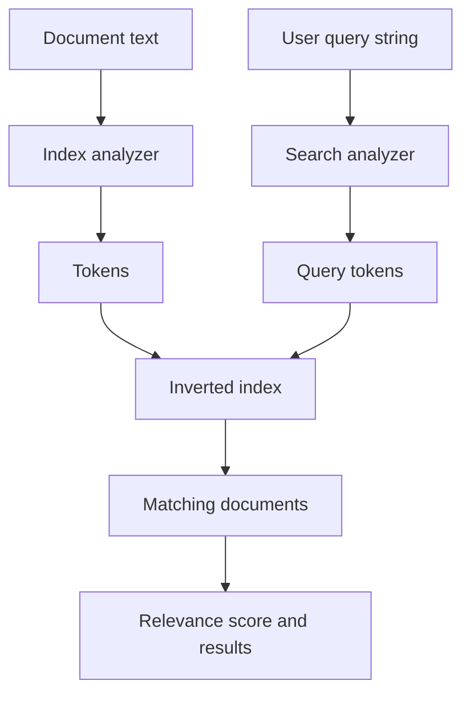

# Match Query and Query String Analysis

In Elasticsearch full-text search, the `match` query is the fundamental query for searching content in analyzed fields such as `text`. When receiving a query string, Elasticsearch applies the appropriate analyzer to turn the string into tokens, then finds documents containing the matching tokens in the inverted index.

The important point is that `match` does not simply compare two literal strings. The string entered by the user may be normalized, lowercased, tokenized, stripped of stop words, or transformed via stemming/synonyms depending on the analyzer. The result depends on both the analyzer used when indexing documents and the analyzer used when analyzing the query string.

Spring Data Elasticsearch can build a `match` query using `NativeQuery` or declare it via repository `@Query`. When full-text search is needed, it is necessary to understand query string analysis, AND/OR operators, `minimum_should_match`, fuzziness, and field mapping to avoid results that are too broad or too narrow.

## 1. Full-Text Search and the Inverted Index

Elasticsearch uses Lucene for indexing and searching. For a `text` field, data is typically analyzed into tokens instead of being stored as a single value for literal matching.

Example document:

```json
{
  "title": "Spring Data Elasticsearch in Practice",
  "description": "Build search applications with Java and Spring"
}
```

With the standard analyzer, the title can be analyzed into tokens approximately like:

```text
spring
data
elasticsearch
in
practice
```

The inverted index stores the mapping from each token to the documents containing that token. When a user searches for `spring data`, Elasticsearch analyzes the query string into tokens and looks up the inverted index to identify matching documents.



The two analysis steps are commonly referred to as:

- **Index-time analysis:** the analyzer processes the field content when the document is indexed.
- **Search-time analysis:** the analyzer processes the query string when a search is executed.

For matching to work as expected, both sides need compatible semantics. If the index-time analyzer produces tokens different from the search-time analyzer, users may fail to find content even when the strings look visually similar.

## 2. Declaring Text Fields and Analyzers

Suppose an application manages articles:

```java
import org.springframework.data.annotation.Id;
import org.springframework.data.elasticsearch.annotations.Document;
import org.springframework.data.elasticsearch.annotations.Field;
import org.springframework.data.elasticsearch.annotations.FieldType;

@Document(indexName = "articles")
public class Article {

    @Id
    private String id;

    @Field(type = FieldType.Text)
    private String title;

    @Field(type = FieldType.Text)
    private String content;

    @Field(type = FieldType.Keyword)
    private String status;

    protected Article() {
    }

    // Constructors and accessors omitted for brevity.
}
```

`title` and `content` are `text` fields, suitable for full-text search. `status` is `keyword`, suitable for exact filtering such as `PUBLISHED` or `DRAFT`.

The mapping can be declared explicitly:

```json
PUT /articles
{
  "mappings": {
    "properties": {
      "title": {
        "type": "text",
        "analyzer": "standard",
        "search_analyzer": "standard"
      },
      "content": {
        "type": "text",
        "analyzer": "standard",
        "search_analyzer": "standard"
      },
      "status": {
        "type": "keyword"
      }
    }
  }
}
```

If no specific analyzer is declared, a text field usually uses Elasticsearch's default analyzer. Explicit declarations make the mapping easier to read and clarify the analysis contract between indexing and searching.

### 2.1 What components make up an analyzer?

An analyzer typically consists of:

1. **Character filters:** transform the text before tokenization, for example removing or replacing certain characters.
2. **Tokenizer:** splits the text into tokens.
3. **Token filters:** transform tokens, for example lowercasing, stop words, stemming, or synonyms.

For instance, the standard analyzer typically splits words on word boundaries and normalizes to lowercase. Another analyzer may add a stop filter or stemmer to reduce word variants to a canonical form.

### 2.2 `analyzer` and `search_analyzer`

- `analyzer` specifies the analyzer used when indexing the field value.
- `search_analyzer` specifies the analyzer used when analyzing the query string for the field.

The two analyzers can be the same or different. For example, indexing might use edge n-grams to support autocomplete, while searching uses a regular analyzer to avoid splitting the query into too many tokens. With a regular match query, Elasticsearch uses the search analyzer configured for the field; the analyzer can be overridden in the query if there is a clear reason.

Changing the index-time analyzer does not automatically re-analyze already indexed tokens. If you want to change how existing data is tokenized, you need to create a new index and reindex the data. Some search-time changes can affect new queries without reindexing, but compatibility with existing tokens must be verified.

## 3. Basic Match Query

A `match` query takes a field name and a search string:

```json
GET /articles/_search
{
  "query": {
    "match": {
      "title": "spring data"
    }
  }
}
```

Elasticsearch analyzes the string `spring data` using the search analyzer of the `title` field, then finds documents containing matching tokens. This query is commonly used for `text` fields.

You can explicitly declare `query` inside an object:

```json
GET /articles/_search
{
  "query": {
    "match": {
      "title": {
        "query": "spring data"
      }
    }
  }
}
```

The object form allows adding operator, analyzer, fuzziness, `minimum_should_match`, and other options.

### 3.1 Match query is not exact string equality

Suppose a document has the title `Spring Data Elasticsearch in Practice`. A `match` query with `spring data` can find the document even though the query string does not match the entire title.

If the requirement is to match an exact code or categorical value, use a `keyword` field and a `term` query. If the requirement is to search text content, `match` on a `text` field is usually more appropriate.

### 3.2 Match query and relevance

`match` is a scoring query. Matching documents can receive different `_score` values based on relevance and query structure. When no explicit sort is specified, results are typically ordered by descending score.

The score is not a probability. You should not interpret `_score = 2.0` as "2x accuracy" or compare scores across different queries as if they were on the same absolute scale.

## 4. OR and AND Operators

When a query string is analyzed into multiple tokens, `match` needs to determine which tokens a document must contain.

### 4.1 Default OR

By default, `match` uses the `OR` operator. With the query `spring data`, a document can match if it contains `spring` or `data` after analysis.

```json
GET /articles/_search
{
  "query": {
    "match": {
      "title": {
        "query": "spring data",
        "operator": "or"
      }
    }
  }
}
```

OR generally increases recall: more documents have a chance to be returned. However, results can be overly broad if the query string contains many common words.

### 4.2 AND

If you want a document to contain all analyzed tokens, use `operator: "and"`:

```json
GET /articles/_search
{
  "query": {
    "match": {
      "title": {
        "query": "spring data",
        "operator": "and"
      }
    }
  }
}
```

AND generally reduces the number of results and tightens the condition. However, it does not require tokens to be adjacent or in exact order. If a phrase must appear consecutively, consider `match_phrase`.

### 4.3 Comparing OR, AND, and phrase

| Query type | Match condition | When to use |
|---|---|---|
| `match` default OR | One or more matching tokens | Broad search, prioritizing recall |
| `match` with AND | All matching tokens, not necessarily adjacent | Stricter search across terms |
| `match_phrase` | Tokens match in phrase order/position | Need exact phrases or word order |

Example query `spring data`:

- Document `Spring applications with data search` can match AND because it contains both tokens, even though they are far apart.
- Document `Spring Data Elasticsearch` can match phrase because the tokens are adjacent and in order.

## 5. `minimum_should_match`

`minimum_should_match` lets you specify the minimum number or percentage of should clauses/tokens that must match. This is a more flexible option than choosing only OR or AND.

Example query with four tokens:

```json
GET /articles/_search
{
  "query": {
    "match": {
      "content": {
        "query": "spring data elasticsearch java",
        "minimum_should_match": "75%"
      }
    }
  }
}
```

With four generated clauses/tokens, 75% requires at least three clauses to match. The actual value depends on the number of clauses after analyzer processing, not necessarily the number of words the user originally typed.

An integer can be used:

```json
"minimum_should_match": 2
```

Or a conditional expression based on the number of clauses, for example:

```json
"minimum_should_match": "2<-25% 9<-3"
```

Advanced expressions are useful when the number of query tokens varies widely, but you need to understand the syntax and test with real query lengths. For simple search APIs, a percentage or integer is easier to predict.

## 6. How Does Query String Analysis Happen?

Suppose the user enters:

```text
The QUICK brown foxes
```

With an analyzer that has a lowercase and stop filter, the string might be converted into tokens:

```text
quick
brown
foxes
```

If an appropriate stemmer is configured, `foxes` may be reduced to its root form according to the configured language and stemmer. This is only an illustrative example; actual tokens must be confirmed using `_analyze` on the index and analyzer in use.

A match query does not inherently know the linguistic meaning of a string. It invokes the configured analyzer. If the analyzer lacks stemming, synonyms, or an appropriate tokenizer, the query only searches for the tokens produced by the analyzer.

### 6.1 Inspecting tokens with `_analyze`

Elasticsearch provides the Analyze API to see how a string is turned into tokens:

```http
POST /articles/_analyze
{
  "field": "title",
  "text": "Spring Data Elasticsearch in Practice"
}
```

Or specify an analyzer:

```http
POST /articles/_analyze
{
  "analyzer": "standard",
  "text": "The QUICK brown foxes"
}
```

The result returns a list of tokens along with information such as position and offset. This is an essential tool when a query does not return the expected results.

### 6.2 Index analyzer and search analyzer must be compatible

Example mapping:

```json
PUT /articles
{
  "settings": {
    "analysis": {
      "analyzer": {
        "content_index": {
          "type": "custom",
          "tokenizer": "standard",
          "filter": ["lowercase", "english_stop", "porter_stem"]
        },
        "content_search": {
          "type": "custom",
          "tokenizer": "standard",
          "filter": ["lowercase", "english_stop", "porter_stem"]
        }
      },
      "filter": {
        "english_stop": {
          "type": "stop",
          "stopwords": "_english_"
        }
      }
    }
  },
  "mappings": {
    "properties": {
      "content": {
        "type": "text",
        "analyzer": "content_index",
        "search_analyzer": "content_search"
      }
    }
  }
}
```

Both analyzers in the example use the same pipeline. In another design, the index analyzer might use n-grams to support autocomplete while the search analyzer uses a standard tokenizer. What matters is that tokens from the query must be able to match how tokens are stored in the inverted index.

Note that the analyzer, tokenizer, and token filters must exist in the corresponding Elasticsearch version/plugins. When declaring a custom analyzer, create a new index if you need to change the index-time analysis structure of existing data.

### 6.3 Language and word segmentation

The default analyzer is not necessarily suitable for every language. For languages with complex word segmentation rules or compound words, the standard analyzer may produce tokens that do not match search expectations.

For Vietnamese content, you should verify how the tokenizer segments words in practice and consider a plugin or custom analysis appropriate for your deployed Elasticsearch version. Do not assume whitespace always corresponds to meaningful word boundaries in every language. Use `_analyze` with representative query sentences and test both index-time and search-time behavior.

## 7. The analyzer Option in a Match Query

You can specify a separate analyzer in the query:

```json
GET /articles/_search
{
  "query": {
    "match": {
      "content": {
        "query": "Spring Data",
        "analyzer": "standard"
      }
    }
  }
}
```

If omitted, Elasticsearch uses the field's search analyzer (or the default analyzer according to the mapping). Only override the analyzer when there is a clear reason, because an analyzer incompatible with index-time analysis can cause results to be missed.

## 8. Fuzziness: Typo Tolerance

Users may make spelling mistakes. `fuzziness` allows a match query to find terms similar to the query term based on Levenshtein edit distance (within Elasticsearch's limits).

Example:

```json
GET /articles/_search
{
  "query": {
    "match": {
      "title": {
        "query": "elastisearch",
        "fuzziness": "AUTO"
      }
    }
  }
}
```

The query can find the term `elasticsearch` even if the user omitted a character. `AUTO` selects the fuzziness threshold based on term length; you can explicitly specify an edit distance of `0`, `1`, or `2` depending on Elasticsearch limits.

### 8.1 `prefix_length`

`prefix_length` specifies the number of leading characters that must match exactly before fuzzy expansion is applied:

```json
"prefix_length": 2
```

Increasing prefix length can reduce the number of variants considered and cut down on overly distant false positives, though it also reduces the ability to correct typos at the beginning of a word.

### 8.2 `max_expansions`

`max_expansions` limits the number of variant terms expanded:

```json
"max_expansions": 50
```

A large value can increase recall but makes the query more resource-intensive. Set a reasonable limit and measure on real data.

### 8.3 `fuzzy_transpositions`

This option controls whether swapping two adjacent characters counts as a single edit in fuzzy matching:

```json
"fuzzy_transpositions": true
```

For example, a user types `teh` instead of `the`. Allowing transpositions can help find the right word when characters are swapped.

### 8.4 When should fuzziness not be enabled?

Fuzziness is useful for free-form keywords, but it is not suitable for every field. You should not enable it by default for:

- Identifiers, SKUs, emails, or contract codes that require exact matching.
- Fields with short values, where a single edit can drastically change meaning.
- Queries with many tokens that require high precision.
- Queries where fuzzy expansion generates too many candidates.

For identifiers, `keyword` and exact match should generally be used. For names or titles, bounded fuzziness can be considered after measuring result quality.

## 9. `zero_terms_query` and Stop Words

An analyzer may remove certain common words (stop words). If the entire query string consists only of stop words, analysis may leave zero tokens to search for.

`zero_terms_query` controls behavior when the analyzer produces zero tokens:

```json
GET /articles/_search
{
  "query": {
    "match": {
      "content": {
        "query": "the and of",
        "zero_terms_query": "none"
      }
    }
  }
}
```

Common options:

- `none`: returns no documents (common default behavior).
- `all`: treats the query as match-all and can return every document within the index scope.

`all` should be used with caution. If a query containing only stop words turns into a match-all, the search endpoint may return far too much data. Enable it only when product semantics genuinely call for it and clear pagination/scope limits are in place.

## 10. `lenient` and Mismatched Data Types

`lenient` allows a match query to ignore certain type conversion errors in supported cases:

```json
"lenient": true
```

This option can be helpful when querying across fields with heterogeneous types or when users enter values that cannot be parsed according to the mapping. However, it can mask data errors or mapping design flaws. Do not use `lenient` as a fix for a broken mapping; standardize data types and target the intended search fields.

## 11. Combining match with filter in a bool Query

A product search often combines full-text search with exact filter conditions:

```json
GET /articles/_search
{
  "query": {
    "bool": {
      "must": [
        {
          "match": {
            "content": {
              "query": "spring data elasticsearch",
              "operator": "and"
            }
          }
        }
      ],
      "filter": [
        { "term": { "status": "PUBLISHED" } }
      ]
    }
  }
}
```

In the example:

- `must` holds the match query and can contribute to the relevance score.
- `filter` requires status to be strictly `PUBLISHED` without calculating a score.

Separating full-text relevance from structural filters makes query intent clear. Conditions such as status, category, tenant, or date ranges are typically suited to filter when they do not need to affect the score.

## 12. Matching Across Multiple Fields with multi_match

If a query string needs to be searched across multiple fields, `multi_match` can be used:

```json
GET /articles/_search
{
  "query": {
    "multi_match": {
      "query": "spring data",
      "fields": ["title^3", "content"],
      "type": "best_fields"
    }
  }
}
```

`title^3` boosts the weight of the title field relative to content. `best_fields` is generally appropriate when a strong match in one field is an important signal. Other multi_match types such as `most_fields`, `cross_fields`, `phrase`, or `bool_prefix` have their own semantics; choose based on how data is analyzed and how users search.

`multi_match` also analyzes the query string according to each field's analyzer or corresponding configuration. If fields use different analyzers, tokenization and scoring results should be verified.

## 13. Match Query and match_phrase

`match_phrase` is used when token position and order matter:

```json
GET /articles/_search
{
  "query": {
    "match_phrase": {
      "title": {
        "query": "spring data",
        "slop": 1
      }
    }
  }
}
```

`slop` allows a certain amount of positional shift/flexibility between tokens. A value of 0 requires the phrase to match positions in order; increasing slop allows gaps or certain positional rearrangements according to phrase query semantics.

Comparison:

- `match`: searches for tokens using operator/boolean semantics.
- `match_phrase`: searches for a sequence of tokens by position and order.
- `term`: matches an exact term without analyzing the query string like match.

Do not use `match_phrase` for every query because it can be too strict and hurt recall. Conversely, using `match` with OR can be too broad when the user expects a specific phrase.

## 14. Using Match Query in Spring Data Elasticsearch

With Spring Data Elasticsearch 5.x using the Elasticsearch Java Client, a match query can be built with `NativeQuery`:

```java
import org.springframework.data.elasticsearch.client.elc.NativeQuery;
import org.springframework.data.elasticsearch.core.query.Query;

Query query = NativeQuery.builder()
    .withQuery(q -> q.match(m -> m
        .field("title")
        .query("spring data")
    ))
    .build();
```

Execute via `ElasticsearchOperations`:

```java
import org.springframework.data.elasticsearch.core.ElasticsearchOperations;
import org.springframework.data.elasticsearch.core.SearchHits;

public class ArticleSearchService {

    private final ElasticsearchOperations operations;

    public ArticleSearchService(ElasticsearchOperations operations) {
        this.operations = operations;
    }

    public SearchHits<Article> searchTitle(String text) {
        Query query = NativeQuery.builder()
            .withQuery(q -> q.match(m -> m
                .field("title")
                .query(text)
            ))
            .build();

        return operations.search(query, Article.class);
    }
}
```

`SearchHits<Article>` provides search results along with metadata such as total hits and score. If only entities are needed, you can map each `SearchHit<Article>` via `getContent()`.

### 14.1 Setting the AND operator in Java

```java
import co.elastic.clients.elasticsearch._types.query_dsl.Operator;

Query query = NativeQuery.builder()
    .withQuery(q -> q.match(m -> m
        .field("title")
        .query("spring data")
        .operator(Operator.And)
    ))
    .build();
```

Here, every token produced from the query string must match under AND semantics. This is still not a phrase query; token order is not required to be contiguous.

### 14.2 Setting minimum_should_match and fuzziness

```java
Query query = NativeQuery.builder()
    .withQuery(q -> q.match(m -> m
        .field("content")
        .query("spring data elasticsearch java")
        .minimumShouldMatch("75%")
        .fuzziness("AUTO")
        .prefixLength(1)
        .maxExpansions(50)
    ))
    .build();
```

This example combines a minimum token percentage with fuzzy matching. They should not always be used together; fuzziness increases the number of candidate terms and `minimum_should_match` changes query strictness. Evaluate relevance and latency on real data.

### 14.3 Specifying an analyzer in Java

```java
Query query = NativeQuery.builder()
    .withQuery(q -> q.match(m -> m
        .field("content")
        .query("Spring Data")
        .analyzer("standard")
    ))
    .build();
```

Setting an analyzer in the query should only be done when you want to override the search analyzer configured for the field. Without a specific reason, letting the mapping manage the search analyzer keeps queries more consistent.

### 14.4 Multi-match in Java

```java
Query query = NativeQuery.builder()
    .withQuery(q -> q.multiMatch(m -> m
        .query("spring data")
        .fields("title^3", "content")
    ))
    .build();
```

This example searches both title and content while boosting title. Specific builders depend on the Elasticsearch Java Client version used by Spring Data; check the matching Javadoc if method names or enum types differ.

## 15. Using `@Query` in a Repository

For stable queries that do not need dynamic construction, Query DSL JSON can be declared in `@Query`:

```java
import java.util.List;

import org.springframework.data.elasticsearch.annotations.Query;
import org.springframework.data.elasticsearch.repository.ElasticsearchRepository;

public interface ArticleRepository
        extends ElasticsearchRepository<Article, String> {

    @Query("{\"match\": {\"title\": {\"query\": \"?0\", \"operator\": \"and\"}}}")
    List<Article> findByTitleAllTerms(String text);
}
```

The placeholder `?0` references the first parameter via Spring Data Elasticsearch's query annotation binding mechanism. Verify how binding works in your version and avoid concatenating raw input strings into JSON queries. With multiple dynamic options such as analyzer, fuzziness, or minimum_should_match, `NativeQuery` is usually easier to read and control.

## 16. When to Use match, term, match_phrase, or query_string?

These queries have similar names but different semantics:

| Query | Analyzes query string? | Purpose |
|---|---|---|
| `match` | Yes | Full-text search by tokens and operator |
| `match_phrase` | Yes | Full-text search by token order/position |
| `term` | Does not analyze query string via analyzer | Exact term match, usually on keyword |
| `terms` | Does not analyze each value like match | Match one of several exact terms |
| `query_string` | Has a query syntax parser | Advanced query with operators and field syntax |
| `simple_query_string` | Has a limited syntax parser, friendlier to invalid input | Search box supporting user operators |

For typical user search input, `match` or `multi_match` is usually the safe, controllable choice. `query_string` has powerful syntax, but users may accidentally or intentionally enter query control characters; you must understand the parser and handle errors. `simple_query_string` ignores some malformed syntax and is often more suitable for search boxes that support operators.

## 17. Debugging When a match Query Does Not Return Expected Results

When a query returns empty or too many documents, do not just randomly flip operators. Check step by step:

1. Confirm whether the field has a `text` or `keyword` mapping.
2. Check the field's `analyzer` and `search_analyzer` with `GET /index/_mapping`.
3. Use `_analyze` to inspect tokens at index time and search time.
4. Run `match` with the default OR operator, then try AND to understand result scope.
5. Check stop words and `zero_terms_query`.
6. If using fuzziness, check prefix length, max expansions, and token length.
7. Check whether the query combines filters that exclude documents.
8. Use `_explain` or the profile API when you need to understand score and query cost.

Example mapping check:

```http
GET /articles/_mapping
```

Token check:

```http
POST /articles/_analyze
{
  "field": "content",
  "text": "Spring Data Elasticsearch"
}
```

Inspect a specific document:

```http
GET /articles/_doc/article-1001
```

Inspect why a document matched or did not match:

```http
GET /articles/_explain/article-1001
{
  "query": {
    "match": {
      "content": {
        "query": "spring data",
        "operator": "and"
      }
    }
  }
}
```

`_explain` is useful for a specific document. The Profile API helps analyze query execution cost, but it adds overhead, so enable it only during investigation.

## 18. Common Mistakes

### 18.1 Using `term` for text content

`term` does not analyze the query string like match. If a field is `text`, a user-entered phrase may not exist as a single term. Use `match` for full-text search.

### 18.2 Assuming match requires all words by default

The default operator is typically OR. If all tokens must match, set `operator: "and"` or use an appropriate `minimum_should_match`.

### 18.3 Confusing AND with phrase

AND requires all tokens to match, but not necessarily adjacently or in order. Use `match_phrase` if position and order matter.

### 18.4 Not checking the analyzer

Two visually similar strings may produce different tokens due to lowercasing, stemming, stop words, synonyms, or the tokenizer. Use `_analyze` instead of guessing from raw strings.

### 18.5 Enabling fuzziness on every field

Fuzziness on identifiers or short fields can return unwanted results and increase cost. Only use it on free-text fields when the product needs typo tolerance.

### 18.6 Using `minimum_should_match` without considering post-analysis tokens

The number of tokens may be smaller than the number of words entered by the user due to stop words or the analyzer. Percentages should be evaluated based on actual tokens.

### 18.7 Changing the index-time analyzer without reindexing

Updating the analyzer in the mapping does not regenerate already indexed tokens. If you change how historical data is analyzed, you must create a new index and reindex.

### 18.8 Using query_string for a search box without controlling syntax

The query parser has its own operators and syntax. If a user enters special characters, the query may fail or have unexpected semantics. Use `match`/`multi_match` for free-form input, or choose `simple_query_string` with controlled configuration.

## 19. Design Principles for Full-Text Search

- Use `text` for content that needs analysis and full-text search.
- Use `keyword` for codes, statuses, and values requiring exact matching.
- Design analyzers around the actual language and data; verify with `_analyze`.
- Ensure index analyzer and search analyzer are compatible.
- Start with `match` defaulting to OR; switch to AND or `minimum_should_match` when stricter matching is needed.
- Use `match_phrase` when token order/position matters.
- Enable fuzziness only when typo tolerance is needed, and limit expansions.
- Handle stop words and zero-token queries intentionally.
- Separate full-text clauses from structural filters using `bool.must` and `bool.filter`.
- Use `multi_match` when searching across multiple fields and tune boosts by importance.
- Use `NativeQuery` for dynamic/advanced queries; use `@Query` for simple, stable queries.
- Reindex when changing index-time analyzers or stored token structure.

## 20. Summary

The `match` query is the foundation of full-text search in Elasticsearch. It analyzes the query string using the search analyzer and looks up matching tokens in the inverted index. Therefore, results depend on field mapping, index-time analyzer, search-time analyzer, and options such as OR/AND, `minimum_should_match`, fuzziness, `prefix_length`, `max_expansions`, and `zero_terms_query`.

In Spring Data Elasticsearch, `NativeQuery` helps construct match queries via the Java Client and execute them through `ElasticsearchOperations`; `@Query` fits stable JSON queries. Distinguish match from exact `term` and phrase queries, inspect tokens with `_analyze`, combine structural filters in a bool query, and enable fuzzy matching only when the business case requires it. Designing the right analyzer for the language and data is essential for search to return meaningful results.

## References

- [Elasticsearch — Match query](https://www.elastic.co/guide/en/elasticsearch/reference/current/query-dsl-match-query.html)
- [Elasticsearch — Text analysis](https://www.elastic.co/guide/en/elasticsearch/reference/current/analysis.html)
- [Elasticsearch — Analyze API](https://www.elastic.co/guide/en/elasticsearch/reference/current/indices-analyze.html)
- [Elasticsearch — Fuzzy query behavior](https://www.elastic.co/guide/en/elasticsearch/reference/current/query-dsl-fuzzy-query.html)
- [Spring Data Elasticsearch Reference — Search Operations](https://docs.spring.io/spring-data/elasticsearch/reference/elasticsearch/template.html)
