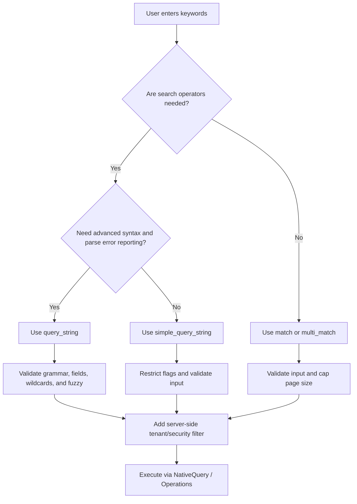

# Query String, Simple Query String, and Input Syntax Boundaries

In full-text search features, users sometimes want to enter an expression containing operators instead of just a few keywords. Elasticsearch provides two queries for this purpose: **`query_string`** and **`simple_query_string`**. Spring Data Elasticsearch can invoke both through `NativeQuery` and `ElasticsearchOperations`.

Both queries have their own parser. `query_string` supports rich syntax and throws an error when an expression is syntactically invalid. `simple_query_string` supports a simpler set of syntax and ignores certain invalid syntax fragments rather than failing the whole request. Both require bounding inputs, searched fields, and resource-intensive operators.

If a product only needs an ordinary keyword search box, **`match` is usually the better choice**. Expose query string syntax only when users genuinely need that feature, rules are clearly defined, and inputs are controlled server-side.

## 1. Three Common Text Search Approaches

Suppose the `products` index has fields:

| Field | Mapping | Purpose |
|---|---|---|
| `name` | `text` | Search by product name. |
| `description` | `text` | Search inside description. |
| `sku` | `keyword` | Exact product code lookup. |
| `category` | `keyword` | Exact category filtering. |
| `tenantId` | `keyword` | Restrict data by tenant. |

Three queries serve different goals:

| Query | Characteristics | Suitable when |
|---|---|---|
| `match` | Analyzes input as search text; does not interpret query string operators | Standard search boxes, searching words/phrases in content. |
| `query_string` | Rich syntax parser; invalid expressions can fail the request | Advanced search features for users who know the syntax. |
| `simple_query_string` | Simpler syntax subset; ignores certain invalid syntax parts | Search boxes allowing basic operators while staying fault-tolerant. |

Example with the same input:

```text
wireless AND headphones
```

- With `match`, this is analyzed as text; the word `AND` may be treated as a token or stripped as a stop word depending on configuration.
- With `query_string`, `AND` is an uppercase Boolean operator.
- With `simple_query_string`, operators are supported according to the simple syntax and enabled flags.

Do not switch `match` to `query_string` merely so users can type parentheses or wildcards before clearly defining how the product supports that syntax.

## 2. Mappings and Analyzers Are the Foundation of Full-Text Queries

`query_string` and `simple_query_string` typically search `text` fields. Analyzers process content at index time and search time, such as lowercasing, tokenizing, or applying token filters. Therefore, query syntax does not bypass mappings.

Example entity:

```java
import org.springframework.data.annotation.Id;
import org.springframework.data.elasticsearch.annotations.Document;
import org.springframework.data.elasticsearch.annotations.Field;
import org.springframework.data.elasticsearch.annotations.FieldType;

@Document(indexName = "products")
public class ProductDocument {

    @Id
    private String id;

    @Field(type = FieldType.Text, analyzer = "standard")
    private String name;

    @Field(type = FieldType.Text, analyzer = "standard")
    private String description;

    @Field(type = FieldType.Keyword)
    private String sku;

    @Field(type = FieldType.Keyword)
    private String category;

    @Field(type = FieldType.Keyword)
    private String tenantId;

    protected ProductDocument() {
    }

    public String getId() {
        return id;
    }

    public String getName() {
        return name;
    }
}
```

`name` and `description` are declared as `text` for full-text search. `sku`, `category`, and `tenantId` are `keyword` because they are used as exact values.

If you need both full-text search and exact matching on a string, declare a multi-field, such as `name` as `text` and `name.raw` as `keyword`. However, query string does not replace `term` queries for identifiers or exact filters. Use the query matching each field's semantics.

The index's actual mapping is what Elasticsearch uses. If the index already exists with an old mapping, editing Java annotations does not automatically alter existing field types. When queries behave unexpectedly, check `GET products/_mapping` and analyzers before changing query syntax.

## 3. Basic Syntax of `query_string`

`query_string` lets users express search criteria using a mini-language. Common syntax elements:

| Syntax | Meaning | Example |
|---|---|---|
| `AND`, `OR`, `NOT` | Boolean operators | `wireless AND headphones` |
| `+` | Mandatory term | `+wireless headphones` |
| `-` | Exclude term | `wireless -used` |
| `"..."` | Phrase | `"wireless headphones"` |
| `(...)` | Group conditions | `(wireless OR bluetooth) AND headphones` |
| `*`, `?` | Wildcard | `head*`, `bluetooth?` |
| `~` | Fuzzy or proximity depending on position | `headphons~1` |
| `^` | Boost an expression | `name:wireless^2` |
| `field:value` | Target a field | `name:wireless` |
| `[a TO b]` / `{a TO b}` | Inclusive/exclusive ranges | `price:[50 TO 300]` |

Example:

```text
(wireless OR bluetooth) headphones -refurbished
```

This expression requires either `wireless` or `bluetooth`, along with `headphones`, and excludes results containing `refurbished` per query string semantics.

### 3.1. Fields and boosts

You can specify fields inside the expression:

```text
name:wireless OR description:bluetooth
```

You can boost a field's weight:

```text
name:wireless^3 description:wireless
```

If no field is specified in the expression, the query's `fields` or `default_field` determines the default fields searched. In applications, configure an explicit field list and do not let users arbitrarily expand search scope beyond intent.

Note: the `fields` list sets default fields, yet the parser's `field:value` syntax can allow users to target other fields. If the product does not allow field selectors, restrict that syntax using parser/flags or validate expressions before sending. Do not treat default `fields` as an authorization boundary.

### 3.2. Default operator

If an expression does not specify an operator, `query_string` defaults to `OR` between terms. You can set `default_operator` to `AND` to require all terms to match.

Example:

```json
GET products/_search
{
  "query": {
    "query_string": {
      "query": "wireless headphones",
      "fields": ["name", "description"],
      "default_operator": "AND"
    }
  }
}
```

With `AND`, documents must satisfy both terms after analysis. Explicit Boolean operators written inside the expression remain part of the syntax interpreted by the parser.

## 4. `query_string` Is Strict with Invalid Syntax

`query_string` supports many features, but its parser can reject syntactically invalid expressions. For example, a user types an opening parenthesis without closing it, or an unclosed quote. Elasticsearch can return a parse error instead of a hit list.

This works well for advanced search when the UI:

- Documents syntax clearly.
- Displays understandable parse errors.
- Highlights the position or part of the expression to fix if the application pre-parses.
- Does not silently alter invalid expressions into a different query.

Do not catch all query errors and return an empty list. That prevents users from distinguishing "no matching results" from "invalid search expression". Translate parser errors into proper validation/search syntax errors at the API layer.

## 5. Special Characters and Escaping in `query_string`

Query string has characters with syntactic meaning. Common special characters include:

```text
+ - = && || > < ! ( ) { } [ ] ^ " ~ * ? : \ /
```

If a special character should be treated literally, it must be escaped according to query parser rules. For example, to search for plus signs as part of `C++`, the query string expression needs escaped plus signs:

```text
C\+\+
```

In a Java string literal, backslashes must also be escaped per Java syntax:

```java
String queryText = "C\\+\\+";
```

The runtime value of the Java string contains `C\+\+`. The Java API Client then serializes the value into JSON and handles JSON escaping. The `query_string` parser is the layer that interprets the backslash to treat the plus sign literally.

Do not confuse these layers:

1. Java source needs `\\` to represent one backslash in the runtime string.
2. The JSON serializer encodes backslashes when building the request body.
3. The query parser reads backslashes in the runtime query string to escape syntax characters.

The characters `<` and `>` in query string follow special rules and cannot be escaped in the ordinary way; if you need to search them as literal text, consider another query like `match` or normalize data appropriately.

Do not hand-roll a naive escape helper that only replaces double quotes. Parser syntax has many special characters as well as double-backslash cases. If users just want to search ordinary text, use `match` so they do not have to enter query string syntax.

## 6. `simple_query_string`: Simpler, More Fault-Tolerant Syntax

`simple_query_string` is designed for cases needing a leaner search syntax. It supports a fixed set of operators and ignores certain invalid syntax fragments instead of rejecting the entire request.

Commonly used operators:

| Symbol | Meaning |
|---|---|
| `+` | AND: mandatory term |
| `|` | OR: one of the branches |
| `-` | NOT: exclude term |
| `"..."` | Phrase search |
| `*` | Trailing prefix wildcard on a term |
| `(...)` | Group expressions |
| `~N` | Fuzzy or proximity depending on position |

Example:

```json
GET products/_search
{
  "query": {
    "simple_query_string": {
      "query": "+wireless +(headphones|earbuds) -refurbished",
      "fields": ["name", "description"],
      "default_operator": "AND"
    }
  }
}
```

`simple_query_string` ignores certain invalid syntax rather than throwing a parser error like `query_string`. This is useful for end-user search boxes, though it does not mean the input is validated or that every expression means what the user intended. If part of an expression is ignored, results may be broader or narrower than expected.

### 6.1. Restricting operators with flags

`simple_query_string` lets you restrict supported operators using `flags`. For example, if the UI only allows AND, OR, and prefix, enable only the required flags for your Elasticsearch version.

Illustrative DSL example:

```json
GET products/_search
{
  "query": {
    "simple_query_string": {
      "query": "wireless + headphones | earbuds",
      "fields": ["name", "description"],
      "flags": "AND|OR|PREFIX",
      "default_operator": "AND"
    }
  }
}
```

The exact set of flags should match the syntax the product intends to support. Do not enable all operators by default just because the parser offers them. Restricting syntax makes the UI easier to document and shrinks the surface of complex queries.

## 7. Comparing `query_string` and `simple_query_string`

| Criterion | `query_string` | `simple_query_string` |
|---|---|---|
| Goal | Advanced search with rich syntax | Search box with more bounded syntax |
| Syntax | Many operators, field selectors, ranges, wildcards, fuzzy, boost | Simpler operator set, constrainable via flags |
| Invalid syntax | Can return parse errors failing the request | Ignores certain invalid syntax fragments |
| Operator control | Must validate input syntax and query options | Can use `flags` to restrict operators |
| User experience | Suited to users who know the syntax | Often better suited to general search UIs |
| Performance risk | Wildcards, fuzzy, field expansion, and complex queries | Still carries risks from prefix, fuzzy, and overly broad queries |
| Replaces `match`? | Should not be used for plain text search | Unnecessary if `match` already meets needs |

`simple_query_string` is not a security mechanism. It simply has a fault-tolerant parser and a different syntax subset. You must still bound fields, input length, page size, tenant filters, and query cost.

## 8. Using `NativeQuery` with `query_string`

Spring Data Elasticsearch lets you build Query DSL with Elasticsearch Java API Client builders through `NativeQuery`. User input goes into the `query` property, while default fields and operators are configured by the application.

Example service:

```java
import co.elastic.clients.elasticsearch._types.FieldValue;
import co.elastic.clients.elasticsearch._types.query_dsl.Operator;
import org.springframework.data.domain.PageRequest;
import org.springframework.data.elasticsearch.client.elc.NativeQuery;
import org.springframework.data.elasticsearch.core.ElasticsearchOperations;
import org.springframework.data.elasticsearch.core.SearchHits;
import org.springframework.data.elasticsearch.core.query.Query;
import org.springframework.stereotype.Service;

@Service
public class AdvancedProductSearchService {

    private final ElasticsearchOperations operations;

    public AdvancedProductSearchService(ElasticsearchOperations operations) {
        this.operations = operations;
    }

    public SearchHits<ProductDocument> search(
            String expression,
            String authenticatedTenantId) {

        Query query = NativeQuery.builder()
            .withQuery(q -> q
                .bool(b -> b
                    .must(m -> m
                        .queryString(qs -> qs
                            .query(expression)
                            .fields("name", "description")
                            .defaultOperator(Operator.And)
                            .allowLeadingWildcard(false)
                        )
                    )
                    .filter(f -> f
                        .term(term -> term
                            .field("tenantId")
                            .value(FieldValue.of(authenticatedTenantId))
                        )
                    )
                )
            )
            .withPageable(PageRequest.of(0, 20))
            .build();

        return operations.search(query, ProductDocument.class);
    }
}
```

Key points to note:

- `expression` is the advanced search syntax permitted by the product; it is not literal text like the `match` argument.
- `fields` sets the default fields to search.
- `defaultOperator(Operator.And)` changes the default operator between terms.
- `allowLeadingWildcard(false)` blocks leading wildcards on terms via the query option.
- The tenant filter comes from the authenticated context, not from user expressions.
- `PageRequest` caps the number of returned hits.

If the UI does not support advanced syntax, use `match` instead of `queryString`. This snippet illustrates an advanced-search endpoint; before shipping, validate expression length, field selectors, and permitted operators.

## 9. Using `NativeQuery` with `simple_query_string`

When you want to give users a few basic operators with better tolerance for syntax mistakes, use `simpleQueryString`:

```java
import co.elastic.clients.elasticsearch._types.FieldValue;
import co.elastic.clients.elasticsearch._types.query_dsl.Operator;
import org.springframework.data.domain.PageRequest;
import org.springframework.data.elasticsearch.client.elc.NativeQuery;
import org.springframework.data.elasticsearch.core.ElasticsearchOperations;
import org.springframework.data.elasticsearch.core.SearchHits;
import org.springframework.data.elasticsearch.core.query.Query;

public SearchHits<ProductDocument> searchSimply(
        String userExpression,
        String authenticatedTenantId) {

    Query query = NativeQuery.builder()
        .withQuery(q -> q
            .bool(b -> b
                .must(m -> m
                    .simpleQueryString(sqs -> sqs
                        .query(userExpression)
                        .fields("name", "description")
                        .defaultOperator(Operator.And)
                    )
                )
                .filter(f -> f
                    .term(term -> term
                        .field("tenantId")
                        .value(FieldValue.of(authenticatedTenantId))
                    )
                )
            )
        )
        .withPageable(PageRequest.of(0, 20))
        .build();

    return operations.search(query, ProductDocument.class);
}
```

This snippet still places the tenant filter in the main query. `simple_query_string` only changes the parser for the text search portion; it does not replace authorization or data-scoping conditions.

If you need to configure `flags`, use the `flags` API generated by your project's Elasticsearch Java API Client version. Enum types and builder signatures may change across versions; consult current Javadoc. You can control flags in JSON DSL or corresponding builder configuration, keeping them aligned with the operator list documented to users.

## 10. `match` Remains the Default for Ordinary Search Boxes

If users only type:

```text
wireless headphones
```

and do not need `AND`, `OR`, wildcards, or field selectors, using `match` is cleaner:

```java
Query query = NativeQuery.builder()
    .withQuery(q -> q
        .bool(b -> b
            .must(m -> m
                .match(match -> match
                    .field("name")
                    .query(userText)
                )
            )
            .filter(f -> f
                .term(term -> term
                    .field("tenantId")
                    .value(FieldValue.of(authenticatedTenantId))
                )
            )
        )
    )
    .build();
```

`userText` is processed as search text after analyzer rules apply. Characters such as parentheses, plus signs, or quotes do not turn into query string operators because this does not invoke that parser.

Choose queries by product experience:

- Simple search box: `match` or `multi_match`.
- Search box with a few common operators: `simple_query_string` with restricted flags.
- Advanced search with documented syntax and parser error reporting: `query_string`.
- Exact codes, statuses, or categories: `term` on `keyword` fields.

## 11. Restricting Fields and Preventing Users from Controlling Query Structure

Query string can allow `field:value` syntax. This is useful in advanced search, yet it can let users search fields the UI never intended to expose.

Guiding principles:

1. Configure an explicit default field list, such as `name` and `description`.
2. If field selectors are not supported, disable or reject field selector syntax in your product grammar.
3. If field selectors are supported, map fields through an allowlist; never trust arbitrary field names.
4. Never let users target `tenantId`, internal fields, sensitive fields, or technical filter-only fields.
5. Always attach server-side tenant/authorization conditions to the main query.
6. Restrict which indices/aliases the service account can access at the Elasticsearch level.

`fields` in the query only sets the default fields. If the parser allows qualifiers inside the expression, a qualifier can change which field is searched. Hence `fields` does not substitute for syntax restrictions or access control.

## 12. Limiting Wildcards, Fuzzy, and Resource-Intensive Queries

A syntactically valid expression can still be overly expensive. Features to control:

### 12.1. Leading wildcards

Patterns like `*phone` or `?ireless` can scan vast numbers of terms because there is no fixed prefix. `allow_leading_wildcard` should be disabled unless the product truly requires leading wildcards.

Trailing prefix wildcards like `head*` are usually easier to optimize, though cost still depends on term count and index structure. Do not allow every user to submit long or repeated wildcards freely.

### 12.2. Fuzzy queries

Fuzzy search helps tolerate typos, such as `headphons~1`. However, fuzzy expansion can generate many alternative terms. Cap fuzziness, expansion counts, and term lengths per use case. Do not leave unbounded fuzziness open on every field.

### 12.3. Overly broad queries

Expressions containing only wildcards or only negation operators can match huge result sets. Decide whether the product permits queries lacking a mandatory term. You can require at least one alphanumeric term and reject expressions made solely of wildcards or negation symbols.

### 12.4. Too many fields

Searching across many fields increases query clause count. Keep the field list tight, boost purposefully, and respect Elasticsearch clause limits. Never raise cluster limits merely to accept uncontrolled user expressions.

## 13. Application-Layer Input Validation

Parsers do not replace validation. An advanced search endpoint should define clear boundaries:

| Aspect | Recommended control |
|---|---|
| Expression length | Cap based on UI, e.g., max 256 characters; choose threshold per product. |
| Empty expression | Reject or treat as bounded default browse/search. |
| Field selector | Allow only allowlisted fields or disallow the syntax. |
| Wildcard | Disallow leading wildcards; cap wildcard count if supported. |
| Fuzzy | Bound edit distance and expansions. |
| Page size | Enforce server-side ceiling; never accept arbitrary sizes. |
| Sort | Allowlist valid sort fields and directions. |
| Tenant | Take from authenticated principal/security context. |
| Query parse error | Return clear input error; do not disguise as "no results". |

Simple validation example:

```java
private String validateExpression(String expression) {
    if (expression == null || expression.isBlank()) {
        throw new IllegalArgumentException("Search expression is required");
    }

    String normalized = expression.trim();
    if (normalized.length() > 256) {
        throw new IllegalArgumentException("Search expression is too long");
    }

    return normalized;
}
```

The number 256 is just a policy example for one endpoint. Choose limits suited to your UI, language, and query cost. You may also need caps on term count, wildcard count, parenthesis depth, or field selector count when supporting advanced syntax.

Do not try to salvage every invalid expression by stripping characters until the parser accepts it. Silent rewriting can change query semantics. It is better to report an error, or use `simple_query_string` if product UX accepts ignoring invalid syntax parts.

## 14. Error Handling and API Responses

With `query_string`, parse errors from Elasticsearch should be translated into appropriate validation/search syntax responses, such as HTTP 400 with a concise message that does not leak internal cluster details.

With `simple_query_string`, the parser may skip invalid parts so no corresponding exception is thrown. The application still needs to define what empty results mean and whether to show syntax tips.

Distinguish these situations:

- **No results**: valid query, but no matching documents.
- **Invalid syntax**: `query_string` could not parse the expression.
- **Invalid input per product rules**: expression too long, disallowed field, or wildcard limit exceeded.
- **Infrastructure error**: timeout, lost connection, or Elasticsearch server error.
- **Insufficient permissions**: user/service account lacks index access.

Do not return an empty list for all errors, because the frontend will be unable to tell "user found no data" apart from "system is failing".

## 15. Combining Full-Text Queries with Security Filters

Advanced search only controls how content is matched. Tenant isolation, access permissions, and record status must still be enforced by the server.

Example:

```java
Query query = NativeQuery.builder()
    .withQuery(q -> q
        .bool(b -> b
            .must(m -> m
                .simpleQueryString(sqs -> sqs
                    .query(userExpression)
                    .fields("name", "description")
                )
            )
            .filter(f -> f
                .term(term -> term
                    .field("tenantId")
                    .value(FieldValue.of(authenticatedTenantId))
                )
            )
            .filter(f -> f
                .term(term -> term
                    .field("status")
                    .value(FieldValue.of("PUBLISHED"))
                )
            )
        )
    )
    .build();
```

Tenant and status conditions sit inside `bool.filter`, so they restrict both hits and aggregations if the request includes aggregations. Do not let users bypass or override these conditions by typing `OR`, parentheses, or field selectors inside the query string.

If a query includes aggregations, security conditions must reside in the main query. Do not put tenant filters in `post_filter`, because `post_filter` does not restrict aggregations.

## 16. Testing Syntax and Input Boundaries

Test across multiple layers:

### 16.1. Validation unit tests

Test:

- `null`, empty strings, and whitespace-only strings.
- Lengths right at and above the limit.
- Field selectors outside the allowlist.
- Leading wildcards when disallowed.
- Expressions consisting only of operators or wildcards.
- Page sizes exceeding the ceiling.

### 16.2. Parser integration tests

With `query_string`, test both valid and invalid expressions:

```text
wireless AND headphones
"wireless headphones"
(wireless OR bluetooth) AND headphones
name:wireless
"unclosed phrase
wireless AND (headphones
```

With `simple_query_string`, test valid syntax and verify invalid input follows the parser behavior of ignoring invalid parts. Do not assume both queries return identical results for every expression.

### 16.3. Cost and access control tests

- Verify queries with leading wildcards are blocked by policy.
- Confirm the tenant filter is always present in the main query.
- Confirm users cannot access internal fields via field selectors.
- Measure latency on representative data for wildcards/fuzzy and real field counts.
- Confirm page size and sort are bounded server-side.

Unit tests only verify validation and request construction. Integration tests against a compatible Elasticsearch instance verify the actual parser, analyzers, mappings, and results.

## 17. Query Selection Workflow



Implementation steps:

1. Determine whether the search box needs advanced syntax or just free-form keywords.
2. Use `match`/`multi_match` if parser syntax is unnecessary.
3. Use `simple_query_string` if opening only a small operator set and wanting better syntax fault tolerance.
4. Use `query_string` if providing a documented advanced-search grammar with clear error handling.
5. Configure fields, default operator, and wildcard behavior server-side.
6. Validate length, field selectors, wildcards, fuzzy, page size, and sort.
7. Add tenant/security filters from the authenticated context.
8. Test valid syntax, invalid syntax, mappings, and cost on representative data.

## 18. Conclusion

`query_string` and `simple_query_string` allow users to enter search expressions with operators. `query_string` is rich and strict on invalid syntax; `simple_query_string` supports a narrower syntax and ignores certain invalid parts. Both remain governed by mappings/analyzers and can produce expensive queries if wildcards, fuzzy, or too many fields are allowed.

For ordinary search boxes, prefer `match` or `multi_match`. When user syntax is needed, choose `simple_query_string` with restricted flags, or `query_string` for documented advanced search with clear error messages. Always configure fields server-side, control field selectors, bound inputs and query cost, and attach tenant/security filters from the authenticated context.

In Spring Data Elasticsearch, both queries can be built with `NativeQuery` and executed through `ElasticsearchOperations`. This keeps request construction strongly typed in code, though it does not remove the need to control the syntax that the parser interprets from user-supplied text.
