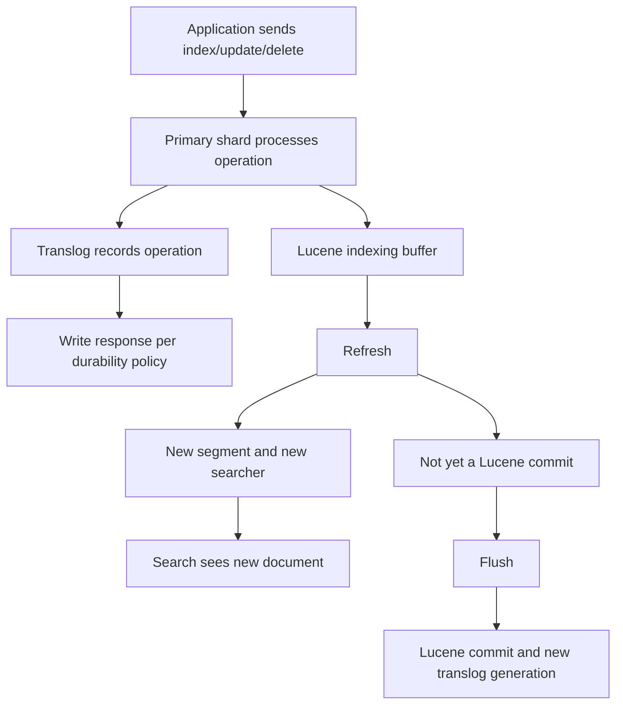

# Near real-time, refresh, flush, and commit in Elasticsearch

Elasticsearch is designed for *near real-time* (NRT) data search. When a document has just been indexed, updated, or deleted successfully, an application may receive an immediate write response, yet a search query might not see that change right away. Changes appear in search results only after the shard is **refreshed**.

Refresh determines when new data becomes searchable. **Flush** serves a different purpose: it instructs Elasticsearch to perform a Lucene commit and start a new translog generation. Commit here refers to an internal Lucene commit, not a relational database transaction commit. Translog, refresh, and flush work together to balance three requirements: write speed, search visibility of new data, and crash recovery.

To operate Elasticsearch and Spring Data Elasticsearch properly, separate three questions:

1. Has Elasticsearch acknowledged the write operation?
2. Has the document appeared in search results yet?
3. Has the data been committed to Lucene, or is the translog still required for recovery?

These three points in time are related, not identical.

## 1. What is near real-time?

In a traditional database, users typically expect a newly written record to be immediately queryable under that DBMS's transaction and isolation model. Elasticsearch is optimized for full-text search across sharded Lucene indices. Rather than reopening a searcher for every single write, Elasticsearch batches changes and periodically refreshes the view used by search queries.

Consequently, a write operation may already have succeeded while searches are still reading a searcher opened prior to the write. When a refresh occurs, a new searcher sees the segments containing the new changes, and subsequent search queries can return that data.

*Near real-time* means data typically becomes searchable after a short delay, usually measured in seconds or less depending on configuration and system load. It does not mean every write is instantaneously visible to every query, nor is it a fixed latency guarantee for individual requests.

### 1.1 General data flow



The diagram shows two paths serving two goals. Refresh updates the view for search. Translog supports recovering operations not yet included in the latest Lucene commit. Flush advances Lucene to a new commit point and rotates the translog.

### 1.2 Why doesn't Elasticsearch refresh after every document?

Refreshing involves creating or publishing new segments and opening a searcher to read them. Refreshing after every single write would create many tiny segments, consuming CPU, memory, file handles, and merge work. That overhead reduces indexing throughput and harms search performance.

Elasticsearch therefore batches multiple changes between refreshes. This approach enables more efficient writes while still providing low-latency search. In return, applications must recognize that write acknowledgment and search visibility are two separate states.

## 2. Underlying components: indexing buffer, segments, and translog

To understand refresh and flush, you need to know how data is organized at the shard level.

### 2.1 Lucene segments

Elasticsearch uses Apache Lucene for indexing and searching on each shard. Lucene organizes indexed data into **segments**. Segments are essentially immutable once created: new data is normally written to new segments, while combining smaller segments into larger ones is performed by the merge process.

A shard can contain multiple segments. When a document is updated, Lucene does not simply modify bytes of the old document in place; the operation is typically represented by indexing a new document and marking the old version invalid for current results. Deletes are likewise recorded by marking deletions. Old data is only physically reclaimed when segments merge.

This explains why segment count and merge activity affect both storage usage and search performance.

### 2.2 Indexing buffer

When a shard receives a write operation, the data is processed through Lucene's indexing path. Part of the new data accumulates in a buffer to build searchable structures. A refresh makes processed changes readable through a new searcher.

Do not treat the indexing buffer as the sole durable storage. It is part of the write path; recovering operations not yet committed by Lucene relies on the translog.

### 2.3 Translog

Each shard has its own transaction log, called the **translog**. The translog records operations such as index, update, and delete. If a node stops unexpectedly before new operations are included in a Lucene commit, Elasticsearch can use the translog to replay necessary operations when the shard recovers.

The translog thus plays a key role in data durability. It also explains why Elasticsearch does not need to perform a Lucene commit after every request to protect acknowledged writes.

The translog is not a queryable datastore replacing Lucene. Search primarily works against segments published via refresh. The translog supports recovery and participates in real-time get; it does not make every just-written operation immediately appear in search results.

### 2.4 Searcher and data snapshot

A searcher operates over a stable view of the segments it has opened. When new segments appear, the current searcher does not automatically change what it sees. Refresh triggers opening a new searcher that includes the new segments.

Because search requests read through a searcher, they only see data published to that searcher at the time the request runs. This is the core mechanism behind near real-time behavior.

## 3. Refresh: making new changes visible in search

**Refresh** makes recent index changes searchable. At the Lucene layer, refresh publishes new segments and updates the searcher so searches can read those segments. Refresh is not synonymous with a durable Lucene commit.

### 3.1 What happens during a refresh?

Suppose the application indexes a document with ID `book-1001` into the `books` index:

1. Elasticsearch receives and processes the operation on the corresponding shard.
2. The operation is written to the translog according to the durability policy.
3. Lucene processes the document content along the indexing path.
4. The current searcher may still not see the new document.
5. When refresh occurs, a new searcher is opened over the published segments.
6. Subsequent search requests can find `book-1001`.

A search request that started before the refresh may still use the older searcher. Therefore, refresh timing and request timing both affect results.

### 3.2 Periodic refresh and `index.refresh_interval`

Elasticsearch automatically refreshes indices periodically. In standard configurations, `index.refresh_interval` defaults to `1s`. This value can be adjusted based on write load and desired search latency.

Check settings:

```http
GET /books/_settings?include_defaults=true
```

Change the refresh interval to 5 seconds:

```http
PUT /books/_settings
{
  "index": {
    "refresh_interval": "5s"
  }
}
```

Increasing the refresh interval can reduce refresh overhead and improve write throughput, especially for continuous indexing workloads. In return, users accept a slightly longer delay before new data appears in search.

You can disable periodic refresh with the value `-1`:

```http
PUT /books/_settings
{
  "index": {
    "refresh_interval": "-1"
  }
}
```

When set to `-1`, the application or operational workflow must explicitly trigger refreshes when data needs to be searchable. Avoid leaving this setting enabled unintentionally on indices serving live queries, because new data will not appear in search until a refresh occurs.

A one-second interval is a common default configuration, not an SLA. System load, shard state, search activity, and Elasticsearch version can affect when a specific change becomes visible.

### 3.3 Manual refresh

You can trigger a refresh on an index via the REST API:

```http
POST /books/_refresh
```

Or refresh multiple indices:

```http
POST /books,authors/_refresh
```

Manual refresh is useful when you need to confirm data is searchable, such as after a bulk import. However, calling refresh after every single document or every normal request can add overhead and generate many small segments.

### 3.4 The `refresh` parameter on writes

Elasticsearch write APIs support a `refresh` parameter with three common choices: `false`, `true`, and `wait_for`.

**`refresh=false`** is the usual default. The request does not trigger a dedicated refresh; data becomes searchable when the next periodic refresh publishes the changes.

**`refresh=true`** forces an immediate refresh on the relevant shards before the request completes. This makes data searchable right after the response, but can incur substantial overhead if used frequently.

**`refresh=wait_for`** makes the request wait until a subsequent refresh makes the change searchable. Under normal conditions, this does not force an immediate refresh; it piggybacks on the upcoming refresh cycle. Therefore, it is generally preferable to `refresh=true` when the application needs read-after-write via search while preserving normal refresh cadence.

Example:

```http
PUT /books/_doc/book-1001?refresh=wait_for
{
  "title": "Spring Data Elasticsearch",
  "author": "Nguyen An"
}
```

Once the request returns successfully, the change has been refreshed and subsequent search requests can see the document. If periodic refresh is disabled with `-1`, a `wait_for` request may have to wait until a refresh is triggered another way. Therefore, configure the refresh interval consistently with how the application uses `wait_for`.

Example forcing an immediate refresh:

```http
PUT /books/_doc/book-1002?refresh=true
{
  "title": "Elasticsearch Fundamentals",
  "author": "Tran Binh"
}
```

Do not use `refresh=true` as a default to make every write appear synchronous. If many concurrent requests continuously force refreshes, the system loses the benefits of batching writes.

### 3.5 Refresh is not durability

Refresh answers the question: *can search see the change yet?* It does not answer: *has the change been committed by Lucene such that the translog is no longer needed for recovery?*

Refresh can create new segments and open a searcher without performing a durable Lucene commit. If a node fails, the translog is still necessary to recover operations not yet included in the latest commit point.

Thus, do not infer that once a document is searchable, all durability steps are complete, or that a flush is required before searching. Search visibility and durability are two independent dimensions.

## 4. Real-time GET vs. near real-time search

Elasticsearch has an easy-to-miss distinction: reading a document by ID and searching for documents do not necessarily share the same visibility delay.

The get-document-by-ID API (`GET /index/_doc/id`) is **real-time** by default. It can return the latest version of a document even when that change has not yet been refreshed for search. In contrast, `_search` uses a searcher and only sees changes after a refresh.

Example writing a document without requesting a refresh:

```http
PUT /books/_doc/book-2001?refresh=false
{
  "title": "Distributed Search",
  "author": "Le Minh"
}
```

Reading by ID immediately afterward:

```http
GET /books/_doc/book-2001
```

Normally, GET by ID can return the new document. However, searching:

```http
GET /books/_search
{
  "query": {
    "term": {
      "author": "Le Minh"
    }
  }
}
```

might not return the document until the next refresh.

This difference also applies to updates and deletes. GET by ID can reflect the new version or deleted state before the searcher is refreshed; search may still see the previous state during the refresh window.

| Read operation | Visibility mechanism | Requires waiting for refresh? |
|---|---|---|
| GET document by `_id` | Real-time get | Usually no |
| `_search` | Reads via refreshed searcher | Yes |
| Search via repository method | Ultimately still a search | Yes |

This is why code can call `save()` then `findById()` and see the data immediately, while calling a derived repository method like `findByAuthor()` may not yet see the newly written document.

## 5. Translog and durability policies

Refresh controls search visibility. To protect operations when a node stops unexpectedly, Elasticsearch uses the translog and a policy for syncing the translog to storage.

### 5.1 Why is the translog needed?

Suppose an operation has been acknowledged but is not yet in a Lucene commit point. If the node loses power or the process crashes, changes held only in memory could be lost. When the shard restarts, Elasticsearch needs a source indicating which operations must be reapplied.

The translog records those operations. During recovery, Elasticsearch uses the latest Lucene commit as a baseline and replays valid remaining operations from the translog. When a flush creates a new commit point, older translog generations no longer needed for recovery can be removed once safety conditions are satisfied.

### 5.2 `index.translog.durability`

Elasticsearch provides the `index.translog.durability` setting to choose when the translog is synced.

**`request`** is the common default mode. Elasticsearch syncs the translog on every write request—such as index, delete, update, or bulk—before acknowledging the request according to durability rules. This prioritizes protecting acknowledged operations against crashes, at the cost of synchronous I/O overhead.

**`async`** allows syncing the translog periodically instead of on every request. The interval is controlled by `index.translog.sync_interval`, typically defaulting to `5s`. This mode can increase write throughput in some workloads, but if a crash occurs, operations acknowledged since the last sync may be lost.

Check configuration:

```http
GET /books/_settings?include_defaults=true
```

Example async configuration:

```http
PUT /books/_settings
{
  "index": {
    "translog": {
      "durability": "async",
      "sync_interval": "5s"
    }
  }
}
```

Only consider `async` when business requirements explicitly accept the potential data-loss window and its impact has been evaluated. Do not use async solely for speed without understanding the risk level.

### 5.3 Write acknowledgment does not mean search visibility

A successful write response indicates Elasticsearch processed the request according to the configured write and durability conditions. In `request` mode, the translog is synced according to policy. However, a successful response does not automatically mean the searcher has refreshed.

Therefore, a document can simultaneously be in the state where:

- The write has been acknowledged.
- Enough information exists in the translog to recover per the durability policy.
- It does not yet appear in `_search` results.
- It is not yet included in the latest Lucene commit point.

This is a normal state in the near real-time model.

## 6. Flush: creating a Lucene commit and rotating the translog

**Flush** is an internal shard-level operation that tells Lucene to perform a commit and Elasticsearch to start a new translog generation. Once the commit completes, Lucene has a new commit point representing the committed index state. Old translog generations can be cleaned up when no longer required for recovery.

Flush is not an operation you need to call for documents to appear in search. That is the job of refresh. A refresh can make a document searchable before the next flush occurs.

### 6.1 What does flush do?

At a high level, flush performs these tasks:

1. Brings pending indexing changes into a state Lucene can commit.
2. Creates a new Lucene commit point.
3. Starts a new translog generation.
4. Allows removing old translog generations once they are no longer needed for recovery.

After a flush, Elasticsearch can recover the shard from a newer Lucene commit and replay fewer operations from the translog.

### 6.2 Calling flush manually

You can trigger a flush on an index:

```http
POST /books/_flush
```

Or flush multiple indices:

```http
POST /books,authors/_flush
```

This is a low-level administrative API. Elasticsearch decides when to flush automatically based on internal conditions such as translog size and shard activity. In most applications, you do not need to call flush after saves, bulks, or refreshes.

Calling flush too frequently can increase I/O overhead and hurt throughput. Only call it manually when there is a specific operational reason and its impact is understood.

### 6.3 Flush is not the same as refresh

The two operations are often confused because both can happen after data is indexed, yet their goals differ:

- Refresh opens a new view for the searcher, making data searchable.
- Flush creates a new Lucene commit point and rotates the translog, supporting durability and recovery management.

If you only need searches to see new documents, consider refresh or `refresh=wait_for`. You do not need to call flush to achieve that goal.

## 7. Commit in Elasticsearch: understanding the scope

The word *commit* can lead developers to think of SQL transaction `COMMIT`. The two concepts are not equivalent.

In the context of flush, commit usually refers to a **Lucene commit**: a commit point identifying the set of segments and metadata forming a committed index state. Elasticsearch manages commit timing via flush and internal mechanisms.

Elasticsearch does not provide a general SQL-style transaction allowing applications to group multiple write operations across multiple documents or indices and atomically commit or roll them back like a relational transaction. Each write operation has its own semantics; refresh and flush do not create business transactions.

### 7.1 Lucene commit and translog recovery

You can picture a shard having:

- A latest Lucene commit point.
- Operations already committed in Lucene.
- A translog containing operations occurring after the commit point that are needed for recovery.

When a flush succeeds, the commit point is updated and a new translog generation begins. During shard recovery, Elasticsearch uses the appropriate commit point and replays necessary operations remaining in the translog.

This does not mean the translog lives only in RAM or that every operation must wait for a flush to be durable. With `request` durability, the translog is synced on every write request; the Lucene commit can happen later.

### 7.2 Commit is not force merge

A shard can accumulate many segments after numerous refreshes and flushes. **Force merge** is an operation instructing Lucene to merge segments, typically to reduce segment count once data changes infrequently or an import finishes.

Force merge is neither a replacement for flush nor a required step after writes. It can consume substantial resources and generate heavy I/O, so it must be used deliberately, especially on indices still receiving writes.

## 8. Comparing refresh, flush, commit, and force merge

| Concept | Primary goal | Impact on search visibility | Role in durability |
|---|---|---|---|
| Refresh | Publish new segments to searcher | Makes changes searchable | Does not replace Lucene commit |
| Translog sync | Sync operation log per durability policy | Does not directly make search see data | Protects operations for recovery |
| Flush | Create Lucene commit and new translog generation | Not the primary mechanism to refresh searcher | Updates commit point, enables cleaning old translog |
| Lucene commit | Establish committed segment state | Not synonymous with refresh API | Provides recovery baseline from Lucene index |
| Force merge | Merge multiple segments | Search continues using reorganized segments | Not a per-write acknowledgment/durability mechanism |

The key point is that refresh and flush solve two different problems. Translog sync and Lucene commit are two distinct layers in the durability story. Do not lump all of them into a single "writing to disk" concept.

## 9. Scenario chain: from save to search

Consider an application request:

```text
repository.save(book)
        |
        v
Elasticsearch processes write operation
        |
        +--> translog is synced per durability policy
        |
        +--> Lucene processes indexing
        |
        v
Write response returned
        |
        v
Search right now may not see the document yet
        |
        v
Periodic refresh or requested refresh
        |
        v
New searcher opened
        |
        v
Subsequent search can see the document
        |
        v
Flush at an appropriate time creates new Lucene commit
```

If the application only calls `findById`, real-time GET can retrieve the new document before refresh. If the application calls `findByAuthor`, that is a search query and must wait for refresh.

If the application needs search immediately after write, there are three main options:

1. Use `refresh=wait_for` so the write request waits for the next refresh.
2. Use the corresponding refresh policy in Spring Data Elasticsearch.
3. Explicitly call refresh after a batch of operations, such as after a bulk import.

Choose based on business requirements and system load. Do not force a refresh on every operation just to avoid a delay built into Elasticsearch's design.

## 10. Refresh policies in Spring Data Elasticsearch

Spring Data Elasticsearch provides abstractions to configure refresh policies for write operations. Depending on the version, you can configure the policy on entity metadata via `@Document` or through the corresponding operations API.

Common policies have these meanings:

- `NONE`: does not request a dedicated refresh for the write operation; relies on periodic refresh.
- `IMMEDIATE`: requests an immediate refresh right after the write operation.
- `WAIT_UNTIL`: waits until the next refresh publishes the changes.

Example declaring a policy on an entity:

```java
import org.springframework.data.annotation.Id;
import org.springframework.data.elasticsearch.annotations.Document;
import org.springframework.data.elasticsearch.core.RefreshPolicy;

@Document(
    indexName = "books",
    refreshPolicy = RefreshPolicy.WAIT_UNTIL
)
public class Book {

    @Id
    private String id;

    private String title;
}
```

The example illustrates entity-level configuration in Spring Data Elasticsearch versions supporting the `refreshPolicy` attribute. Package names, applicability scope, and configuration APIs can vary across versions; check the exact dependency version your project uses.

### 10.1 Which policy to choose?

For regular write flows, `NONE` is usually the right choice because it leverages periodic refreshes and avoids unnecessary refresh overhead.

If a write operation must be searchable immediately before the response returns, `WAIT_UNTIL` is usually a more balanced option. The request may wait for a duration corresponding to the refresh cycle.

`IMMEDIATE` is useful in special cases requiring immediate publication, but frequent use can degrade indexing throughput. Choose it only when strict search latency demands it.

### 10.2 Repository save and repository search

Service example:

```java
import java.util.List;

import org.springframework.stereotype.Service;

@Service
public class BookService {

    private final BookRepository repository;

    public BookService(BookRepository repository) {
        this.repository = repository;
    }

    public Book save(Book book) {
        return repository.save(book);
    }

    public List<Book> findByAuthor(String author) {
        return repository.findByAuthor(author);
    }
}
```

If the entity uses the `NONE` policy, `save()` can return successfully while `findByAuthor()` called immediately afterward does not yet see the document because search has not been refreshed. This behavior aligns with NRT and is not necessarily a repository bug.

If `findById()` is called right after `save()`, real-time GET can usually return the new version. Therefore, when verifying read-after-write behavior, distinguish whether the application is reading by ID or running a search query.

### 10.3 Integration tests

An integration test can fail intermittently if it writes a document and immediately searches while using the default refresh policy. You can handle this by:

- Configuring `WAIT_UNTIL` for write operations within the appropriate test scope.
- Explicitly refreshing the index after preparing test data.
- Using a bounded wait mechanism to wait for data to appear, if the test's goal is to verify asynchronous behavior.

Example refresh call via REST API after seeding data:

```http
POST /books/_refresh
```

Do not use `Thread.sleep(1000)` as a synchronization guarantee. Refresh intervals can change, CI environments experience varying load, and sleep does not prove the index was actually refreshed. Using a refresh policy or explicit refresh expresses intent much more clearly.

## 11. Optimizing bulk indexing

When loading large volumes of initial data, the goal is usually high write throughput. Refreshing too frequently during this phase creates many small segments and increases merge overhead.

A common workflow is:

1. Increase `refresh_interval` or temporarily disable periodic refresh.
2. Send data in appropriately sized bulk requests.
3. Check per-item errors in the bulk response, not just the overall HTTP status.
4. Once finished, restore the desired refresh interval.
5. Trigger a refresh so the newly loaded data becomes searchable.
6. Monitor segments, merges, translog, and index storage after the import.

Example disabling periodic refresh during import:

```http
PUT /books/_settings
{
  "index": {
    "refresh_interval": "-1"
  }
}
```

After bulk completes, restore the interval:

```http
PUT /books/_settings
{
  "index": {
    "refresh_interval": "1s"
  }
}
```

Then trigger a refresh:

```http
POST /books/_refresh
```

In practice, restore the index's previous refresh interval rather than assuming every index uses `1s`.

### 11.1 Do you need to flush after bulk?

Normally, you do not need to call flush manually just because a bulk import finished. Refresh is the step needed if you want search to see the data immediately. Flush is managed by Elasticsearch to create commit points and rotate the translog when appropriate.

If you have specific operational requirements around commits or recovery, evaluate them separately. Do not add flush to every import pipeline out of habit, because flush has a cost and does not substitute for refresh.

### 11.2 Choosing bulk size and refresh interval

There is no single bulk size suitable for every cluster. Batches that are too small create too many requests and overhead; batches that are too large can cause memory pressure, long processing times, and expensive retries. Test with realistic document sizes, shard counts, node resources, and ingest rates.

A longer refresh interval batches more changes between refreshes. However, if the index serves users who need fresh data quickly, balance write throughput against visibility delay.

## 12. Observing refresh, flush, and translog

In operations, inspect actual metrics rather than guessing solely from application responses.

### 12.1 Index stats

Retrieve refresh, flush, and translog statistics:

```http
GET /books/_stats/refresh,flush,translog
```

Useful metric groups to monitor:

- `refresh`: refresh count, total refresh time, and pending refreshes if any.
- `flush`: flush count and total flush time.
- `translog`: operation count, translog size, and sync details depending on version.

Exact field names in the response can vary across Elasticsearch versions. When investigating, examine both index-level and shard-level stats if you suspect uneven shard load.

### 12.2 Inspecting segments

You can view the segment list:

```http
GET /books/_segments
```

Or use the CAT API:

```http
GET /_cat/segments/books?v
```

Too many small segments can indicate frequent refreshes or merges falling behind the workload. However, a high segment count does not automatically prove a fault; correlate it with storage usage, latency, indexing rate, search latency, and merge stats.

### 12.3 Inspecting translog and shards

```http
GET /_cat/shards/books?v
GET /books/_stats/translog
```

When investigating durability or recovery, check shard states, translog size, and disk-related warnings. Never delete translog files or tamper directly with Elasticsearch data directories to free space; use supported APIs and administrative procedures.

## 13. Common misconceptions

### 13.1 "If save returns successfully, search must see it immediately"

Incorrect. Write acknowledgment and search visibility are separate. Search requires a refresh. If business logic needs immediate searchability, use `WAIT_UNTIL`, `refresh=wait_for`, or an explicit refresh after a group of operations.

### 13.2 "Refresh is a commit to disk"

Incorrect. Refresh makes changes searchable by updating the searcher. It is not equivalent to a Lucene commit and does not replace translog durability.

### 13.3 "You must flush before querying new documents"

Incorrect. Refresh is the mechanism that publishes data for search. Flush handles Lucene commits and translog generation management.

### 13.4 "Flushing after every request makes data safer"

Do not assume this. With `request` durability, Elasticsearch already syncs the translog per policy before acknowledging write requests. Frequent flushes can introduce overhead without corresponding benefits for the application.

### 13.5 "Elasticsearch commit is like SQL transaction commit"

Incorrect. A Lucene commit establishes an index commit point. It does not create an atomic transaction across a business sequence spanning multiple documents or indices.

### 13.6 "If GET by ID doesn't see it yet, search won't see it either"

Not necessarily. GET by ID is real-time by default, while search is near real-time. The two APIs follow different read paths and visibility timings.

### 13.7 "Setting refresh interval to 1 second guarantees every document appears in exactly one second"

It is not a hard timing guarantee. It is a configured refresh cadence; cluster load, shard state, and execution scheduling can shift exact visibility timing.

### 13.8 "Force merge is also a flush"

Incorrect. Flush creates a commit point and rotates the translog. Force merge merges segments. The two operations have different goals and costs.

## 14. Application design guidelines

When designing a write and search flow, start from business requirements:

**If data can tolerate a short delay:** keep an appropriate default refresh interval and use `refresh=false`/`NONE`. This is the best option for most normal ingest flows.

**If a write request must be searchable immediately upon return:** use `refresh=wait_for`, or `RefreshPolicy.WAIT_UNTIL` if supported by your Spring Data version. Only use `IMMEDIATE` when forcing an instant refresh is necessary and its cost is accepted.

**If importing large datasets:** consider increasing or temporarily disabling refresh, sending bulk writes, then restoring settings and triggering a single refresh. Monitor resources and per-item errors.

**If evaluating data durability:** inspect `index.translog.durability`, `index.translog.sync_interval`, shard status, and backup/recovery mechanisms. Do not treat refresh as evidence of durability.

**If investigating why data has not appeared:** distinguish GET by ID from search, check the refresh interval, write request refresh policy, and shard status.

**If needing to alter segments or reduce segment count:** monitor merges and consider force merge only in appropriate scenarios. Do not use flush in place of force merge.

## 15. Operating model conclusion

Near real-time behavior stems from how Elasticsearch publishes changes to searchers per refresh cycle. A write operation can be acknowledged before search sees the document. The translog retains operations to support recovery; the durability policy determines when the translog is synced. Flush creates a new Lucene commit point and starts a new translog generation. Commit is an internal Lucene concept, not an application transaction commit.

When working with Spring Data Elasticsearch, this shows clearly in the difference between `save()` and search methods: saving can succeed while repository searches do not yet see the data until a refresh occurs. Choose your refresh policy based on read-after-write needs, let Elasticsearch manage flushes in most cases, and observe translog/segment/refresh stats when diagnosing or tuning.
