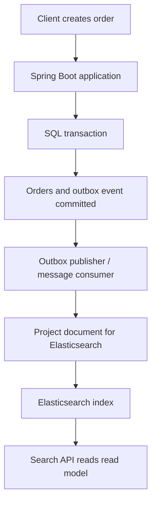

# Transaction limits, joins, and data constraints compared to SQL

Elasticsearch and relational databases solve different problems. SQL databases are typically used to manage transactional business data with transactions, keys, and relational constraints. Elasticsearch is a distributed search engine that stores data as JSON documents and is optimized for indexing, filtering, aggregating, and searching across large volumes of data.

Therefore, when using Spring Data Elasticsearch, do not assume repository operations carry the same semantics as JPA or JDBC. Elasticsearch offers useful document-level guarantees and shard synchronization mechanisms, but it does not provide multi-document transactions, general relational joins, or SQL-style integrity constraints.

| Capability | Typical SQL database | Elasticsearch |
|---|---|---|
| Transactions | Supports transactions spanning multiple statements with ACID properties per engine/configuration. | Single-document operations are atomic; there are no ACID transactions spanning multiple documents or indices. |
| Relationships | JOIN across tables by keys and query conditions. | No general relational joins across indices; typically denormalize, or use `nested` / `join` fields within a single index. |
| Constraints | Can declare `PRIMARY KEY`, `FOREIGN KEY`, `UNIQUE`, `NOT NULL`, `CHECK`. | Mappings control types and indexing behavior; most business and relational constraints must be enforced by the application or source system. |
| Data visibility | Usually tied to transaction commit and isolation level. | Search is near-real-time; new documents may not appear in search results until the next refresh. |
| Data model | Typically normalized into tables and relationships. | Document-oriented; commonly pre-stores data needed for reads to avoid query-time joins. |

## 1. Transaction limits in Elasticsearch

### 1.1. Atomicity scoped to a single document

Elasticsearch processes a write operation on a single document as a unit. Indexing or updating a document replaces/adjusts that document's content in a document-level atomic operation. If a document contains nested objects or arrays, updating the document is still an update on that same document.

For example, an order stored as a single document:

```json
{
  "orderId": "ORD-1001",
  "status": "PAID",
  "customer": {
    "id": "CUS-10",
    "name": "An"
  },
  "items": [
    { "sku": "BOOK-01", "quantity": 2 },
    { "sku": "PEN-02", "quantity": 3 }
  ]
}
```

If the application updates this document to change `status` or adjust `items`, Elasticsearch processes the change as a single operation on document `ORD-1001`. This organization is convenient when those fields are frequently read together.

However, if orders, inventory, and payments are stored as three separate documents, Elasticsearch has no transaction to ensure all three updates succeed or roll back together. It is possible for the order status update to succeed while the inventory update fails.

### 1.2. Bulk is not a transaction

The Bulk API groups multiple write operations into a single request to reduce network overhead and increase throughput. Sending multiple operations in the same request does not turn them into a transaction.

For example:

```http
POST /_bulk
{"index":{"_index":"orders","_id":"ORD-1001"}}
{"status":"PAID"}
{"index":{"_index":"inventory","_id":"BOOK-01"}}
{"available":18}
{"delete":{"_index":"temporary-orders","_id":"ORD-OLD"}}
```

Each item has its own result. Some items may succeed while others fail; the Bulk response contains an `errors` flag and per-item results for the application to inspect. Elasticsearch does not automatically roll back succeeded items when another item fails.

Similarly, `_update_by_query` and `_delete_by_query` are operations applied across multiple documents. They can encounter version conflicts, errors on certain batches, or cancellation after partial processing. Applications must inspect the response and design appropriate retry/reconciliation logic rather than assuming the entire job rolls back like a SQL transaction.

### 1.3. Controlling concurrent updates

When multiple requests edit the same document simultaneously, one request can overwrite newer changes unless concurrency is controlled. Elasticsearch provides optimistic concurrency control based on `_seq_no` and `_primary_term`.

A typical flow:

1. Read the document and retrieve `_seq_no` and `_primary_term` from the response.
2. Compute the updated content.
3. Send the write operation along with those two retrieved values.
4. If the document has changed since the read, Elasticsearch returns a version conflict error so the application can re-read and decide how to proceed.

Example conditional update request:

```http
PUT /products/_doc/BOOK-01?if_seq_no=12&if_primary_term=3
Content-Type: application/json

{
  "name": "Java Fundamentals",
  "available": 18
}
```

The values `12` and `3` are only examples; the application must obtain them from reading the respective document. This condition prevents silent overwrites, though it does not create multi-document transactions.

In Spring Data Elasticsearch, choose an update approach suited to your business needs and library version. For critical data, explicitly design behavior on optimistic locking conflicts: bounded retries, re-read and recompute, or returning an error for the caller to handle.

### 1.4. Refresh and when searches see data

Elasticsearch is a near-real-time system. An acknowledged write operation does not automatically make the document appear immediately in search results. Search only sees data after the shard refreshes and produces appropriate searchable segments.

Three common options when sending write operations:

- Omitting `refresh`: uses the default behavior, usually better for write throughput; the document becomes searchable after the next refresh.
- `refresh=wait_for`: waits for a subsequent refresh to make the change searchable before completing the response.
- `refresh=true`: forces an immediate refresh on the relevant shards; can degrade performance if used frequently.

Example:

```http
PUT /products/_doc/BOOK-01?refresh=wait_for
Content-Type: application/json

{
  "name": "Java Fundamentals",
  "available": 18
}
```

Refresh is not SQL `COMMIT`, nor does it create transaction isolation. It governs when data becomes visible through the search API. Direct fetches by document ID have real-time semantics distinct from search.

Do not force `refresh=true` after every write solely to make search see data immediately. If a business flow requires reading via search right after writing, consider `refresh=wait_for` at appropriate boundaries or adjust the read flow to fetch directly by ID.

## 2. Elasticsearch does not have general relational JOINs like SQL

In SQL, you can store customers, orders, and products in separate tables and JOIN them at query time:

```sql
SELECT o.id, c.name, o.total_amount
FROM orders o
JOIN customers c ON c.id = o.customer_id
WHERE o.status = 'PAID';
```

In Elasticsearch, you cannot by default write a search query that arbitrarily JOINs across indices like relational tables. The common design is pre-storing the fields needed for searching or displaying directly in the target index's documents.

There are three common design approaches: denormalization, `nested`, and parent-child relationships using a `join` field. Each has its own scope and trade-offs.

### 2.1. Denormalization: pre-storing data needed for reads

Denormalization means copying selected data from related entities into the document so queries do not require JOINs. For example, an order document can store `customerId`, `customerName`, and `customerTier` alongside order details.

```json
{
  "orderId": "ORD-1001",
  "customerId": "CUS-10",
  "customerName": "An",
  "customerTier": "GOLD",
  "status": "PAID",
  "totalAmount": 1250000
}
```

Advantages:

- Querying and displaying data usually requires reading only a single index.
- You can filter, sort, and aggregate on the indexed fields.
- Avoids query-time join overhead.

In return, data is duplicated. If a customer's name changes, order documents that copied that name do not update automatically. The application must define a synchronization policy: propagate updates to affected documents, accept snapshot data captured when the order was created, or store only the ID and fetch the latest details from the source system when needed.

Denormalization fits well when read optimization is prioritized and update rules for duplicated data are clear. It is usually the simplest, most effective choice for search and listing screens.

### 2.2. Nested objects for object arrays with internal relationships

By default, Elasticsearch flattens objects inside arrays into multi-value fields. When you need to preserve relationships between fields within the same array element, the `nested` type lets you query each sub-object as an independent unit.

For example, an order with multiple line items:

```json
{
  "orderId": "ORD-1001",
  "items": [
    { "sku": "BOOK-01", "color": "RED", "quantity": 2 },
    { "sku": "PEN-02", "color": "BLUE", "quantity": 3 }
  ]
}
```

If `items` is an ordinary object, the conditions `sku = BOOK-01` and `color = BLUE` could match across two different elements after fields are flattened. Use `nested` to ensure conditions apply to the same element.

Mapping:

```json
PUT /orders
{
  "mappings": {
    "properties": {
      "orderId": { "type": "keyword" },
      "items": {
        "type": "nested",
        "properties": {
          "sku": { "type": "keyword" },
          "color": { "type": "keyword" },
          "quantity": { "type": "integer" }
        }
      }
    }
  }
}
```

Nested query:

```json
GET /orders/_search
{
  "query": {
    "nested": {
      "path": "items",
      "query": {
        "bool": {
          "filter": [
            { "term": { "items.sku": "BOOK-01" } },
            { "term": { "items.color": "BLUE" } }
          ]
        }
      }
    }
  }
}
```

The query above matches only when a single element in `items` has both `sku` equal to `BOOK-01` and `color` equal to `BLUE`. In the example data, the document does not match because those two values belong to different elements.

Nested suits sub-objects whose lifecycle is tied to the parent document and are typically read and updated with the parent. Each nested object is stored as an internal Lucene document, so large numbers of nested objects increase storage, indexing, and query costs. Nested is not a tool for joining two indices.

### 2.3. Parent-child with a join field

Elasticsearch provides a `join` field type to model parent-child relationships within the same index. For example, a company has many employees stored as separate documents, where employee documents reference their parent company document.

Create the index and declare the relationship:

```json
PUT /company-directory
{
  "mappings": {
    "properties": {
      "relation": {
        "type": "join",
        "relations": {
          "company": "employee"
        }
      },
      "name": { "type": "text" }
    }
  }
}
```

Write the parent document and child document:

```http
PUT /company-directory/_doc/company-1
Content-Type: application/json

{
  "name": "Acme",
  "relation": "company"
}
```

```http
PUT /company-directory/_doc/employee-1?routing=company-1
Content-Type: application/json

{
  "name": "An",
  "relation": {
    "name": "employee",
    "parent": "company-1"
  }
}
```

Parent and child must reside on the same shard. Therefore, writing a child requires routing by the parent's ID as shown in the example. When searching, you can use `has_child` or `has_parent` to filter by relationship.

Parent-child is useful when child documents need to be searched or updated independently and the number of children is too large to embed in a `nested` document. However, relational queries consume more resources than regular document queries; updates, routing, and shard distribution become more complex. An index can have only one join field, although that field can declare multiple relationships according to supported configurations.

The join field does not turn Elasticsearch into a relational database: it does not provide arbitrary JOINs across indices, does not replace foreign keys, and does not automatically perform cascade updates or deletes like SQL.

### 2.4. Choosing how to model relationships

| Requirement | Commonly appropriate design |
|---|---|
| Search listing needs to display a few fields from a related entity | Denormalize the needed display fields into the document. |
| Sub-object array is always read and updated with the parent document | Ordinary object or `nested`, depending on whether per-element field correlation must be preserved. |
| Child documents have independent lifecycles and queries, yet require parent-child querying | Parent-child `join` field within the same index, after evaluating cost. |
| Flexible multi-table JOINs, transactions, and strict relational constraints needed | Use a SQL database as the source of truth; sync appropriate data to Elasticsearch for search. |

## 3. Data constraints: mappings are not SQL schemas

### 3.1. Mappings control types and indexing behavior

Mappings describe how Elasticsearch interprets each field: `keyword`, `text`, `integer`, `date`, `boolean`, `object`, `nested`, and other types. Mappings determine storage, text analysis, filtering, sorting, and aggregations.

Example:

```json
PUT /customers
{
  "mappings": {
    "dynamic": "strict",
    "properties": {
      "customerId": { "type": "keyword" },
      "name": { "type": "text" },
      "email": { "type": "keyword" },
      "birthDate": { "type": "date" },
      "active": { "type": "boolean" }
    }
  }
}
```

Here, `customerId` and `email` are `keyword` suitable for exact filtering; `name` is `text` suitable for full-text search; `birthDate` and `active` have explicit data types. `dynamic: strict` causes documents with undeclared fields to be rejected instead of automatically adding mappings.

However, `dynamic: strict` does not mean every field is required to be present. A document missing `email` can still be accepted if no other validation requires that field.

### 3.2. SQL constraints not automatically present in mappings

Mappings do not provide the full set of business constraints familiar in SQL:

- **NOT NULL / required:** mappings do not inherently require a field to be present in every document.
- **FOREIGN KEY:** Elasticsearch does not automatically check whether a referenced document exists in another index.
- **UNIQUE on arbitrary fields:** declaring a field as `keyword` does not make values of that field unique.
- **CHECK constraint:** mappings do not enforce rules such as `quantity > 0`, `startDate <= endDate`, or restricting a status to an allowed business set.
- **ON DELETE CASCADE:** deleting a parent document does not automatically delete referencing documents or related child documents elsewhere.

Elasticsearch enforces a unique `_id` per index. Writing a document with the same `_id` using a normal index operation can replace existing content; a `create` operation requires the ID not to exist and returns a conflict if already taken. That does not enforce uniqueness on other fields such as email or phone number.

For example, two documents with different `_id` values can still contain the same `email`:

```json
{ "_id": "customer-1", "email": "an@example.com" }
{ "_id": "customer-2", "email": "an@example.com" }
```

If business logic requires unique emails, enforce it in a system capable of guaranteeing that rule, typically the source database. Checking beforehand and then writing to Elasticsearch is not sufficient to guarantee uniqueness under concurrent requests.

### 3.3. Where should validation live?

Split data validation responsibilities across layers:

1. **API/application validation:** check required fields, formats, value ranges, and business rules before writing. In Spring applications, you can use Bean Validation such as `@NotBlank`, `@NotNull`, `@Positive`, along with custom validation.
2. **Domain/source database:** enforce integrity rules that must hold under concurrent writes, such as uniqueness, foreign keys, and business transactions. If SQL is the source of truth, critical constraints belong there.
3. **Elasticsearch mapping:** declare proper field types, analyzers, normalizers, and object structures; use `dynamic: strict` if you want to reject out-of-contract fields.
4. **Ingestion pipeline:** validate or normalize data entering Elasticsearch from multiple sources when needed, while recording failed documents for reprocessing.

Validation in Spring Data only protects flows passing through that application layer. If another system writes directly to Elasticsearch, checks in your application's controllers/services are not automatically enforced. Therefore, do not treat one API's validation as a global constraint for the index.

## 4. Organizing data between SQL and Elasticsearch

A common architecture is keeping business data in SQL and using Elasticsearch as a read model for search. SQL handles transactions, locks, and constraints; Elasticsearch receives a normalized data projection for search screens.

Example order creation flow:



In this model:

- The SQL transaction writes order data and an outbox event within the same transaction.
- The publisher reads committed events and forwards them to the consumer.
- The consumer creates or updates search documents in Elasticsearch.
- Search APIs read from Elasticsearch; business operations requiring transactional guarantees still use the appropriate source system.

The outbox pattern avoids situations where the SQL commit succeeds but sending the message fails before synchronization is recorded. Updating Elasticsearch can still experience lag or transient failures, so the consumer needs retries and error observability.

### 4.1. Idempotency and update ordering

A consumer can receive the same event more than once due to retries. Therefore, use a stable document ID, such as `orderId`, and design writes to be safely repeatable. If multiple events for the same entity can arrive out of order, use a business version or version check to prevent older events from overwriting newer state.

For example, an order document can include a `sourceVersion` taken from the source system. The consumer only accepts versions newer than the currently indexed version using an appropriate concurrency mechanism. Do not rely solely on the timestamp when the consumer received a message as the authoritative business ordering.

### 4.2. When to write synchronously to both SQL and Elasticsearch?

Writing sequentially to both systems does not create a distributed transaction. If SQL succeeds and Elasticsearch fails, or vice versa, states can diverge. Only use that approach when consistency trade-offs are explicitly accepted and retries/reconciliation plus recovery exist; for critical business systems, an outbox is usually easier to reason about and control.

Do not expect a `@Transactional` annotation on a Spring service to automatically combine SQL and Elasticsearch operations into a single ACID transaction. A transaction manager coordinates only resources that actually participate in that transaction; Elasticsearch does not provide multi-document transactions for Spring Data to arbitrarily roll back committed writes.

## 5. Applying these concepts in Spring Data Elasticsearch

Spring Data Elasticsearch maps Java objects to documents and provides repository/operations APIs. These abstractions do not change Elasticsearch's transaction, join, or constraint limitations.

Entity example:

```java
@Document(indexName = "customers")
public class CustomerDocument {

    @Id
    private String id;

    @Field(type = FieldType.Keyword)
    private String customerId;

    @Field(type = FieldType.Text)
    private String name;

    @Field(type = FieldType.Keyword)
    private String email;

    // constructors, getters, setters
}
```

Repository:

```java
public interface CustomerSearchRepository
        extends ElasticsearchRepository<CustomerDocument, String> {
}
```

Calling `save` writes a single document by entity ID. If the application needs to guarantee unique emails, validate references to another customer, or atomically update multiple documents, the repository does not provide those transactions or constraints automatically. Those rules must be designed in the service layer and source system.

For related data, you can choose:

- An aggregated document containing customer fields needed for display in order search results.
- A nested collection when elements belong to the same aggregate and need exact per-element querying.
- Parent-child when independent parent and child documents within the same index are truly needed and join cost is acceptable.

Entity mappings also need to stay consistent with the actual index mapping. Annotations describe fields to Spring Data, yet modifying an existing mapping may require creating a new index and reindexing data. Do not assume editing an annotation automatically transforms existing data.

## 6. Deciding between SQL and Elasticsearch

| System requirement | Prefer |
|---|---|
| Money transfers, balance updates, reservations, or operations requiring all-or-nothing commit/rollback | SQL transactions or an appropriate transactional system. |
| Enforcing unique email/identifiers and checking foreign keys | Constraints in the source database. |
| Full-text search, relevance scoring, autocomplete, faceted search, and aggregations over large datasets | Elasticsearch. |
| Listing pages combining order and customer info with high read speed | Denormalized read model in Elasticsearch. |
| Child relationships inside one document requiring exact filtering on individual array objects | Nested mapping/query. |
| Independent parent-child documents in one index with clear relational query needs | Evaluate parent-child join field and its cost. |

When Elasticsearch acts purely as a search projection of SQL data, treat index contents as a reproducible copy derived from the source of truth. Maintain stable identifiers, synchronization workflows, retries, lag monitoring, dead-letter/error handling, and full reindex capability whenever mappings or document shapes change.

## 7. Key takeaways

- Elasticsearch provides single-document atomic operations, not ACID transactions spanning multiple documents or indices.
- The Bulk API is a way to send multiple operations in one request; each item has its own result and there is no shared rollback.
- Optimistic concurrency control with `_seq_no` and `_primary_term` detects concurrent document updates.
- Search is near-real-time; refresh controls when documents become searchable and is not equivalent to SQL commit.
- Elasticsearch does not support general relational JOINs across indices like SQL. Denormalization generally suits read queries; `nested` and parent-child solve narrower requirements.
- Mappings define types and indexing behavior; they do not replace `NOT NULL`, `UNIQUE`, `FOREIGN KEY`, `CHECK`, or cascade constraints.
- `@Transactional` in Spring does not create a joint transaction across SQL and Elasticsearch.
- For business logic needing strong integrity, keep SQL or an appropriate transactional store as the source of truth and sync a read model to Elasticsearch using retries, idempotency, and reconciliation.

Understanding these limits helps draw a clean boundary between transactional business data and search data. Spring Data Elasticsearch is a convenient tool for working with documents, while correctness of transactions, relationships, and constraints must still be designed at the architectural and domain levels.
