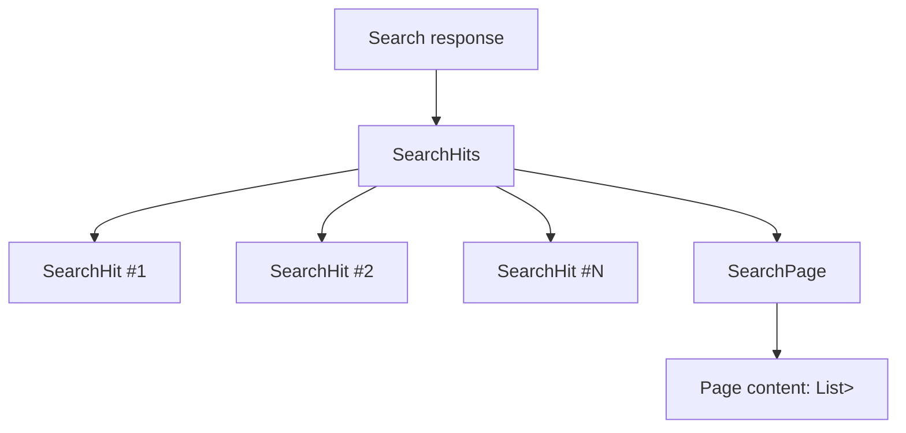
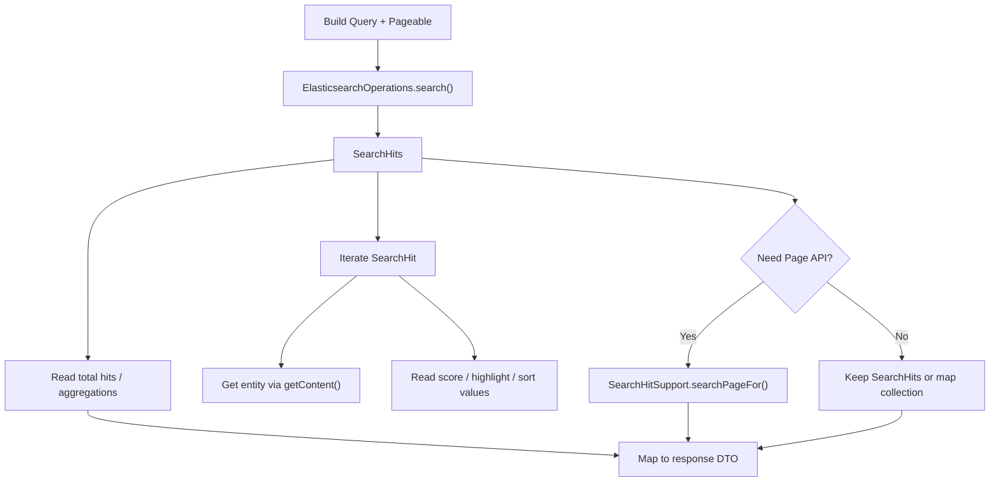

# SearchHit<T>, SearchHits<T>, and SearchPage<T>

When searching with Spring Data Elasticsearch, the result is not merely a list of entities. Each returned document can come with a relevance score, ID, source index, sort values, highlights, and other metadata. The entire response also includes total hits, max score, aggregations, and pagination information.

Spring Data provides three types to represent these result layers:

- **`SearchHit<T>`** represents a single search result, consisting of entity `T` and the hit's own metadata.
- **`SearchHits<T>`** represents the entire search result, consisting of a list of `SearchHit<T>` and response-level metadata.
- **`SearchPage<T>`** represents search results according to Spring Data's `Page` model, in which the page content is `SearchHit<T>` instances while still retaining `SearchHits<T>` information.

Understanding the differences between these three types helps the application avoid losing scores or highlights when converting results into entities, while building more accurate pagination and search UI APIs.

## 1. Why Do Search Results Need More Than a `List<T>`?

Suppose a user searches for products using the keyword `wireless`. Elasticsearch may return multiple documents, each with `_source` and its own metadata:

```json
{
  "_index": "products",
  "_id": "p-1001",
  "_score": 4.82,
  "_source": {
    "name": "Wireless Headphones",
    "category": "audio",
    "price": 129.90
  },
  "sort": [4.82, "p-1001"]
}
```

Beyond product data, the application might need:

- `_id` to construct detail links or perform follow-up operations.
- `_score` for ranking or displaying relevance information.
- Highlight fragments to emphasize text matching the keyword.
- Sort values to continue pagination via `search_after`.
- Total hits to display “125 results found”.
- Aggregations to display category, brand, or price-range facets.

If you only retrieve `List<ProductDocument>`, the application retains only the entities and may lose most of the search metadata. The `SearchHit`, `SearchHits`, and `SearchPage` types preserve this information within Spring Data's result model.

## 2. `SearchHit<T>`: A Single Hit and Its Metadata

`SearchHit<T>` represents a single document in the search results. It contains the entity converted to type `T` along with the metadata Elasticsearch returned for that hit.

Commonly used information includes:

| Information | Meaning |
|---|---|
| `getContent()` | Java entity mapped from `_source`. |
| `getId()` | Document ID (`_id`). |
| `getIndex()` | Name of the index containing the document. |
| `getScore()` | Relevance score of the hit. |
| `getSortValues()` | Sort values returned by Elasticsearch for the hit. |
| `getHighlightFields()` | Highlighted text snippets if the request requested highlighting. |
| `getInnerHits()` | Inner hits if the query used `nested`/parent-child and the request declared them. |
| `getMatchedQueries()` | Names of named queries matching the hit if configured in the request. |

Optional metadata is only meaningful when the request is configured to return it. For example, if a query does not request highlighting, you cannot expect `getHighlightFields()` to contain fragments.

### 2.1. Reading the Entity Inside a Hit

Example searching for products using `ElasticsearchOperations`:

```java
import org.springframework.data.elasticsearch.core.SearchHit;
import org.springframework.data.elasticsearch.core.SearchHits;
import org.springframework.data.elasticsearch.core.query.Query;

SearchHits<ProductDocument> hits = operations.search(
    query,
    ProductDocument.class
);

for (SearchHit<ProductDocument> hit : hits) {
    ProductDocument product = hit.getContent();

    System.out.println("ID: " + hit.getId());
    System.out.println("Name: " + product.getName());
    System.out.println("Score: " + hit.getScore());
}
```

`getContent()` returns the `ProductDocument` entity; `SearchHit` is a wrapper holding both the entity and metadata. Therefore, when retrieving domain properties, access them via `hit.getContent()`.

### 2.2. Score Is Not Always a Business Metric

`getScore()` is the relevance score computed by Elasticsearch based on the query and scoring configuration. This score is useful for ranking search results, but it is not a probability, accuracy percentage, or absolute quality score.

When a query only has filters or sorts by a field, the score may not carry the ranking meaning the UI needs. You should not display `4.82` as “96% match accuracy” without a defined and validated business conversion model.

### 2.3. Highlight Fields

If a search request enables highlighting, a hit may contain fragments with matching parts marked. Example highlight data might look like:

```json
{
  "name": [
    "<em>Wireless</em> Headphones"
  ],
  "description": [
    "Enjoy music with <em>wireless</em> connectivity"
  ]
}
```

Reading highlights from `SearchHit`:

```java
for (SearchHit<ProductDocument> hit : hits) {
    List<String> nameFragments = hit.getHighlightFields().get("name");

    if (nameFragments != null && !nameFragments.isEmpty()) {
        System.out.println(nameFragments.get(0));
    }
}
```

Highlights are content generated by Elasticsearch from indexed data. When rendering fragments into HTML, output must be processed according to the application's safe rendering policy. Do not assume every highlight string is trusted HTML; highlight tag names can be configured and the original content may contain characters requiring escaping.

### 2.4. Sort Values

`getSortValues()` contains the hit's sort values in the order of the sort fields in the request. This is critical metadata when using `search_after` to fetch the next page.

Do not recalculate sort values from the entity yourself, because Elasticsearch may apply missing value policies, multi-value modes, tie-breakers, or other normalizations. Retain the sort values returned by the response if cursor-based pagination needs to continue.

## 3. `SearchHits<T>`: The Entire Search Response

`SearchHits<T>` represents the search result at the request level. It contains the `SearchHit<T>` instances and overall response metadata.

Commonly used methods:

| Method | Meaning |
|---|---|
| `getSearchHits()` | List of returned `SearchHit<T>` instances. |
| `getTotalHits()` | Total number of hits according to the information returned by Elasticsearch. |
| `getMaxScore()` | Highest score among the returned hits. |
| `getAggregations()` | Aggregation container if the request declared aggregations. |
| `getSuggest()` | Suggest response if the request configured suggestions. |

`SearchHits<T>` can be iterated directly in a loop, or use `getSearchHits()` when working with a specific list.

Example:

```java
SearchHits<ProductDocument> hits = operations.search(
    query,
    ProductDocument.class
);

long total = hits.getTotalHits();
float maxScore = hits.getMaxScore();

List<SearchHit<ProductDocument>> searchHits = hits.getSearchHits();

System.out.println("Total hits: " + total);
System.out.println("Max score: " + maxScore);

for (SearchHit<ProductDocument> hit : searchHits) {
    System.out.println(hit.getId() + " -> " + hit.getContent().getName());
}
```

### 3.1. `getTotalHits()` Differs from the Number of Hits in the Current Page

Suppose a request asks for `size = 20` and Elasticsearch finds 125 documents:

- `hits.getSearchHits().size()` is the actual number of hits in the current response, at most 20.
- `hits.getTotalHits()` is the total number of matching hits according to the request's total-hits semantics.

Do not use `getSearchHits().size()` to display the total number of results. It is only the number of documents on the current page.

Elasticsearch has a mechanism to limit the cost of counting total hits. Depending on `track_total_hits` configuration and version, the returned total may be an exact count or only a lower bound. If the product requires an exact figure for reporting or pagination, configure appropriate tracking and evaluate the cost on large indices. Do not assume every total hits value is exact simply because the API returns a `long`.

### 3.2. Aggregations Reside at the `SearchHits` Level

An aggregation is a statistical summary across the search request's document set, not per-hit metadata. For example, a request has a terms aggregation by category; the aggregation result is accessed from `SearchHits.getAggregations()`.

```java
SearchHits<ProductDocument> hits = operations.search(
    queryWithAggregations,
    ProductDocument.class
);

var aggregations = hits.getAggregations();
```

The container type and how buckets are read depend on the Spring Data Elasticsearch version and client type used. Use the response model matching the project's dependency. Do not cast arbitrarily or assume aggregations are always present; if the request did not declare aggregations, the container may have no value.

## 4. `SearchPage<T>`: Search Results in the Page Model

`SearchPage<T>` combines search metadata with Spring Data's `Page` pagination abstraction. The page content consists of `SearchHit<T>` instances, preserving per-hit metadata while providing familiar pagination properties.

Information available from the page:

- `getContent()`: list of `SearchHit<T>` for the current page.
- `getNumber()`: current page number, starting from 0.
- `getSize()`: page size.
- `getTotalElements()`: total number of elements according to search metadata.
- `getTotalPages()`: total number of pages derived from total elements and page size.
- `hasNext()` / `hasPrevious()`: check for next/previous page.
- `getSearchHits()`: access the underlying `SearchHits<T>` to retrieve search response metadata, depending on the Spring Data Elasticsearch API.

`SearchPage<T>` is not a `Page<T>` containing entities directly. It is a page containing `SearchHit<T>`. To get the entity, call `getContent()` on each hit.

### 4.1. Converting `SearchHits` to `SearchPage`

When using `ElasticsearchOperations`, you can build a query with `Pageable`, receive `SearchHits<T>`, and then use `SearchHitSupport.searchPageFor(...)` to create a `SearchPage<T>`:

```java
import org.springframework.data.domain.PageRequest;
import org.springframework.data.domain.Pageable;
import org.springframework.data.elasticsearch.core.SearchHit;
import org.springframework.data.elasticsearch.core.SearchHitSupport;
import org.springframework.data.elasticsearch.core.SearchHits;
import org.springframework.data.elasticsearch.core.SearchPage;
import org.springframework.data.elasticsearch.client.elc.NativeQuery;
import org.springframework.data.elasticsearch.core.query.Query;

Pageable pageable = PageRequest.of(0, 20);

Query query = NativeQuery.builder()
    .withQuery(q -> q
        .match(match -> match
            .field("name")
            .query("wireless")
        )
    )
    .withPageable(pageable)
    .build();

SearchHits<ProductDocument> hits = operations.search(
    query,
    ProductDocument.class
);

SearchPage<ProductDocument> page = SearchHitSupport.searchPageFor(
    hits,
    pageable
);
```

Then you can use the Page API:

```java
System.out.println("Page number: " + page.getNumber());
System.out.println("Page size: " + page.getSize());
System.out.println("Total elements: " + page.getTotalElements());
System.out.println("Total pages: " + page.getTotalPages());

for (SearchHit<ProductDocument> hit : page.getContent()) {
    ProductDocument product = hit.getContent();
    System.out.println(hit.getScore() + " - " + product.getName());
}
```

`SearchHitSupport.searchPageFor` converts search results into a pagination abstraction while retaining the hits. Signatures and packages should be verified against the Spring Data Elasticsearch version in use if the project runs on an older API generation.

## 5. Comparing the Three Result Types

| Criterion | `SearchHit<T>` | `SearchHits<T>` | `SearchPage<T>` |
|---|---|---|---|
| Scope | A single document in the results | The entire search response | A single page of search results |
| Entity | `getContent()` | Inside each hit | Inside each hit in page content |
| Score | Score of the hit | Max score at response level and score in each hit | Score inside each hit |
| ID/index | Metadata of a single document | Accessed via each hit | Accessed via each hit |
| Total hits | Not primary info of a single hit | Has `getTotalHits()` | Has Page total elements and underlying search hits |
| Aggregations | Outside the scope of a single hit | Accessible via the response | Accessible via `getSearchHits()` |
| Pagination | No | Does not implement the Page API itself | Has `Pageable` semantics |
| Purpose | Inspect entity with its own metadata | Process the entire response and search metadata | Return paginated results to the service/API layer |

The relationship can be visualized as:



`SearchPage` does not replace `SearchHit` or `SearchHits`; it adds a pagination layer for search results.

## 6. Using Repositories with Search Result Types

Spring Data Elasticsearch Repositories support search result types in appropriate query methods alongside standard entity return types. For example, a derived query can return `SearchHits<ProductDocument>` to preserve metadata:

```java
import org.springframework.data.elasticsearch.repository.ElasticsearchRepository;
import org.springframework.data.elasticsearch.core.SearchHits;

public interface ProductRepository
        extends ElasticsearchRepository<ProductDocument, String> {

    SearchHits<ProductDocument> findByCategory(String category);
}
```

When information such as score, highlights, or sort values is needed, search hits return types are more suitable than `List<ProductDocument>`.

For dynamic queries, aggregations, complex filters, or runtime index/alias selection, `ElasticsearchOperations` is usually more flexible. Do not force every query into Repository method names.

Supported Repository return types may vary by version and query type. Check the documentation/Javadoc of the Spring Data Elasticsearch version in use before choosing `SearchPage<T>` directly as the return type of a query method.

## 7. Building Response DTOs for REST APIs

You should not by default return raw `SearchHits`, `SearchPage`, or Elasticsearch client response objects directly out of an API. These types belong to the persistence/search layer and may contain version-dependent metadata or structures.

Convert results into DTOs tailored to the API contract:

```java
public record ProductSearchItem(
    String id,
    String name,
    String category,
    float score,
    List<String> nameHighlights
) {
}

public record ProductSearchResponse(
    List<ProductSearchItem> items,
    long totalElements,
    int page,
    int size,
    int totalPages
) {
}
```

Service converting from `SearchPage`:

```java
import java.util.List;

public ProductSearchResponse toResponse(SearchPage<ProductDocument> page) {
    List<ProductSearchItem> items = page.getContent().stream()
        .map(hit -> new ProductSearchItem(
            hit.getId(),
            hit.getContent().getName(),
            hit.getContent().getCategory(),
            hit.getScore(),
            hit.getHighlightFields().getOrDefault("name", List.of())
        ))
        .toList();

    return new ProductSearchResponse(
        items,
        page.getTotalElements(),
        page.getNumber(),
        page.getSize(),
        page.getTotalPages()
    );
}
```

The example uses modern Java with records and `Stream.toList()`. If the project uses an older Java version, replace records with regular DTO classes and use `Collectors.toList()`.

DTOs allow the application to explicitly decide which metadata is exposed publicly. For example, score and highlights can be returned for the search UI without returning internal index names or sort values if the API does not need them.

## 8. Pagination with `Pageable`

When building queries with `NativeQuery`, use `Pageable` to specify page number, page size, and sorting:

```java
Pageable pageable = PageRequest.of(
    0,
    20,
    Sort.by(Sort.Direction.DESC, "price")
);

Query query = NativeQuery.builder()
    .withQuery(q -> q
        .match(match -> match
            .field("name")
            .query("wireless")
        )
    )
    .withPageable(pageable)
    .build();

SearchHits<ProductDocument> hits = operations.search(
    query,
    ProductDocument.class
);
```

This can be converted into a `SearchPage` as shown in the previous section if the service needs the Page API.

### 8.1. Page Number and Offset

`PageRequest.of(page, size)` uses a 0-based page number. For example, `PageRequest.of(2, 20)` requests the third page, corresponding to offset 40 with page size 20.

Elasticsearch uses `from` and `size` for offset-style pagination. This is convenient for initial pages, but has depth limits and costs when accessing very distant pages. Do not allow clients to send unbounded page numbers.

### 8.2. Stable Sorting

When paginating, there should be a stable sort order. If multiple documents share the same sort value, results can shift between pages when data changes or when there is no proper tie-breaker.

You can add a unique field as a tie-breaker, such as `id` or a keyword field with doc values, if the mapping and query support it:

```java
Sort sort = Sort.by(
    Sort.Order.desc("price"),
    Sort.Order.asc("id")
);
```

Choose sort fields based on the actual mapping. Do not sort directly on a `text` field without an appropriate `keyword` multi-field.

## 9. Deep Pagination: `search_after` and Point in Time

For exports or batches reading a very large number of documents, increasing the page number and using `from`/`size` can be resource-intensive. Elasticsearch supports `search_after`, where the next request uses the sort values of the last hit from the previous request.

Overview flow:

1. Run the first request with a stable sort.
2. Get `getSortValues()` from the last hit.
3. Pass those values into `search_after` of the next request.
4. Continue until no hits remain.

Example response hit with sort values:

```json
{
  "_id": "p-1001",
  "sort": [129.9, "p-1001"]
}
```

The value `[129.9, "p-1001"]` is that hit's cursor according to the declared sort order. Do not construct the cursor yourself by taking the price from the entity if Elasticsearch returns additional tie-breakers or applies missing-value semantics.

For data that may change while reading multiple pages, Point in Time (PIT) helps maintain a consistent view of the index during pagination. Exact PIT usage and `search_after` APIs depend on the Elasticsearch/Spring Data version. When performing batch exports, manage the PIT lifetime, close the PIT when done, and handle expired cursor cases.

`SearchPage<T>` is suitable for standard pagination. For cursor pagination, a separate response model containing sort values/cursor is needed; do not force `search_after` into `PageRequest` when semantics do not align.

## 10. SearchHits and Aggregations

A query can return hits and compute aggregations simultaneously. Example counting products by category:

```java
Query query = NativeQuery.builder()
    .withQuery(q -> q
        .match(match -> match
            .field("name")
            .query("wireless")
        )
    )
    .withAggregation("categories", aggregation -> aggregation
        .terms(terms -> terms.field("category"))
    )
    .withPageable(PageRequest.of(0, 20))
    .build();

SearchHits<ProductDocument> hits = operations.search(
    query,
    ProductDocument.class
);

var aggregations = hits.getAggregations();
```

Hits and aggregations have different scopes in the model:

- `SearchHit<T>` contains a single document with metadata.
- `SearchHits<T>` contains the list of hits and response metadata, including the aggregation container.
- `SearchPage<T>` paginates hits, while aggregations remain metadata of the underlying search response.

Do not assume aggregations are calculated only over the hits on the current page. Aggregations are typically calculated over the set of documents matching the main query, not just the 20 displayed documents. If the request has a `post_filter`, remember that aggregations are not restricted by the post filter.

## 11. Highlighting and Reading Fragments in SearchHit

To get highlights, the search request must declare the fields to highlight. When Elasticsearch returns highlight fragments, Spring Data places them in `SearchHit` metadata.

DSL structure example:

```json
GET products/_search
{
  "query": {
    "match": {
      "name": "wireless"
    }
  },
  "highlight": {
    "fields": {
      "name": {}
    },
    "pre_tags": ["<mark>"],
    "post_tags": ["</mark>"]
  }
}
```

After executing via Operations:

```java
for (SearchHit<ProductDocument> hit : hits) {
    List<String> fragments = hit.getHighlightFields()
        .getOrDefault("name", List.of());

    ProductDocument product = hit.getContent();
    // Convert product and fragments into response DTO.
}
```

Highlighting does not modify the entity's `_source`. `getContent().getName()` remains the original name; highlight fragments are separate hit metadata. If the UI needs to display highlighted names, use highlight fragments with controlled rendering.

## 12. When to Use `List<T>`, `SearchHits<T>`, or `SearchPage<T>`?

| Need | Suitable return type | Reason |
|---|---|---|
| Only entities needed, no search metadata needed | `List<T>` or appropriate collection type | Simple, minimal coupling to search response. |
| Per-hit score, ID, highlights, or sort values needed | `SearchHits<T>` | Preserves per-hit and response-wide metadata. |
| A single hit and its metadata needed | `SearchHit<T>` | Suitable for operations on an individual result. |
| Page API with total elements, page number, and page size needed | `SearchPage<T>` | Combines search metadata with Spring Data Page. |
| Deep cursor pagination needed | Dedicated cursor response based on sort values/PIT | `Page` offset semantics do not fully represent `search_after`. |

Do not always use `SearchHits` for every use case. If a service only needs a list of entities for internal processing and uses no metadata, a simple collection can be easier to read. Conversely, do not convert `SearchHits` to `List<T>` too early if the UI needs score, highlights, or a cursor.

## 13. Common Pitfalls

| Symptom | Possible cause | Resolution |
|---|---|---|
| Cannot get product name from `SearchHit` | Accessing domain property directly on wrapper | Use `hit.getContent().getName()`. |
| Total results equals the number of hits on the page | Using `getSearchHits().size()` instead of total hits | Use `SearchHits.getTotalHits()` or Page total elements. |
| No highlights | Query does not declare highlight or field is unsupported | Add highlight request and check mapping/field. |
| Score is 0 or unhelpful | Query mainly uses filters or has no scoring clauses | Do not interpret score as a business score; inspect query and sort. |
| `SearchPage` content is not the entity | Page contains `SearchHit<T>` | Iterate page content and call `getContent()` on each hit. |
| Aggregation only has partial data | Condition placed in main query or aggregation size too small | Clarify the dataset the aggregation should reflect and check `size`. |
| Total hits not strictly exact | Total-hits tracking is capped | Configure appropriate tracking if business requires an exact count. |
| Deep pages are slow | Offset pagination with large `from` | Use cursor with `search_after` and consider PIT. |
| Duplicate/missing results across pages | Unstable sort or data changing during pagination | Add tie-breaker and consider PIT. |
| API tightly coupled to Elasticsearch model | Returning raw SearchHits/SearchPage from REST | Convert into DTOs according to the API contract. |

## 14. Search Result Processing Workflow



Practical steps:

1. Determine whether the UI/API needs entities, score, highlights, aggregations, or pagination metadata.
2. Build an appropriate query and `Pageable`.
3. Execute with `ElasticsearchOperations.search(...)` to receive `SearchHits<T>`.
4. Read total hits and aggregations at the response level.
5. Iterate each `SearchHit<T>` to extract the entity and its individual metadata.
6. Convert into `SearchPage<T>` if the Page API is needed.
7. Map results to DTOs, keeping only metadata that should be exposed publicly.
8. For deep pagination, consider cursor/`search_after` instead of large page numbers.

## 15. Conclusion

`SearchHit<T>` represents a single matched document along with metadata such as ID, index, score, highlights, and sort values. `SearchHits<T>` represents the entire response, including the hit list, total results, max score, and aggregation/suggest metadata when present. `SearchPage<T>` adds Spring Data's pagination model, where each page element remains a `SearchHit<T>`.

When you need to process the entity, call `hit.getContent()`. When you need the total number of results, use `SearchHits.getTotalHits()` or Page total elements instead of counting hits on the page. When you need highlights, aggregations, or cursors, keep metadata at the appropriate response and hit levels.

For application APIs, convert these result types into clear DTOs to control the response contract and avoid direct coupling to Elasticsearch's response model. For initial and regular pages, `SearchPage` is convenient; for very large datasets, use stable sorting with `search_after` and PIT where appropriate.
