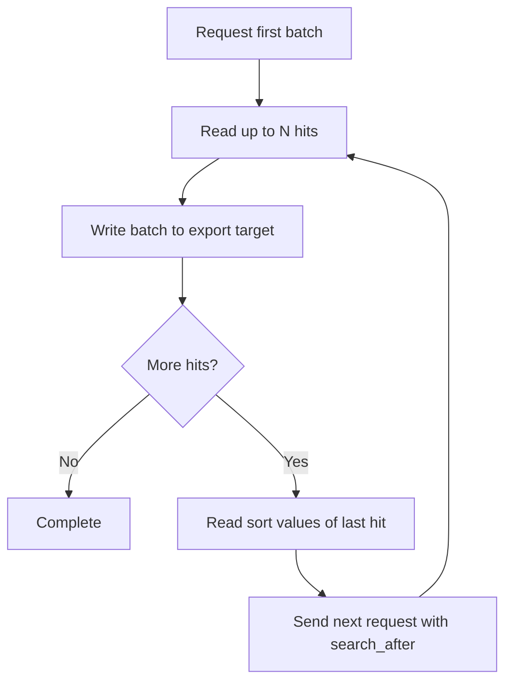
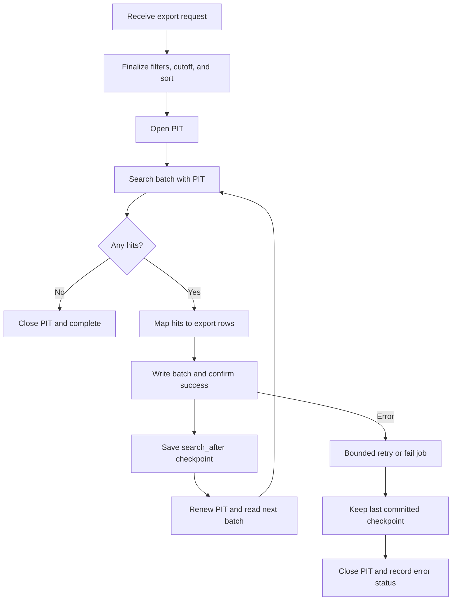

# Distinguishing UI Pagination from Scanning Data for Export

In Spring Data Elasticsearch, pagination can serve two very different purposes. A search UI typically needs to display a small page, letting users move to the next page, return to the previous page, or jump to a specific page. Conversely, an export job needs to sequentially read hundreds of thousands or millions of documents to write to CSV, JSON, report files, or another system.

These two goals should not share the same default strategy:

- **UI pagination** prioritizes page number, page size, sorting, and total result count for user navigation.
- **Scanning data for export** prioritizes stable sequential reading, memory control, throughput, resumability after failure, and ensuring no documents are missed.

Spring Data Elasticsearch supports `Pageable`, `SearchHits`, and `SearchPage` for standard pagination. For deep scanning, Elasticsearch recommends **Point in Time (PIT) combined with `search_after`** rather than continually incrementing `from`. Choosing the right approach depends on user experience, data size, and the consistency requirements of the export.

## 1. Two Problems with Different Goals

Suppose an application has an `orders` index containing millions of orders.

An admin screen may need to show 25 orders per page, allowing staff to pick page 1, 2, 3, or filter by status. Users do not need to load the entire dataset at once.

Meanwhile, an end-of-day job needs to export all completed orders within a date range to a file. This job must read the entire dataset, avoid holding millions of entities in RAM, and recover gracefully if file writing or Elasticsearch connectivity fails.

| Criterion | UI pagination | Scanning data for export |
|---|---|---|
| Goal | Display a slice of results for user navigation | Read the entire dataset to be exported |
| Traversal pattern | May jump to arbitrary pages or go back | Sequential from first batch to last batch |
| Read size per call | Usually small, e.g., 10–50 hits | Larger batches, chosen by payload and resources |
| Total result count | Usually helpful for page numbers and counters | Usually no need to pre-count everything |
| Pagination mechanism | `Pageable`, `from`/`size`, `SearchPage` | `search_after` with PIT |
| Application memory | Holds one page | Processes batch by batch without accumulating everything |
| Consistency on data changes | Changes between page turns may be acceptable depending on product | Usually needs a stable view throughout the export |
| Resumability | User reloads the page | Save cursor/checkpoint and handle resume |
| Completion condition | No more pages or user stops | No hits remain after the last cursor |

Crucially, an export is not a UI with very many pages. It is a batch-processing pipeline over a large dataset.

## 2. UI Pagination Using `Pageable`

Spring Data uses `Pageable` to describe page number, page size, and sort order. With `NativeQuery`, you can set `Pageable` and execute via `ElasticsearchOperations`:

```java
import org.springframework.data.domain.PageRequest;
import org.springframework.data.domain.Pageable;
import org.springframework.data.domain.Sort;
import co.elastic.clients.elasticsearch._types.FieldValue;
import org.springframework.data.elasticsearch.client.elc.NativeQuery;
import org.springframework.data.elasticsearch.core.SearchHits;
import org.springframework.data.elasticsearch.core.query.Query;

Pageable pageable = PageRequest.of(
    0,
    25,
    Sort.by(Sort.Direction.DESC, "createdAt")
);

Query query = NativeQuery.builder()
    .withQuery(q -> q
        .bool(b -> b
            .filter(f -> f.term(t -> t
                .field("status")
                    .value(FieldValue.of("COMPLETED"))
            ))
        )
    )
    .withPageable(pageable)
    .build();

SearchHits<OrderDocument> hits = operations.search(
    query,
    OrderDocument.class
);
```

`PageRequest.of(0, 25)` requests the first page with up to 25 results. Page numbers start at 0. The next page can use `PageRequest.of(1, 25)`.

If the familiar `Page` API is needed, convert `SearchHits` to `SearchPage`:

```java
import org.springframework.data.elasticsearch.core.SearchHitSupport;
import org.springframework.data.elasticsearch.core.SearchPage;

SearchPage<OrderDocument> page = SearchHitSupport.searchPageFor(
    hits,
    pageable
);

long totalElements = page.getTotalElements();
int totalPages = page.getTotalPages();
boolean hasNext = page.hasNext();
```

`SearchPage` holds `SearchHit<OrderDocument>` items in `getContent()`. When the entity is needed, call `hit.getContent()`. Hit metadata such as score and highlights can still be preserved.

### 2.1. When to Use `Page`, `Slice`, or `SearchPage`?

- Use `Page<T>` when the application layer needs total elements and total pages.
- Use `Slice<T>` when only whether a next page exists is needed and exact total element counts are unnecessary.
- Use `SearchPage<T>` when pagination along with search metadata such as score, highlights, and sort values is needed.
- Use `SearchHits<T>` when full search response metadata is needed without the Page API.

Computing total hits can incur extra cost on large indices. If the UI only has a "Show more" or "Load more" button, there is no need to count all matching documents accurately before rendering the first page.

## 3. Limits of `from` and `size`

Traditional UI pagination is implemented using `from` and `size` in Elasticsearch. For example:

```json
GET orders/_search
{
  "from": 50,
  "size": 25,
  "sort": [
    { "createdAt": "desc" }
  ],
  "query": {
    "term": {
      "status": "COMPLETED"
    }
  }
}
```

This request skips the first 50 results and returns up to the next 25 results.

By default, Elasticsearch typically limits `from + size` using `index.max_result_window`, usually 10,000. Thus requesting very deep pages can trigger a result window limit error. This limit exists because every shard must retain and process results up to the offset position, consuming memory and CPU when offsets are large.

Do not immediately work around this by raising `index.max_result_window` to hundreds of thousands or millions. Increasing the limit makes deep queries more expensive and puts pressure on the cluster. For exports or batch scans, use `search_after`.

### 3.1. When `from`/`size` Fits

- Users need to jump to a specific page.
- Page depth is not overly deep.
- Page size is small and capped on the server.
- The UI needs to display total page counts.
- Page-turning frequency and latency are acceptable.

### 3.2. When `from`/`size` Does Not Fit

- Exporting hundreds of thousands or millions of documents.
- Batch jobs reading all matching results.
- Users can request very large page numbers.
- The application increments `from` in a loop to read the entire index.

## 4. Problems with Exporting by Incrementing Page Numbers

A seemingly simple approach is looping `PageRequest.of(pageNumber, batchSize)` until an empty page is returned:

```java
import org.springframework.data.domain.Page;
import org.springframework.data.domain.Pageable;
import org.springframework.data.elasticsearch.repository.ElasticsearchRepository;

public interface OrderRepository
        extends ElasticsearchRepository<OrderDocument, String> {

    Page<OrderDocument> findByStatus(String status, Pageable pageable);
}

int pageNumber = 0;
int batchSize = 500;

while (true) {
    Pageable pageable = PageRequest.of(pageNumber, batchSize);
    Page<OrderDocument> page = repository.findByStatus(
        "COMPLETED",
        pageable
    );

    if (page.isEmpty()) {
        break;
    }

    export(page.getContent());
    pageNumber++;
}
```

This approach has several problems:

1. `from` increases with page number and eventually hits `max_result_window`.
2. Deep pages become increasingly expensive because Elasticsearch must process prior results before the offset.
3. If documents are inserted or deleted during the export, offset positions can shift, causing duplicated or skipped data.
4. If each loop iteration runs a `count` to build `Page`, total counting is repeated unnecessarily.
5. The entire pipeline is coupled to a UI page-navigation model rather than a sequential scan model.

`PageRequest` fits UIs and moderately sized result sets. It is not the optimal tool for reading an entire index.

## 5. Sequential Scanning with `search_after`

`search_after` uses the sort values of the last hit in the current batch as the cursor for the next request. Instead of saying "skip 100,000 results", the request says "return results coming after the hit with these sort values".

Basic flow:



Example first request:

```json
GET orders/_search
{
  "size": 500,
  "sort": [
    { "createdAt": "asc" },
    { "orderSortId": "asc" }
  ],
  "query": {
    "term": {
      "status": "COMPLETED"
    }
  }
}
```

Suppose the last hit has:

```json
{
  "_id": "order-9000",
  "sort": ["2026-11-13T10:30:00Z", "order-9000"]
}
```

The next request passes that exact sort values array:

```json
GET orders/_search
{
  "size": 500,
  "sort": [
    { "createdAt": "asc" },
    { "orderSortId": "asc" }
  ],
  "search_after": [
    "2026-11-13T10:30:00Z",
    "order-9000"
  ],
  "query": {
    "term": {
      "status": "COMPLETED"
    }
  }
}
```

Subsequent requests must keep the same query and same sort order. Do not compute cursors manually from entities when the response already provides sort values; use the exact values returned by Elasticsearch.

## 6. Sorting Must Be Stable and Have a Tie-Breaker

If sorting only by `createdAt`, multiple orders can share the exact same timestamp. When two documents have identical full sort values, batch boundaries may not be deterministic enough for accurate pagination.

Add a unique field as a tie-breaker, such as `orderSortId` typed as `keyword` with doc values:

```json
"sort": [
  { "createdAt": "asc" },
  { "orderSortId": "asc" }
]
```

The tie-breaker field should:

- Have a value for every document in the export set.
- Have a sortable mapping, usually `keyword` or an appropriate numeric/date type.
- Be unique within the result set being scanned.
- Not change during the export if a stable cursor is required.

Do not sort on a regular `text` field because it lacks doc values by default. If sorting by name content is needed, create a `keyword` multi-field or a dedicated sort field.

When using PIT, Elasticsearch can use `_shard_doc` as an internal tie-breaker if the request does not declare its own tie-breaker. However, if the export needs deterministic business ordering or human-readable checkpoints, an application-managed unique field is usually clearer. For scans that do not require business ordering, consider `_shard_doc` per the documentation for your active Elasticsearch version.

## 7. Combining `search_after` with Point in Time (PIT)

`search_after` alone does not create a consistent snapshot. If the index changes between two requests, documents may be inserted, deleted, or have their sort values altered. This can cause the cursor to no longer represent the same initial dataset.

**Point in Time (PIT)** creates a stable view of the index for a duration. Combining PIT and `search_after` is the right strategy for deep data scanning while minimizing the impact of concurrent changes.

Workflow:

1. Open a PIT on the index or alias to export.
2. Send search requests using the PIT, fixed query, and stable sort.
3. Write the result batch to the target.
4. Read the sort values of the last hit as `search_after`.
5. Send the next request with the same PIT and renew `keep_alive`.
6. Repeat until no hits remain.
7. Close the PIT on every termination path, including when the export fails or is canceled.

### 7.1. Opening a PIT

REST API:

```http
POST /orders/_pit?keep_alive=2m
```

The response returns a PIT ID. When searching with PIT, requests are sent to `/_search` and include the PIT ID:

```json
{
  "pit": {
    "id": "PIT_ID_FROM_OPEN_RESPONSE",
    "keep_alive": "2m"
  },
  "size": 500,
  "sort": [
    { "createdAt": "asc" },
    { "orderSortId": "asc" }
  ],
  "query": {
    "term": {
      "status": "COMPLETED"
    }
  }
}
```

When using PIT, do not pass the index path on individual search requests in the standard way; the PIT already defines the opened index view.

### 7.2. Renewing the PIT

`keep_alive` is not the total lifetime of the entire export. It is how long Elasticsearch keeps the PIT alive after the most recent access. Each subsequent request should send a `keep_alive` long enough to process the next batch.

If processing a batch takes too long, the PIT may expire before the next request. Choose batch size and keep-alive based on actual processing times while monitoring per-batch duration.

Elasticsearch may return a new PIT ID in the search response. If the response includes a new ID, use the latest ID for the next request and when closing the PIT. Do not keep using an old PIT ID once the server has returned a replacement ID.

### 7.3. Closing the PIT

After the export finishes or fails, close the PIT to release resources:

```http
DELETE /_pit
{
  "id": "LATEST_PIT_ID"
}
```

PIT holds resources and state associated with the search context. Never open a PIT and forget it. Use `try/finally` or an equivalent resource-management mechanism to guarantee cleanup.

## 8. Java Example with Elasticsearch Java API Client

In Spring Boot / Spring Data Elasticsearch, you can inject the configured `ElasticsearchClient` and use PIT/search APIs when fine-grained cursor control is needed. The following example uses an export DTO whose JSON structure matches `_source`:

```java
public record OrderExportRow(
    String orderId,
    String status,
    Instant createdAt,
    BigDecimal total
) {
}
```

Example batch-reading service:

```java
import java.io.IOException;
import java.math.BigDecimal;
import java.time.Instant;
import java.util.List;
import java.util.function.Consumer;

import co.elastic.clients.elasticsearch.ElasticsearchClient;
import co.elastic.clients.elasticsearch._types.FieldValue;
import co.elastic.clients.elasticsearch._types.SortOrder;
import co.elastic.clients.elasticsearch.core.SearchResponse;
import co.elastic.clients.elasticsearch.core.search.Hit;
import co.elastic.clients.elasticsearch.core.OpenPointInTimeResponse;

public class OrderExportScanner {

    private final ElasticsearchClient client;

    public OrderExportScanner(ElasticsearchClient client) {
        this.client = client;
    }

    public void export(Consumer<List<OrderExportRow>> batchConsumer)
            throws IOException {

        OpenPointInTimeResponse opened = client.openPointInTime(request ->
            request.index("orders").keepAlive("2m")
        );

        String pitId = opened.id();
        List<FieldValue> searchAfter = null;

        try {
            while (true) {
                final String currentPitId = pitId;
                final List<FieldValue> cursor = searchAfter;

                SearchResponse<OrderExportRow> response = client.search(request -> {
                    request
                        .pit(pit -> pit.id(currentPitId).keepAlive("2m"))
                        .size(500)
                        .sort(sort -> sort.field(field -> field
                            .field("createdAt")
                            .order(SortOrder.Asc)
                        ))
                        .sort(sort -> sort.field(field -> field
                            .field("orderSortId")
                            .order(SortOrder.Asc)
                        ))
                        .query(query -> query
                            .term(term -> term
                                .field("status")
                                .value(FieldValue.of("COMPLETED"))
                            )
                        );

                    if (cursor != null) {
                        request.searchAfter(cursor);
                    }

                    return request;
                }, OrderExportRow.class);

                if (response.pitId() != null) {
                    pitId = response.pitId();
                }

                List<Hit<OrderExportRow>> hits = response.hits().hits();
                if (hits.isEmpty()) {
                    break;
                }

                List<OrderExportRow> rows = hits.stream()
                    .map(Hit::source)
                    .filter(java.util.Objects::nonNull)
                    .toList();

                batchConsumer.accept(rows);

                searchAfter = hits.get(hits.size() - 1).sort();
            }
        } finally {
            final String latestPitId = pitId;
            client.closePointInTime(request -> request.id(latestPitId));
        }
    }
}
```

This illustrates the Java Client API; method names and response types should be verified against the Elasticsearch Java API Client version managed by Spring Boot. Add imports for `java.util.function.Consumer`, `java.time.Instant`, and `java.math.BigDecimal` for the DTO/consumer. Depending on the client's JSON mapper, the export DTO must have constructor/record support and field names matching `_source`.

Key points in this example to preserve in implementation:

- PIT is opened once for the entire scan.
- Each search request uses the current PIT and the same query/sort.
- `searchAfter` is taken directly from `sort()` of the last hit.
- Each batch is passed to the consumer immediately without accumulating all data.
- The latest PIT ID is retained if the response returns a replacement ID.
- `finally` closes the PIT.

The example does not yet implement retries, durable checkpoints, temp file write / atomic rename, or per-record error handling. Those parts should be added according to the operational requirements of your export job.

### 8.1. Notes When Using the Java API Client Alongside Spring Data

`ElasticsearchClient` uses the client's JSON-P mapper to convert `_source` to Java types. It does not automatically apply all of Spring Data's `MappingElasticsearchConverter`, `@Field` annotations, custom conversions, or property mappings.

Therefore, when exporting directly via the client:

- Use an export DTO whose field names and data types match `_source`.
- Or receive data as `JsonData`/`Map` and convert via a dedicated adapter.
- If Spring Data's custom conversions are mandatory, design an adapter using the configured converter or use `NativeQuery`/Operations APIs from a version supporting PIT and search-after.

Do not assume a POJO used for a Repository will always be deserialized identically by the Java API Client as by Spring Data.

## 9. Batch Size and Memory Control

There is no single right batch size for every system. A batch of 500 small documents may be lightweight, whereas 500 documents with long descriptions, nested objects, and binary-like payloads can create a huge response.

Choose batch size by measuring:

- Response size in bytes.
- Time Elasticsearch takes to process the request.
- Time spent converting each document.
- Time spent writing the batch to the target.
- Application heap usage and garbage collection.
- Overall throughput and cluster/network timeouts.

A common starting point is a few hundred to around a thousand documents per batch, adjusted based on actual data. This is only a starting point, not a rigid rule.

### 9.1. Do Not Keep the Entire Export in RAM

Avoid doing:

```java
List<OrderExportRow> allRows = new ArrayList<>();

while (hasMore) {
    allRows.addAll(readNextBatch());
}

writeCsv(allRows);
```

With millions of documents, this list can consume huge heap and cause application OOM.

Instead, write or process each batch immediately:

```java
while (hasMore) {
    List<OrderExportRow> batch = readNextBatch();
    csvWriter.writeRows(batch);
    csvWriter.flushIfNeeded();
}
```

If the destination is slower than Elasticsearch, apply backpressure: fetch the next batch only after the current batch has finished writing or been acknowledged as persisted. Do not build unbounded queues between reader and writer.

## 10. Exports Should Have Checkpoints and Resumability

For long exports, execution can stop due to restarts, timeouts, file system errors, or cluster incidents. Restarting from the beginning can be costly.

A checkpoint should store at least:

- Export job ID and job status.
- Scanned index/alias or data range.
- Fixed query/filter and relevant schema version.
- Sort definition.
- `search_after` values of the last successfully written batch.
- Number of documents written and checkpoint timestamp.
- Snapshot/PIT info if the system can resume within the same PIT lifetime.

Do not mark a cursor as processed before the batch is durably written to the destination. When writing files, write the batch and flush/fsync as needed before saving the checkpoint. If a checkpoint is saved before the batch completes, resuming can skip data.

### 10.1. What If the PIT Expires?

PIT has a finite lifetime. If the PIT expires, you cannot assume that opening a new PIT and resuming with the old cursor will still read the exact same snapshot. Data may have changed between the two snapshots.

Options depend on requirements:

- If the export must reflect a strictly consistent snapshot, keep the PIT alive long enough, control processing time, or create a dedicated snapshot data source.
- If the export can tolerate data changes during execution, open a new PIT and continue from the cursor, but define how duplicates/gaps are handled.
- If data is append-only with a clear watermark, bound the export by a fixed cutoff and resume by sort key, while still defining rules for updates/deletes.
- If the destination supports idempotency, use stable business keys to rewrite batches without creating duplicate records.

Do not claim "exactly once" export merely because `search_after` is saved. Exactly-once requires coordinating cursors, snapshots, checkpoints, and destination write semantics.

## 11. Retries and Per-Batch Error Handling

An export job should distinguish transient errors from data errors:

| Error | Handling approach |
|---|---|
| Timeout or transient connection error | Retry with bounded attempts and backoff; verify whether PIT is still valid. |
| PIT expired | Open a new snapshot per defined resume policy; do not assume the cursor preserves the old snapshot. |
| Mapping/deserialization error | Log the failing document, handle per skip/quarantine policy, or fail the job. |
| Destination write failure | Do not advance checkpoint past unwritten batches; retry writes idempotently if possible. |
| Disk full or permission error | Stop the job, preserve error state, and release the PIT. |
| Cancellation | Stop fetching new batches, finish or roll back the current batch per policy, then close PIT. |

Retries must not create infinite loops. Cap retry attempts, use backoff, and log job ID, batch number, and cursor/checkpoint (avoiding logging sensitive data). When retrying a batch, reuse the same cursor and ensure destination writes tolerate repeated execution.

## 12. Scroll API and Why PIT + search_after Is Usually Preferred

Elasticsearch historically used the Scroll API extensively for deep pagination and exports. Scroll retains a search context on the cluster and returns a scroll ID for subsequent requests.

Scroll may still appear in legacy systems or specific compatible batch workloads, but it carries operational characteristics to manage:

- The search context is held on the cluster throughout the scan.
- Scroll keep-alive must be renewed while continuing reads.
- Scroll must be cleared upon completion to release resources.
- Scroll is unsuitable for UI experiences requiring jumping to arbitrary pages.

In modern Elasticsearch versions, PIT combined with `search_after` is recommended for many deep pagination scenarios because it provides a stable snapshot alongside an explicit sort cursor. If using Scroll due to compatibility or workload requirements, follow your cluster version's guidance and always clear scrolls.

## 13. UI Pagination and Exports Need Different Sort/Consistency Guarantees

A UI may sort by price, name, or creation date for easy browsing. With frequently changing data, users may tolerate page 2 having minor differences from when page 1 loaded, depending on product requirements.

Exports typically require a clearer definition:

- Does the export capture data as of start time or latest data throughout execution?
- Are documents created after the job starts included?
- If an order changes status mid-scan, does the export capture the old or new status?
- If a document is deleted during export, must the old snapshot still be exported?
- Must record ordering be deterministic for reconciliation?

PIT maintains a stable view for the search context, but does not replace business rules regarding when data is cut off. For financial reporting or reconciliation, a business cutoff or a pre-frozen snapshot source may be needed before exporting.

## 14. Choosing a Strategy Based on Requirements

| Scenario | Appropriate strategy |
|---|---|
| Order list, 25 rows per page, with page numbers | `Pageable`/`SearchPage` with `from`/`size` |
| "Load more" button needing only the next page | `Slice` or cursor pagination depending on depth and consistency |
| UI needing to jump to page 20 in a small/medium dataset | `from`/`size`, if within the result window |
| Exporting 500,000 documents | PIT + `search_after`, processed in batches |
| Reading the whole index to sync another system | PIT + `search_after`, checkpoints, and idempotent destination |
| Export requiring a fixed business snapshot | Create/select a frozen data source, then scan sequentially |
| Older cluster without suitable PIT support | Evaluate Scroll API and resource limits per version |

Do not choose a strategy based solely on document count. Consider how users navigate, how frequently data mutates, consistency requirements, pagination depth, and resumability.

## 15. Common Pitfalls

| Symptom | Possible cause | Resolution |
|---|---|---|
| Export stops around 10,000 documents | Using `from`/`size` and hitting `max_result_window` | Switch to PIT + `search_after`. |
| Batches contain duplicate or missing records | Unstable sort or index changes between requests | Use PIT and a sort with a stable tie-breaker. |
| Search-after returns no further results | Cursor not taken from last hit or sort/query changed across requests | Use intact sort values and keep query/sort identical. |
| Export causes application OOM | Accumulating all entities in one collection | Write and release each batch. |
| PIT expires | `keep_alive` too short or batch processing too slow | Renew on every request and optimize batches; define resume when PIT expires. |
| Cluster retains many search contexts | Failing to close PIT/scroll after job completion | Close PIT in `finally`, clear scroll if using Scroll. |
| UI pages shift when navigating | Data inserted/deleted between offset requests | Accept per UX or use cursor/PIT if a stable snapshot is needed. |
| Sorting fails on name field | `text` field lacks doc values | Use a `keyword` multi-field or dedicated sort field. |
| Resume skips the last batch | Checkpoint saved before destination write succeeded | Commit checkpoint only after batch is durably written. |
| Resume creates duplicate records | Destination is not idempotent | Use stable keys and upsert/dedup per destination contract. |

## 16. Workflow for Designing an Export Job



An implementation workflow should include:

1. Finalize query/filters and business cutoff before opening the PIT.
2. Select sort fields with doc values and a stable tie-breaker.
3. Open PIT with an appropriate keep-alive.
4. Read batches using `search_after`, keeping query and sort unchanged.
5. Transform and write each batch to the destination; do not hold the entire dataset in RAM.
6. Save checkpoints only after each batch is written successfully.
7. Renew PIT on each request and retain the latest PIT ID.
8. Retry transient errors with limits; define clear behavior when PIT expires.
9. Close PIT along all exit paths.
10. Reconcile document counts, job status, and export file/destination upon completion.

## 17. Conclusion

UI pagination and scanning data for export are two distinct problems. `Pageable`, `Page`, and `SearchPage` fit UIs requiring page numbers, page size, sorting, and total result counts within moderate pagination ranges. The `from`/`size` mechanism has a depth limit—commonly 10,000 results by default—and is unsuitable for scanning millions of documents.

For exports, use PIT combined with `search_after`, stable sorting, batch processing, and checkpoints. Each subsequent request uses the sort values of the last hit, query and sort remain consistent, batches are written successfully before advancing checkpoints, and the PIT is closed when the job finishes. Do not accumulate all documents in RAM and do not claim exactly-once unless snapshot, checkpoint, and destination semantics support it.

Choose `from`/`size` for page-navigation experiences; choose PIT + `search_after` for deep sequential reads. Maintaining this clear boundary gives the application both an intuitive search UI and a reliable, resource-controlled export pipeline.
