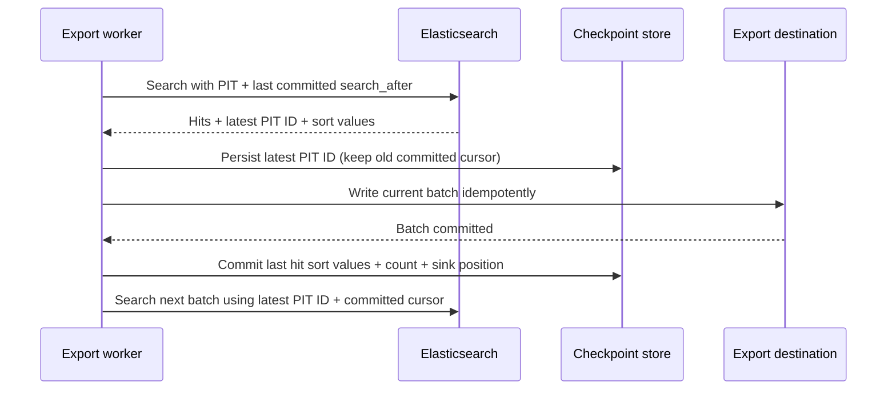
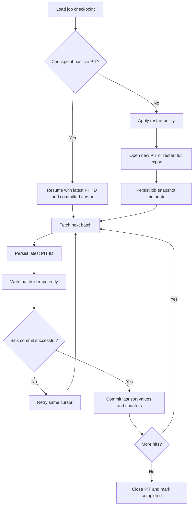

# Recovering from Interrupted Exports and Limits of Continuation Points

When exporting hundreds of thousands or millions of documents from Elasticsearch, an application typically cannot retrieve all data in a single request. Instead, it reads batch by batch, writes each batch to a file or target system, and continues until no results remain. If the process stops partway through, a crucial question arises: can it resume from the exact previous spot, or must it restart?

Elasticsearch offers mechanisms for traversing large result sets, such as the Scroll API and `search_after` paired with Point in Time (PIT). They support pagination and data traversal, but a cursor is not a durable export checkpoint. Scroll IDs and PIT IDs reference search contexts that exist for a limited window; they can expire or be lost when the cluster changes. `search_after` is simply the sort values of the last processed hit—it does not persist job state or guarantee resuming the exact same snapshot once a PIT is lost.

For reliable recovery, the application must manage checkpoints itself, persist cursor state at the right moment, write to the destination idempotently, and define clearly what happens when a search context expires. Once a snapshot is gone, you cannot guarantee continuing over the exact same set of documents simply by opening a new PIT and reusing an old cursor.

## 1. Why Do Exports Need Resumption Support?

Suppose a job exports the `orders` index to a JSONL file. The index holds 2 million documents; each request fetches 2,000 documents. The workflow might look like:

1. Open a consistent view of the index.
2. Fetch the first batch.
3. Write the batch to a file or data warehouse.
4. Persist a checkpoint for the successfully written batch.
5. Fetch the next batch.
6. Repeat until data is exhausted.

The job can be interrupted for many reasons:

- Process restart or server power loss.
- Container replacement during deployment.
- Network timeout preventing the application from receiving a response.
- Elasticsearch node or cluster restart.
- Scroll/PIT context exceeding `keep_alive`.
- Full destination disk, temporary database unavailability, or failed batch write transaction.
- Intentional stop for maintenance or configuration changes.

Always restarting from the beginning can incur steep read and write costs. Resuming at the wrong position can duplicate or drop data. Therefore, exports must distinguish three states:

| State | Meaning |
|---|---|
| Read | Elasticsearch returned the batch to the application |
| Durably written | The batch was committed to the export destination |
| Checkpointed | The job saved the last position confirmed as written |

Never equate "response received" with "export committed." If the application advances the cursor before destination data is durably persisted, a crash can lose a batch.

## 2. Three Concepts to Distinguish

### 2.1 Scroll ID

The Scroll API creates a search context to iterate sequentially through batches of a search result. The response returns `_scroll_id`; the application uses that ID to request the next batch. The search context preserves the data view at initial search time for a window extended via `keep_alive`.

A Scroll ID is a reference to a server-side context in Elasticsearch. It does not contain the data itself, is not a durable page number, and is not an offset you can recompute.

### 2.2 Point in Time ID (PIT ID)

PIT opens a stable view of an index for a bounded duration. Search requests use the PIT ID to query that snapshot across multiple calls. Every response may return a new PIT ID; the application must use the latest ID returned.

A PIT ID is also a reference to a server-side search context in Elasticsearch. It expires and can be lost. Saving a PIT ID to a database tells the application which ID to try upon restart, but it does not turn a PIT into a permanently persisted snapshot.

### 2.3 `search_after` Cursor

`search_after` is the array of sort values from the last hit of the previous batch. The next request sends the same query and sort along with that array to fetch hits positioned after the processed point.

For example, the last hit has:

```json
"sort": [
  "2025-03-12T10:30:00.000Z",
  "ORDER-900100"
]
```

The next request uses these exact two values:

```json
"search_after": [
  "2025-03-12T10:30:00.000Z",
  "ORDER-900100"
]
```

`search_after` stores no state in Elasticsearch and creates no snapshot. For consistent traversal while the index may still change, pair it with PIT. A cursor is meaningful only with the same query, sort, and data view.

## 3. Scroll API: Batch Traversal via Search Context

Scroll fits certain large batch export jobs, especially when scanning all results in an efficient internal order rather than UI pagination.

### 3.1 Opening a Scroll

The first request specifies `scroll` keep-alive and batch size:

```http
POST /orders/_search?scroll=2m
{
  "size": 2000,
  "sort": ["_doc"],
  "query": {
    "term": {
      "status": "COMPLETED"
    }
  }
}
```

The response contains the first batch and `_scroll_id`:

```json
{
  "_scroll_id": "DXF1ZXJ5...",
  "hits": {
    "hits": [
      { "_id": "order-1", "_source": { "status": "COMPLETED" } },
      { "_id": "order-2", "_source": { "status": "COMPLETED" } }
    ]
  }
}
```

`_doc` is an efficient sort choice when simply traversing documents without a specific business order. If the exported file requires a deterministic order by date or order code, pick an appropriate sort and accept its cost.

### 3.2 Fetching the Next Batch

Send the most recent scroll ID:

```http
POST /_search/scroll
{
  "scroll": "2m",
  "scroll_id": "DXF1ZXJ5..."
}
```

The response returns the next batch and may return a new `_scroll_id`. Always replace your stored ID with the latest ID returned by the response. Never assume the initial scroll ID remains valid for the entire job.

### 3.3 What Does `keep_alive` Mean?

`keep_alive` is how long Elasticsearch retains the search context since the most recent scroll request. Each time you continue scrolling, the application can request extending the context duration for the next call.

It is not the maximum duration of the entire job. A job can run many times longer than `keep_alive` if it keeps sending requests on time. Conversely, if the job pauses longer than the context retention window, the context may close and the scroll ID becomes unusable.

Choose a `keep_alive` long enough to process/write a batch and absorb transient delays. Avoid setting it arbitrarily long because each scroll context holds resources on the cluster.

### 3.4 Ending and Releasing the Scroll Context

When data is exhausted or the job is cancelled, delete the scroll context:

```http
DELETE /_search/scroll
{
  "scroll_id": ["DXF1ZXJ5..."]
}
```

If multiple scroll IDs need cleanup, pass the list per the API. In code, place the clear operation inside `finally` or an equivalent cleanup hook so the context is released on success or exception.

## 4. Recovery Limits of Scroll IDs

A Scroll ID is not a durable checkpoint. Understand these limitations:

1. **Context expiration:** if `keep_alive` elapses before the job continues, Elasticsearch may close the context.
2. **Cluster-resident context:** the application process can save the scroll ID string, but it cannot save the internal search context inside Elasticsearch.
3. **IDs can change:** you must use the latest ID from the response. If a response is lost before the application receives the new ID, the application may not know which ID to use next.
4. **Cluster restart or closed context:** an old scroll ID cannot reconstruct the snapshot by itself.
5. **No random access:** scroll is a sequential batch stream, not an API for jumping to arbitrary pages by offset.
6. **Resource consumption:** the context holds search state and required segments; opening too many scrolls or keeping them open too long strains the cluster.

If the scroll context is lost, you cannot simply take the last document ID and ask the Scroll API to resume from there. The Scroll API does not accept `_id` as an arbitrary recovery cursor. To restart, you must open a new search or switch to another cursor strategy; the new snapshot may no longer contain the exact initial dataset.

### 4.1 A Scroll ID Is Not Equivalent to an Export File Checkpoint

Suppose the application receives batch 12 and a new scroll ID, but has not written the batch to the file yet. If the process crashes, saving only the scroll ID does not tell you whether batch 12 was committed. If you resume and skip this batch, data is missing; if you rewrite it, duplicates may occur if the batch was written before the checkpoint updated.

Checkpoints must describe the state of the **export destination**, not merely the state of the Elasticsearch cursor. With the Scroll API, tying a durable checkpoint to a batch position is inherently limited because the cursor depends on a server-side search context.

## 5. PIT Combined with `search_after`

In modern Elasticsearch versions, the standard way to perform deep pagination and snapshot traversal is PIT combined with `search_after`.

- PIT keeps a stable view of the index.
- `search_after` determines the next position in the sort order.
- The application persists the cursor and job state to resume after a process restart, provided the PIT is still alive.

### 5.1 Opening a PIT

```http
POST /orders/_pit?keep_alive=5m
```

The response returns a PIT ID. The application saves this ID alongside job metadata.

### 5.2 Searching the First Batch

```http
POST /_search
{
  "size": 2000,
  "pit": {
    "id": "PIT_ID_FROM_OPEN",
    "keep_alive": "5m"
  },
  "query": {
    "term": {
      "status": "COMPLETED"
    }
  },
  "sort": [
    { "createdAt": "asc" },
    { "exportKey": "asc" }
  ]
}
```

Here `exportKey` is a unique, stable, sortable keyword field. `createdAt` defines business order; `exportKey` breaks ties among documents sharing the same timestamp.

When using PIT, Elasticsearch can add `_shard_doc` as an internal tie-breaker when needed. The sort values returned in each hit must be preserved intact to resend in `search_after`. A unique business field is also useful when inspecting or debugging checkpoints. Avoid using `_id` arbitrarily as a regular sort field; `_id` has sorting/doc-values limitations, so if sorting by identifier is needed, copy it into a keyword field with doc values enabled.

### 5.3 Searching the Next Batch

Suppose the last hit of the first batch returns:

```json
{
  "_id": "order-900100",
  "sort": [
    "2025-03-12T10:30:00.000Z",
    "ORDER-900100",
    4294967298
  ]
}
```

The next request passes the `sort` array verbatim in `search_after`:

```http
POST /_search
{
  "size": 2000,
  "pit": {
    "id": "LATEST_PIT_ID",
    "keep_alive": "5m"
  },
  "query": {
    "term": {
      "status": "COMPLETED"
    }
  },
  "sort": [
    { "createdAt": "asc" },
    { "exportKey": "asc" }
  ],
  "search_after": [
    "2025-03-12T10:30:00.000Z",
    "ORDER-900100",
    4294967298
  ]
}
```

The cursor array must preserve the exact element order, data types, and values returned by Elasticsearch. Do not convert timestamps to another timezone, round numbers, or save only a subset of the sort values.

### 5.4 Using the Latest PIT ID

Search responses may return a new PIT ID. Replace the saved PIT ID with the latest ID after every response. Like scroll IDs, never assume the initial ID remains valid for every subsequent request.

Each request can extend `keep_alive`. If the application fails to send a request within the PIT's retention window, the context can expire. A PIT does not stay alive indefinitely simply because its ID sits in an application database.

### 5.5 Closing the PIT

When the export finishes or is cancelled, close the PIT:

```http
DELETE /_pit
{
  "id": "LATEST_PIT_ID"
}
```

If a newer ID arrived after the last request, use that latest ID to close. If cleanup fails because the context already expired, log the status and let Elasticsearch reclaim the context per its lifecycle; do not loop close attempts infinitely.

## 6. Continuation Points Are Not Snapshots

`search_after` is merely a sort position. By itself, it does not preserve the data as of export start time. Consistency comes from PIT.

If you use `search_after` without PIT while the index continues accepting inserts, updates, or deletes:

- A new document with a sort value smaller than the cursor may fall before the cursor and be skipped.
- An updated document whose sort value changes may jump from behind the cursor to ahead of it or vice versa.
- A document deleted before being read will disappear.
- A document may be observed at a different position if ordering shifts between requests.

Therefore, an old cursor does not prevent duplicates or omissions when data changes.

### 6.1 PIT Creates a Search-View Snapshot

PIT preserves a stable view of the index at open time. Changes indexed afterward do not appear in the snapshot; documents existing in the snapshot continue to be read at their snapshot version.

This helps exports requiring consistency: an order updated after the PIT opened does not alter the content the job iterates within that PIT.

However, the snapshot exists only while the PIT context remains alive. It is not an independent on-disk copy of data dedicated to the job, nor is it an export transaction spanning arbitrary restarts.

### 6.2 Once a PIT Is Lost, You Cannot Recreate the Same Snapshot with an Old Cursor

If a PIT expires or is lost, opening a new PIT establishes a new view. Reusing an old `search_after` against the new PIT continues from the sort position in the new snapshot, but the document set and positions may have changed.

For example:

1. PIT A is opened at 10:00.
2. The job exported up to `createdAt = 10:30`, `exportKey = ORDER-900100`.
3. PIT A expires while the job is paused.
4. Between 10:00 and 10:20, new documents were added, old ones deleted, and several sort fields modified.
5. The job opens PIT B at 10:25 and uses the old cursor.

PIT B is not snapshot A. New documents may sit prior to the cursor and be skipped; modified documents may shift across the cursor boundary. There is no way to reconstruct snapshot A completely from the old cursor once context A is lost.

This is the fundamental limit of continuation points: the cursor indicates position, whereas the snapshot context defines the dataset and document versions that position refers to.

## 7. Designing Durable Checkpoints

The application must store export state in durable storage such as a database, checkpoint store, or atomically written manifest file. A useful checkpoint typically includes:

| Field | Meaning |
|---|---|
| `jobId` | Unique identifier of the export run |
| `index`/alias | Exported data source |
| `queryHash` | Fingerprint of the query/filter |
| `sortDefinition` | Sort order and sort-rule version |
| `pitId` | Latest PIT ID received, if using PIT |
| `searchAfter` | Sort values of the last committed hit |
| `lastDocumentId` | Last ID for observability/reconciliation, not a replacement for the sort cursor |
| `batchNumber` | Number of committed batches |
| `exportedCount` | Number of successfully written records |
| `sinkPosition` | Committed position/offset/file segment at the destination |
| `startedAt` | Start timestamp of the job/snapshot |
| `status` | `RUNNING`, `PAUSED`, `COMPLETED`, or `FAILED` |

Not every job needs every field. However, you must save enough metadata to know which query, sort, and index a cursor belongs to. Never reuse a cursor if the query or sort has changed.

### 7.1 Never Checkpoint Before Destination Data Commits

Wrong order:

1. Receive batch.
2. Save `search_after` as the last hit of the batch.
3. File write fails.
4. Restart from the new cursor.

The unwritten batch is skipped because the checkpoint already advanced.

Safer order:

1. Receive batch and new PIT ID.
2. Save the latest PIT ID while keeping the previously committed cursor.
3. Write the batch to the destination and commit durably.
4. Update the cursor to the sort values of the last hit of the newly committed batch.
5. Increment batch number and exported count.

If a crash occurs after step 2 and before step 3, the job rereads the same batch from the old cursor. If a crash occurs after step 3 and before step 4, the batch may be written again on resume. Hence, the export destination must be idempotent or able to recognize already-committed batches.

### 7.2 Persist New PIT ID and Committed Cursor Separately

The latest PIT ID and the last successfully written cursor have different update timings:

- The PIT ID should be saved as soon as a new response arrives so the job retains the latest context handle.
- `search_after` should advance only after the corresponding batch is durably written.

If both fields are bundled into a single checkpoint updated only after batch writes, a crash mid-write can lose the latest PIT ID. Conversely, updating the cursor too early can skip uncommitted batches. Save the PIT ID first, then commit the cursor once the sink confirms.

### 7.3 Example Processing Sequence



If the sink and checkpoint store support a shared transaction, commit batch data and cursor together in one transaction. If they are separate systems, design idempotency, page manifests, or an outbox-like protocol to bridge the gap between the two commits.

## 8. Handling Crashes and Retries

Not every failure has the same recovery path. Distinguish failures before sending the request, failures during Elasticsearch execution, lost responses, and destination write failures.

| Scenario | What can be known | Recovery approach |
|---|---|---|
| Process crashes after checkpoint commit | Cursor and sink position are saved | Resume from checkpoint if PIT is still alive |
| Sink write fails before commit | Batch was not confirmed | Retry batch from the old cursor |
| Sink commits but checkpoint did not advance | Data may already exist at destination | Reprocess batch via idempotent/deduplicating sink |
| PIT/scroll context expires | Snapshot context is gone | Cannot continue old snapshot; restart or use watermark strategy |
| Search response times out, unclear if completed | May not have received the new PIT ID | Retry with saved ID/cursor if context lives; treat as uncertain state |
| Elasticsearch returns shard/context error | Batch untrustworthy or context lost | Inspect response; bounded retry or restart job per policy |
| Cluster restart loses context | Old ID no longer references a valid context | Open a new snapshot and apply restart policy |

### 8.1 Retrying with the Same `search_after`

While the PIT is alive, if the sink has not committed the batch, resend the same query, sort, latest saved PIT ID, and last committed `search_after`. Results will resume right after the committed cursor.

This may return the partially processed batch again. That is intentional: the cursor represents the committed batch, not merely the received batch.

### 8.2 Request Timeouts and Lost Responses

A tricky case occurs when Elasticsearch processes the request but the response is lost on the network. The application does not know what new PIT ID the response carried. If the old PIT ID is still valid, you can retry the request with the committed cursor; however, do not rely on old IDs always staying valid, because the API expects using the latest received PIT ID.

To mitigate risk:

- Persist the new PIT ID immediately upon receiving a response.
- Keep the cursor at the last committed batch position.
- Use bounded retries and log request/job IDs.
- If context existence cannot be confirmed, transition the job to require initializing a new snapshot per policy.
- Use an idempotent sink capable of absorbing resent batches.

End-to-end exactly-once across Elasticsearch and an independent destination system cannot be achieved with `search_after` alone. Exactly-once requires a shared transaction or a sufficiently strong idempotency/deduplication protocol.

## 9. When PIT or Scroll Context Is Lost: Choosing a Recovery Policy

Once the context expires, the application must decide how to proceed. No single choice fits every export type.

### 9.1 Restarting the Full Export

Suitable when:

- Dataset size is moderate.
- The sink can overwrite by unique key or deduplicate.
- You want the freshest snapshot and do not require preserving the prior snapshot.
- Rerun cost is acceptable.

The job opens a new PIT, clears/rebuilds the target partition, or overwrites using idempotent keys. Semantics are simple, though it can be costly in time and resources.

### 9.2 Resuming from a Business Watermark

If documents have an immutable, monotonically increasing field such as `createdAt` or a source-assigned sequence, a watermark can partition ranges:

```text
createdAt <= 2025-03-12T10:30:00Z
```

The job records the last committed watermark, opens a new PIT, and queries documents after the watermark. This works well for append-only datasets or when update/delete handling rules are explicit.

However, a time watermark alone does not handle every mutation:

- Older documents updated after the watermark may not be reread.
- Deleted documents disappear and go undetected.
- Two documents sharing a timestamp require a unique tie-breaker.
- Clock skew or late-arriving data can introduce records with timestamps older than the watermark.

A more robust strategy uses `(updatedAt, uniqueKey)` as a composite cursor with an overlap window to reread near the watermark and deduplicate by ID/version. If deletes must be reflected, the source must provide tombstones, a change log, or CDC.

### 9.3 Exporting by Fixed Key Ranges or Partitions

If a stable partitioning key exists, split work into non-overlapping ranges:

```text
range A: exportKey from A000000 to A999999
range B: exportKey from B000000 to B999999
range C: exportKey from C000000 to C999999
```

Each partition maintains its own checkpoint. If one partition fails, only that partition reruns. This helps with large datasets having well-distributed keys, provided ranges cover all data without overlap. If keys can change, partitions may miss or duplicate documents.

### 9.4 Using a Durable Change Source

If exports must resume accurately over long periods, you may need a durable change source such as CDC, an event log, or snapshots persisted in another system. PIT/scroll contexts are built for search, not long-term job state storage.

An event log with durable offsets lets a job resume from its committed offset and process inserts, updates, and deletes in order. Elasticsearch can serve search queries while the log/CDC serves as the primary source for long-lived synchronization.

## 10. Sort Cursors Must Be Stable

`search_after` depends on sort order. If sorting is nondeterministic, batch boundaries become ambiguous when multiple documents share the same sort value.

### 10.1 Adding a Unique Tie-Breaker

For example, sorting only by `createdAt`:

```json
"sort": [
  { "createdAt": "asc" }
]
```

Many orders can share the same timestamp. Add a unique field:

```json
"sort": [
  { "createdAt": "asc" },
  { "exportKey": "asc" }
]
```

`exportKey` must:

- Be populated for every document in the export set.
- Be unique within the index or export scope.
- Remain unchanged for the snapshot's duration.
- Have a sortable mapping, typically `keyword` with doc values.

When using PIT, Elasticsearch may automatically add `_shard_doc` as an internal tie-breaker. Preserve the returned sort values intact. `_shard_doc` is meaningful only within that PIT context; do not treat it as a durable key for resuming after opening a new PIT.

### 10.2 Keeping Query and Sort Unchanged Across Batches

When resuming, keep constant:

- Source index or alias.
- Query/filters and their parameters.
- Sort fields, directions, and missing-value behavior.
- Mapping/export logic version.
- PIT context if using a snapshot.

Changing filters or sort mid-run invalidates the old cursor's logical position. Start a new job or a new partition with its own checkpoint instead.

### 10.3 Persisting Sort Values with Exact Types

If Elasticsearch returns a sort value as an integer, store it as an integer; if it is a date string, preserve the exact string/format; if null, do not replace it with an empty string. When serializing JSON checkpoints, use a serializer that preserves JSON types and element ordering.

Do not save only `lastDocumentId` and try to rebuild the `search_after` array when sorting on multiple fields. The last ID is insufficient to reconstruct all sort values.

## 11. Spring Data Elasticsearch: Scroll API

Spring Data Elasticsearch exposes scroll APIs through `ElasticsearchOperations`. Method names and return types vary across versions, but common release lines offer `searchScrollStart`, `searchScrollContinue`, and `searchScrollClear`.

Illustrative example:

```java
import java.util.List;

import org.springframework.data.elasticsearch.core.ElasticsearchOperations;
import org.springframework.data.elasticsearch.core.SearchScrollHits;
import org.springframework.data.elasticsearch.core.mapping.IndexCoordinates;
import org.springframework.data.elasticsearch.core.query.Query;
import org.springframework.data.elasticsearch.core.query.StringQuery;

public class OrderExportService {

    private final ElasticsearchOperations operations;

    public OrderExportService(ElasticsearchOperations operations) {
        this.operations = operations;
    }

    public void export() {
        long keepAliveMillis = 120_000L;
        IndexCoordinates index = IndexCoordinates.of("orders");
        Query query = new StringQuery("{\"term\":{\"status\":\"COMPLETED\"}}")
            .setPageable(org.springframework.data.domain.PageRequest.of(0, 1000));

        SearchScrollHits<Order> page = operations.searchScrollStart(
            keepAliveMillis,
            query,
            Order.class,
            index
        );

        String scrollId = page.getScrollId();

        try {
            while (page.hasSearchHits()) {
                writeBatch(page.getSearchHits());

                page = operations.searchScrollContinue(
                    scrollId,
                    keepAliveMillis,
                    Order.class,
                    index
                );

                scrollId = page.getScrollId();
            }
        } finally {
            if (scrollId != null) {
                operations.searchScrollClear(List.of(scrollId));
            }
        }
    }

    private void writeBatch(List<?> hits) {
        // Persist this batch to the export destination.
    }
}
```

This example illustrates the API flow; verify method signatures, return types, and empty-batch checks against your project's exact Spring Data Elasticsearch version. In production code, update `scrollId` to the latest ID before the next call and follow the durable batch-write and checkpointing rules described earlier.

### 11.1 Using `searchForStream`

Spring Data Elasticsearch also offers a stream/iterator API such as `searchForStream(...)` in supported versions. This is convenient for iterating `SearchHit<T>` sequentially and typically uses scroll underneath.

High-level example:

```java
try (SearchHitsIterator<Order> stream = operations.searchForStream(
        query,
        Order.class,
        IndexCoordinates.of("orders"))) {

    while (stream.hasNext()) {
        SearchHit<Order> hit = stream.next();
        writeOne(hit.getContent());
    }
}
```

Closing the iterator is necessary to release scroll/context resources. Streaming is convenient for sequential loops, but it does not automatically provide durable checkpoints to recover after a process kill. If resumption is needed, the application must still manage export state externally and may need lower-level scroll APIs to control IDs.

## 12. Spring Data and PIT/search_after

PIT and `search_after` are Elasticsearch Search API features. Spring Data Elasticsearch may expose abstractions for parts of them through `NativeQuery`/client integration depending on version; support levels and builder names vary by release.

When using PIT/`search_after`, the application needs control over:

- Opening a PIT and receiving its ID.
- Building a search request with PIT and keep-alive.
- Reading `sort` values of the last hit.
- Sending `search_after` for the next batch.
- Receiving and persisting the latest PIT ID from responses.
- Closing the PIT upon completion.

If your Spring Data version's abstraction does not expose all of these fields, you can call the Elasticsearch Java API Client directly for the export while still using Spring Data mapping/converters for document conversion. Avoid assuming `withPointInTime` or `withSearchAfter` exists in every version; check the actual API of your dependency.

REST examples show the clearest contract of the flow:

```http
POST /orders/_pit?keep_alive=5m
```

```http
POST /_search
{
  "size": 1000,
  "pit": {
    "id": "LATEST_PIT_ID",
    "keep_alive": "5m"
  },
  "query": {
    "term": {
      "status": "COMPLETED"
    }
  },
  "sort": [
    { "createdAt": "asc" },
    { "exportKey": "asc" }
  ],
  "search_after": [
    "2025-03-12T10:30:00.000Z",
    "ORDER-900100"
  ]
}
```

In practice, if the PIT response automatically appends a sort tie-breaker, the `search_after` array must include that value verbatim as returned.

## 13. Designing Recoverable Export Files

When writing to files, avoid blindly appending and writing checkpoints separately without synchronization rules. Several implementation options:

### 13.1 Per-Batch Files and a Manifest

Write each batch to its own file:

```text
export-job-42/
  batch-000001.jsonl
  batch-000002.jsonl
  batch-000003.jsonl
  checkpoint.json
```

Workflow:

1. Write the batch to a temporary file `batch-000004.tmp`.
2. Flush and close the file.
3. Atomically rename to `batch-000004.jsonl` on the same filesystem.
4. Update the manifest/checkpoint recording batch 4 as committed.

If a crash occurs after rename but before updating the checkpoint, restart recovery can detect that the batch file already exists and verify its checksum/count before marking it committed. Deterministic batch naming and metadata prevent accidental duplicate writes.

### 13.2 Appending to a Single File

When writing to a single JSONL file, the checkpoint must record the last committed byte offset or record boundary. On restart, you can truncate uncommitted trailing bytes if the format and filesystem support it. This is more complex because you must never save a cursor ahead of durably flushed bytes.

Never save a checkpoint after writing only to an in-memory buffer. Flush and, where durability demands it, sync data to storage before advancing the cursor.

### 13.3 Writing to Databases or Object Storage

For databases, use a unique key per document ID and idempotent upserts. For object storage, write each batch as a distinct object and track completed objects in a manifest. Regardless of sink, commit the checkpoint only after the sink confirms durable batch persistence.

## 14. Exactly-Once, At-Least-Once, and Deduplication

In distributed systems, an application can face an uncertainty window between two operations: Elasticsearch returned data, yet either the sink or the checkpoint has not confirmed. Without a shared transaction, strict single-write guarantees per record are difficult to achieve.

### 14.1 At-Least-Once

The job advances the cursor only after the batch commits. When a crash occurs between sink commit and checkpoint commit, the batch is reread and may be written again. These are at-least-once semantics.

To prevent duplicate final output, the sink must be idempotent:

- Upsert by `_id` or unique business key.
- Name objects deterministically from job ID and batch number.
- Enforce unique constraints in the target database.
- Use a manifest or deduplication key to recognize completed batches.

### 14.2 At-Most-Once

Updating the cursor before the sink commits means a crash can skip rewriting a batch. That resembles at-most-once semantics and risks data loss. It is unsuitable for exports requiring complete record preservation.

### 14.3 Exactly-Once

End-to-end exactly-once requires a shared transaction spanning sink and checkpoint or an idempotency protocol strong enough that observed outcomes are equivalent to exactly-once. Scroll IDs, PIT IDs, and `search_after` alone do not provide this guarantee.

For file exports, the practical standard is at-least-once paired with deterministic batch files/record keys and manifest commits. For databases, ID-based upserts and transactional checkpoints can be simpler.

## 15. Limits of Cursors and Snapshots

Continuation mechanisms differ in their limits:

| Mechanism | Cursor | Snapshot | Can resume after process restart? | Main limitation |
|---|---|---|---|---|
| `from`/`size` | Offset | Does not preserve a snapshot | Offset can be resent | Deep paging is expensive; data changes cause duplicates/gaps |
| Scroll | Server-side Scroll ID | Yes, inside scroll context | Only while context lives and latest ID was saved | Context expires, consumes resources; lost context cannot resume old snapshot |
| `search_after` without PIT | Sort values | No | Cursor can be resent | Data changes shift ordering, risking skips/duplicates |
| PIT + `search_after` | Sort values + PIT ID | Yes, inside PIT context | Yes, if PIT lives and checkpoint is complete | Once PIT expires/is lost, old snapshot cannot be restored |
| Business watermark | Business value/sequence | No built-in snapshot | Can start a new job from watermark | Needs immutable/append-only data or CDC for updates/deletes |

No single cursor solves every export challenge. Choose based on consistency requirements, runtime, restartability, and source mutability.

## 16. Common Mistakes

### 16.1 Saving Scroll ID Without Saving Sink State

On restart, the job does not know whether the last batch was written. Save both cursor and batch/sink position; design idempotent writes for safe replay.

### 16.2 Using an Old Scroll ID After Receiving a New ID

Scroll IDs can change per response. Always update and use the latest ID.

### 16.3 Trying to Continue After Scroll Context Expiration

A Scroll ID cannot reconstruct a closed context. Opening a new search starts a new snapshot; apply a restart policy rather than retrying the old ID infinitely.

### 16.4 Saving PIT ID but Forgetting to Extend keep_alive

A PIT ID does not keep the context alive forever. Subsequent requests must send a sufficient `keep_alive`; job pauses can outlast the window.

### 16.5 Omitting PIT When the Index Is Changing

`search_after` without PIT creates no snapshot. Inserts, updates, or deletes can shift documents across the cursor, causing duplicates or omissions.

### 16.6 Saving Only the Last ID Without Sort Values

If sorting on timestamp and unique key, the last ID alone cannot rebuild the cursor array. Persist the last hit's entire `sort` array.

### 16.7 Changing the Query Mid-Job

Cursors are meaningful only within a specific query/sort context. Changing filters, sorting, or index invalidates the cursor. Bind query hash and sort version to the checkpoint.

### 16.8 Checkpointing Before Flushing Destination Data

If the file or database has not committed while the cursor advances, a batch can be skipped. Advance the cursor only after the sink confirms durable persistence.

### 16.9 Failing to Handle Duplicate Batches on Retry

A crash after sink commit but before checkpoint commit can rewrite a batch. Use unique IDs, upserts, deterministic batch files, or deduplication.

### 16.10 Holding Too Many Contexts Open

Scroll/PIT contexts consume resources. Close contexts when finished, limit concurrent jobs, and pick moderate `keep_alive` values.

## 17. Workflow for Implementing a Resilient Export Job

A practical workflow can be structured as follows:



Key steps:

1. **Create job:** persist job ID, index, query hash, sort definition, batch size, and sink target.
2. **Open snapshot:** create PIT and store its ID and start timestamp.
3. **Read batch:** use the latest PIT and committed cursor.
4. **Persist PIT ID:** update the new ID immediately upon receiving the response while keeping the committed cursor unchanged.
5. **Write destination:** write the batch idempotently and confirm durability.
6. **Commit cursor:** persist `sort` values of the batch's last hit, batch number, count, and sink position.
7. **Loop:** read the next batch.
8. **Finalize:** close PIT, record `COMPLETED` status, and persist final checksum/count.
9. **Recover:** if the PIT is still alive, resume; otherwise apply the defined restart policy.

## 18. Verifying Completeness After Export

A finished job does not automatically prove the destination file is complete. Store and reconcile metrics such as:

- Total hits in the snapshot, if accurately obtainable.
- Total documents successfully written.
- Count of committed batches.
- First and last IDs or final sort cursor.
- Count of failed/quarantined documents.
- Per-batch/file checksums if corruption detection is needed.
- Query hash and snapshot timestamp.

If the query requested exact `track_total_hits`, you can compare total hits against exported records, bearing in mind they may differ if the job intentionally filters records, deduplicates, or routes failures elsewhere. Define the reconciliation formula explicitly.

For JSONL files, verify line counts and checksums. For target databases, verify unique key counts and upserted record counts. Never rely solely on a `"job completed"` log entry.

## 19. Guidelines for Choosing a Mechanism

- Use Scroll for sequential batch scanning without needing a business cursor when per-batch processing stays shorter than `keep_alive`.
- Use `PIT + search_after` for deep, stably ordered traversal over a snapshot.
- Use `from`/`size` for UI pagination at shallow depths, never for exporting millions of records.
- Use watermarks/sequences or CDC when resumption must outlive search context lifetimes.
- Persist the latest PIT/scroll ID while recognizing they are ephemeral context handles, not durable checkpoints.
- Save complete sort values, query hash, sort definition, and sink state.
- Advance the cursor only after the batch commits durably.
- Design idempotent sinks because batches can be replayed.
- Never pair an old cursor with a new query or sort.
- If a PIT/scroll context is lost, never claim the same snapshot continued; restart or use an explicitly understood bounded watermark/deduplication policy.
- Close PIT/scroll contexts upon completion and cap concurrent contexts.

## 20. Summary

Scroll IDs and PIT IDs are references to ephemeral search contexts in Elasticsearch. They enable iterating a result set across requests, yet they expire, can change, and vanish when contexts close or clusters change. `search_after` stores only the last hit's sort position; it neither creates a snapshot nor manages export state.

PIT combined with `search_after` is well suited for deep traversal over a stable snapshot. To recover after process restarts, persist the latest PIT ID, all sort values of the last committed hit, query/sort definitions, and destination state. Write batches durably before advancing the cursor; use idempotent sinks to handle crashes occurring between write commit and checkpoint commit.

Once a PIT or scroll context expires, you cannot reconstruct the exact prior snapshot from a cursor alone. Opening a new PIT introduces a new view of the data, which can yield duplicates or gaps if the source changed. When long-lived resumability is required, use watermarks/sequences, fixed partitions, or change logs/CDC and define explicit rules for updates and deletes. Export reliability comes from coordinating cursor, snapshot, checkpoint, and destination writes—not from the pagination API alone.

## References

- [Elasticsearch — Scroll search results](https://www.elastic.co/guide/en/elasticsearch/reference/current/scroll-api.html)
- [Elasticsearch — Point in time API](https://www.elastic.co/guide/en/elasticsearch/reference/current/point-in-time-api.html)
- [Elasticsearch — Paginate search results](https://www.elastic.co/guide/en/elasticsearch/reference/current/paginate-search-results.html)
- [Spring Data Elasticsearch — Search operations](https://docs.spring.io/spring-data/elasticsearch/reference/elasticsearch/template.html)
