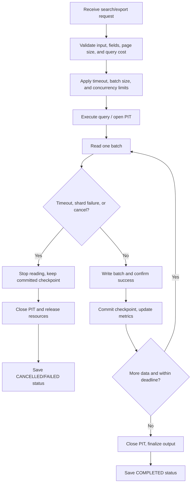

# Bounding Large Queries, Operation Cancellation, and Resource Control

An Elasticsearch query can return very few documents and still consume heavy CPU, heap, I/O, or resources across multiple shards. This happens frequently when an application exports large datasets, runs high-cardinality aggregations, executes wildcard/fuzzy searches, or permits high concurrency.

In Spring Data Elasticsearch, calling `ElasticsearchOperations.search(...)` or the Elasticsearch Java API Client does not bypass cluster resource limits. The application must enforce boundaries on both sides: limiting request scope and complexity, and capping batch sizes, concurrent tasks, execution time, and in-memory buffers. When a user cancels an export or the application shuts down, the system must also stop further reads, release PIT/search contexts, and record clear job state.

This lesson focuses on four goals: bounding expensive queries, setting appropriate timeouts, cancelling operations cleanly, and controlling resources end-to-end across a search/export pipeline.

## 1. A Small Hit Count Can Still Be Very Expensive

Suppose a screen requests only 20 results:

```json
GET products/_search
{
  "size": 20,
  "query": {
    "wildcard": {
      "name.raw": "*phone*"
    }
  },
  "aggs": {
    "all_skus": {
      "terms": {
        "field": "sku",
        "size": 50000
      }
    }
  }
}
```

The response returns at most 20 hits, yet Elasticsearch may still have to:

- Evaluate a huge number of terms due to a leading `*` wildcard.
- Read across many segments and shards to find matching documents.
- Compute aggregations across all matching documents, not merely the 20 returned hits.
- Build numerous buckets and hold intermediate structures to reduce results across shards.
- Transfer a massive aggregation response over the network and deserialize it in the application.

Thus, `size: 20` never guarantees a cheap request. Evaluate the query, aggregations, shard fan-out, total hit tracking, and response payload together.

## 2. Important Elasticsearch Limits

Elasticsearch enforces several safeguards to protect the cluster. Some apply per index, others per cluster or request, and some vary by version.

| Limit / mechanism | What it controls | Key considerations |
|---|---|---|
| `index.max_result_window` | Pagination depth via `from` + `size` | Typically defaults to 10,000. Do not raise it just to scan an entire index. |
| `search.max_buckets` | Aggregation bucket count in a single response | Multi-dimensional or high-cardinality aggregations can breach this cap. |
| `track_total_hits` | Cost of counting exact total hits | Disable or cap counting when exports do not need exact totals. |
| Search `timeout` | Wait time limit for shard-level search | Can yield partial results; always check `timed_out` and shard failures. |
| `terminate_after` | Maximum documents collected per shard | Used for early termination in certain cases; unsuitable for complete exports. |
| `search.allow_expensive_queries` | Certain high-cost query types | Not a general-purpose limiter; understand its impact on wildcard, regexp, fuzzy, and related queries. |
| Circuit breakers | Protects heap from oversized allocations | Requests may be rejected when tripped; do not treat as application throttling. |
| Thread pools and queues | Number of search tasks running/queued | Full queues lead to rejections; enlarging queues does not add processing capacity. |

Defaults and configurability vary by Elasticsearch version. Check your actual cluster settings before relying on specific numbers.

## 3. Bounding Pagination and Response Size

For UIs, `Pageable` and `from`/`size` fit initial pages. For deep queries or exports, use `search_after` with PIT as covered in the data-scanning lessons.

Example request enforcing a page size ceiling:

```java
int requestedSize = request.pageSize();
int pageSize = Math.min(Math.max(requestedSize, 1), 100);

Pageable pageable = PageRequest.of(
    request.page(),
    pageSize,
    Sort.by(Sort.Direction.DESC, "createdAt")
);
```

Never forward an unbounded page size from clients into Elasticsearch. Enforce a server-side ceiling and validate page numbers so offsets never exceed `max_result_window`.

For exports, pick batch size based on actual payload size. A batch of 500 documents may be lightweight for small documents, yet massive if `_source` holds nested arrays, long descriptions, or unnecessary fields. Use source filtering to fetch only required export fields:

```json
GET orders/_search
{
  "size": 500,
  "_source": ["orderId", "createdAt", "status", "total"],
  "query": {
    "term": {
      "status": "COMPLETED"
    }
  }
}
```

Trimming `_source` cuts network payload, deserialization overhead, and application heap usage. Never pull whole documents when the export file needs just a handful of fields.

## 4. Bounding Query Cost

Beyond hit counts, constrain query structure.

### 4.1. Wildcard, Regexp, and Fuzzy Queries

Leading `*` wildcards or broad regular expressions can force Elasticsearch to scan many terms. Fuzzy queries can likewise expand into numerous similar terms.

Guidelines:

- Prefer `match`/`multi_match` for standard full-text search.
- Use `prefix` or dedicated autocomplete mappings when prefix matching suffices.
- Enable leading wildcards, regexps, and fuzzy matching only when products genuinely require them.
- Cap the length and count of user-supplied expressions.
- Monitor latency and rejections on production-scale data.

### 4.2. Field Counts and Boolean Clauses

Searching across too many fields or constructing Boolean queries with huge branch counts inflates clause counts and query planning work. Do not let clients submit arbitrary field lists. Whitelist allowed fields, limit filter counts, and construct queries through controlled API structures.

### 4.3. High-Cardinality Aggregations

`terms` aggregations on fields with huge numbers of unique values can spawn vast bucket counts. Hit `size` does not limit bucket count. Request only facets the UI genuinely needs, keep bucket sizes modest, and evaluate composite aggregations when paginating buckets page by page.

Do not use a `terms` aggregation with an enormous `size` as a makeshift way to export all distinct values. Composite aggregations are built for bucket pagination with an `after_key` cursor; keep the same query and aggregation setup across pages.

### 4.4. Tracking Total Hits

When a task merely scans documents for export, counting exact total hits upfront is usually unnecessary. Disable `track_total_hits` in the request to skip exact counting overhead:

```json
GET orders/_search
{
  "track_total_hits": false,
  "size": 500,
  "query": {
    "term": {
      "status": "COMPLETED"
    }
  }
}
```

If the UI needs a counter, cap exact counting or enable exact tracking per product requirements. Do not assume every request needs an exact total count.

## 5. Timeouts Do Not Equal Full Cancellation

A request spans several timeout layers:

1. Client/HTTP transport timeout: the application stops waiting for a response after an interval.
2. Search timeout inside Elasticsearch: search may stop collecting hits past the limit and return a response with `timed_out: true` or shard failures.
3. Application deadline: the entire job must finish within a business-permitted window.
4. PIT/scroll context timeout: server resources are retained for `keep_alive` unless extended.

These layers do not substitute for one another. A client timing out does not prove Elasticsearch stopped executing the request. Nor does a search timeout guarantee every shard halted at a hard wall-clock boundary.

### 5.1. Setting a Search Timeout

The Search API supports a `timeout` parameter:

```json
GET orders/_search
{
  "timeout": "5s",
  "size": 100,
  "query": {
    "term": {
      "status": "COMPLETED"
    }
  }
}
```

On timeout, Elasticsearch may return partial results. The application must inspect `timed_out` and shard metadata in the response.

For UIs, partial results are sometimes acceptable if the product clearly communicates the status. For exports requiring complete data, never mark a file successful when a response or batch reports timeouts or failed shards without an explicit handling policy.

### 5.2. Rejecting Partial Results When Completeness Is Required

The Search API provides `allow_partial_search_results`. For workloads requiring every shard to succeed, set it to `false`:

```json
GET orders/_search?allow_partial_search_results=false
{
  "timeout": "10s",
  "size": 500,
  "query": {
    "term": {
      "status": "COMPLETED"
    }
  }
}
```

This fails the request when complete results cannot be returned per Search API semantics. The application must still handle exceptions, timeouts, PIT expiry, and destination errors. Never check only HTTP status while ignoring `timed_out` or shard failures.

### 5.3. Overall Job Deadline

An export runs across many batches. Each batch may complete in 2 seconds while the whole job runs for hours. Alongside per-request timeouts, enforce an overall deadline or maximum runtime policy for the job.

For example, an export job might configure:

- Overall deadline: 30 minutes.
- Per-search-request timeout: 10 seconds.
- PIT `keep_alive`: 2 minutes, extended on every request.
- Maximum 3 retries for transient failures.
- Maximum 2 concurrent exports per tenant.

These numbers are illustrative; tune them to SLAs, cluster load, and dataset size.

## 6. Validating Responses Before Accepting a Batch

For exports, consider a batch successful only when:

- The request completed within timeout policy.
- No shard failures occurred outside allowed policy.
- The response was not marked `timed_out` when completeness is required.
- All exported documents converted cleanly or followed record-error policy.
- The destination confirmed durable batch writes.

Example response check using the Elasticsearch Java API Client:

```java
SearchResponse<OrderExportRow> response = client.search(request, OrderExportRow.class);

if (Boolean.TRUE.equals(response.timedOut())) {
    throw new ExportBatchIncompleteException("Elasticsearch search timed out");
}

if (response.shards() != null && response.shards().failed() > 0) {
    throw new ExportBatchIncompleteException("One or more shards failed");
}
```

Verify exact accessor names and response types against your Elasticsearch Java API Client version. The principle is never treating a timed-out or shard-failed response as a complete batch.

## 7. User-Initiated Cancellation

An export job should maintain explicit states, for example:

```text
QUEUED -> RUNNING -> COMPLETED
                  -> CANCELLING -> CANCELLED
                  -> FAILED
```

When a user clicks Cancel:

1. The API marks the job `CANCELLING`.
2. The worker checks a cancellation token before dispatching each new batch.
3. If a request is in flight, the application requests stopping via the appropriate client/task mechanism.
4. No further batches are fetched.
5. Any in-progress batch write finishes or rolls back per destination policy.
6. The PIT is closed or the scroll is cleared.
7. `CANCELLED` status and the last committed checkpoint are saved.

Do not simply flip the database status to `CANCELLED` while the worker keeps reading Elasticsearch and writing files. Job status must reflect that resources have stopped and cleanup completed.

## 8. Client Cancellation Differs from Elasticsearch Task Cancellation

With synchronous APIs, interrupting a thread or closing a client connection stops the application from waiting, yet it does not always guarantee the cluster-side search task stops immediately.

With asynchronous APIs, you can cancel the client-side future/subscription. However, whether cancellation propagates to the server depends on the client, transport, and request type. Verify your version's behavior.

Elasticsearch provides a Task Management API for operations exposed as cancellable tasks. You can list running tasks:

```http
GET _tasks?actions=indices:data/read/search*
```

Task responses include ID, action, description, running time, and a `cancellable` flag. Only tasks supporting cancellation can be requested to cancel via the task API:

```http
POST _tasks/{task_id}/_cancel
```

Do not assume every synchronous search request exposes a task ID for direct cancellation. Verify actual tasks and their `cancellable` flags on your cluster version. For short batched searches, the most effective approach is stopping before the next batch, setting tight request timeouts, and closing the PIT upon exit.

Task cancellation is a broad administrative operation. Never let end users pass arbitrary `task_id` values to cancel other systems' tasks; application APIs must tie tasks strictly to authenticated job IDs and ownership.

## 9. Cancellation Tokens in Services

An export worker can accept a cancellation token abstraction managed by the job manager. Conceptual example:

```java
public interface CancellationToken {
    boolean isCancellationRequested();

    default void throwIfCancellationRequested() {
        if (isCancellationRequested()) {
            throw new ExportCancelledException();
        }
    }
}
```

The worker checks the token before each request and before writing a batch:

```java
while (true) {
    cancellationToken.throwIfCancellationRequested();

    SearchResponse<OrderExportRow> response = fetchNextBatch(cursor);
    validateCompleteResponse(response);

    cancellationToken.throwIfCancellationRequested();
    destination.write(response.hits().hits());

    checkpointStore.commit(cursorOfLastHit(response));

    if (response.hits().hits().isEmpty()) {
        break;
    }
}
```

This pseudocode illustrates cancellation check points; adapt response types and ordering to your actual implementation. If cancellation triggers after the destination writes a batch but before the checkpoint commits, a subsequent retry may rewrite that batch. Destinations should support idempotency or temporary-file staging to handle this safely.

## 10. Closing PIT and Releasing Resources on All Exit Paths

PIT keeps a search context on the cluster. Whether the export is cancelled, hits a mapping error, times out, or fails writing to the destination, the PIT must still be closed.

Example `try/finally` structure:

```java
String pitId = openPointInTime();

try {
    scanBatches(pitId, cancellationToken);
} catch (ExportCancelledException ex) {
    markCancelled();
    throw ex;
} catch (Exception ex) {
    markFailed(ex);
    throw ex;
} finally {
    closePointInTimeIfOpen(pitId);
}
```

If responses return a new PIT ID, update `pitId` and close using the latest ID. Never close with a stale ID after the server has issued a replacement.

When using the Scroll API, call clear scroll on completion. When using streams, file writers, temporary files, or other resources, close them in `try-with-resources` or `finally` accordingly.

## 11. Controlling Concurrency

A single export job may be reasonable on its own yet overload the system if 50 users simultaneously start full-dataset exports.

Applications should implement admission control:

- Cap total running exports system-wide.
- Cap exports per tenant or user.
- Cap in-flight search requests per job.
- Queue or reject new jobs once limits are reached.
- Prioritize interactive UI searches over batch exports when workloads share infrastructure.

Example using a semaphore to cap export workers within a single process:

```java
import java.util.concurrent.Semaphore;

public class ExportAdmissionControl {

    private final Semaphore slots = new Semaphore(2);

    public void runExport(Runnable exportTask) {
        if (!slots.tryAcquire()) {
            throw new ExportCapacityExceededException();
        }

        try {
            exportTask.run();
        } finally {
            slots.release();
        }
    }
}
```

A `Semaphore` in this example limits concurrency within one JVM only. Across multiple replicas, enforce distributed limits via queues, job schedulers, or shared state stores. Also retain the permit until the worker truly halts; never release it the instant an API acknowledges a cancel request.

## 12. Backpressure and Memory Control

Never read new batches faster than the destination can write them. If Elasticsearch returns 500 documents in 100 ms while a file writer needs 3 seconds, continuing to read builds up queues that can exhaust heap.

A safe pipeline typically processes sequentially:

```text
Elasticsearch batch
        |
        v
Convert / validate
        |
        v
Write destination
        |
        v
Flush / confirm
        |
        v
Commit checkpoint
        |
        v
Read next batch
```

Fetch the next batch only after the current batch is processed and confirmed. When using parallel producers/consumers, enforce bounded queues and worker limits. Unbounded queues simply shift the memory problem from document lists into the queue.

Lower memory usage by:

- Using `_source` filtering to fetch only required export fields.
- Sizing batches by byte weight and heap usage, not document count alone.
- Streaming output instead of building a `List` containing all results.
- Avoiding retaining response, entity list, and DTO list simultaneously unless required.
- Dropping batch references once writes finish.
- Avoiding spawning a dedicated thread per export request.

## 13. Retries, Backoff, and Avoiding Retry Storms

Under cluster overload, requests may be rejected or time out. If every worker retries immediately, load spikes further and worsens the outage.

A sound retry policy should:

- Retry only transient failures such as rejections, timeouts, or network drops.
- Never retry validation, query parsing, mapping, or authorization errors as though they will self-heal.
- Apply exponential backoff with jitter.
- Cap retry counts and total retry duration.
- Lower concurrency or batch size when rejections rise.
- Never advance checkpoints for uncommitted batches.
- Keep destinations idempotent in case writes are replayed.

Conceptual backoff example:

```java
Duration delayForAttempt(int attempt) {
    long baseMillis = 250L;
    long maxMillis = 10_000L;
    long exponential = Math.min(maxMillis, baseMillis * (1L << attempt));
    long jitter = ThreadLocalRandom.current().nextLong(0, Math.max(1, exponential / 3));
    return Duration.ofMillis(exponential + jitter);
}
```

This snippet illustrates growing wait times; real implementations must bound `attempt` to prevent overflow and honor retry budgets and cancellation tokens while sleeping. Never retry a batch indefinitely while holding a PIT if the PIT might expire.

## 14. Cancellation During Application Shutdown

When Spring Boot receives a shutdown signal, export workers must stop cleanly:

1. Stop accepting new jobs.
2. Flag running jobs for cancellation or allow completion within a grace period per policy.
3. Stop dispatching new batches upon cancellation.
4. Finish or roll back any in-flight batch write as supported by the destination.
5. Commit the checkpoint for the last successfully written batch.
6. Close PITs, writers, streams, and other resources.
7. Wait for workers to exit within the allowed shutdown window.

Avoid letting the JVM terminate abruptly while workers are writing files or holding PITs. If the grace period expires, transition jobs to an interrupted state so subsequent runs can resume per policy.

For file exports, a useful pattern is writing to a temporary file, flushing and closing it, and renaming it to the final filename upon full completion. Incomplete outputs are never mistaken for finished files if a job is cancelled mid-way. Atomic rename guarantees depend on the filesystem and file location.

## 15. Monitoring Resources and Export Quality

You cannot control resources effectively without measuring them. Emit metrics per job and per batch:

| Metric | What it reveals |
|---|---|
| Job duration | Whether exports breach SLAs or run abnormally long. |
| Batch latency | Whether search or destination writes are the bottleneck. |
| Batch document count and response bytes | Whether batch size fits payload targets. |
| Heap usage / GC pauses | Whether the application retains too much data. |
| Active export jobs | Whether concurrency limits are approached or breached. |
| Queue depth | Whether pending jobs are backing up. |
| Search rejections / timeouts / shard failures | Whether the cluster is overloaded or experiencing shard issues. |
| PIT age / open PIT count | Whether jobs hold search contexts open too long. |
| Retry count | Whether repeated transient errors are occurring. |
| Exported rows / checkpoint position | Whether jobs progress steadily and remain resumable. |

Include `jobId`, `batchNumber`, duration, document count, and status in logs. Avoid logging full queries containing sensitive data, document contents, PIT IDs, or credentials. Use trace/correlation IDs to link application requests with Elasticsearch logs when needed.

## 16. Example Configuration for a Bounded Export Job

Job configuration can centralize resource bounds in one place:

```java
public record ExportLimits(
    int batchSize,
    int maxConcurrentJobs,
    Duration requestTimeout,
    Duration pitKeepAlive,
    Duration maxJobDuration,
    int maxRetries
) {
}
```

Example environment values:

```yaml
app:
  elasticsearch-export:
    batch-size: 500
    max-concurrent-jobs: 2
    request-timeout: 10s
    pit-keep-alive: 2m
    max-job-duration: 30m
    max-retries: 3
```

These values are illustrative starting points. Tune them according to document size, cluster throughput, SLAs, replica counts, and real resource limits. Never scatter these bounds as magic constants across multiple services.

A job manager can use this configuration to:

- Reject or queue requests when `maxConcurrentJobs` is reached.
- Supply a fixed batch size that clients cannot inflate arbitrarily.
- Set per-search-request timeouts.
- Extend PITs using `pitKeepAlive`.
- Terminate jobs reaching `maxJobDuration`.
- Retry transient errors up to `maxRetries` times.
- Record metrics and job status on each batch.

## 17. Common Mistakes

| Symptom | Possible cause | Resolution |
|---|---|---|
| Search returns few hits yet runs slowly | Query or aggregation processes a large document set | Inspect query profile, trim fields/aggregations, and optimize mappings. |
| Export stops at 10,000 results | Using `from`/`size` past the result window | Switch to `PIT + search_after`. |
| Export file misses data yet reports success | Ignoring `timed_out` or shard failures | Validate responses and flag incomplete batches when needed. |
| UI cancels job yet worker keeps running | Only flipped job status without propagating cancellation to worker | Use a cancellation token and exit the loop before the next batch. |
| Thread interrupted yet cluster keeps processing | Client cancellation does not guarantee server task halted | Set timeouts, close contexts, and use Task API for cancellable tasks. |
| PITs stay open too long | Missing cleanup on exception/cancellation | Close PIT in `finally` using the latest PIT ID. |
| Heap climbs steadily | Reading faster than writing or accumulating all results | Use bounded batches, backpressure, and streaming. |
| Cluster repeatedly rejects searches | Too many concurrent exports or oversized batches | Lower concurrency/batch size, queue jobs, and add backoff. |
| Retries amplify load | Immediate, unbounded retries | Use exponential backoff, jitter, and retry budgets. |
| Multiple replicas breach concurrency limit | Using a single-JVM semaphore | Use distributed queues or shared concurrency limits. |
| Partial export file appears as finished output | Writing directly to final filename | Stage to temporary files and finalize/rename upon completion. |

## 18. Safe Design and Operations Workflow



Operational checklist:

- Enforce page size and batch size caps on the server.
- Use `search_after + PIT` for deep scans.
- Fetch only needed fields via source filtering.
- Bound aggregation buckets and avoid unnecessary wildcards/fuzzy queries.
- Disable exact total hit tracking when exports do not need it.
- Configure per-request timeouts and overall job deadlines.
- Validate `timed_out` and shard failures before accepting any batch.
- Use cancellation tokens and an explicit job state machine.
- Close PITs/scrolls on every exit path.
- Cap concurrency and apply backpressure.
- Retry transient failures with backoff, jitter, and retry budgets.
- Commit checkpoints only after the destination confirms durable writes.
- Monitor latency, heap, rejections, PITs, and batch counts.
- Finalize output files only after the entire export succeeds.

## 19. Conclusion

Large queries must be bounded across multiple layers: pagination depth, batch size, aggregation bucket counts, query complexity, total hit tracking, request duration, and concurrent execution count. A small `size` does not guarantee a cheap request, and a timeout does not mean the server task was fully cancelled.

For exports, read in batches using `PIT + search_after`, cap concurrency, enforce backpressure, fetch only needed fields, and commit checkpoints only after destination writes succeed. When users cancel or the application shuts down, halt new batch reads, finish or roll back the active batch per policy, close the PIT, and update job status.

Distinguish client timeouts, Elasticsearch search timeouts, job deadlines, and PIT lifetimes. Inspect `timed_out` alongside shard failures before treating any batch as complete. Combining input bounds, controlled retries, metric observability, and reliable cleanup enables Spring Data Elasticsearch applications to handle large queries while protecting both application and cluster resources.
