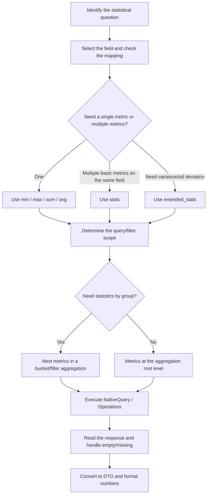

# Metric Aggregations with min, max, sum, avg, and stats

In Elasticsearch, aggregations let you compute statistics over the set of documents matching a query. **Metric aggregations** focus on calculating numeric values such as minimum, maximum, sum, average, or multiple statistics at once. Spring Data Elasticsearch can build these aggregations using `NativeQuery` and execute them via `ElasticsearchOperations`.

The five common metrics are:

- `min`: the minimum value.
- `max`: the maximum value.
- `sum`: the sum of values.
- `avg`: the average value.
- `stats`: combines `count`, `min`, `max`, `avg`, and `sum` in a single aggregation.

Calculations are performed on indexed fields and over the document set received by the aggregation. Therefore, mappings, query filters, missing values, numeric types, and bucket scopes all affect the results.

## 1. What are metric aggregations used for?

Suppose the `products` index stores products with these fields:

| Field | Mapping | Example |
|---|---|---|
| `name` | `text` | `Wireless Headphones` |
| `category` | `keyword` | `audio` |
| `priceInCents` | `long` | `12990` |
| `stock` | `integer` | `45` |
| `rating` | `double` | `4.6` |

An admin page might need to know:

- The lowest and highest price of products on sale.
- Total stock quantity.
- Average price of products in a category.
- Price statistics including value count, min, max, average, and sum.

There is no need to load all documents into the application and calculate them yourself in Java. Elasticsearch can compute directly over indexed data and return only the statistical numbers.

Example request computing metrics only:

```json
GET products/_search
{
  "size": 0,
  "query": {
    "term": {
      "status": "ACTIVE"
    }
  },
  "aggs": {
    "minimum_price": {
      "min": {
        "field": "priceInCents"
      }
    },
    "maximum_price": {
      "max": {
        "field": "priceInCents"
      }
    },
    "total_stock": {
      "sum": {
        "field": "stock"
      }
    },
    "average_rating": {
      "avg": {
        "field": "rating"
      }
    },
    "price_stats": {
      "stats": {
        "field": "priceInCents"
      }
    }
  }
}
```

`size: 0` instructs Elasticsearch not to return the hit list, only aggregations. The `status = ACTIVE` condition limits the document set used for all metrics in the request.

## 2. Mapping must fit the calculation

Metric aggregations operate on fields with appropriate data types. For prices, quantities, and ratings, use numeric mappings such as `integer`, `long`, `float`, `double`, or `scaled_float` depending on requirements.

Example entity:

```java
package com.example.catalog.product.document;

import org.springframework.data.annotation.Id;
import org.springframework.data.elasticsearch.annotations.Document;
import org.springframework.data.elasticsearch.annotations.Field;
import org.springframework.data.elasticsearch.annotations.FieldType;

@Document(indexName = "products")
public class ProductDocument {

    @Id
    private String id;

    @Field(type = FieldType.Text)
    private String name;

    @Field(type = FieldType.Keyword)
    private String category;

    @Field(type = FieldType.Keyword)
    private String status;

    @Field(type = FieldType.Long)
    private Long priceInCents;

    @Field(type = FieldType.Integer)
    private Integer stock;

    @Field(type = FieldType.Double)
    private Double rating;

    protected ProductDocument() {
    }

    public String getId() {
        return id;
    }

    public Long getPriceInCents() {
        return priceInCents;
    }
}
```

The fields `priceInCents`, `stock`, and `rating` are numeric, so they can be used in appropriate metric aggregations. `category` and `status` are `keyword` for exact filtering or bucketing; `name` is `text` for full-text search.

Do not use a `text` field to compute min, max, sum, or average as a numeric value. If numeric data is currently stored as strings, fix the schema/mapping and transform the data before running metric aggregations.

### 2.1. Currency and precision

For currency, using binary floating-point types like `double` can introduce rounding errors. A common approach is to store the smallest unit as an integer, such as VND dong or cents according to business conventions:

```java
@Field(type = FieldType.Long)
private Long priceInCents;
```

When displaying, the application converts back to the currency unit. If you need to store decimals with fixed precision, consider `scaled_float` with an explicitly designed scaling factor. Choose the mapping before indexing data and use the same convention across all services.

### 2.2. Inspecting the actual mapping

Java annotations describe the desired mapping when creating an index. If the index already exists, the actual mapping on the cluster is what Elasticsearch uses:

```http
GET products/_mapping
```

If a field has an unsuitable type, changing the annotation does not automatically convert already-indexed data. An incompatible mapping change usually requires creating a new index, reindexing data, and switching aliases.

## 3. `min`: minimum value

`min` returns the minimum value of the field across the document set processed by the aggregation.

Example fetching the lowest price:

```json
GET products/_search
{
  "size": 0,
  "aggs": {
    "minimum_price": {
      "min": {
        "field": "priceInCents"
      }
    }
  }
}
```

The response has a structure like:

```json
{
  "aggregations": {
    "minimum_price": {
      "value": 4990
    }
  }
}
```

In Spring Data Elasticsearch, you can build the aggregation with `NativeQuery`:

```java
import co.elastic.clients.elasticsearch._types.aggregations.Aggregation;
import org.springframework.data.elasticsearch.client.elc.NativeQuery;
import org.springframework.data.elasticsearch.core.query.Query;

Aggregation minPrice = Aggregation.of(aggregation -> aggregation
    .min(min -> min.field("priceInCents"))
);

Query query = NativeQuery.builder()
    .withAggregation("minimum_price", minPrice)
    .build();
```

Then execute the query via `ElasticsearchOperations` as shown in the integration section below. `minimum_price` is the aggregation name in the response, and `priceInCents` is the computed field.

If the field has no values in the document set, `min` has no numeric value to return; the response may represent `value` as `null`. The application must handle the no-data case instead of defaulting the minimum price to 0.

## 4. `max`: maximum value

`max` returns the maximum value of the field:

```json
GET products/_search
{
  "size": 0,
  "aggs": {
    "maximum_price": {
      "max": {
        "field": "priceInCents"
      }
    }
  }
}
```

Illustrative response:

```json
{
  "aggregations": {
    "maximum_price": {
      "value": 259900
    }
  }
}
```

NativeQuery:

```java
Aggregation maxPrice = Aggregation.of(aggregation -> aggregation
    .max(max -> max.field("priceInCents"))
);

Query query = NativeQuery.builder()
    .withAggregation("maximum_price", maxPrice)
    .build();
```

`min` and `max` are often used to build price ranges, display lowest/highest prices, or inspect data bounds. If a field has multiple values in a single document, the metric evaluates the indexed values according to field semantics, not necessarily one value per document.

## 5. `sum`: sum of values

`sum` adds the field values across the evaluated document set:

```json
GET products/_search
{
  "size": 0,
  "aggs": {
    "total_stock": {
      "sum": {
        "field": "stock"
      }
    }
  }
}
```

If products have stock 5, 10, and 20 respectively, the sum is 35.

NativeQuery:

```java
Aggregation totalStock = Aggregation.of(aggregation -> aggregation
    .sum(sum -> sum.field("stock"))
);

Query query = NativeQuery.builder()
    .withAggregation("total_stock", totalStock)
    .build();
```

`sum` adds field values; it does not count documents. If a document contains a multi-valued field like `quantities: [2, 3]`, both values can participate in the sum. If a document lacks the field, it contributes nothing to the total.

For large integer fields, note that the numeric type in metric responses is typically `double`. Very large values can lose integer precision when exceeding double's exact representation range. For financial requirements or extremely large quantities, evaluate precision and design appropriate storage/reconciliation.

## 6. `avg`: average value

`avg` computes the average of field values:

\[
\text{avg} = \frac{\text{sum of values}}{\text{count of values}}
\]

Example:

```json
GET products/_search
{
  "size": 0,
  "aggs": {
    "average_rating": {
      "avg": {
        "field": "rating"
      }
    }
  }
}
```

If the ratings are 4.0, 4.5, and 5.0, the average is 4.5.

NativeQuery:

```java
Aggregation averageRating = Aggregation.of(aggregation -> aggregation
    .avg(avg -> avg.field("rating"))
);

Query query = NativeQuery.builder()
    .withAggregation("average_rating", averageRating)
    .build();
```

`avg` averages present values; it does not treat documents missing the field as 0. For instance, if three documents have ratings 4.0, 5.0, and missing, the average is 4.5, not 3.0.

With multi-valued data, each field value can participate separately in the calculation. Consequently, `avg` on a field holding multiple numbers per document can differ from a per-document average. If the business needs an average per product, ensure each document holds a single aggregated rating or design the aggregation to match the data model.

## 7. `stats`: multiple metrics in one aggregation

`stats` is a multi-value metric aggregation. It returns five main metrics in a single pass:

- `count`: the number of values counted.
- `min`: the minimum value.
- `max`: the maximum value.
- `avg`: the average value.
- `sum`: the sum of values.

Example:

```json
GET products/_search
{
  "size": 0,
  "aggs": {
    "price_stats": {
      "stats": {
        "field": "priceInCents"
      }
    }
  }
}
```

Illustrative response:

```json
{
  "aggregations": {
    "price_stats": {
      "count": 3,
      "min": 4990,
      "max": 259900,
      "avg": 104963.33333333333,
      "sum": 314890
    }
  }
}
```

NativeQuery:

```java
Aggregation priceStats = Aggregation.of(aggregation -> aggregation
    .stats(stats -> stats.field("priceInCents"))
);

Query query = NativeQuery.builder()
    .withAggregation("price_stats", priceStats)
    .build();
```

If you need basic metrics on the same field, `stats` is usually cleaner than declaring five separate aggregations. If you only need a single value, using the corresponding single metric aggregation expresses intent more clearly.

### 7.1. `count` in stats is not the number of documents

`count` counts the number of field values participating in the aggregation. If a document lacks `priceInCents`, that document does not contribute to count. If a document has multiple numeric values, count can increment by more than one for that document.

Example:

| Document | `priceInCents` |
|---|---|
| A | `10000` |
| B | `20000` |
| C | Field missing |
| D | `[30000, 35000]` |

In the multi-valued field case, stats can count four numeric values, even though only three documents contain the field. Therefore, do not use `stats.count` as the product count if the schema allows multiple values in a single document.

## 8. `extended_stats`: when you need standard deviation

Beyond `stats`, Elasticsearch provides `extended_stats`, extending the output with metrics such as sum of squares, variance, standard deviation, and bounds. It is useful when analyzing data dispersion.

DSL example:

```json
GET products/_search
{
  "size": 0,
  "aggs": {
    "price_extended_stats": {
      "extended_stats": {
        "field": "priceInCents",
        "sigma": 2
      }
    }
  }
}
```

`stats` is sufficient for min/max/sum/avg/count. Only use `extended_stats` if the product actually requires variance, standard deviation, or statistical bounds. More metrics mean a larger response and extra computation, though the main cost increase usually depends on the document set processed.

## 9. Combining multiple metrics in one request

A single request can contain multiple aggregations with distinct names:

```json
GET products/_search
{
  "size": 0,
  "query": {
    "term": {
      "status": "ACTIVE"
    }
  },
  "aggs": {
    "minimum_price": {
      "min": { "field": "priceInCents" }
    },
    "maximum_price": {
      "max": { "field": "priceInCents" }
    },
    "total_stock": {
      "sum": { "field": "stock" }
    },
    "average_rating": {
      "avg": { "field": "rating" }
    },
    "price_stats": {
      "stats": { "field": "priceInCents" }
    }
  }
}
```

Aggregation names (`minimum_price`, `price_stats`, etc.) serve as keys for the application to read the right results. Use clear, stable names and avoid collisions when building dynamic queries.

## 10. Executing metric aggregations with `NativeQuery` and `ElasticsearchOperations`

Spring Data Elasticsearch uses `NativeQuery` to build Query DSL with typed builders from the Elasticsearch Java API Client. `ElasticsearchOperations` then executes the request and returns `SearchHits<T>` along with aggregation metadata.

Example service building a query with a filter and multiple metrics:

```java
import co.elastic.clients.elasticsearch._types.FieldValue;
import co.elastic.clients.elasticsearch._types.aggregations.Aggregation;
import org.springframework.data.elasticsearch.client.elc.NativeQuery;
import org.springframework.data.elasticsearch.core.ElasticsearchOperations;
import org.springframework.data.elasticsearch.core.SearchHits;
import org.springframework.data.elasticsearch.core.query.Query;
import org.springframework.stereotype.Service;

@Service
public class ProductMetricsService {

    private final ElasticsearchOperations operations;

    public ProductMetricsService(ElasticsearchOperations operations) {
        this.operations = operations;
    }

    public SearchHits<ProductDocument> calculateActiveProductMetrics() {
        Aggregation minPrice = Aggregation.of(a -> a
            .min(m -> m.field("priceInCents"))
        );

        Aggregation maxPrice = Aggregation.of(a -> a
            .max(m -> m.field("priceInCents"))
        );

        Aggregation totalStock = Aggregation.of(a -> a
            .sum(s -> s.field("stock"))
        );

        Aggregation averageRating = Aggregation.of(a -> a
            .avg(avg -> avg.field("rating"))
        );

        Aggregation priceStats = Aggregation.of(a -> a
            .stats(stats -> stats.field("priceInCents"))
        );

        Query query = NativeQuery.builder()
            .withQuery(q -> q
                .bool(b -> b
                    .filter(f -> f
                        .term(t -> t
                            .field("status")
                            .value(FieldValue.of("ACTIVE"))
                        )
                    )
                )
            )
            .withAggregation("minimum_price", minPrice)
            .withAggregation("maximum_price", maxPrice)
            .withAggregation("total_stock", totalStock)
            .withAggregation("average_rating", averageRating)
            .withAggregation("price_stats", priceStats)
            .build();

        return operations.search(query, ProductDocument.class);
    }
}
```

The code returns `SearchHits<ProductDocument>` because that is the search return type of Operations. If you only need metrics and not document hits, configure the request to return no hits (e.g., `size: 0` in Query DSL or the appropriate API for your Spring Data version) to avoid transferring unnecessary data.

`SearchHits.getAggregations()` provides the response's aggregation container. The wrapper type and how specific aggregates are accessed depend on the Spring Data Elasticsearch/client version. With implementations based on the Elasticsearch Java API Client, the container typically wraps aggregate responses by aggregation name. Use the `ElasticsearchAggregations` API matching your project dependency rather than casting to legacy client aggregation classes.

## 11. Reading stats results with the Elasticsearch Java API Client

When you need to access specific stats values using the client's built-in types, you can invoke the Search API directly via `ElasticsearchClient`. This clearly shows the response types of the Elasticsearch Java API Client:

```java
import co.elastic.clients.elasticsearch.ElasticsearchClient;
import co.elastic.clients.elasticsearch._types.FieldValue;
import co.elastic.clients.elasticsearch._types.aggregations.Aggregate;
import co.elastic.clients.elasticsearch._types.aggregations.StatsAggregate;
import co.elastic.clients.elasticsearch.core.SearchResponse;

SearchResponse<ProductDocument> response = client.search(s -> s
        .index("products")
        .size(0)
        .query(q -> q
            .term(t -> t
                .field("status")
                .value(FieldValue.of("ACTIVE"))
            )
        )
        .aggregations("price_stats", a -> a
            .stats(stats -> stats.field("priceInCents"))
        ),
    ProductDocument.class
);

Aggregate aggregate = response.aggregations().get("price_stats");
StatsAggregate stats = aggregate.stats();

long count = stats.count();
double min = stats.min();
double max = stats.max();
double average = stats.avg();
double sum = stats.sum();
```

Direct client code reads `response.aggregations()` and the aggregate union returned by the Java API Client. If the application uses `ElasticsearchOperations`, read aggregations through the Spring Data wrapper for your version or create a shared adapter to map results into DTOs.

### 11.1. Converting stats to a DTO

Do not expose Elasticsearch's response models directly in a REST API. Create a DTO tailored to domain needs:

```java
public record NumericStats(
    long count,
    Double min,
    Double max,
    Double average,
    Double sum
) {
}
```

After reading the aggregate, map it to the DTO:

```java
NumericStats result = new NumericStats(
    stats.count(),
    stats.min(),
    stats.max(),
    stats.avg(),
    stats.sum()
);
```

For cases with no values, handle the aggregate's semantics before constructing the DTO. Do not assume `min`, `max`, or `avg` always have finite values. Depending on the response model, missing values may be represented as `null`, `NaN`, or a distinct state; check the response types of the version you use and normalize to `null`/Optional in the adapter.

## 12. Which document set is the aggregation computed on?

Metric aggregations do not automatically scan the entire index regardless of the query. They are computed on the document set that the aggregation receives.

Example:

```json
GET products/_search
{
  "size": 0,
  "query": {
    "bool": {
      "filter": [
        { "term": { "status": "ACTIVE" } },
        { "term": { "category": "audio" } }
      ]
    }
  },
  "aggs": {
    "average_price": {
      "avg": {
        "field": "priceInCents"
      }
    }
  }
}
```

`average_price` only computes over active products in the `audio` category. Conditions in the main query, including `bool.filter`, constrain the dataset used for aggregations.

If the request uses a top-level `post_filter`, aggregations are not restricted by the post filter. This is an important distinction when building faceted search UIs. For normal metric reports, place business conditions in the main query so metrics reflect the intended dataset.

## 13. Metric aggregations inside bucket aggregations

Metrics can be nested inside bucket aggregations to compute statistics per group. For example, calculating average and min/max price per category:

```json
GET products/_search
{
  "size": 0,
  "aggs": {
    "categories": {
      "terms": {
        "field": "category"
      },
      "aggs": {
        "price_stats": {
          "stats": {
            "field": "priceInCents"
          }
        },
        "total_stock": {
          "sum": {
            "field": "stock"
          }
        }
      }
    }
  }
}
```

Overview of response structure:

```json
{
  "aggregations": {
    "categories": {
      "buckets": [
        {
          "key": "audio",
          "doc_count": 42,
          "price_stats": {
            "count": 40,
            "min": 4990,
            "max": 259900,
            "avg": 104963.33,
            "sum": 4198533
          },
          "total_stock": {
            "value": 320
          }
        }
      ]
    }
  }
}
```

The bucket's `doc_count` counts documents in the category, whereas `price_stats.count` counts the price values calculated. The two numbers can differ if some documents lack a price or if the field is multi-valued.

In Spring Data, you can construct nested aggregations using builders:

```java
Aggregation categoryMetrics = Aggregation.of(a -> a
    .terms(terms -> terms.field("category"))
    .aggregations("price_stats", sub -> sub
        .stats(stats -> stats.field("priceInCents"))
    )
    .aggregations("total_stock", sub -> sub
        .sum(sum -> sum.field("stock"))
    )
);

Query query = NativeQuery.builder()
    .withAggregation("categories", categoryMetrics)
    .build();
```

Nested aggregation builder signatures depend on the Elasticsearch Java API Client version. This example illustrates the structure: a bucket aggregation on `category` containing two metric sub-aggregations. When implementing, verify the builder API of your actual dependency.

## 14. Metrics inside filter aggregations

If you need multiple statistics for different conditions in the same request, use a filter aggregation to define the subset of documents for each metric.

Example comparing average price between active products and out-of-stock products:

```json
GET products/_search
{
  "size": 0,
  "aggs": {
    "active_products": {
      "filter": {
        "term": { "status": "ACTIVE" }
      },
      "aggs": {
        "average_price": {
          "avg": { "field": "priceInCents" }
        }
      }
    },
    "out_of_stock_products": {
      "filter": {
        "term": { "stock": 0 }
      },
      "aggs": {
        "maximum_price": {
          "max": { "field": "priceInCents" }
        }
      }
    }
  }
}
```

Child metrics compute only on documents belonging to the parent filter aggregation. This keeps multiple calculations in one request without sending separate search requests.

## 15. `missing`: handling documents without the field

By default, documents without a value for the field are ignored by the aggregation. For certain reports, documents missing a field need to be treated as having a default value. Elasticsearch supports the `missing` option for many metric aggregations.

Example treating products without a rating as having rating 0:

```json
GET products/_search
{
  "size": 0,
  "aggs": {
    "average_rating_with_missing_zero": {
      "avg": {
        "field": "rating",
        "missing": 0
      }
    }
  }
}
```

This changes the meaning of the calculation: documents without a rating now contribute a value of 0. Use this only when that matches the business rule. If "not yet rated" differs from "rating of 0", do not set `missing: 0`.

With `stats`, count will also reflect the missing values substituted per configuration. Therefore, clearly document in reports whether missing values are skipped or replaced by a default.

## 16. Metrics with multi-valued fields and nested data

A field can contain multiple values in a single document. For example:

```json
{
  "sku": "BUNDLE-1",
  "componentPrices": [1000, 2000, 3000]
}
```

A metric aggregation on `componentPrices` processes the indexed numeric values. `sum` adds all three values; `avg` averages those values; `stats.count` counts the number of values, not the number of bundles.

If the data resides in nested objects, you must use a nested aggregation to enter the nested documents before computing metrics. Do not assume a root-level metric aggregation automatically computes per child object inside a nested array the way an application loops over Java objects.

Conceptual example with nested field `items`:

```json
GET orders/_search
{
  "size": 0,
  "aggs": {
    "order_items": {
      "nested": {
        "path": "items"
      },
      "aggs": {
        "average_item_price": {
          "avg": {
            "field": "items.price"
          }
        }
      }
    }
  }
}
```

Here the metric computes over nested documents belonging to `items`. If you want to go back to counting or aggregating on parent documents, you may need `reverse_nested` depending on the report structure.

## 17. Empty results and how to handle them in the application

An aggregation can receive an empty document set or have no documents containing the field. The application needs to decide how to represent that case.

| Metric | When no field values exist |
|---|---|
| `min` | No finite min; response may contain `value: null`. |
| `max` | No finite max; response may contain `value: null`. |
| `avg` | No finite average; response may contain `value: null`. |
| `sum` | Sum is typically `0` when no values contribute. |
| `stats` | `count` is 0; min/max/avg have no finite values; sum is 0. |

When mapping the response to a DTO, do not automatically turn `null` into 0 for min/max/avg because that could mislead the UI into showing that a product costs 0. Represent "no data" separately, such as with nullable fields or a `hasValues` flag.

## 18. Precision and interpreting numbers

Metric aggregations usually return numeric values as double. For measurements, ratings, or general statistics, this is usually appropriate. For currency, very large quantities, or exact reconciliation, understand the precision limits of double.

Some guidelines:

- Store currency in the smallest unit as integer/long when appropriate.
- Do not use `double` expecting every decimal operation to be exact.
- Round at the presentation layer according to currency rules, not prematurely before metric calculation.
- Distinguish document count (`doc_count`) from value count (`stats.count`).
- Explicitly document whether missing values are skipped or substituted.
- With multi-valued fields in a document, decide whether the metric is per value or per document.
- Check for overflow/precision issues when sums can become very large.

## 19. Performance: metric aggregations still process the entire matching set

Setting `size: 0` omits hits from the response, but Elasticsearch still has to process the document set matching the query to compute aggregations. Therefore, a metric request can still be resource-intensive if the index is large or filters are not selective.

Ways to control this:

- Put necessary conditions in query/filter to narrow the document set.
- Use fields with proper mappings and doc values.
- Request only the metrics you actually need.
- Use bucket aggregations with reasonable limits when computing by group.
- Avoid creating too many buckets/high cardinality unnecessarily.
- Use `size: 0` when hits are not needed to reduce response payload.
- Measure latency and use query profiling when locating bottlenecks.
- Consider pre-aggregation or transforms for recurring reports over large datasets.

Do not issue separate requests for min, max, sum, and avg if they can be combined into a single request. A single request with multiple metrics on the same field usually reduces round trips and shares document-set processing, though overall cost still depends on the aggregations and data.

## 20. Distinguishing metric aggregations from value count

`stats.count` counts the number of field values fed into stats. If you only need to count present values, you can use `value_count`:

```json
GET products/_search
{
  "size": 0,
  "aggs": {
    "number_of_ratings": {
      "value_count": {
        "field": "rating"
      }
    }
  }
}
```

`value_count` is not the number of unique documents. For multi-valued fields, it counts each value. If you need the number of documents in a bucket, use the bucket's `doc_count`. If you need an approximate count of unique values, that is a different use case, usually handled by the cardinality aggregation.

## 21. Common mistakes

| Symptom | Possible cause | Solution |
|---|---|---|
| Metric aggregation throws field type error | Field is `text` or `keyword` instead of numeric | Check mapping and use an appropriate numeric field. |
| `avg` is lower than expected | Documents missing the field are skipped or multi-valued fields change the denominator | Clarify missing semantics and per-document data. |
| `sum` does not equal total document count | Sum adds field values, not document counts | Use `value_count` or `doc_count` for counting needs. |
| `stats.count` is greater than document count | Field contains multiple values in a single document | Distinguish value count from document count. |
| `min`/`max` has no value | Empty document set or no documents have the field | Handle nullable/empty stats in DTO. |
| Currency results have precision drift | Using float/double or inconsistent unit conversion | Use smallest integer unit or intentional scaled decimal. |
| Metric includes unwanted categories | Main query didn't restrict document set or filter placed in `post_filter` | Put business conditions in the main query. |
| Bucket metric differs from global total | Metric is nested inside a bucket so it computes only over that bucket's documents | Check parent/child aggregation scope. |
| Nested metric is incorrect | Missing nested aggregation or wrong nested path | Use nested aggregation matching the mapping. |
| Request is slow despite `size: 0` | Aggregation still processes the entire matching document set | Narrow the query, reduce buckets, and profile. |

## 22. Workflow for building metric aggregations



Steps to apply:

1. Determine whether you need min, max, sum, average, or the full stats suite.
2. Select a numeric field and inspect the actual mapping.
3. Determine which query/filter constrains the document set to aggregate.
4. Decide between global metrics or per-bucket/category/filter metrics.
5. Use `NativeQuery` to declare aggregations and `ElasticsearchOperations` to execute.
6. Read the aggregation container according to your Spring Data/client version.
7. Handle empty sets, missing values, multi-valued fields, and precision.
8. Convert results to DTOs per the application contract.
9. Measure performance on representative data if the aggregation runs frequently or on large indices.

## 23. Conclusion

Metric aggregations let Elasticsearch compute statistics directly over indexed fields. `min` returns the lowest value, `max` returns the highest value, `sum` adds values, `avg` computes the average, and `stats` returns count/min/max/avg/sum in a single aggregation. `extended_stats` adds dispersion metrics when needed.

In Spring Data Elasticsearch, you can construct these aggregations with Elasticsearch Java API Client builders via `NativeQuery`, then call `ElasticsearchOperations.search(...)`. Aggregation results reside in response-level metadata, not inside individual entity hits. If you only need metrics, set hit size to 0 to avoid transferring unnecessary documents.

Always check numeric mappings, query/filter scope, missing values, multi-valued fields, nested paths, and precision. In particular, `stats.count` counts field values rather than necessarily counting documents; `avg` skips documents missing values by default; and `size: 0` does not eliminate the cost of computing aggregations. Understanding these semantics allows metric aggregations to deliver fast, consistent statistics suited for dashboards, reports, and data filters.
