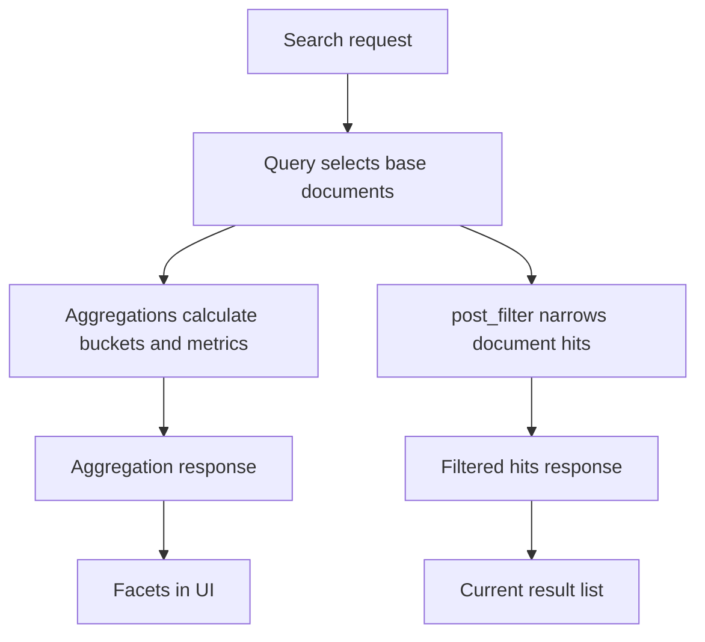
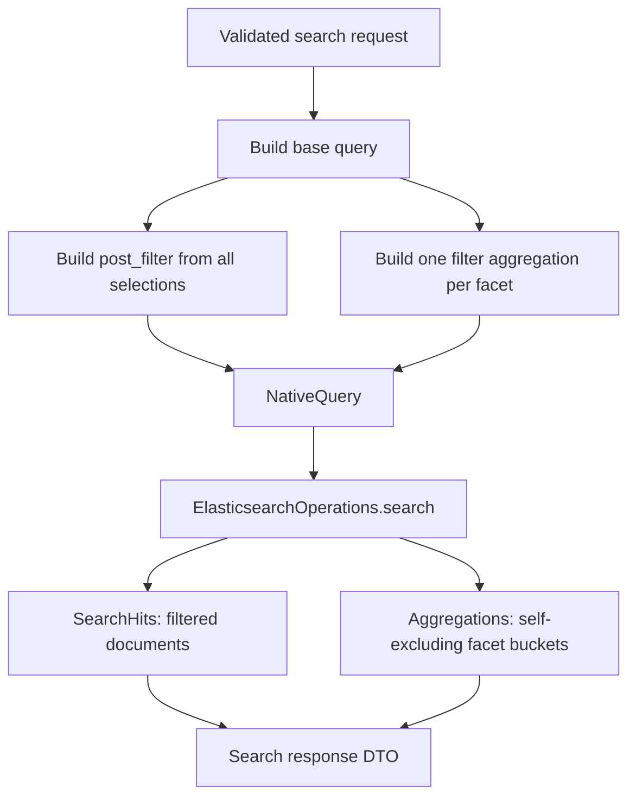

# Combining Aggregations with post_filter for Faceted Search

Faceted search is a search pattern in which users view a list of results while using filter groups to narrow down the data. For example, a product page displays items matching a keyword alongside counts by category, brand, color, or price range. When a user selects a brand, the product list narrows to that brand; other facets still need to show how many matching options remain.

Elasticsearch supports this model by combining **query**, **aggregations**, and **`post_filter`** in a single search request. The query defines the baseline document set. Aggregations compute buckets/metrics over the document set in their scope. `post_filter` filters the hits list after aggregations have already been computed, allowing the displayed list to narrow without eliminating other facet options.

The key rule is that `post_filter` affects hits, not top-level aggregations. When you need facet counts that "respect other selected filters while ignoring the filter of the facet currently being calculated," place each facet inside a `filter` aggregation with its own scope. This technique is commonly called *disjunctive faceting* or *self-excluding facets*.

## 1. What problem does faceted search solve?

Suppose the `products` index has documents with fields `name`, `category`, `brand`, `color`, `price`, and `active`. A search page needs to:

- Display products matching a keyword.
- Allow filtering by category.
- Allow filtering by brand.
- Allow filtering by color.
- Allow filtering by price range.
- Show matching counts next to each option, such as `Keyboard (12)` or `Northwind (8)`.

A single search request can return both the document list and all facets. The UI does not need to make a separate request for each statistical group when they can all be computed in one aggregation request.

### 1.1 Example data

Suppose we have illustrative data:

| SKU | Category | Brand | Color | Price | Active |
|---|---|---|---|---:|---|
| KB-01 | keyboard | Northwind | black | 120 | true |
| KB-02 | keyboard | Contoso | white | 180 | true |
| KB-03 | keyboard | Northwind | white | 220 | true |
| MS-01 | mouse | Northwind | black | 40 | true |
| MS-02 | mouse | Fabrikam | blue | 60 | true |
| MN-01 | monitor | Contoso | black | 300 | true |
| MN-02 | monitor | Northwind | white | 450 | false |

The user searches `wireless`, selects category `keyboard`, and then selects brand `Northwind`. The hits list should contain only Northwind keyboards. However, the brand facet should still show which other brands have products in category `keyboard`; the category facet can still show counts per category under the other active filters.

To interpret facet counts accurately, you must define each aggregation's scope. If every user-selected filter sits in the main query, all aggregations shrink to those combined filters and other options within a facet disappear.

## 2. Distinguishing query, aggregation, and post_filter

The three components serve distinct roles:

| Component | Affects hits | Affects top-level aggregations | Role |
|---|---|---|---|
| `query` | Yes | Yes | Defines the baseline document set for the search |
| `aggs` | Does not select hits directly | Computes buckets/metrics over the aggregation's scope | Produces facets and statistics |
| `post_filter` | Yes, after aggregations are computed | No | Narrows hits while keeping aggregation scope broader |

The processing flow can be visualized as follows:



`post_filter` is applied after Elasticsearch has computed aggregations. Therefore, hits and facets can intentionally reflect two different document sets.

### 2.1 Query filters affect both hits and aggregations

Conditions placed in `query.bool.filter` restrict the baseline document set. Both hits and top-level aggregations see only documents passing those filters.

Example:

```json
GET /products/_search
{
  "query": {
    "bool": {
      "must": [
        { "match": { "name": "wireless" } }
      ],
      "filter": [
        { "term": { "active": true } },
        { "term": { "category": "keyboard" } }
      ]
    }
  },
  "aggs": {
    "brands": {
      "terms": {
        "field": "brand",
        "size": 20
      }
    }
  }
}
```

The `brands` aggregation only counts products that match `wireless`, are active, and belong to category `keyboard`. If the goal is to still show other categories or brands after selecting a category, putting `category` in the main query prevents the facet from seeing documents outside that category.

### 2.2 post_filter only narrows hits

If you move the category filter to `post_filter`, top-level aggregations compute over documents passing the query before the category filter:

```json
GET /products/_search
{
  "query": {
    "bool": {
      "must": [
        { "match": { "name": "wireless" } }
      ],
      "filter": [
        { "term": { "active": true } }
      ]
    }
  },
  "post_filter": {
    "term": {
      "category": "keyboard"
    }
  },
  "aggs": {
    "categories": {
      "terms": {
        "field": "category",
        "size": 20
      }
    }
  }
}
```

Result:

- `hits.hits` contains only products matching `wireless`, active, and category `keyboard`.
- `aggregations.categories` counts categories across active products matching `wireless`, prior to applying the selected category.

This is the foundational pattern of faceted search: user-selected filters narrow the result list while the corresponding facet continues showing alternative options.

## 3. Why is post_filter alone sometimes insufficient?

The pattern above keeps aggregations broader than all `post_filter` conditions. That works for a single facet, but with multiple facet groups, finer behavior is usually needed.

Suppose the user has selected:

- Category = `keyboard`.
- Brand = `Northwind`.
- Color = `black`.

The hits list must apply all three selections. Yet when rendering the category facet, we normally want category counts after applying brand and color, while ignoring the current category selection. When rendering the brand facet, we want category and color applied, while ignoring the current brand selection. Likewise for color.

If you use a single top-level aggregation and put all three filters into `post_filter`, every facet runs before all three filters. They become too broad: the brand facet fails to reflect the selected category/color. If you put all three filters into the main query, every facet becomes too narrow: each facet sees only its own currently selected value.

The solution is a **dedicated filter aggregation for each facet**:

- Category aggregation applies brand and color filters, omitting the category filter.
- Brand aggregation applies category and color filters, omitting the brand filter.
- Color aggregation applies category and brand filters, omitting the color filter.
- Hits still use `post_filter` with all three filters.

## 4. Disjunctive faceting: each facet ignores its own filter

This is the standard model for e-commerce interfaces and multi-filter search.

### 4.1 Logical rules

Suppose:

```text
Q = full-text query + tenant/security constraints + active = true
C = category selection
B = brand selection
L = color selection
P = price range selection
```

The hits list needs:

```text
Q AND C AND B AND L AND P
```

The category facet needs:

```text
Q AND B AND L AND P, then bucket by category
```

The brand facet needs:

```text
Q AND C AND L AND P, then bucket by brand
```

The color facet needs:

```text
Q AND C AND B AND P, then bucket by color
```

The price facet needs:

```text
Q AND C AND B AND L, then bucket by price range
```

Thus, each facet reflects selections in other groups without excluding alternative values within its own group.

### 4.2 Multiple selections within the same facet

Within a single facet, multiple selections are typically combined with OR. For example, the user selects `keyboard` or `mouse`:

```json
{
  "terms": {
    "category": ["keyboard", "mouse"]
  }
}
```

The category condition is an OR group. Different facet groups typically combine with AND:

```text
(category = keyboard OR category = mouse)
AND (brand = Northwind OR brand = Contoso)
AND (color = black)
```

In Elasticsearch DSL, placing one `terms` query per group inside `bool.filter` expresses this exact rule: values inside `terms` are ORed, while filter clauses in bool are ANDed.

## 5. Complete Query DSL for faceted search

The example below has three selection groups: category, brand, and color. The user has selected category `keyboard`, brand `Northwind`, and color `black`.

```http
GET /products/_search
{
  "size": 20,
  "query": {
    "bool": {
      "must": [
        {
          "match": {
            "name": "wireless"
          }
        }
      ],
      "filter": [
        { "term": { "active": true } }
      ]
    }
  },
  "post_filter": {
    "bool": {
      "filter": [
        { "terms": { "category": ["keyboard"] } },
        { "terms": { "brand": ["Northwind"] } },
        { "terms": { "color": ["black"] } }
      ]
    }
  },
  "aggs": {
    "categories_scope": {
      "filter": {
        "bool": {
          "filter": [
            { "terms": { "brand": ["Northwind"] } },
            { "terms": { "color": ["black"] } }
          ]
        }
      },
      "aggs": {
        "values": {
          "terms": {
            "field": "category",
            "size": 20
          }
        }
      }
    },
    "brands_scope": {
      "filter": {
        "bool": {
          "filter": [
            { "terms": { "category": ["keyboard"] } },
            { "terms": { "color": ["black"] } }
          ]
        }
      },
      "aggs": {
        "values": {
          "terms": {
            "field": "brand",
            "size": 20
          }
        }
      }
    },
    "colors_scope": {
      "filter": {
        "bool": {
          "filter": [
            { "terms": { "category": ["keyboard"] } },
            { "terms": { "brand": ["Northwind"] } }
          ]
        }
      },
      "aggs": {
        "values": {
          "terms": {
            "field": "color",
            "size": 20
          }
        }
      }
    }
  }
}
```

In this request:

- The main query applies full-text `wireless` and `active = true` to both hits and aggregations.
- `post_filter` applies category, brand, and color simultaneously to filter hits.
- `categories_scope` omits the selected category, yet applies brand and color.
- `brands_scope` omits the selected brand, yet applies category and color.
- `colors_scope` omits the selected color, yet applies category and brand.

Each child aggregation `values` builds buckets for its corresponding field. The UI reads buckets from the right scope to render each facet.

### 5.1 When price range is included

Suppose the user selects a price between 100 and 300. Add the range to `post_filter` to restrict hits:

```json
{
  "range": {
    "price": {
      "gte": 100,
      "lte": 300
    }
  }
}
```

When computing category, brand, and color facets, retain the price range because it belongs to another group. When computing the price facet, omit the current price range to display alternative price brackets under the selected category/brand/color.

Price aggregation example:

```json
"prices_scope": {
  "filter": {
    "bool": {
      "filter": [
        { "terms": { "category": ["keyboard"] } },
        { "terms": { "brand": ["Northwind"] } },
        { "terms": { "color": ["black"] } }
      ]
    }
  },
  "aggs": {
    "price_ranges": {
      "range": {
        "field": "price",
        "ranges": [
          { "to": 100 },
          { "from": 100, "to": 200 },
          { "from": 200, "to": 300 },
          { "from": 300 }
        ]
      }
    }
  }
}
```

Range boundaries in this example use inclusive `from` and exclusive `to`. If the UI displays intervals with labels like "100–199", define boundary representation and currency units clearly so intervals neither overlap nor leave gaps.

## 6. When are top-level aggregations alone sufficient?

Not every faceted search needs a separate filter aggregation for every facet. Pick the simplest structure matching the desired user experience.

### 6.1 Facets independent of selected filters

If the UI always displays category/brand counts across the entire base-query document set regardless of selected facets, simple top-level aggregations with `post_filter` are enough:

```json
{
  "query": {
    "match": {
      "name": "wireless"
    }
  },
  "post_filter": {
    "term": {
      "category": "keyboard"
    }
  },
  "aggs": {
    "categories": {
      "terms": {
        "field": "category"
      }
    },
    "brands": {
      "terms": {
        "field": "brand"
      }
    }
  }
}
```

Both facets compute over the `wireless` set unaffected by the selected category. This fits cases where facets always summarize the baseline query set.

### 6.2 Facets depending on selections in other groups

If the category facet must respect brand/color/price and the brand facet must respect category/color/price, use separate filter aggregations per facet as shown in the disjunctive faceting section.

Do not use a single shared top-level aggregation and expect each facet to automatically ignore its own filter. Elasticsearch does not infer UI rules; each scope must be explicitly declared in the request.

## 7. Using `filter` aggregation to scope each facet

A `filter` aggregation creates a sub-scope of documents according to a query. Nested aggregations compute solely over documents passing that filter.

Simple example:

```json
{
  "aggs": {
    "brands_for_selected_category": {
      "filter": {
        "term": {
          "category": "keyboard"
        }
      },
      "aggs": {
        "brand_values": {
          "terms": {
            "field": "brand"
          }
        }
      }
    }
  }
}
```

`brands_for_selected_category` receives only keyboard products; `brand_values` groups documents in that scope by brand.

In multi-group faceted search, each filter aggregation is constructed following the rule "every other filter except the current facet's filter." Apply the baseline query and shared filters at the top level so every facet obeys tenant, status, and access constraints.

### 7.1 Filter aggregation is not post_filter

Both mechanisms use filters, yet their effects differ:

| Mechanism | Purpose |
|---|---|
| `post_filter` | Filters hits after aggregations have already been computed |
| `filter` aggregation | Creates a dedicated scope for one aggregation branch |
| `bool.filter` in query | Restricts the baseline document set for hits and aggregations |

All three can be used in the same request. A common pattern is query for baseline conditions, `post_filter` for all user selections to filter hits, and filter aggregations for self-excluding facet counts.

## 8. Multiple values in one facet and logical combination rules

Faceted search commonly lets users select multiple values within the same group. Define AND/OR rules clearly.

For example, the user picks two categories `keyboard` and `mouse`, plus two brands `Northwind` and `Contoso`:

```json
{
  "bool": {
    "filter": [
      {
        "terms": {
          "category": ["keyboard", "mouse"]
        }
      },
      {
        "terms": {
          "brand": ["Northwind", "Contoso"]
        }
      }
    ]
  }
}
```

Semantics:

```text
(category = keyboard OR category = mouse)
AND
(brand = Northwind OR brand = Contoso)
```

Within a single facet, selections are usually ORed. Across different facets, condition groups are usually ANDed. If the product requires different rules, express them explicitly via `bool` queries instead of mixing different fields into one large `terms` query.

### 8.1 Omitting the entire current facet group when computing buckets

If multiple categories are selected, the category facet must still omit the entire category group when computing buckets—not just one selected value. Therefore, the category aggregation contains no category conditions at all, while retaining filters for brand, color, price, and other groups.

### 8.2 Selected values missing from buckets

If active filters are strict or bucket size is small, a currently selected value may not appear in the returned bucket list. The UI should preserve selection state from the client request/state rather than dropping a selection just because the bucket response omits it.

With terms aggregations, `size` limits returned buckets. If selected values must remain visible, increase `size` reasonably or merge selected values into the facet model in response-mapping logic. Never assume an aggregation always returns all distinct values.

## 9. Mappings must suit facets

Terms-based facets are typically run on `keyword` fields or types supporting doc values. `text` fields are tokenized and are rarely the right default for exact facets.

Example mapping:

```json
PUT /products
{
  "mappings": {
    "properties": {
      "name": {
        "type": "text"
      },
      "category": {
        "type": "keyword"
      },
      "brand": {
        "type": "keyword"
      },
      "color": {
        "type": "keyword"
      },
      "price": {
        "type": "double"
      },
      "active": {
        "type": "boolean"
      }
    }
  }
}
```

If you need both full-text search on names and faceting/sorting by exact name values, use a multi-field:

```json
"name": {
  "type": "text",
  "fields": {
    "raw": {
      "type": "keyword"
    }
  }
}
```

Facet on `name.raw`, and run match queries on `name`. Do not enable fielddata on `text` just for terms aggregations without evaluating heap cost and cardinality; a keyword sub-field is usually the cleaner design.

## 10. Building faceted search with Spring Data Elasticsearch

With Spring Data Elasticsearch 5.x and the Elasticsearch Java API Client, `NativeQuery` supports queries, filters, aggregations, and pageables. `NativeQuery`'s standalone filter translates to `post_filter` in the Search API; `withQuery(...)` creates the main query. Verify the API of your project's exact Spring Data version because builders and Java Client types can evolve across releases.

### 10.1 Declaring a simple aggregation

Example creating a terms aggregation by category:

```java
import co.elastic.clients.elasticsearch._types.aggregations.Aggregation;
import org.springframework.data.elasticsearch.client.elc.NativeQuery;
import org.springframework.data.elasticsearch.core.query.Query;

Aggregation categories = Aggregation.of(a -> a
    .terms(t -> t
        .field("category")
        .size(20)
    )
);

Query query = NativeQuery.builder()
    .withQuery(q -> q.match(m -> m
        .field("name")
        .query("wireless")
    ))
    .withAggregation("categories", categories)
    .build();
```

The aggregation is named `categories`; this name is used when reading results. You can declare multiple aggregations by calling `withAggregation` multiple times.

### 10.2 Filtering hits using post_filter

Suppose the user selects category `keyboard`:

```java
import org.springframework.data.elasticsearch.client.elc.NativeQuery;
import org.springframework.data.elasticsearch.core.query.Query;

Query query = NativeQuery.builder()
    .withQuery(q -> q.bool(b -> b
        .must(m -> m.match(mm -> mm
            .field("name")
            .query("wireless")
        ))
        .filter(f -> f.term(t -> t
            .field("active")
            .value(true)
        ))
    ))
    .withFilter(f -> f.term(t -> t
        .field("category")
        .value("keyboard")
    ))
    .withAggregation("categories", categories)
    .build();
```

In `NativeQuery`, `withFilter(...)` is the search request's standalone filter and acts as `post_filter`: hits are filtered by category, while top-level aggregations still compute on the main query. Do not confuse it with `bool.filter` inside `withQuery(...)`, because `bool.filter` restricts both hits and aggregations.

### 10.3 Filter aggregation in the Java Client

To build a brand facet based on the selected category, declare a filter aggregation wrapping a terms aggregation:

```java
Aggregation brandsForCategory = Aggregation.of(a -> a
    .filter(f -> f.term(t -> t
        .field("category")
        .value("keyboard")
    ))
    .aggregations("values", sub -> sub.terms(t -> t
        .field("brand")
        .size(20)
    ))
);

Query query = NativeQuery.builder()
    .withQuery(q -> q.match(m -> m
        .field("name")
        .query("wireless")
    ))
    .withAggregation("brands_scope", brandsForCategory)
    .build();
```

The `brands_scope` aggregation restricts documents to category `keyboard`; child aggregation `values` groups those documents by brand. For multi-select categories, use a `terms` query inside the filter aggregation. For full disjunctive faceting, build one filter aggregation per facet applying all selected filters except the facet's own group.

### 10.4 Combining multiple facets in NativeQuery

An implementation skeleton can prepare the aggregations first and attach them to the query:

```java
Aggregation categoriesForOtherFilters = Aggregation.of(a -> a
    .filter(f -> f.bool(b -> b
        .filter(q -> q.term(t -> t.field("brand").value("Northwind")))
        .filter(q -> q.term(t -> t.field("color").value("black")))
    ))
    .aggregations("values", sub -> sub.terms(t -> t
        .field("category")
        .size(20)
    ))
);

Aggregation brandsForOtherFilters = Aggregation.of(a -> a
    .filter(f -> f.bool(b -> b
        .filter(q -> q.term(t -> t.field("category").value("keyboard")))
        .filter(q -> q.term(t -> t.field("color").value("black")))
    ))
    .aggregations("values", sub -> sub.terms(t -> t
        .field("brand")
        .size(20)
    ))
);

Query query = NativeQuery.builder()
    .withQuery(q -> q.bool(b -> b
        .must(m -> m.match(mm -> mm.field("name").query("wireless")))
        .filter(f -> f.term(t -> t.field("active").value(true)))
    ))
    .withFilter(f -> f.bool(b -> b
        .filter(q -> q.term(t -> t.field("category").value("keyboard")))
        .filter(q -> q.term(t -> t.field("brand").value("Northwind")))
        .filter(q -> q.term(t -> t.field("color").value("black")))
    ))
    .withAggregation("categories_scope", categoriesForOtherFilters)
    .withAggregation("brands_scope", brandsForOtherFilters)
    .withPageable(PageRequest.of(0, 20))
    .build();
```

This example illustrates Elasticsearch Java Client builder style. In the category filter aggregation, the code omits category from the scope; in the brand filter aggregation, the code omits brand from the scope. In a real application, build filters from validated request inputs rather than hardcoding values. Specific method overloads can vary across client versions; keep the DSL structure and check your dependency's Javadoc.

### 10.5 Reading hits and aggregations separately

```java
SearchHits<Product> result = operations.search(query, Product.class);

List<Product> products = result.getSearchHits().stream()
    .map(SearchHit::getContent)
    .toList();

long totalHits = result.getTotalHits();
AggregationsContainer<?> aggregationContainer = result.getAggregations();
```

`products` is the document list after `post_filter`. `aggregationContainer` holds facet buckets per configured scope. When reading aggregations, look up the exact aggregation name such as `categories_scope` or `brands_scope`, then extract the child aggregation `values`. Concrete wrapper structures depend on the Spring Data/Elasticsearch Java Client version.

Do not convert buckets into entities. A bucket contains only key, count, and child aggregations; it is not a product document.

## 11. Building dynamic filters from requests

A faceted search API typically receives multiple selections:

```java
public record ProductFacetRequest(
    String keyword,
    List<String> categories,
    List<String> brands,
    List<String> colors,
    Double minPrice,
    Double maxPrice,
    Integer page,
    Integer size
) {
}
```

Before constructing the query, validate and normalize inputs:

- Deduplicate values within each group.
- Reject or ignore blank strings per API contract.
- Limit the number of selections per facet.
- Verify `minPrice` is not greater than `maxPrice`.
- Allow only facet fields on a server-side allowlist.
- Enforce tenant/security constraints in the baseline query, never placing them in client-controlled `post_filter`.

### 11.1 Helper for building terms filters

Logically, a multi-value selection group translates into a `terms` query. If the list is empty, do not add a filter for that group:

```java
private void addTermsFilter(
        List<Query> filters,
        String field,
        List<String> values) {
    if (values != null && !values.isEmpty()) {
        filters.add(Query.of(q -> q.terms(t -> t
            .field(field)
            .terms(v -> v.value(
                values.stream().map(FieldValue::of).toList()
            ))
        )));
    }
}
```

This helper illustrates converting a multi-value group into a `terms` query. `Query` here is the Elasticsearch Java Client query type; do not confuse it with Spring Data's `org.springframework.data.elasticsearch.core.query.Query`. When implementing, use clear imports/aliases to avoid class name collisions.

### 11.2 Building post_filter

Validated filters are combined with a bool filter:

```java
Query postFilter = Query.of(q -> q.bool(b -> {
    for (Query filter : selectedFacetFilters) {
        b.filter(filter);
    }
    return b;
}));
```

Pass it into `NativeQuery` via your version's filter API. If no facets are selected, omit `post_filter`.

### 11.3 Building a filter aggregation for each facet

For the `category` facet, take all selected facet filters excluding the category group. For the `brand` facet, omit the brand group. Organizing input filters into a map keyed by facet prevents writing bespoke logic for every combination:

```text
selectedFilters = {
  category: categoryTermsFilter,
  brand: brandTermsFilter,
  color: colorTermsFilter,
  price: priceRangeFilter
}

scope(category) = brand + color + price
scope(brand)    = category + color + price
scope(color)    = category + brand + price
scope(price)    = category + brand + color
```

Each scope turns into a filter aggregation containing the corresponding terms/range aggregation. This is a general pattern for building disjunctive facets as the number of filter groups grows.

## 12. Distinguishing query filters from aggregation filters

A search system typically has three kinds of conditions:

1. **Baseline conditions:** tenant, access permissions, allowed statuses, full-text query. Place in the main query so all hits and facets obey them.
2. **User selections:** category, brand, color, price. Place in `post_filter` to filter hits.
3. **Facet scope:** user selections excluding selections belonging to the facet being computed. Place in the corresponding filter aggregation.

Never place security conditions in `post_filter` if aggregations must not see data outside the user's authorization scope. `post_filter` does not restrict aggregations. Tenant/security filters must reside in the baseline query or an equivalent request-wide authorization mechanism.

### 12.1 Tenant isolation example

Suppose documents have `tenantId`. The baseline query must include the active tenant:

```json
"query": {
  "bool": {
    "must": [
      { "match": { "name": "wireless" } }
    ],
    "filter": [
      { "term": { "tenantId": "tenant-42" } },
      { "term": { "active": true } }
    ]
  }
}
```

Child filter aggregations inherit the baseline query's scope, so they compute solely on tenant-42's data. If a `global` aggregation is used, it ignores the query scope and requires its own security handling; never casually add a global aggregation to a multi-tenant faceted endpoint.

## 13. Facet counts and how to interpret numbers

A bucket's `doc_count` is the number of documents in the bucket within the aggregation scope. It does not necessarily equal the number of displayed hits because:

- Hits have passed through `post_filter`, whereas the aggregation may exclude one or more facet filters.
- Buckets compute over the baseline query plus their own scope.
- Terms aggregations may return only top buckets.
- A document can hold multiple values in an array field and appear in multiple buckets.
- Distributed terms aggregations can exhibit bucket-count error depending on configuration/shards.

The UI must understand which scope each facet count belongs to. For instance, `Northwind (8)` in the brand facet may mean "8 Northwind products after applying current category, color, and price, before applying the selected brand." That is not the current hit count after all filters.

### 13.1 Terms size and selected values

`terms.size` limits the number of returned buckets. If many brands exist, low-count brands may be omitted. Raise `size` reasonably, sort by key if a stable list is required, or use composite aggregation when all buckets must be traversed.

If a currently selected value does not appear in buckets because its count is 0 or it fell outside the size cap, backend/UI should still retain the submitted selection. You can return selected values separately in the response or merge them into the facet model at the application layer.

### 13.2 Bucket count is not total hits

`hits.total` describes total documents matching the query and hit-level filters per the request. `bucket.doc_count` describes documents inside the bucket's scope. In disjunctive faceting, the two numbers differ by design.

Do not sum category bucket counts to infer total hits when fields can be multi-valued or terms aggregations are capped. Verify field and aggregation semantics before interpreting figures.

## 14. Range and date histogram facets

Not every facet is a terms aggregation.

### 14.1 Price range facet

Range aggregations can build price bracket options:

```json
{
  "aggs": {
    "price_ranges": {
      "range": {
        "field": "price",
        "ranges": [
          { "to": 50 },
          { "from": 50, "to": 100 },
          { "from": 100, "to": 250 },
          { "from": 250 }
        ]
      }
    }
  }
}
```

When a user picks a price range, add the range filter to `post_filter` for hits. When computing the price facet, omit the active price range filter while keeping other facets inside the price scope filter aggregation.

### 14.2 Date histogram facet

For orders or articles, you can group by day/month:

```json
{
  "aggs": {
    "orders_by_month": {
      "date_histogram": {
        "field": "createdAt",
        "calendar_interval": "month",
        "time_zone": "+07:00"
      }
    }
  }
}
```

If the user picks a date range, apply the date range in `post_filter` for hits and omit it from the date facet scope if alternative date buckets should stay visible. Specify the business timezone explicitly so buckets do not shift days.

## 15. Hit pagination does not paginate facets

`from`/`size` or `Pageable` controls the returned document list. They do not paginate aggregation buckets. A single request can return 20 hits while the category facet returns 20 buckets, the brand facet returns 20 buckets, and the price facet returns multiple ranges.

If a facet has thousands of distinct values, `terms.size` only returns top buckets. Use composite aggregation with `after_key` to scan buckets if the UI or a workflow needs all values. Composite bucket pagination differs from `search_after` used for document hits.

Never load all documents just to build facets in Java. Use aggregations to compute statistics in Elasticsearch, and fetch only the hits needed for the current page.

## 16. Common mistakes

### 16.1 Putting all selected filters in the main query

When category, brand, and color all sit in the query filter, top-level aggregations see only documents passing all selections. Facets may end up returning only the currently selected value. Move user selections to `post_filter` and build separate scopes per facet when self-excluding counts are needed.

### 16.2 Assuming post_filter affects aggregations

`post_filter` filters hits only after aggregations are computed. If an aggregation needs to be filtered, use a filter aggregation or place baseline conditions in the main query.

### 16.3 Using one broad post_filter while expecting facets to respect other filters

A single top-level aggregation does not automatically know which filter each facet should ignore. To make the category facet respect brand/color while ignoring category, create a category filter aggregation scoped to brand/color. Repeat for each facet.

### 16.4 Unintentionally combining multiple selections in one facet with AND

If a user picks category keyboard or mouse, those two values must be ORed. Use a single `terms` query for the category group. Different facet groups combine with AND inside the bool filter.

### 16.5 Putting tenant/security constraints in post_filter

Aggregations are not restricted by `post_filter`, so facets could leak counts for documents outside the user's permissions. Put tenant/security constraints in the baseline query or enforce request-wide authorization.

### 16.6 Confusing bucket count with hits.total

Facet scopes can be broader than or different from the hit set. Explain counts by their defined scope and never substitute bucket counts for total hits.

### 16.7 Running terms aggregation on a text field

Exact facets should use `keyword` fields or keyword multi-fields. Text fields are usually unsuitable for default terms aggregations.

### 16.8 Losing selected state when a bucket is omitted

Terms aggregations cap bucket counts. The UI must preserve selected state from the request even if the value does not appear in the current bucket list.

### 16.9 Inconsistent queries between hits and facet scopes

Every facet scope must inherit the same baseline query, tenant, and shared statuses. If an aggregation runs on a different query, counts can no longer be reconciled against hits.

## 17. Testing faceted search

Create a small dataset with documents varying across category, brand, color, price, and status to verify each scope clearly.

Test cases:

1. No facets selected: hits and facets reflect the baseline query.
2. One category selected: hits narrow to that category; category facet still displays alternative options per the intended scope.
3. Category and brand selected: hits apply both; category facet omits category while keeping brand; brand facet omits brand while keeping category.
4. Multiple values selected in one group: values within the group behave as OR.
5. Values selected across two different groups: groups combine as AND.
6. Price range selected: price facet omits current range while other facets retain it.
7. Zero hits returned: aggregations can still return empty buckets or metrics per their scope.
8. Tenant filter present: all facets count only authorized tenant data.
9. Small terms size: UI retains selected values absent from top buckets.
10. Query text changes: both hits and all facet scopes share the updated baseline query.

When debugging, execute REST requests directly and inspect `hits.hits`, `hits.total`, and each `aggregations` branch separately. Clear aggregation names like `categories_scope`, `brands_scope`, `colors_scope` and uniform child bucket names like `values` make Java code and response mappers easy to read.

## 18. Workflow for building a faceted search endpoint

An implementation workflow can follow these steps:

1. **Define the baseline query:** full-text search, tenant, access permissions, and shared statuses.
2. **Identify facet groups:** category, brand, color, price, date, etc.
3. **Normalize selections:** deduplicate, validate fields/values, and cap selection counts.
4. **Build post_filter:** combine all user selections to filter hits.
5. **Build aggregation scopes:** for each facet, combine selections from other groups and omit the current group.
6. **Build buckets/metrics:** terms for keywords, range for numbers, date_histogram for dates.
7. **Bound hits and buckets:** page size, terms size, and bucket pagination strategy.
8. **Execute one search request:** fetch hits and aggregations together.
9. **Map the response:** separate document list, total hits, and facet models.
10. **Preserve selected state:** do not rely solely on the returned bucket list.



## 19. Implementation principles

- Use the main query for full-text and baseline conditions applying to both hits and aggregations.
- Use `post_filter` for facet selections that should filter the hits list without narrowing top-level aggregations.
- Use separate filter aggregations per facet when counts must respect selections in other groups while ignoring the facet's own selection.
- Use `terms` for multiple values in the same facet: values within a group are ORed; different facet groups are typically ANDed.
- Place tenant/security constraints in the baseline query or request-wide authorization layer, never solely in `post_filter`.
- Use keyword mappings for terms facets; use range/date histogram for numeric and date facets.
- Distinguish `hits.total`, `hits.hits`, and `bucket.doc_count`.
- Remember that `from`/`size` paginate hits, not buckets.
- Preserve selected values at the application layer even if a terms aggregation omits the corresponding bucket.
- In Spring Data, use `NativeQuery` to combine query, post-filter, aggregations, and pageable; read hits and aggregations separately via `SearchHits`.
- Verify builder semantics against your exact Spring Data Elasticsearch/Java Client version.

## 20. Summary

Faceted search pairs a document list with statistical buckets so users can inspect results while narrowing by category, brand, color, price, or time. The main query defines the baseline document set and enforces shared conditions. `post_filter` filters hits after aggregations compute, keeping facets broader than the displayed list.

When facets do not depend on active selections, top-level aggregations with `post_filter` suffice. When disjunctive faceting is required, each facet needs its own filter aggregation: applying selected filters from other groups while omitting the facet's own filter. Multiple values within a group usually combine via OR; distinct groups combine via AND. Tenant and security constraints must reside in the baseline query or request-wide authorization so aggregations never expose out-of-scope data.

In Spring Data Elasticsearch, `NativeQuery` combines query, post-filter, and aggregations; `SearchHits` exposes the document list and aggregation container separately. Understanding each component's scope ensures meaningful facet counts, avoids confusing buckets with hits, and delivers a consistent multi-step filtering experience.

## References

- [Elasticsearch — Filter search results](https://www.elastic.co/guide/en/elasticsearch/reference/current/filter-search-results.html)
- [Elasticsearch — Post filter](https://www.elastic.co/guide/en/elasticsearch/reference/current/filter-search-results.html#post-filter)
- [Elasticsearch — Filter aggregation](https://www.elastic.co/guide/en/elasticsearch/reference/current/search-aggregations-bucket-filter-aggregation.html)
- [Elasticsearch — Terms aggregation](https://www.elastic.co/guide/en/elasticsearch/reference/current/search-aggregations-bucket-terms-aggregation.html)
- [Elasticsearch — Search API](https://www.elastic.co/guide/en/elasticsearch/reference/current/search-search.html)
- [Spring Data Elasticsearch Reference — Search Operations](https://docs.spring.io/spring-data/elasticsearch/reference/elasticsearch/template.html)
