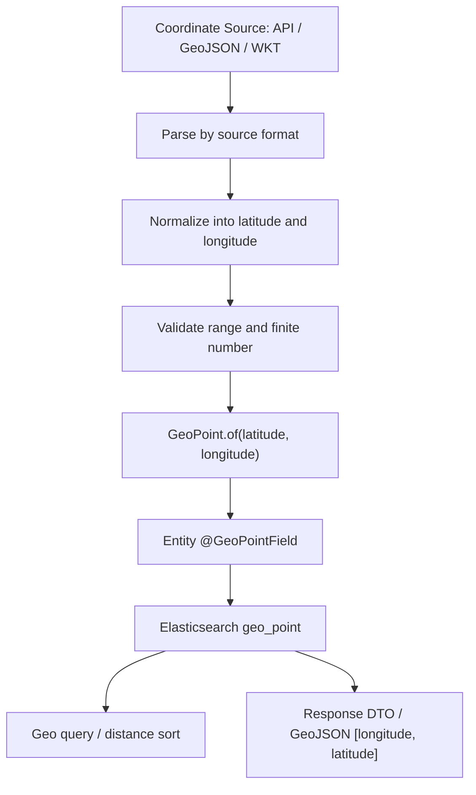

# Mapping GeoPoint, @GeoPoint, and Coordinate Structures

When storing geographic locations in Elasticsearch, a latitude/longitude pair should not be treated as two independent numeric fields if the application needs distance searches, geographic area queries, or distance-based sorting. Elasticsearch provides the **`geo_point`** data type to represent a point on the Earth's surface. In Spring Data Elasticsearch, the commonly used Java type is **`GeoPoint`**, and the annotation for declaring the mapping is **`@GeoPointField`**.

The most critical detail when working with coordinates is value order. Spring Data's `GeoPoint` API takes **latitude first, longitude second**; several array formats accepted by Elasticsearch use **longitude first, latitude second**. Reversing the two values can produce a completely different location or cause coordinates to exceed valid bounds.

This lesson covers how to declare `geo_point` in an entity, how Spring Data maps `GeoPoint`, the coordinate structures supported by Elasticsearch, how to create and inspect mappings, and validation rules to prevent errors when storing geospatial data.

## 1. What is `geo_point`?

`geo_point` is an Elasticsearch field type used to store a geographic point defined by two components:

- **Latitude**: North/South position, ranging from -90 to 90 degrees.
- **Longitude**: East/West position, ranging from -180 to 180 degrees.

For example, a location in Ho Chi Minh City can be represented approximately as follows:

```json
{
  "location": {
    "lat": 10.762622,
    "lon": 106.660172
  }
}
```

Elasticsearch understands `location` as a geographic point. From there, the application can use geospatial queries such as `geo_distance`, `geo_bounding_box`, `geo_polygon`, or sort by distance if the use case requires it.

If you only store `latitude` and `longitude` as two `double` fields, Elasticsearch can still filter each number individually, but it does not automatically understand them as a geographic coordinate pair. Using `geo_point` declares the proper semantics of the data and unlocks built-in geospatial operations.

## 2. Distinguishing latitude and longitude

The two components have different ranges and meanings:

| Component | Vietnamese Term | Valid Range | Example in Ho Chi Minh City |
|---|---|---:|---:|
| Latitude | Vĩ độ | `-90` to `90` | `10.762622` |
| Longitude | Kinh độ | `-180` to `180` | `106.660172` |

Positive latitude lies in the Northern Hemisphere, negative latitude in the Southern Hemisphere. Positive longitude lies East of the prime meridian, negative longitude lies West.

In Java code, use clear, descriptive variable names:

```java
double latitude = 10.762622;
double longitude = 106.660172;
```

Avoid generic variable names like `x` and `y` without an explicit convention. In some coordinate systems or graphics libraries, `x` typically represents longitude and `y` represents latitude; this differs from the constructor parameter order of many `GeoPoint` APIs.

## 3. `GeoPoint` and `@GeoPointField` in Spring Data Elasticsearch

Spring Data Elasticsearch provides the `GeoPoint` class to represent coordinates in Java and the `@GeoPointField` annotation to declare a property with an Elasticsearch `geo_point` mapping.

Entity example:

```java
package com.example.places.document;

import org.springframework.data.annotation.Id;
import org.springframework.data.elasticsearch.annotations.Document;
import org.springframework.data.elasticsearch.annotations.Field;
import org.springframework.data.elasticsearch.annotations.FieldType;
import org.springframework.data.elasticsearch.annotations.GeoPointField;
import org.springframework.data.elasticsearch.core.geo.GeoPoint;

@Document(indexName = "places")
public class PlaceDocument {

    @Id
    private String id;

    @Field(type = FieldType.Keyword)
    private String name;

    @GeoPointField
    private GeoPoint location;

    protected PlaceDocument() {
    }

    public PlaceDocument(String id, String name, GeoPoint location) {
        this.id = id;
        this.name = name;
        this.location = location;
    }

    public String getId() {
        return id;
    }

    public String getName() {
        return name;
    }

    public GeoPoint getLocation() {
        return location;
    }
}
```

Two important imports to note:

```java
import org.springframework.data.elasticsearch.annotations.GeoPointField;
import org.springframework.data.elasticsearch.core.geo.GeoPoint;
```

`@GeoPointField` is the Spring Data Elasticsearch annotation commonly used to mark a property of type `geo_point`. `GeoPoint` is the Java type holding the latitude and longitude values. Do not confuse this annotation with similarly named annotations from GIS libraries or other mapping frameworks.

### 3.1. Creating a GeoPoint

You can create a point using the factory method:

```java
GeoPoint location = GeoPoint.of(10.762622, 106.660172);

PlaceDocument place = new PlaceDocument(
    "place-001",
    "Central Post Office",
    location
);
```

The parameter order for `GeoPoint.of(...)` is:

```java
GeoPoint.of(latitude, longitude)
```

If you use the `GeoPoint` class constructor in your version, the convention is also latitude first, longitude second. Prefer the factory method if the API in your project version provides it; check the Javadoc when upgrading Spring Data Elasticsearch.

### 3.2. Mapping from an input DTO

A REST request may accept two separate fields:

```java
public record PlaceRequest(
    String name,
    double latitude,
    double longitude
) {
}
```

Convert the DTO into an entity:

```java
GeoPoint point = GeoPoint.of(
    request.latitude(),
    request.longitude()
);

PlaceDocument document = new PlaceDocument(
    generatedId,
    request.name(),
    point
);
```

Naming the DTO fields explicitly as `latitude` and `longitude` helps prevent API callers from sending values in the wrong order without realizing it. Validate before creating the entity.

## 4. Generated Elasticsearch mapping

When Spring Data creates an index from entity metadata, `@GeoPointField` declares the field with type `geo_point`.

The corresponding mapping looks like:

```json
PUT places
{
  "mappings": {
    "properties": {
      "name": {
        "type": "keyword"
      },
      "location": {
        "type": "geo_point"
      }
    }
  }
}
```

Spring Data can generate the mapping from the entity when the index is created via configured mapping/index operations. For example:

```java
import org.springframework.data.elasticsearch.core.ElasticsearchOperations;
import org.springframework.data.elasticsearch.core.IndexOperations;
import org.springframework.stereotype.Component;

@Component
public class PlaceIndexInitializer {

    private final ElasticsearchOperations operations;

    public PlaceIndexInitializer(ElasticsearchOperations operations) {
        this.operations = operations;
    }

    public void createIndexIfMissing() {
        IndexOperations indexOperations = operations.indexOps(PlaceDocument.class);

        if (!indexOperations.exists()) {
            indexOperations.createWithMapping();
        }
    }
}
```

This snippet illustrates creating an index and mapping from an entity. In production, index provisioning should usually be managed by controlled migrations or deployment pipelines; avoid letting multiple application instances concurrently auto-create indices on startup.

### 4.1. Checking the actual mapping

After creating the index, inspect the mapping directly on Elasticsearch:

```http
GET places/_mapping
```

The response should show:

```json
{
  "properties": {
    "location": {
      "type": "geo_point"
    }
  }
}
```

Do not rely solely on Java annotations to assume the mapping on the cluster is correct. The index might have existed before the annotation was added, been created by another template, or had its mapping provisioned by an infrastructure pipeline.

### 4.2. Existing mappings do not change automatically

If `location` was previously declared as `object`, `keyword`, or two separate numeric fields, adding `@GeoPointField` to the entity does not automatically convert the existing mapping. Elasticsearch does not allow arbitrarily changing the type of an already indexed field.

A safe change procedure typically involves:

1. Creating a new index with the `geo_point` mapping.
2. Transforming old data into the proper coordinate structure.
3. Reindexing or reloading data into the new index.
4. Verifying documents and mapping.
5. Switching read/write aliases to the new index according to the deployment plan.

If old data stored latitude and longitude in two separate fields, the transformation step must combine them in the correct order and handle documents missing either value.

## 5. Coordinate structures accepted by Elasticsearch

Elasticsearch `geo_point` supports multiple ways to represent a point. Even though they describe the same location, latitude/longitude order is not the same across all formats.

### 5.1. Object with `lat` and `lon`

This is the clearest and easiest-to-read form:

```json
{
  "location": {
    "lat": 10.762622,
    "lon": 106.660172
  }
}
```

The property names clearly indicate each component, reducing confusion. This is also a convenient structure to read and inspect in `_source` when the application serializes `GeoPoint` as an object.

### 5.2. Array in `[longitude, latitude]` order

Elasticsearch accepts a coordinate array in longitude-first, latitude-second order:

```json
{
  "location": [106.660172, 10.762622]
}
```

This is one of the most common sources of bugs. Arrays use `[lon, lat]` order, not `[lat, lon]`.

If a GIS system or GeoJSON sends coordinates as `[x, y]`, `x` is normally longitude and `y` is latitude. When converting to `GeoPoint.of(...)`, you must swap the parameter positions to `(latitude, longitude)`.

### 5.3. String in `"latitude,longitude"` format

Elasticsearch also supports a comma-separated string with latitude first and longitude second:

```json
{
  "location": "10.762622,106.660172"
}
```

This format has a different order from arrays. Do not apply the `[lon, lat]` rule of arrays to `"lat,lon"` strings.

### 5.4. WKT Point

Well-Known Text (WKT) represents a point in x/y order, meaning longitude then latitude:

```text
POINT (106.660172 10.762622)
```

In WKT, the first coordinate is x/longitude and the second coordinate is y/latitude. If reading WKT to construct a `GeoPoint`, convert it as `GeoPoint.of(y, x)`.

### 5.5. Geohash

Elasticsearch also supports geohash strings to represent an area/location as an encoded string:

```json
{
  "location": "w3gvk"
}
```

Location precision depends on the geohash length. Shorter geohashes represent larger regions; longer geohashes identify smaller regions. For typical application data, `lat`/`lon` objects or Java `GeoPoint` are usually easier to read and control.

### 5.6. Summary table of coordinate order

| Format | Example | Order |
|---|---|---|
| Object | `{"lat": 10.76, "lon": 106.66}` | `lat`, `lon` by property name |
| Array | `[106.66, 10.76]` | `longitude`, `latitude` |
| String | `"10.76,106.66"` | `latitude`, `longitude` |
| WKT | `POINT (106.66 10.76)` | `x/longitude`, `y/latitude` |
| Spring Data `GeoPoint` | `GeoPoint.of(10.76, 106.66)` | `latitude`, `longitude` |

When integrating multiple systems, standardize on a single internal format. With Spring Data Elasticsearch, using `GeoPoint` in entities and two clearly named `latitude`/`longitude` fields in DTOs is usually easy to control.

## 6. Common coordinate-swapping mistakes

Suppose a point is in Ho Chi Minh City:

```java
double latitude = 10.762622;
double longitude = 106.660172;
```

Correct:

```java
GeoPoint point = GeoPoint.of(latitude, longitude);
```

Incorrect:

```java
GeoPoint point = GeoPoint.of(longitude, latitude);
```

In the incorrect example, `106.660172` is interpreted as latitude. Because latitude is only valid between -90 and 90, this value exceeds the valid range. Some systems may reject the document; other conversion pipelines or datasets can produce subtle bugs if both numbers happen to fall within valid ranges.

Not every coordinate swap causes a range error. For example, a point in a region where both latitude and longitude lie between -90 and 90 still forms a valid numeric pair, only at the wrong location. Therefore, checking numeric bounds alone is insufficient to catch every swap; test with reference data or known locations.

## 7. Validating coordinates before saving

Validate coordinates at the API or service boundary before creating a `GeoPoint`:

```java
public final class Coordinates {

    private Coordinates() {
    }

    public static GeoPoint toGeoPoint(double latitude, double longitude) {
        if (!Double.isFinite(latitude) || !Double.isFinite(longitude)) {
            throw new IllegalArgumentException("Coordinates must be finite numbers");
        }

        if (latitude < -90 || latitude > 90) {
            throw new IllegalArgumentException("Latitude must be between -90 and 90");
        }

        if (longitude < -180 || longitude > 180) {
            throw new IllegalArgumentException("Longitude must be between -180 and 180");
        }

        return GeoPoint.of(latitude, longitude);
    }
}
```

`Double.isFinite` rejects `NaN` and infinite values. Those values are not valid geographic coordinates.

For request DTOs, you can use Bean Validation to check ranges:

```java
import jakarta.validation.constraints.DecimalMax;
import jakarta.validation.constraints.DecimalMin;
import jakarta.validation.constraints.NotNull;

public record PlaceRequest(
    String name,

    @NotNull
    @DecimalMin("-90.0")
    @DecimalMax("90.0")
    Double latitude,

    @NotNull
    @DecimalMin("-180.0")
    @DecimalMax("180.0")
    Double longitude
) {
}
```

If using a nullable `Double` in a DTO, check for null before unboxing. Bean Validation only takes effect when the controller/service triggers validation properly, such as `@Valid` on the request body.

Range validation ensures coordinates fall within valid bounds, but it cannot verify whether a location matches the address entered by the user. For critical use cases, you may need to verify the geocoding source or confirm the location on a map.

## 8. Saving documents via Spring Data Elasticsearch

After creating a `GeoPoint`, you can save the entity using a Repository:

```java
import org.springframework.data.elasticsearch.repository.ElasticsearchRepository;

public interface PlaceRepository
        extends ElasticsearchRepository<PlaceDocument, String> {
}
```

Call:

```java
GeoPoint location = Coordinates.toGeoPoint(10.762622, 106.660172);

PlaceDocument place = new PlaceDocument(
    "place-001",
    "Central Post Office",
    location
);

placeRepository.save(place);
```

Or use `ElasticsearchOperations`:

```java
PlaceDocument saved = operations.save(place);
```

Spring Data uses mapping metadata and converters to translate `GeoPoint` into the document structure corresponding to `geo_point`. The application does not need to manually assemble JSON for each entity.

### 8.1. Inspecting saved documents

Read the document from Elasticsearch:

```http
GET places/_doc/place-001
```

Check that the `location` field in `_source` has the expected latitude and longitude. If using a converter or custom serializer, confirm the field order and names in the actual JSON.

Read it back via the Repository:

```java
PlaceDocument loaded = placeRepository.findById("place-001")
    .orElseThrow();

GeoPoint point = loaded.getLocation();
```

This is a round-trip check: the Java `GeoPoint` is written to Elasticsearch and converted back into a Java type.

## 9. Separating DTOs and geospatial entities

You do not necessarily need to expose `GeoPoint` directly in your API. A DTO with two clearly named properties is often easier to understand:

```java
public record CoordinatesResponse(
    double latitude,
    double longitude
) {
}

public record PlaceResponse(
    String id,
    String name,
    CoordinatesResponse location
) {
}
```

Convert from entity to DTO:

```java
GeoPoint point = place.getLocation();

CoordinatesResponse coordinates = new CoordinatesResponse(
    point.getLat(),
    point.getLon()
);

PlaceResponse response = new PlaceResponse(
    place.getId(),
    place.getName(),
    coordinates
);
```

If the `GeoPoint` version you are using provides getters with different names, follow the class's Javadoc. In common Spring Data APIs, `getLat()` and `getLon()` return latitude and longitude respectively.

For GeoJSON or frontend maps, the coordinate structure is typically `[longitude, latitude]`. When constructing a GeoJSON response, convert the order explicitly:

```java
List<Double> geoJsonCoordinates = List.of(
    point.getLon(),
    point.getLat()
);
```

Do not take this `[lon, lat]` list and pass it straight into `GeoPoint.of(...)`; the factory method expects `(lat, lon)`.

## 10. Using `geo_point` in geospatial queries

The purpose of declaring `geo_point` is to let Elasticsearch treat locations as geospatial data. For example, finding places within a 2 km radius of a center point:

```json
GET places/_search
{
  "query": {
    "geo_distance": {
      "distance": "2km",
      "location": {
        "lat": 10.762622,
        "lon": 106.660172
      }
    }
  }
}
```

The `geo_distance` condition only works properly when the field is mapped as `geo_point` and the coordinate data has a valid structure.

You can use `geo_bounding_box` to filter points inside a coordinate box:

```json
GET places/_search
{
  "query": {
    "geo_bounding_box": {
      "location": {
        "top_left": {
          "lat": 10.80,
          "lon": 106.60
        },
        "bottom_right": {
          "lat": 10.70,
          "lon": 106.75
        }
      }
    }
  }
}
```

These examples help verify that the field is genuinely a `geo_point`. Geospatial querying offers many different options; first, store coordinates accurately and confirm the mapping.

## 11. Checking mapping and data when errors occur

When a geospatial query returns no results or saving a document fails, check in this order:

1. **Mapping**: Does `GET places/_mapping` show `location.type = geo_point`?
2. **Document**: Does `GET places/_doc/{id}` have a properly structured location field?
3. **Coordinate order**: Are arrays using `[lon, lat]`, while `GeoPoint.of` receives `(lat, lon)`?
4. **Numeric bounds**: Is latitude within `[-90, 90]`, and longitude within `[-180, 180]`?
5. **Missing values**: Does the document have both components, or only latitude/longitude?
6. **Index/template**: Was the actual index created from another template that overrode the mapping?
7. **Converter**: Is a custom converter serializing GeoPoint into a string or an invalid structure?

Checking analyzers is unrelated to `geo_point`; focus on the mapping and coordinate data. Geospatial fields do not need analyzers like `text` fields do.

## 12. Common mistakes

| Symptom | Possible cause | Resolution |
|---|---|---|
| Elasticsearch reports latitude out of range | Longitude was passed in the latitude position | Check order; `GeoPoint.of(lat, lon)`. |
| Points appear in the wrong place on the map | Swapped latitude/longitude even though both values remain in valid range | Compare with reference coordinates and inspect the data source. |
| Geo query reports field is not geo_point | Actual mapping is object/keyword/double | Inspect `_mapping`, create a new index, and reindex if needed. |
| Added `@GeoPointField` but query still fails | Index already existed with old mapping | Annotations do not alter existing mappings automatically. |
| Array stored incorrectly | Used `[lat, lon]` instead of `[lon, lat]` | Convert to the proper order required by the Elasticsearch format. |
| WKT produces wrong location | Used `POINT (lat lon)` instead of `POINT (lon lat)` | WKT uses x/longitude first, y/latitude second. |
| Document missing location | Request missing a component or unvalidated nullable DTO | Require both values or handle nulls per domain rules. |
| `NaN`/infinity in data | Numbers not validated before creating GeoPoint | Use `Double.isFinite` and check ranges. |
| API returns coordinates reversed for GeoJSON | Used Spring `GeoPoint` order for GeoJSON array | GeoJSON coordinates use `[longitude, latitude]`. |
| Save/read yields different results | Inconsistent converter or JSON mapping | Check `_source`, converters, and round-trip integration tests. |

## 13. Testing GeoPoint mapping

An integration test should verify both the mapping and data round-tripping. Illustrative example:

```java
import static org.assertj.core.api.Assertions.assertThat;

import org.junit.jupiter.api.BeforeEach;
import org.junit.jupiter.api.Test;
import org.springframework.beans.factory.annotation.Autowired;
import org.springframework.boot.test.context.SpringBootTest;
import org.springframework.data.elasticsearch.core.ElasticsearchOperations;
import org.springframework.data.elasticsearch.core.IndexOperations;
import org.springframework.data.elasticsearch.core.geo.GeoPoint;

@SpringBootTest
class PlaceGeoPointMappingTest {

    @Autowired
    private ElasticsearchOperations operations;

    @Autowired
    private PlaceRepository repository;

    @BeforeEach
    void setUp() {
        IndexOperations indexOperations = operations.indexOps(PlaceDocument.class);
        if (indexOperations.exists()) {
            indexOperations.delete();
        }
        indexOperations.createWithMapping();
    }

    @Test
    void storesAndReadsLatitudeAndLongitude() {
        GeoPoint expected = GeoPoint.of(10.762622, 106.660172);
        PlaceDocument place = new PlaceDocument(
            "place-001",
            "Central Post Office",
            expected
        );

        repository.save(place);

        PlaceDocument loaded = repository.findById("place-001").orElseThrow();

        assertThat(loaded.getLocation().getLat()).isEqualTo(10.762622);
        assertThat(loaded.getLocation().getLon()).isEqualTo(106.660172);
    }
}
```

This is a test example against a compatible Elasticsearch instance. If the repository or index is configured with `createIndex = false`, the test must explicitly create the mapping as shown above. Deleting an index in a test is only appropriate for dedicated test indices; never run that operation against production data.

In addition to round-trip checks, include validation tests for:

- Latitude less than -90 or greater than 90.
- Longitude less than -180 or greater than 180.
- `NaN`, positive infinity, or negative infinity values.
- Missing latitude or longitude.
- Valid-range coordinates whose order is swapped.

The last case requires a known location fixture because both values can still lie within valid bounds.

## 14. Workflow for normalizing coordinates from multiple sources

An application may receive coordinates from mobile apps, GeoJSON, geocoding services, or partner systems. Each source may use a different structure.

Recommended workflow:

1. Identify the input format of each source: object, array, WKT, or string.
2. Parse according to that format's ordering rules.
3. Normalize into two variables named `latitude` and `longitude`.
4. Validate finite numbers and coordinate ranges.
5. Construct `GeoPoint.of(latitude, longitude)`.
6. Save the entity containing the `@GeoPointField` property.
7. Verify the mapping and documents when deploying a new index.
8. When returning data as GeoJSON, convert back to `[longitude, latitude]`.

Conversion diagram:



Do not scatter coordinate-reordering logic across controllers, services, and repositories. Consolidate it into a clearly named adapter/converter, such as `GeoJsonCoordinateMapper` or `Coordinates.toGeoPoint`, and test it separately.

## 15. Conclusion

Elasticsearch `geo_point` represents a geographic location using latitude and longitude. In Spring Data Elasticsearch, use `GeoPoint` as the Java type and `@GeoPointField` to declare the mapping. The cluster mapping must have `"type": "geo_point"` for geo queries to work properly.

Remember the ordering rules:

- Spring Data `GeoPoint.of(latitude, longitude)` takes latitude first, longitude second.
- Elasticsearch arrays use `[longitude, latitude]`.
- Elasticsearch strings use `"latitude,longitude"`.
- WKT Points use `POINT (longitude latitude)`.
- GeoJSON coordinates use `[longitude, latitude]`.

Normalize input data into two clearly named variables, validate ranges and finite values, and then construct `GeoPoint`. Inspect the actual mapping and `_source` after saving; if an existing index has the wrong mapping, create a new index and migrate the data. Following these steps helps prevent coordinate-swapping errors and provides a reliable foundation for distance search, geospatial filtering, and location-based sorting.