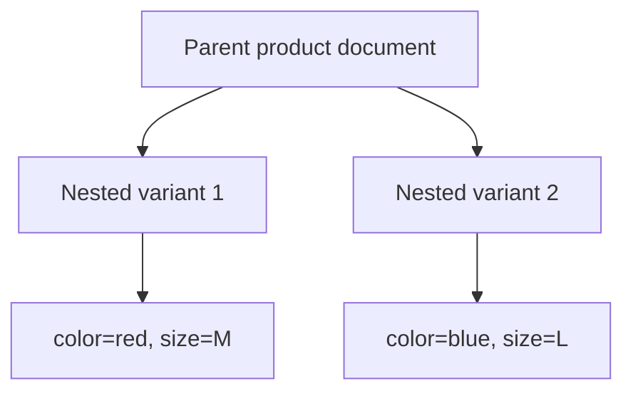

# Object and Nested: Preserving Child Element Attribute Pairs

In Elasticsearch, both `object` and `nested` are used to store JSON structures with sub-properties. The critical difference arises when a field contains an **array of objects**. With a standard `object` mapping, Elasticsearch indexes sub-values in a way that loses the association between attributes belonging to the same array element. A query can inadvertently combine values from two different elements and return the wrong document.

A `nested` mapping keeps each object element in the array as a separate nested unit during indexing. A `nested` query can require multiple conditions to match on **the exact same child element**. This is essential when the relationship between attributes of an individual element has business meaning, such as the color and size of the same product variant, the name and price of the same order line, or the participant and role in the same record.

`nested` has higher storage and query costs than `object`, because each nested object is indexed as a hidden Lucene document linked to the parent document. Therefore, only use `nested` when you need to preserve the relationship between attributes of individual elements; if you only need to store sub-structures and do not need to constrain multiple fields on the same element, `object` is usually simpler.

## 1. Example: a product with multiple variants

Suppose a product has two variants:

```json
{
  "id": "product-1001",
  "name": "Sports Jacket",
  "variants": [
    {
      "sku": "JACKET-RED-M",
      "color": "red",
      "size": "M",
      "price": 120,
      "available": true
    },
    {
      "sku": "JACKET-BLUE-L",
      "color": "blue",
      "size": "L",
      "price": 140,
      "available": true
    }
  ]
}
```

Each element in `variants` is an object with multiple attributes. The relationship between attributes matters:

- `JACKET-RED-M` is red and size M.
- `JACKET-BLUE-L` is blue and size L.

A user searches for a product that has a variant that is both red and size L. The product above **does not** have such a variant. Red belongs to the first element, while size L belongs to the second element.

If the mapping uses `object`, Elasticsearch can match this document when querying for `color = red AND size = L`, because the values of the two fields are indexed independently without keeping element boundaries. This is the *cross-object matching* bug.

If the mapping uses `nested` and both conditions are placed inside the same `nested` query, the document above will not match because no single variant satisfies both conditions.

## 2. How does object mapping store an array of objects?

The default mapping for `object` typically looks like this:

```json
PUT /products-object
{
  "mappings": {
    "properties": {
      "name": {
        "type": "text"
      },
      "variants": {
        "type": "object",
        "properties": {
          "sku": { "type": "keyword" },
          "color": { "type": "keyword" },
          "size": { "type": "keyword" },
          "price": { "type": "double" },
          "available": { "type": "boolean" }
        }
      }
    }
  }
}
```

When indexing the example document, `_source` still retains the original JSON array. However, in the inverted index, Elasticsearch treats the sub-values as multi-valued field sets on the parent document. You can visualize the data as flattened into:

```text
variants.sku       = [JACKET-RED-M, JACKET-BLUE-L]
variants.color     = [red, blue]
variants.size      = [M, L]
variants.price     = [120, 140]
variants.available = [true, true]
```

The information that "red goes with M" and "blue goes with L" is no longer preserved for standard field queries. Elasticsearch knows the document has `red` and has `L`, but an `object` query cannot require both values to come from the same array element.

### 2.1 Object queries can produce false matches

Example query:

```http
GET /products-object/_search
{
  "query": {
    "bool": {
      "filter": [
        { "term": { "variants.color": "red" } },
        { "term": { "variants.size": "L" } }
      ]
    }
  }
}
```

The query requires the document to have at least one `red` value in `variants.color` and at least one `L` value in `variants.size`. The two conditions can be satisfied by two different elements. As a result, the example product can appear even though there is no red/L variant.

This is not a bug in the `bool` query. The query is following the exact semantics of `object` mapping: each condition checks the value set of a field on the parent document. `object` mapping does not provide same-element array constraints.

### 2.2 When object is still the right choice

`object` is suitable if:

- The sub-structure is only used for storage or display.
- Sub-fields are only queried independently.
- There is no need to constrain two or more attributes to the same array element.
- The array contains only scalars or relationships between elements do not matter.
- You want to minimize hidden documents and nested query overhead.

For example, `address` is a single object containing `city`, `district`, and `street`; if there is only one address and conditions apply to that single object, `object` mapping is enough. An array of independent labels or codes also typically does not require `nested`.

## 3. Nested mapping preserves element relationships

With `nested` mapping, Elasticsearch indexes each object element as a separate nested document while preserving its link to the parent document.

Mapping:

```json
PUT /products-nested
{
  "mappings": {
    "properties": {
      "name": {
        "type": "text"
      },
      "variants": {
        "type": "nested",
        "properties": {
          "sku": { "type": "keyword" },
          "color": { "type": "keyword" },
          "size": { "type": "keyword" },
          "price": { "type": "double" },
          "available": { "type": "boolean" }
        }
      }
    }
  }
}
```

The `_source` JSON remains identical to the original document. The difference is in the index structure: each `variants` element is stored as a separate nested Lucene document, while the product document is the parent document. This allows Elasticsearch to evaluate conditions per element and only return the parent document when a single nested document satisfies the conditions.



For a document with two nested objects, Elasticsearch needs to index at least three Lucene documents: one parent document and two nested documents. An array with many nested objects increases the internal document count and corresponding indexing/search costs.

## 4. Nested queries: conditions must match on the same element

To find products that have a variant that is both red and size L, use a `nested` query with `path` set to `variants`. Place both conditions inside the same `bool` query:

```http
GET /products-nested/_search
{
  "query": {
    "nested": {
      "path": "variants",
      "query": {
        "bool": {
          "filter": [
            { "term": { "variants.color": "red" } },
            { "term": { "variants.size": "L" } }
          ]
        }
      }
    }
  }
}
```

Elasticsearch evaluates the `bool` filter against each nested document under `variants`. A single nested document must simultaneously have `color = red` and `size = L`; only then is the parent document containing that matching nested document returned.

With the two variants in the example, the first nested document satisfies red but not size L; the second satisfies size L but not red. Neither nested document satisfies both, so the product does not appear.

### 4.1 Place conditions in the same nested query

This is the most important point when using `nested`. Correct structure:

```json
{
  "nested": {
    "path": "variants",
    "query": {
      "bool": {
        "filter": [
          { "term": { "variants.color": "red" } },
          { "term": { "variants.size": "L" } }
        ]
      }
    }
  }
}
```

Both conditions are evaluated together on one nested child.

If written as two independent `nested` queries:

```json
{
  "bool": {
    "filter": [
      {
        "nested": {
          "path": "variants",
          "query": {
            "term": { "variants.color": "red" }
          }
        }
      },
      {
        "nested": {
          "path": "variants",
          "query": {
            "term": { "variants.size": "L" }
          }
        }
      }
    ]
  }
}
```

the parent document can match if one nested child is red and a different nested child is size L. This structure reintroduces cross-object matching even though the mapping is `nested`. To preserve attribute pairs, you must put conditions that belong to the same element inside **a single nested query**.

### 4.2 Combining parent and child conditions

You can filter parent document fields outside the `nested` query while filtering variant attributes inside:

```http
GET /products-nested/_search
{
  "query": {
    "bool": {
      "filter": [
        { "term": { "active": true } },
        {
          "nested": {
            "path": "variants",
            "query": {
              "bool": {
                "filter": [
                  { "term": { "variants.color": "red" } },
                  { "term": { "variants.size": "L" } },
                  { "term": { "variants.available": true } }
                ]
              }
            }
          }
        }
      ]
    }
  }
}
```

The parent document must be active and must have at least one nested variant that is red, size L, and in stock. Parent and child conditions are properly scoped.

### 4.3 Score mode

A `nested` query has `score_mode` to determine how the scores of matching nested documents contribute to the parent document's score:

```json
{
  "nested": {
    "path": "variants",
    "score_mode": "max",
    "query": {
      "match": {
        "variants.description": "wireless"
      }
    }
  }
}
```

Common options include `avg`, `max`, `min`, `sum`, and `none`. For pure filters, scoring generally does not matter; you can use a filter context. When a `nested` query participates in relevance scoring, choose the score mode based on how you want to aggregate the relevance of child documents.

## 5. Returning child element details with inner_hits

By default, a `nested` query returns matching parent documents. If the UI needs to know exactly which variant matched, use `inner_hits`:

```http
GET /products-nested/_search
{
  "query": {
    "nested": {
      "path": "variants",
      "query": {
        "bool": {
          "filter": [
            { "term": { "variants.color": "red" } },
            { "term": { "variants.size": "M" } }
          ]
        }
      },
      "inner_hits": {
        "name": "matching_variants",
        "size": 5
      }
    }
  }
}
```

The response includes the parent document in `hits.hits[*]._source` and the matching nested hits in `hits.hits[*].inner_hits.matching_variants.hits.hits`. This lets the application display the exact SKU/price of the variant that satisfied the criteria.

### 5.1 Inner hits do not change the parent's `_source`

`inner_hits` is result metadata attached to the parent hit. It does not turn nested objects into independent documents in the index and does not alter the original `_source` JSON. You can configure source filtering, sorting, or highlighting specifically for inner hits as supported by the Search API.

### 5.2 Limiting the number of inner hits

You should not return all nested children for every parent if each document has hundreds or thousands of elements. Set a reasonable `inner_hits.size`, return only needed fields, and consider response payload cost. If you need to browse all child elements as independent data, consider modeling them in a separate index/document.

## 6. Object and nested in Spring Data Elasticsearch

Spring Data Elasticsearch maps Java property types to Elasticsearch mappings using annotations. An object can be explicitly declared as `FieldType.Object`; nested uses `FieldType.Nested`.

### 6.1 Declaring Java types

Child class representing a variant:

```java
import org.springframework.data.elasticsearch.annotations.Field;
import org.springframework.data.elasticsearch.annotations.FieldType;

public class ProductVariant {

    @Field(type = FieldType.Keyword)
    private String sku;

    @Field(type = FieldType.Keyword)
    private String color;

    @Field(type = FieldType.Keyword)
    private String size;

    @Field(type = FieldType.Double)
    private Double price;

    @Field(type = FieldType.Boolean)
    private Boolean available;

    protected ProductVariant() {
    }

    // Constructors and accessors omitted for brevity.
}
```

Product entity with nested variants:

```java
import java.util.List;

import org.springframework.data.annotation.Id;
import org.springframework.data.elasticsearch.annotations.Document;
import org.springframework.data.elasticsearch.annotations.Field;
import org.springframework.data.elasticsearch.annotations.FieldType;

@Document(indexName = "products")
public class Product {

    @Id
    private String id;

    @Field(type = FieldType.Text)
    private String name;

    @Field(type = FieldType.Boolean)
    private Boolean active;

    @Field(type = FieldType.Nested)
    private List<ProductVariant> variants;

    protected Product() {
    }

    // Constructors and accessors omitted for brevity.
}
```

The `@Field(type = FieldType.Nested)` annotation tells Spring Data that `variants` must be mapped as `nested`. If you use `FieldType.Object` or leave it at the default object mapping, relationships between array elements are not preserved for nested queries.

### 6.2 Declaring a regular object

If nested semantics are not needed, you can declare:

```java
@Field(type = FieldType.Object)
private ProductVariant details;
```

For a single child object, `object` mapping is usually sufficient if you do not need to query relationships across multiple array elements. With `List<ProductVariant>`, choosing between `Object` and `Nested` must depend on whether multiple conditions need to match on the same element.

### 6.3 Checking the actual mapping

After creating the index, verify that the field has `type: nested`:

```http
GET /products/_mapping
```

Expected result:

```json
{
  "properties": {
    "variants": {
      "type": "nested",
      "properties": {
        "sku": { "type": "keyword" },
        "color": { "type": "keyword" },
        "size": { "type": "keyword" },
        "price": { "type": "double" },
        "available": { "type": "boolean" }
      }
    }
  }
}
```

Do not rely solely on Java annotations; check the actual mapping created, especially when the index already exists or is managed by a separate template/migration.

## 7. Nested queries in Spring Data with NativeQuery

With Spring Data Elasticsearch using the Elasticsearch Java API Client, `NativeQuery` lets you build nested queries using a typed query builder.

Example finding products with a red, size M variant:

```java
import co.elastic.clients.elasticsearch._types.FieldValue;
import org.springframework.data.elasticsearch.client.elc.NativeQuery;
import org.springframework.data.elasticsearch.core.query.Query;

Query query = NativeQuery.builder()
    .withQuery(q -> q.nested(n -> n
        .path("variants")
        .query(nq -> nq.bool(b -> b
            .filter(f -> f.term(t -> t
                .field("variants.color")
                .value(FieldValue.of("red"))
            ))
            .filter(f -> f.term(t -> t
                .field("variants.size")
                .value(FieldValue.of("M"))
            ))
        ))
    ))
    .build();
```

Both `term` queries sit inside the same `nested` query with path `variants`, so they must match on the same nested child. Executing via `ElasticsearchOperations`:

```java
SearchHits<Product> hits = operations.search(query, Product.class);
```

`SearchHits<Product>` contains the parent `Product` documents. Nested children are not returned as a separate list of `Product`s; if you need the matching variant content, configure `inner_hits` and read the corresponding metadata.

### 7.1 Combining nested and parent fields

```java
Query query = NativeQuery.builder()
    .withQuery(q -> q.bool(b -> b
        .filter(f -> f.term(t -> t
            .field("active")
            .value(FieldValue.of(true))
        ))
        .filter(f -> f.nested(n -> n
            .path("variants")
            .query(nq -> nq.bool(nb -> nb
                .filter(v -> v.term(t -> t
                    .field("variants.color")
                    .value(FieldValue.of("red"))
                ))
                .filter(v -> v.term(t -> t
                    .field("variants.size")
                    .value(FieldValue.of("M"))
                ))
            ))
        ))
    ))
    .build();
```

The `active` condition applies to the parent document. Both color/size conditions apply to the same nested variant.

### 7.2 Repository methods and nested queries

For fixed queries, you can declare Query DSL JSON via `@Query` if your Spring Data Elasticsearch version supports that structure:

```java
import org.springframework.data.elasticsearch.annotations.Query;
import org.springframework.data.elasticsearch.repository.ElasticsearchRepository;

public interface ProductRepository
        extends ElasticsearchRepository<Product, String> {

    @Query("{\"nested\":{\"path\":\"variants\",\"query\":{\"bool\":{\"filter\":[{\"term\":{\"variants.color\":\"?0\"}},{\"term\":{\"variants.size\":\"?1\"}}]}}}}")
    List<Product> findByVariantColorAndSize(String color, String size);
}
```

Placeholder binding and parameter serialization should be verified against your project's version. For dynamic nested queries or multiple conditions, `NativeQuery` is typically easier to read, extend, and control than a long JSON string.

## 8. Nested sorting

When sorting parent documents by a field inside a nested object, Elasticsearch needs to know the nested path and how to aggregate child values. For example, a product has multiple variants and needs to be sorted by the lowest price among available variants:

```http
GET /products/_search
{
  "query": {
    "match_all": {}
  },
  "sort": [
    {
      "variants.price": {
        "order": "asc",
        "mode": "min",
        "nested": {
          "path": "variants",
          "filter": {
            "term": {
              "variants.available": true
            }
          }
        }
      }
    }
  ]
}
```

`nested.path` identifies the nested field. `mode: min` selects the minimum price among participating children. The nested filter includes only in-stock variants. Modes such as `min`, `max`, `avg`, `sum`, or `median` (depending on field type and version) control how multiple values are aggregated.

Sorting on `variants.price` without declaring a nested context may fail or produce unintended semantics. This is one reason to carefully evaluate `nested` when designing queries, sorts, and aggregations.

## 9. Nested aggregations

Aggregations on nested fields need to enter the nested scope using a `nested` aggregation. For example, counting variants by color:

```http
GET /products/_search
{
  "size": 0,
  "aggs": {
    "variants_scope": {
      "nested": {
        "path": "variants"
      },
      "aggs": {
        "colors": {
          "terms": {
            "field": "variants.color"
          }
        }
      }
    }
  }
}
```

`variants_scope` shifts the aggregation context from parent documents to nested documents. `colors` counts nested variants by color, so `doc_count` here is the number of nested children, not the number of parent products.

### 9.1 Returning to parent document scope with reverse_nested

If you need to count parent products that have variants of each color, use `reverse_nested`:

```http
GET /products/_search
{
  "size": 0,
  "aggs": {
    "variants_scope": {
      "nested": {
        "path": "variants"
      },
      "aggs": {
        "by_color": {
          "terms": {
            "field": "variants.color"
          },
          "aggs": {
            "parent_products": {
              "reverse_nested": {}
            }
          }
        }
      }
    }
  }
}
```

`by_color` counts nested variants by color. `parent_products.doc_count` counts the parent documents associated with each color bucket. The two counts can differ because a single product can have multiple variants of the same color.

## 10. Updating nested objects

A nested object is not an independent document that an application can update via its own `_id`. Nested children are stored internally and attached to the parent document. When updating a nested element, the usual operation is still updating/reindexing the parent document containing the nested array.

For example, changing the price of one variant:

1. Read the product or fetch canonical data from the business source.
2. Find the variant with the matching SKU in the array.
3. Update the price in the Java object.
4. Write the parent document through the designed update flow.

If the parent document is large or many concurrent requests update different variants, consider concurrency and the cost of reindexing the entire parent. `nested` is suitable when children are tightly coupled and typically read/queried alongside the parent. If children need frequent independent updates, modeling each child as a separate document may be better.

### 10.1 Do not use nested to replace independent relationships

If variants have separate lifecycles, access permissions, transactions, or large data volumes, a separate index for variants may be easier to manage. You can store `productId` as a link key and run multi-step queries or application-level joins. Elasticsearch does not provide arbitrary cross-index joins like a relational database.

`nested` is optimized for finding parent documents based on conditions over related child objects; it does not turn Elasticsearch into a relational database.

## 11. Migrating mapping from object to nested

A field already created with `object` mapping cannot be changed directly to `nested` via a mapping update. The two types are indexed differently. If conversion is needed:

1. Create a new index with the `nested` mapping.
2. Reindex documents from the old index into the new index.
3. Verify nested queries against the new data.
4. Switch the alias/application to the new index according to the migration plan.
5. Retire the old index after confirming all consumers have switched.

Example creating the new index:

```http
PUT /products-v2
{
  "mappings": {
    "properties": {
      "name": {
        "type": "text"
      },
      "variants": {
        "type": "nested",
        "properties": {
          "sku": { "type": "keyword" },
          "color": { "type": "keyword" },
          "size": { "type": "keyword" },
          "price": { "type": "double" },
          "available": { "type": "boolean" }
        }
      }
    }
  }
}
```

Reindex:

```http
POST /_reindex
{
  "source": {
    "index": "products-v1"
  },
  "dest": {
    "index": "products-v2"
  }
}
```

If `_source` of the old index retains the original JSON array, reindexing can use that content to create nested documents in the new index according to the target mapping. However, you should verify results and handle mapping/data errors before switching aliases.

### 11.1 Alias switch

If the application reads via an alias, you can switch the alias atomically in a single `_aliases` operation:

```http
POST /_aliases
{
  "actions": [
    { "remove": { "index": "products-v1", "alias": "products" } },
    { "add": { "index": "products-v2", "alias": "products" } }
  ]
}
```

Aliases allow switching physical indexes without renaming the index across all consumers. Before switching, synchronize any new writes occurring during reindexing, or use an appropriate dual-write/cutover plan; a simple reindex does not automatically sync changes made after each document is read.

## 12. Costs and limits of nested

`nested` solves element-correlation requirements, but comes with costs:

- Each nested object becomes a hidden Lucene document, increasing internal document count.
- Indexing and updating parent documents can require additional work.
- Nested queries, nested sorts, and nested aggregations are more complex than flat-field queries.
- `inner_hits` can enlarge responses and increase overhead.
- There are configurable limits such as the number of nested fields and nested objects per document; exact values depend on the Elasticsearch version and settings.
- `nested` does not support updating individual children independently like separate documents.

Do not make every object `nested` by default. Choose `nested` for arrays of objects where the business requires multi-field conditions on the same element. For simple sub-structures, `object` is usually sufficient and lighter.

### 12.1 Nested or a separate index?

| Criterion | Object | Nested | Child as separate document |
|---|---|---|---|
| Preserves field relationships within the same array element on query | No | Yes | Yes, per separate document |
| Querying parent documents by child conditions | Can cross-match | Yes, via nested query | Requires application-side queries/linking |
| Updating individual elements independently | No | Not directly | Yes |
| Index cost | Lower | Higher due to hidden docs | Depends on document count and mapping |
| Best suited for | Sub-structures not needing correlation | Children tightly coupled to parent | Children with independent lifecycles/volumes |

## 13. Common mistakes

### 13.1 Using an object array when same-element conditions are needed

If a query needs `color = red AND size = L` on the same variant, `object` mapping does not guarantee that. Use `nested` mapping and a single `nested` query containing both conditions.

### 13.2 Having nested mapping but querying fields like object fields

You cannot simply query `variants.color` with a root-level `term` query and expect nested semantics. You must wrap the condition in a `nested` query with the right `path`.

### 13.3 Splitting conditions into multiple independent nested queries

Two separate `nested` queries can match two different children. If conditions must apply to the same child, place them inside the same `nested` query and the same `bool` group.

### 13.4 Confusing nested hits with parent hits

A `nested` query returns parent documents. To see which nested child matched, enable `inner_hits` and read the inner hits metadata.

### 13.5 Forgetting nested context in sorts or aggregations

Sorting on a nested field requires a nested path/mode/filter. Aggregating on a nested field requires a `nested` aggregation; to count parent documents again, use `reverse_nested`.

### 13.6 Assuming nested children have independent `_id`s

A nested object is part of the parent document, not an independent document in standard CRUD APIs. If children need independent updates/gets/deletes, consider a separate index.

### 13.7 Changing object to nested directly

You cannot change an existing field's type via a mapping update. Create a new index and reindex the data.

### 13.8 Not verifying the created mapping

Java annotations do not guarantee that an existing index has a `nested` mapping if the index was created beforehand or is managed by a template. Inspect the actual `_mapping`.

## 14. Testing with counterexample data

To verify that a mapping preserves element relationships, create a document with two children where each child satisfies only half of the conditions:

```json
PUT /products-nested/_doc/product-1001
{
  "name": "Sports Jacket",
  "variants": [
    { "sku": "RED-M", "color": "red", "size": "M" },
    { "sku": "BLUE-L", "color": "blue", "size": "L" }
  ]
}
```

Run a `nested` query looking for red/L:

```http
GET /products-nested/_search
{
  "query": {
    "nested": {
      "path": "variants",
      "query": {
        "bool": {
          "filter": [
            { "term": { "variants.color": "red" } },
            { "term": { "variants.size": "L" } }
          ]
        }
      }
    }
  }
}
```

The result must not contain `product-1001`. Next, search for red/M; the product must be returned and `inner_hits` (if enabled) must point to `RED-M`.

This is an important counterexample dataset because it clearly distinguishes object flattening from nested correlation. If you only test documents with one child or where all children share the same values, both mappings can return the same results and cross-matching bugs go unnoticed.

## 15. Selection and implementation guidelines

- Use `object` for JSON sub-structures when you do not need multiple fields to match on the same array element.
- Use `nested` for object arrays when you need to preserve attribute pairs/groups per element.
- Place conditions that must match the same child in a single `nested` query with the same `path`.
- Do not split correlated conditions into multiple independent `nested` queries.
- Use `inner_hits` when you need to know which child caused the parent document to match.
- Use nested sorts with an appropriate path/mode/filter; use nested aggregations to analyze children and `reverse_nested` to return to parent scope.
- In Spring Data, declare `@Field(type = FieldType.Nested)` and verify the actual mapping.
- Use `NativeQuery`/Elasticsearch Java Client for complex nested queries; use repository `@Query` when the query is fixed and readable.
- Remember that nested children are not independent documents; updates typically affect the parent document.
- Reindex into a new index when converting a field from `object` to `nested`.
- Measure the cost of nested objects, inner hits, sorts, and aggregations before using them on large datasets.
- If children have independent lifecycles and operations, consider modeling children as separate documents.

## 16. Summary

`object` and `nested` both represent JSON structures with child properties, but differ in how Elasticsearch indexes arrays of objects. Object mapping flattens child values by field, so a query can combine `color = red` from one element with `size = L` from another. When the relationship between attributes within a single element matters, that produces incorrect business results.

Nested mapping stores each object element as a separate nested Lucene document. A `nested` query with conditions placed inside the same `bool` group guarantees all conditions match on the same nested child. `inner_hits` identifies which child matched; nested sorts and nested aggregations require dedicated scopes/paths. In Spring Data Elasticsearch, declare this with `@Field(type = FieldType.Nested)` and build queries via `NativeQuery` or the corresponding Query DSL.

`nested` has higher storage and query costs than `object`, does not create child documents with independent CRUD lifecycles, and cannot directly convert an existing `object` mapping into `nested`. Choose `nested` when element relationships must be preserved, inspect actual mappings, and reindex into a new index when changing field types. If children need independent management, a separate index may be a better fit.

## References

- [Elasticsearch — Object field type](https://www.elastic.co/guide/en/elasticsearch/reference/current/object.html)
- [Elasticsearch — Nested field type](https://www.elastic.co/guide/en/elasticsearch/reference/current/nested.html)
- [Elasticsearch — Nested query](https://www.elastic.co/guide/en/elasticsearch/reference/current/query-dsl-nested-query.html)
- [Elasticsearch — Nested aggregation](https://www.elastic.co/guide/en/elasticsearch/reference/current/search-aggregations-bucket-nested-aggregation.html)
- [Elasticsearch — Nested sorting](https://www.elastic.co/guide/en/elasticsearch/reference/current/sort-search-results.html#nested-sorting)
- [Spring Data Elasticsearch Reference](https://docs.spring.io/spring-data/elasticsearch/reference/index.html)
