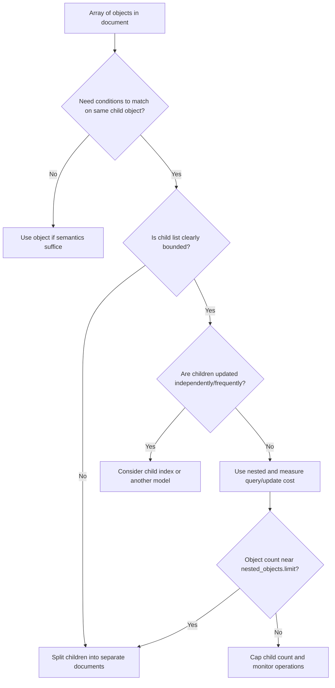

# Nested Object Limits and Update Costs

In Elasticsearch, `nested` mapping preserves the relationship between attributes of each object inside an array. It is necessary when a document contains multiple child objects and queries must ensure conditions match on **one specific child object**. However, `nested` is not free: Elasticsearch stores each nested object as a hidden Lucene document, increasing index size, query cost, and especially update cost.

Spring Data Elasticsearch lets you declare a nested field with `@Field(type = FieldType.Nested)`. When designing entities, consider the number of nested objects per document, the number of distinct nested mappings in an index, update frequency, and how the application queries child data.

Two important limits are often confused:

- `index.mapping.nested_fields.limit`: limits the number of **distinct nested field mappings** in an index.
- `index.mapping.nested_objects.limit`: limits the total number of **nested objects in a single document**.

Under common Elasticsearch defaults, these two limits are 50 nested field mappings and 10,000 nested objects per document, respectively. Actual values should be checked against your running Elasticsearch version and index configuration.

## 1. Why is nested mapping needed?

Suppose an order has multiple order lines. Each line has `productId`, `quantity`, and `unitPrice`:

```json
{
  "orderId": "ORD-1001",
  "items": [
    {
      "productId": "P-100",
      "quantity": 2,
      "unitPrice": 150000
    },
    {
      "productId": "P-200",
      "quantity": 10,
      "unitPrice": 50000
    }
  ]
}
```

The application needs to find orders that have a line containing product `P-100` with a quantity of at least 5. The conditions must match on the same `items` element.

If `items` is mapped as a regular `object`, Elasticsearch flattens the object array's values into multi-valued fields. The relationship between attributes within each individual child object is no longer retained for per-object querying. A query could match `productId = P-100` from the first line and `quantity >= 5` from the second line, even though no line satisfies both conditions.

`nested` solves this by indexing each child object as a separate document while maintaining its link to the parent document. A `nested` query can require conditions to match on the same nested object.

## 2. Declaring nested in Spring Data Elasticsearch

Example order entity:

```java
package com.example.orders.document;

import java.util.List;

import org.springframework.data.annotation.Id;
import org.springframework.data.elasticsearch.annotations.Document;
import org.springframework.data.elasticsearch.annotations.Field;
import org.springframework.data.elasticsearch.annotations.FieldType;

@Document(indexName = "orders")
public class OrderDocument {

    @Id
    private String id;

    @Field(type = FieldType.Keyword)
    private String orderId;

    @Field(type = FieldType.Keyword)
    private String status;

    @Field(type = FieldType.Nested)
    private List<OrderItem> items;

    protected OrderDocument() {
    }

    public OrderDocument(
            String id,
            String orderId,
            String status,
            List<OrderItem> items) {
        this.id = id;
        this.orderId = orderId;
        this.status = status;
        this.items = items;
    }

    public String getId() {
        return id;
    }

    public List<OrderItem> getItems() {
        return items;
    }
}
```

Child object class:

```java
package com.example.orders.document;

import org.springframework.data.elasticsearch.annotations.Field;
import org.springframework.data.elasticsearch.annotations.FieldType;

public class OrderItem {

    @Field(type = FieldType.Keyword)
    private String productId;

    @Field(type = FieldType.Integer)
    private Integer quantity;

    @Field(type = FieldType.Long)
    private Long unitPrice;

    protected OrderItem() {
    }

    public OrderItem(String productId, Integer quantity, Long unitPrice) {
        this.productId = productId;
        this.quantity = quantity;
        this.unitPrice = unitPrice;
    }

    public String getProductId() {
        return productId;
    }

    public Integer getQuantity() {
        return quantity;
    }

    public Long getUnitPrice() {
        return unitPrice;
    }
}
```

`@Field(type = FieldType.Nested)` sets the mapping of `items` to `nested`. Fields inside `OrderItem` have their own mappings such as `keyword`, `integer`, and `long`.

The corresponding Elasticsearch mapping looks like:

```json
PUT orders
{
  "mappings": {
    "properties": {
      "orderId": { "type": "keyword" },
      "status": { "type": "keyword" },
      "items": {
        "type": "nested",
        "properties": {
          "productId": { "type": "keyword" },
          "quantity": { "type": "integer" },
          "unitPrice": { "type": "long" }
        }
      }
    }
  }
}
```

Spring Data can create the mapping from entity metadata via `IndexOperations`:

```java
IndexOperations indexOperations = operations.indexOps(OrderDocument.class);

if (!indexOperations.exists()) {
    indexOperations.createWithMapping();
}
```

In production, index mappings should be managed via migrations or a controlled provisioning process. Do not let multiple application instances auto-create indexes concurrently on startup.

## 3. How do `object` and `nested` differ?

`object` is the default mapping type for JSON objects. When a field is an array of objects, Elasticsearch flattens those objects' attributes into multi-valued fields. `nested` creates a separate child document for each object and preserves relationships between attributes of the same object.

| Criterion | `object` | `nested` |
|---|---|---|
| Indexing mechanism | Object fields are flattened | Each child object is indexed as a hidden Lucene document |
| Preserves field relationships in same object | Does not preserve per-object query semantics | Yes |
| Querying | Standard `term`/`range` queries on fields | Requires `nested` query to query child objects |
| Aggregations | Standard aggregations | `nested` aggregation to enter nested documents |
| Indexing cost | Lower in many cases | Higher due to extra Lucene documents |
| Update cost | Updating root document still reindexes document | Updates root document and entire associated nested block |
| When to use | No need to constrain conditions on the same child object | Need to query attributes belonging to the same child object |

Do not declare every object as `nested` out of habit. If you only need to store metadata and do not need to preserve field relationships within individual elements, `object` is usually simpler and cheaper.

## 4. How are nested objects stored?

A nested object is not an independent child table like in a relational database. Elasticsearch indexes each nested object as a separate Lucene document and groups the child documents with the parent document in the same block.

For example, an order with 3 `items` elements:

```text
Order document
  ├── Item nested document 1
  ├── Item nested document 2
  └── Item nested document 3
```

At the Lucene level, this block has one parent document and three nested documents. An index with many orders, each having many items, creates a significantly larger number of Lucene documents than the number of orders the application sees.

If a single document contains 2,000 nested objects, that document alone corresponds to thousands of additional Lucene documents. This impacts:

- Index size and internal document count.
- Indexing and refresh costs.
- Segment merges and I/O.
- Heap and data structures used for queries.
- `nested` query, `nested` aggregation, and `nested` sort costs.
- `_source` size and payload serialization/deserialization during reads or updates.

Therefore, limit the number of nested objects per root document and reconsider the data model if child lists can grow without bound.

## 5. Two nested limits to distinguish

### 5.1. `index.mapping.nested_fields.limit`

This setting limits the number of distinct nested field mappings in an index. A common default is `50`.

For example, a mapping with nested paths:

```json
{
  "properties": {
    "items": { "type": "nested" },
    "shipments": { "type": "nested" },
    "payments": { "type": "nested" }
  }
}
```

Here there are three distinct nested field mappings: `items`, `shipments`, and `payments`. A document with 100 `items` elements does not increase the nested field mapping count to 100; that is governed by the nested-objects-per-document limit.

Dynamic mapping can accidentally generate many distinct nested paths if schemas are produced from diverse object types or custom fields. Design a small, stable set of nested paths rather than creating new nested mappings per data type or tenant.

### 5.2. `index.mapping.nested_objects.limit`

This setting limits the total number of nested objects inside a single document across all nested types. A common default is `10,000` nested objects per document.

Examples:

- An order with 100 `items`: 100 nested objects.
- An order with 4 shipments and 100 items: total nested objects in the document can be 104.
- A document with multiple nested paths: total objects across all paths count toward that document's limit.

This limit applies per document, not across the entire index. An index can hold a vast number of nested objects distributed across many documents without hitting the per-document limit; however, that total still increases index size and operational overhead.

### 5.3. Quick comparison table

| Setting | What it counts | Scope | Common default |
|---|---|---|---:|
| `index.mapping.nested_fields.limit` | Number of distinct nested field mappings | Per index | 50 |
| `index.mapping.nested_objects.limit` | Total nested object instances | Per document | 10,000 |

Do not confuse these two settings with `index.mapping.total_fields.limit`, which caps the total number of field mappings. A mapping with few nested paths but tens of thousands of nested objects per document can hit `nested_objects.limit`; conversely, a mapping with too many nested paths can hit `nested_fields.limit` even if each document holds only a few child objects.

## 6. Configuring and inspecting nested limits

Limits can be declared in index settings when creating an index:

```json
PUT orders-v1
{
  "settings": {
    "index.mapping.nested_fields.limit": 20,
    "index.mapping.nested_objects.limit": 3000
  },
  "mappings": {
    "properties": {
      "items": {
        "type": "nested",
        "properties": {
          "productId": { "type": "keyword" },
          "quantity": { "type": "integer" }
        }
      }
    }
  }
}
```

The numbers `20` and `3000` merely illustrate a stricter policy than the defaults. Do not copy them without measuring actual document sizes and workloads.

Reading index settings:

```http
GET orders-v1/_settings?include_defaults=true
```

Inspecting mappings:

```http
GET orders-v1/_mapping
```

Settings and whether they can be updated dynamically or require closing the index may differ across Elasticsearch versions. Verify your cluster version's documentation before making changes. Raising a limit does not make queries or updates faster; it only allows the index to accept larger structures and can increase resource risks.

### 6.1. Do not raise limits to mask data modeling issues

If a document contains 50,000 nested elements, the first question should be whether those 50,000 elements truly belong inside the same document. They may be historical data, logs, transactions, or child records that should be stored as independent documents.

Only raise `nested_objects.limit` when:

- There is a clear business reason to keep all child objects within one root document.
- The maximum size has been determined and benchmarked.
- Query/update latency and index size have been tested under near-production load.
- Input validation prevents clients from creating arbitrarily large documents.
- The cluster has sufficient resources and a monitoring plan is in place after the change.

## 7. Nested queries and query costs

To query fields on a nested path, you must use a `nested` query. For example, finding orders that have an item with `productId = P-100` and `quantity >= 5`:

```json
GET orders/_search
{
  "query": {
    "nested": {
      "path": "items",
      "query": {
        "bool": {
          "filter": [
            { "term": { "items.productId": "P-100" } },
            { "range": { "items.quantity": { "gte": 5 } } }
          ]
        }
      },
      "inner_hits": {
        "size": 5
      }
    }
  }
}
```

Both conditions apply to the same nested object in `items`. `inner_hits` requests returning the matching nested objects as well. If displaying matching line items is unnecessary, omit `inner_hits` to reduce response payload.

`nested` queries cost more than regular queries because Elasticsearch must resolve relationships between nested documents and parent documents. When there are many nested objects per root document, queries must evaluate more Lucene documents.

Factors affecting cost:

- Average and maximum number of nested objects per document.
- Number of shards and index size.
- Number of nested clauses in the query.
- Number of fields filtered/sorted inside the nested path.
- Use of `inner_hits` and number of inner hits returned.
- Nested aggregations and bucket tree size.

Cap `inner_hits.size`, page size, and the number of nested paths a query touches. Do not return thousands of nested objects per hit if the UI only needs a handful of matching lines.

### 7.1. Using nested queries via NativeQuery

In Spring Data Elasticsearch, you can construct a nested query using the Elasticsearch Java API Client builder:

```java
import co.elastic.clients.elasticsearch._types.FieldValue;
import org.springframework.data.elasticsearch.client.elc.NativeQuery;
import org.springframework.data.elasticsearch.core.SearchHits;
import org.springframework.data.elasticsearch.core.query.Query;

Query query = NativeQuery.builder()
    .withQuery(q -> q
        .nested(n -> n
            .path("items")
            .query(nq -> nq
                .term(t -> t
                    .field("items.productId")
                    .value(FieldValue.of("P-100"))
                )
            )
        )
    )
    .build();

SearchHits<OrderDocument> hits = operations.search(
    query,
    OrderDocument.class
);
```

This example focuses on an exact match condition. When combining multiple conditions on the same nested object, place them inside a `bool` within `nested.query`, just like the JSON DSL above. Builder method names can vary across Java API Client versions; the key requirement is that `path` must be a mapped nested path.

## 8. Nested aggregations also carry their own costs

To compute statistics over fields in nested objects, use a `nested` aggregation to shift computation scope into nested documents.

For example, counting line items by `productId`:

```json
GET orders/_search
{
  "size": 0,
  "aggs": {
    "order_items": {
      "nested": {
        "path": "items"
      },
      "aggs": {
        "products": {
          "terms": {
            "field": "items.productId",
            "size": 20
          }
        }
      }
    }
  }
}
```

The `products` aggregation counts nested documents by `productId`, not parent orders. To return to order scope and count parent documents, you can use a `reverse_nested` aggregation.

Nested aggregations over large datasets, many nested objects, or high-cardinality buckets can be resource-intensive. Cap bucket sizes, request only needed facets, and measure latency on representative data.

## 9. Cost of updating nested objects

This is a crucial consideration in data modeling. Elasticsearch is a Lucene-based search engine; indexed documents are not modified in-place like rows in a relational database. When updating a document, Elasticsearch creates a new version of the document and marks the old version for deletion under Lucene's segment model.

With `nested` mapping, a root document and its nested documents are stored together as a block. When updating the root document, Elasticsearch must rewrite the root and associated nested objects in that block.

For example, an order has 2,000 items. Changing only the `quantity` of a single item can still require reindexing the entire order along with all of its nested documents, not just that one nested object.

This leads to:

- Larger payloads serialized and sent to Elasticsearch.
- Increased indexing work and segment writes.
- Higher write amplification when only a single child field changes.
- Increased merge pressure and I/O under frequent updates.
- Higher risk of write conflicts if multiple tasks concurrently update the same root document.

### 9.1. `save` updates the entire aggregate

Example service reading an order, modifying one item, and saving it back:

```java
OrderDocument order = orderRepository.findById(orderId)
    .orElseThrow();

List<OrderItem> updatedItems = order.getItems().stream()
    .map(item -> item.getProductId().equals(productId)
        ? new OrderItem(item.getProductId(), newQuantity, item.getUnitPrice())
        : item)
    .toList();

OrderDocument updated = new OrderDocument(
    order.getId(),
    order.getOrderId(),
    order.getStatus(),
    updatedItems
);

orderRepository.save(updated);
```

This is a clean approach when an order is a small aggregate updated as a single unit. However, with large nested lists, the cost of rewriting the whole aggregate can be substantial.

### 9.2. Partial updates do not turn nested objects into independent rows

Elasticsearch's Update API can accept a partial document or script to modify part of `_source`. While this saves the application from fetching and reassembling the document on the client in some cases, internally Elasticsearch still creates a new document version in Lucene.

Therefore, partial updates do not mean only a single nested Lucene document is edited in place. If the root document holds many nested objects, updating one element can still reindex the entire root/nested block.

Scripted updates reduce application round trips but do not eliminate write amplification. The Bulk API reduces HTTP request overhead when updating multiple documents, but does not change the cost of updating each root document that carries a large nested array.

## 10. How update frequency affects the nested choice

`nested` is generally a good fit when:

- The list of child objects has a clear upper bound.
- Child objects are read together with the parent in most use cases.
- Queries need to match multiple attributes on the same child object.
- Parent and children are typically created/updated together.
- Update frequency is low or moderate relative to read frequency.

`nested` is a poor fit when:

- The child list grows indefinitely over time.
- Individual children are updated independently and frequently.
- A single root document holds tens or hundreds of thousands of child records.
- Multiple concurrent requests modify different children within the same root document.
- Use cases primarily search individual children independently rather than querying parents via children.

For example, an order's `items` usually have a bounded count and are read with the order, making `nested` a reasonable fit. Conversely, event histories, audit logs, or continuously arriving transactions should not accumulate unboundedly inside a document's nested array.

## 11. Alternative strategies when nested is too large or updated frequently

### 11.1. Use `object` if same-element correlation is not needed

If the application only displays attributes and does not need queries with multiple conditions matching the same child object, `object` mapping can satisfy the need at lower cost.

For example, simple metadata:

```json
{
  "attributes": [
    { "name": "color", "value": "black" },
    { "name": "material", "value": "plastic" }
  ]
}
```

If queries do not need to ensure `name` and `value` belong to the same object, `object` mapping is an option. If you must match an exact attribute pair on the same element, `nested` preserves those semantics.

### 11.2. Split children into separate documents

If each item needs independent updates and searches, store each item as a document in a separate index:

```json
{
  "orderId": "ORD-1001",
  "productId": "P-100",
  "quantity": 2,
  "unitPrice": 150000
}
```

One item can then be updated without reindexing the entire order and all other items. In return, queries require application-level joins or denormalizing needed parent data into child documents.

This design fits when:

- Child records have their own lifecycle.
- Children are updated frequently.
- Child counts are not tightly bounded.
- Searches primarily target child records.

### 11.3. Denormalize data needed for reads

Elasticsearch works well with denormalized read models. You can copy necessary parent information into each child document—such as `orderStatus`, `customerId`, or `createdAt`—to search children without joining.

Denormalization increases synchronization costs when the parent changes. You need a process to update child documents or accept point-in-time snapshot semantics. Do not copy the entire parent if only a few fields are needed for filtering.

### 11.4. Parent-child relationships

Elasticsearch offers the `join` field to model parent-child relationships within the same index. This allows parents and children to be separate documents while supporting join queries. However, join queries carry significant cost, require routing so parents and children live on the same shard, and may rely on global ordinals.

Parent-child is not the default choice merely because a nested array is large. Consider it only when children need an independent lifecycle, parent-child relationships truly must be queried inside Elasticsearch, and the team has benchmarked join costs. In many systems, separate indexes with application-level joins or denormalization are simpler.

### 11.5. Use event-based or time-based indexes

For audit logs, events, or change histories, store each event as an independent document with a timestamp and a link key to the parent. Depending on the workload, you can use data streams or time-based indexes. Do not pile unbounded history into a single document's nested array.

## 12. Optimizing nested update workflows

If `nested` is the right choice and data cannot be split, you can still reduce costs by:

- Enforcing nested array size limits at the domain/API layer.
- Skipping root document updates when values haven't actually changed.
- Batching multiple changes to the same root document into a single write.
- Using the Bulk API when updating many different root documents.
- Limiting the number of workers concurrently updating the same aggregate type.
- Using optimistic concurrency control when concurrent overwrites are possible.
- Fetching only needed fields when reading, while remembering source updates may still require the full document.
- Monitoring update latency, indexing throughput, merge times, and rejections.

### 12.1. Bulk does not eliminate reindex costs

The Bulk API reduces HTTP round-trip overhead by sending multiple operations in one request. However, each update item is still processed according to Elasticsearch's indexing semantics. If 1,000 orders each containing 2,000 nested items are updated, bulk does not turn those 2,000,000 nested objects into a few cheap field edits.

Choose bulk batch sizes based on payload size, processing time, and per-item failures. Do not only check that the HTTP request succeeded; a bulk response can contain individual item failures.

### 12.2. Preventing overwrites under concurrent updates

Two workers may read the same order concurrently, each modify a different item, and call `save`. The second worker to write can overwrite the first worker's change if both worked from the same stale snapshot.

You can use optimistic concurrency/versioning or serialize updates by order ID. Implementation depends on your Spring Data API and Elasticsearch version; the key is defining clearly which aggregate owns updates and how conflicts are detected.

## 13. Enforcing nested size limits at the application layer

Do not rely solely on Elasticsearch's `nested_objects.limit` to reject oversized documents. Enforce business limits before sending requests:

```java
public final class OrderRules {

    private static final int MAX_ITEMS_PER_ORDER = 500;

    private OrderRules() {
    }

    public static void validateItems(List<OrderItem> items) {
        if (items == null) {
            throw new IllegalArgumentException("Order items are required");
        }

        if (items.size() > MAX_ITEMS_PER_ORDER) {
            throw new IllegalArgumentException(
                "An order cannot contain more than " + MAX_ITEMS_PER_ORDER + " items"
            );
        }
    }
}
```

`500` is just an example. Choose a maximum based on business rules, average nested object size, query latency, and update cost. If a document has multiple nested paths, count total nested objects across all paths, not just `items.size()`.

Beyond count, you can limit:

- Total bytes or text length of child objects.
- Number of fields allowed inside child objects.
- Nesting depth.
- Update frequency for a single parent within a time window.
- Number of children returned via `inner_hits`.

## 14. Monitoring nested mappings and cluster costs

To diagnose issues, observe both mappings and workload:

```http
GET orders/_mapping
GET orders/_settings?include_defaults=true
GET orders/_stats/docs,store,indexing,merge
```

Metrics to watch:

| Metric | Meaning |
|---|---|
| Nested field mapping count | Approaching `nested_fields.limit`? |
| Max nested objects per document | Any documents near `nested_objects.limit`? |
| Lucene document count vs. root document count | How much are nested objects inflating internal doc counts? |
| Index size and segment count | Is nested data causing rapid index growth? |
| Indexing/update latency | Are parent updates becoming too slow? |
| Merge time and disk I/O | Is write amplification driving merge pressure? |
| Nested query latency | Are queries on nested paths breaching SLAs? |
| Bulk item failures/rejections | Are batch updates straining the cluster? |

You can use the Profile API to see where a nested query spends time, though profiling carries overhead and should not be enabled indiscriminately on every production request.

## 15. Common errors

| Symptom | Possible cause | Resolution |
|---|---|---|
| Indexing fails due to nested limit | A document contains too many nested objects | Cap at application layer or split children into separate documents; raise limits only after benchmarking. |
| Mapping rejected when adding a nested path | Exceeded `nested_fields.limit` | Reduce distinct nested mappings and standardize the schema. |
| Query matches fields from two different child objects | Array was mapped as `object` instead of `nested` | Use `nested` mapping if same-object correlation is required. |
| Nested query returns empty | Missing `nested` query or wrong `path` | Inspect mapping and use the exact nested path. |
| Updating one item slows down the whole order | Root document and its nested block are reindexed | Shrink aggregate size, batch updates, or split child documents. |
| Bulk update still causes heavy load | Bulk reduces round trips but doesn't avoid root reindexing | Reduce batch size/concurrency and measure write amplification. |
| `inner_hits` makes responses huge | Returning too many nested hits per parent | Limit `inner_hits.size` and fetch only needed fields. |
| Nested aggregation consumes heavy resources | Many nested documents or high bucket cardinality | Narrow the query, cap bucket sizes, and review data model. |
| Concurrent writes lose updates | Multiple workers rewrite the same root from stale snapshots | Use optimistic concurrency or serialize by parent ID. |
| Raising limit leaves cluster still slow | Limits only permit larger documents, not cheaper workloads | Optimize schema, queries, update frequency, and resources. |

## 16. Decision process for using nested



Before choosing `nested`, answer:

1. Do queries need multiple attributes to belong to the same child object?
2. What is the maximum number of child objects per document?
3. Are children updated independently and frequently?
4. Do queries primarily read the parent with children, or individual children separately?
5. Are sorts, aggregations, or `inner_hits` required on the nested path?
6. Have index size and update costs been measured with near-production data?
7. Could `object`, a child index, or a denormalized read model be used instead?

## 17. Conclusion

`nested` mapping preserves relationships between attributes of the same child object by indexing each nested object as a hidden Lucene document. It is essential when queries must ensure multiple conditions match on a single array element. In Spring Data Elasticsearch, declare it with `@Field(type = FieldType.Nested)` and use `nested` queries/aggregations with the proper path.

Two key limits to remember are `index.mapping.nested_fields.limit` for distinct nested mappings in an index and `index.mapping.nested_objects.limit` for total nested objects per document. Common defaults are 50 and 10,000, respectively. Raising limits does not speed up queries or updates; it only permits larger structures.

Update cost deserves special attention: Elasticsearch does not edit a nested object in place. When a root document is updated, the entire associated root/nested block may be reindexed. `nested` works well for bounded child lists read with their parent and rarely updated independently. For unbounded history or frequently changing children, consider splitting children into separate documents, denormalizing read data, or choosing another relationship model after measuring costs.

Good design starts from query semantics, child count bounds, and update frequency. Combining application-level validation, monitoring nested limits, capping `inner_hits`/buckets, and testing against realistic data lets you gain the benefits of `nested` without creating operational costs that exceed your cluster's capacity.
