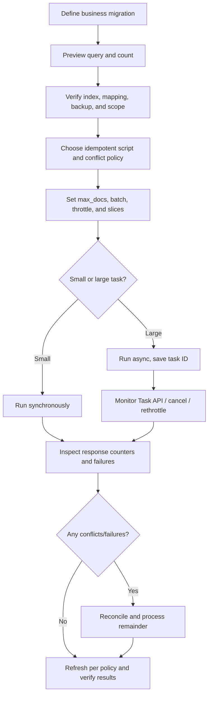

# Update by Query and Consistency Limitations

Elasticsearch provides the **Update By Query API** to update multiple documents matching the same condition in a single request. Instead of the application searching for each document and calling update individually, Elasticsearch finds the matching set of documents and runs a script on each of them. In Spring Data Elasticsearch, this operation can be organized at the service/repository layer; for advanced Elasticsearch options, the application can use the Spring-configured Elasticsearch Java API Client.

Update by query is useful when you need to normalize fields, transition statuses in bulk, populate default values, or fix data after a domain rule change. However, it is not a transaction spanning the entire set of documents. Elasticsearch processes in batches, each document can succeed or fail independently, and data can change concurrently while the task is running.

Consistency limitations to understand before using it:

- The search phase of update by query relies on a snapshot/scroll context created when the task starts.
- If a document changes after the snapshot is taken but before the update is applied, a version conflict can occur.
- By default, a version conflict can halt the task; `conflicts=proceed` allows continuing but does not update the conflicted documents.
- The task may partially update documents and then fail or be cancelled.
- Re-running a non-idempotent script can modify the data a second time.

Therefore, treat update by query as a controlled data maintenance task with load limits, progress monitoring, and a recovery plan.

## 1. What Is Update by Query?

Suppose the `orders` index has many orders in `PENDING` status. When a business rule changes, the application needs to transition all orders created before a specific date to `EXPIRED`.

If using a loop in the application, the workflow is typically:

1. Search for matching documents.
2. Fetch each document into the application.
3. Modify the attributes.
4. Send an update for each document.
5. Manage pagination, retries, and errors across writes.

Update by query performs both finding and updating on the Elasticsearch side:

```json
POST orders/_update_by_query
{
  "query": {
    "bool": {
      "filter": [
        { "term": { "status": "PENDING" } },
        { "range": { "createdAt": { "lt": "2025-01-01T00:00:00Z" } } }
      ]
    }
  },
  "script": {
    "lang": "painless",
    "source": "ctx._source.status = params.newStatus",
    "params": {
      "newStatus": "EXPIRED"
    }
  }
}
```

The request finds `PENDING` orders before the chosen timestamp, then changes `status` to `EXPIRED` on each matching document.

Elasticsearch processes this by searching documents matching the query and sending updates in batches. The application does not need to pull all documents into memory just to modify a single field.

## 2. Update by Query Is Not a Multi-Document Transaction

The most important point: the Update By Query API does not provide an ACID transaction across all documents in the query.

If the query matches 100,000 documents, Elasticsearch processes multiple batches. Along the way:

- Earlier batches may already be updated successfully.
- A later batch may hit a version conflict or a mapping/script error.
- The task may time out, be cancelled, or encounter a shard failure.
- Already-updated documents are not automatically rolled back if the task fails.

Therefore, an error response does not mean no data changed. Conversely, a successful HTTP response alone is not enough to conclude all documents were updated as expected; you must read the counters and failure list in the response.

Example response with fields such as:

```json
{
  "took": 12450,
  "timed_out": false,
  "total": 10000,
  "updated": 9980,
  "version_conflicts": 20,
  "noops": 0,
  "batches": 10,
  "failures": []
}
```

The numbers are illustrative. `total` is the number of documents processed by the task, `updated` is the number of successful updates, `version_conflicts` is the number of version conflicts, and `noops` is the number of documents for which the script requested no change. A task can complete with some conflicts if `conflicts=proceed` was chosen.

## 3. Painless Scripts and `ctx._source`

Update by query typically uses a Painless script to modify each document's `_source`.

Example updating a field:

```json
POST products/_update_by_query
{
  "query": {
    "term": {
      "status": "ACTIVE"
    }
  },
  "script": {
    "lang": "painless",
    "source": "ctx._source.status = params.newStatus",
    "params": {
      "newStatus": "ARCHIVED"
    }
  }
}
```

In the script:

- `ctx._source` is the source data of the document currently being updated.
- `params` holds values passed from the request.
- `ctx.op` can control the operation, e.g., `noop` to skip the document or `delete` to delete a matching document.

Example incrementing a counter:

```json
POST products/_update_by_query
{
  "query": {
    "term": {
      "category": "audio"
    }
  },
  "script": {
    "lang": "painless",
    "source": "ctx._source.viewCount += params.increment",
    "params": {
      "increment": 1
    }
  }
}
```

This script is not idempotent: if re-run, `viewCount` increments by 1 again. For tasks that may be retried or resumed, prefer deterministic assignments from inputs or design conditions so re-running does not alter the result a second time.

### 3.1. Skipping Documents with `noop`

You can check the data before updating:

```json
POST products/_update_by_query
{
  "query": {
    "match_all": {}
  },
  "script": {
    "lang": "painless",
    "source": "if (ctx._source.status == params.target) { ctx.op = 'noop'; } else { ctx._source.status = params.target; }",
    "params": {
      "target": "ACTIVE"
    }
  }
}
```

If the value is already correct, the script sets `ctx.op = 'noop'`, avoiding rewriting that document. The response increments `noops` accordingly.

### 3.2. Deleting Documents via Script

Painless can set `ctx.op = 'delete'` to delete documents inside an update by query task. However, if the goal is solely conditional deletion, the Delete By Query API expresses the intent more clearly:

```json
POST orders/_delete_by_query
{
  "query": {
    "term": {
      "status": "CANCELLED"
    }
  }
}
```

Do not use a script update to emulate a simple delete when the Delete By Query API is more appropriate.

## 4. Narrow the Query Tightly Before Running

Update by query affects many documents. An overly broad query can modify the entire index unexpectedly.

Before running:

1. Write a query with explicit conditions, usually using `bool.filter`.
2. Run a preview search with the same query to inspect sample documents.
3. Use `_count` to estimate the number of matching documents.
4. Verify the target index/alias and routing if applicable.
5. Clearly identify the fields being modified and their post-update values.
6. Test on a staging index or a small dataset.
7. Run in production only after having a monitoring and error-handling plan.

Example preview:

```http
GET orders/_search
{
  "size": 10,
  "_source": ["orderId", "status", "createdAt"],
  "query": {
    "bool": {
      "filter": [
        { "term": { "status": "PENDING" } },
        { "range": { "createdAt": { "lt": "2025-01-01T00:00:00Z" } } }
      ]
    }
  }
}
```

Count expected documents:

```http
GET orders/_count
{
  "query": {
    "bool": {
      "filter": [
        { "term": { "status": "PENDING" } },
        { "range": { "createdAt": { "lt": "2025-01-01T00:00:00Z" } } }
      ]
    }
  }
}
```

Preview and count do not lock data. Documents can change between the preview and when update by query starts. They help catch mis-scoped queries, but are not a guarantee that the entire set of documents remains static.

## 5. Version Conflicts and Consistency

Elasticsearch uses internal versioning to avoid overwriting a newer change with stale data. Update by query searches documents in a snapshot/scroll context, then sends updates based on the version it read.

Suppose:

1. Update by query reads order `ORD-1001` with status `PENDING` and version 5.
2. Another business request updates the order to `PAID`, bumping the version to 6.
3. Update by query attempts to write changes based on version 5.
4. Elasticsearch detects the version mismatch and records a conflict.

This prevents a maintenance job from blindly overwriting a concurrent change. However, a conflict means that document was not updated in this run.

### 5.1. Aborting on Conflict by Default

By default, update by query can halt upon encountering a version conflict. The response includes conflict details, and updates already executed before the failure remain in effect.

### 5.2. `conflicts=proceed`

If business rules permit skipping conflicted documents and continuing with the rest, you can use:

```http
POST orders/_update_by_query?conflicts=proceed
```

Or in the JSON request:

```json
POST orders/_update_by_query?conflicts=proceed
{
  "query": {
    "term": {
      "status": "PENDING"
    }
  },
  "script": {
    "lang": "painless",
    "source": "ctx._source.status = 'EXPIRED'"
  }
}
```

`proceed` does not resolve conflicts and does not retry conflicted documents. It simply lets the task continue instead of stopping at the conflict. Afterward, inspect `version_conflicts` and decide whether to run a narrower follow-up query for documents still in the old state.

Do not blindly enable `conflicts=proceed` for every task. If every document must be updated, conflicts must be handled as part of the business workflow.

## 6. Snapshots and Consistency Limits

Update by query uses a search context to identify the set of documents to process. Documents created after the snapshot starts are typically not part of the selected set. If a document changes after being read but before being updated, a conflict can occur.

A search snapshot does not turn the whole update into a transaction. The following can still happen:

- Some documents are updated while others hit conflicts.
- The task is cancelled after updating multiple batches.
- A new document matching the query is created after the snapshot timestamp and is not updated in that run.
- A document is modified by another business process while update by query is running.
- A re-run may select a different set of documents because data has changed.

If the business requirement is "every document at a point in time must change together or none should change", the Update By Query API does not provide that guarantee. You must design a separate migration/snapshot process or adapt the data model and read paths to support phased transitions.

## 7. Idempotency: Is It Safe to Re-Run?

An update by query task may fail after partially updating documents. Thus, safe re-execution is crucial.

### 7.1. Deterministic Assignment Scripts

Example:

```painless
ctx._source.status = params.targetStatus
```

Re-running with the same `targetStatus` sets the field to the same value. This is idempotent at the field level, provided the query and business conditions do not shift in ways that affect unintended data.

### 7.2. Increment/Decrement Scripts

Example:

```painless
ctx._source.retryCount += 1
```

Re-running increments it again. If the task times out after some batches succeed and the application resubmits the whole query, already-processed documents can be incremented twice.

### 7.3. Designing the Query to Select Only Unmigrated Documents

Instead of running across all documents, the query can constrain to the old state:

```json
POST products/_update_by_query
{
  "query": {
    "term": {
      "schemaVersion": 1
    }
  },
  "script": {
    "lang": "painless",
    "source": "ctx._source.newField = params.value; ctx._source.schemaVersion = 2",
    "params": {
      "value": "default"
    }
  }
}
```

Once a document moves to version 2, subsequent runs no longer select it. This is a resumable migration technique, though you must ensure both the field assignment and the version bump happen in the same script, while also handling conflicts and newly created data.

## 8. Limiting Document Count with `max_docs`

`max_docs` caps the number of documents the task attempts to process. For example, testing on at most 500 documents:

```http
POST products/_update_by_query?max_docs=500
```

This is a useful limit for controlling scope or splitting migrations into multiple passes. However, with slicing or version conflicts, the actual number of updated documents may be lower than the cap. Do not treat `max_docs` as an exact guarantee of successfully updated documents.

If you need to split a migration into phases, use range queries by date, ID, or schema version instead of relying solely on `max_docs`. That establishes clear business partitions and simplifies reconciliation.

## 9. Batch Size and `scroll_size`

Update by query reads documents in scroll batches and sends bulk operations. `scroll_size` controls the number of hits fetched per batch.

Example:

```http
POST orders/_update_by_query?scroll_size=500
```

Smaller batches:

- Reduce the size of each response/bulk request.
- Can lower memory pressure at each step.
- Increase round-trips and overhead.

Larger batches:

- Can improve throughput when the cluster has spare capacity.
- Produce larger request/bulk payloads.
- Can increase heap pressure, per-batch processing time, and timeout risk.

Choose batch size by measuring latency, payload size, heap, indexing pressure, and rejections. Do not assume increasing `scroll_size` automatically makes the task faster.

## 10. Throttling with `requests_per_second`

Update by query can generate heavy write load because every updated document produces new indexing work. The `requests_per_second` parameter limits the processing rate per request/batch so the task does not starve cluster capacity.

Example:

```http
POST orders/_update_by_query?requests_per_second=200
```

This value throttles by batch rate, not as a strict documents-per-second cap. Batch size and processing duration also affect actual throughput.

You can start at a conservative rate, monitor the cluster, and gradually increase it if latency and indexing pressure remain stable. If the cluster serves live user traffic, run migrations off-peak or use a queue/job scheduler to cap concurrent tasks.

## 11. Slicing for Parallel Execution

Slicing divides update by query work into independent partitions that can run in parallel. Example:

```http
POST orders/_update_by_query?slices=4
```

Or let Elasticsearch choose the slice count automatically:

```http
POST orders/_update_by_query?slices=auto
```

Advantages:

- Can increase throughput by processing multiple partitions in parallel.
- Useful for large indices when the cluster has spare resources.

Limitations:

- Each slice creates additional search/bulk workload.
- Slices may have uneven sizes.
- Total duration does not necessarily scale linearly with slice count.
- The parent response/task aggregates status across child slices.
- Excessive slicing can overload the cluster.

Measure throughput and rejections before increasing slice counts. `slices=auto` is convenient, but does not replace capacity planning.

## 12. Synchronous vs. Asynchronous Execution

By default, update by query waits for the task to finish before returning the response. For large tasks, the HTTP request can take a long time and exceed gateway or client timeouts.

You can use `wait_for_completion=false` to launch a background task:

```http
POST orders/_update_by_query?wait_for_completion=false&requests_per_second=100
{
  "query": {
    "term": {
      "status": "PENDING"
    }
  },
  "script": {
    "lang": "painless",
    "source": "ctx._source.status = 'EXPIRED'"
  }
}
```

The initial response returns a task ID instead of waiting for all work to finish. The application should persist the task ID alongside its job ID to track progress.

Check task status:

```http
GET _tasks/{task_id}
```

Cancel the task if needed:

```http
POST _tasks/{task_id}/_cancel
```

Change the rate of a running task:

```http
POST _update_by_query/{task_id}/_rethrottle?requests_per_second=50
```

Task cancellation does not roll back already-updated batches. When cancelled, part of the data may already have changed; inspect the task response/status and reconcile the data.

## 13. Spring Data Elasticsearch and the Elasticsearch Java API Client

In Spring Boot applications, the client is normally configured and managed by Spring. For single operations, `ElasticsearchOperations` provides appropriate `save`, `update`, or bulk APIs. For update by query, abstraction support and API signatures depend on the Spring Data Elasticsearch version in use.

In versions with `ElasticsearchOperations.updateByQuery(...)`, you can build an `UpdateQuery` containing the query, script, and parameters, then execute it against `IndexCoordinates`. Illustrative example:

```java
Query query = NativeQuery.builder()
    .withQuery(q -> q
        .term(t -> t
            .field("status")
            .value("PENDING")
        )
    )
    .build();

UpdateQuery updateQuery = UpdateQuery.builder(query)
    .withScript("ctx._source.status = params.target")
    .withParams(Map.of("target", "EXPIRED"))
    .build();

operations.updateByQuery(
    updateQuery,
    IndexCoordinates.of("orders")
);
```

This snippet illustrates the API concept; builder names, response types, and options such as conflicts, slicing, throttling, and async execution can differ across releases. Verify against the Javadoc of the exact dependency in your project before using.

If your current version's abstraction does not expose all required options, inject the Spring-configured `ElasticsearchClient` and call the Update By Query API through a dedicated adapter. The REST JSON examples in earlier sections show the exact options the adapter must pass.

Do not create a new `ElasticsearchClient` for each update. Reuse the Spring-managed bean, configure timeouts and authentication in client settings, and keep update by query APIs inside a service with explicit permissions.

## 14. Service Example Organizing a Migration Task

A migration service should accept a clear business command rather than letting a controller accept arbitrary raw scripts and queries:

```java
public record ExpireOldOrdersCommand(
    Instant createdBefore,
    int maxDocuments
) {
}
```

The service can:

1. Validate the cutoff and document limit.
2. Construct a fixed query for `status = PENDING` and `createdAt < cutoff`.
3. Construct a fixed script setting status to `EXPIRED`.
4. Configure `conflicts`, batch size, and throttling per policy.
5. Run synchronously for small sets or asynchronously for large tasks.
6. Persist the task ID and job status.
7. Poll task status, recording progress and failures.
8. Reconcile document counts upon completion.

Controllers must not accept `script.source`, field names, index names, or Painless code sent by end users. Expose only whitelisted business parameters.

## 15. Consistency Limitations Under Concurrent Execution

Update by query can run concurrently with other `save`/`update`/`delete` operations. Scenarios to account for:

| Scenario | Behavior/limitation |
|---|---|
| Document changes after update by query reads snapshot | Version conflict may occur; document is not updated in that run. |
| New document created after snapshot | Normally excluded from the current run's document set. |
| Task cancelled mid-batch | Earlier batches may remain updated; no rollback. |
| Non-idempotent script re-run | May accumulate duplicate changes or corrupt data. |
| Two update by query jobs editing the same field | May contend and create version conflicts; result ordering is not transactional. |
| Alias pointing to multiple indices | Task may affect multiple indices via the alias; confirm scope before running. |
| Incompatible mapping across indices | Some documents/batches may fail when the script writes a field with an invalid type. |

If schema migration is needed, consider a version field to select only unmigrated documents. If newer business updates must be preserved, design the query to select only the old state and ensure the script does not overwrite changed fields according to an explicit rule.

## 16. Refresh and Data Visibility After Updates

Update by query does not necessarily make changes visible to search immediately. Elasticsearch makes new data searchable only after a refresh.

You can request a refresh upon completion:

```http
POST orders/_update_by_query?refresh=true
```

`refresh=true` makes changes searchable once the request finishes, though it can increase refresh cost. For large tasks, consider refreshing once after the migration finishes rather than refreshing continuously on small write steps.

Refresh is not a transaction and does not make updates atomic. It only affects when changes become visible via search.

## 17. Response, Progress, and Reconciliation

When the task completes, read the important response fields:

| Field | Meaning |
|---|---|
| `took` | Execution time in milliseconds. |
| `timed_out` | Whether the search phase timed out. |
| `total` | Number of documents processed by the task. |
| `updated` | Number of documents updated. |
| `deleted` | Number of documents deleted by script, if any. |
| `noops` | Number of documents skipped by script. |
| `version_conflicts` | Number of documents hitting version conflicts. |
| `batches` | Number of batches processed. |
| `retries` | Search/bulk retry counts per response. |
| `throttled_millis` | Total throttled duration. |
| `failures` | Errors reported in the response. |

For async tasks, the Task API can provide running status, progress, and final results. Store these metrics with the job ID, index, query version, and start/end timestamps.

Post-run reconciliation:

- Count documents still matching the old query.
- Count documents that now have the new value.
- Spot-check a sample of documents by ID.
- Inspect failures, timeouts, and version conflicts.
- If conflicts occurred, decide whether to run a narrower query again or switch to per-document processing.

Do not rely solely on `updated` to conclude a migration succeeded if the response has failures or unacceptable conflicts.

## 18. Protecting the Cluster and Data in Production

Update by query generates concurrent read and write load. A single task can affect both regular search traffic and regular indexing traffic.

Measures to apply:

- Run against an explicitly identified index/alias; avoid overly broad index wildcards unnecessarily.
- Preview the query and count before writing.
- Use `max_docs` or partition by range/schema version when the migration can be split.
- Set appropriate `requests_per_second` and `scroll_size`.
- Enable `slices` only when the cluster has capacity and after benchmarking.
- Run long tasks asynchronously and persist the task ID.
- Monitor indexing pressure, search latency, heap, merges, and rejections.
- Have a cancellation procedure, understanding that cancel does not roll back.
- Keep scripts and field names application-controlled; do not accept arbitrary Painless code from clients.
- Use snapshots/backups or appropriate recovery capabilities before high-risk migrations.
- Check mappings and data types before scripts write new fields.

## 19. Common Mistakes

| Symptom | Possible cause | Resolution |
|---|---|---|
| Task halts on version conflict | Document modified concurrently after snapshot | Decide whether conflicts are acceptable; use `conflicts=proceed` only when appropriate and reconcile the remainder. |
| Task errors out yet some documents changed | Update by query is not a transaction; earlier batches already wrote | Read response/task status, identify completed portion, and design resumption. |
| Re-run doubles counters | Non-idempotent script | Use deterministic assignments or a query selecting unprocessed documents. |
| New documents are not updated | Created after the task's snapshot | Run a follow-up pass or process documents created after the cutoff. |
| Cluster slows down during migration | Throttle too high, large batches, or too many slices | Lower rate, batch size, and concurrency; run off-peak. |
| HTTP request times out while task continues running | Client timeout does not stop the server-side task | Use async task IDs and inspect via the Task API. |
| Data remains partially changed after cancel | Earlier batches already updated before cancel took effect | Reconcile and proceed per policy; do not expect automatic rollback. |
| `updated` is lower than `total` | Noops, conflicts, or failures | Analyze all counters and failures instead of inferring from one field. |
| Script fails on some documents | Missing fields, inconsistent data types, or faulty script assumptions | Validate mapping/data, handle `null`, and test on samples. |
| Alias updates wrong indices | Alias points to multiple indices or write index is unclear | Verify alias targets and specify concrete indices when needed. |

## 20. Update by Query Implementation Workflow



Practical workflow:

1. Identify the exact index, query, and fields to change.
2. Preview using search and count.
3. Verify mappings, scripts, and sample data.
4. Choose an idempotent script whenever possible.
5. Determine conflict policy, `max_docs`, batch size, throttle, and slices.
6. Run in staging or on a small partition first.
7. Run synchronously for small tasks; run asynchronously and monitor tasks for long jobs.
8. Check `updated`, `noops`, `version_conflicts`, `failures`, and `timed_out`.
9. Reconcile data, handle remaining documents, and refresh as needed.
10. Log migration details, query version, task ID, and results for auditing.

## 21. Conclusion

Update by query is an effective way to update many documents matching a condition directly inside Elasticsearch. The request consists of a query defining the document set and a Painless script modifying `_source`. You can bound scope with `max_docs`, throttle load with `requests_per_second`, tune batches with `scroll_size`, parallelize with `slices`, and monitor background tasks via the Task API.

However, update by query is not a multi-document transaction. It uses a snapshot/scroll to find data, can hit version conflicts when documents change concurrently, and can leave partial updates if it fails or is cancelled. `conflicts=proceed` only skips conflicts and continues; it does not re-update conflicted documents. Non-idempotent scripts can corrupt data if re-run.

In Spring Data Elasticsearch, organize the operation in a service and use the Spring-managed client. Choose `ElasticsearchOperations.updateByQuery` if your version exposes the full required API; for advanced options, use the Elasticsearch Java API Client inside a dedicated adapter. Always preview queries, throttle load, persist task IDs, inspect response counters/failures, and reconcile afterward. This approach keeps data migrations observable, controllable, and recoverable when conflicts or mid-run errors occur.
