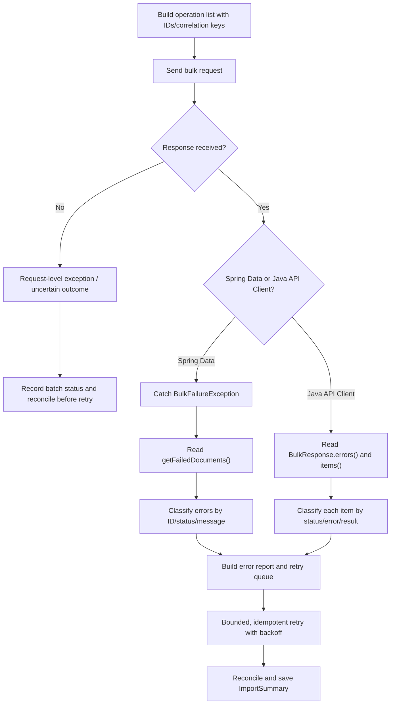

# Reading `BulkFailureException` or Detailed Results by API

The Elasticsearch Bulk API lets you send multiple index, create, update, or delete operations in a single request. This reduces network round trips and generally increases throughput during data imports. However, **a bulk request is not a transaction**: some items can succeed while other items fail. Therefore, a successful HTTP response or a Java call completing without throwing an exception is not sufficient to conclude that every document was written properly.

In Spring Data Elasticsearch, operations such as `ElasticsearchOperations.bulkIndex(...)` and `bulkUpdate(...)` can throw **`BulkFailureException`** when items fail. This exception exposes the failed documents via `getFailedDocuments()`. If you need detailed results for every operation—including both successes and failures in submission order—you can call the Elasticsearch Java API Client directly and inspect `BulkResponse.items()`.

This lesson explains how to read both result forms, how to classify errors, how to retry the right items, and how to build reliable bulk reporting.

## 1. A Bulk Request Can Partially Succeed

Suppose the application imports 4 products in a single bulk request:

| ID | Operation | Illustrative Result |
|---|---|---|
| `P-100` | Index | Succeeded, `201 created` |
| `P-101` | Index | Failed, `400 mapper_parsing_exception` |
| `P-102` | Index | Succeeded, `201 created` |
| `P-103` | Index | Failed, `409 version_conflict_engine_exception` |

Elasticsearch can still return HTTP 200 for the entire Bulk API request while two items failed. The bulk response includes an `errors: true` flag and a separate result for each operation.

This differs from an all-or-nothing single request. The Bulk API does not roll back the two successful items just because other items failed. The application must inspect per-item outcomes and decide how to handle the remainder.

## 2. Distinguishing Request Errors from Per-Item Errors

There are two error classes to handle separately:

| Error Type | Example | Where It Surfaces |
|---|---|---|
| Request/transport failure | Connection drop, timeout, auth failure, bulk request malformed overall | Exception from client/transport; a complete `BulkResponse` may not exist |
| Item failure | Single document fails mapping, version conflict, missing document | Corresponding item in `BulkResponse`, or `BulkFailureException` from Spring Data |

If the request cannot reach Elasticsearch or the server rejects the whole request, the application may receive `IOException`, `ElasticsearchException`, or a Spring-translated exception. In that case, there may be no item result list to analyze.

If Elasticsearch received and processed the bulk request, the response can contain per-operation results. In that situation, do not merely catch a generic exception and log "bulk failed"; extract the ID and cause for each item.

## 3. `BulkFailureException` in Spring Data Elasticsearch

Spring Data Elasticsearch provides the class:

```java
import org.springframework.data.elasticsearch.BulkFailureException;
```

`BulkFailureException` is an exception in Spring's `DataAccessException` hierarchy. Bulk methods such as `DocumentOperations.bulkIndex(...)` and `bulkUpdate(...)` can throw this exception when a bulk operation has failed documents.

Key method:

```java
Map<String, BulkFailureException.FailureDetails> getFailedDocuments()
```

Starting in Spring Data Elasticsearch 5.2, the map contains:

- Key: document ID.
- Value: `FailureDetails`, a record holding `status` and `errorMessage`.

Example:

```java
try {
    operations.bulkIndex(indexQueries, IndexCoordinates.of("products"));
} catch (BulkFailureException ex) {
    Map<String, BulkFailureException.FailureDetails> failedDocuments =
        ex.getFailedDocuments();

    failedDocuments.forEach((id, failure) -> {
        log.warn(
            "Bulk item failed: id={}, status={}, reason={}",
            id,
            failure.status(),
            failure.errorMessage()
        );
    });
}
```

`getFailedDocuments()` is the starting point for identifying which documents failed. Do not log only `ex.getMessage()`, as the summary message may be insufficient to pinpoint the records needing repair.

### 3.1. Return Type Change Across Versions

There is an important API change when upgrading Spring Data Elasticsearch from the 5.1 line to 5.2:

| Version | Return Type of `getFailedDocuments()` |
|---|---|
| 5.1.x and earlier | `Map<String, String>` |
| 5.2.x and later | `Map<String, BulkFailureException.FailureDetails>` |

In older versions, each key is the document ID and the value is the error message string:

```java
// For older Spring Data Elasticsearch versions with the Map<String, String> API.
try {
    operations.bulkIndex(indexQueries, IndexCoordinates.of("products"));
} catch (BulkFailureException ex) {
    Map<String, String> failures = ex.getFailedDocuments();

    failures.forEach((id, message) ->
        log.warn("Bulk item failed: id={}, reason={}", id, message)
    );
}
```

From 5.2 onward, the value changed to the `FailureDetails` record to include the HTTP status:

```java
// For Spring Data Elasticsearch 5.2+.
BulkFailureException.FailureDetails details =
    ex.getFailedDocuments().get("P-101");

if (details != null) {
    Integer status = details.status();
    String errorMessage = details.errorMessage();
}
```

The two snippets use incompatible generic types and cannot compile side-by-side in the same source set. When upgrading the dependency, update the variable types and handling logic to match the version in use.

### 3.2. What Does `FailureDetails` Contain?

In the newer API, `FailureDetails` is a record with two components:

```java
public record FailureDetails(Integer status, String errorMessage) {
}
```

- `status()` is typically the item's HTTP status code, such as 400, 404, 409, or 429.
- `errorMessage()` is the error description retained by Spring Data for that document.

This information is enough for many typical import flows: identifying IDs, classifying statuses, logging, and routing failed records to follow-up handling. If you need `operationType`, index, result, sequence number, primary term, or `caused_by`/`root_cause` structures, inspect the detailed response from the Elasticsearch Java API Client.

## 4. What Does `bulkIndex` Return on Success?

`ElasticsearchOperations.bulkIndex(...)` returns:

```java
List<IndexedObjectInformation>
```

Each `IndexedObjectInformation` is a record containing metadata of an indexed document, including fields such as:

- `id()` — document ID.
- `index()` — target index.
- `seqNo()` — sequence number.
- `primaryTerm()` — primary term.
- `version()` — document version.

Example:

```java
List<IndexedObjectInformation> indexed = operations.bulkIndex(
    indexQueries,
    IndexCoordinates.of("products")
);

for (IndexedObjectInformation info : indexed) {
    log.info(
        "Indexed document: index={}, id={}, seqNo={}, version={}",
        info.index(),
        info.id(),
        info.seqNo(),
        info.version()
    );
}
```

When the call returns normally, the list provides metadata for the indexed documents. If there are item failures, the API can throw `BulkFailureException`; control enters `catch`, and no `List<IndexedObjectInformation>` is returned to the caller. The exception provides the failed-document map, not a complete mirror of `BulkResponse` containing both successes and failures.

For `bulkUpdate(...)`, the API returns `void` and can also throw `BulkFailureException`. If you need per-update detailed statistics, use the client directly or design a suitable result-recording layer.

## 5. Example: Creating `IndexQuery` Items and Catching `BulkFailureException`

Example entity:

```java
@Document(indexName = "products")
public class ProductDocument {

    @Id
    private String id;

    private String name;

    private Long priceInCents;

    // constructors, getters and setters
}
```

Building `IndexQuery` items from a list of entities:

```java
import java.util.List;

import org.springframework.data.elasticsearch.core.IndexedObjectInformation;
import org.springframework.data.elasticsearch.core.mapping.IndexCoordinates;
import org.springframework.data.elasticsearch.core.query.IndexQuery;
import org.springframework.data.elasticsearch.core.query.IndexQueryBuilder;
import org.springframework.data.elasticsearch.BulkFailureException;

List<IndexQuery> queries = products.stream()
    .map(product -> new IndexQueryBuilder()
        .withId(product.getId())
        .withObject(product)
        .build())
    .toList();

try {
    List<IndexedObjectInformation> indexed = operations.bulkIndex(
        queries,
        IndexCoordinates.of("products")
    );

    log.info("Bulk indexed {} products", indexed.size());
} catch (BulkFailureException ex) {
    ex.getFailedDocuments().forEach((id, failure) ->
        log.error(
            "Could not index product id={}, status={}, message={}",
            id,
            failure.status(),
            failure.errorMessage()
        )
    );
}
```

This example uses the `FailureDetails` API from Spring Data Elasticsearch 5.2+. If your project uses an older release, update the generic type and value extraction to `Map<String, String>` as shown earlier.

When creating `IndexQuery` items, assign deterministic IDs whenever business logic allows. Deterministic IDs help locate failed documents, reconcile source data, and re-run only the failed records.

## 6. Reading Errors from `bulkUpdate`

`bulkUpdate` takes a list of `UpdateQuery` and returns `void`. When one or more items fail, Spring Data can throw `BulkFailureException`:

```java
try {
    operations.bulkUpdate(
        updateQueries,
        IndexCoordinates.of("products")
    );

    log.info("Bulk update completed");
} catch (BulkFailureException ex) {
    ex.getFailedDocuments().forEach((id, failure) -> {
        log.error(
            "Could not update product id={}, status={}, reason={}",
            id,
            failure.status(),
            failure.errorMessage()
        );
    });
}
```

Do not treat `bulkUpdate` throwing an exception as proof that every update failed. Other items may already have been applied successfully. Reconcile failed IDs against the data source and the actual state in the index.

## 7. When Do You Need More Detailed Results Than `BulkFailureException`?

`BulkFailureException` is convenient when you want to stay within Spring Data's abstraction and only need the list of failed documents. However, some scenarios require knowing the outcome of **every single operation**:

- Counting exact numbers of `created`, `updated`, `deleted`, and failed items.
- Needing `operationType`, index, ID, and HTTP status for successful items as well.
- Inspecting `ErrorCause.type()`, `reason()`, `causedBy()`, or `rootCause()`.
- Capturing returned sequence numbers, primary terms, or versions.
- Mixing multiple operation types or multiple indices in one bulk request.
- Mapping every response item back to the exact position of its source record.

In those cases, use `ElasticsearchClient.bulk(...)` and inspect `BulkResponse`.

## 8. `BulkResponse`: Detailed Results from the Elasticsearch Java API Client

The Elasticsearch Java API Client returns `BulkResponse`. Key components:

| Component | Meaning |
|---|---|
| `errors()` | `true` if at least one operation failed. |
| `items()` | Individual outcome for each operation, in the exact order submitted. |
| `took()` | Time spent by Elasticsearch processing the bulk request, in milliseconds. |
| `ingestTook()` | Ingest pipeline duration if included in the response. |

Each `BulkResponseItem` can provide:

| Method | Meaning |
|---|---|
| `operationType()` | Operation type: index, create, update, or delete. |
| `index()` | Target index. |
| `id()` | Document ID. |
| `status()` | Item HTTP status. |
| `result()` | Success outcome such as `created`, `updated`, or `deleted`. |
| `error()` | Error details; normally present only when the item failed. |
| `seqNo()` / `primaryTerm()` / `version()` | Versioning metadata when available. |

Key point: `errors()` is a summary flag. When it is `true`, you must still iterate `items()` to locate failed items. Do not stop at a single boolean if you need to know which records must be reprocessed.

## 9. Example: Using `ElasticsearchClient` to Inspect Each `BulkResponseItem`

Example building a bulk request with the Elasticsearch Java API Client:

```java
import co.elastic.clients.elasticsearch.ElasticsearchClient;
import co.elastic.clients.elasticsearch._types.ErrorCause;
import co.elastic.clients.elasticsearch.core.BulkResponse;
import co.elastic.clients.elasticsearch.core.bulk.BulkResponseItem;

BulkResponse response = client.bulk(bulk -> bulk
    .operations(operation -> operation.index(index -> index
        .index("products")
        .id("P-100")
        .document(product100)
    ))
    .operations(operation -> operation.index(index -> index
        .index("products")
        .id("P-101")
        .document(product101)
    ))
    .operations(operation -> operation.index(index -> index
        .index("products")
        .id("P-102")
        .document(product102)
    ))
);

if (response.errors()) {
    for (BulkResponseItem item : response.items()) {
        if (item.error() != null) {
            ErrorCause error = item.error();

            log.error(
                "Bulk item failed: index={}, id={}, status={}, type={}, reason={}",
                item.index(),
                item.id(),
                item.status(),
                error.type(),
                error.reason()
            );
        }
    }
} else {
    log.info("Bulk completed without item errors; took={}ms", response.took());
}
```

The `operations(...)` lambdas are appended in operation order. `response.items()` preserves that order, allowing you to match each response item with the input command list by list index. In production code, also track a `sourceRecordId` or correlation key at the application layer if the Elasticsearch ID differs from the import file's record ID.

The Elasticsearch Java API Client serializes documents using the mapper configured on that client. When calling the client directly, do not assume every annotation or custom conversion from Spring Data's `MappingElasticsearchConverter` is applied automatically. If entities use custom mapping conversions, verify the serialized JSON or use `ElasticsearchOperations` for flows that require Spring Data's converter.

## 10. Inspecting `ErrorCause` More Deeply

`BulkResponseItem.error()` returns an `ErrorCause`, which exposes fields such as:

- `type()` — Elasticsearch error type.
- `reason()` — human-readable error description.
- `causedBy()` — underlying cause if present.
- `rootCause()` — list of root causes if present.
- `metadata()` — extra metadata depending on the error type.

Example:

```java
ErrorCause error = item.error();

String errorType = error.type();
String reason = error.reason();

ErrorCause causedBy = error.causedBy();
if (causedBy != null) {
    log.debug(
        "Underlying cause: type={}, reason={}",
        causedBy.type(),
        causedBy.reason()
    );
}

for (ErrorCause root : error.rootCause()) {
    log.debug("Root cause: type={}, reason={}", root.type(), root.reason());
}
```

Not every error populates `causedBy`, `rootCause`, or `metadata`. Always handle null/empty values. Do not log `stackTrace()` or full error metadata by default if responses might contain sensitive data.

## 11. Using Detailed Results to Build an Import Report

An application DTO can represent the outcome for each source row:

```java
public record BulkItemResult(
    int inputPosition,
    String sourceRecordId,
    String index,
    String documentId,
    int status,
    String result,
    String errorType,
    String errorMessage
) {
    public boolean successful() {
        return errorType == null;
    }
}
```

Converting `BulkResponse.items()` into DTOs:

```java
List<BulkItemResult> results = new ArrayList<>();

for (int i = 0; i < response.items().size(); i++) {
    BulkResponseItem item = response.items().get(i);
    ErrorCause error = item.error();

    results.add(new BulkItemResult(
        i,
        sourceRecords.get(i).recordId(),
        item.index(),
        item.id(),
        item.status(),
        item.result(),
        error == null ? null : error.type(),
        error == null ? null : error.reason()
    ));
}
```

In this example, `sourceRecords` must stay in the exact same order as operations added to the bulk request. Do not sort or filter one list without updating the position mapping, otherwise the report can attribute errors to the wrong import row.

From the DTOs, the service can compute:

```java
long successCount = results.stream()
    .filter(BulkItemResult::successful)
    .count();

long failureCount = results.size() - successCount;
```

If generating an error report file for users, include `sourceRecordId`, source row, status, and a normalized message. Avoid exposing stack traces or sensitive payloads in public responses.

## 12. Classifying Errors to Decide Handling

Not every bulk error should be retried. Classify by status and error type:

| Common Error | Typical Status | Meaning | Handling Approach |
|---|---:|---|---|
| `mapper_parsing_exception` / `document_parsing_exception` | 400 | Data does not match mapping or invalid JSON | Fix data/schema; do not retry as-is. |
| `illegal_argument_exception` | 400 | Invalid parameter or field | Fix request or source data. |
| `document_missing_exception` | 404 | Update/delete targeting a non-existent document | Check business logic; ignore if idempotent semantics allow. |
| `version_conflict_engine_exception` | 409 | Version mismatch from concurrent update or duplicate `create` ID | Re-read and reconcile; do not retry blindly. |
| `es_rejected_execution_exception` | 429 | Cluster rejected due to overload/full queue | Retry with backoff and jitter; reduce batch/concurrency. |
| Temporary shard/availability error | 5xx depending on case | Cluster or shard temporarily unavailable | Check health, retry with limits if operation is safe. |
| Authorization failure | 401/403 at request or item level | Missing permissions | Fix permission config; do not retry continuously. |

Status code is only an initial classification signal. Read `error.type()` and `error.reason()` because the same status can arise from different causes.

## 13. Retrying Only Failed Items

Suppose a bulk request contains 1,000 documents, of which 990 succeed and 10 fail due to transient errors. Resending all 1,000 items can:

- Re-write documents that already succeeded.
- Trigger conflicts if using `create`.
- Increment counters twice if an update script is non-idempotent.
- Add unnecessary load on the cluster.

A better workflow:

1. Inspect per-item responses.
2. Classify errors.
3. Exclude permanent data errors from the retry queue.
4. Enqueue only recoverable items into the retry queue.
5. Retry with backoff, jitter, and an attempt cap.
6. Persist the final status for every source record.

### 13.1. Bounded Backoff

Pseudocode example:

```java
for (int attempt = 1; attempt <= maxAttempts; attempt++) {
    BulkResponse response = sendBulk(pendingItems);

    List<SourceRecord> retryable = classifyRetryableFailures(
        pendingItems,
        response
    );

    if (retryable.isEmpty()) {
        break;
    }

    pendingItems = retryable;
    sleep(backoffWithJitter(attempt));
}
```

This illustrates the control loop; `classifyRetryableFailures` must examine `BulkResponseItem` and maintain exact mapping between response items and source records. In production, waiting must support cancellation and an overall retry deadline.

### 13.2. Idempotency and Stable IDs

Before retrying, verify whether the operation can safely run again:

- `index` with a stable ID and identical content usually overwrites to the same desired state.
- `create` can return a conflict if the previous attempt created the document while the client lost the response.
- `update` assigning fixed values is generally easier to retry than increments/decrements.
- A `counter += 1` script is non-idempotent; retries can increment twice.
- `delete` with the same ID can be treated as idempotent depending on business rules, though you must handle `not_found` responses.

If the client times out after sending a request, it cannot always tell whether the server partially applied it. Stable IDs, idempotent operations, and document reconciliation are the foundation of safe recovery.

## 14. Handling Results with Mixed Operation Types

A Bulk API request can mix `index`, `create`, `update`, and `delete`. Each `BulkResponseItem` describes its corresponding operation:

```java
for (BulkResponseItem item : response.items()) {
    switch (item.operationType()) {
        case INDEX, CREATE -> handleIndexResult(item);
        case UPDATE -> handleUpdateResult(item);
        case DELETE -> handleDeleteResult(item);
        default -> handleUnknownOperation(item);
    }
}
```

Operation enum constants can expand in newer client versions. If you want to avoid brittle exhaustive switches over the enum, inspect `operationType()` and branch on the operation types your application actually submits.

When mixing operations, response ordering matters even more. Persist command metadata for each operation, such as action type, source record ID, business key, and target index.

## 15. Request-Level Errors vs. Per-Item Errors

A request-level error can cause the client to throw an exception before returning a `BulkResponse`, for example:

- Unable to connect to the cluster.
- Malformed JSON/NDJSON structure.
- Missing permissions for the entire request/index.
- Request rejected at the gateway or transport layer.

In that case, there is no `items()` list to iterate over. The application should record the batch status as `UNKNOWN` or `REQUEST_FAILED` depending on whether it can confirm the request reached the server. If a timeout occurs after sending the body, the outcome may be indeterminate; do not assume every item went unwritten.

With item-level errors, `BulkResponse` already provides per-operation outcomes. Mark success/failure individually for each record.

A useful import state model:

```text
QUEUED
  -> SENDING
       -> SUCCEEDED
       -> PARTIAL_FAILURE
       -> REQUEST_FAILED
       -> UNKNOWN_OUTCOME
```

If a bulk request contains both successes and failures, the batch is `PARTIAL_FAILURE`; do not mark the whole batch `FAILED` and lose track of the items that succeeded.

## 16. How Do `BulkFailureException` and `BulkResponse` Differ?

| Criterion | `BulkFailureException` | `BulkResponse` |
|---|---|---|
| API | Spring Data `ElasticsearchOperations` | Elasticsearch Java API Client |
| How results arrive | Exception thrown when items fail | Normal response with `errors` flag |
| Error list | `getFailedDocuments()` | `items()` with `error()` per item |
| Success | `bulkIndex` returns `IndexedObjectInformation` when completing normally; `bulkUpdate` returns `void` | Each item carries status/result and metadata |
| Error details | ID, status, and message from 5.2+ | ID, index, operation, status, error type/reason/root cause |
| Operation order | Failed map is not a submission-ordered list | `items()` matches submission order in the request |
| Entity mapping | Uses Spring Data converter | Uses Java API Client JSON mapper |
| Best suited when | You want Spring Data abstractions and only need failed IDs | You need full per-operation outcomes |

You do not have to pick a single approach for the entire application. Typical services can use Spring Data `bulkIndex` and handle `BulkFailureException`, while an import pipeline needing row-by-row reporting can use the client directly or wrap it in an adapter returning a detailed DTO.

## 17. Surfacing Bulk Errors to APIs Without Leaking Internals

Do not return raw exceptions or `ErrorCause` objects to the frontend. Map them to a stable response structure:

```java
public record ImportItemError(
    String sourceRecordId,
    Integer status,
    String code,
    String message
) {
}

public record ImportSummary(
    int submitted,
    int succeeded,
    int failed,
    List<ImportItemError> errors
) {
}
```

The service can map internal error types to business codes:

| Elasticsearch Error Type | Suggested API Code | User-Facing Message |
|---|---|---|
| `mapper_parsing_exception` | `INVALID_FIELD_VALUE` | One or more values have an invalid format. |
| `version_conflict_engine_exception` | `CONCURRENT_MODIFICATION` | Data was modified by another operation. |
| `document_missing_exception` | `DOCUMENT_NOT_FOUND` | The record to update could not be found. |
| `es_rejected_execution_exception` | `TEMPORARY_CAPACITY` | System is busy, please try again later. |

Specific codes and messages should fit your product conventions. Do not return internal index names, stack traces, scripts, full `_source`, or infrastructure details to unauthorized clients.

## 18. Logging and Monitoring Bulk Operations

Each batch should have a correlation ID and metrics:

- Number of submitted items.
- Number of succeeded and failed items.
- `took` duration.
- Retry count.
- Error distribution by status/error type.
- Batch size and payload bytes.
- Target index and operation type.

Example summary log:

```java
log.info(
    "Bulk completed: batchId={}, submitted={}, succeeded={}, failed={}, tookMs={}",
    batchId,
    response.items().size(),
    successCount,
    failureCount,
    response.took()
);
```

Log only the necessary IDs and error codes. For personal or sensitive data, do not dump full documents or offending field values into default logs. Store error reports under proper access controls and retention policies.

## 19. Testing Bulk Errors

A meaningful test should verify both successes and failures within the same batch rather than testing only the happy path where all documents are valid.

Scenarios to cover:

1. All items succeed.
2. One item fails mapping while other items succeed.
3. Version conflict on update.
4. `create` with a duplicate ID.
5. Updating a non-existent document.
6. Request-level timeout or connection drop.
7. Retrying only items classified as retryable.
8. Correlating response order with source record order.
9. Spring Data 5.2+ reading `FailureDetails.status()` and `errorMessage()`.
10. If older versions are still supported, testing `Map<String, String>` separately.

For integration tests, use an Elasticsearch version compatible with your client/Spring Data version. Inspect real responses since error types and messages depend on mapping, operation, and server version.

## 20. Bulk Result Handling Workflow



Practical steps:

1. Generate stable IDs and correlation metadata for each source record.
2. Split data into appropriately sized batches.
3. Submit via `ElasticsearchOperations.bulkIndex/bulkUpdate` or the Java API Client.
4. When using Spring Data, catch `BulkFailureException` and inspect `getFailedDocuments()`.
5. When per-operation results are needed, inspect `BulkResponse.items()` and `errors()`.
6. Classify data errors, conflicts, overload rejections, and request-level errors.
7. Retry only recoverable items using backoff, attempt caps, and idempotent operations.
8. Record an error report keyed by source record ID.
9. Reconcile final state in Elasticsearch and store the batch/import job summary.

## 21. Conclusion

The Bulk API executes multiple operations in one request without providing an all-or-nothing transaction. A single bulk request can contain both successful and failed items. When using Spring Data Elasticsearch, `ElasticsearchOperations.bulkIndex(...)` returns `IndexedObjectInformation` metadata on success and can throw `BulkFailureException` when items fail. Inspect `getFailedDocuments()` to obtain the ID, status, and error message of failed documents.

Since Spring Data Elasticsearch 5.2, `getFailedDocuments()` returns `Map<String, FailureDetails>` with `status()` and `errorMessage()`, whereas versions 5.1 and earlier returned `Map<String, String>`. `bulkUpdate(...)` returns `void` and can likewise throw this exception.

If you need complete results for every operation, use the Elasticsearch Java API Client and read `BulkResponse.errors()` alongside `BulkResponse.items()`. Each item provides ID, index, operation type, status, result, and error details, and the list preserves submission order. Distinguish request-level errors from item-level errors, avoid blindly retrying the entire batch, and never assume successful items will be rolled back. Combining stable IDs, classified retries, backoff, idempotency, and per-record error reporting makes bulk import pipelines observable and recoverable.
