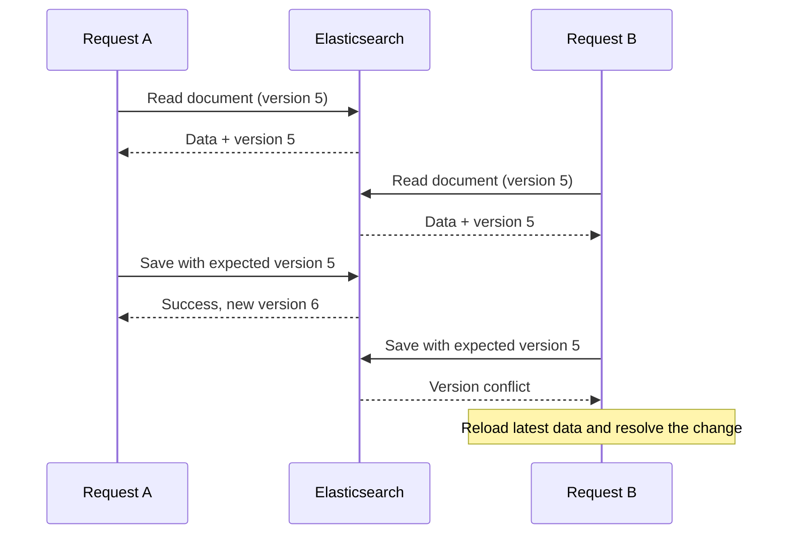
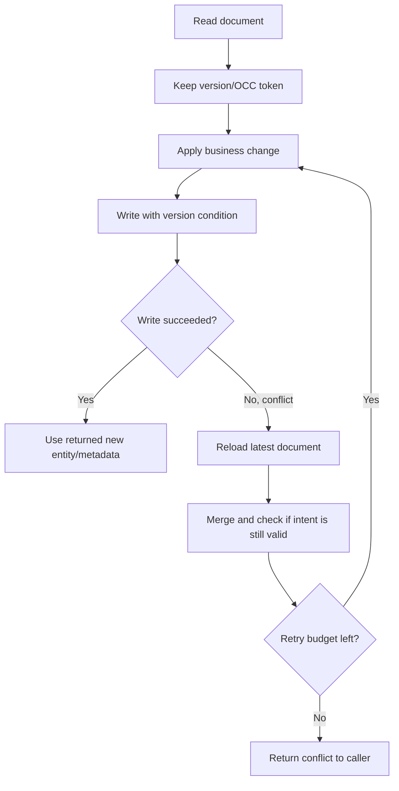

# Versioning, @Version, and API Compatibility Requirements

When multiple requests or multiple workers concurrently update an Elasticsearch document, an application needs a way to detect that data has changed since it was read. Without control, one request can overwrite a newer change with an older copy. Elasticsearch supports versioning and optimistic concurrency control (OCC); Spring Data Elasticsearch integrates versioning through the **`@Version`** annotation.

Three mechanisms must be distinguished:

- **Internal versioning**: Elasticsearch manages `_version` and increments the version when a document is written.
- **Optimistic concurrency control with sequence number and primary term**: a request is applied only if the document is still in the exact state the client read.
- **External versioning**: the application sends a version managed by a source system to prevent stale data from overwriting newer data.

`@Version` lets Spring Data participate in the versioning optimistic locking mechanism supported by Spring Data. When direct control via `if_seq_no`/`if_primary_term` or external versioning is required, use the corresponding Elasticsearch Java API Client APIs. Do not treat these three mechanisms as the same type of token or mix them within the same write path without clearly defined semantics.

## 1. The lost update problem with concurrent writes

Suppose a product has price `100` and stock `20`. Two requests read the document concurrently:

1. Request A reads price `100`, stock `20`.
2. Request B also reads price `100`, stock `20`.
3. A changes price to `120` and saves.
4. B changes stock to `15`, but saves the entire old object with price `100`.

If B overwrites the entire `_source` without concurrency control, A's price of `120` can be lost. This is a **lost update**.

Optimistic locking lets both requests read without locking the document up front. On write, Elasticsearch checks whether the document is still at the version the request read. If the document has changed, the stale write is rejected so the application can reload and resolve the conflict.



This is optimistic locking: conflicts are detected at write time rather than locking the document for the entire duration of business processing.

## 2. `@Version` in Spring Data Elasticsearch

Spring Data Elasticsearch uses the common Spring Data annotation:

```java
import org.springframework.data.annotation.Version;
```

Do not import an arbitrary `Version` annotation from another library. Entity example:

```java
import org.springframework.data.annotation.Id;
import org.springframework.data.annotation.Version;
import org.springframework.data.elasticsearch.annotations.Document;
import org.springframework.data.elasticsearch.annotations.Field;
import org.springframework.data.elasticsearch.annotations.FieldType;

@Document(indexName = "products")
public class ProductDocument {

    @Id
    private String id;

    @Field(type = FieldType.Keyword)
    private String name;

    @Field(type = FieldType.Long)
    private Long priceInCents;

    @Version
    private Long version;

    protected ProductDocument() {
    }

    public ProductDocument(String id, String name, Long priceInCents) {
        this.id = id;
        this.name = name;
        this.priceInCents = priceInCents;
    }

    public String getId() {
        return id;
    }

    public String getName() {
        return name;
    }

    public Long getPriceInCents() {
        return priceInCents;
    }

    public void setPriceInCents(Long priceInCents) {
        this.priceInCents = priceInCents;
    }

    public Long getVersion() {
        return version;
    }
}
```

`@Version` marks the property Spring Data uses for versioning. When the entity is read, Spring Data maps Elasticsearch version metadata into this property. When the entity is saved again, the version is used to detect concurrent updates and the new version metadata is returned with the write result.

Use a nullable `Long` to clearly indicate the entity has no version yet before its first save. Property types and initialization/returned version details should follow the documentation of the exact Spring Data Elasticsearch release in use; do not assign an assumed version in constructors.

### 2.1. Version is not a business field inside `_source`

Versioning is Elasticsearch metadata. A `@Version` property is recognized by Spring Data as a version property and should not be treated as a regular business field for searching or aggregating within `_source`.

If the domain needs a `revision` or `schemaVersion` field with business meaning, declare a separate field. Do not use the same property for both Elasticsearch version metadata and application-managed revisions.

## 3. Saving an entity with `@Version`

You can use a Repository:

```java
import org.springframework.data.elasticsearch.repository.ElasticsearchRepository;

public interface ProductRepository
        extends ElasticsearchRepository<ProductDocument, String> {
}
```

Or `ElasticsearchOperations`:

```java
import org.springframework.data.elasticsearch.core.ElasticsearchOperations;
import org.springframework.stereotype.Service;

@Service
public class ProductService {

    private final ElasticsearchOperations operations;

    public ProductService(ElasticsearchOperations operations) {
        this.operations = operations;
    }

    public ProductDocument changePrice(String id, long newPrice) {
        ProductDocument product = operations.get(
            id,
            ProductDocument.class
        );

        if (product == null) {
            throw new IllegalArgumentException("Product not found: " + id);
        }

        product.setPriceInCents(newPrice);

        return operations.save(product);
    }
}
```

The key point is that the entity read from Elasticsearch carries its current version. When saving that entity, Spring Data can use the read version to detect changes that occurred while the service was processing.

Keep the new entity/version returned by `save`. Do not continue using an old instance after a successful save if code needs to perform another update afterward.

## 4. Handling `OptimisticLockingFailureException`

If the document changed since it was read, the write operation can fail with a Spring DAO exception:

```java
import org.springframework.dao.OptimisticLockingFailureException;

try {
    ProductDocument saved = operations.save(product);
    return saved;
} catch (OptimisticLockingFailureException ex) {
    // Document was modified by another operation.
    throw new ProductUpdateConflictException(product.getId(), ex);
}
```

The application can translate the conflict into HTTP 409 Conflict if it is a user-initiated update API. The message should tell the user the data has changed and ask them to reload, rather than exposing an Elasticsearch stack trace.

### 4.1. Do not blindly retry the same stale entity

If save fails due to a version conflict, resending the exact same old entity with the same version will usually keep failing. The proper handling workflow is typically:

1. Reload the latest document.
2. Determine which changes in the request are still valid.
3. Reapply the business intent onto the fresh data.
4. Save again with the new version.
5. Limit retry attempts and return a conflict if still unsuccessful.

For example, if the request only changes the price, reload the latest product and only apply the new price. Do not write back the entire stale object read earlier.

### 4.2. Bounded retry example

```java
public ProductDocument changePriceWithRetry(
        String id,
        long newPrice,
        int maxAttempts) {

    for (int attempt = 1; attempt <= maxAttempts; attempt++) {
        ProductDocument current = operations.get(
            id,
            ProductDocument.class
        );

        if (current == null) {
            throw new IllegalArgumentException("Product not found: " + id);
        }

        current.setPriceInCents(newPrice);

        try {
            return operations.save(current);
        } catch (OptimisticLockingFailureException ex) {
            if (attempt == maxAttempts) {
                throw new ProductUpdateConflictException(id, ex);
            }
        }
    }

    throw new IllegalStateException("Unreachable retry state");
}
```

This illustrates a price-assignment operation that can be reapplied after reloading. For business operations such as deducting stock, adding points, or conditional state transitions, rules must be re-evaluated on the new data; not every operation is safe to retry automatically.

## 5. Elasticsearch internal versioning

Every Elasticsearch document has `_version` metadata. With internal versioning, Elasticsearch manages this value and increments it across successful write operations.

Example reading a document:

```http
GET products/_doc/P-100
```

The response may contain:

```json
{
  "_index": "products",
  "_id": "P-100",
  "_version": 7,
  "found": true,
  "_source": {
    "name": "Wireless Headphones",
    "priceInCents": 12990
  }
}
```

`_version` is metadata, not an ordinary property in `_source`.

### 5.1. Checking version on write

Elasticsearch supports passing an expected version on write operations. With internal versioning, the operation succeeds only if the supplied version matches the current version according to API semantics. Otherwise, Elasticsearch returns a version conflict.

Illustrative REST example:

```http
PUT products/_doc/P-100?version=7&version_type=internal
{
  "name": "Wireless Headphones",
  "priceInCents": 13990
}
```

This request asks to write based on current version 7. If the document already has a different version, the operation is rejected.

Spring Data's `@Version` maps the version property into the versioning mechanism supported by Spring Data. When using direct APIs, understand how `version` and `version_type` are passed; never invent an arbitrary number.

## 6. Optimistic concurrency control with `_seq_no` and `_primary_term`

Elasticsearch provides another OCC mechanism based on two metadata values:

- **`_seq_no` (sequence number)**: the operation sequence number accepted by the primary shard.
- **`_primary_term`**: identifier of the primary shard generation handling the operation.

When reading a document, the client retains both values. When writing, the client sends `if_seq_no` and `if_primary_term`. Elasticsearch accepts the write only if both still match the document/shard's current state.

Example reading a document:

```http
GET products/_doc/P-100
```

Illustrative response:

```json
{
  "_index": "products",
  "_id": "P-100",
  "_seq_no": 42,
  "_primary_term": 3,
  "_source": {
    "name": "Wireless Headphones",
    "priceInCents": 12990
  }
}
```

Write with OCC conditions:

```http
PUT products/_doc/P-100?if_seq_no=42&if_primary_term=3
{
  "name": "Wireless Headphones",
  "priceInCents": 13990
}
```

If another operation changed the document or the primary term changed, the request fails with a conflict. The client must reload the data and decide how to handle it.

### 6.1. Why are both values needed?

Sequence number identifies operation ordering within a shard. Primary term changes when the shard moves to a new primary. Combining both values avoids accepting an operation based on stale state when the primary shard has changed.

Do not store only `seq_no` while discarding `primary_term`. The two values must be kept and sent as a pair.

### 6.2. Using the Elasticsearch Java API Client

With the Elasticsearch Java API Client, `IndexRequest` supports OCC conditions:

```java
import co.elastic.clients.elasticsearch.ElasticsearchClient;
import co.elastic.clients.elasticsearch.core.IndexResponse;

IndexResponse response = client.index(request -> request
    .index("products")
    .id(productId)
    .ifSeqNo(seqNo)
    .ifPrimaryTerm(primaryTerm)
    .document(productDocument)
);
```

If the document changed since it was read, the client receives a version conflict error. The corresponding approach can also be applied to update/delete requests supported by your version of the client API.

If you need sequence number and primary term from a search hit instead of GET, the search request must ask to return that metadata (for example `seq_no_primary_term: true` in the Search API). Check the corresponding API builder in your Java Client version.

### 6.3. Is `@Version` the same as `seq_no`/`primary_term`?

Do not assume these two approaches are the same API or the same token:

- `@Version` is a Spring Data abstraction relying on a version property and the versioning mechanism integrated in that Spring Data Elasticsearch release.
- `if_seq_no`/`if_primary_term` are explicit OCC conditions in the Elasticsearch API.
- `_version` and the `_seq_no`/`_primary_term` pair are different metadata returned by Elasticsearch.

If an application uses `ElasticsearchOperations` for some writes and the Java API Client directly for others, standardize the OCC mechanism and metadata stored in domains/commands. Do not grab `_version` and pass it into `if_seq_no`, or treat `seq_no` as a version property.

## 7. External versioning for data coming from source systems

Some systems maintain their own versions, such as a source database with an incrementing revision or an event stream with a sequence number. Elasticsearch supports external versioning to ensure an older record does not overwrite a newer one.

REST example:

```http
PUT products/_doc/P-100?version=105&version_type=external
{
  "name": "Wireless Headphones",
  "priceInCents": 13990
}
```

With `version_type=external`, the submitted version must be strictly greater than the document's current version. If an older event arrives after a newer event, Elasticsearch rejects the update because the version is older.

### 7.1. `external` and `external_gte`

| Version type | Main rule | When suitable |
|---|---|---|
| `internal` | Elasticsearch manages the version; requests can check current version | OCC for standard read-modify-write operations |
| `external` | Client-supplied version must be greater than current version | Syncing from a source with monotonically increasing revisions |
| `external_gte` | Client-supplied version must be greater than or equal to current version | Certain replay flows with identical payloads and matching versions |

`external_gte` requires care: two different payloads with the same version can allow the later-arriving payload to overwrite the earlier one. Use it only when the source guarantees the same version always represents the exact same state or when those semantics are acceptable.

External versioning is not a drop-in replacement for `@Version` on every entity. It fits when a source system owns the version and guarantees versions increase with data ordering.

## 8. Which versioning mechanism to choose?

| Need | Mechanism to consider | Reason |
|---|---|---|
| CRUD via Spring Data, want to detect concurrent overwrites | `@Version` | Integrates with Spring Data entities/repositories/operations |
| Using Elasticsearch API directly and need read-based OCC | `if_seq_no` + `if_primary_term` | Explicit OCC tokens from Elasticsearch |
| Syncing events from source database with increasing revision | External versioning | Blocks stale events from overwriting newer events |
| Only writing documents without read-modify-write | Normal write with proper ID | No need for extra OCC mechanisms if there is no conflict requirement |
| Bulk import needing per-item handling | Bulk response and per-operation version policy | Each item can succeed or fail independently |

Do not turn on versioning mechanically for every document. Choose a mechanism based on lost-update risk, data source, and how the application performs writes.

## 9. Versioning in bulk operations

A bulk request can contain multiple index/update/delete operations. Each item can have its own version or OCC conditions if supported by the API. One conflicting item does not roll back the entire bulk request.

REST Bulk API example with external version:

```text
{ "index": { "_index": "products", "_id": "P-100", "version": 105, "version_type": "external" } }
{ "name": "Wireless Headphones", "priceInCents": 13990 }
```

If an item fails due to a version conflict, inspect the item response for its status/error. Do not blindly retry the whole bulk batch, especially if other operations succeeded.

With Spring Data bulk operations, inspect `BulkFailureException` and the list of failed documents. If you need per-item `seq_no`, `primary_term`, version, and operation results, the Elasticsearch Java API Client's `BulkResponse.items()` can provide finer detail depending on the operation/version.

## 10. API compatibility across Spring Data Elasticsearch generations

Spring Data Elasticsearch changes clients and query APIs across major releases. When reading online examples or upgrading dependencies, identify your project's exact version.

An important boundary:

| Spring Data Elasticsearch generation | Common client/API | Notes |
|---|---|---|
| 4.x | Elasticsearch High Level REST Client (RHLC); query APIs like `NativeSearchQuery` | Older examples may use `NativeSearchQueryBuilder` and `RestHighLevelClient`. |
| 5.x | Elasticsearch Java API Client (ELC); query APIs like `NativeQuery` | Newer examples use `co.elastic.clients.elasticsearch.*` and lambda builders. |

Abstractions like `ElasticsearchOperations`, Repositories, and Spring Data annotations help keep domain code more stable, but do not guarantee every method, builder, or response type stays identical across major versions.

### 10.1. Importing the right client for your version

With Spring Data Elasticsearch 5.x, the Java API Client uses package:

```java
import co.elastic.clients.elasticsearch.ElasticsearchClient;
```

With the 4.x generation, older examples may use:

```java
import org.elasticsearch.client.RestHighLevelClient;
```

Do not mix RHLC request builders with the new `ElasticsearchClient`. The two clients have different request/response models, serialization, and APIs.

### 10.2. `NativeSearchQuery` and `NativeQuery`

In older code, you may encounter:

```java
NativeSearchQuery query = new NativeSearchQueryBuilder()
    .withQuery(...)
    .build();
```

In Spring Data Elasticsearch 5.x code, `NativeQuery` is typically used with Elasticsearch Java API Client builders:

```java
NativeQuery query = NativeQuery.builder()
    .withQuery(q -> q
        .match(m -> m
            .field("name")
            .query("wireless")
        )
    )
    .build();
```

These are not two classes that can be swapped simply by changing imports. When upgrading, migrate query DSL, sorting, aggregations, highlighting, pagination, and response reading to the new API.

### 10.3. Keep dependencies aligned with the Spring Boot BOM

If the project uses Spring Boot, prefer the dependency management/BOM provided by your Spring Boot release. Avoid manually overriding `spring-data-elasticsearch`, `spring-data-commons`, `elasticsearch-java`, or transport client versions to incompatible releases.

When selecting versions, verify:

- Spring Boot version.
- Spring Data release train managed by Boot.
- Spring Data Elasticsearch module version.
- Elasticsearch Java API Client version.
- Elasticsearch server version and compatibility matrix.
- JDK version.

Do not infer server/client compatibility simply because a project compiles. A client can compile while sending requests/responses or features unsupported by that server version.

## 11. Compatibility of `@Version` and exceptions

`@Version` belongs to Spring Data Commons:

```java
import org.springframework.data.annotation.Version;
```

This is a shared annotation used by Spring Data Elasticsearch. However, versioning implementation details, supported property types, metadata reading APIs, and exception mapping can vary across releases.

Points to verify when upgrading:

1. Is the annotation still read from the exact package `org.springframework.data.annotation.Version`?
2. Which property types are supported in the current release? Prefer documented nullable types, typically `Long`.
3. Is Spring Data using internal versioning or another OCC mechanism for the specific operation?
4. Which exception do Repository and `ElasticsearchOperations.save(...)` translate conflicts into?
5. Do bulk operations report conflicts via a composite exception or per-item responses?
6. If calling the Java API Client directly, do responses provide `_version`, `_seq_no`, and `_primary_term` according to the configured request?

Do not copy a versioning snippet from Spring Data 4.x into 5.x without checking imports, builders, and exception types. In particular, do not use `RestHighLevelClient` APIs in a project that has migrated to the Java API Client just because an old example looks similar.

## 12. API compatibility when using the Java API Client directly

The Elasticsearch Java API Client is a strongly typed client for Elasticsearch's REST API. Request builders frequently evolve across library versions. Example OCC using `ifSeqNo` and `ifPrimaryTerm`:

```java
IndexResponse response = client.index(request -> request
    .index("products")
    .id(productId)
    .ifSeqNo(seqNo)
    .ifPrimaryTerm(primaryTerm)
    .document(document)
);
```

When upgrading the client version, verify:

- Packages and request/response class names.
- Types for `seqNo`, `primaryTerm`, and version.
- Whether builder methods still exist with the same overloads.
- How error responses are wrapped in exceptions.
- Whether JSON mapper/transport matches Spring configuration.
- Whether the server supports the endpoints and request options being used.

When Spring Data Elasticsearch provides a suitable abstraction, prefer using it for standard CRUD. Use the Java API Client directly when you need Elasticsearch options not yet exposed by Spring Data, and isolate them in an adapter/service to limit API coupling.

## 13. Do not mix version metadata with business revisions

An entity may need both an Elasticsearch version and a business revision from a source system:

```java
@Document(indexName = "products")
public class ProductDocument {

    @Id
    private String id;

    @Version
    private Long elasticsearchVersion;

    @Field(type = FieldType.Long)
    private Long sourceRevision;
}
```

The two fields serve different purposes:

- `elasticsearchVersion` is used for optimistic locking managed by Spring Data/Elasticsearch.
- `sourceRevision` is a business revision managed by the source system and can be used to decide which event is newer.

If using external versioning, the source version can be passed in request metadata rather than stored solely as a `_source` field. Whichever approach you choose, establish a single source of truth for each mechanism.

Do not use `sourceRevision` in place of `@Version` unless you have designed external versioning and understand the version-type rules. Conversely, `_version` cannot replace a business revision for reconciling source database events.

## 14. Common errors

| Symptom | Possible cause | How to handle |
|---|---|---|
| Two requests overwrite each other's changes | Missing optimistic locking or saving an entire stale object | Use `@Version`/OCC and apply changes onto the latest data. |
| `OptimisticLockingFailureException` on save | Document changed after read | Reload, merge business intent, and retry with a bound. |
| Retries still conflict | Resending the old entity with the old version | Reload entity and get new version before retrying. |
| Version field treated as domain data | Wrong annotation or import | Use `org.springframework.data.annotation.Version`. |
| Using `seq_no` as version | Confused OCC metadata | Keep `_seq_no` and `_primary_term` together; do not swap with `_version`. |
| Older event overwrites newer event | Not using external versioning or non-monotonic source version | Use appropriate external versioning and verify revision order. |
| `external_gte` overwrites payload with same version | Different payloads sharing the same revision | Only use `external_gte` when the same version guarantees identical state. |
| Example fails to compile after upgrade | Mixing RHLC/`NativeSearchQuery` with Java API Client/`NativeQuery` | Check major version and migrate request/response types. |
| Bulk save does not throw `OptimisticLockingFailureException` as expected | Bulk API reports errors per item or via composite exception | Inspect `BulkFailureException` or `BulkResponse.items()`. |
| Version conflicts handled as generic server errors | Missing exception translation/API mapping | Translate to a proper business conflict/HTTP 409. |

## 15. Testing optimistic locking

An integration test should demonstrate that two reads of the same version cannot silently overwrite each other.

Test flow:

1. Save an initial document.
2. Read the document into two independent instances, A and B.
3. Modify and save A successfully.
4. Modify B based on stale data and attempt to save.
5. Assert B hits an optimistic locking conflict.
6. Reload the document and assert A's change remains intact.

Example test skeleton:

```java
@Test
void staleEntityCannotOverwriteNewerVersion() {
    ProductDocument initial = operations.save(
        new ProductDocument("P-100", "Headphones", 10000L)
    );

    ProductDocument firstRead = operations.get("P-100", ProductDocument.class);
    ProductDocument secondRead = operations.get("P-100", ProductDocument.class);

    firstRead.setPriceInCents(12000L);
    operations.save(firstRead);

    secondRead.setPriceInCents(9000L);

    assertThatThrownBy(() -> operations.save(secondRead))
        .isInstanceOf(OptimisticLockingFailureException.class);

    ProductDocument latest = operations.get("P-100", ProductDocument.class);
    assertThat(latest.getPriceInCents()).isEqualTo(12000L);
}
```

This is an illustrative test; use a dedicated test index, wait for refresh when needed, and verify the versioning API of the Spring Data release you use. With the direct Elasticsearch API Client, write a similar test by retaining `_seq_no`/`_primary_term`, writing once, then sending a second request with the old token pair and asserting conflict.

## 16. Controlled update workflow



Practical steps:

1. Identify who owns the data and who issues versions.
2. Choose `@Version`, `if_seq_no`/`if_primary_term`, or external versioning.
3. Read the document along with the corresponding version metadata.
4. Apply the business change onto the read data.
5. Write with the read version/token condition.
6. If successful, use the newly returned metadata.
7. If a conflict occurs, reload and merge intent; never resend the stale object.
8. Bound retries and return a conflict if it cannot be resolved safely.
9. Test two concurrent writers and the retry flow against a compatible Elasticsearch instance.
10. When upgrading Spring Data/client/server, re-verify imports, builders, exceptions, and versioning semantics.

## 17. Conclusion

Versioning detects concurrent updates and prevents a stale write from overwriting a newer change. Spring Data Elasticsearch provides `@Version` from `org.springframework.data.annotation.Version` to integrate a version property into entity save operations. When a conflict is detected, the application usually receives `OptimisticLockingFailureException`; the proper response is to reload, reapply the business intent, and retry within bounds.

Elasticsearch offers distinct metadata mechanisms: `_version` for internal/external versioning and the `_seq_no`/`_primary_term` pair for optimistic concurrency control. External versioning fits when a source system owns a monotonically increasing revision. Do not confuse these tokens or mix them without clearly defining their semantics.

Spring Data Elasticsearch APIs also change across major versions. The 4.x line typically uses the High Level REST Client and `NativeSearchQuery`; the 5.x line uses the Elasticsearch Java API Client and `NativeQuery`. Prefer dependencies managed by the Spring Boot BOM, check server/client compatibility matrices, and isolate direct client APIs inside adapters. When upgrading, verify `@Version`, property types, exception translation, and request/response builders. Following these steps keeps optimistic locking consistent and avoids errors caused by mixing APIs across library generations.
