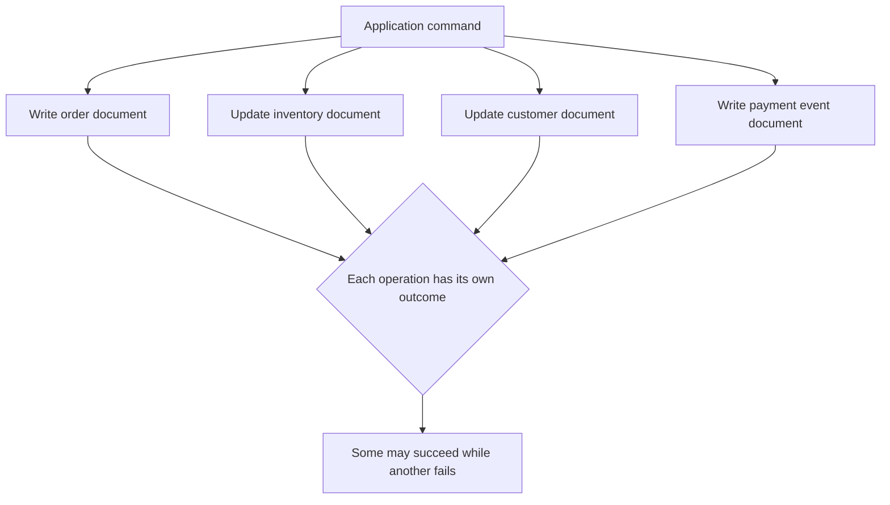
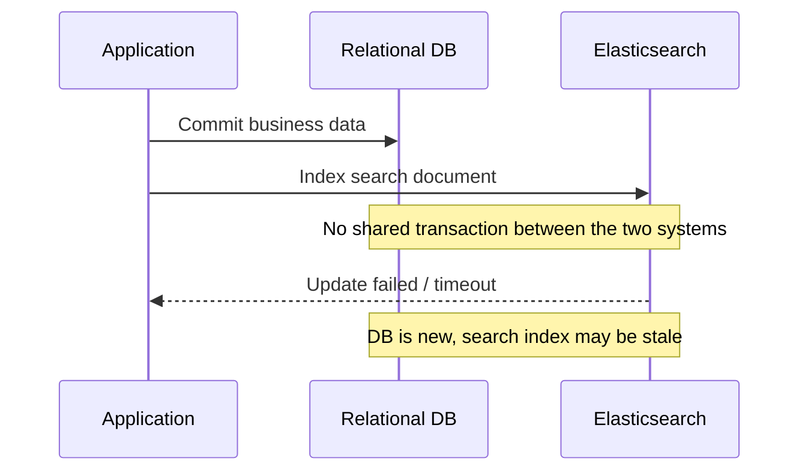
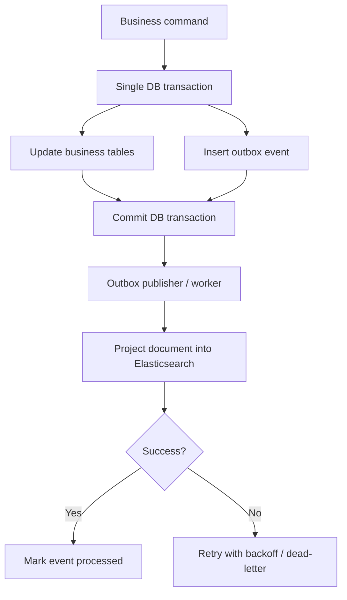
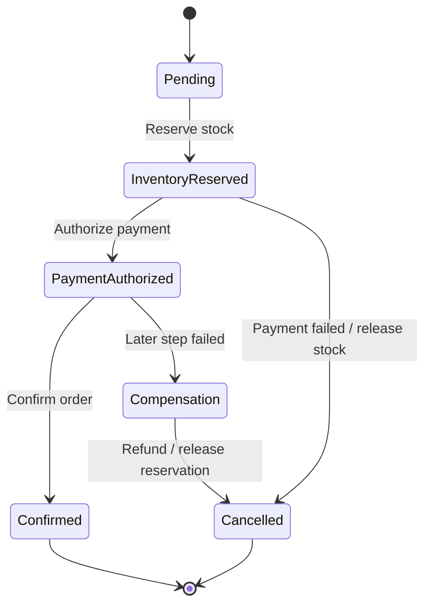

# No Multi-Document ACID Transactions Equivalent to JPA

When working with a relational database through JPA, applications commonly group multiple writes into a single transaction: create an order, deduct inventory, record payment history, and then commit. If any step fails, the transaction can roll back to return all changes within the transaction scope to their initial state.

Elasticsearch does not provide multi-document ACID transactions equivalent to how JPA/JDBC works with a relational database. A write operation on **a single document** is atomic at the document level, but a sequence of operations across multiple documents, multiple shards, or multiple indices is not wrapped in a shared transaction that can commit/roll back as a whole. The Bulk API does not turn multiple items into an atomic transaction either: each item succeeds or fails independently.

Therefore, when using Spring Data Elasticsearch, do not assume JPA's `@Transactional` encompasses Elasticsearch write operations. If business logic needs consistency across multiple documents or between a relational database and Elasticsearch, the application must design explicit data boundaries and synchronization workflows, typically by placing invariants in a single document, using a transactional outbox, saga/compensation, idempotent retries, and reconciliation.

## 1. What scope do ACID transactions have in JPA?

ACID refers to four properties commonly used to describe transactions:

- **Atomicity:** all operations in the transaction succeed together or roll back together.
- **Consistency:** the transaction moves data from one valid state to another valid state according to system-enforced constraints.
- **Isolation:** concurrent transactions do not observe intermediate states per the chosen isolation level.
- **Durability:** after a successful commit, changes are stored durably according to the database management system's guarantees.

Example of a JPA service:

```java
@Service
public class OrderService {

    private final OrderRepository orders;
    private final InventoryRepository inventory;
    private final PaymentRepository payments;

    @Transactional
    public void placeOrder(PlaceOrderCommand command) {
        Order order = orders.save(Order.pending(command));
        inventory.decrease(command.productId(), command.quantity());
        payments.save(Payment.requested(order.getId(), command.amount()));
        order.markSubmitted();
    }
}
```

If all three repositories participate in the same JPA transaction manager and the same database transaction, commit/rollback can cover all those changes. That transaction boundary is managed by the relational database and transaction manager.

A critical requirement is that the operations actually participate in the same transactional resource/transaction manager. Simply placing `@Transactional` on a method does not create a distributed transaction across every external system the method invokes.

## 2. Elasticsearch guarantees atomicity at the single-document level

Elasticsearch stores documents by `_id` within an index and shard. An index, delete, or update operation on a single document is processed atomically at the document level: readers never see half of a JSON document being written.

Example updating a single order document:

```http
POST /orders/_update/order-1001
{
  "doc": {
    "status": "CONFIRMED",
    "confirmedAt": "2026-11-13T10:30:00Z"
  }
}
```

Changes to `order-1001` are applied as a single unit. Search never receives a document with the new `status` while `confirmedAt` is only half-written. The Update API reads the current document, applies the partial doc or script, and reindexes the updated document version.

This does not mean Elasticsearch provides ACID transactions for a group of documents. If an application needs to update `order-1001`, `inventory-product-7`, and `customer-42`, those three operations are three separate writes. One operation can succeed while another fails.

### 2.1 A single document can hold multiple related attributes

If fields must change together to maintain an invariant, you can model them within the same document:

```json
{
  "orderId": "order-1001",
  "status": "CONFIRMED",
  "paymentStatus": "AUTHORIZED",
  "inventoryReservation": {
    "status": "RESERVED",
    "reservationId": "reservation-9001"
  },
  "updatedAt": "2026-11-13T10:30:00Z"
}
```

A single document update can modify related fields in the same write. This leverages document-level atomicity. However, it is suitable when the data truly belongs to the same aggregate and can be read/updated as one unit.

### 2.2 Nested objects do not create separate transactions

A `nested` array in Elasticsearch is indexed using hidden Lucene documents linked to the parent document, yet it still belongs to the parent document in the API model. A nested child is not an independent document that can participate in its own transaction. Updating a nested array normally still updates the parent document.

Thus, if an order has `items`, `addresses`, or nested components that must change synchronously, keeping them in the same document enables document-level atomic updates. However, if each item has an independent lifecycle or high update frequency, consider alternative modeling and synchronization workflows.

## 3. No multi-document ACID transactions in Elasticsearch

Suppose a request needs to:

1. Create an order document.
2. Deduct stock in a product document.
3. Increment the customer's order count.
4. Create a payment history document.

There is no native transaction API to wrap these four operations into a single ACID commit/rollback unit equivalent to a JPA transaction on a relational database.



The application must handle partial states. If three operations succeed and the fourth fails, Elasticsearch does not automatically roll back the three that succeeded.

### 3.1 No rollback across a group of writes

Once a document has been updated successfully, a later failure does not automatically undo earlier changes. If business logic requires compensation, the application must send separate compensating operations and handle the possibility that compensation itself fails.

### 3.2 No shared isolation across multiple documents

A search request can read documents at different refresh/replication points according to Elasticsearch semantics. There is no multi-document transactional snapshot equivalent to the isolation level of a JPA database transaction.

If an application reads document A and then document B while another writer updates both in two separate requests, the application can observe an intermediate state. Design data and business processes so they do not depend on a multi-document snapshot that Elasticsearch does not provide.

### 3.3 Multiple shards or indices do not create transaction boundaries

A document is routed to a primary shard. A single document write can be protected at the document level, while operations on different documents can go to different shards. Sending operations in the same HTTP request or the same Bulk request does not turn them into a cross-shard transaction.

Similarly, updating two different indices has no shared commit/rollback transaction. Aliases are also just logical pointers to indices; an alias switch can change target indices atomically as an alias-management operation, but does not create a multi-index data transaction.

## 4. The Bulk API is not a transaction

The Bulk API batches multiple index/create/update/delete operations into one request to reduce network overhead and boost throughput:

```http
POST /_bulk
{ "index": { "_index": "orders", "_id": "order-1001" } }
{ "orderId": "order-1001", "status": "CREATED" }
{ "update": { "_index": "inventory", "_id": "product-7" } }
{ "doc": { "stock": 19 } }
{ "index": { "_index": "order-events", "_id": "event-1001" } }
{ "orderId": "order-1001", "type": "ORDER_CREATED" }
```

The Bulk response reports results at the per-item level. Some items can succeed while others fail due to version conflicts, mapping errors, routing errors, or shard failures.

Abbreviated example response:

```json
{
  "errors": true,
  "items": [
    {
      "index": {
        "_index": "orders",
        "_id": "order-1001",
        "status": 201,
        "result": "created"
      }
    },
    {
      "update": {
        "_index": "inventory",
        "_id": "product-7",
        "status": 409,
        "error": {
          "type": "version_conflict_engine_exception"
        }
      }
    },
    {
      "index": {
        "_index": "order-events",
        "_id": "event-1001",
        "status": 201,
        "result": "created"
      }
    }
  ]
}
```

The order and event were written, while the inventory update conflicted. Elasticsearch does not roll back the two succeeded items just because the second item failed.

### 4.1 Always inspect per-item errors

Do not check only the HTTP status or assume a Bulk request succeeded entirely. The application needs to:

- Check the `errors` flag and each item's outcome.
- Log the ID, operation type, and specific error.
- Retry transient errors under a backoff policy.
- Never blindly retry mapping or invalid-data errors.
- Ensure retried operations are idempotent.
- Route unrecoverable failures to a dead-letter queue or manual review queue.

### 4.2 Bulk updates in Spring Data Elasticsearch

Spring Data Elasticsearch provides bulk APIs for multiple `IndexQuery`, `UpdateQuery`, or delete queries depending on the version. Example:

```java
List<UpdateQuery> updates = List.of(
    UpdateQuery.builder("product-7")
        .withDocument(Document.create().append("stock", 19))
        .build(),
    UpdateQuery.builder("product-8")
        .withDocument(Document.create().append("stock", 12))
        .build()
);

operations.bulkUpdate(updates, IndexCoordinates.of("inventory"));
```

The Bulk API sends multiple updates more efficiently, yet does not provide an atomic transaction. Inspect the return type and failed item details per your Spring Data version; do not treat a normal method return as proof every item succeeded if the API returns partial results.

## 5. JPA's `@Transactional` does not cover Elasticsearch

A common design mistake is placing `@Transactional` on a service using both a JPA repository and `ElasticsearchOperations` and expecting the two systems to commit/roll back together.

Example:

```java
@Service
public class CatalogService {

    private final ProductJpaRepository productJpaRepository;
    private final ElasticsearchOperations elasticsearchOperations;

    @Transactional
    public void updateProduct(Product product) {
        productJpaRepository.save(product);

        Document partial = Document.create()
            .append("name", product.getName())
            .append("price", product.getPrice());

        UpdateQuery update = UpdateQuery.builder(product.getId())
            .withDocument(partial)
            .build();

        elasticsearchOperations.update(
            update,
            IndexCoordinates.of("products-search")
        );
    }
}
```

Here, `@Transactional` normally manages the JPA datasource transaction. `ElasticsearchOperations` uses its own Elasticsearch client and does not automatically participate in that JPA transaction. If the Elasticsearch update succeeds while the JPA commit fails, the search index may contain uncommitted database data. If JPA commits while the Elasticsearch operation fails, the updated database and stale search index coexist.

### 5.1 Why is the annotation not enough?

Spring transactions are driven by a specific `PlatformTransactionManager`. `JpaTransactionManager` manages transactions for a matching EntityManagerFactory/datasource. It does not automatically govern external systems such as Elasticsearch, HTTP services, or object storage.

Spring can configure multiple transaction managers or specialized coordination mechanisms, yet that still does not create native multi-document ACID transactions inside Elasticsearch. Do not infer that a `@Transactional` method rolls back every side effect invoked inside it together.

### 5.2 Call ordering changes the failure mode without creating atomicity

If writing to Elasticsearch before JPA:

- Elasticsearch succeeds.
- JPA fails and rolls back.
- Elasticsearch does not roll back automatically.

If writing to JPA before Elasticsearch:

- JPA can commit.
- Elasticsearch fails.
- The database changed while the search index remained stale.

Changing the call order only changes which failure state occurs. It does not solve the dual-write problem.

## 6. The dual-write problem between database and Elasticsearch

In many systems, a relational database is the system of record and Elasticsearch is a read model/search index. A business action needs to update the database and update Elasticsearch.



If writing to both directly within the request, there is always a window where one system committed and the other has not. Network timeouts also leave an uncertain state: the application does not know whether Elasticsearch received and wrote the request.

This is why many systems treat Elasticsearch as a rebuildable projection/read model derived from the authoritative source of truth, rather than the sole store for business invariants requiring multi-record transactions.

## 7. Transactional outbox: writing database state and events in one transaction

When a relational database is the source of truth, a common way to avoid losing synchronization events is the transactional outbox.

Within a single JPA transaction:

1. Update the business tables.
2. Insert an event into an outbox table.
3. Commit both in the same database transaction.

A separate worker reads the outbox and updates Elasticsearch. If Elasticsearch fails temporarily, the event stays in the outbox for retry.



The database transaction guarantees business data and the outbox event commit or roll back together. Workers can deliver events at least once; therefore, Elasticsearch updates must be idempotent.

### 7.1 Illustrative outbox table

```sql
CREATE TABLE outbox_event (
    event_id       VARCHAR(64) PRIMARY KEY,
    aggregate_type VARCHAR(100) NOT NULL,
    aggregate_id   VARCHAR(100) NOT NULL,
    event_type     VARCHAR(100) NOT NULL,
    payload        TEXT NOT NULL,
    created_at     TIMESTAMP NOT NULL,
    processed_at   TIMESTAMP NULL,
    retry_count    INTEGER NOT NULL DEFAULT 0
);
```

Data types and syntax should be adapted to your actual database. Unique `event_id` identifies events across retries. `aggregate_id` groups events by entity/aggregate. `processed_at` or a status column indicates whether the event has been processed.

### 7.2 Writing outbox in the same JPA transaction

```java
@Service
public class ProductCommandService {

    private final ProductJpaRepository products;
    private final OutboxRepository outbox;

    @Transactional
    public void changePrice(String productId, BigDecimal newPrice) {
        ProductEntity product = products.findById(productId)
            .orElseThrow();

        product.changePrice(newPrice);

        outbox.save(OutboxEvent.productPriceChanged(
            UUID.randomUUID().toString(),
            product.getId(),
            product.getVersion(),
            newPrice
        ));
    }
}
```

The database commits both the product change and the event. If the transaction rolls back, no event exists for a worker to process an uncommitted change.

### 7.3 Worker updating Elasticsearch

```java
@Component
public class ProductProjectionWorker {

    private final OutboxRepository outbox;
    private final ElasticsearchOperations operations;

    public void process(OutboxEvent event) {
        Document document = Document.create()
            .append("productId", event.aggregateId())
            .append("price", event.newPrice())
            .append("version", event.aggregateVersion());

        IndexQuery indexQuery = new IndexQueryBuilder()
            .withId(event.aggregateId())
            .withObject(document)
            .build();

        operations.index(indexQuery, IndexCoordinates.of("products-search"));
        outbox.markProcessed(event.eventId());
    }
}
```

This illustrates worker structure; in real systems, verify event ordering, versions, and API builders for your Spring Data version. If the worker crashes after Elasticsearch succeeds but before marking the event processed, the event will be replayed. Thus projections must be idempotent and should check versions so older events do not overwrite newer state.

### 7.4 Outbox does not create a shared transaction with Elasticsearch

An outbox does not make the database and Elasticsearch commit simultaneously. It ensures the synchronization event is durably saved alongside the source transaction, and a worker retries until the projection updates or the event enters an error-handling path.

The result is typically **eventual consistency**: the database commits first, and Elasticsearch converges once the worker processes the event. This is an intentional trade-off to avoid losing updates when one system is temporarily unavailable.

## 8. Idempotency and handling duplicate events

Outboxes, message brokers, and retries generally provide at-least-once delivery semantics: the same event can be delivered multiple times. Workers must handle duplicates without corrupting data.

### 8.1 Writing projections with deterministic IDs

If each product has one search document keyed by `productId`, use that ID as `_id`. Rewriting the same projection with the same content yields the same final outcome (idempotent) if the operation is deterministic index/replace.

Do not generate random `_id` values per retry when an event describes the same state, as that creates duplicate documents.

### 8.2 Using versions to stop older events from overwriting newer ones

Suppose event version 12 arrives before version 11 due to parallel workers or broker redelivery. If event 11 writes afterward, the projection can regress to an older state.

You can store `aggregateVersion` inside the document and apply an event only if its version is newer than the current version. Elasticsearch supports document-level optimistic concurrency via `_seq_no`/`_primary_term`, plus versioning/external versioning options depending on the use case. At the application layer, clearly define the aggregate's business version and handle out-of-order events.

### 8.3 Event IDs and deduplication

Store processed `event_id` values in an inbox/dedup table or use a unique constraint so the same event is not applied twice. For full-document replacement projections, rewriting the same state is often already idempotent; for additive/subtractive operations (`stock += 1`), duplicate processing changes the outcome and requires deduplication or sequence/version guards.

## 9. Sagas and compensating actions

When a use case genuinely needs to coordinate multiple services or multiple documents with independent lifecycles, a saga can be used. A saga breaks a workflow into local steps, each committing independently. If a later step fails, the system executes defined compensating actions for previous steps.

Order placement example:

1. Create an order in `PENDING` status.
2. Reserve inventory.
3. Authorize/capture payment.
4. Confirm the order.

If payment fails after inventory was reserved, the saga issues a command to release the reservation and transitions the order to `CANCELLED`.



Compensation is not a physical rollback. For instance, a refund is a new business transaction rather than erasing the payment transaction that occurred. Therefore, sagas require state machines, retries, timeouts, idempotency, and clear status tracking.

### 9.1 Compensation can fail

Do not assume compensating actions always succeed. If releasing inventory fails, the saga needs retries and alerting; if retries exhaust, transition to a state requiring manual intervention. Every step should have a command ID/idempotency key and persisted state so workflows can resume after restarts.

### 9.2 When should sagas be used?

Sagas fit when multiple independent business steps must coordinate and compensating actions can be defined. If you only need to update an Elasticsearch projection from a database, a transactional outbox is usually simpler. There is no need to implement a saga for every index write.

## 10. Data modeling to reduce multi-document transaction needs

One of the best ways to reduce consistency issues is designing documents around access patterns and business invariants.

### 10.1 Group data needing atomic updates into one document

If order status, line items, and shipping address need to be read together, they can live in one order document with nested/object fields. A single document update can modify status and related metadata in one operation.

This does not mean embedding everything. If a customer has millions of orders or inventory changes very frequently, embedding all of it in a customer document creates massive documents and write contention.

### 10.2 Denormalization and projections

Elasticsearch is commonly designed for fast reads tailored to search use cases. You can store repeated data (such as category name, brand, or display status) in the search document to avoid query-time joins. When source data changes, projections update via events/outbox.

Denormalization creates multiple copies of data, requiring synchronization rules and index rebuild capabilities. Do not use a search document as the source of truth for all invariants when a business database is the authoritative system.

### 10.3 Use separate documents for independent data

If each inventory item updates independently, a separate document per SKU reduces contention across products. If an aggregate must modify multiple fields together, grouping them into one document enables atomic updates. Document boundaries should reflect consistency boundaries and access patterns.

## 11. Update by query is not a multi-document transaction either

`_update_by_query` matches multiple documents and runs an update script. It can process in batches/slices and encounter version conflicts. Do not treat the whole job as an all-or-nothing rollback transaction.

Example:

```http
POST /products/_update_by_query?conflicts=proceed
{
  "query": {
    "term": {
      "status": "LEGACY"
    }
  },
  "script": {
    "lang": "painless",
    "source": "ctx._source.status = 'ARCHIVED'"
  }
}
```

With `conflicts=proceed`, Elasticsearch continues processing on conflict, potentially skipping conflicted documents and reporting the conflict count in the response. The application must inspect results, decide on retries/reconciliation, and never assume every matching document was updated.

## 12. Refresh is not a transaction commit

Elasticsearch search typically only sees changes after a refresh. A successful write response and immediate search visibility are two different concepts.

- **Write acknowledgement:** Elasticsearch confirms the write according to request/cluster semantics.
- **Refresh:** makes indexed changes searchable via the Search API.
- **Flush/translog:** internal mechanisms related to durability and segment management; not a commit command across a group of documents.

`refresh=wait_for` can wait for the next refresh before returning a response so callers can find changes via search. It does not bundle multiple documents into a transaction and does not roll back other documents if one write fails.

Example:

```java
// Conceptual example: request the operation to wait for refresh per the version's supported API.
// Do not use immediate refresh on every write if read-after-write is not required.
```

With an outbox system, a worker may index successfully before data becomes searchable. If an endpoint needs read-after-write, pick an intentional refresh policy or read from the authoritative database while the projection catches up.

## 13. Error handling and recovery for multi-step workflows

When multiple writes are independent, the application must persist progress instead of simply throwing a generic exception.

A command can record state:

```text
workflowId: order-1001
status: INVENTORY_RESERVED
steps:
  - create-order: SUCCEEDED
  - reserve-inventory: SUCCEEDED
  - authorize-payment: RETRYING
  - confirm-order: PENDING
```

This state lets workers know which steps succeeded, which need retries, and which compensations must run. Each step must have an idempotency key so retries do not create duplicate side effects.

### 13.1 Retrying by error type

| Error | Handling approach |
|---|---|
| Timeout/network with unknown state | Idempotent retry or check state by operation ID |
| HTTP 429/rejected execution | Backoff with jitter, reduce concurrency |
| Version conflict | Reload/recompute or retry per policy |
| Mapping/parse error | Do not blindly retry; fix data or mapping |
| Document missing | Decide create/upsert/not-found per business rules |
| Authorization error | Do not auto-retry unless permissions change |
| Sink unavailable | Retain event/checkpoint and retry later |

### 13.2 Reconciliation

Because systems can drift briefly or due to operational issues, run reconciliation jobs:

- Compare versions or updated timestamps between the source of truth and search projections.
- Find stalled or failed outbox events.
- Detect missing or stale projection documents.
- Reindex/replay drifted aggregates.
- Log and emit metrics for pending, retried, and dead-lettered records.

Reconciliation is the final safety net when retries and event delivery alone are insufficient to guarantee convergence.

## 14. How to test consistency assumptions

Do not test only the happy path. Simulate failures between steps:

1. Elasticsearch write succeeds, but the worker crashes before marking the outbox event processed.
2. Elasticsearch returns a timeout, but the request actually processed.
3. One item in a bulk request fails while another succeeds.
4. Two writers update the same document and one hits a version conflict.
5. An older event version arrives after a newer event version.
6. A worker restarts while a saga is between two steps.
7. Elasticsearch stays unavailable longer than the retry window.
8. Slow refresh causes search to miss a newly written projection.

Verify that retries do not create duplicates, older events do not overwrite newer projections, workflow state can resume, and compensating actions can be retried.

## 15. Choosing a strategy by requirement

| Requirement | Appropriate strategy |
|---|---|
| Multiple fields in the same entity must change together | Single-document update/script |
| Multiple independent documents, no business atomicity needed | Bulk + per-item inspection + retry |
| Database is source of truth, Elasticsearch is search projection | Transactional outbox + idempotent consumer |
| Multiple services coordinating a workflow with compensation | Saga/state machine |
| Search index needs rebuilding after an incident | Rebuild/reindex from source of truth |
| Concurrent writers updating the same document | Optimistic concurrency or atomic script |
| Search results needed right after write | Intentional refresh policy or read from source of truth |

No single mechanism replaces transactions in all situations. Choose based on invariants to protect, source of truth, eventual consistency tolerance, and recovery cost.

## 16. Common misconceptions

### 16.1 Thinking a Bulk request is a transaction

Bulk only batches requests; each item has its own result. One item failing does not roll back other items.

### 16.2 Thinking JPA `@Transactional` rolls back Elasticsearch

The JPA transaction manager does not automatically manage the Elasticsearch client. A succeeded Elasticsearch update does not automatically roll back when the database rolls back.

### 16.3 Thinking updating multiple fields is a multi-document transaction

A partial update on one document can modify multiple fields atomically. That does not extend across multiple `_id` values.

### 16.4 Thinking nested children are independent documents

Nested children are part of the parent document in the API. They do not have independent transactions or CRUD lifecycles like separate documents.

### 16.5 Thinking refresh creates a commit

Refresh only makes data searchable. It does not commit/roll back multiple operations and does not replace durability/transactions.

### 16.6 Thinking outbox guarantees exactly-once automatically

An outbox ensures the event is recorded within the source transaction. Workers can still process an event multiple times; idempotency/deduplication is still required.

### 16.7 Thinking saga rollback works like a database

Sagas use compensation, which is a new business operation. Compensation can fail and requires retries/state tracking.

### 16.8 Thinking an alias switch is a multi-index data transaction

Alias actions can atomically swap routing/name mappings at the alias API level, but they do not combine prior data writes across multiple indices into a transaction.

## 17. Safe design workflow

When a use case must update multiple pieces of data, follow these steps:

1. Identify which invariants must always hold and which documents change together.
2. If invariants belong to a small aggregate, consider storing them in one document and updating in a single operation.
3. If a relational database is the source of truth, commit business data and outbox events in the same JPA transaction.
4. Build workers that update Elasticsearch from events; use deterministic IDs and versions for idempotent projections.
5. If a workflow spans multiple services or steps requiring compensation, use a saga/state machine.
6. With bulk, inspect every item and retry selectively.
7. Use optimistic concurrency or scripts for concurrent updates on the same document.
8. Define the state when one step succeeds and another fails.
9. Build reconciliation and metrics for backlogged events/drifted projections.
10. Test crashes, timeouts, duplicates, and out-of-order events.

## 18. Summary

Elasticsearch guarantees atomic writes at the single-document level, yet does not provide multi-document ACID transactions equivalent to JPA transactions. Multiple updates by ID, multiple shards/indices, or multiple items in a Bulk request can succeed or fail independently; Elasticsearch does not automatically roll back succeeded operations when another fails. JPA's `@Transactional` only manages transactional resources controlled by its transaction manager and does not cover `ElasticsearchOperations`. Refresh likewise controls only search visibility, not transaction commits.

If you need to modify multiple fields sharing an invariant, consider grouping them into one document to leverage document-level atomicity. If a relational database is the source of truth and Elasticsearch is a search projection, a transactional outbox stores business changes and sync events in the same database transaction; workers update Elasticsearch idempotently under eventual consistency. For multi-step workflows needing compensation, use a saga/state machine. Bulk requires per-item checks, retries, and reconciliation; optimistic concurrency protects concurrent writers on the same document.

Sound design relies not on assuming Elasticsearch has multi-document transactions, but on clear aggregate boundaries, an authoritative source of truth, durable events, idempotency, compensation, and well-defined recovery.

## References

- [Elasticsearch — Document APIs](https://www.elastic.co/guide/en/elasticsearch/reference/current/docs.html)
- [Elasticsearch — Bulk API](https://www.elastic.co/guide/en/elasticsearch/reference/current/docs-bulk.html)
- [Elasticsearch — Update API](https://www.elastic.co/guide/en/elasticsearch/reference/current/docs-update.html)
- [Elasticsearch — Optimistic concurrency control](https://www.elastic.co/guide/en/elasticsearch/reference/current/optimistic-concurrency-control.html)
- [Elasticsearch — Near real-time search and refresh](https://www.elastic.co/guide/en/elasticsearch/reference/current/near-real-time.html)
- [Spring Framework — Transaction management](https://docs.spring.io/spring-framework/reference/data-access/transaction.html)
- [Spring Data Elasticsearch Reference — Template API](https://docs.spring.io/spring-data/elasticsearch/reference/elasticsearch/template.html)
