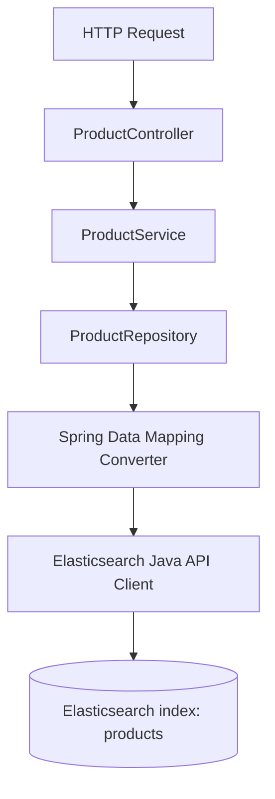
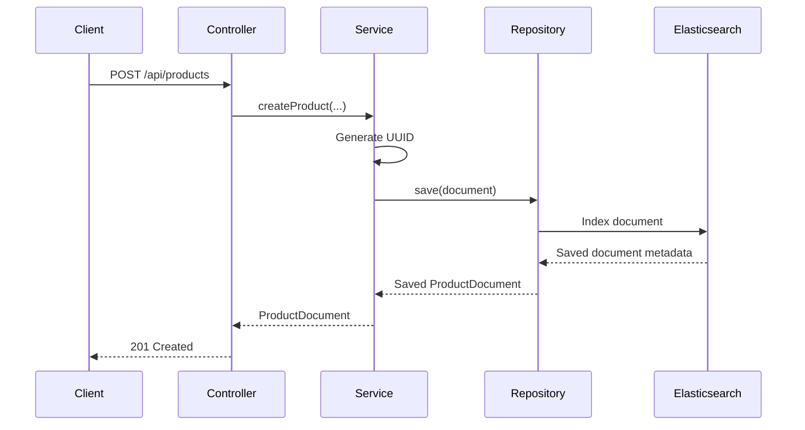

# Creating Your First Document, ElasticsearchRepository, and Service

In Spring Data Elasticsearch, a basic data storage and search feature typically starts with three components: a **Document** describing the data stored in Elasticsearch, an **`ElasticsearchRepository`** providing data access operations, and a **Service** implementing the application's business rules.

This lesson builds a complete vertical slice for product management. The application connects to Elasticsearch, maps a Java class to a document in the `products` index, declares a Repository, creates a Service, and exposes REST endpoints to test creating, searching, and deleting products.

## 1. Execution Flow of a Data Feature

Elasticsearch stores data as JSON documents inside indices. Spring Data Elasticsearch enables Java applications to work with those documents via entity mapping and Repositories.



Each component has a clear responsibility:

- **Document** describes the data structure and index mapping metadata.
- **Repository** provides APIs to save, read, delete, and query documents.
- **Service** combines the Repository with business rules, such as generating IDs and handling a use case.
- **Controller** receives HTTP requests, invokes the Service, and returns HTTP responses.
- **Elasticsearch** stores documents and executes queries according to the index mapping.

Spring Data generates the Repository implementation when the application starts. We only declare the interface and let Spring manage that bean.

## 2. Adding Dependencies and Connection Configuration

For a Spring Boot project using Gradle, add the following starter to `build.gradle`:

```groovy
dependencies {
    implementation 'org.springframework.boot:spring-boot-starter-data-elasticsearch'
    testImplementation 'org.springframework.boot:spring-boot-starter-test'
}
```

`spring-boot-starter-test` provides JUnit 5, Mockito, and common Spring testing libraries used in Spring Boot projects.

If the project uses Maven, the corresponding dependency is:

```xml
<dependency>
    <groupId>org.springframework.boot</groupId>
    <artifactId>spring-boot-starter-data-elasticsearch</artifactId>
</dependency>
```

When a project already uses Spring Boot dependency management, there is no need to pin a Spring Data Elasticsearch version different from the one managed by Spring Boot. Let Spring Boot's compatible version set select the Spring Data and Elasticsearch Java Client libraries.

Declare the Elasticsearch address in `src/main/resources/application.yml`:

```yaml
spring:
  application:
    name: product-catalog
  elasticsearch:
    uris: ${ELASTICSEARCH_URIS:http://localhost:9200}
```

In the configuration above, the application uses `http://localhost:9200` when the `ELASTICSEARCH_URIS` environment variable is unset. When deploying to another environment, you can pass the cluster URI via the environment variable without editing the configuration file.

Make sure Elasticsearch is running and the application can reach the configured address. For security-enabled clusters, configure authentication credentials and TLS per deployment environment; never commit real passwords or credentials into Git.

Spring Boot auto-configures the client and Spring Data Elasticsearch components when the starter is on the classpath and configuration is valid. Place the `@SpringBootApplication` class in the root package, such as `com.example.catalog`, and place the `document`, `repository`, `service`, and `controller` packages underneath it. This layout lets component scanning and repository scanning locate components without custom scan configuration.

Example directory structure:

```text
src/main/java/com/example/catalog/
├── ProductCatalogApplication.java
├── product/
│   ├── document/
│   │   └── ProductDocument.java
│   ├── repository/
│   │   └── ProductRepository.java
│   ├── service/
│   │   └── ProductService.java
│   └── web/
│       ├── CreateProductRequest.java
│       └── ProductController.java
└──
src/main/resources/
└── application.yml
```

Minimal startup class:

```java
package com.example.catalog;

import org.springframework.boot.SpringApplication;
import org.springframework.boot.autoconfigure.SpringBootApplication;

@SpringBootApplication
public class ProductCatalogApplication {

    public static void main(String[] args) {
        SpringApplication.run(ProductCatalogApplication.class, args);
    }
}
```

Normally, you do not need to manually define `RestClient`, `ElasticsearchClient`, or `ElasticsearchOperations` beans just to use a Repository. Spring Boot provides the necessary beans via auto-configuration. Only add custom client configuration when the application has specific requirements for connections, authentication, transport, or multiple clusters.

## 3. Creating the Document Class

Suppose the application manages products with the following attributes:

| Attribute | Meaning | Mapping Type |
|---|---|---|
| `id` | Document ID | `_id` managed by Elasticsearch |
| `sku` | Product code | `keyword` |
| `name` | Product name | `text` |
| `category` | Category | `keyword` |
| `price` | Product price | `double` |

Create `ProductDocument.java`:

```java
package com.example.catalog.product.document;

import org.springframework.data.annotation.Id;
import org.springframework.data.elasticsearch.annotations.Document;
import org.springframework.data.elasticsearch.annotations.Field;
import org.springframework.data.elasticsearch.annotations.FieldType;

@Document(indexName = "products")
public class ProductDocument {

    @Id
    private String id;

    @Field(type = FieldType.Keyword)
    private String sku;

    @Field(type = FieldType.Text)
    private String name;

    @Field(type = FieldType.Keyword)
    private String category;

    @Field(type = FieldType.Double)
    private Double price;

    protected ProductDocument() {
    }

    public ProductDocument(
            String id,
            String sku,
            String name,
            String category,
            Double price) {
        this.id = id;
        this.sku = sku;
        this.name = name;
        this.category = category;
        this.price = price;
    }

    public String getId() {
        return id;
    }

    public String getSku() {
        return sku;
    }

    public String getName() {
        return name;
    }

    public String getCategory() {
        return category;
    }

    public Double getPrice() {
        return price;
    }
}
```

### 3.1. Meaning of the Annotations

**`@Document(indexName = "products")`** marks the Java class as a document managed by Spring Data Elasticsearch and associates it with the `products` index. `createIndex` defaults to `true`, allowing Spring Data to create the index and mapping from metadata when index creation is triggered. You can set `createIndex = false` if indices are provisioned through a separate process.

**`@Id`** marks the property used as the document ID, corresponding to Elasticsearch's `_id` metadata. The annotation is imported from `org.springframework.data.annotation.Id`, not JPA's `jakarta.persistence.Id`.

**`@Field(type = FieldType.Keyword)`** declares a field of type `keyword`. This type suits product codes, categories, statuses, or values requiring exact matching, sorting, and aggregations.

**`@Field(type = FieldType.Text)`** declares a text field processed through an analyzer. This type suits full-text search such as product names or descriptions. `match` queries are typically used on `text` fields.

**`@Field(type = FieldType.Double)`** declares a floating-point field. When storing monetary data requiring strict decimal precision, choose an appropriate numeric model, such as storing the smallest currency unit as an integer or designing a `scaled_float` mapping; do not assume floating-point numbers are exact currency representations.

### 3.2. How Is a Java Document Converted to JSON?

Given an object:

```java
ProductDocument product = new ProductDocument(
    "p-1001",
    "SKU-1001",
    "Wireless Headphones",
    "audio",
    129.90
);
```

Spring Data uses a mapping converter to translate the Java object into a JSON document. The resulting data looks conceptually like:

```json
{
  "sku": "SKU-1001",
  "name": "Wireless Headphones",
  "category": "audio",
  "price": 129.90
}
```

The `id` value is used as the document's `_id`, rather than a regular `_id` field inside `_source`. The remaining fields are stored inside `_source` according to the mapping.

You do not need to write object-to-JSON conversion code manually when using a Repository. Spring Data handles conversion based on document metadata and converter configuration.

### 3.3. Mapping Choices Directly Affect Queries

`name` and `category` are declared with two different types because they are searched differently:

- Product names need searching by analyzed words or phrases: `text` and `match`.
- Categories need filtering by exact value `audio`: `keyword` and `term` or the corresponding exact query.

If you declare a field as `text` when the use case requires exact filtering, queries may not behave as expected because the analyzer transforms the content. Determine how a field will be queried before picking its mapping type.

Mapping is the schema of the index. Changing the type of a field that already holds data cannot usually be done in place like modifying a Java field type; the common workflow is creating a new index with the right mapping, migrating data via reindexing, and switching the application to the new index.

## 4. Creating ElasticsearchRepository

Create `ProductRepository.java`:

```java
package com.example.catalog.product.repository;

import java.util.List;
import java.util.Optional;

import org.springframework.data.elasticsearch.repository.ElasticsearchRepository;

import com.example.catalog.product.document.ProductDocument;

public interface ProductRepository
        extends ElasticsearchRepository<ProductDocument, String> {

    Optional<ProductDocument> findBySku(String sku);

    List<ProductDocument> findByCategory(String category);
}
```

The two generic type parameters of `ElasticsearchRepository<ProductDocument, String>` mean:

- `ProductDocument`: the document type managed by the Repository.
- `String`: the data type of the document ID.

`ElasticsearchRepository` provides foundational operations such as:

| Method | Purpose |
|---|---|
| `save(entity)` | Saves a document and returns the saved entity. |
| `findById(id)` | Finds a document by `_id`, returning an `Optional`. |
| `existsById(id)` | Checks whether a document exists for the given ID. |
| `findAll()` | Retrieves documents via the Repository API. |
| `deleteById(id)` | Deletes a document by ID. |
| `count()` | Counts documents via the Repository API. |

Beyond inherited methods, Spring Data can derive queries from method names. For example:

```java
Optional<ProductDocument> findBySku(String sku);

List<ProductDocument> findByCategory(String category);
```

Spring Data parses the names `findBySku` and `findByCategory`, then builds corresponding queries against the mapped fields. This lets us declare standard queries without writing Query DSL manually.

Property names in derived query methods must match the properties of the document class. The field's mapping type must still align with the query semantics. In this example, `sku` and `category` are `keyword`, making them suitable for exact value lookups.

### 4.1. Spring Generates the Repository Implementation

We only write the interface:

```java
public interface ProductRepository
        extends ElasticsearchRepository<ProductDocument, String> {
}
```

At application startup, Spring Data scans for Repository interfaces, creates proxy implementations, and registers beans in the Application Context. Therefore, the Service can inject `ProductRepository` via its constructor.

There is no need to write a `ProductRepositoryImpl` class for built-in CRUD methods or standard derived queries. A custom implementation is only needed when queries or behavior cannot be expressed using standard Repository APIs.

If the Repository package lies outside the default scan scope, configure the scan range with `@EnableElasticsearchRepositories` on an appropriate configuration class. With packages nested under the `@SpringBootApplication` root package, this explicit configuration is typically unnecessary.

## 5. Creating Your First Service

Repositories focus on data access. The Service is where the application implements use cases, such as creating a product with an application-generated ID, looking up a product by SKU, or deleting a product.

Create `ProductService.java`:

```java
package com.example.catalog.product.service;

import java.util.List;
import java.util.Optional;
import java.util.UUID;

import org.springframework.stereotype.Service;

import com.example.catalog.product.document.ProductDocument;
import com.example.catalog.product.repository.ProductRepository;

@Service
public class ProductService {

    private final ProductRepository productRepository;

    public ProductService(ProductRepository productRepository) {
        this.productRepository = productRepository;
    }

    public ProductDocument createProduct(
            String sku,
            String name,
            String category,
            Double price) {

        ProductDocument product = new ProductDocument(
            UUID.randomUUID().toString(),
            sku,
            name,
            category,
            price
        );

        return productRepository.save(product);
    }

    public Optional<ProductDocument> findById(String id) {
        return productRepository.findById(id);
    }

    public Optional<ProductDocument> findBySku(String sku) {
        return productRepository.findBySku(sku);
    }

    public List<ProductDocument> findByCategory(String category) {
        return productRepository.findByCategory(category);
    }

    public void deleteById(String id) {
        productRepository.deleteById(id);
    }
}
```

### 5.1. Why Does the Service Use Constructor Injection?

`ProductService` receives `ProductRepository` via its constructor. Spring automatically passes the Repository bean when creating the Service. This approach offers several benefits:

- Dependencies are explicitly visible in the constructor.
- Dependency fields can be declared `final`.
- Unit tests can pass a mock or fake Repository directly.
- No field injection or manual `ApplicationContext` bean lookup is required.

The `@Service` annotation registers the class as a Spring bean and indicates it handles business logic. `@Repository` does not need to be placed on the `ProductRepository` interface because Spring Data already registers the Repository bean.

### 5.2. Why Generate the ID in the Service?

In this example, the Service generates an ID using `UUID.randomUUID()`. The ID is assigned before calling `save`, so the returned result has a stable ID for the client to use in subsequent read or delete operations.

Elasticsearch can also auto-generate `_id` when indexing a document without an ID. Generating the ID in the application is useful when the ID is needed immediately in the business model or when you want explicit control over IDs. Choose a consistent ID strategy for each document type.

Note that `save` is an index/upsert operation by ID. If another document already has the same ID, saving may replace that document's content. If business rules require rejecting duplicate SKUs or creating only when absent, design appropriate validation rules and write operations; merely calling `findBySku` before `save` does not guarantee uniqueness under concurrent requests.

### 5.3. Should the Service Have `@Transactional`?

Do not add `@Transactional` out of habit from Spring Data JPA. Elasticsearch does not provide multi-document transactions with relational database semantics. A Service method invoking multiple Elasticsearch operations will not automatically roll back like a relational database transaction.

Design error handling, retries, and consistency according to Elasticsearch characteristics and your specific business requirements.

## 6. Exposing a REST API to Use the Service

To test the flow from HTTP request to Elasticsearch, create a request DTO:

```java
package com.example.catalog.product.web;

public record CreateProductRequest(
    String sku,
    String name,
    String category,
    Double price
) {
}
```

Then create `ProductController.java`:

```java
package com.example.catalog.product.web;

import java.util.List;

import org.springframework.http.HttpStatus;
import org.springframework.http.ResponseEntity;
import org.springframework.web.bind.annotation.DeleteMapping;
import org.springframework.web.bind.annotation.GetMapping;
import org.springframework.web.bind.annotation.PathVariable;
import org.springframework.web.bind.annotation.PostMapping;
import org.springframework.web.bind.annotation.RequestBody;
import org.springframework.web.bind.annotation.RequestMapping;
import org.springframework.web.bind.annotation.RequestParam;
import org.springframework.web.bind.annotation.ResponseStatus;
import org.springframework.web.bind.annotation.RestController;

import com.example.catalog.product.document.ProductDocument;
import com.example.catalog.product.service.ProductService;

@RestController
@RequestMapping("/api/products")
public class ProductController {

    private final ProductService productService;

    public ProductController(ProductService productService) {
        this.productService = productService;
    }

    @PostMapping
    public ResponseEntity<ProductDocument> create(
            @RequestBody CreateProductRequest request) {

        ProductDocument saved = productService.createProduct(
            request.sku(),
            request.name(),
            request.category(),
            request.price()
        );

        return ResponseEntity.status(HttpStatus.CREATED).body(saved);
    }

    @GetMapping("/{id}")
    public ResponseEntity<ProductDocument> findById(@PathVariable String id) {
        return productService.findById(id)
            .map(ResponseEntity::ok)
            .orElseGet(() -> ResponseEntity.notFound().build());
    }

    @GetMapping
    public List<ProductDocument> findByCategory(
            @RequestParam String category) {
        return productService.findByCategory(category);
    }

    @DeleteMapping("/{id}")
    @ResponseStatus(HttpStatus.NO_CONTENT)
    public void deleteById(@PathVariable String id) {
        productService.deleteById(id);
    }
}
```

The Controller does not call the Repository directly. It passes input data to the Service and maps the Service result into an HTTP response. As the application grows, you can add validation, response DTOs, centralized error handling, and authorization at the web layer without leaking HTTP details into the Repository.

## 7. Testing Create, Read, Search, and Delete Flows

Start Elasticsearch, verify the connection URI, and run the Spring Boot application. Then send a request to create a product:

```http
POST /api/products
Content-Type: application/json

{
  "sku": "SKU-1001",
  "name": "Wireless Headphones",
  "category": "audio",
  "price": 129.90
}
```

The application creates a `ProductDocument`, generates an ID, calls `productRepository.save(...)`, and returns HTTP `201 Created`. The response contains the saved document, including the Service-generated ID.

Use the ID from the response to read the document back:

```http
GET /api/products/{id}
```

If the document exists, the API returns `200 OK` with the product content. If not found, the Controller returns `404 Not Found`.

Search products by category:

```http
GET /api/products?category=audio
```

This request goes through `ProductController`, `ProductService`, and invokes the Repository's derived query `findByCategory("audio")`.

Delete the document:

```http
DELETE /api/products/{id}
```

The Controller calls the Service, the Service calls `deleteById`, and the API returns `204 No Content`.

The requests above illustrate the data flow:



## 8. When Are the Index and Mapping Created?

`@Document(indexName = "products")` binds `ProductDocument` to the index named `products`. By default, `createIndex` is enabled. Spring Data Elasticsearch can create the index and mapping from annotations when repositories initialize and index creation is permitted.

This is convenient in learning or development environments. However, in production, the index lifecycle generally needs explicit management:

- Define mappings before ingesting data into the index.
- Manage mapping changes via migrations or a separate deployment pipeline.
- Use versioned indices and aliases when incompatible schema changes are needed.
- Do not let multiple application instances concurrently alter production mappings automatically.

You can inspect the index mapping using the Elasticsearch API:

```http
GET /products/_mapping
```

The output lets you verify that fields such as `sku`, `category`, `name`, and `price` are mapped to the expected types. If a mapping already existed before the application started, inspect the actual mapping rather than relying solely on annotations in code.

## 9. Important Behaviors to Understand When Using Repositories

### 9.1. `save` Stores Documents by ID

`save` sends a document index operation to Elasticsearch. The ID identifies the target document. If the ID does not exist yet, a new document is created; if it already exists, the content is updated/replaced according to index operation semantics.

Therefore, `save` is not equivalent to a SQL `INSERT` statement that always rejects duplicate keys. Choose the ID and write operation based on whether the business requirement is creation or update.

### 9.2. `findById` and Search May Have Different Visibility Timing

Elasticsearch supports reading a document by ID in real time, whereas search relies on refreshed segments. Consequently, right after calling `save`, `findById` may see the document while a search query like `findByCategory` might not see it immediately if a refresh has not occurred yet.

Elasticsearch is a near real-time search system. Avoid forcing a refresh on every write just to make search see data instantaneously, as that can degrade performance. If a use case requires immediate read-after-write via search, learn about refresh policies and choose an intentional strategy.

### 9.3. Derived Queries Depend on Property Names

For example, `findByCategory` references the Java property `category`. If you rename the property to `productCategory`, the derived query method name must also be updated. If the field name in Elasticsearch differs from the Java property name due to mapping configuration, Spring Data handles mapping metadata for derived queries; queries written directly in Query DSL must reference the exact field names in the index.

### 9.4. Repositories Do Not Replace Mapping Design

Repositories reduce data access boilerplate, but they do not decide for you which fields should be `text`, `keyword`, `date`, or numeric types. Poor mappings cause queries, sorting, and aggregations to behave unexpectedly. Design documents and mappings based on how the application reads, filters, and searches data.

### 9.5. Do Not Mechanically Apply Relational Thinking

Elasticsearch documents are generally designed around query needs. Do not assume relationships between Java classes are stored as foreign keys or joined as in a relational database. When related data needs to be displayed, you may need to denormalize part of the data into the document or use a query model suited to Elasticsearch.

## 10. Unit Testing the Service

Because `ProductService` receives the Repository via its constructor, you can test the Service without starting Elasticsearch. Example using JUnit 5 and Mockito:

```java
package com.example.catalog.product.service;

import static org.junit.jupiter.api.Assertions.assertEquals;
import static org.junit.jupiter.api.Assertions.assertNotNull;
import static org.mockito.ArgumentMatchers.any;
import static org.mockito.Mockito.verify;
import static org.mockito.Mockito.when;

import org.junit.jupiter.api.Test;
import org.junit.jupiter.api.extension.ExtendWith;
import org.mockito.InjectMocks;
import org.mockito.Mock;
import org.mockito.junit.jupiter.MockitoExtension;

import com.example.catalog.product.document.ProductDocument;
import com.example.catalog.product.repository.ProductRepository;

@ExtendWith(MockitoExtension.class)
class ProductServiceTest {

    @Mock
    private ProductRepository productRepository;

    @InjectMocks
    private ProductService productService;

    @Test
    void createProductShouldSaveDocumentWithGeneratedId() {
        when(productRepository.save(any(ProductDocument.class)))
            .thenAnswer(invocation -> invocation.getArgument(0));

        ProductDocument saved = productService.createProduct(
            "SKU-1001",
            "Wireless Headphones",
            "audio",
            129.90
        );

        assertNotNull(saved.getId());
        assertEquals("SKU-1001", saved.getSku());
        assertEquals("Wireless Headphones", saved.getName());
        verify(productRepository).save(any(ProductDocument.class));
    }
}
```

This unit test verifies that the Service creates a document with an ID and passes it to the Repository. It does not verify connectivity, mappings, or real Elasticsearch query execution. Those require separate integration tests against a compatible Elasticsearch instance.

## 11. Common Beginner Errors

| Symptom | Causes to Check |
|---|---|
| Cannot connect to Elasticsearch on startup | Elasticsearch is not running, wrong URI, unreachable port, or incorrect TLS/authentication setup. |
| Cannot inject Repository | Repository package is outside scan scope or repository configuration is not enabled. |
| Document does not have the expected ID | ID property is not annotated with `@Id`, or the Service did not assign an ID according to the chosen strategy. |
| Query by category returns unexpected results | Check `category` mapping, stored values, and exact-match query behavior. |
| Search does not yet show newly saved document | The index may not have refreshed yet; distinguish ID reads from search queries. |
| Application cannot create index | Check Elasticsearch user privileges, pre-existing index/mapping, and `createIndex` setting. |
| Actual mapping differs from annotations | The index may have been created earlier with an old mapping; inspect mapping and plan migration/reindex. |

When diagnosing, inspect startup logs to see whether the error occurs during client creation, Repository initialization, index creation, or request execution. These errors belong to different layers and must be resolved at the right layer.

## 12. Summary of the Built Structure

After this lesson, the product feature consists of:

| Component | Responsibility |
|---|---|
| `ProductDocument` | Describes the document and mapping for the `products` index. |
| `ProductRepository` | Provides CRUD and derived queries on `ProductDocument`. |
| `ProductService` | Implements use cases for creating, finding, and deleting products. |
| `CreateProductRequest` | Describes input data for the product creation API. |
| `ProductController` | Exposes HTTP endpoints and calls the Service. |
| `application.yml` | Configures the Elasticsearch connection URI. |

The basic flow is: Controller receives a request, Service handles business logic, Repository operates on documents, and Spring Data maps Java objects to JSON for Elasticsearch to store or query. Once you understand the roles of Document, Repository, and Service, you have the foundation to build more complex queries, pagination, bulk operations, custom repositories, and advanced search features.
