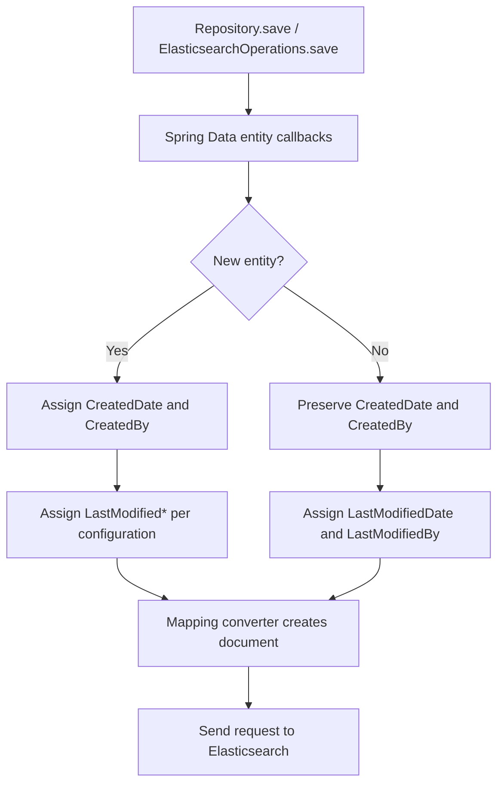
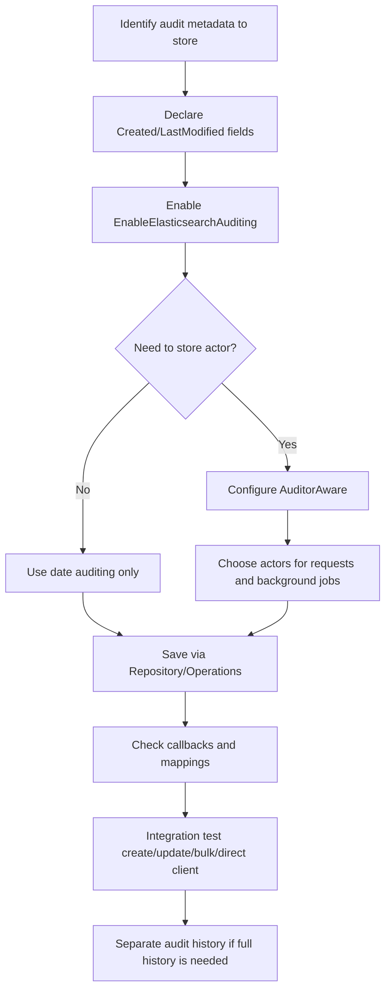

# @CreatedDate, @LastModifiedDate, @CreatedBy, and @LastModifiedBy

Auditing lets an application automatically record **who created a document, who modified it, and when those operations occurred**. Spring Data Elasticsearch integrates Spring Data's auditing mechanism through the `@CreatedDate`, `@LastModifiedDate`, `@CreatedBy`, and `@LastModifiedBy` annotations.

When auditing is configured properly, Spring Data updates audit properties during the entity save lifecycle. Applications do not need to manually assign timestamps or usernames in every service. However, auditing only works on write paths that execute Spring Data's callbacks; calling the Elasticsearch Java API Client directly does not trigger these callbacks automatically.

Each of the four annotations has a distinct meaning:

- `@CreatedDate`: timestamp when the document was first created.
- `@LastModifiedDate`: timestamp when the document was last modified.
- `@CreatedBy`: user or principal who created the document.
- `@LastModifiedBy`: user or principal who performed the latest modification.

These fields are useful for admin dashboards, tracing recent edits, and operational support. They are not a full audit log: they store only the current creation/modification state and do not preserve a history of all updates.

## 1. What Problem Does Auditing Solve?

Consider a product management application. A product might be created by a catalog operator and later edited by an administrator. Without auditing, every service must manually set the timestamp and actor:

```java
product.setCreatedAt(Instant.now());
product.setCreatedBy(currentUsername);
```

On edits, other services must remember to update `lastModifiedAt` and `lastModifiedBy`. This approach is error-prone, inconsistent, and duplicates audit logic across many places.

Spring Data Auditing centralizes that logic into one shared mechanism:

1. The application enables Elasticsearch auditing.
2. Configures an actor source via `AuditorAware<T>` if user tracking is required.
3. Annotates entity properties with audit annotations.
4. When the entity is saved via Spring Data, the auditing callback updates those properties before the document is converted into data sent to Elasticsearch.

Example document after creation:

```json
{
  "id": "P-100",
  "name": "Wireless Headphones",
  "createdAt": "2026-11-13T08:30:00Z",
  "lastModifiedAt": "2026-11-13T08:30:00Z",
  "createdBy": "alice",
  "lastModifiedBy": "alice"
}
```

After another staff member updates the product name, `createdAt` and `createdBy` remain unchanged, while `lastModifiedAt` and `lastModifiedBy` are updated to reflect the new operation.

## 2. The Four Audit Annotations

The annotations are declared in the Spring Data Commons package:

```java
import org.springframework.data.annotation.CreatedDate;
import org.springframework.data.annotation.LastModifiedDate;
import org.springframework.data.annotation.CreatedBy;
import org.springframework.data.annotation.LastModifiedBy;
```

| Annotation | Meaning | When Updated |
|---|---|---|
| `@CreatedDate` | Entity/document creation time | When the entity is identified as new |
| `@LastModifiedDate` | Last modification time | When the entity is saved; creation behavior depends on `modifyOnCreate` |
| `@CreatedBy` | Principal that created the entity/document | When the entity is identified as new and an auditor is available |
| `@LastModifiedBy` | Principal that last modified the entity | When the entity is saved; creation behavior depends on `modifyOnCreate` |

`Created*` describes the origin of the record. `LastModified*` describes the latest write. Do not use `@LastModifiedDate` in place of `@CreatedDate`, because it changes on updates.

## 3. Declaring an Entity with Audit Metadata

Example entity `ProductDocument`:

```java
package com.example.catalog.document;

import java.time.Instant;

import org.springframework.data.annotation.CreatedBy;
import org.springframework.data.annotation.CreatedDate;
import org.springframework.data.annotation.Id;
import org.springframework.data.annotation.LastModifiedBy;
import org.springframework.data.annotation.LastModifiedDate;
import org.springframework.data.elasticsearch.annotations.Document;
import org.springframework.data.elasticsearch.annotations.Field;
import org.springframework.data.elasticsearch.annotations.FieldType;

@Document(indexName = "products")
public class ProductDocument {

    @Id
    private String id;

    @Field(type = FieldType.Keyword)
    private String name;

    @CreatedDate
    @Field(type = FieldType.Date)
    private Instant createdAt;

    @LastModifiedDate
    @Field(type = FieldType.Date)
    private Instant lastModifiedAt;

    @CreatedBy
    @Field(type = FieldType.Keyword)
    private String createdBy;

    @LastModifiedBy
    @Field(type = FieldType.Keyword)
    private String lastModifiedBy;

    protected ProductDocument() {
    }

    public ProductDocument(String id, String name) {
        this.id = id;
        this.name = name;
    }

    public String getId() {
        return id;
    }

    public String getName() {
        return name;
    }

    public void setName(String name) {
        this.name = name;
    }

    public Instant getCreatedAt() {
        return createdAt;
    }

    public Instant getLastModifiedAt() {
        return lastModifiedAt;
    }

    public String getCreatedBy() {
        return createdBy;
    }

    public String getLastModifiedBy() {
        return lastModifiedBy;
    }
}
```

The audit fields have explicit mappings declared:

- Timestamps use an Elasticsearch date type, such as `FieldType.Date`.
- User identifiers typically use `keyword` because exact matching/filtering is needed rather than full-text analysis.
- `Instant` is a good choice for system-wide timestamps because it represents a UTC instant independent of display timezone.

Spring Data supports temporal types recognized by its auditing infrastructure. If using another type such as `LocalDateTime`, `OffsetDateTime`, or `Date`, verify converter and mapping support in your project version. Avoid storing timestamps as arbitrary strings if sorting, range queries, or date aggregations are needed.

## 4. Enabling Elasticsearch Auditing

Adding annotations to the entity alone is not enough. You must enable auditing in Spring configuration:

```java
import org.springframework.context.annotation.Configuration;
import org.springframework.data.elasticsearch.config.EnableElasticsearchAuditing;

@Configuration
@EnableElasticsearchAuditing
public class ElasticsearchAuditingConfiguration {
}
```

When enabled, Spring Data registers the auditing infrastructure and entity callback to apply metadata before the entity is converted and saved.

If only created/modified timestamps are needed, you do not have to provide `AuditorAware`. To automatically populate `@CreatedBy` and `@LastModifiedBy`, declare an `AuditorAware<T>` bean whose type `T` matches the type of the two auditor fields.

### 4.1. Common Configuration Options

`@EnableElasticsearchAuditing` supports options such as:

| Attribute | Purpose |
|---|---|
| `auditorAwareRef` | Name of the `AuditorAware` bean used to retrieve the actor |
| `dateTimeProviderRef` | Name of the bean providing audit timestamps |
| `setDates` | Enables/disables automatic assignment of audit date fields |
| `modifyOnCreate` | Controls whether `LastModified*` fields are populated at creation time |

Check defaults and annotation signatures in your project's Spring Data Elasticsearch release. The examples below use explicit bean names to configure the auditor source and clock.

## 5. `AuditorAware<T>` Provides the Actor

`@CreatedBy` and `@LastModifiedBy` need to know who is performing the operation. Spring Data obtains that information via the interface:

```java
import java.util.Optional;
import org.springframework.data.domain.AuditorAware;
```

`AuditorAware<T>` returns `Optional<T>`. Type `T` must be compatible with the type of fields annotated with `@CreatedBy` and `@LastModifiedBy`.

Simple example using a `String` username:

```java
import java.util.Optional;

import org.springframework.data.domain.AuditorAware;
import org.springframework.stereotype.Component;

@Component("auditorAware")
public class CurrentUserAuditorAware implements AuditorAware<String> {

    @Override
    public Optional<String> getCurrentAuditor() {
        return Optional.of("system");
    }
}
```

This is an illustrative example for an application with a single system actor. In a real application, `getCurrentAuditor()` should resolve the current request's principal or the actor of the running job. Do not hard-code `system` for every operation if real users must be audited.

### 5.1. Integrating with Spring Security

For applications using Spring Security, the auditor can come from `SecurityContextHolder`:

```java
import java.util.Optional;

import org.springframework.data.domain.AuditorAware;
import org.springframework.security.authentication.AnonymousAuthenticationToken;
import org.springframework.security.core.Authentication;
import org.springframework.security.core.context.SecurityContextHolder;
import org.springframework.stereotype.Component;

@Component("auditorAware")
public class SecurityAuditorAware implements AuditorAware<String> {

    @Override
    public Optional<String> getCurrentAuditor() {
        Authentication authentication =
            SecurityContextHolder.getContext().getAuthentication();

        if (authentication == null
                || !authentication.isAuthenticated()
                || authentication instanceof AnonymousAuthenticationToken) {
            return Optional.empty();
        }

        return Optional.ofNullable(authentication.getName());
    }
}
```

`authentication.getName()` returns the principal identifier per the security configuration. Applications can use a username, JWT subject, or stable user ID. In systems where usernames can change, storing an immutable ID is usually better than storing a display name.

Do not return the entire `Authentication` or `UserDetails` object directly into an audit field when the document only needs a concise, stable identifier. Keeping the auditor type simple such as `String` or a domain ID makes mapping, querying, and reporting easier to control.

### 5.2. Configuring the Auditor Bean

If using a specific bean name, specify it in the annotation:

```java
@Configuration
@EnableElasticsearchAuditing(auditorAwareRef = "auditorAware")
public class ElasticsearchAuditingConfiguration {
}
```

If only one matching `AuditorAware` bean exists, Spring can locate it automatically per infrastructure rules. Using `auditorAwareRef` makes configuration explicit when the application has multiple auditor sources.

## 6. Configuring the Time Source with `DateTimeProvider`

By default, auditing uses the system clock. If you want to control the clock—for instance, for testing or synchronizing a shared time rule—provide a `DateTimeProvider`:

```java
import java.time.Clock;
import java.util.Optional;

import org.springframework.context.annotation.Bean;
import org.springframework.context.annotation.Configuration;
import org.springframework.data.auditing.DateTimeProvider;
import org.springframework.data.elasticsearch.config.EnableElasticsearchAuditing;

@Configuration
@EnableElasticsearchAuditing(
    auditorAwareRef = "auditorAware",
    dateTimeProviderRef = "auditDateTimeProvider"
)
public class ElasticsearchAuditingConfiguration {

    @Bean
    Clock auditClock() {
        return Clock.systemUTC();
    }

    @Bean
    DateTimeProvider auditDateTimeProvider(Clock auditClock) {
        return () -> Optional.of(auditClock.instant());
    }
}
```

`DateTimeProvider` returns `Optional<TemporalAccessor>`. Using `Clock` allows tests to replace the system clock with `Clock.fixed(...)` to produce deterministic timestamps.

Example creating a fixed clock in a test:

```java
import java.time.Instant;
import java.time.Clock;
import java.time.ZoneOffset;

Clock fixedClock = Clock.fixed(
    Instant.parse("2026-11-13T08:30:00Z"),
    ZoneOffset.UTC
);
```

You do not need a custom provider if the application accepts system time. Add one only when deterministic testing, clock synchronization, or a custom time rule is needed.

## 7. Auditing Lifecycle When Saving an Entity

Auditing executes during Spring Data Elasticsearch's callback lifecycle before the entity is converted into a document sent to Elasticsearch.

High-level flow:



Common rules:

- `@CreatedDate` and `@CreatedBy` are populated when the entity is recognized as new.
- `@LastModifiedDate` and `@LastModifiedBy` are updated when the entity is saved.
- `modifyOnCreate` determines whether `LastModified*` fields are populated on initial creation.
- If `AuditorAware` returns `Optional.empty()`, there is no new auditor to assign; auditor fields may stay null or retain existing values depending on entity state and handler behavior.
- Callbacks only run when operations flow through Spring Data's auditing infrastructure.

Determining whether an entity is new or existing relies on Spring Data's newness detection mechanism, which can inspect ID and version properties. For entities with manually assigned IDs, test the initial save to be sure auditing recognizes the new state correctly.

## 8. Saving via Repository and ElasticsearchOperations

Repository:

```java
public interface ProductRepository
        extends ElasticsearchRepository<ProductDocument, String> {
}
```

Creating a document:

```java
ProductDocument product = new ProductDocument(
    "P-100",
    "Wireless Headphones"
);

ProductDocument saved = productRepository.save(product);
```

Or using `ElasticsearchOperations`:

```java
ProductDocument saved = operations.save(product);
```

When auditing is enabled and callbacks are triggered, audit fields are populated before the entity is converted for persistence. Use the object returned from the save operation if you need to read the latest metadata; some APIs may return an updated instance or equivalent result per your version's contract.

### 8.1. Updating a Document

Example updating a product:

```java
ProductDocument product = productRepository.findById("P-100")
    .orElseThrow();

product.setName("Wireless Headphones Pro");

ProductDocument saved = productRepository.save(product);
```

Expected result:

| Field | Before Update | After Update |
|---|---|---|
| `createdAt` | Initial creation timestamp | Preserved |
| `createdBy` | Initial creator | Preserved |
| `lastModifiedAt` | Previous modification timestamp | Current save timestamp |
| `lastModifiedBy` | Previous modifier | Current auditor if available |

Do not manually reset `createdAt` or `createdBy` in an update service. These fields describe the document's origin and should be protected from regular edit requests.

## 9. Auditing with Write Operations That Bypass Entity Callbacks

This is an important limitation when combining Spring Data with the Elasticsearch API Client.

If calling directly:

```java
client.index(request -> request
    .index("products")
    .id(product.getId())
    .document(product)
);
```

the request goes straight through the Elasticsearch Java API Client. It does not automatically execute Spring Data's `AuditingEntityCallback`, look up `AuditorAware`, or populate audit fields.

Write paths to watch carefully:

| Write Method | Spring Data Auditing |
|---|---|
| `ElasticsearchRepository.save(...)` | Yes, when auditing is enabled and callbacks are configured |
| `ElasticsearchOperations.save(...)` | Yes, when flowing through callback infrastructure |
| Direct Java API Client calls | Not automatic |
| Direct Bulk API via Java API Client | Not automatic |
| Spring Data bulk/partial update APIs | Depends on implementation path and version; check actual callback behavior |
| Update by query / Painless script | Does not automatically run per-entity auditing callbacks |

For write paths that do not trigger callbacks, the application must assign audit metadata manually in the service/script or route operations through a shared adapter performing audit logic. Do not assume every API with "Spring Data" in its name applies auditing identically.

If the system mixes Repository, Operations, bulk, and the Java API Client, write integration tests for each write path to verify `createdAt`, `lastModifiedAt`, `createdBy`, and `lastModifiedBy` are updated properly.

## 10. `setDates` and `modifyOnCreate`

These two options control audit date population:

- `setDates`: enables/disables updating `@CreatedDate` and `@LastModifiedDate` fields.
- `modifyOnCreate`: when enabled, `@LastModifiedDate` is assigned at creation time; when disabled, modified fields may stay unset until a subsequent update.

Example not populating LastModified on creation:

```java
@EnableElasticsearchAuditing(
    auditorAwareRef = "auditorAware",
    setDates = true,
    modifyOnCreate = false
)
```

With `modifyOnCreate = false`, a new document may have `createdAt` while `lastModifiedAt` remains null until the next edit. This fits when the domain clearly distinguishes "created" from "modified after creation".

Common defaults are `setDates = true` and `modifyOnCreate = true`. Verify annotation defaults in your specific release, as default behavior impacts API contracts and tests.

Similarly, `@CreatedBy` and `@LastModifiedBy` follow their own auditor semantics. If you want to skip setting the auditor at creation or adjust how auditors are populated on create, inspect the auditing attributes available in your Spring Data version rather than inferring from `modifyOnCreate`, which addresses modification metadata.

## 11. Auditor Data Types

Type `T` in `AuditorAware<T>` must match the type of the `@CreatedBy` and `@LastModifiedBy` fields.

Example using `String`:

```java
@CreatedBy
private String createdBy;

@LastModifiedBy
private String lastModifiedBy;
```

```java
class SecurityAuditorAware implements AuditorAware<String> {
    // return Optional<String>
}
```

If using a `UUID` user ID:

```java
@CreatedBy
private UUID createdBy;

@LastModifiedBy
private UUID lastModifiedBy;
```

```java
class UserIdAuditorAware implements AuditorAware<UUID> {
    // return Optional<UUID>
}
```

Choose a stable, easily serialized, and meaningful type in your system. Avoid using a full user object as the auditor unless explicit converters and mappings exist.

## 12. Background Jobs, Schedulers, and System Actors

Not every operation originates from an HTTP request. A scheduler, message consumer, or batch import can save documents without a `SecurityContext`.

If `AuditorAware` returns `Optional.empty()`, auditor fields may remain empty. If business requirements demand an actor on every change, define actors for background tasks, such as:

- `system:nightly-import`
- `system:price-sync`
- A service account ID.
- The user ID of whoever triggered the job, stored in the job context.

Do not use a random user's username to represent a background job. The actor should indicate whether the operation was performed by a user, the system, or an integration service.

For asynchronous jobs, if preserving the original initiator is required, pass the actor ID into the message/job context when enqueuing. Do not rely on `SecurityContextHolder` on worker threads if security context is not propagated.

## 13. Threads and Async Context

By default, `SecurityContextHolder` typically uses a thread-local strategy. When a request hands off to an executor or `@Async`, the worker thread may not see the original request's authentication.

Ways to handle this:

- Use Spring Security context propagation supported for executors.
- Pass the actor ID explicitly in the command/job message.
- For standalone schedulers, use an identifiable system actor.
- Do not store authentication objects in static fields or copy security contexts carelessly.

With reactive applications, do not rely on `ThreadLocal` as in blocking applications. Use context propagation and auditing integration tailored to the reactive stack; standard Spring Data Elasticsearch is a blocking API, so design the boundary between reactive requests and persistence workers clearly.

## 14. Custom DateTimeProvider for Deterministic Testing

Tests relying on `Instant.now()` are difficult to assert precisely because timestamps shift with runtime execution. Using a fixed `Clock` lets tests verify audit timestamps accurately:

```java
@Test
void createdDateUsesConfiguredClock() {
    Instant expected = Instant.parse("2026-11-13T08:30:00Z");
    Clock fixedClock = Clock.fixed(expected, ZoneOffset.UTC);

    // Configure DateTimeProvider using fixedClock in the test context.
    // Save the entity via Repository or ElasticsearchOperations.

    assertThat(saved.getCreatedAt()).isEqualTo(expected);
}
```

The snippet above illustrates the idea; how you inject a test clock depends on your Spring test configuration. You can use `@TestConfiguration` to provide `Clock`/`DateTimeProvider` beans overriding production clocks.

Test both scenarios:

1. Creating a document: `createdAt` is populated and `lastModifiedAt` follows `modifyOnCreate`.
2. Updating a document: `createdAt` remains unchanged, while `lastModifiedAt` advances to the new timestamp.

## 15. Audit Fields and Elasticsearch Mapping

Auditing only updates Java values before saving. Elasticsearch mappings still must match the data types:

| Field | Suggested Java Type | Elasticsearch Mapping |
|---|---|---|
| `createdAt` | `Instant` | `date` |
| `lastModifiedAt` | `Instant` | `date` |
| `createdBy` | `String` | `keyword` |
| `lastModifiedBy` | `String` | `keyword` |

Illustrative mapping:

```json
PUT products
{
  "mappings": {
    "properties": {
      "createdAt": { "type": "date" },
      "lastModifiedAt": { "type": "date" },
      "createdBy": { "type": "keyword" },
      "lastModifiedBy": { "type": "keyword" }
    }
  }
}
```

Do not let date fields be dynamically mapped as `text`. If an index already exists with the wrong mapping, adding Java annotations does not alter the cluster's mapping; you must create a new index and reindex when changing field types.

## 16. Protecting Audit Fields from Incoming Input

Do not allow REST clients to pass `createdAt`, `createdBy`, `lastModifiedAt`, or `lastModifiedBy` directly in standard update DTOs.

If clients can set these fields, a user could spoof the creator, alter timestamps, or erase modification traces. Safe practices:

- Separate request DTOs from persistence entities.
- Do not map audit fields from request bodies.
- Do not expose audit field setters to the web layer unnecessarily.
- Keep auditing logic in the persistence callback layer.
- If an import process needs to preserve source audit metadata, handle it via an internal command/endpoint with dedicated permissions and explicit rules.

Example update DTO containing only business fields:

```java
public record UpdateProductRequest(
    String name
) {
}
```

The service receives the request and updates `name`; audit fields are managed by Spring Data. Do not use `BeanUtils.copyProperties(request, entity)` if the DTO could unintentionally carry audit fields or internal fields.

## 17. Auditing Is Not a Full Change History

`@CreatedDate`, `@LastModifiedDate`, `@CreatedBy`, and `@LastModifiedBy` describe only the initial creation and the latest edit. Example:

```text
createdBy = alice
createdAt = 2026-01-01T10:00:00Z
lastModifiedBy = bob
lastModifiedAt = 2026-02-10T12:00:00Z
```

If Carol edits the document later, Bob's modification metadata is replaced. These four fields cannot fully answer:

- Which fields did Bob change?
- What were the before and after values?
- How many updates occurred?
- Who deleted a field last week?
- What was the document's state at various points in the past?

If history is required, design dedicated audit events—for example, an index `product-audit-events` storing each operation as an append-only document with entity ID, actor, timestamp, action, and a normalized diff. Use an event store, database audit table, or dedicated logging system depending on retention and compliance requirements.

Do not confuse "last modified" metadata with an immutable audit trail.

## 18. Common Pitfalls

| Symptom | Possible Cause | Resolution |
|---|---|---|
| `@CreatedDate` is always null | `@EnableElasticsearchAuditing` not enabled or callback did not run | Check configuration and Spring Data write path. |
| `@CreatedBy` is always null | Missing `AuditorAware` or provider returns `Optional.empty()` | Register `AuditorAware<T>` and check security context. |
| Auditor mismatches field type | `AuditorAware<T>` generic type differs from `@CreatedBy`/`@LastModifiedBy` type | Align ID/username types. |
| `lastModifiedAt` does not change on update | Write path does not trigger callback or date auditing is off | Check `setDates`, callbacks, and the API called. |
| `createdAt` changes on update | Service reassigns it manually or callback/newness detection misconfigured | Do not map creation fields from requests; check new/existing detection. |
| Bulk writes miss audit data | Bulk path does not execute callbacks like regular saves | Check specific API; populate audit manually or route through adapter. |
| Direct Java API Client writes lack audit | Client bypasses Spring Data callbacks | Assign metadata in service or use Spring Data write path. |
| Background jobs lack `createdBy` | No `SecurityContext` on worker thread | Pass actor ID or use a system actor. |
| Timestamps suffer timezone skew | Using local time or inconsistent clock configurations | Prefer `Instant`/UTC and format at display layer. |
| API allows spoofing audit fields | DTO accepts internal fields | Separate DTOs and never map audit metadata from clients. |
| Cannot inspect historical changes | Storing only LastModified fields | Use a separate audit event/history store. |

## 19. Testing Auditing

An integration test should traverse the exact save path used by the application. At minimum verify:

1. On creation, `createdAt` has a value.
2. On creation, `createdBy` is populated when an auditor exists.
3. `lastModifiedAt` and `lastModifiedBy` follow `modifyOnCreate`.
4. On update, `createdAt` and `createdBy` remain unchanged.
5. On update, `lastModifiedAt` and `lastModifiedBy` are updated.
6. When `AuditorAware` returns empty, the application behaves according to policy.
7. Background jobs use the appropriate actor.
8. Direct Java API Client calls are not assumed to run auditing automatically.
9. Actual index mappings have `date` and `keyword` as expected.

Example test skeleton for creation and update:

```java
import static org.assertj.core.api.Assertions.assertThat;

@Test
void auditingTracksCreationAndModification() {
    ProductDocument created = productRepository.save(
        new ProductDocument("P-100", "Headphones")
    );

    Instant originalCreatedAt = created.getCreatedAt();
    String originalCreatedBy = created.getCreatedBy();

    assertThat(originalCreatedAt).isNotNull();
    assertThat(originalCreatedBy).isEqualTo("alice");

    created.setName("Headphones Pro");
    ProductDocument updated = productRepository.save(created);

    assertThat(updated.getCreatedAt()).isEqualTo(originalCreatedAt);
    assertThat(updated.getCreatedBy()).isEqualTo(originalCreatedBy);
    assertThat(updated.getLastModifiedAt()).isNotNull();
    assertThat(updated.getLastModifiedBy()).isEqualTo("alice");
}
```

To test exact timestamp changes, use a fixed `DateTimeProvider`/`Clock` or advance the clock between the two saves. Integration tests against a real Elasticsearch instance or compatible container confirm callbacks, converters, and mappings work together.

## 20. Process for Implementing Auditing



Implementation steps:

1. Determine whether the application needs timestamps, actors, or both.
2. Declare `@CreatedDate`, `@LastModifiedDate`, `@CreatedBy`, and `@LastModifiedBy` on the entity.
3. Choose stable temporal and auditor types, such as `Instant` and `String`/`UUID` user IDs.
4. Enable `@EnableElasticsearchAuditing`.
5. Configure `AuditorAware<T>` if actors are needed.
6. Define actors for schedulers, consumers, and background jobs.
7. Identify which write paths invoke callbacks; handle direct clients/bulk/update-by-query separately when needed.
8. Verify `date`/`keyword` mappings and newness detection.
9. Separate audit fields from input DTOs.
10. Write integration tests for creation, updates, and all actual write paths.
11. Use separate audit events if a full change history is required.

## 21. Conclusion

Spring Data Elasticsearch supports auditing via four annotations: `@CreatedDate`, `@LastModifiedDate`, `@CreatedBy`, and `@LastModifiedBy`. Enable `@EnableElasticsearchAuditing` to register the auditing infrastructure; provide `AuditorAware<T>` when tracking creators and modifiers is needed. Spring Data updates audit fields in callbacks before entity conversion and document saving across API paths that trigger callbacks.

`@Created*` preserves initial creation info; `@LastModified*` reflects the latest write. `modifyOnCreate` controls whether modified metadata is assigned on creation, and `DateTimeProvider` lets you control the time source. Use `Instant`/UTC for timestamps and a stable auditor identifier such as user ID.

Keep in mind that calling the Elasticsearch Java API Client directly does not automatically run auditing callbacks. Bulk and special update paths must be verified against your specific API and version. Never let clients submit audit fields directly and do not use these four properties in place of a full audit history. When a history of every change is needed, record separate audit events. Combining callback configuration, reliable auditor sources, proper mappings, and integration tests keeps creation/modification metadata consistent across your application's write flows.
