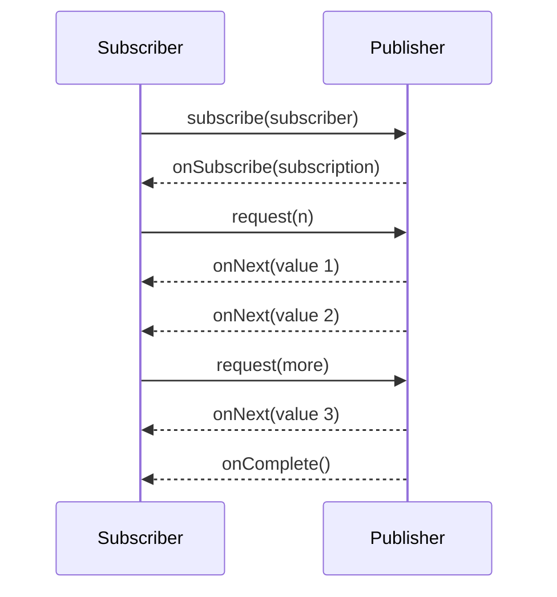
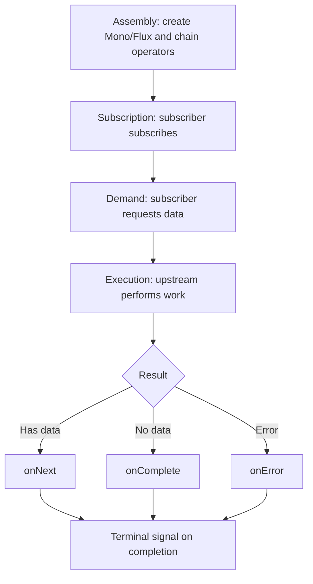

# Publisher, Mono, Flux, and Execution Timing Model

In reactive Spring Data Elasticsearch, many APIs do not return a document or a list of documents immediately when called. Instead, they return a **Publisher**: a description of work that may emit data in the future. Reactor provides two common types to represent a publisher: `Mono<T>` and `Flux<T>`.

The most important point when reading or writing reactive code is distinguishing three phases:

1. **Assembly time**: the application creates the publisher and chains operators into a pipeline.
2. **Subscription time**: a subscriber registers to receive results; the publisher begins execution according to its implementation.
3. **Signal/execution time**: data, errors, or completion signals are emitted through the pipeline as demand is signaled.

A call such as `reactiveRepository.findById(id)` usually only creates a `Mono` describing the read operation. The actual Elasticsearch request is executed when the publisher is subscribed to. In WebFlux, the framework typically subscribes when handling the response; in tests, `StepVerifier` subscribes; in another application, a terminal operation may create the subscription.

Understanding this model properly helps avoid common mistakes such as calling `subscribe()` inside a service, using `block()` on an event-loop thread, accidentally executing the same query multiple times, or assuming a `save()` call has already written data at the moment the method returns a `Mono`.

## 1. Reactive Streams and Publisher

Reactive Streams is a specification for asynchronous stream processing with non-blocking backpressure. Its core components include:

- `Publisher<T>`: a source that can emit elements of type `T`.
- `Subscriber<T>`: a consumer that receives elements and termination signals.
- `Subscription`: the link between a publisher and a subscriber, allowing elements to be requested or the subscription to be canceled.
- `Processor<T, R>`: acts as both a subscriber of type `T` and a publisher of type `R`.

In Java, these interfaces belong to the `org.reactivestreams` package:

```java
public interface Publisher<T> {
    void subscribe(Subscriber<? super T> subscriber);
}
```

The subscriber receives signals according to a defined protocol:

```java
public interface Subscriber<T> {
    void onSubscribe(Subscription subscription);
    void onNext(T value);
    void onError(Throwable error);
    void onComplete();
}
```

The subscription enables demand control and cancellation:

```java
public interface Subscription {
    void request(long n);
    void cancel();
}
```

Typically, the sequence starts with `onSubscribe`. The publisher then emits zero or more `onNext` signals and ends with exactly one terminal signal: `onComplete` or `onError`. After a terminal signal, the publisher must not emit any further data for that subscription.



This is the conceptual model. Reactor may optimize and fuse operators internally, but the Reactive Streams contract remains the foundation for data emission and backpressure.

## 2. How Do Mono and Flux Differ?

Project Reactor provides two frequently used `Publisher` implementations:

- `Mono<T>`: emits at most one element of type `T`, completes empty, or terminates with an error.
- `Flux<T>`: emits zero to many elements of type `T`, or terminates with an error.

| Type | Maximum `onNext` elements | Typical use case |
|---|---:|---|
| `Mono<T>` | 1 | Reading one document by ID, saving one entity, single operation result |
| `Flux<T>` | No fixed limit | Searching multiple hits, reading multiple documents, event streams |
| `Mono<Void>` | 0 | Operations that only signal completion, such as delete or commands returning no data |

### 2.1. Mono Has Three Common Termination Patterns

A `Mono<T>` can:

1. Emit one value and then complete.
2. Complete without emitting a value (`Mono.empty()`).
3. Terminate with an error (`Mono.error(...)`).

Example:

```java
Mono<String> found = Mono.just("P-100");
Mono<String> missing = Mono.empty();
Mono<String> failed = Mono.error(
    new IllegalStateException("Search store unavailable")
);
```

`Mono.empty()` is not equivalent to `Mono.just(null)`. Reactive Streams does not allow emitting `null` via `onNext`; Reactor also rejects null in factories such as `Mono.just`.

### 2.2. Flux Emits Multiple Elements

Example:

```java
Flux<String> ids = Flux.just("P-100", "P-101", "P-102");
```

Upon subscription, a Flux can emit three values sequentially and then complete. An empty Flux is also valid:

```java
Flux<ProductDocument> noProducts = Flux.empty();
```

A Flux does not need to emit at least one element. If an Elasticsearch query finds no documents, the publisher typically completes without emitting any hits.

### 2.3. Why Does Delete Usually Return Mono<Void>?

A delete operation usually does not need to return a document. `Mono<Void>` represents an asynchronous task that only signals success or failure:

```java
Mono<Void> delete = repository.deleteById("P-100");
```

When successful, the publisher completes without emitting `onNext`. If it fails, it emits `onError`. Do not use `block()` just to wait for a `Mono<Void>` in a reactive service; compose it with `then`, `thenReturn`, or return the publisher directly to the caller.

## 3. Publishers in Reactive Spring Data Elasticsearch

Spring Data Elasticsearch provides reactive APIs built on Reactor. Reactive repositories typically return `Mono` or `Flux` instead of synchronous types.

Example:

```java
import org.springframework.data.elasticsearch.repository.ReactiveElasticsearchRepository;

public interface ProductRepository
        extends ReactiveElasticsearchRepository<ProductDocument, String> {
}
```

CRUD methods have familiar signatures:

```java
Mono<ProductDocument> findById(String id);

Flux<ProductDocument> findAll();

Mono<ProductDocument> save(ProductDocument product);

Mono<Void> deleteById(String id);
```

Derived query methods generated by Spring Data can also return `Mono<T>` or `Flux<T>` depending on the expected cardinality. For example:

```java
public interface ProductRepository
        extends ReactiveElasticsearchRepository<ProductDocument, String> {

    Flux<ProductDocument> findByStatus(String status);

    Mono<ProductDocument> findFirstBySku(String sku);
}
```

`findByStatus` can return multiple products, whereas `findFirstBySku` represents at most one result. Ensure the query and method name reflect the intended business semantics.

### 3.1. ReactiveElasticsearchOperations

If you need a flexible Query DSL or explicit index control, you can use `ReactiveElasticsearchOperations`:

```java
import org.springframework.data.elasticsearch.core.ReactiveElasticsearchOperations;

@Service
public class ProductSearchService {

    private final ReactiveElasticsearchOperations operations;

    public ProductSearchService(ReactiveElasticsearchOperations operations) {
        this.operations = operations;
    }

    public Mono<ProductDocument> findById(String id) {
        return operations.get(id, ProductDocument.class);
    }
}
```

`operations.get(...)` returns a `Mono` because a lookup by ID returns at most one document. Search APIs may return a publisher of search hits or entities depending on the method and version. Check the signatures of the Spring Data Elasticsearch release you are using, as generic types and response metadata can vary across APIs.

The key point does not lie in choosing Repository versus Operations: both return publishers for the caller to compose. Calling a method does not mean the request has already completed.

## 4. Three Phases: Assembly, Subscription, and Execution

This is the most important model for understanding execution timing.

### 4.1. Assembly time

Assembly is when the application invokes factories and operators to build a pipeline:

```java
Mono<ProductDocument> productMono = repository.findById("P-100")
    .map(this::toResponseSource);
```

At this point, the code is describing a sequence of operations. For cold publishers like typical reactive operations, an Elasticsearch request has not yet been sent merely because the `productMono` variable was created.

### 4.2. Subscription time

When a subscriber registers:

```java
productMono.subscribe();
```

the publisher begins connecting the subscription and upstream gets the opportunity to execute. In real applications, `subscribe()` is typically invoked by WebFlux, a reactive runtime, or a test framework.

### 4.3. Signal/execution time

After subscription and demand are established, the publisher starts emitting data or errors. Operators process each signal:

```java
productMono
    .doOnNext(product -> log.info("Received {}", product.getId()))
    .doOnError(error -> log.error("Lookup failed", error));
```

`doOnNext` and `doOnError` only run when the subscription actually receives the corresponding signal. Declaring operators at assembly time does not mean the callbacks have already executed.

Diagram:



Not all publishers wait for demand in the exact same way internally, but subscription is the critical trigger point for cold/lazy publishers. Backpressure controls the amount of data the subscriber requests.

## 5. Cold and Lazy Publishers

A **cold publisher** typically starts fresh work for each subscriber. Each subscription can trigger a new execution.

Example:

```java
Mono<ProductDocument> product = repository.findById("P-100");

product.subscribe();
product.subscribe();
```

For a cold publisher representing a repository lookup, two subscriptions usually mean two executions of the read operation. Do not assume the result of the first subscription is automatically reused for the second.

Similarly:

```java
Mono<ProductDocument> save = repository.save(productDocument);
```

The line above creates a publisher describing the save operation. The write operation is only executed when the publisher is subscribed to. If the same cold publisher is subscribed to twice, two save calls may occur. With the same ID and payload, two index operations may write the same state, yet they still issue two requests and may have separate side effects or version behavior.

### 5.1. Lazy Does Not Mean Every Java Expression Is Lazy

This is an easy mistake to make:

```java
Mono<String> result = Mono.just(callExternalService());
```

`callExternalService()` is a Java expression evaluated immediately when `Mono.just(...)` is called to create the publisher. `Mono.just` captures an already-computed value; it does not defer evaluation of its argument.

If you want to invoke the method upon subscription:

```java
Mono<String> result = Mono.fromSupplier(this::callExternalService);
```

Or:

```java
Mono<String> result = Mono.fromCallable(this::callExternalService);
```

`fromCallable` is suitable when the method can throw a checked exception and returns a value. If the method may return `null`, Reactor converts that case into an empty publisher; it does not emit `null`.

### 5.2. `Mono.defer` Defers Publisher Creation

`Mono.defer` accepts a supplier returning a `Mono` and invokes the supplier upon subscription:

```java
Mono<ProductDocument> product = Mono.defer(() ->
    repository.findById("P-100")
);
```

Key distinction:

- `Mono.just(value)` holds a value already computed at assembly time.
- `Mono.fromCallable(callable)` invokes the callable at subscription time.
- `Mono.defer(supplier)` invokes the supplier at subscription time to obtain a new publisher.

`defer` is useful when you need to read current state, build a query based on context, or create a fresh publisher for each subscription.

## 6. Common Mono Factories

| Factory | Meaning | Example |
|---|---|---|
| `Mono.just(value)` | Publisher containing an already-available value | `Mono.just("P-100")` |
| `Mono.empty()` | Publisher completing without a value | `Mono.empty()` |
| `Mono.error(error)` | Publisher terminating with an error | `Mono.error(ex)` |
| `Mono.fromCallable(...)` | Invokes a callable upon subscription | `Mono.fromCallable(this::load)` |
| `Mono.fromSupplier(...)` | Invokes a supplier upon subscription | `Mono.fromSupplier(this::currentValue)` |
| `Mono.defer(...)` | Creates a new publisher per subscription | `Mono.defer(this::loadReactive)` |
| `Mono.fromFuture(...)` | Bridges from a `CompletableFuture` | `Mono.fromFuture(future)` |
| `Mono.delay(...)` | Emits a value after a duration | `Mono.delay(Duration.ofSeconds(1))` |

Combined example:

```java
Mono<ProductDocument> findProduct(String id) {
    return Mono.defer(() -> repository.findById(id))
        .switchIfEmpty(Mono.error(new ProductNotFoundException(id)));
}
```

`switchIfEmpty` is only triggered if the repository completes without emitting a document. An errored publisher is not considered empty; errors follow the error path.

## 7. Common Flux Factories

| Factory | Meaning | Example |
|---|---|---|
| `Flux.just(...)` | Emits already-available values | `Flux.just("a", "b")` |
| `Flux.empty()` | Completes without elements | `Flux.empty()` |
| `Flux.error(...)` | Terminates with an error | `Flux.error(ex)` |
| `Flux.fromIterable(...)` | Emits elements of an Iterable | `Flux.fromIterable(products)` |
| `Flux.range(start, count)` | Emits a sequence of numbers | `Flux.range(1, 10)` |
| `Flux.defer(...)` | Creates a new Flux per subscription | `Flux.defer(this::loadAll)` |
| `Flux.fromStream(...)` | Bridges from a Stream | `Flux.fromStream(streamSupplier)` |
| `Flux.generate(...)` | Generates elements sequentially with state | Stateful generator |
| `Flux.create(...)` | Bridges callback/event APIs | Callback-based source |

Example:

```java
Flux<ProductDocument> products = Flux.defer(() ->
    repository.findAllByStatus("ACTIVE")
);
```

With `Flux.fromStream`, use the overload accepting a supplier if each subscription needs a fresh stream. A Java Stream can only be consumed once; reusing the same Stream across multiple subscriptions causes errors or unexpected behavior.

## 8. map and flatMap in Pipelines

`map` transforms a value synchronously into another value:

```java
Mono<ProductResponse> response = repository.findById(id)
    .map(ProductResponse::from);
```

`flatMap` is used when the transformation function returns another publisher:

```java
Mono<ProductResponse> response = repository.findById(id)
    .flatMap(product -> inventoryService.findAvailability(product.getId())
        .map(availability -> ProductResponse.from(product, availability))
    );
```

If you use `map` with a function returning a `Mono`, the result is a nested publisher:

```java
Mono<Mono<Availability>> nested = repository.findById(id)
    .map(product -> inventoryService.findAvailability(product.getId()));
```

Usually you want a flattened `Mono<Availability>`, so use `flatMap`.

With `Flux`, `flatMap` can subscribe to inner publishers concurrently and emit results as they complete; output order does not necessarily match input order. If you need to preserve order and process sequentially, consider `concatMap`.

## 9. Combining Multiple Publishers

Reactor provides several operators to combine publishers:

### 9.1. `then`

Waits for the first publisher to complete and then runs the next publisher, ignoring the first publisher's value:

```java
Mono<ProductResponse> result = repository.save(product)
    .then(repository.findById(product.getId()))
    .map(ProductResponse::from);
```

### 9.2. `thenReturn`

Waits for completion and then emits a fixed value:

```java
Mono<String> result = repository.deleteById(id)
    .thenReturn("deleted");
```

### 9.3. `zip`

Combines results from multiple publishers once all have emitted values:

```java
Mono<ProductDetails> details = Mono.zip(
    repository.findById(id),
    inventoryService.findAvailability(id)
).map(tuple -> new ProductDetails(tuple.getT1(), tuple.getT2()));
```

If one source completes empty, `zip` may complete without producing a tuple. Define the semantics when a source has no data.

### 9.4. `concat` and `merge`

- `Flux.concat(a, b)` subscribes to and emits publishers sequentially in order.
- `Flux.merge(a, b)` combines signals from publishers as they emit; order may interleave.

Choose the operator based on ordering and concurrency requirements, not merely convenience.

## 10. Execution Timing with Spring Data Elasticsearch

Example:

```java
Mono<ProductDocument> saved = repository.save(product);
log.info("Publisher assembled");
```

The log message can appear before Elasticsearch receives the write because `save` returns a publisher. If the publisher has not been subscribed to, the operation may not have occurred yet.

When a WebFlux controller returns a publisher:

```java
@PostMapping("/products")
public Mono<ProductDocument> create(@RequestBody ProductDocument product) {
    return repository.save(product);
}
```

WebFlux manages the subscription when writing the response. You do not need to call `.subscribe()` in the controller.

In tests:

```java
StepVerifier.create(repository.save(product))
    .expectNextMatches(saved -> saved.getId().equals(product.getId()))
    .verifyComplete();
```

`StepVerifier` subscribes to the publisher, requests data, and verifies signals. This is why tests can trigger Elasticsearch operations even when production code never calls `subscribe()` directly.

### 10.1. Chained Write and Read

If you need to read after a save completes, compose the publishers:

```java
Mono<ProductDocument> saveThenRead(ProductDocument product) {
    return repository.save(product)
        .flatMap(saved -> repository.findById(saved.getId()));
}
```

The read publisher is subscribed to only after the save publisher emits a value and `flatMap` chains it. If you only need to wait for the save and return the saved object itself, you can simply do:

```java
Mono<ProductDocument> save(ProductDocument product) {
    return repository.save(product);
}
```

Do not call `repository.save(product).subscribe()` and immediately call `findById`; two independent subscriptions may run out of the intended order.

Also note: write acknowledgement does not necessarily mean the document is already search-visible. If the subsequent read is a GET by ID, semantics may differ from a search query due to Elasticsearch near real-time behavior. When search read-after-write is required, configure an appropriate refresh policy.

## 11. Subscriptions and Multiple Executions

A cold publisher can re-execute on every subscription:

```java
Mono<ProductDocument> product = repository.findById("P-100");

product.subscribe(first -> log.info("first={}", first));
product.subscribe(second -> log.info("second={}", second));
```

This usually results in two independent lookups. If the publisher represents a write operation, multiple subscriptions can cause multiple writes.

Avoid creating two subscriptions just to both log and consume the result. Instead, attach side-effect operators within the same pipeline:

```java
Mono<ProductDocument> product = repository.findById("P-100")
    .doOnNext(value -> log.info("Loaded {}", value.getId()));
```

### 11.1. `cache` and Sharing Results

If you genuinely need to share results across multiple subscribers, you can consider operators such as `cache()` or `share()`, though their semantics differ:

- `cache()` can store and replay signals to later subscribers, depending on the overload and TTL.
- `share()` shares a single subscription while the publisher is active; its lifecycle when no subscribers remain must be clearly understood.

Example:

```java
Mono<ProductDocument> cachedProduct = repository.findById("P-100")
    .cache();
```

This caches within the publisher's lifecycle, not as a data cache with automatic invalidation against Elasticsearch. If the document is updated later, the cached publisher may still emit stale data. Do not add `cache()` just to avoid multiple subscriptions without defining TTL, invalidation, and freshness requirements.

## 12. Cold Publishers and Hot Publishers

A **cold publisher** typically starts emitting data independently for each subscriber. Examples include publishers created from `Mono.defer`, `Flux.fromIterable`, or reactive repository operations.

A **hot publisher** can emit data independently of any specific subscriber; late subscribers may miss signals emitted before registration unless the source supports replay/caching.

Example of a hot source using `Sinks.Many`:

```java
Sinks.Many<String> events = Sinks.many()
    .multicast()
    .onBackpressureBuffer();

Flux<String> eventStream = events.asFlux();

events.tryEmitNext("product-created");
```

A subscriber registering after emission time may not receive previously emitted events with this multicast sink. Replay sink variants have different storage and replay semantics.

In Spring Data Elasticsearch, ordinary repository operations are publishers representing per-subscription requests, not a shared hot event stream. If you want to emit events when documents change, you need a separate event source such as a message broker, change stream, or application events; a search query does not become a hot stream simply by returning `Flux`.

## 13. Backpressure: Subscribers Control Demand

Backpressure is the mechanism allowing a subscriber to signal to a publisher how many elements it is ready to receive. The subscriber calls `request(n)` to ask for at most the next `n` elements.

Conceptual example:

```java
subscription.request(10);
```

The publisher should not emit more than the requested demand. This prevents pushing unbounded data into a subscriber that cannot keep up.

With Flux, you can use operators such as `limitRate`, `buffer`, `window`, or `onBackpressureBuffer` to tune demand handling and buffering.

Example:

```java
Flux<ProductDocument> products = repository.findAll()
    .limitRate(100);
```

`limitRate` adjusts how Reactor splits upstream demand into smaller requests. It is not a hard limit on the total number of documents and does not replace a pagination or batching strategy in Elasticsearch.

### 13.1. Backpressure Does Not Automatically Solve All Memory Issues

Operators can buffer data. For example:

```java
Mono<List<ProductDocument>> allProducts = repository.findAll()
    .collectList();
```

`collectList()` holds all elements in memory until the Flux completes. On a large index, this can consume a large amount of heap even though the source is reactive.

If you need to process large datasets, process element by element or in batches:

```java
Mono<Void> processAll() {
    return repository.findAll()
        .flatMap(this::processProduct, 8)
        .then();
}
```

Concurrency `8` in the example limits the number of inner publishers processed concurrently by `flatMap`. Choose the number based on latency, connection pool size, and cluster capacity; do not assume higher concurrency is always better.

### 13.2. Backpressure at the Application Layer and Elasticsearch

Reactive Streams backpressure controls signals between publisher and subscriber. That does not mean a single `request(1)` always corresponds to exactly one HTTP request or that Elasticsearch fetches only a single document. The client may use pages, scroll, PIT, or internal buffers depending on the API.

For large Elasticsearch queries, you still need to cap page size, use appropriate pagination, control concurrent requests, and avoid unbounded `collectList()`. Backpressure is one part of load control, not a substitute for query and pagination design.

## 14. Cancellation and Timeout

A subscriber can cancel a subscription via `cancel()`. In Reactor, cancellation can arise when:

- The HTTP client closes the connection.
- A controller times out or the request is canceled.
- An operator such as `take(n)` has received enough elements.
- A combined publisher no longer needs an upstream source.

Example:

```java
Flux<ProductDocument> firstTen = repository.findAll()
    .take(10);
```

Once 10 elements are received, downstream can cancel the remainder of the subscription. The reactive client can propagate cancellation down to upstream requests/resources if supported.

However, cancellation is not a rollback. If a write has already been executed by Elasticsearch before cancellation arrives, the data does not automatically revert to its previous state. With bulk or update-by-query, part of the work may already be completed. Design writes to be idempotent and reconcilable when requests are canceled mid-flight.

## 15. Error Handling in Mono and Flux

Errors are emitted as `onError`, which is a terminal signal for the current subscription. They can be handled with operators:

### 15.1. `onErrorMap`

Translates one error type into another:

```java
Mono<ProductDocument> product = repository.findById(id)
    .onErrorMap(DataAccessException.class,
        ex -> new ProductSearchException("Search failed", ex));
```

### 15.2. `onErrorResume`

Switches to a fallback publisher when a matching error occurs:

```java
Mono<ProductDocument> product = repository.findById(id)
    .onErrorResume(SearchStoreUnavailableException.class,
        ex -> cache.findById(id));
```

Only use a fallback if business requirements accept cached data and have a clear freshness policy. Do not turn every error into `Mono.empty()`, as that can hide outages.

### 15.3. `retryWhen`

Retries a publisher when an error satisfies a condition:

```java
Mono<ProductDocument> product = repository.findById(id)
    .retryWhen(
        Retry.backoff(3, Duration.ofMillis(200))
            .filter(this::isTransientFailure)
    );
```

Each retry can resubscribe upstream and issue a new request. For write operations, only retry when the operation is safe to repeat or has an appropriate idempotency/versioning strategy. Do not retry mapping errors, authorization errors, or conflicts by resending the same stale data.

## 16. `subscribe()` and Who Should Own the Subscription?

`subscribe()` is a terminal action that creates a subscription. Calling it causes the current code to trigger execution of the publisher itself.

In a WebFlux service or controller, you should not call `subscribe()` yourself:

```java
// Avoid in reactive controllers/services.
public Mono<ProductDocument> create(ProductDocument product) {
    repository.save(product).subscribe();
    return Mono.just(product);
}
```

This code has several problems:

- The method returns a response before knowing whether the save succeeded or failed.
- Errors from the save do not propagate through the publisher returned to WebFlux.
- Request cancellation does not control the independent save subscription.
- Tests may finish before the save completes.

Return the publisher instead:

```java
public Mono<ProductDocument> create(ProductDocument product) {
    return repository.save(product);
}
```

The outermost framework layer owns the subscription. This is the principle of structured reactive flow: each layer composes work and returns a publisher; a runtime or caller at the boundary performs the subscribe.

There are cases where an application needs to launch an independent background process, but in those cases lifecycle, error handling, cancellation, and logging must be designed explicitly rather than calling `subscribe()` arbitrarily inside a business method.

## 17. Why Avoid block() in WebFlux?

`block()` waits for the publisher to complete and returns the value synchronously:

```java
ProductDocument product = repository.findById(id).block();
```

This converts from reactive to blocking. On a WebFlux event-loop thread, blocking prevents the thread from handling other requests and can reduce throughput or cause deadlocks in certain scenarios.

Instead of:

```java
public ProductResponse get(String id) {
    ProductDocument product = repository.findById(id).block();
    return ProductResponse.from(product);
}
```

keep it reactive:

```java
public Mono<ProductResponse> get(String id) {
    return repository.findById(id)
        .map(ProductResponse::from);
}
```

If you must call a blocking library, isolate the call on an appropriate scheduler such as `Schedulers.boundedElastic()` and cap concurrency. Do not use `boundedElastic` as an excuse to turn the entire reactive application into blocking code.

## 18. Execution Timing in WebFlux Controllers

A controller returns a `Mono` or `Flux`:

```java
@RestController
@RequestMapping("/products")
public class ProductController {

    private final ProductRepository repository;

    public ProductController(ProductRepository repository) {
        this.repository = repository;
    }

    @GetMapping("/{id}")
    public Mono<ProductDocument> get(@PathVariable String id) {
        return repository.findById(id);
    }

    @GetMapping
    public Flux<ProductDocument> list() {
        return repository.findAll();
    }

    @PostMapping
    public Mono<ProductDocument> create(@RequestBody ProductDocument product) {
        return repository.save(product);
    }
}
```

The controller does not need to subscribe itself. WebFlux receives the publisher and connects it to writing the HTTP response. Upon subscription, the publisher executes; as results arrive, the framework serializes the response according to the return type.

With `Flux`, the framework can stream multiple elements as supported by the response media type. If returning a standard JSON array, the response may need buffering or appropriate framing; with NDJSON/SSE, data can be sent element by element. Choose the media type and response contract according to client needs.

## 19. Difference Between Creating a Publisher and Creating a Side Effect

Some code looks reactive, but the side effect actually occurs at assembly time.

Example:

```java
Mono<ProductDocument> save = repository.save(buildProduct());
```

`buildProduct()` runs immediately when the method is called. The reactive save operation itself waits for subscription, but entity creation has already happened.

If you need to create the entity at subscription time:

```java
Mono<ProductDocument> save = Mono.defer(() ->
    repository.save(buildProduct())
);
```

This can matter if an ID, timestamp, or actor is computed at the time of each subscription. However, do not use `defer` purely out of habit; choose when data is created based on business semantics.

`doOnNext`, `doOnSuccess`, `doOnError`, and `doFinally` are side-effect operators for observing signals. They do not replace transformation operators and should not contain business logic that must run exactly once if the publisher can be subscribed to multiple times.

Example:

```java
Mono<ProductDocument> save = repository.save(product)
    .doOnSuccess(saved -> log.info("Save publisher completed"))
    .doOnError(error -> log.error("Save failed", error))
    .doFinally(signal -> log.debug("Subscription finished: {}", signal));
```

For `Mono`, `doOnSuccess` can receive `null` when the publisher completes empty; keep this in mind when using it with operations that emit no value. `doFinally` is invoked when the subscription terminates with complete, error, or cancel.

## 20. Sequential and Concurrent Execution

`flatMap` typically allows multiple inner publishers to run concurrently. Example:

```java
Flux<ProductResponse> responses = repository.findAll()
    .flatMap(product -> inventoryService.findAvailability(product.getId())
        .map(availability -> ProductResponse.from(product, availability)),
        8
    );
```

The parameter `8` limits the concurrency of inner publishers. If you need sequential processing that preserves order:

```java
Flux<ProductResponse> responses = repository.findAll()
    .concatMap(product -> inventoryService.findAvailability(product.getId())
        .map(availability -> ProductResponse.from(product, availability))
    );
```

`concatMap` waits for the current inner publisher to complete before processing the next element. This preserves order but may reduce throughput.

Do not call Elasticsearch with unbounded concurrency simply because publishers are non-blocking. The cluster still has limits on CPU, heap, connections, thread pools, and search/indexing capacity. Bound concurrency and batch sizes based on realistic benchmarks.

## 21. Testing Execution Timing with StepVerifier

`StepVerifier` in `reactor-test` allows subscribing to and asserting signals in sequence.

Example testing a Mono:

```java
StepVerifier.create(Mono.just("P-100"))
    .expectNext("P-100")
    .verifyComplete();
```

Testing an empty publisher:

```java
StepVerifier.create(Mono.<String>empty())
    .verifyComplete();
```

Testing an error:

```java
StepVerifier.create(Mono.error(new IllegalStateException("failed")))
    .expectErrorMessage("failed")
    .verify();
```

### 21.1. Proving a Publisher Is Lazy

You can use a counter to confirm that a callable only runs on subscription:

```java
AtomicInteger calls = new AtomicInteger();

Mono<Integer> source = Mono.fromCallable(calls::incrementAndGet);

assertThat(calls.get()).isZero();

StepVerifier.create(source)
    .expectNext(1)
    .verifyComplete();

assertThat(calls.get()).isEqualTo(1);
```

Then subscribe again:

```java
StepVerifier.create(source)
    .expectNext(2)
    .verifyComplete();
```

Because this is a cold publisher, the callable is invoked again for the new subscription.

### 21.2. Testing a Reactive Repository

With an Elasticsearch integration test:

```java
StepVerifier.create(repository.save(product))
    .assertNext(saved -> assertThat(saved.getId()).isEqualTo(product.getId()))
    .verifyComplete();
```

`StepVerifier` creates a subscription to trigger the save. If you need to search immediately after writing, the test needs a refresh or an appropriate refresh policy because Elasticsearch search is near real-time. Do not use `Thread.sleep()` to guess refresh timing.

## 22. Debugging Pipelines and Observing Subscriptions

Useful operators when debugging:

```java
Mono<ProductDocument> result = repository.findById(id)
    .doOnSubscribe(subscription -> log.debug("Subscribed to product lookup"))
    .doOnRequest(n -> log.debug("Requested {} item(s)", n))
    .doOnNext(product -> log.debug("Received product {}", product.getId()))
    .doOnError(error -> log.error("Lookup failed", error))
    .doFinally(signal -> log.debug("Finished with signal {}", signal));
```

`log()` can also display signals at a given point in the pipeline:

```java
repository.findById(id)
    .log("product-lookup")
    .map(ProductResponse::from);
```

In development environments, `checkpoint()` can add assembly context when investigating errors:

```java
repository.findById(id)
    .checkpoint("load-product-for-details");
```

Deep debugging mechanisms can add overhead. Do not enable logging of all signals or heavy operator debugging in production without evaluating the cost and log volume.

## 23. Common Pitfalls

| Symptom | Possible cause | Resolution |
|---|---|---|
| Calling `save()` does not write the document | Publisher was never subscribed to | Return the publisher to WebFlux or subscribe at the proper runtime boundary. |
| Calling `subscribe()` in service causes API to return before save finishes | Created an independent subscription | Compose with `flatMap`/`then` and return the publisher. |
| Repository called twice unintentionally | Cold publisher subscribed to multiple times | Structure a single subscription; only use cache/share when semantics fit. |
| `Mono.just(call())` runs function immediately | Argument evaluated at assembly time | Use `fromCallable`, `fromSupplier`, or `defer`. |
| Getting `Mono<Mono<T>>` | Used `map` with a function returning a publisher | Use `flatMap`. |
| Using `block()` in WebFlux | Converts reactive to blocking on the event loop | Keep pipeline composed with `map`/`flatMap`. |
| `collectList()` spikes heap usage | Holds the entire Flux in memory | Process element by element or in bounded batches. |
| `flatMap` results arrive out of order | Inner publishers complete independently of input order | Use `concatMap` if order is required. |
| Elasticsearch becomes overloaded | Excessive concurrency or demand | Cap concurrency, page size, and input load. |
| Request canceled yet write still happened | Server processed request before cancellation arrived | Design idempotency and reconciliation; cancel is not rollback. |
| Test finishes before operation runs | Missing StepVerifier/terminal subscription | Use StepVerifier or framework-managed subscription. |
| Search test misses newly saved data | Index not refreshed yet | Refresh explicitly or use an appropriate wait-for policy. |

## 24. Checklist for Reading a Reactive Pipeline

When reading a reactive code snippet, you can walk through these questions in order:

1. Is the root publisher a `Mono` or `Flux`? Does it represent at most one result or multiple results?
2. Where is the publisher created? Which factory is used: `just`, `fromCallable`, `defer`, repository operation, or client call?
3. Which side effects happen immediately at assembly and which happen only at subscription?
4. Who owns the subscription: WebFlux, StepVerifier, a scheduler, or code calling `subscribe()` directly?
5. Which operators transform data (`map`), chain publishers (`flatMap`), or combine sources (`zip`, `concat`, `merge`)?
6. Are multiple subscriptions causing queries/writes to execute more than once?
7. Is there any buffering or `collectList()` accumulating data in memory?
8. Where are concurrency and backpressure bounded?
9. How are errors and cancellation handled?
10. If there is an Elasticsearch write followed by a search, what is the refresh/read-after-write contract?

## 25. Conclusion

Reactive Streams defines `Publisher`, `Subscriber`, and `Subscription` for asynchronous data transfer with backpressure. Reactor implements this model using `Mono<T>` for at most one element and `Flux<T>` for zero to many elements. Reactive Spring Data Elasticsearch uses these types for read, write, search, and delete operations; they describe work to be executed rather than returning synchronous results immediately at the method call.

Distinguish assembly time, subscription time, and signal emission time. `Mono.just` holds an existing value, while `fromCallable`, `fromSupplier`, and `defer` can defer work until subscription. Cold publishers typically re-execute work for each subscriber; hot publishers have their own emission lifecycle. Therefore, multiple subscriptions can trigger multiple Elasticsearch requests.

In WebFlux services and controllers, compose publishers using `map`, `flatMap`, `concatMap`, `zip`, or `then`, and return the publisher so the framework manages the subscription. Avoid calling `subscribe()` or `block()` arbitrarily. Backpressure helps regulate demand, but it does not replace limits on page size, concurrency, and memory. Cancellation does not roll back writes already processed by the server. Use StepVerifier to verify signals and execution timing; when testing search after write, explicitly control Elasticsearch refresh. Mastering these concepts is the foundation for building reactive Spring Data Elasticsearch pipelines that are properly ordered, load-controlled, and easy to diagnose.
