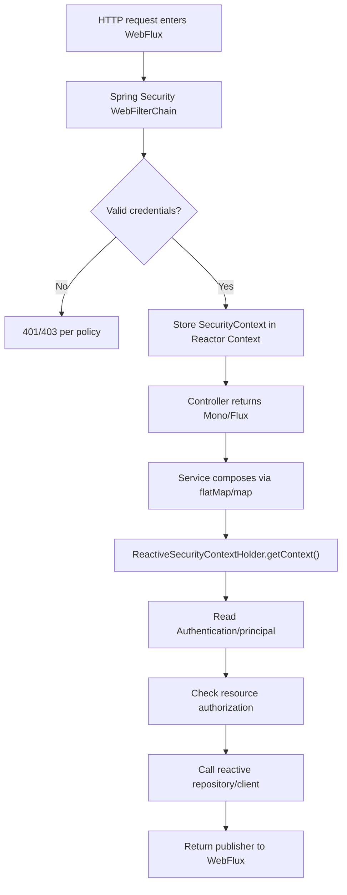

# Propagating Authentication Context via Reactor Context

In a Spring WebFlux application, a request typically flows through a reactive pipeline made of `Mono`, `Flux`, operators such as `map`, `flatMap`, and `filter`, and may switch threads via `publishOn` or `subscribeOn`. You cannot assume the entire pipeline always executes on the same thread. Therefore, storing user details in `ThreadLocal` as in traditional Servlet applications is unsuitable as the primary security mechanism for reactive apps.

Reactive Spring Security stores `SecurityContext` in **Reactor Context**. Applications read authentication details via `ReactiveSecurityContextHolder`, while Spring Security WebFlux automatically injects the security context into the reactive pipeline after authenticating the request. Reactor Context travels with the subscription, allowing operators across the reactive chain to access it independently of the current thread.

Key concepts to understand:

- `Reactor Context`: an immutable key-value store attached to a subscription.
- `ReactiveSecurityContextHolder`: Spring Security's API for reading and writing `SecurityContext` in Reactor Context.
- `contextWrite(...)`: creates context visible to operators upstream of that call.
- `ReactiveSecurityContextHolder.getContext()`: returns `Mono<SecurityContext>` from the current subscription's context.
- `ReactiveSecurityContextHolder.withAuthentication(...)`: helper to attach an `Authentication` to context, primarily useful in tests or intentional integrations.

## 1. Why Does Reactive Need Reactor Context?

In the blocking Servlet model, a request is usually handled on a single thread for most of its lifecycle. Spring Security can place `SecurityContext` into `SecurityContextHolder`, which uses `ThreadLocal` by default.

In WebFlux, a single request may be processed across multiple threads. For example:

```java
return repository.findById(id)
    .publishOn(Schedulers.boundedElastic())
    .map(this::toResponse);
```

`publishOn` can move subsequent operations onto a different thread. If authentication lived only in the original thread's `ThreadLocal`, the new thread would lack that value. Moreover, one thread serves multiple different requests over time; misusing ThreadLocal risks reading stale data or leaking another request's context.

Reactor Context solves this by attaching metadata to the subscription rather than to a thread. As Reactor executes an operator chain, the subscription's context propagates through the pipeline even across thread switches.

This does not mean every asynchronous construct automatically inherits the context. A brand-new Reactor subscription, a manually spawned `CompletableFuture`, or a callback outside Reactor may not carry the original context. Know those boundaries to avoid losing authentication details.

## 2. How Does Reactor Context Work?

Reactor Context is an immutable key/value structure bound to a subscriber. Each update produces a new context. Context is not a global `Map` and is never shared arbitrarily across requests.

Simple example:

```java
import reactor.core.publisher.Mono;

Mono<String> result = Mono.deferContextual(context ->
    Mono.just("request-id=" + context.get("requestId"))
).contextWrite(context -> context.put("requestId", "req-1001"));
```

When subscribed, `deferContextual` reads the `requestId` added by `contextWrite`:

```text
request-id=req-1001
```

`deferContextual` defers reading the context until the subscription actually executes. This is crucial: never read context eagerly when building the publisher, because no subscriber context exists yet.

### 2.1. Direction of `contextWrite` Propagation

A common point of confusion is that `contextWrite` flows from downstream to upstream. Context written by it becomes visible to operators appearing above it in the publisher chain.

Example:

```java
Mono<String> result = Mono.deferContextual(context ->
        Mono.just(context.get("user"))
    )
    .map(String::toUpperCase)
    .contextWrite(context -> context.put("user", "alice"));
```

The `deferContextual` source and upstream `map` operator receive the context containing `user=alice`. If `contextWrite` is placed elsewhere, trace which publishers sit upstream of it to know which ones see the value.

Remember:

- The subscriber establishes the initial context.
- `contextWrite` modifies the context visible upstream.
- `deferContextual` reads context at subscription time.
- Context is per-subscription, not a global variable.

## 3. Where Does Reactive Spring Security Store Authentication?

In Spring WebFlux, Spring Security uses Reactor Context to hold the authenticated request's `SecurityContext`. Filters in `SecurityWebFilterChain` perform authentication and populate the context for downstream processing.

Applications should read authentication via:

```java
ReactiveSecurityContextHolder.getContext()
```

This method returns `Mono<SecurityContext>`. Inside sits `Authentication`, holding the principal, authorities, and authentication details for the active security mechanism.

Never use `SecurityContextHolder.getContext()` in reactive code to read the current user. That is the imperative holder strategy based on ThreadLocal, not the reactive security context API.

### 3.1. Spring Security WebFlux Configuration

Example configuration protecting endpoints:

```java
import org.springframework.context.annotation.Bean;
import org.springframework.context.annotation.Configuration;
import org.springframework.security.config.annotation.web.reactive.EnableWebFluxSecurity;
import org.springframework.security.config.web.server.ServerHttpSecurity;
import org.springframework.security.web.server.SecurityWebFilterChain;

@Configuration
@EnableWebFluxSecurity
public class SecurityConfiguration {

    @Bean
    SecurityWebFilterChain springSecurityFilterChain(ServerHttpSecurity http) {
        return http
            .csrf(ServerHttpSecurity.CsrfSpec::disable)
            .authorizeExchange(exchanges -> exchanges
                .pathMatchers("/public/**").permitAll()
                .pathMatchers("/admin/**").hasRole("ADMIN")
                .anyExchange().authenticated()
            )
            .httpBasic(basic -> {})
            .build();
    }
}
```

This example uses HTTP Basic for illustration. Real authentication setups may use JWT, OAuth2 Resource Server, or another mechanism. Once Spring Security authenticates a request, it puts the security context into the request flow's Reactor Context.

Never call `contextWrite(withAuthentication(...))` in controllers as a substitute for the security filter chain. Context injected by application code does not prove a user was authenticated; authentication must come from your configured security layer.

## 4. Reading Authentication with ReactiveSecurityContextHolder

A service can retrieve the current username as follows:

```java
import org.springframework.security.core.Authentication;
import org.springframework.security.core.context.SecurityContext;
import org.springframework.security.core.context.ReactiveSecurityContextHolder;
import reactor.core.publisher.Mono;

public Mono<String> currentUsername() {
    return ReactiveSecurityContextHolder.getContext()
        .map(SecurityContext::getAuthentication)
        .map(Authentication::getName);
}
```

The method returns `Mono<String>` because authentication is read inside the reactive pipeline. Never call `.block()` to convert the result into a String inside a normal WebFlux service.

If no security context is present, `ReactiveSecurityContextHolder.getContext()` completes without emitting a value. Therefore, if an endpoint allows anonymous access, define explicit behavior when authentication is absent.

Example providing a fallback value:

```java
public Mono<String> currentUsernameOrAnonymous() {
    return ReactiveSecurityContextHolder.getContext()
        .map(SecurityContext::getAuthentication)
        .map(Authentication::getName)
        .defaultIfEmpty("anonymous");
}
```

Never default to `anonymous` for operations requiring authenticated permissions. For sensitive actions, require an authenticated principal and emit an error if context is absent.

## 5. Reading the Principal in Controllers and Services

WebFlux controllers can inject `Principal` directly as a handler parameter:

```java
import java.security.Principal;
import org.springframework.web.bind.annotation.GetMapping;
import org.springframework.web.bind.annotation.RestController;
import reactor.core.publisher.Mono;

@RestController
public class AccountController {

    @GetMapping("/me")
    public Mono<String> me(Principal principal) {
        return Mono.just(principal.getName());
    }
}
```

This is convenient when the controller simply needs the principal for one endpoint. When services deeper in the pipeline need authentication or authorities, read them via `ReactiveSecurityContextHolder`.

Example service using the actor name:

```java
public Mono<AccountResponse> getCurrentAccount() {
    return ReactiveSecurityContextHolder.getContext()
        .map(SecurityContext::getAuthentication)
        .flatMap(authentication ->
            accountRepository.findByUsername(authentication.getName())
        )
        .map(AccountResponse::from);
}
```

The reactive repository returns `Mono<Account>` in this example. `flatMap` chains the repository publisher into the current pipeline, so it continues running inside the subscription carrying the security context.

## 6. Context Propagates Through Reactive Operators

As long as execution stays within the same reactive subscription, Reactor Context is preserved across operators such as:

- `map` and `filter`.
- `flatMap` and `concatMap`.
- `switchIfEmpty` and `onErrorResume`.
- `publishOn` and `subscribeOn`.
- Publishers created and subscribed to via composition in the same pipeline.

Example:

```java
public Mono<OrderResponse> getOrder(String orderId) {
    return orderRepository.findById(orderId)
        .flatMap(order -> ReactiveSecurityContextHolder.getContext()
            .map(SecurityContext::getAuthentication)
            .map(authentication -> new OrderResponse(
                order.getId(),
                order.getStatus(),
                authentication.getName()
            ))
        )
        .publishOn(Schedulers.parallel());
}
```

Within the same subscription, switching schedulers does not drop Reactor Context. Note that `publishOn` above is only for illustrating context preservation; do not add `publishOn` unless you actually have a scheduling requirement.

### 6.1. `publishOn` and `subscribeOn` Are Not Context Propagation APIs

These two operators control where work executes:

- `subscribeOn` determines the scheduler used to initiate upstream subscription.
- `publishOn` switches downstream operators onto the specified scheduler.

Reactor Context attaches to the subscription, so it remains accessible across operators as threads change. There is no need to copy authentication into ThreadLocal just because `publishOn` or `subscribeOn` is used.

This differs from calling an imperative API outside Reactor, which may have no awareness of Reactor Context.

## 7. Adding Authentication to Reactor Context

`ReactiveSecurityContextHolder.withAuthentication(authentication)` returns a function usable with `contextWrite`:

```java
Mono<String> result = currentUsername()
    .contextWrite(
        ReactiveSecurityContextHolder.withAuthentication(authentication)
    );
```

Once added, upstream publishers can read that authentication via `ReactiveSecurityContextHolder.getContext()`.

This API is useful for:

- Unit testing reactive services without booting the full WebFlux security filter chain.
- Internal adapters holding a verified authentication from a trusted source.
- Controlled test or integration flows needing a populated security context.

In regular web applications, never extract a username from a request body, build a `UsernamePasswordAuthenticationToken`, and write it into Reactor Context. Doing so turns client-controlled input into a trusted identity. Let Spring Security verify credentials and populate the context.

### 7.1. Using `withSecurityContext`

If you already have a `Mono<SecurityContext>`, you can attach it directly:

```java
Mono<String> result = currentUsername()
    .contextWrite(
        ReactiveSecurityContextHolder.withSecurityContext(securityContextMono)
    );
```

`withSecurityContext(...)` takes a security context publisher. `withAuthentication(...)` is a convenience helper when you already have an `Authentication`.

## 8. Per-Subscription Context and Concurrent Requests

Reactor Context is isolated per subscriber. Two concurrent requests can carry two different authentications without locking shared state.

Example:

```java
Mono<String> currentUser = ReactiveSecurityContextHolder.getContext()
    .map(SecurityContext::getAuthentication)
    .map(Authentication::getName);

Mono<String> alice = currentUser.contextWrite(
    ReactiveSecurityContextHolder.withAuthentication(aliceAuthentication)
);

Mono<String> bob = currentUser.contextWrite(
    ReactiveSecurityContextHolder.withAuthentication(bobAuthentication)
);
```

Each publisher has its own context on subscription. Alice's context is never shared with Bob.

Never store the current authentication in static fields, mutable singleton fields, or manually managed `ThreadLocal` variables shared across requests. Those approaches risk leaking user identities between subscriptions.

## 9. Boundaries Where Reactor Context Is Lost

Reactor Context stays intact across normal reactive composition, yet it can be lost when code leaves the current subscription.

### 9.1. Calling `subscribe()` Manually Inside a Service

Avoid writing:

```java
public Mono<Void> updateOrder(String id) {
    orderRepository.findById(id)
        .flatMap(order -> update(order))
        .subscribe();

    return Mono.empty();
}
```

`subscribe()` creates an independent subscription. It is no longer governed by the original request's subscriber and may lose Reactor Context, cancellation, error handling, and outer-pipeline backpressure.

Return the publisher for the caller to compose:

```java
public Mono<Void> updateOrder(String id) {
    return orderRepository.findById(id)
        .flatMap(this::update)
        .then();
}
```

### 9.2. Crossing into `CompletableFuture`

Example:

```java
return Mono.fromFuture(
    CompletableFuture.supplyAsync(() -> legacyClient.load())
);
```

A `CompletableFuture` created and run outside Reactor does not automatically know about subscriber context. If logic inside the future needs a user ID, extract the needed value in the reactive pipeline and pass it explicitly:

```java
return ReactiveSecurityContextHolder.getContext()
    .map(SecurityContext::getAuthentication)
    .map(Authentication::getName)
    .flatMap(username -> Mono.fromFuture(
        CompletableFuture.supplyAsync(() -> legacyClient.loadFor(username))
    ));
```

This example passes an identifier already read in the pipeline. If an imperative API needs the full authentication or security authorization, design a controlled adapter with explicit context propagation.

### 9.3. Calling `block()` or Spawning a New Subscription

`block()` introduces a blocking boundary and creates its own subscription. In WebFlux, it also risks blocking event-loop threads. Never call `block()` to read the principal inside reactive controllers or services.

Instead of:

```java
String username = ReactiveSecurityContextHolder.getContext()
    .map(SecurityContext::getAuthentication)
    .map(Authentication::getName)
    .block();
```

keep the value inside the pipeline:

```java
return ReactiveSecurityContextHolder.getContext()
    .map(SecurityContext::getAuthentication)
    .map(Authentication::getName)
    .flatMap(service::loadForUser);
```

## 10. Comparing Reactor Context and ThreadLocal

| Characteristic | Reactor Context | ThreadLocal / Imperative SecurityContextHolder |
|---|---|---|
| Bound to | Subscription | Thread |
| Suited for | Reactive pipelines | Thread-per-request blocking/Servlet code |
| On thread switch | Context follows the subscription | ThreadLocal value does not automatically follow to the new thread |
| Request isolation | Per subscriber | Relies on ThreadLocal management and cleanup |
| Spring Security API | `ReactiveSecurityContextHolder` | `SecurityContextHolder` |
| How it is read | `Mono<SecurityContext>` | Read directly from holder |

Do not call `SecurityContextHolder.clearContext()` routinely inside reactive pipelines; reactive Spring Security manages context via the Reactor Context lifecycle. Conversely, if an application mixes blocking Servlet code with WebFlux, define clear boundaries between the models and use proper bridging mechanisms.

## 11. Context Propagation Across External Libraries and Callbacks

Some libraries integrate with Reactor or Micrometer Context Propagation. However, never assume every callback, executor, or third-party library automatically propagates Reactor Context.

When stepping outside the pipeline, there are three options:

1. **Pass needed data as arguments**: usually clearest and easiest to test. For example, read `userId` in the pipeline and pass it to the blocking function.
2. **Use a context propagation bridge**: when libraries support Micrometer Context Propagation or Reactor hooks, configure it for your exact version and test thoroughly.
3. **Stay within reactive APIs**: prefer clients/reactive adapters that compose directly inside the same publisher.

Do not blindly enable automatic copying of every ThreadLocal just to make reactive code behave like blocking code. Context propagation should be configured intentionally, because copying broad request state onto threads can risk leaks or stale context if lifecycles are not managed carefully.

## 12. Using Authentication in Reactive Auditing

A common use case is recording who created or modified a document in a reactive service. When using auditing in a Spring Data reactive module that supports reactive auditing, the auditor source must be reactive—typically via `ReactiveAuditorAware<T>`—rather than a blocking `AuditorAware<T>` reading ThreadLocal.

Conceptual example reading username from the reactive security context:

```java
import org.springframework.data.domain.ReactiveAuditorAware;
import org.springframework.security.core.context.ReactiveSecurityContextHolder;
import org.springframework.security.core.context.SecurityContext;
import reactor.core.publisher.Mono;

public class SecurityReactiveAuditorAware
        implements ReactiveAuditorAware<String> {

    @Override
    public Mono<String> getCurrentAuditor() {
        return ReactiveSecurityContextHolder.getContext()
            .map(SecurityContext::getAuthentication)
            .filter(authentication -> authentication.isAuthenticated())
            .map(authentication -> authentication.getName());
    }
}
```

`ReactiveAuditorAware` returns `Mono<T>` and reads the principal from Reactor Context. How reactive auditing is enabled and how callbacks work depend on the Spring Data reactive module in use; check the annotations and configuration for your Spring Data Elasticsearch release rather than copying MongoDB or R2DBC auditing configurations blindly.

The central requirement is reading the auditor inside the reactive subscription where Spring Security established the context. Calling the Elasticsearch Java API Client directly or spawning a new detached subscription may prevent callbacks and auditors from seeing the expected security context.

## 13. Security Considerations When Using Reactor Context

Reactor Context is a mechanism for propagating metadata, not a dumping ground for secrets or untrusted arbitrary data.

Guidelines to follow:

- Store only pipeline-necessary metadata, such as correlation IDs or authentication verified by Spring Security.
- Never log access tokens, refresh tokens, or passwords when debugging context.
- Never treat client-supplied request body fields as proof of identity in context.
- Never modify or swap security contexts inside business logic without an explicit security reason.
- Never share a mutable `Authentication` across multiple subscriptions.
- When crossing into executors or imperative APIs, pass only the minimum required data.
- Enforce authorization checks server-side; reading a username does not mean the user is authorized to access a resource.

Specifically, `Authentication.getName()` only returns the principal identifier. It does not prove the user has rights to a specific order. Services must still verify ownership, tenant, and authorities before returning data.

## 14. Testing Security Context in WebFlux

With WebFlux, endpoints can be tested using `WebTestClient` and Spring Security test support.

Example:

```java
import org.junit.jupiter.api.Test;
import org.springframework.beans.factory.annotation.Autowired;
import org.springframework.boot.test.autoconfigure.web.reactive.AutoConfigureWebTestClient;
import org.springframework.boot.test.context.SpringBootTest;
import org.springframework.test.web.reactive.server.WebTestClient;
import static org.springframework.security.test.web.reactive.server.SecurityMockServerConfigurers.mockUser;

@SpringBootTest
@AutoConfigureWebTestClient
class AccountControllerTest {

    @Autowired
    WebTestClient webTestClient;

    @Test
    void exposesAuthenticatedPrincipal() {
        webTestClient
            .mutateWith(mockUser("alice"))
            .get()
            .uri("/me")
            .exchange()
            .expectStatus().isOk()
            .expectBody(String.class).isEqualTo("alice");
    }
}
```

This test requires a `spring-security-test` dependency matching the project's Spring Security version. `mockUser` supplies a simulated authentication for the test request; it does not replace testing real authentication mechanisms such as JWT signature checks or password verification.

### 14.1. Unit Testing a Service Using ReactiveSecurityContextHolder

When testing only a service, attach the context directly to the publisher:

```java
import static org.assertj.core.api.Assertions.assertThat;

import org.junit.jupiter.api.Test;
import org.springframework.security.authentication.UsernamePasswordAuthenticationToken;
import org.springframework.security.core.Authentication;
import org.springframework.security.core.context.ReactiveSecurityContextHolder;
import reactor.test.StepVerifier;

@Test
void readsUsernameFromReactorContext() {
    Authentication authentication =
        new UsernamePasswordAuthenticationToken("alice", "n/a");

    Mono<String> result = service.currentUsername()
        .contextWrite(
            ReactiveSecurityContextHolder.withAuthentication(authentication)
        );

    StepVerifier.create(result)
        .expectNext("alice")
        .verifyComplete();
}
```

This tests reading the context, not credential verification. Creating `UsernamePasswordAuthenticationToken` directly is appropriate only in tests or trusted internal flows—never take it from a request body to self-assert identity.

## 15. Common Pitfalls

| Symptom | Possible cause | Resolution |
|---|---|---|
| `SecurityContextHolder.getContext()` has no user in WebFlux | Using imperative/ThreadLocal API | Use `ReactiveSecurityContextHolder.getContext()`. |
| `ReactiveSecurityContextHolder.getContext()` completes empty | Anonymous request or publisher running outside security chain | Check authorization, security filter chain, and subscriptions. |
| Principal exists in controller yet disappears in service | Spawned a new subscription or called `subscribe()` manually | Compose publishers with `flatMap` and return the publisher to the caller. |
| Authentication lost inside `CompletableFuture` | Future executes outside Reactor Context | Pass principal as an argument or use a configured context propagation bridge. |
| Authentication survives `publishOn` while ThreadLocal is empty | Confusing Reactor Context with ThreadLocal | Use the reactive holder; do not expect ThreadLocal to follow thread hops. |
| Calling `.block()` to read username | Breaking out of reactive pipeline and risking event-loop stalls | Keep data in `Mono`/`Flux` and compose via `flatMap`. |
| Two requests see the same user | Stored principal in mutable/static state | Keep Reactor Context isolated per subscription. |
| Auditor is null in async job | Worker lacks SecurityContext or context was not propagated | Supply actor ID in job context or use explicit reactive context propagation. |
| Endpoint test returns anonymous | Missing mock authentication or test security filter chain config | Use `mockUser` or configure test security properly. |
| Authenticated user reads another tenant's data | Checked `Authentication.getName()` without resource authorization | Enforce ownership, tenant, and authority checks in the service. |

## 16. Workflow for Handling Authentication in Reactive Services



Implementation steps:

1. Configure Spring Security WebFlux to authenticate requests.
2. Let the security filter chain establish context for authenticated requests.
3. Use `ReactiveSecurityContextHolder` or a `Principal` parameter to read identity.
4. Keep processing within the same `Mono`/`Flux` subscription.
5. Use `flatMap` to chain reactive calls; never call `subscribe()` or `block()` in services.
6. When crossing to imperative APIs/`CompletableFuture`, pass minimal principal data or use a configured context propagation bridge.
7. Separate principal identity from resource access rights; enforce authorization in the service.
8. If using reactive auditing, supply a reactive auditor and enable the module/version's reactive auditing infrastructure.
9. Test both WebTestClient with mock users and service publishers with Reactor Context.
10. Watch for lost context across scheduler, executor, and new-subscription boundaries.

## 17. Conclusion

Reactive Spring Security uses Reactor Context to propagate `SecurityContext` through WebFlux pipelines. Applications read authentication with `ReactiveSecurityContextHolder.getContext()`, receiving a `Mono<SecurityContext>`, and compose it with the rest of the service. This mechanism is thread-independent because Reactor Context attaches to the subscription and is preserved across standard reactive operators, even across `publishOn` or `subscribeOn`.

`contextWrite` updates the context visible to upstream operators; `deferContextual` reads context at subscription time. `withAuthentication` and `withSecurityContext` are useful for tests or intentional integrations, while production requests should rely on the Spring Security filter chain to authenticate and populate context.

Context may be lost if code creates a new subscription, calls `subscribe()` inside a service, uses `block()`, or crosses into `CompletableFuture`/callbacks outside Reactor. Keep execution inside the same publisher, pass minimal principal data across imperative boundaries or configure a proper context propagation bridge, never replace the reactive holder with ThreadLocal/imperative SecurityContextHolder, never trust client-supplied usernames, and always check resource authorization beyond reading the principal. These practices keep authentication propagation consistent and secure in reactive Spring Data Elasticsearch applications.
