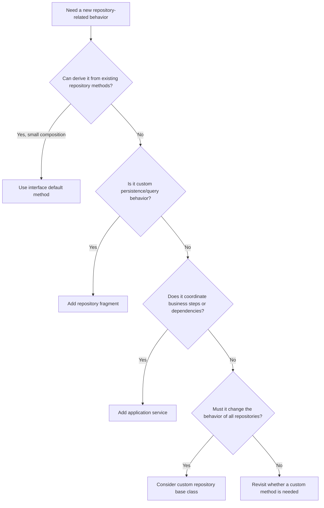

# When to Use a Default Method, Fragment, or Service

When a Spring Data Elasticsearch repository needs behavior beyond the built-in CRUD and query methods, three places are commonly considered: **default methods on the repository interface**, **repository fragments**, and **application-layer services**. All three can call the repository, but they solve different kinds of responsibilities.

Default methods are well suited for composing a few existing repository operations into a small utility without needing separate dependencies. Repository fragments are appropriate when you need custom data access behavior, need to inject `ElasticsearchOperations`, or need to reuse a group of persistence operations. Services are appropriate for use-case logic, orchestrating multiple repositories or external systems, enforcing business rules, and defining application processing boundaries.

You should not put all logic into a repository simply because that logic reads or writes data. A repository represents how the application accesses a dataset; a service represents the application carrying out a business operation. Choosing the right place keeps interfaces easy to understand, makes persistence logic reusable, and prevents use cases from becoming tightly coupled to Elasticsearch details.

## 1. How Is a Spring Data Repository Created?

A Spring Data repository is typically an interface extending a base interface such as `ElasticsearchRepository`:

```java
import org.springframework.data.elasticsearch.repository.ElasticsearchRepository;

public interface ProductRepository
        extends ElasticsearchRepository<Product, String> {
}
```

Spring Data generates an implementation proxy for this interface. The proxy provides CRUD methods, derived methods from method names such as `findBySku(...)`, query-annotated methods, and custom behaviors configured via repository composition.

Example of adding query methods:

```java
public interface ProductRepository
        extends ElasticsearchRepository<Product, String> {

    Optional<Product> findBySku(String sku);

    List<Product> findByActiveTrue();
}
```

There is no need to write implementations manually for methods that Spring Data can derive from names or query metadata. Only add customization when the behavior genuinely does not fit the built-in abstractions.

### 1.1 A Repository Interface Is Not the Place for All Logic

A repository interface can contain several kinds of methods:

- Methods inherited from `CrudRepository`, `PagingAndSortingRepository`, or `ElasticsearchRepository`.
- Query methods parsed by Spring Data from method names.
- Methods with `@Query` or the corresponding query annotation.
- Default methods written directly by the application in the interface.
- Methods provided by repository fragments.

Services typically call those methods to complete a use case. The repository does not need to know where a controller calls it from, which screen the user is on, or how many steps a business workflow has.

## 2. Default Methods: Composing Small Repository Behaviors

Java allows interfaces to declare methods with a body using the `default` keyword. Spring Data repositories can use these methods to add utilities built on top of existing repository methods.

For example, if the repository already has `findBySku(...)` and `findByActiveTrue()`, you can add a small default method:

```java
public interface ProductRepository
        extends ElasticsearchRepository<Product, String> {

    Optional<Product> findBySku(String sku);

    default Optional<Product> findActiveBySku(String sku) {
        return findBySku(sku)
            .filter(Product::isActive);
    }
}
```

`findActiveBySku` merely composes a query method with a simple filter. It does not need `ElasticsearchOperations`, a client, a converter, or other dependencies. This is an appropriate case for a default method.

### 2.1 When a Default Method Is a Good Choice

A default method is usually suitable when:

- The behavior is short and can be expressed using existing repository methods.
- No dependency injection is needed.
- There is no need to manually build Query DSL or control `ElasticsearchOperations`.
- The behavior is directly tied to the repository's data access concept.
- The logic does not need to orchestrate multiple aggregates or external systems.
- The method name helps callers understand a repository convenience operation.

Another example:

```java
public interface ProductRepository
        extends ElasticsearchRepository<Product, String> {

    List<Product> findByCategory(String category);

    default boolean existsActiveProductInCategory(String category) {
        return findByCategory(category).stream()
            .anyMatch(Product::isActive);
    }
}
```

This is a simple example of composition. However, if a category has a huge number of products, loading the entire list into Java just to check `anyMatch` is inefficient. Whenever possible, write an appropriate query such as `existsByCategoryAndActiveTrue(...)` or use a fragment with an optimized query. A default method does not automatically make an inefficient algorithm better.

### 2.2 Default Methods Have Nowhere to Inject Dependencies

An interface has no constructor for Spring to inject `ElasticsearchOperations`, a clock, an HTTP client, or another service into a default method. If a default method needs such dependencies, that is a sign the behavior should be moved to a fragment or a service.

Do not attempt to access a static `ApplicationContext`, use a service locator, or add static fields to retrieve beans inside a default method. That hides dependencies, makes testing difficult, and defeats the purpose of the repository abstraction.

### 2.3 Keep Default Methods Small

A long default method with many conditional branches, calls to multiple other repositories, and orchestration of external APIs is no longer a repository utility. It becomes hard to understand because the interface ends up holding both business workflows and the data access contract.

The following example is not suitable for placement in a repository:

```java
default Product publishProduct(String id) {
    Product product = findById(id).orElseThrow();
    validateImages(product);
    inventoryClient.checkAvailability(product.getSku());
    product.markPublished();
    Product saved = save(product);
    eventPublisher.publish(new ProductPublished(saved.getId()));
    return saved;
}
```

This method performs business validation, calls an external service, mutates state, and publishes an event. It belongs to a use case in the service layer. The repository should only provide the persistence operations needed for that use case.

## 3. Repository Fragments: Adding Custom Persistence Behavior

When a repository needs an operation that cannot be expressed cleanly with a query method or default method, a Spring Data repository fragment is the right choice.

A fragment consists of:

1. An interface describing the group of custom behaviors.
2. An implementation class implementing that interface.
3. The main repository extending the fragment interface.

Spring Data composes the fragment implementation with the auto-generated repository implementation. A fragment can inject `ElasticsearchOperations`, converters, or needed dependencies via its constructor.

### 3.1 Declaring a Fragment Interface

For example, suppose you need a product search operation using custom Query DSL:

```java
import org.springframework.data.domain.Pageable;
import org.springframework.data.elasticsearch.core.SearchHits;

public interface ProductSearchOperations {

    SearchHits<Product> searchByText(String text, Pageable pageable);
}
```

The fragment interface only describes the behavior to be added. It does not need to extend `ElasticsearchRepository`.

### 3.2 Writing the Fragment Implementation

```java
import org.springframework.data.elasticsearch.client.elc.NativeQuery;
import org.springframework.data.elasticsearch.core.ElasticsearchOperations;
import org.springframework.data.elasticsearch.core.SearchHits;
import org.springframework.data.elasticsearch.core.query.Query;

public class ProductSearchOperationsImpl implements ProductSearchOperations {

    private final ElasticsearchOperations operations;

    public ProductSearchOperationsImpl(ElasticsearchOperations operations) {
        this.operations = operations;
    }

    @Override
    public SearchHits<Product> searchByText(String text, Pageable pageable) {
        Query query = NativeQuery.builder()
            .withQuery(q -> q.multiMatch(m -> m
                .query(text)
                .fields("name", "description")
            ))
            .withPageable(pageable)
            .build();

        return operations.search(
            query,
            Product.class,
            IndexCoordinates.of("products")
        );
    }
}
```

The implementation uses `ElasticsearchOperations` to build and execute a native query. It can hold specialized persistence logic without making the repository interface overly long.

The exact imports and builders may vary depending on the Spring Data Elasticsearch / Elasticsearch Java Client version. The example above illustrates the fragment structure and how Operations are injected; use the API that matches your project's dependencies.

### 3.3 Composing the Fragment into the Repository

```java
public interface ProductRepository
        extends ElasticsearchRepository<Product, String>,
                ProductSearchOperations {

    Optional<Product> findBySku(String sku);
}
```

The main repository has both the CRUD/query methods provided by Spring Data and the `searchByText` method implemented by the fragment.

Callers use a single repository bean:

```java
SearchHits<Product> hits = productRepository.searchByText(
    "wireless keyboard",
    PageRequest.of(0, 20)
);
```

There is no need to inject `ProductSearchOperationsImpl` separately; Spring Data composition integrates the fragment implementation into the repository proxy.

### 3.4 Implementation Naming Convention

For a fragment interface named `ProductSearchOperations`, the conventional implementation is `ProductSearchOperationsImpl`. The class name is formed from the fragment interface name plus the default implementation postfix `Impl`.

The important point is that the implementation must correspond to the fragment interface. Do not confuse the fragment convention with the legacy custom repository implementation style based on the main repository's name, such as `ProductRepositoryImpl`.

Modern versions of Spring Data recommend repository fragments to organize customizations by behavior group. The postfix and scanning behavior can be customized in the repository configuration; if you use non-default configuration, make sure Spring can locate the implementation.

## 4. Splitting a Repository into Multiple Fragments

A repository can extend multiple fragments, with each fragment representing a group of persistence capabilities.

```java
public interface ProductSearchOperations {
    SearchHits<Product> searchByText(String text, Pageable pageable);
}

public interface ProductInventoryOperations {
    UpdateResponse updateStock(String productId, int delta);
}

public interface ProductRepository extends
        ElasticsearchRepository<Product, String>,
        ProductSearchOperations,
        ProductInventoryOperations {

    Optional<Product> findBySku(String sku);
}
```

Each fragment has its own implementation:

```text
ProductSearchOperations
    -> ProductSearchOperationsImpl

ProductInventoryOperations
    -> ProductInventoryOperationsImpl

ProductRepository
    -> Spring Data repository proxy + fragments
```

This helps group behaviors by purpose. The search fragment can hold `NativeQuery`, aggregations, and highlighting; the inventory fragment can hold scripted updates and stock-related persistence logic.

### 4.1 Reusable Fragments

If multiple repositories need the same capability, you can design a reusable fragment interface and implementation, provided the entity/index types and method contracts align. Avoid making a fragment so generic that it requires passing arbitrary field names or using hard-to-follow generic reflection.

### 4.2 Precedence Order When Methods Have Matching Signatures

Repository composition has precedence rules when multiple fragments or implementations provide methods with the same signature. The order in which fragments are added to the composition can affect which implementation is selected. Do not rely on name collisions to control behavior; name methods clearly and avoid declaring the same signature across multiple fragments without a specific reason.

If multiple fragments need the same helper, extract the helper into a shared component or design separate interfaces rather than creating method conflicts.

## 5. When Should You Use a Fragment?

A fragment is appropriate when:

- You need to use `ElasticsearchOperations` or the Elasticsearch Java Client directly.
- The query requires nested queries, aggregations, highlighting, scripts, scoring, or complex DSL.
- You need custom persistence-level update/bulk operations.
- There is a reusable group of data access behaviors.
- You want to keep the main repository as a unified facade for callers.
- You need dependency injection in the implementation.

Examples of methods suited for a fragment:

```java
public interface ProductSearchOperations {
    SearchHits<Product> searchWithFacets(ProductSearchCriteria criteria);
    SearchHits<Product> searchVariants(VariantCriteria criteria);
}

public interface ProductWriteOperations {
    UpdateResponse changeStock(String productId, int delta);
    void bulkReindex(Collection<Product> products);
}
```

These methods represent Elasticsearch access and manipulation techniques. They should not decide a business workflow such as whether a product is allowed to be sold; the service is responsible for those rules.

## 6. Service: Orchestrating Use Cases and Business Rules

A service is the right place for application logic. A single use case can call multiple repositories, check conditions, use a clock, call a payment service, publish events, or coordinate multiple steps.

Example of a product publishing use case:

```java
@Service
public class ProductPublishingService {

    private final ProductRepository products;
    private final InventoryClient inventoryClient;
    private final ProductEventPublisher eventPublisher;

    public ProductPublishingService(
            ProductRepository products,
            InventoryClient inventoryClient,
            ProductEventPublisher eventPublisher) {
        this.products = products;
        this.inventoryClient = inventoryClient;
        this.eventPublisher = eventPublisher;
    }

    public Product publish(String productId) {
        Product product = products.findById(productId)
            .orElseThrow(() -> new ProductNotFoundException(productId));

        if (!product.hasRequiredInformation()) {
            throw new ProductCannotBePublishedException(productId);
        }

        inventoryClient.verifySellable(product.getSku());
        product.markPublished();

        Product saved = products.save(product);
        eventPublisher.publishProductPublished(saved.getId());
        return saved;
    }
}
```

The service orchestrates the business workflow: reading the product, validating information, calling the inventory service, changing state, saving, and publishing an event. The repository does not need to know the step order or the business reason why the product is being published.

### 6.1 A Service Can Use Multiple Repositories

```java
@Service
public class CustomerOrderService {

    private final OrderRepository orders;
    private final CustomerRepository customers;
    private final ProductRepository products;

    public CustomerOrderService(
            OrderRepository orders,
            CustomerRepository customers,
            ProductRepository products) {
        this.orders = orders;
        this.customers = customers;
        this.products = products;
    }

    public OrderSummary getOrderSummary(String orderId) {
        Order order = orders.findById(orderId).orElseThrow();
        Customer customer = customers.findById(order.getCustomerId())
            .orElseThrow();

        List<Product> items = products.findAllById(order.getProductIds());
        return OrderSummary.from(order, customer, items);
    }
}
```

This is a use case that needs to combine data from multiple aggregates. A service is the right place to perform orchestration and build the response model.

### 6.2 Services Are Where Application Transaction Boundaries Belong

In applications with a relational database, services typically mark JPA transactions for use cases requiring atomicity across tables belonging to the same datasource:

```java
@Transactional
public void updateCustomerProfile(...) {
    // JPA operations belonging to the same transaction manager.
}
```

However, JPA's `@Transactional` does not automatically create multi-document ACID transactions for Elasticsearch. If a service writes to both a database and Elasticsearch, you must design an outbox/saga or appropriate synchronization process; do not assume the annotation will roll back Elasticsearch when JPA rolls back.

With Elasticsearch as the sole data source for a single-document operation, a service can still coordinate validation and call the repository/Operations. A transaction annotation does not turn a sequence of multi-document writes into a transaction.

## 7. Distinguishing Responsibilities with Design Questions

When deciding where to place a method, ask yourself:

1. Does the method simply compose a few existing repository methods without needing dependencies? A default method may fit.
2. Does the method need to build a custom Elasticsearch query/update or inject Operations? Use a fragment.
3. Does the method express a use case, check business rules, or orchestrate multiple components? Use a service.
4. Is the behavior identical across all repositories and does it need to change how the base repository works? Consider a custom repository base class.
5. Can the behavior be expressed with a query method or a simple `@Query`? You may not need custom code at all.

| Criterion | Default method | Fragment | Service |
|---|---|---|---|
| Purpose | Small utility on repository | Custom persistence capability | Use case / business logic |
| Dependency injection | Inconvenient / discouraged | Yes, via constructor | Yes, via constructor |
| Using `ElasticsearchOperations` | Not suitable | Very suitable | Can call via repository/Operations when needed |
| Orchestrating multiple repositories | Usually not | Should not be the goal | Suitable |
| Custom Query DSL | Not ideal | Suitable | Should delegate to repository/fragment |
| Business workflow | Not suitable | Not its primary responsibility | Suitable |
| Reuse | Small logic tied to interface | Persistence capability | Application use case / component |

## 8. Comparing the Same Requirement Across All Three Approaches

Suppose the requirement is to find an active product by SKU, and then return the product if it is in stock.

### 8.1 Default Method If Only Composing Query Methods

```java
public interface ProductRepository extends ElasticsearchRepository<Product, String> {

    Optional<Product> findBySku(String sku);

    default Optional<Product> findActiveBySku(String sku) {
        return findBySku(sku).filter(Product::isActive);
    }
}
```

Suitable if the dataset is small, the filtering is simple, and a more optimized query is not needed. If you can write a single query method covering all conditions, prefer that query so Elasticsearch filters on the server side.

### 8.2 Fragment If a Custom Query Is Needed

```java
public interface ProductAvailabilitySearch {
    Optional<Product> findAvailableBySku(String sku);
}

public class ProductAvailabilitySearchImpl implements ProductAvailabilitySearch {

    private final ElasticsearchOperations operations;

    public ProductAvailabilitySearchImpl(ElasticsearchOperations operations) {
        this.operations = operations;
    }

    @Override
    public Optional<Product> findAvailableBySku(String sku) {
        Query query = NativeQuery.builder()
            .withQuery(q -> q.bool(b -> b
                .filter(f -> f.term(t -> t.field("sku").value(sku)))
                .filter(f -> f.term(t -> t.field("active").value(true)))
                .filter(f -> f.range(r -> r.number(n -> n
                    .field("stock")
                    .gt(0.0)
                )))
            ))
            .withPageable(PageRequest.of(0, 1))
            .build();

        return operations.search(query, Product.class, PRODUCTS)
            .getSearchHits()
            .stream()
            .map(SearchHit::getContent)
            .findFirst();
    }
}
```

The fragment pushes the conditions down to Elasticsearch and retrieves only one result. This is custom persistence behavior, not a multi-step workflow.

### 8.3 Service If Business Rules and External Sources Are Involved

```java
@Service
public class ProductAvailabilityService {

    private final ProductRepository products;
    private final WarehouseClient warehouse;

    public ProductAvailabilityService(
            ProductRepository products,
            WarehouseClient warehouse) {
        this.products = products;
        this.warehouse = warehouse;
    }

    public ProductAvailability check(String sku) {
        Product product = products.findBySku(sku)
            .orElseThrow(() -> new ProductNotFoundException(sku));

        if (!product.isActive()) {
            return ProductAvailability.inactive(product);
        }

        int warehouseQuantity = warehouse.availableQuantity(sku);
        return ProductAvailability.of(product, warehouseQuantity);
    }
}
```

The service combines product status with inventory from the warehouse system and determines the business outcome. You should not put HTTP calls to the warehouse inside an Elasticsearch persistence fragment.

## 9. Custom Repository Base Class: Another Case

Beyond default methods, fragments, and services, Spring Data allows replacing the base repository implementation class. This is an option when you need to change shared behavior for many repositories at once—for example, a base method with auditing rules or a common implementation inherited by every repository.

A custom base class typically extends the default Spring Data Elasticsearch repository implementation and is configured via `repositoryBaseClass` in the repository configuration.

Configuration skeleton example:

```java
@Configuration
@EnableElasticsearchRepositories(
    basePackages = "com.example.catalog.repository",
    repositoryBaseClass = AuditedElasticsearchRepository.class
)
class ElasticsearchRepositoryConfig {
}
```

The base implementation name, constructor, and generic signatures must match the Spring Data Elasticsearch version. Do not copy a base class example from another version without checking the current API.

### 9.1 When Is a Base Class Better Than a Fragment?

- Base class: the behavior must apply uniformly across many repositories as part of the foundational repository.
- Fragment: only certain repositories need a specific capability; multiple independent fragments can be combined.

Do not use a base class just to avoid declaring a fragment. It affects every repository within the configuration scope and alters default behavior more broadly.

## 10. Legacy Custom Implementations and Repository Fragments

Older Spring Data documentation often describes creating a class named like `ProductRepositoryImpl` to implement custom methods for `ProductRepository`. This mechanism existed before repository fragments became the recommended composition model.

For new code, prefer a dedicated fragment interface and corresponding implementation:

```text
ProductRepository
    extends ElasticsearchRepository<Product, String>, ProductSearchOperations

ProductSearchOperations
    implemented by ProductSearchOperationsImpl
```

The benefit is that customization is separated into clearly named capabilities, allowing multiple fragments to be composed and reused independently. When maintaining legacy code that uses `ProductRepositoryImpl`, check how the repository is configured and avoid renaming arbitrarily if the application relies on the old convention.

## 11. Package Organization

A simple structure:

```text
catalog/
  domain/
    Product.java
    ProductAvailability.java
  repository/
    ProductRepository.java
    ProductSearchOperations.java
    ProductSearchOperationsImpl.java
  service/
    ProductPublishingService.java
    ProductAvailabilityService.java
  web/
    ProductController.java
```

Repositories and fragments live together in the persistence area. Services contain use cases. Controllers translate HTTP input/output to services. Exact package organization can vary by project architecture; the goal is for dependencies to flow from services toward the repository abstraction, without repositories depending back on controllers.

## 12. Testing Each Kind of Customization

### 12.1 Testing Default Methods

Default methods can usually be tested through the repository proxy against an Elasticsearch test index or by mocking query methods depending on test setup. What matters is verifying that the composition method invokes the right query methods and applies its small logic properly to the result.

If using a mocking framework, check how interface default methods on proxies are invoked in your specific setup. Integration tests with the repository bean typically reflect Spring Data behavior more accurately.

### 12.2 Testing Fragments

A fragment implementation is a regular class that can be unit tested by mocking `ElasticsearchOperations`:

```java
@ExtendWith(MockitoExtension.class)
class ProductSearchOperationsImplTest {

    @Mock
    ElasticsearchOperations operations;

    @Test
    void buildsSearchAndDelegatesToOperations() {
        ProductSearchOperations fragment =
            new ProductSearchOperationsImpl(operations);

        // Stub operations.search(...) and verify the request/result.
    }
}
```

In addition to unit testing the implementation, have an integration test to confirm Spring Data actually detects the fragment and binds its methods onto the repository proxy. Unit testing the standalone class does not verify naming/composition conventions.

### 12.3 Testing Services

Service tests focus on use cases: success paths, validation failures, missing documents, errors from external systems, and events published at the right time. Repository interfaces and external clients can be mocked so Elasticsearch is not required for every unit test.

For JPA transactions, test against a real transaction manager. For Elasticsearch, do not assume a mocked `@Transactional` proves multi-document rollback.

## 13. Common Design Mistakes

### 13.1 Putting Long Query DSL into a Default Method

Default methods have no dependency injection and quickly become hard to maintain when building nested queries, aggregations, scripts, or complex sorting. Move that logic to a fragment.

### 13.2 Putting Business Workflows into a Repository

Repositories should not call payment, inventory, or notification systems or orchestrate multiple aggregates. Place workflows in services and let repositories provide persistence operations.

### 13.3 Having a Fragment Depend on a Business Service

Fragments should focus on persistence capabilities. If a fragment calls back into a service to decide business policy, the dependency direction is inverted. Services may call fragments; fragments should not drive use cases.

### 13.4 Creating a Fragment for a Simple Query Method

If a method can be clearly expressed with `findByStatusAndCategory(...)` or a short `@Query`, there is no need to add an extra interface/implementation just to wrap a single query.

### 13.5 A Fragment That Is Too Large

A fragment containing search, bulk import, reporting, inventory updates, and auditing no longer represents a single clear capability. Split it by related behavior groups.

### 13.6 Using a Service Only to Forward a Single Call

There is no need to create a service class just to call `repository.findById(id)` and return the result unchanged if no abstraction or use case is added. However, if an endpoint needs validation, authorization, DTO mapping, or orchestration, a service has a clear responsibility.

### 13.7 Using a Base Class for a Single Special Case

A custom base repository has broad impact. If only one repository needs custom search, use a dedicated fragment.

### 13.8 Misnaming a Fragment Implementation

If Spring does not discover the implementation by convention, fragment methods may not be attached to the repository proxy. Check the interface/implementation names, package scanning, configured postfix, and repository startup logs.

### 13.9 Assuming `@Transactional` on a Service Enables Multi-Document Rollback in Elasticsearch

A transaction manager only manages resources it supports. If a workflow involves both JPA and Elasticsearch, you need an outbox/saga or synchronization strategy; do not rely on annotations to create distributed transactions.

## 14. Decision Flow

You can follow this sequence when adding a new method:



Decision examples:

- `findActiveBySku` composing one query method with a small filter: default method or direct query method.
- `searchProductsWithFacets` using NativeQuery and aggregations: fragment.
- `publishProduct` validating data, calling warehouse, saving state, and publishing an event: service.
- Shared audit rules across all repositories in a module: consider a base class or shared component.

## 15. Implementation Principles

- Prefer query methods or `@Query` before writing custom code whenever they can express the requirement.
- Use default methods for small compositions that require no dependencies and belong directly to the repository.
- Use repository fragments for custom Elasticsearch queries/updates, when Operations injection is needed, or to isolate persistence capabilities.
- Use services for business rules, orchestration, external system integration, and use cases.
- Consider a custom base repository class only when needing to alter shared behavior across many repositories.
- Name fragment interfaces after capabilities and implementations according to Spring Data conventions/configuration.
- Keep dependency direction clean: services call repositories; fragments do not drive business services.
- Do not put HTTP/client calls or multi-step workflows inside repository default methods.
- Do not create a fragment merely to wrap a simple query method.
- Test fragments both at the class level and via repository proxy composition.
- Verify with a real transaction manager; JPA `@Transactional` does not create multi-document ACID transactions in Elasticsearch.

## 16. Summary

Default methods, repository fragments, and services can all add behavior to a Spring Data Elasticsearch application, but each option has a clear boundary of responsibility. Default methods fit small utilities that compose existing repository methods without dependencies. Repository fragments fit custom persistence capabilities, especially when `ElasticsearchOperations`, Query DSL, aggregations, scripts, or bulk operations are needed. Services fit use cases, business rules, and coordinating multiple repositories or external systems.

If a behavior must apply uniformly across all repositories, a custom repository base class can be considered. For new code, repository fragments are generally clearer and easier to compose than the legacy custom implementation convention tied directly to the main repository name. Before introducing a new abstraction, check whether a query method or `@Query` already satisfies the requirement.

An easy boundary to remember is: a repository describes how data is accessed; a fragment extends how data is accessed; a service describes what the application does with that data to fulfill a business goal. Choosing the right boundary keeps repositories concise, gives custom queries a clear home, and keeps workflows decoupled from Elasticsearch.

## References

- [Spring Data Commons — Custom Implementations for Spring Data Repositories](https://docs.spring.io/spring-data/commons/reference/repositories/custom-implementations.html)
- [Spring Data Elasticsearch — Repository Support](https://docs.spring.io/spring-data/elasticsearch/reference/elasticsearch/repositories.html)
- [Spring Data Elasticsearch — Elasticsearch Operations](https://docs.spring.io/spring-data/elasticsearch/reference/elasticsearch/template.html)
- [Spring Framework — Classpath Scanning and Managed Components](https://docs.spring.io/spring-framework/reference/core/beans/classpath-scanning.html)
