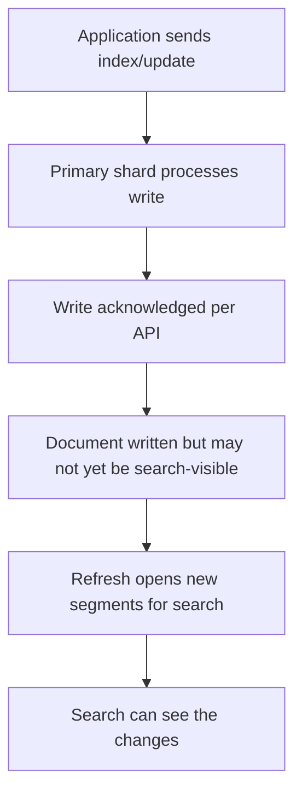
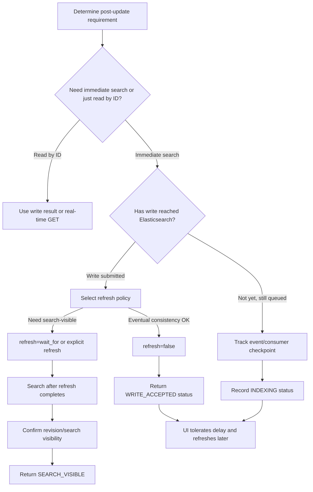

# Indexing Lag and Post-Update Search Contracts

When an application writes a document to Elasticsearch and immediately searches for it afterward, sometimes the newly written document does not yet appear in search results. This is usually not a data-loss bug: Elasticsearch is a **near real-time (NRT)** search system. A write operation may already be acknowledged, yet the data only becomes visible to search after the next **refresh**.

In Spring Data Elasticsearch, operations like `save`, `index`, or bulk writes generally do not force an immediate refresh after every write. Therefore, the system must define an explicit read-after-write contract:

- The API only confirms Elasticsearch has accepted the write operation.
- The API confirms the document is already findable via search.
- The UI reads the document back by ID and needs the latest data.
- A sync pipeline runs asynchronously and tolerates search visibility lag within a bounded window.

Refresh choices directly impact latency and throughput. Using `refresh=true` on every operation can degrade performance significantly; `refresh=wait_for` is usually more suitable when a specific request needs to wait for data to become searchable; and the default `refresh=false` fits most write flows that can accept eventual consistency.

## 1. Why Is a Document Not Searchable Immediately After Writing?

Elasticsearch uses Lucene to store and search data. When a document is indexed or updated, changes are written to write structures and the translog. Search reads only Lucene segments that have been opened for search. The process of making new changes visible to search is called **refresh**.

General flow:



Elasticsearch typically refreshes indexes periodically, with a common default of around **1 second** when an index is actively receiving traffic. Therefore, a successful write does not guarantee the very next search request will see that document.

It is important to distinguish two questions:

1. **Has the write been accepted?** This is the outcome of the write operation and the request's shard/replication conditions.
2. **Is the change search-visible yet?** This depends on refresh.

Do not conclude from an empty search result immediately after a write that the document was not saved. Check via GET by ID and inspect the operation's refresh policy.

## 2. What Is Refresh?

Refresh makes recent changes in Lucene visible to search by opening newly created segments. It is part of Elasticsearch's near real-time mechanism.

Example manual refresh call:

```http
POST products/_refresh
```

Once refresh finishes, changes written to the corresponding shards become discoverable via search.

### 2.1. Refresh Is Not the Same as Flush

Do not confuse refresh with flush:

| Mechanism | Purpose | Primary impact |
|---|---|---|
| Refresh | Makes new changes visible to search | Opens new segments for search; incurs cost of creating many small segments if run too often |
| Flush | Performs a Lucene commit and starts a new translog generation | Related to durability/recovery and translog management |
| Search | Reads refreshed segments | Does not automatically force recent writes to refresh immediately |
| GET by ID | Reads a document by ID | Real-time by default, can see writes before the next refresh |

Refresh is neither a relational database transaction commit nor a substitute for backup/flush. In most applications, calling flush manually after writes is unnecessary.

## 3. GET by ID and Search Have Different Semantics

A common source of confusion: **GET document by ID is real-time by default**, whereas search is near real-time.

Example writing a document:

```http
PUT products/_doc/P-100
{
  "name": "Wireless Headphones",
  "status": "ACTIVE"
}
```

Immediately afterward, GET by ID:

```http
GET products/_doc/P-100
```

Typically, a real-time GET returns the new content even if refresh has not occurred yet.

However, search:

```http
GET products/_search
{
  "query": {
    "term": {
      "status": "ACTIVE"
    }
  }
}
```

may not return `P-100` until the next refresh.

Therefore, if a UI just created a document and needs to display its details right away, GET by ID or returning the written data from the write response/domain command may fit better than immediately re-searching.

Real-time GET does not solve every aspect of a read-after-write contract. If read requests pass through an alias, tenant filter, custom routing, or a separate projection system, verify the exact read path and data scope.

## 4. Three Refresh Policies of the Write API

Elasticsearch write APIs accept a `refresh` parameter with three common options:

| Value | Behavior | When suitable |
|---|---|---|
| `false` | Does not request a refresh after the operation; this is the common default | High throughput, tolerates delayed search visibility |
| `true` | Refreshes affected shards immediately after the operation so changes become search-visible | Special cases needing immediate search visibility and accepting the cost |
| `wait_for` | Waits for the next refresh to make changes search-visible; does not normally force an immediate refresh | Needs read-after-write via search while avoiding force-refreshing per request |

### 4.1. `refresh=false`

Example:

```http
PUT products/_doc/P-100?refresh=false
{
  "name": "Wireless Headphones",
  "status": "ACTIVE"
}
```

The write API does not wait for refresh. Requests typically return faster and Elasticsearch can batch multiple changes before refreshing. This suits ingestion, sync, or bulk indexing pipelines that tolerate some search delay.

### 4.2. `refresh=true`

Example:

```http
PUT products/_doc/P-100?refresh=true
{
  "name": "Wireless Headphones",
  "status": "ACTIVE"
}
```

The operation forces an immediate refresh of the affected shards so changes are visible to search when the request completes. This increases latency and can create many small segments if repeated per document.

Do not set `refresh=true` by default for every CRUD request. If a batch of 1,000 documents is written as 1,000 individual requests each forcing a refresh, the overhead can be far higher than batching into a bulk request and waiting for a single refresh.

### 4.3. `refresh=wait_for`

Example:

```http
PUT products/_doc/P-100?refresh=wait_for
{
  "name": "Wireless Headphones",
  "status": "ACTIVE"
}
```

The request waits until a refresh makes the change search-visible. It does not force Elasticsearch to refresh immediately like `true`; normally the request piggybacks on the next scheduled automatic refresh.

This is typically the right choice when a specific operation must guarantee that subsequent searches after the response returns will see the change, without forcing a refresh on every request.

Note: if `index.refresh_interval` is disabled (`-1`) and no manual refresh occurs, a `wait_for` request can wait for a very long time. Use this policy only when the index refresh lifecycle is configured appropriately.

## 5. `index.refresh_interval` and Search Lag

The `index.refresh_interval` setting defines the automatic refresh period. A common default is `1s`.

Inspect settings:

```http
GET products/_settings?include_defaults=true
```

Change refresh interval:

```http
PUT products/_settings
{
  "index": {
    "refresh_interval": "5s"
  }
}
```

Increasing the interval to `5s`, `10s`, or higher reduces refresh frequency and can improve indexing throughput for write-heavy workloads. In exchange, the delay before search sees new data increases.

You can disable automatic refresh during a large bulk load:

```http
PUT products/_settings
{
  "index": {
    "refresh_interval": "-1"
  }
}
```

After loading finishes, restore the interval and trigger one refresh:

```http
PUT products/_settings
{
  "index": {
    "refresh_interval": "1s"
  }
}
```

```http
POST products/_refresh
```

This workflow is meant for controlled batch loads. Never disable refresh on an index actively serving search without evaluating the search contract, because new data will not appear in search automatically until a refresh runs.

### 5.1. Trade-off Between Freshness and Throughput

| Refresh interval | Expected search lag | Impact on indexing |
|---|---|---|
| Short, e.g., `1s` | Low | Frequent refreshes, more small segments |
| Medium, e.g., `5s` | Higher | Fewer refreshes, can improve throughput |
| Long, e.g., `30s` | Noticeably delayed visibility | Useful for throughput-oriented ingestion |
| `-1` | No automatic refresh | Fits certain batch loads; requires active refresh before search needs new data |

No single interval fits every index. Indexes serving autocomplete or fast-updating UIs may need short intervals. Historical or batch analytics indexes can prioritize throughput and tolerate longer lag.

## 6. Post-Update Search Contracts

A data sync API should state clearly what is guaranteed when a response returns. Do not leave the frontend guessing just because the HTTP status is 200.

Three levels can be defined:

| Contract level | Guarantee when API returns | Appropriate read approach |
|---|---|---|
| Write accepted | Elasticsearch has accepted the write per write API | GET by ID or wait for search visibility if needed |
| Search-visible | Changes have passed refresh and are findable via search | Search immediately after response |
| Projection synchronized | Source → Elasticsearch pipeline has processed up to the target revision/event | Read by revision/checkpoint or sync status |

These three levels are not equivalent. `refresh=wait_for` addresses the refresh delay of a write already sent to Elasticsearch. It does not ensure an event still sitting in a message queue has been consumed, nor does it ensure another data source has synchronized.

### 6.1. Eventual Consistency Contract

For most data sync flows, eventual consistency is a reasonable choice:

1. API writes source data or emits an event.
2. Sync worker updates Elasticsearch.
3. Elasticsearch acknowledges the write.
4. Search sees the data after the next refresh.

The API can return `202 Accepted` or a job status `PENDING_INDEX` when sync runs asynchronously. The UI shows a syncing state and refreshes results after a short delay or upon receiving completion notification.

Never return a message saying "searchable now" right after merely enqueueing an event. Enqueued and search-visible are two distinct checkpoints.

### 6.2. Read-Your-Own-Write Contract

If a user updates a product and must immediately find that product via a search query, choose one of these approaches:

- Use `refresh=wait_for` for that write request.
- Group related operations into one bulk request with `refresh=wait_for`.
- Return the newly written document directly to the UI and allow searching only after the projection is visible.
- Use GET by ID if the UI just needs to view the updated document rather than filter-searching.

Avoid force-refreshing the entire index after every operation just to simplify the UI. Apply the policy only to the specific endpoints or batches requiring read-after-write.

### 6.3. Revision-Based Contract

In event-driven pipelines, attach a `sourceRevision` or event sequence to the Elasticsearch document. APIs/jobs can report which revision has been synchronized.

Example response:

```json
{
  "entityId": "P-100",
  "sourceRevision": 42,
  "indexingStatus": "SEARCH_VISIBLE"
}
```

To return `SEARCH_VISIBLE`, the system must know revision 42 was written and an appropriate refresh has completed. If it only knows the worker sent the write, a more accurate status is `WRITE_ACCEPTED` or `INDEXING`.

Revisions also help detect out-of-order events. Combine them with external versioning/OCC or consumer checks so older events do not overwrite newer state. Refresh does not solve event ordering or duplicate delivery.

## 7. Spring Data Elasticsearch and Refresh

Spring Data Elasticsearch provides `ElasticsearchOperations`, `IndexOperations`, and bulk APIs to write documents. Refresh behavior depends on the method, options, and release version in use.

### 7.1. Writing via Repository or Operations

Example:

```java
ProductDocument saved = productRepository.save(product);
```

Or:

```java
String id = operations.index(indexQuery, IndexCoordinates.of("products"));
```

Standard write APIs should not be assumed to always force an immediate refresh on every save. If the application needs immediate search visibility, choose a refresh policy supported by your API/version or trigger an intentional refresh.

### 7.2. Refresh via `IndexOperations`

Spring Data provides `IndexOperations` for index-level operations. You can request a refresh:

```java
IndexOperations indexOperations = operations.indexOps(
    IndexCoordinates.of("products")
);

indexOperations.refresh();
```

This is an explicit refresh, useful in tests or controlled sync steps. Never call it after each item in a bulk loop.

### 7.3. Refresh Policy in Bulk Options

Spring Data Elasticsearch releases can expose refresh policies via bulk operation options. Conceptual example:

```java
BulkOptions bulkOptions = BulkOptions.builder()
    .withRefreshPolicy(RefreshPolicy.WAIT_UNTIL)
    .build();

operations.bulkIndex(
    indexQueries,
    bulkOptions,
    IndexCoordinates.of("products")
);
```

Exact builder, enum, and overload names depend on the Spring Data Elasticsearch version in your project. Check the Javadoc/dependency in use before applying. Values commonly correspond to `NONE`, `IMMEDIATE`, and `WAIT_UNTIL`, representing no refresh requested, immediate refresh, and wait for refresh respectively.

If your current release does not expose the policy through the abstraction, use the Spring-configured Elasticsearch Java API Client or REST endpoint via a dedicated adapter. Do not instantiate a new client per request.

## 8. Bulk Indexing and Refreshing Once for the Whole Batch

For high-volume data sync, bulk requests are usually far more efficient than individual requests. You can specify a refresh policy for the entire bulk request:

```http
POST _bulk?refresh=wait_for
{ "index": { "_index": "products", "_id": "P-100" } }
{ "name": "Headphones", "status": "ACTIVE" }
{ "index": { "_index": "products", "_id": "P-101" } }
{ "name": "Keyboard", "status": "ACTIVE" }
```

With `refresh=wait_for`, the response waits for the refresh that makes the bulk changes search-visible. This is usually better than force-refreshing after every single item.

If a bulk job is split into multiple batches, each batch can wait for its own refresh. Consider batch size and frequency so you do not accumulate excessive refresh listeners or stall the pipeline waiting on refreshes continuously.

Never confuse a bulk request returning HTTP 200 with all items succeeding. Still inspect `errors` and every item in the bulk response; refresh policy governs visibility only, not partial failure handling.

## 9. `refresh=wait_for` Does Not Replace Other Shard Conditions

Write APIs have other options such as `wait_for_active_shards`. They answer different questions:

- `wait_for_active_shards`: waits for the required number of shard copies to be active before processing the write.
- `refresh=wait_for`: waits for changes to become visible to search.
- `timeout`: bounds waiting time for certain API conditions/requests.

Example:

```http
PUT products/_doc/P-100?wait_for_active_shards=all&refresh=wait_for&timeout=10s
{
  "name": "Headphones",
  "status": "ACTIVE"
}
```

These options are not interchangeable. Waiting for active shards does not mean refreshed; waiting for refresh does not guarantee an upstream consumer finished processing events; and a timeout does not automatically roll back a partially executed write.

## 10. Syncing from a Database or Message Queue to Elasticsearch

In architectures with a source database and Elasticsearch as a read model, writes usually execute asynchronously:


Total latency consists of several components:

1. Time to commit the source transaction and emit the event.
2. Time the event sits in the queue.
3. Time for the consumer to process and call Elasticsearch.
4. Time for Elasticsearch to index the document.
5. Time waiting for refresh.

`refresh=wait_for` addresses only the final leg after the worker submits the write. It does not eliminate queue lag, consumer lag, or retry backlogs.

### 10.1. Ensuring Events Are Not Written Out of Order

Suppose a product has revisions 41 and 42. If event 42 is processed first and event 41 arrives late, the consumer may overwrite newer data without a version policy.

You can use:

- External versioning with source-assigned database revisions.
- OCC or conditional checks on `sourceRevision` before writing.
- Consumer partitioning by entity ID to keep per-key ordering.
- Idempotent upserts and event deduplication.

Refresh only makes already-written changes search-visible; it does not enforce business ordering or prevent duplicate deliveries.

### 10.2. Tracking Sync Milestones

Separate these statuses:

```text
EVENT_PUBLISHED
    -> EVENT_CONSUMED
    -> WRITE_ACCEPTED
    -> SEARCH_VISIBLE
```

Each status needs a clear source of confirmation. For example, `WRITE_ACCEPTED` comes from the write response; `SEARCH_VISIBLE` is confirmed only after the refresh policy completes or a visibility check confirms the target revision.

## 11. Testing Read-After-Write

An integration test can save a document and immediately search for it. Because search is near real-time, tests should trigger an intentional refresh instead of relying on `Thread.sleep`:

```java
@Test
void documentCanBeFoundAfterExplicitRefresh() {
    ProductDocument product = new ProductDocument("P-100", "Headphones");

    productRepository.save(product);

    operations.indexOps(IndexCoordinates.of("products")).refresh();

    Query query = NativeQuery.builder()
        .withQuery(q -> q
            .term(t -> t
                .field("name.keyword")
                .value("Headphones")
            )
        )
        .build();

    SearchHits<ProductDocument> hits = operations.search(
        query,
        ProductDocument.class,
        IndexCoordinates.of("products")
    );

    assertThat(hits.getTotalHits()).isEqualTo(1);
}
```

This is an illustrative example; the `name` mapping must include a `keyword` multi-field if the query uses `name.keyword`. Substitute your project's actual keyword field. Tests should use dedicated indexes and avoid `Thread.sleep(1000)` to wait for refreshes, which makes tests slow and flaky.

When testing `WAIT_UNTIL`, execute the write with that policy and search immediately upon completion. When testing default eventual consistency, you can test real-time GET and search before/after refresh to confirm the two distinct semantics.

## 12. Measuring Search Visibility Lag

Do not measure only write API duration. For a read-after-write contract, measure from the moment a command is received until the document is actually findable via search.

Useful metrics:

| Metric | Interpretation |
|---|---|
| Write latency | Time from sending write until response |
| Queue lag | Time an event waits before consumer processing |
| Consumer processing time | Time for worker to convert event into write request |
| Refresh wait time | Time a request waits on refresh when using `wait_for` |
| Search visibility lag | Time from source update until search returns the target revision |
| Bulk item failure rate | Percentage of failed operations in bulk requests |
| Retry backlog | Number of events/documents awaiting retry |

For sync pipelines, attach correlation IDs/entity IDs and source revisions to measure end-to-end latency. Avoid logging full documents or sensitive data just to measure freshness.

## 13. Choosing Refresh Policy by Use Case

| Use case | Recommended choice | Rationale |
|---|---|---|
| Importing millions of documents where search can lag | `refresh=false`, suitable interval or temporarily disable refresh during batch load | Prioritizes throughput and lowers refresh overhead |
| Normal CRUD where UI reads details by ID | Default `false`; return document from write or GET by ID | Immediate search visibility unnecessary |
| User edits and immediately searches with filters | `refresh=wait_for` on the necessary write/bulk | Guarantees search visibility before response completes |
| Bulk syncing a batch that must be searchable right after | One bulk request with `refresh=wait_for` | Waits for one refresh for the whole batch |
| Integration tests needing to query newly saved data | `IndexOperations.refresh()` or wait-for policy | Deterministic, no sleep needed |
| Log/analytics indexes prioritizing ingestion | Longer interval, accept freshness lag | Reduces refresh overhead |
| Event queue still has backlog lag | Address consumer/checkpoint lag first; refresh after write if needed | Refresh does not process unconsumed events |

Do not apply `refresh=true` globally just because one screen needs immediate results. Identify which endpoints/batches need a search-visible contract and scope the policy there.

## 14. Common Pitfalls

| Symptom | Possible cause | Resolution |
|---|---|---|
| Save returns success yet search misses the document | Next refresh has not occurred yet | Use real-time GET, `refresh=wait_for`, or intentional refresh per contract. |
| GET by ID sees new data while search does not | GET is real-time, search is near real-time | Normal difference; check refresh timing. |
| Every save slows down search | Using `refresh=true` on every request | Switch to default or `wait_for` only where needed. |
| Bulk import is unusually slow | Refreshing too frequently or batches too small | Batch into bulk, increase refresh interval, and measure throughput. |
| `refresh=wait_for` hangs indefinitely | `refresh_interval=-1` with no manual refresh | Restore interval or refresh explicitly per procedure. |
| Tests need sleep to find documents | Tests depend on refresh timing | Call `IndexOperations.refresh()` or use wait-for policy. |
| Search after update still returns old values | Query ran before refresh or read another alias/index | Verify target index/routing and visibility policy. |
| `wait_for_active_shards=all` yet search still misses data | Waited for active shard copies, not necessarily refreshed | Use an explicit refresh policy as well. |
| Event published yet Elasticsearch has no data | Consumer/queue has not processed the event | Check queue lag and sync status, not just refresh. |
| Older event overwrites newer event | Missing ordering/version policy | Use revisions, external versioning, or OCC. |

## 15. Post-Write Search Contract Design Workflow



Practical steps:

1. Determine whether clients need write acknowledgement, real-time GET, or search-visible results.
2. Distinguish queue/consumer lag from refresh lag.
3. Use the default refresh policy for flows that tolerate eventual consistency.
4. Use `refresh=wait_for` on writes/bulk needing read-after-write via search.
5. Use `refresh=true` only when force refresh is genuinely required and its cost is accepted.
6. Tune `index.refresh_interval` based on workload and freshness SLAs.
7. For batch loads, group writes and refresh after the batch rather than per document.
8. For event-driven sync, track revisions/checkpoints and prevent stale events from overwriting newer data.
9. Return accurate API statuses: `WRITE_ACCEPTED`, `INDEXING`, or `SEARCH_VISIBLE`.
10. Test using explicit refresh/wait-for rather than arbitrary sleeps.
11. Monitor write latency, queue lag, refresh wait, and search visibility lag.

## 16. Conclusion

Elasticsearch is a near real-time system. A write can be acknowledged before the document appears in search because refresh is the step that makes new changes search-visible. GET by ID is real-time by default and can observe new data before search does. Refresh differs from flush and is not a transaction commit.

The three refresh choices to remember are `false`, `true`, and `wait_for`. `false` is the right default for most ingestion workloads; `true` forces a refresh and can hurt throughput if used frequently; `wait_for` waits for the next refresh and usually fits read-after-write when a specific request needs search visibility. If automatic refresh is disabled, `wait_for` requires a refresh to occur before completing.

In Spring Data Elasticsearch, you can explicitly refresh via `IndexOperations.refresh()` and apply refresh policies through the APIs/options supported by your release. For bulk sync, group operations into batches and wait for a single refresh if required by the contract. In event-driven architectures, separate event published, event consumed, write accepted, and search-visible projection states. Refresh does not solve queue lag, event ordering, or duplicate delivery.

Define clear post-update search contracts for every flow. When the UI only needs the newly written document, returning the write result or using real-time GET may suffice. When users must find the document immediately via search, apply a `wait_for` policy selectively. When throughput is the priority, keep eventual consistency and monitor end-to-end lag. This distinction helps Spring Data Elasticsearch applications balance data freshness, latency, and indexing capacity.
