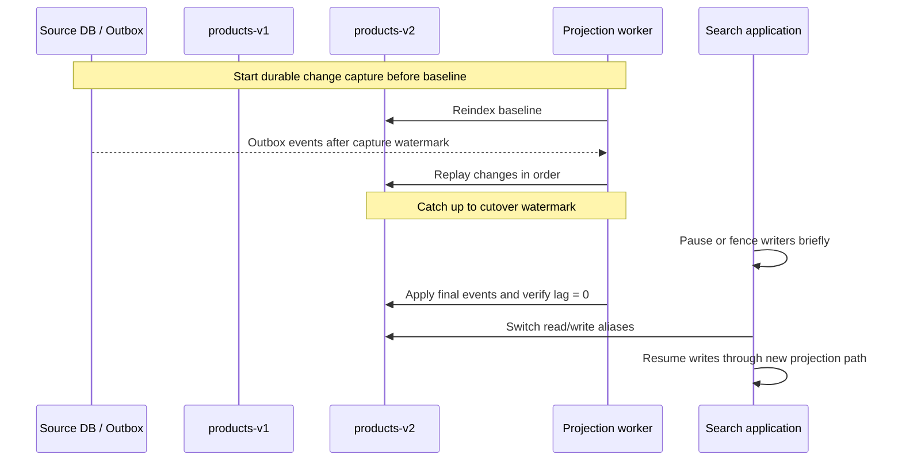
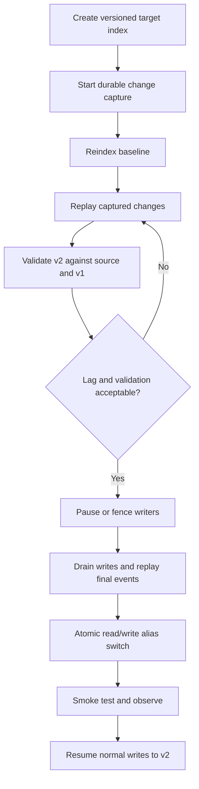

# Reindexing Projections, Switching Aliases, and Rollback Plans

In a Spring Data Elasticsearch application, an index often acts as a projection (read model): data is structured to optimize searching, filtering, sorting, and aggregations. Over time, this model may need to evolve because the domain adds fields, old mappings no longer fit, analyzers change, documents are re-denormalized, or query patterns shift.

Many mapping changes cannot be applied directly to existing fields. For example, changing `text` to `keyword`, changing numeric types, replacing an analyzer, or converting an object structure to `nested` typically requires creating a new index and reloading the data. This workflow consists of three major operations:

1. **Reindex:** create the target index with new mappings/settings and copy or transform documents.
2. **Switch alias:** move read/write aliases from the old index to the new index via an atomic alias update.
3. **Rollback:** retain the old index and change data long enough to roll back if issues surface after cutover.

A stable alias keeps application code unaware of which physical versioned index is currently active. A repository can point to the alias `products`, while the alias successively points to `products-v1`, `products-v2`, or subsequent versions.

The hardest part of an online migration is that writes can continue occurring during reindexing. Reindex only copies the state it reads; updates occurring after the read boundary must be captured and replayed via dual-write, change data capture (CDC), a transactional outbox, or a controlled write pause. Simply switching an alias back to the old index does not restore writes that were sent solely to the new index.

## 1. Projections in Elasticsearch

A projection is a data structure built to serve a specific set of queries. It can be assembled from one or more aggregates/domain entities, then denormalized into documents tailored for the Search API.

For example, an e-commerce system has source data:

```text
Product (database)
  - productId
  - name
  - brandId
  - categoryId

Brand (database)
  - brandId
  - brandName

Category (database)
  - categoryId
  - categoryName
```

The Elasticsearch projection can combine data for fast search:

```json
{
  "product_id": "P-100",
  "name": "Mechanical Keyboard",
  "brand": {
    "id": "B-10",
    "name": "Acme"
  },
  "category": {
    "id": "C-20",
    "name": "Keyboard"
  },
  "price": 2500000,
  "active": true
}
```

A projection can differ from the database schema because it serves read patterns. Changes such as switching `brand.name` from `text` to `keyword`, adding `search_name`, swapping analyzers, or changing `nested` structures may require rebuilding the index.

### 1.1. When Is a New Index Version Needed?

Common situations:

- Changing field types, e.g., `long` to `keyword`.
- Changing analyzers, normalizers, or synonym configurations.
- Changing `object` to `nested` or vice versa.
- Changing how data is denormalized across multiple sources.
- Adding fields requiring backfill from source data.
- Removing old fields or renaming fields under a new schema.
- Changing shard count, replicas, refresh intervals, or creation-time index settings.
- Changing ID generation, routing, or document structure.

Not every change requires reindexing. Certain mapping parameters can be updated via the mapping API, and dynamic settings can be changed directly. However, if a change is incompatible with already-indexed data or requires transforming source documents, create a new index rather than trying to patch the live production index.

### 1.2. Choosing the Source to Rebuild the Projection

There are two main approaches:

| Rebuild source | When suitable | Limitations |
|---|---|---|
| Old Elasticsearch index | `_source` holds enough data to build the new projection. | Cannot recover fields stripped from `_source` or data never stored there. |
| Database/domain source of truth | Need to join new data, fix projection logic, or recover full data. | Requires batch readers, watermarks/CDC, and application mapping logic. |

If the old index stores only partial data, reindexing from that index cannot recreate lost information. When projections depend on multiple tables or aggregates, rebuilding from the authoritative source is usually better.

## 2. Using Versioned Index Names and Stable Aliases

Never couple the entire application directly to physical index names like `products-v1`. Instead, create versioned indexes and a stable alias:

```text
products-v1  <--- alias: products
```

Once migration completes:

```text
products-v2  <--- alias: products
```

Repositories or services continue using the `products` alias; only infrastructure configuration changes which physical index the alias points to.

You can separate read and write aliases:

```text
products-read  ---> products-v2
products-write ---> products-v2 (is_write_index = true)
```

Separating aliases is useful when reads and writes have different routing, filters, or operational policies. If the application needs only a shared alias, one alias can serve both reads and writes while explicitly designating the write index whenever the alias spans multiple indexes.

### 2.1. Aliases Do Not Store Data

An alias is a logical name referencing one or more indexes. Aliases do not copy documents and do not create a transaction layer for write operations.

Aliases can carry settings such as:

- `is_write_index`: the index receiving writes when the alias points to multiple indexes.
- Filter: restricts documents visible through the alias.
- Search/index routing: routes operations by routing value.
- Metadata attributes associated with the alias.

When moving an alias to a new index, preserve all required attributes. Forgetting filters or routing can cause the application to see a different dataset after cutover even when all documents were reindexed.

### 2.2. Declaring an Alias in Spring Data Elasticsearch

Entities can point to a stable alias name:

```java
import org.springframework.data.annotation.Id;
import org.springframework.data.elasticsearch.annotations.Document;
import org.springframework.data.elasticsearch.annotations.Field;
import org.springframework.data.elasticsearch.annotations.FieldType;

@Document(indexName = "products")
public class ProductDocument {

    @Id
    private String id;

    @Field(type = FieldType.Text)
    private String name;

    @Field(type = FieldType.Keyword)
    private String brand;

    @Field(type = FieldType.Double)
    private double price;

    // constructors, getters, setters
}
```

`indexName = "products"` can be an alias managed by Elasticsearch. When the alias switches from `products-v1` to `products-v2`, the repository keeps using the same logical name.

If code hardcodes `@Document(indexName = "products-v1")`, switching the `products` alias will not affect that repository. Therefore, decide clearly whether an entity's index name is an alias or a physical index name.

## 3. Creating the Target Index Before Reindexing

The Reindex API does not automatically copy all mappings, settings, templates, or aliases from source to destination. Create the destination index beforehand with the right configuration.

Example creating `products-v2`:

```http
PUT /products-v2
Content-Type: application/json

{
  "settings": {
    "number_of_shards": 3,
    "number_of_replicas": 1,
    "analysis": {
      "analyzer": {
        "product_name_analyzer": {
          "type": "custom",
          "tokenizer": "standard",
          "filter": ["lowercase", "asciifolding"]
        }
      }
    }
  },
  "mappings": {
    "properties": {
      "product_id": { "type": "keyword" },
      "name": {
        "type": "text",
        "analyzer": "product_name_analyzer",
        "fields": {
          "keyword": { "type": "keyword" }
        }
      },
      "brand": { "type": "keyword" },
      "price": { "type": "scaled_float", "scaling_factor": 100 },
      "active": { "type": "boolean" },
      "created_at": { "type": "date" }
    }
  }
}
```

This is an illustrative mapping example. Field types, analyzers, shard counts, and replicas must reflect actual workload, data volume, queries, and operational requirements.

### 3.1. Entity Mapping vs. Index Mapping

In Spring Data Elasticsearch, `@Document` and `@Field` annotations describe entity mappings. You can use `IndexOperations` to work with indexes and mappings via Spring Data.

Example obtaining operations for a specific index:

```java
import org.springframework.data.elasticsearch.core.IndexOperations;
import org.springframework.data.elasticsearch.core.mapping.IndexCoordinates;

IndexOperations targetIndex = operations.indexOps(
        IndexCoordinates.of("products-v2")
);
```

Depending on your Spring Data Elasticsearch version, you can use `create`, `createWithMapping`, `putMapping`, `getMapping`, and corresponding index operations APIs. When using entity mapping, confirm the actual mapping on the target index after creation.

For mappings relying on analyzer settings, templates, or advanced configuration, you can create the index via Elasticsearch REST API/Java API Client and use Spring Data for entity reads and writes. What matters is that the destination index has complete mappings/settings before receiving bulk data.

### 3.2. Verifying Mappings Before Loading

Inspect mapping:

```http
GET /products-v2/_mapping
```

Inspect settings:

```http
GET /products-v2/_settings
```

Test analyzer:

```http
POST /products-v2/_analyze
Content-Type: application/json

{
  "analyzer": "product_name_analyzer",
  "text": "Mechanical Keyboard"
}
```

Do not wait until after reindexing millions of documents to discover wrong field types or analyzers. Mappings must be tested with sample data and expected queries before running a large migration.

## 4. Basic Reindex API

The Reindex API reads documents from a source index and writes them to a destination index. Example copying all of `products-v1` to `products-v2`:

```http
POST /_reindex
Content-Type: application/json

{
  "source": {
    "index": "products-v1"
  },
  "dest": {
    "index": "products-v2"
  }
}
```

Reindex requires `_source` on source documents. It does not substitute aliases for preparing destination mappings, and does not automatically sync concurrent writes made while the job runs.

The response typically includes fields such as:

- `total`: documents evaluated.
- `created`: documents created at destination.
- `updated`: documents updated.
- `deleted`: documents deleted in applicable operation contexts.
- `batches`: batches processed.
- `version_conflicts`: number of version conflicts.
- `failures`: per-item/batch errors.
- `took`: processing duration.

Do not check HTTP status alone. Inspect `failures`, `version_conflicts`, and counters to verify whether the migration completed as intended.

### 4.1. Using `op_type: create`

If the destination should be populated fresh without overwriting existing documents, you can set:

```http
POST /_reindex
Content-Type: application/json

{
  "source": {
    "index": "products-v1"
  },
  "dest": {
    "index": "products-v2",
    "op_type": "create"
  }
}
```

When an ID already exists at the destination, the item fails with a conflict instead of overwriting. This is useful when the destination already received dual-writes or when rerunning part of a job, though you need an explicit conflict-handling policy.

Never enable `conflicts: proceed` and treat the job as successful based solely on created counts. Conflicts can signal that destination data was already updated newer, or indicate migration errors needing investigation. Distinguish expected conflicts from failures requiring action.

### 4.2. Filtering Source Documents

You can reindex only a subset of documents:

```http
POST /_reindex
Content-Type: application/json

{
  "source": {
    "index": "products-v1",
    "query": {
      "term": {
        "active": true
      }
    }
  },
  "dest": {
    "index": "products-v2"
  }
}
```

The source query must match the exact data scope to migrate. If the destination needs inactive documents too yet the query selects only active ones, migration will miss data without the Reindex API reporting any errors.

## 5. Transforming Documents During Reindex

The Reindex API supports scripts to transform documents while copying. Example renaming `old_price` to `price` and adding a default active status:

```http
POST /_reindex
Content-Type: application/json

{
  "source": {
    "index": "products-v1"
  },
  "dest": {
    "index": "products-v2"
  },
  "script": {
    "lang": "painless",
    "source": "if (ctx._source.old_price != null) { ctx._source.price = ctx._source.old_price; } ctx._source.remove('old_price'); if (ctx._source.active == null) { ctx._source.active = true; }"
  }
}
```

The script runs on every document. Verify:

- Whether old fields can be missing/null.
- Whether transformed data types match destination mappings.
- Whether default rules match business logic.
- Whether the script drops data that should be preserved.
- Whether script overhead significantly slows migration.

If projection logic is complex, requires joining multiple sources, or invokes business services, a reindex script is usually insufficient. In that case, read from the source of truth, transform in the application or dedicated pipeline, and bulk index into the destination.

### 5.1. Using an Ingest Pipeline

The destination can use an ingest pipeline to normalize documents upon ingestion. Example reindex specifying a pipeline:

```http
POST /_reindex
Content-Type: application/json

{
  "source": {
    "index": "products-v1"
  },
  "dest": {
    "index": "products-v2",
    "pipeline": "products-projection-v2"
  }
}
```

Create and test the pipeline beforehand. Avoid modifying a pipeline mid-migration if reproducible outcomes are needed; version pipelines just like mappings and indexes.

## 6. Running Long Reindexes with the Task API

For large datasets, avoid holding an HTTP connection open until the entire reindex finishes. Run asynchronously:

```http
POST /_reindex?wait_for_completion=false
Content-Type: application/json

{
  "source": {
    "index": "products-v1"
  },
  "dest": {
    "index": "products-v2"
  }
}
```

The response returns a task ID. Store the task ID in migration job metadata for tracking.

Check status:

```http
GET /_tasks/<task_id>
```

The response reports whether the task is still running or completed, progress, status, and errors if any.

You can list running reindex tasks:

```http
GET /_tasks?actions=*reindex&detailed=true
```

If a task must be stopped:

```http
POST /_tasks/<task_id>/_cancel
```

Canceling does not roll back documents already written to the destination. The destination may hold partial data and must be cleaned up or resumed under a controlled procedure.

### 6.1. Tracking Tasks and Saving Results

A migration job should persist:

- Source index and destination index.
- Mapping/schema version.
- Reindex task ID.
- Start/end timestamps.
- Total documents, created/updated, and failure counts.
- Relevant change stream version/watermark.
- Initiating user/process and cutover status.

If the migration controller process restarts, it can look up the task by ID instead of launching an ambiguous duplicate reindex.

## 7. Throttling and Slicing Reindex Jobs

Reindexing can place heavy load on both source and destination. Common options:

- `slices`: splits work into parallel slices.
- `requests_per_second`: throttles batch rate.
- `max_docs`: caps document count for dry runs or scoped migrations.
- `scroll`: retention duration for the source read context between batches.
- `wait_for_completion=false`: runs as a background task.

Throttle example:

```http
POST /_reindex?wait_for_completion=false&requests_per_second=500
Content-Type: application/json

{
  "source": {
    "index": "products-v1"
  },
  "dest": {
    "index": "products-v2"
  }
}
```

`requests_per_second` regulates the Reindex API's batch rate; it is not a fixed documents-per-second guarantee. Measure in practice and tune against CPU, disk I/O, indexing pressure, search latency, and write rejections.

You can use slicing for parallelism:

```http
POST /_reindex?wait_for_completion=false&slices=auto
Content-Type: application/json

{
  "source": {
    "index": "products-v1"
  },
  "dest": {
    "index": "products-v2"
  }
}
```

More slicing is not always faster. Many slices increase open search contexts, request concurrency, and cluster pressure. Start moderately and benchmark.

## 8. Reindex Does Not Automatically Sync Concurrent Writes

This is the highest risk of zero-downtime migrations.

Suppose reindexing begins at 10:00. While the job runs:

- 10:01: product P-100 gets a price update.
- 10:02: product P-200 is created.
- 10:03: product P-300 is deleted.
- 10:05: reindex reads an older subset of documents.

Without change capture, the destination may retain stale state, miss P-200, or still contain P-300. Switching the alias to the destination at 10:10 drops the newest updates from the read path.

Reindex reads the source via Elasticsearch scan/search mechanics. It is not a transactional snapshot paired with a write log that replays every mutation occurring during the job. Design a sync boundary and separate delta stream.

## 9. Short-Downtime Migration Strategy

If the system can pause writes briefly, the simplest workflow is:

1. Put the application into maintenance/read-only mode or stop write producers.
2. Drain in-flight writes to completion.
3. Create the destination index and reindex all data.
4. Refresh the destination.
5. Reconcile counts and samples.
6. Switch the alias to the destination.
7. Verify reads/writes through the alias.
8. Resume write traffic.

```text
Stop writes
    |
    v
Drain in-flight writes
    |
    v
Reindex source -> destination
    |
    v
Refresh + validate
    |
    v
Atomic alias switch
    |
    v
Resume writes on destination
```

The advantage is simplicity and fewer moving parts. The disadvantage is that write downtime scales with dataset size and reindex speed. For large indexes, downtime can be too long.

## 10. Online Strategy Using Dual-Write

Dual-write writes new changes to both the old and new indexes during migration. A flow can execute:

1. Enable concurrent writes to `products-v1` and `products-v2`.
2. Capture the dual-write start marker.
3. Run backfill from source to destination.
4. Ensure backfill does not overwrite newer versions produced by dual-write.
5. Reconcile both indexes.
6. Switch the alias to the destination.
7. Continue writing to the destination; optionally maintain sync back to v1 during the rollback window if rollback is needed.

### 10.1. Race Risk Between Backfill and Dual-Write

Example:

1. Reindex reads P-100 at an older version.
2. Application dual-writes a newer version of P-100 to the destination.
3. Reindex later writes the older version of P-100.

If reindex uses standard overwrite semantics, the older version overwrites newer data. Enabling dual-write alone does not prevent this race.

Ways to control it:

- Use source versions and external versioning so older versions cannot overwrite newer ones.
- Backfill the destination first, then replay a change log in version order.
- Use deterministic IDs and a reconciliation pass to catch lower-version documents.
- Pause updates briefly at the end, drain write queues, and run a final delta pass before cutover.

Versioning must stay consistent across source, reindex, and write path. Never add `version_type` arbitrarily if source `_version` does not represent the desired business version.

### 10.2. Dual-Write Is Not a Distributed Transaction

If the application writes to v1 successfully yet fails writing to v2, the two indexes diverge. If v2 succeeds and v1 fails, state also diverges. Calling two sequential requests does not create an atomic transaction across two indexes.

When using dual-write, you need:

- Per-target outcome tracking.
- Idempotent retries.
- Durable sync state or change event storage.
- Reconciliation to detect and fix drift.
- Clarity on which index is authoritative in each phase.

For critical systems, transactional outbox/CDC is usually far more reliable than issuing two independent writes from a service.

## 11. Online Strategy Using CDC or Transactional Outbox

When a database is the authoritative data source, changes can be captured via CDC or a transactional outbox and applied to the Elasticsearch projection.

General flow:

```text
Database transaction
      |
      +---- update domain rows
      |
      +---- append outbox event
                |
                v
         CDC / event consumer
                |
                +------> products-v1
                |
                +------> products-v2 (during migration)

Initial snapshot --------------------> products-v2
```

Migration steps:

1. Establish a repeatable change-log position/watermark `W0`.
2. Start storing or retaining all events from `W0` onward.
3. Create the destination index with the v2 mapping.
4. Load the source snapshot into v2.
5. Replay events from `W0` in appropriate order to bring v2 up to date.
6. Reconcile and wait for consumer lag to reach 0 or below a defined threshold.
7. Briefly pause/serialize writes, drain final events, and confirm final watermark `W1`.
8. Switch the alias to v2.
9. Keep consumers running against v2; retain the event log long enough for rollback.

The tricky part is aligning the snapshot with the watermark. If the snapshot reflects state after `W0` while replaying events from `W0`, the same change may apply twice. If the snapshot is older than `W0` and skips some events, data can be lost. Use a consistent snapshot/CDC pairing, such as a database snapshot tied to a log position or an outbox with explicit checkpoints.

### 11.1. Idempotency and Event Ordering

Event consumers must handle:

- Redelivered events.
- Late or out-of-order events across multiple partitions/workers.
- Entities updated multiple times before the consumer catches up.
- Deletes represented via tombstones or delete events.

Use aggregate IDs, event IDs, and versions to detect already-processed events and prevent older versions from overwriting newer ones. When projections combine multiple sources, ensure events carry sufficient data or consumers can re-read authoritative state from the source of truth.

### 11.2. Dual-Write During the Rollback Window

After switching the alias to v2, if you want the option to revert to v1 without losing writes, keep v1 synchronized or retain a change log capable of replaying backward/forward per your migration plan.

You do not need to maintain dual-write forever. You can retain outbox/CDC events during the rollback window and retire v1 sync once v2 proves stable. However, if you stop updating v1, rolling back later requires replaying data from the event log or rebuilding from the source of truth.

## 12. Validating Before Cutover

Do not switch aliases solely because the Reindex API returned `completed`. Verify destination counts, contents, and query readiness.

### 12.1. Refreshing the Destination

Before running search/count checks, refresh the destination:

```http
POST /products-v2/_refresh
```

If reindex tasks are still running or CDC replay has not finished, do not treat validation metrics as final.

### 12.2. Comparing Document Counts

```http
GET /products-v1/_count
```

```http
GET /products-v2/_count
```

Compare counts over the exact same scope and watermark. If v1 still accepts writes during validation while v2 has not finished replaying, differing counts are not necessarily a reindex bug; still, never cut over until deltas are caught up and sync criteria are met.

### 12.3. Checking Sample IDs

Pick a representative sample of IDs:

- Recently created documents.
- Recently updated documents.
- Documents with optional/null fields.
- Documents with nested arrays or edge-case data.
- Documents with Unicode text, dates, and numeric boundaries.

Fetch by ID from both indexes and compare key fields. If transformations were intentional, verify against transformation rules rather than byte-for-byte equality.

### 12.4. Testing Production Queries

Run the queries production applications execute:

- Match/full-text queries using new analyzers.
- Term filters on keyword fields.
- Range filters/sorts on numeric/date fields.
- Nested queries if mappings switched to `nested`.
- Required aggregations and cardinalities.
- Geo queries, routing, or alias filters if applicable.

An index with exact document counts can still break the application if mapping/analyzer changes alter query behavior.

### 12.5. Checking Errors and Data Distribution

Verify:

- Reindex `failures` equals 0, or all failures are resolved.
- `version_conflicts` match policy expectations.
- Counts match by tenant/category/status or business partition.
- Required fields show expected missing rates.
- No unresolved mapping rejections or bulk failures remain.
- CDC/outbox lag and watermark reached the cutover target.

## 13. Atomic Alias Switching

Once the destination is ready, use a single `_aliases` request to remove the alias from the old index and add it to the new index. Elasticsearch executes all actions in the request as one atomic cluster-state alias update.

Example for shared alias `products`:

```http
POST /_aliases
Content-Type: application/json

{
  "actions": [
    {
      "remove": {
        "index": "products-v1",
        "alias": "products"
      }
    },
    {
      "add": {
        "index": "products-v2",
        "alias": "products",
        "is_write_index": true
      }
    }
  ]
}
```

Once the request succeeds, new requests through `products` route to v2. There is no window where the alias is removed in one request before being re-added in another.

### 13.1. Switching Read and Write Aliases Together

When using two separate aliases:

```http
POST /_aliases
Content-Type: application/json

{
  "actions": [
    { "remove": { "index": "products-v1", "alias": "products-read" } },
    { "remove": { "index": "products-v1", "alias": "products-write" } },
    { "add": { "index": "products-v2", "alias": "products-read" } },
    {
      "add": {
        "index": "products-v2",
        "alias": "products-write",
        "is_write_index": true
      }
    }
  ]
}
```

Combining actions in one request switches both read and write aliases in the same cluster state update. Confirm the application genuinely uses the right alias for each flow.

### 13.2. Why Is `is_write_index` Needed?

An alias can point to multiple indexes for combined reads. However, when writing through a multi-index alias, Elasticsearch needs to know which index receives writes. `is_write_index: true` designates the target write index.

If an alias points to only one index, Elasticsearch defaults that index as the write index, yet declaring it explicitly makes configuration clearer—especially during migrations.

Never point a write alias to both v1 and v2 expecting automatic dual-write. Aliases do not fan out writes to all member indexes; they route writes solely to the designated write index.

## 14. Spring Data Elasticsearch After Switching Aliases

If the entity uses a stable alias:

```java
@Document(indexName = "products")
public class ProductDocument {
    // fields
}
```

the repository continues using the alias:

```java
public interface ProductRepository
        extends ElasticsearchRepository<ProductDocument, String> {
}
```

Once `products` switches to `products-v2`, new repository operations target v2 via the entity's configured index name.

### 14.1. Avoid Unexpected Cached Physical Index Names in Clients

Applications might cache index names, `IndexCoordinates`, or maintain dedicated services pointing directly to `products-v1`. Those paths will not follow alias switches automatically. Before cutover, audit every reference to physical index names:

- `@Document(indexName = ...)`.
- `IndexCoordinates.of(...)`.
- Direct REST queries.
- Bulk/reindex jobs.
- Dashboards, monitoring, or other integrations.
- Ingest pipelines and templates.

Keeping stable aliases in application code and managing versioned index names in migration/configuration lowers risk.

### 14.2. Repositories and Write Aliases

When `save()` or `delete()` runs through a repository using an alias, Elasticsearch resolves the alias to its write index. If the alias spans multiple indexes, `is_write_index` must be set. If a migration write path needs to target a specific index directly, use custom operations/`IndexCoordinates` or an appropriate client, ensuring that path is controlled and normal repositories do not accidentally bypass the alias.

## 15. Pre-Cutover Rollback Plan

If reindex fails before the alias switches:

1. Keep read/write aliases on v1.
2. Do not expose v2.
3. Save the task output and failure list for investigation.
4. Fix mappings/scripts/sources and recreate or clean up the destination per procedure.
5. Re-run reindexing and reconciliation.

Users remain unaffected on the old index because the alias never moved. The failed destination can be deleted and recreated if it holds no unique data that must be kept.

## 16. Post-Cutover Rollback Plan

After switching the alias to v2, rollback can switch the alias back to v1:

```http
POST /_aliases
Content-Type: application/json

{
  "actions": [
    { "remove": { "index": "products-v2", "alias": "products" } },
    {
      "add": {
        "index": "products-v1",
        "alias": "products",
        "is_write_index": true
      }
    }
  ]
}
```

The alias operation itself is fast and atomic, yet it only changes where the alias points. It does not synchronize data back from v2 to v1.

### 16.1. Risk of Losing Post-Cutover Writes

Suppose:

1. Alias switches to v2 at 12:00.
2. User creates P-500 at 12:05; write goes only to v2.
3. User updates P-100 at 12:06; write goes only to v2.
4. At 12:10, an application bug is spotted and the alias switches back to v1.

v1 lacks P-500 and still holds the older version of P-100. An alias rollback reverts the read path to stale data, making post-cutover writes disappear from the application.

Therefore, **never treat an alias rollback as a data rollback**. You need a write-sync plan covering the rollback window.

### 16.2. Ways to Ensure Zero-Data-Loss Rollback

Choose one of these strategies:

**Maintain dual-write during the rollback window**

- Post-cutover, continue writing changes to both v2 and v1.
- Monitor per-target outcomes and retry/reconcile drift.
- On rollback, v1 already has the newest writes and can safely retake the alias.
- Retire dual-write only when the rollback window closes.

**Retain CDC/outbox and replay to v1**

- Durably persist all post-cutover changes.
- On rollback, replay events from the appropriate watermark into v1.
- Ensure events are idempotent, ordered/versioned, and include delete events.
- Switch the alias only after replay catches up.

**Pause writes during rollback**

- Block write producers or switch to read-only mode.
- Drain in-flight requests.
- Sync latest changes from v2/source of truth back to v1.
- Verify data and switch the alias back to v1.
- Re-enable writes after verification.

**Recover from the source of truth**

- If the database is authoritative, rebuild v1 from the source of truth or replay the event log.
- This takes longer, yet avoids relying on a buggy projection.

### 16.3. Retaining the Old Index During the Rollback Window

Do not delete `products-v1` immediately after cutover. Keep the old index long enough to:

- Observe mapping/query bugs and business defects.
- Evaluate production performance.
- Execute a rollback if necessary.
- Replay/reconcile data.

The rollback window duration balances risk against storage cost. Delete v1 only after confirming v2 stability, verifying the write path, confirming CDC/dual-write is no longer needed, and obtaining stakeholder sign-off to close the rollback window.

## 17. Cutover and Rollback Decision Matrix

| Situation | Action |
|---|---|
| Reindex fails, alias unchanged | Keep v1; fix error and rerun v2. |
| Reindex completes yet validation fails | Do not cut over; investigate mapping/transform/data. |
| CDC lag has not reached threshold | Do not cut over; continue replaying and reconciling. |
| Alias switch succeeds, smoke tests pass | Monitor v2 and keep v1 throughout the rollback window. |
| Failure post-cutover, v1 still receives dual-writes | Can switch alias back to v1 per procedure. |
| Failure post-cutover, v1 stopped receiving writes | Sync deltas to v1 or rebuild from source of truth before rolling back. |
| v2 has bugs yet unique data exists only in v2 | Do not delete v2; extract/replay needed data before rollback. |
| Rollback window ends, v2 stable | Stop old dual-write/CDC per plan and retire v1. |

## 18. Phased Migration Runbook Example

An online migration can be structured as follows:

```text
Phase A — Preparation
  - Create products-v2
  - Install v2 mappings/settings/pipeline
  - Verify current aliases

Phase B — Change Capture
  - Lock in watermark W0
  - Enable/retain CDC or outbox from W0

Phase C — Backfill
  - Reindex or read source snapshot into v2
  - Monitor tasks, failures, and throttling

Phase D — Catch-Up
  - Replay events from W0
  - Verify versions, counts, samples, queries
  - Wait for lag to drop below cutover threshold

Phase E — Cutover
  - Briefly drain/serialize writes
  - Replay final deltas up to W1
  - Atomic alias switch v1 -> v2
  - Smoke test reads/writes

Phase F — Rollback Window
  - Retain v1 and change log
  - Dual-write or ensure reverse replay to v1
  - Monitor errors and performance

Phase G — Completion
  - Close rollback window
  - Retire old sync pipeline
  - Delete v1 per retention policy
```

Watermarks `W0` and `W1` must be recorded in migration metadata. Never rely solely on wall-clock time when the event source provides exact offsets/sequences.

## 19. Production Migration Pre-Flight Checklist

**Target index**

- New version name does not collide with existing indexes.
- Mappings, analyzers, normalizers, templates, and settings verified.
- Shard/replica counts sized appropriately.
- Destination is not receiving unplanned production writes.

**Source and synchronization**

- `_source` contains sufficient data if reindexing from the old index.
- Source of truth identified.
- Watermark and write capture mechanism locked in.
- Inserts/updates/deletes during backfill handled.
- Event replay enforces idempotency and version ordering.

**Reindex**

- Source query covers the right scope.
- Transform/pipeline tested.
- Batching, slicing, throttling, and timeouts configured appropriately.
- Task ID persisted and monitored.
- `failures` and `version_conflicts` classified.

**Validation**

- Destination refreshed.
- Counts and data distributions reconciled at matching watermarks.
- Sample IDs and key fields verified.
- Queries, sorts, aggregations, and new analyzers verified.
- CDC lag within cutover threshold.

**Cutover and rollback**

- Read/write aliases inventoried and confirmed prior to changes.
- Alias filters/routing preserved.
- Single `_aliases` request executes the entire switch.
- Write index explicitly specified.
- Post-cutover smoke tests ready.
- Old index retained.
- Replay/dual-write strategy in place so rollback loses no post-cutover writes.
- Owner and clear abort/rollback criteria assigned.

## 20. Common Pitfalls

| Symptom | Possible cause | Resolution |
|---|---|---|
| Reindex reports mapping errors | Destination mapping incompatible with source or transform. | Check field types, edge values, and scripts; recreate destination index if needed. |
| Reindex finishes with missing documents | Wrong source query filter, missing `_source`, or ignored failures. | Check query, `_source`, `failures`, and per-partition counts. |
| Destination unintentionally inherits old mapping | Assumed Reindex API copies mappings/settings automatically. | Create destination with mappings/settings before reindexing. |
| Destination overwrites newer data with older backfill | Race between reindex and dual-write. | Use versioning or backfill first then replay change log in order. |
| Documents created during reindex missing in v2 | Failed to capture new writes. | Use CDC/outbox, dual-write, or a maintenance window. |
| Documents deleted at source linger in v2 | Delete events not replayed. | Use tombstones/delete events and reconciliation. |
| Alias rejects writes after cutover | Alias points to multiple indexes without a write index. | Set `is_write_index: true` on target index. |
| Application still reads old index | Some code paths use physical index names instead of aliases. | Audit and switch all read/write paths to stable aliases. |
| Alias filter/routing changed after cutover | Forgot to replicate alias metadata. | Compare alias config before and after migration. |
| Alias rollback loses new data | Post-cutover writes went only to v2. | Dual-write, replay events, or sync deltas to v1 before rolling back. |
| Reindex task runs too slowly | Suboptimal batch/slicing/concurrency or cluster capacity. | Throttle, measure load, tune mappings, and adjust slicing. |
| Reindex task canceled leaving partial destination | Cancel does not roll back already-written items. | Mark destination incomplete; clean up or resume carefully. |
| Counts differ between two indexes | Compared across different watermarks or CDC not caught up. | Sync to the same boundary and re-reconcile. |
| v2 runs yet business queries return wrong results | Mapping/analyzer or projection transform changed semantics. | Run query acceptance suite before cutover. |

## 21. Key Takeaways

- Elasticsearch projections are typically versioned when mappings, analyzers, or document structures change incompatibly.
- Create the new versioned index with complete mappings/settings before loading data.
- The Reindex API copies documents from source to destination, but does not copy mappings/settings or sync writes occurring after the read scan.
- Inspect `failures`, `version_conflicts`, counts, and sample data; HTTP success alone never proves a migration is correct.
- Use the Task API, slicing, and throttling for large or long-running reindexes.
- Aliases are logical pointers, not data copies, and do not automatically dual-write.
- Use a single `_aliases` request to atomically remove/add aliases; set `is_write_index` when needed.
- Keep stable aliases in `@Document(indexName = "...")` so repositories do not depend on physical index versions.
- Online reindexing must capture/replay inserts, updates, and deletes via CDC, outbox, dual-write, or controlled downtime.
- Dual-write is not a transaction; handle partial failures, retries, idempotency, and races against backfill.
- Before cutover, refresh the destination and reconcile at a matching watermark.
- Alias rollback switches only the read/write target; it does not migrate new writes from v2 back to v1.
- Retain the old index during the rollback window and delete it only after agreeing to close rollback capability.
- Design rollback as a data workflow with replay/dual-write, not just a single alias swap command.

Reindexing projections, switching aliases, and rolling back form a multi-checkpoint data synchronization workflow. Create the new index with proper mappings, load a snapshot, catch up concurrent changes, validate data, and switch aliases atomically. Retain the old index and change log throughout the rollback window so you can revert without losing post-cutover writes.

## References

- [Elasticsearch — Reindex API](https://www.elastic.co/guide/en/elasticsearch/reference/current/docs-reindex.html)
- [Elasticsearch — Index aliases](https://www.elastic.co/guide/en/elasticsearch/reference/current/aliases.html)
- [Elasticsearch — Update aliases API](https://www.elastic.co/guide/en/elasticsearch/reference/current/indices-aliases.html)
- [Elasticsearch — Tasks API](https://www.elastic.co/guide/en/elasticsearch/reference/current/tasks.html)
- [Elasticsearch — Tune for indexing speed](https://www.elastic.co/guide/en/elasticsearch/reference/current/tune-for-indexing-speed.html)
- [Spring Data Elasticsearch — Object mapping](https://docs.spring.io/spring-data/elasticsearch/reference/elasticsearch/object-mapping.html)
- [Spring Data Elasticsearch — Index operations](https://docs.spring.io/spring-data/elasticsearch/reference/elasticsearch/template.html)
# Reindexing Projections, Switching Aliases, and Rollback Plans

A reindex migration creates a new versioned index with updated mappings, settings, or document structures, loads data into it, verifies the results, and switches application aliases to the target index. Physical indexes carry versioned names such as `products-v1` and `products-v2`; applications use stable aliases such as `products-read` and `products-write`.

An alias switch changes only the access target. It does not copy data, synchronize writes occurring during reindexing, or create a transaction between two indexes. A migration plan must address baselines, change capture, validation, cutover, and rollback.
## 1. Projections and Why Reindexing Is Needed

Suppose a business database has a product table. A projection worker creates search documents:

```json
{
  "productId": "product-1001",
  "sku": "KB-1001",
  "name": "Mechanical Keyboard",
  "nameSort": "mechanical keyboard",
  "category": "keyboard",
  "price": 135.0,
  "active": true,
  "projectionVersion": 12
}
```

An Elasticsearch index can be tailored specifically for search: `name` uses `text`, `nameSort` uses `keyword`, `category` uses `keyword` for facets, `price` uses numeric types for ranges/sorts. This structure is a read model and need not match the database schema.

Common reasons requiring a new index:

- Changing a field from `text` to `keyword`, or vice versa.
- Adding multi-fields, normalizers, or new analyzers.
- Changing data types, date formats, or value representations.
- Converting an object array to `nested` to preserve per-element relationships.
- Renaming fields, normalizing data, or adding derived fields.
- Changing how information is denormalized from multiple tables/aggregates.
- Fixing bugs in projection logic that left legacy data incorrect.
- Creating a new index with different shards/replicas/settings.

Modifying existing mappings is limited. For instance, you cannot directly change an already-indexed `text` field to `keyword` via a simple mapping update. Creating a new index with the desired mapping, reloading documents, and switching aliases is the safer implementation path.

## 2. Using Versioned Indexes and Stable Aliases

Never let every service depend directly on physical index names like `products-v1`. Use versioned index names with stable aliases:

| Name | Role |
|---|---|
| `products-v1` | Current physical index |
| `products-v2` | New physical index |
| `products-read` | Read alias used by the application |
| `products-write` | Write alias used by the projection worker |

The application reads via `products-read`; the worker writes via `products-write`. Once migration completes, aliases move from `products-v1` to `products-v2`. Application code does not need index name edits everywhere.

### 2.1 Separating Read Aliases and Write Aliases

Separating read and write aliases gives clean cutover control:

- `products-read`: can point to indexes serving queries.
- `products-write`: specifies the index receiving new writes.

An alias pointing to multiple indexes can serve searches, but write operations require identifying a single write index. When an alias spans multiple indexes, set `is_write_index: true` on the index receiving writes. When an alias points to only one index, Elasticsearch defaults that index as the write index; declaring it explicitly still makes configuration clearer.

Initial alias setup example:

```http
POST /_aliases
{
  "actions": [
    {
      "add": {
        "index": "products-v1",
        "alias": "products-read"
      }
    },
    {
      "add": {
        "index": "products-v1",
        "alias": "products-write",
        "is_write_index": true
      }
    }
  ]
}
```

`products-v1` is the physical index. Application search/index requests use aliases. Never create an alias with the same name as an existing index.

### 2.2 Configuring Spring Data Elasticsearch

Entities can declare an alias as their default index name:

```java
@Document(indexName = "products-read")
public class ProductDocument {

    @Id
    private String productId;

    @Field(type = FieldType.Keyword)
    private String sku;

    @Field(type = FieldType.Text)
    private String name;

    @Field(type = FieldType.Double)
    private Double price;
}
```

If the same entity is used for writes, ensure the repository/template actually writes to `products-write` as designed. You can pass explicit `IndexCoordinates` to `ElasticsearchOperations`:

```java
private static final IndexCoordinates READ_INDEX =
    IndexCoordinates.of("products-read");

private static final IndexCoordinates WRITE_INDEX =
    IndexCoordinates.of("products-write");

SearchHits<ProductDocument> search(Query query) {
    return operations.search(query, ProductDocument.class, READ_INDEX);
}

String index(ProductDocument document) {
    return operations.index(
        IndexQueryBuilder.newBuilder()
            .withId(document.getProductId())
            .withObject(document)
            .build(),
        WRITE_INDEX
    );
}
```

Exact builder and overload names depend on your Spring Data Elasticsearch version; the idea is keeping read/write targets explicit. If a repository defaults to a single alias for both reads and writes, verify that the alias configures `is_write_index` and aligns with your migration process.

## 3. Creating the Target Index Before Reindexing

Reindex copies documents from source to destination, but does not automatically copy all index settings, mappings, templates, or aliases in a way that replaces explicit index preparation. Create the target index with the desired configuration first.

Example creating `products-v2`:

```http
PUT /products-v2
{
  "settings": {
    "number_of_shards": 3,
    "number_of_replicas": 1,
    "analysis": {
      "normalizer": {
        "lowercase_normalizer": {
          "type": "custom",
          "filter": ["lowercase", "asciifolding"]
        }
      }
    }
  },
  "mappings": {
    "properties": {
      "productId": { "type": "keyword" },
      "sku": { "type": "keyword" },
      "name": {
        "type": "text",
        "fields": {
          "raw": {
            "type": "keyword",
            "normalizer": "lowercase_normalizer"
          }
        }
      },
      "category": { "type": "keyword" },
      "price": { "type": "double" },
      "active": { "type": "boolean" },
      "projectionVersion": { "type": "long" }
    }
  }
}
```

This is an illustrative configuration. Shard count, replicas, analyzers, normalizers, and mappings must reflect actual workload, data, and Elasticsearch version.

### 3.1 Preparing Mappings and Templates

Before loading data, define:

- Mappings for every field queried, sorted, aggregated, and highlighted.
- Which fields are `text` and which are `keyword`.
- Date formats, numeric types, and nested/object structures.
- Analyzers/normalizers and synonym resources.
- Dynamic mapping policy.
- Shards/replicas, refresh intervals, and allocation settings.
- Ingest pipelines if the projection requires transforms.

If indexes are created via index templates, verify no template applies unexpectedly to the new index. A new versioned index name might match a different template pattern than the old index.

### 3.2 Separating Projection Logic Versions

When document structures change, record the projection version in the document or metadata:

```json
{
  "productId": "product-1001",
  "projectionVersion": 12,
  "projectionSchema": "products-v2"
}
```

Versioning identifies which logic generated a document, aiding debugging and reconciliation. Both fields are not mandatory in every system, yet migrations should maintain a clear way to identify schema/projection versions.

## 4. Reindexing Existing Data

The reindex API reads documents from a source index and writes them to a destination index:

```http
POST /_reindex
{
  "source": {
    "index": "products-v1"
  },
  "dest": {
    "index": "products-v2"
  }
}
```

If the source has stable `_id`s and the destination uses the same IDs, reindex preserves document identities. Document `_source` transfers to the destination and gets indexed under the target mapping.

### 4.1 Reindexing with Transformations

You can use a script to reshape documents during copying:

```http
POST /_reindex
{
  "source": {
    "index": "products-v1"
  },
  "dest": {
    "index": "products-v2"
  },
  "script": {
    "lang": "painless",
    "source": "ctx._source.nameSort = ctx._source.name.toLowerCase(); ctx._source.projectionVersion = 12;"
  }
}
```

Scripts must handle missing/null fields and legacy data. When transformations are complex or span multiple data sources, running a projection builder from the authoritative source is usually better than cramming all logic into Painless.

### 4.2 Filtering Data During Reindex

You can reindex only a subset of documents:

```http
POST /_reindex
{
  "source": {
    "index": "products-v1",
    "query": {
      "term": {
        "active": true
      }
    }
  },
  "dest": {
    "index": "products-v2"
  }
}
```

Use filters only when the target index genuinely should hold that subset. If the new index must be a complete projection, adding a query filter accidentally omits documents.

### 4.3 Asynchronous Reindexing

For large datasets, requests can take a long time. Use `wait_for_completion=false` to get a task ID:

```http
POST /_reindex?wait_for_completion=false
{
  "source": {
    "index": "products-v1"
  },
  "dest": {
    "index": "products-v2"
  }
}
```

The response returns a task ID. Track progress:

```http
GET /_tasks/<task_id>
```

When a task must be stopped:

```http
POST /_tasks/<task_id>/_cancel
```

Canceling a task does not roll back documents already written to the destination. When rerunning, define overwrite/skip/conflict handling and inspect the destination index before resuming.

### 4.4 Slicing and Throttling

For large datasets, reindex supports slicing to split work and throttling to limit rate:

```http
POST /_reindex?wait_for_completion=false&slices=auto&requests_per_second=500
{
  "source": {
    "index": "products-v1"
  },
  "dest": {
    "index": "products-v2"
  }
}
```

`slices=auto` can split work across shards; `requests_per_second` limits request/batch rate. These operational parameters should be benchmarked on a realistic cluster. Excessive concurrency can impact live search and ingestion.

### 4.5 Handling Conflicts and Errors

`conflicts=proceed` lets reindex continue when encountering version conflicts:

```http
POST /_reindex?conflicts=proceed
{
  "source": {
    "index": "products-v1"
  },
  "dest": {
    "index": "products-v2"
  }
}
```

It does not mean conflicts were resolved or data is guaranteed complete. Responses report `version_conflicts`, `failures`, `created`, `updated`, `noops`, and batch counts. Inspect these fields and decide on retries/reconciliation. Never ignore `failures` simply because the task completed.
## 5. Reindexing While the Source Still Receives Writes

This is the hardest part of online migrations. Suppose:

1. 10:00 reindex begins from `products-v1` to `products-v2`.
2. 10:05 a product is updated at the source.
3. Reindex already read that document before 10:05.
4. Reindex finishes at 10:20.

The destination may still hold pre-10:05 values. Reindex is not a CDC mechanism that automatically syncs changes occurring after a document was scanned. Similarly, documents deleted from the source during migration can remain at the destination unless deletes are propagated.

Accordingly, three common strategies exist:

1. Pause writes during reindexing (maintenance window).
2. Write concurrently / dual-write to both indexes during migration.
3. Use change capture such as transactional outbox/CDC, reindex the baseline, and replay changes before cutover.

Choose based on acceptable downtime, change volume, authoritative data source, and rollback requirements.

## 6. Simple Strategy: Pausing Writes

If the system tolerates a maintenance window:

1. Block or queue incoming write commands.
2. Wait for in-flight requests/workers to finish.
3. Reindex everything from source to destination.
4. Verify counts and data.
5. Switch read/write aliases.
6. Re-enable writes.

The advantage is simplicity and easy verification: no source changes happen during copying. The drawback is that write downtime scales with reindex and validation duration.

Do not stop only HTTP endpoints while forgetting background workers, scheduled jobs, bulk importers, or event consumers. All writers must be paused or queued consistently.

## 7. Online Strategy: Transactional Outbox or CDC

If writes cannot be paused for long, you need a durable change log. When a database is the source of truth, a transactional outbox is a common choice:

1. Start recording all business changes in the outbox before starting the baseline.
2. Record the event stream offset/high-watermark.
3. Reindex the baseline from the old projection or rebuild new projections from the database.
4. Replay events starting from the watermark into the new destination.
5. Monitor lag and keep replaying until near real-time.
6. Pause or serialize writers for a brief cutover window.
7. Replay final events up to a confirmed watermark.
8. Switch aliases and resume writers on the new path.



Outbox events must contain enough data to build the new projection or allow the worker to re-read the current aggregate from the database. If an event says only "product changed" without clear payload/sequence details, the worker needs a way to load the latest state and prevent old events from overwriting newer state.

### 7.1 Handling Ordering and Versions

Each aggregate should carry a monotonically increasing version or business sequence number. Projection workers apply events only when the event version is newer than the recorded version:

```json
{
  "productId": "product-1001",
  "aggregateVersion": 42,
  "price": 135.0,
  "active": true
}
```

Versions help:

- Detect duplicate events.
- Prevent stale events from overwriting newer events.
- Detect sequence gaps or out-of-order delivery.
- Compare projections against the source of truth during reconciliation.

If using Elasticsearch external versioning, understand `version`/`version_type` semantics and conflict handling. Another strategy is having the worker check `aggregateVersion` inside the document and update only if newer. Never let an older baseline overwrite newer replayed events.

### 7.2 Handling Deletes with Tombstones/Events

Baseline reindexing copies only existing documents. If the source deletes a document after the baseline scanned it, the destination can retain the stale record. The change stream must represent deletes—for example via `ProductDeleted` events or tombstones carrying aggregate ID and version. Workers apply deletes in version order.

If the event stream does not preserve deletes, you need a way to reconcile against the source of truth to detect orphaned documents in the destination. Replaying creates/updates alone is insufficient for full projection sync.

### 7.3 Avoiding Races Between Baseline and Replay

Never run baseline and replay concurrently in an unguarded fashion. An older baseline document could write after a newer event and overwrite newer state. The simplest approach is finishing the baseline before replaying events sequentially from the watermark. If running in parallel, enforce a version fence/external versioning guaranteeing older versions cannot overwrite newer ones.

## 8. Direct Dual-Write to Two Indexes

Another option is modifying the projection worker to write to both the old and new indexes during migration:

```text
ProductChanged event
      |
      +----> projection v1 -> products-v1
      |
      +----> projection v2 -> products-v2
```

The advantage is that both indexes continue receiving updates while v2 is validated. The drawback is that the two writes are non-atomic: one index can succeed while the other fails. The worker must retry each target independently and track sync status.

Never dual-write by placing two write calls in the same method and treating them as a transaction. You need durable events, idempotent retries, and version ordering. When a database is the source of truth, an outbox is usually a more reliable way to feed both projections.

### 8.1 Stable Identifiers and Payloads

Both indexes should use the same business ID as `_id` when each business entity maps to one document per projection. Payloads should derive from the same event/version for easy comparison. When v2 changes structure, two projection builders can map the same event into two different schemas.

### 8.2 Tracking Each Projection's Status

An event should be marked complete only after all required projections are updated or retry states are explicitly persisted. If v1 succeeds and v2 fails, retrying v2 should not create duplicates and need not rewrite v1 if v1 already succeeded.

## 9. Validating the New Index Before Cutover

Do not switch aliases merely because reindex reported `completed`. Validate both structure and content.

### 9.1 Comparing Document Counts

```http
GET /products-v1/_count
```

```http
GET /products-v2/_count
```

If both indexes should contain the same document set, counts should match once caught up. If the new projection intentionally filters data or merges/splits documents, compare using matching rules rather than demanding identical raw counts.

### 9.2 Checking Mappings/Settings

```http
GET /products-v2/_mapping
```

```http
GET /products-v2/_settings
```

Verify field types, analyzers, normalizers, nested paths, shards/replicas, and critical settings. Inspect index templates and ingest pipelines if present.

### 9.3 Running the Same Query Suite on v1 and v2

Pick representative queries:

- Match/full-text queries.
- Exact term queries.
- Range queries and sorts.
- Aggregations/facets.
- Nested queries if the schema uses `nested`.
- Highlighting and source filtering.
- Missing/null/legacy document edge cases.

Compare results against business semantics. New mappings may intentionally alter scoring or tokenization, so scores do not all have to match; confirm the new results satisfy requirements.

### 9.4 Inspecting Sample Documents

Fetch a representative set of IDs from both indexes:

```http
GET /products-v1/_doc/product-1001
```

```http
GET /products-v2/_doc/product-1001
```

Compare key fields, projection versions, and transformed data. For large datasets, use per-partition checksums/manifests to verify counts and contents.

### 9.5 Waiting for Refresh and Shard Stability

Before running validation searches, ensure data is searchable. Check cluster health, shard allocation, and completed reindex tasks. If the destination still has unassigned shards or an indexing backlog, cutover can trigger immediate latency/errors after switching aliases.

## 10. Atomic Alias Switching

Once the new index is ready and synchronized to the cutover watermark, switch aliases using one `_aliases` request. Actions in a single alias request apply as an atomic alias update in cluster state.

Example switching both read and write aliases:

```http
POST /_aliases
{
  "actions": [
    {
      "remove": {
        "index": "products-v1",
        "alias": "products-read"
      }
    },
    {
      "add": {
        "index": "products-v2",
        "alias": "products-read"
      }
    },
    {
      "remove": {
        "index": "products-v1",
        "alias": "products-write"
      }
    },
    {
      "add": {
        "index": "products-v2",
        "alias": "products-write",
        "is_write_index": true
      }
    }
  ]
}
```

Switching aliases routes new alias requests to the new index without modifying per-service configuration. However, an alias switch does not:

- Copy missing data.
- Sync concurrent changes.
- Validate mappings or queries.
- Create a transaction between two indexes.
- Automatically guarantee post-cutover data rollback.

Therefore, switch only after migration and validation are complete.

### 10.1 Verifying Aliases After Switching

```http
GET /_alias/products-read
```

```http
GET /_alias/products-write
```

Confirm aliases point to the right index and the write alias has `is_write_index: true` where required. Run a read smoke test and a controlled write test through the aliases, confirming documents land in the target index under the chosen refresh policy.

### 10.2 Avoiding Alias Gaps

Never send a separate remove-alias request followed later by an add-alias request. The gap between the two requests can cause clients to encounter missing aliases or misrouted writes. Bundle remove/add actions in one `_aliases` request for an atomic switch.
## 11. Controlled Cutover Plan

An online cutover can follow this sequence:

1. Create `products-v2` with new mappings/settings.
2. Start capturing events/change logs and record the watermark.
3. Reindex the baseline.
4. Replay post-watermark events into v2 in version order.
5. Run parallel validation across v1/v2.
6. Monitor lag down to a cutover-ready threshold.
7. Briefly fence or pause writers; drain in-flight requests.
8. Capture the final cutover watermark and replay up to it.
9. Confirm zero pending events before the watermark; verify deletes and versions.
10. Switch read/write aliases in one request.
11. Run smoke tests and watch errors/latency.
12. Resume writers and keep projecting into v2.



If writers cannot be paused, use fencing/sequence watermarks strong enough to pinpoint the exact cutover boundary and ensure no writes slip to the old index after switching.

## 12. Reverting to the Old Index (Rollback)

Retaining `products-v1` post-cutover is essential for observation and rollback capability. However, **keeping the old index does not mean the old index still holds the newest data**.

Suppose the alias switched to v2 and all new writes went solely to v2. Thirty minutes later, a projection bug is discovered; switching the alias back to v1 makes the application read stale data. Changes written only to v2 vanish from v1.

Alias rollback is safe only when the old index stays synced up to the recovery state or when a plan exists to replay/rebuild new data before putting it back into service.

### 12.1 Fast Rollback When Both Indexes Stay Synced

If outbox/dual-write keeps updating both v1 and v2 at matching versions during the rollback window, you can switch aliases back to v1:

```http
POST /_aliases
{
  "actions": [
    {
      "remove": {
        "index": "products-v2",
        "alias": "products-read"
      }
    },
    {
      "add": {
        "index": "products-v1",
        "alias": "products-read"
      }
    },
    {
      "remove": {
        "index": "products-v2",
        "alias": "products-write"
      }
    },
    {
      "add": {
        "index": "products-v1",
        "alias": "products-write",
        "is_write_index": true
      }
    }
  ]
}
```

This is a fast rollback because v1 already received new changes. After switching, workers keep writing to v1 and halt/retire v2 projections per plan. Verify versions and event lag before rolling back.

### 12.2 Rollback When v1 Stopped Receiving Writes

If v1 is stale:

1. Pause/fence writers.
2. Identify changes occurring since the cutover watermark.
3. Replay events into v1 or rebuild v1 from the authoritative source.
4. Verify counts/versions and data.
5. Switch aliases back to v1.
6. Point writers to v1 and continue event capture.

Never switch aliases back to v1 before replaying needed data, unless reading stale or missing data is explicitly accepted.

### 12.3 Rollback Is Not Always the Right Choice

If v2 introduced backward-incompatible schema changes, or new writes created data v1 cannot represent, rolling back may require reverse transforms or rebuilding from the source of truth. Sometimes forward-fixing v2 is safer than reverting to v1.

A rollback plan should specify:

- Rollback trigger criteria.
- Decision owners and maximum window post-cutover.
- Where event/write logs are stored.
- How changes are replayed back to v1.
- How v2-only fields are handled.
- How write/read aliases switch and verify afterward.
- When v1 may be deleted.

## 13. Keeping the Old Index During the Rollback Window

Do not delete v1 right after the alias switch. Keep the old index through an observation period long enough to:

- Monitor query errors, latency, and resource usage.
- Spot mapping/analyzer or projection bugs.
- Compare live data.
- Allow time to decide on rollback.
- Replay events or rebuild if necessary.

However, the old index consumes storage, shards, and cluster resources. Set an explicit expiration for the rollback window and delete only after confirming no consumer or recovery process still needs it.

### 13.1 Pre-Migration Snapshots

For critical data, consider taking a repository snapshot before migrating. Snapshots aid index recovery during operational incidents, but do not replace change capture: an old snapshot does not contain writes made after snapshot creation.

Snapshots and the old index serve different purposes:

- The old index supports fast rollback if kept in sync.
- Snapshots support point-in-time data/index recovery.
- Outbox/CDC retains changes occurring during migration and the rollback window.

## 14. Reindexing from the Source of Truth vs. the Old Index

There are two ways to build v2:

| Source | Pros | Limitations |
|---|---|---|
| Reindex from v1 | Fast, reuses current `_source`, fits simple schema transforms | Can carry over buggy/stale projection data; lacks data omitted from v1 |
| Rebuild from database/event stream | Builds projections with new logic and authoritative data; fixes legacy projection bugs | Requires workers/backfill, can take longer, and must manage consistency |

If v1 differs only in mapping while `_source` is complete, reindexing from v1 usually fits. If v1 has logic bugs, missing source fields, or v2 needs new data from additional tables, rebuild from the source of truth.

Never treat a search index as the sole source of truth when authoritative business data lives in a database. Reindexing from a flawed projection propagates existing bugs into the new index.

## 15. Reindexing with Spring Data Elasticsearch

Spring Data Elasticsearch can perform index operations and bulk indexing via `ElasticsearchOperations`. For complex migrations, the `_reindex` REST API is often efficient when both source and destination are Elasticsearch and only simple transforms are needed. When building projections from a database or events, use a batched service/worker.

### 15.1 Creating a New Index via `IndexOperations`

```java
IndexOperations indexOps = operations.indexOps(
    IndexCoordinates.of("products-v2")
);

if (!indexOps.exists()) {
    indexOps.create();
    indexOps.putMapping(ProductV2Document.class);
}
```

This illustrates creating an index and mapping via the template. In production, confirm settings/mappings were applied properly before ingesting; if custom settings are needed, create the index with `create(settings)` or the appropriate migration REST/API for your version.

### 15.2 Rebuilding Projections in Batches

When the source of truth is a database or repository, read in batches and bulk index into the target:

```java
public void rebuildProducts(List<ProductEntity> sourceBatch) {
    List<IndexQuery> queries = sourceBatch.stream()
        .map(entity -> {
            ProductV2Document projection = projector.toV2(entity);

            return new IndexQueryBuilder()
                .withId(projection.getProductId())
                .withObject(projection)
                .build();
        })
        .toList();

    operations.bulkIndex(
        queries,
        IndexCoordinates.of("products-v2")
    );
}
```

This is an imperative example; exact bulk APIs and `IndexQuery` builders depend on version. For large sources, chunk batches, checkpoint by key/partition, and retry per-item errors. Never load the entire database into heap.

### 15.3 Workers Producing Two Projection Versions

During dual projection:

```java
ProductV1Document v1 = projectorV1.toDocument(event);
ProductV2Document v2 = projectorV2.toDocument(event);

indexV1(v1);
indexV2(v2);
```

Two index calls are not atomic. The worker must persist success states independently per target, retry separately, and ensure older event versions never overwrite newer data. If one target fails, never mark the event complete for both.

### 15.4 Using Aliases at Runtime, Physical Indexes in Migrations

Runtime applications should read/write through stable aliases. Migration workers should target `products-v2` explicitly so write-alias switches do not disrupt migration writes. Mixing runtime aliases and physical index names can cause workers to write to the wrong index after cutover.

## 16. Monitoring Progress and Operations

During reindexing/cutover, monitor:

- Task progress: total, created, updated, noops, conflicts, and failures.
- Event lag or outbox backlog.
- Document/version mismatches between source and target.
- Cluster health, shard allocation, disk watermarks.
- CPU, heap, search latency, and indexing latency.
- Bulk rejections, retry counts, and dead-letter counts.
- Alias targets and write indexes.
- Post-cutover query error rates and response latency.

Task API:

```http
GET /_tasks/<task_id>
```

Alias state:

```http
GET /_cat/aliases/products-*?v
```

Cluster health:

```http
GET /_cluster/health/products-v2
```

Do not rely solely on a "reindex finished" log line. Migration is complete only when data, mappings, query behavior, event lag, and alias state all meet cutover criteria.

## 17. Common Pitfalls

### 17.1 Reindexing While the Source Mutates Without Change Capture

The baseline can miss updates/deletes occurring during scanning. Pause writes or use versioned outbox/CDC/dual-write to sync changes.

### 17.2 Assuming Reindex Copies Settings and Aliases

Reindex primarily transfers documents from source to destination. Create the destination index with separate mappings/settings/aliases beforehand.

### 17.3 Switching Aliases Before Replay Finishes

Alias switches do not sync pending events. Wait to catch up to the cutover watermark and verify lag per policy.

### 17.4 Removing and Adding Aliases in Two Separate Requests

This can create an outage gap or write errors. Combine remove/add actions into one `_aliases` request.

### 17.5 Rolling Back Aliases While v1 Is Stale

Applications will read stale data or lose post-cutover writes. Maintain dual-write/change capture during the rollback window or replay data back to v1 before switching.

### 17.6 Running `conflicts=proceed` and Ignoring Failures

The task may finish while dropping documents. Inspect `version_conflicts`, `failures`, counts, and reconciliation.

### 17.7 Using Random IDs During Rebuilds

Rebuilds can create duplicate documents for the same entity. Use stable business IDs as `_id`.

### 17.8 Baseline Overwriting Newer Events

If baseline and replay run in parallel, older documents can write after newer events. Complete the baseline before replay or enforce version fences/external versioning.

### 17.9 Forgetting Delete Events

Updates/creates get replayed while deletes are omitted, leaving deleted documents alive in the target. Capture tombstones/deletes and apply them in version order.

### 17.10 Deleting the Old Index Right After Cutover

Loses fast rollback paths and comparison baselines. Keep v1 through the rollback window, then delete per retention policy.

## 18. Migration Operational Checklist

### Pre-Migration

- [ ] Identify source of truth and target projection version.
- [ ] Create mappings/settings/index templates for the new index.
- [ ] Verify current read/write aliases and write index.
- [ ] Define how writes/deletes occurring during migration are captured.
- [ ] Choose maintenance window, dual-write, or outbox/CDC.
- [ ] Define event watermarks, aggregate versions, and idempotency keys.
- [ ] Prepare rollback plan and old-index retention period.
- [ ] Take snapshot if recovery requirements warrant it.

### During Migration

- [ ] Run baseline reindex/rebuild in batches.
- [ ] Monitor tasks, failures, conflicts, and cluster health.
- [ ] Replay events in order/version.
- [ ] Verify deletes/tombstones.
- [ ] Prevent older baseline records from overwriting newer projections.
- [ ] Run query comparisons and data validation.
- [ ] Monitor lag down to the cutover watermark.

### At Cutover

- [ ] Fence/pause writers or establish a strict sequence watermark.
- [ ] Drain in-flight write requests/workers.
- [ ] Replay final events and confirm lag equals 0 at watermark.
- [ ] Verify target index is searchable and shards are healthy.
- [ ] Switch read/write aliases in a single request.
- [ ] Verify aliases and write index.
- [ ] Run read/write smoke tests via aliases.
- [ ] Monitor errors, latency, and projection lag.

### Post-Cutover

- [ ] Continue syncing the new projection.
- [ ] Retain v1 throughout the rollback window.
- [ ] Keep event logs long enough to replay if needed.
- [ ] If rolling back, sync v1 before switching aliases or explicitly accept stale data.
- [ ] Delete v1 only after the rollback window ends and no consumers remain.
- [ ] Record mapping/projection versions and migration outcomes.

## 19. Decision Principles

- If writes can pause long enough, maintenance window + reindex + validation + alias switch is the simplest workflow.
- If downtime must be minimized, use versioned outbox/CDC or dual projection with replay.
- When a database is the source of truth, prefer rebuilding projections from the database/event stream whenever v2 logic changes significantly.
- If only mappings change while legacy `_source` holds complete data, reindexing from the old index can be faster.
- Use versioned indexes and stable aliases so runtime code does not depend on physical names.
- Use physical index names in migration workers so targets do not shift unexpectedly on alias switches.
- Verify counts, mappings, query behavior, deletes, versions, and event lag before cutover.
- Switch aliases with one `_aliases` request containing both remove and add actions.
- Retain the old index and change log throughout the rollback window.
- Perform fast alias rollback only while the old index remains in sync; if stale, replay/rebuild first.
- Never treat reindex task completion or an alias switch as proof of data consistency.

## 20. Summary

Reindexing projections is the process of creating a new versioned index with desired mappings/settings and projection logic, then copying or rebuilding documents from the old index or source of truth. Applications should use stable read/write aliases to decouple physical index names from runtime code. Once reindexing finishes and data is verified, switch aliases via a single `_aliases` request so cutover leaves no gap between remove and add actions.

The greatest challenge is concurrent changes occurring during reindexing. Reindex does not automatically capture updates/deletes happening after documents are scanned. You can pause writes, dual-write, or use transactional outbox/CDC to capture and replay changes. Version ordering, idempotency, tombstones for deletes, and a clear cutover watermark prevent older data from overwriting newer data.

Rollback also requires synchronized data. If all post-cutover writes go solely to v2, switching the alias back to v1 drops newer changes from the application's view. Keep v1 synchronized during the rollback window or replay/rebuild v1 before reverting. Aliases change only the access target; they do not copy data or provide multi-index transactions. A complete migration prepares target mappings, baselines, change capture, validation, atomic alias switches, post-cutover monitoring, and recovery plans ahead of time.

## References

- [Elasticsearch — Reindex API](https://www.elastic.co/guide/en/elasticsearch/reference/current/docs-reindex.html)
- [Elasticsearch — Aliases](https://www.elastic.co/guide/en/elasticsearch/reference/current/aliases.html)
- [Elasticsearch — Update API](https://www.elastic.co/guide/en/elasticsearch/reference/current/docs-update.html)
- [Elasticsearch — Tasks API](https://www.elastic.co/guide/en/elasticsearch/reference/current/tasks.html)
- [Elasticsearch — Index templates](https://www.elastic.co/guide/en/elasticsearch/reference/current/index-templates.html)
- [Elasticsearch — Snapshot and restore](https://www.elastic.co/guide/en/elasticsearch/reference/current/snapshot-restore.html)
- [Spring Data Elasticsearch Reference — Index Operations](https://docs.spring.io/spring-data/elasticsearch/reference/elasticsearch/template.html)
