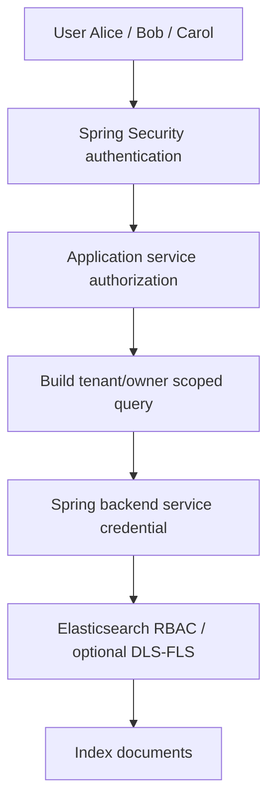
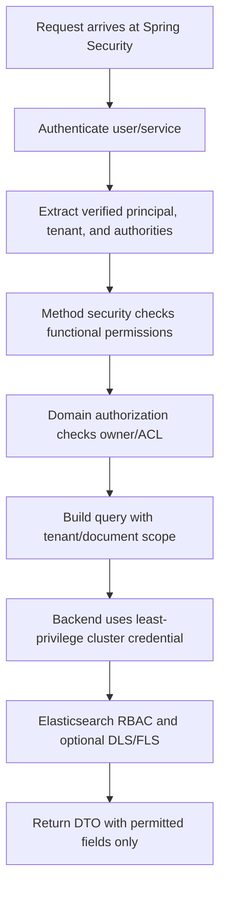

# Service-Level Data Authorization and Cluster-Side Protection

Spring Data Elasticsearch helps applications search and store documents, yet deciding whether a user can read, modify, or delete a specific document is a security responsibility that must be designed across multiple layers. There are two primary boundaries:

- **Application/service-level authorization**: determines which actions the current user may perform on which data. For example, a user may only view products belonging to their tenant or only modify orders they own.
- **Elasticsearch cluster-level protection**: authenticates clients connecting to the cluster, limits which indices/actions a credential may use, and—in supported environments—can apply document-level security (DLS) or field-level security (FLS).

These two layers complement each other. In a common architecture, the Spring backend uses a single service credential to connect to Elasticsearch on behalf of many end users. The cluster then sees the backend's identity and does not inherently know which user initiated the original HTTP request. Consequently, the service must enforce per-user/per-tenant authorization before building queries or writing documents. Cluster roles must still restrict the backend's privileges so a bug in the application does not automatically become cluster-wide administrative access.

## 1. Distinguishing Authentication and Authorization

These two concepts are often used together but answer different questions:

- **Authentication**: determines who the caller is. For instance, Spring Security validates a session, JWT, or credential and creates an `Authentication`.
- **Authorization**: determines what the caller is allowed to do on which resource. For instance, a user with role `PRODUCT_EDITOR` can edit products in their own tenant, but cannot read products in another tenant.

A request can already be authenticated and still be denied access to the requested document.

For example, user `alice` is logged in and has the authority `PRODUCT_READ`. That alone is not enough to conclude Alice can read every document in the `products` index. The service must also check the product's tenant, owner, status, or sharing policy.

In Spring Security, authentication is typically obtained from `Authentication` or the principal; authorization can be checked at URL, method, or domain logic levels. For Elasticsearch data, permission checks must align with the exact document and field scope a user is allowed to see.

## 2. Why Is Service-Layer Authorization Necessary?

Suppose a SaaS system shares an `orders` index across multiple tenants. A document has the structure:

```json
{
  "id": "ORD-1001",
  "tenantId": "tenant-a",
  "ownerId": "user-17",
  "status": "PAID",
  "total": 250000
}
```

If an API simply looks up by ID:

```java
return operations.get(orderId, OrderDocument.class);
```

then any user who knows the ID can read the document unless another authorization layer checks permissions. Hard-to-guess IDs are not a security mechanism.

The service must determine the tenant/user from the authenticated identity and restrict queries according to policy. Likewise, updates and deletes must check permissions on the target document before modifying data.

Never let clients send a `tenantId` and treat it as an authenticated tenant. Clients can tamper with values in requests. Tenant and actor must be derived from a server-verified principal/token or from a trusted context injected and protected by a gateway.

## 3. Modeling Tenant and Owner in Documents

A document typically needs fields that define its access scope:

```java
import org.springframework.data.annotation.Id;
import org.springframework.data.elasticsearch.annotations.Document;
import org.springframework.data.elasticsearch.annotations.Field;
import org.springframework.data.elasticsearch.annotations.FieldType;

@Document(indexName = "orders")
public class OrderDocument {

    @Id
    private String id;

    @Field(type = FieldType.Keyword)
    private String tenantId;

    @Field(type = FieldType.Keyword)
    private String ownerId;

    @Field(type = FieldType.Keyword)
    private String status;

    @Field(type = FieldType.Long)
    private Long total;

    protected OrderDocument() {
    }

    public String getId() {
        return id;
    }

    public String getTenantId() {
        return tenantId;
    }

    public String getOwnerId() {
        return ownerId;
    }
}
```

`tenantId` and `ownerId` are usually `keyword` fields because the service needs exact matching/filtering. Avoid mapping these IDs as `text` if full-text search is not needed.

Data modeling principles:

- Every document carries a clear tenant identifier if an index is shared across multiple tenants.
- Tenant/owner identifiers are set server-side from the authenticated identity.
- Authorization fields must not be directly modifiable by ordinary users.
- Mappings and queries use the right field type, usually `keyword`.
- If access rules are complex, model ACLs/visibility explicitly with bounded size.

For data requiring strong isolation, consider dedicated indices or dedicated clusters per tenant rather than relying solely on a field filter. This choice depends on tenant count, data volume, compliance requirements, and operational cost.

## 4. Enabling Method Security in Spring Security

Method security lets you place authorization rules directly on service methods where business read/modify/delete logic resides.

```java
import org.springframework.context.annotation.Configuration;
import org.springframework.security.config.annotation.method.configuration.EnableMethodSecurity;

@Configuration
@EnableMethodSecurity
public class MethodSecurityConfiguration {
}
```

You can then use `@PreAuthorize`:

```java
import org.springframework.security.access.prepost.PreAuthorize;
import org.springframework.stereotype.Service;

@Service
public class OrderService {

    @PreAuthorize("hasAuthority('ORDER_READ')")
    public OrderResponse getOrder(String orderId) {
        // Load and authorize the document.
        return null;
    }
}
```

The example above only checks a coarse-grained authority. In multi-tenant systems, you also need to constrain the document by tenant/owner. You can reference an authorization bean in SpEL:

```java
@PreAuthorize("@orderAuthorization.canRead(authentication, #orderId)")
public OrderResponse getOrder(String orderId) {
    // ...
}
```

The `orderAuthorization` bean must accurately verify the policy and data. Avoid cramming all complex logic into a hard-to-test SpEL expression.

Method security controls service method invocation. It does not automatically inject a tenant filter into Elasticsearch queries. Queries must still restrict documents so code inside the method cannot return out-of-scope data.

## 5. Extracting Tenant and Actor from the Authenticated Principal

Example application principal:

```java
public record AppPrincipal(
    String userId,
    String tenantId,
    Set<String> permissions
) {
}
```

A component can extract the principal from `Authentication`:

```java
import org.springframework.security.core.Authentication;
import org.springframework.stereotype.Component;

@Component
public class CurrentActor {

    public AppPrincipal requirePrincipal(Authentication authentication) {
        Object principal = authentication.getPrincipal();

        if (!(principal instanceof AppPrincipal appPrincipal)) {
            throw new AccessDeniedException("Unsupported authenticated principal");
        }

        return appPrincipal;
    }
}
```

In JWT-based systems, `AppPrincipal` can be constructed from claims verified by Spring Security Resource Server. Never parse unverified JWTs yourself or trust a `tenantId` coming from an arbitrary header.

Tenant identifiers must be normalized and verified. If a user can belong to multiple tenants, the service must determine the active tenant context and verify the user is allowed to select that tenant. Never treat a client-sent `X-Tenant-Id` as proof that the user belongs to that tenant.

## 6. Including Tenant Filters in Every Read Query

A critical principle is that **permission scope must be pushed into the query sent to Elasticsearch**. Never fetch all results and filter by tenant afterward in Java.

Example using `NativeQuery` and the Elasticsearch Java API Client builder:

```java
import co.elastic.clients.elasticsearch._types.FieldValue;
import org.springframework.data.elasticsearch.client.elc.NativeQuery;
import org.springframework.data.elasticsearch.core.SearchHits;
import org.springframework.data.elasticsearch.core.query.Query;

public SearchHits<OrderDocument> findOrdersForTenant(
        String tenantId,
        String status) {

    Query query = NativeQuery.builder()
        .withQuery(q -> q
            .bool(b -> b
                .filter(f -> f
                    .term(t -> t
                        .field("tenantId")
                        .value(FieldValue.of(tenantId))
                    )
                )
                .filter(f -> f
                    .term(t -> t
                        .field("status")
                        .value(FieldValue.of(status))
                    )
                )
            )
        )
        .build();

    return operations.search(
        query,
        OrderDocument.class,
        IndexCoordinates.of("orders")
    );
}
```

In a real service, `tenantId` must be obtained from the authenticated principal, not taken directly from a request query parameter. Placing the tenant condition inside `bool.filter` ensures Elasticsearch only considers documents within that tenant's scope.

### 6.1. Combining user search conditions

If an API allows filtering by status, creation date, or keywords, combine user criteria with the tenant constraint via `bool.filter`/`bool.must` according to the required semantics. The tenant constraint must always be attached to the final query.

Never let clients send raw Query DSL, arbitrary field names, or a query capable of replacing the security conditions. Translate request DTOs into a whitelisted set of filters.

### 6.2. Do not use `post_filter` as a security boundary

`post_filter` runs after aggregations and has different semantics from query filters. Similarly, filtering hit lists in Java after searching is poor tenant isolation:

- Elasticsearch has already returned out-of-scope data to the application.
- `totalHits`, pagination, and aggregations can reflect broader data.
- It is easy to miss another code path or endpoint.
- Sensitive data has already crossed the network and entered backend heap.

Put access conditions into the main query before sending the request. `@PostFilter` or controller filtering can serve as an extra check on small collections, but never replaces query scoping and service-layer authorization.

## 7. Reading Documents by ID Still Requires Tenant Checks

GET by ID is commonly used to fetch document details. Never assume IDs are secret or unguessable.

A safe pattern is querying by both ID and tenant:

```java
public OrderDocument findOrderForTenant(String orderId, String tenantId) {
    Query query = NativeQuery.builder()
        .withQuery(q -> q
            .bool(b -> b
                .filter(f -> f.term(t -> t
                    .field("_id")
                    .value(FieldValue.of(orderId))
                ))
                .filter(f -> f.term(t -> t
                    .field("tenantId")
                    .value(FieldValue.of(tenantId))
                ))
            )
        )
        .withMaxResults(1)
        .build();

    return operations.searchOne(
        query,
        OrderDocument.class,
        IndexCoordinates.of("orders")
    );
}
```

This is one way to implement a scoped lookup; you can also use repository methods such as `findByIdAndTenantId(...)` if appropriate for your project's API and mappings. If using `operations.get(id, ...)`, which fetches strictly by ID, check the tenant after reading and never return the document before checking. For strict isolation, querying by both ID and tenant avoids loading out-of-scope documents into business logic at all.

When a document is not found in the tenant, APIs commonly return `404` to avoid revealing whether the document exists in another tenant. Some systems choose `403`; align consistently with product policy and avoid creating side channels that leak data existence.

## 8. Owner Authorization and Document Sharing

Not every system relies solely on tenant boundaries. Some documents may only be accessed by their owner or a shared group.

Example query constraining both tenant and owner:

```json
GET documents/_search
{
  "query": {
    "bool": {
      "filter": [
        { "term": { "tenantId": "tenant-a" } },
        { "term": { "ownerId": "user-17" } }
      ]
    }
  }
}
```

If documents are shared with multiple users, you can have a `keyword` field such as `readerIds` or a separate ACL model. Queries must combine owner, tenant, and sharing permissions cleanly. ACL arrays can grow document size and complicate queries; bound the number of entries or move sharing relationships into a dedicated read model at large scale.

Do not enforce a single `ownerId` filter if business rules allow tenant administrators or shared groups to read documents. An authorization service should centralize this policy and generate the matching query constraints.

## 9. Authorization on Create, Update, and Delete

Authorization does not apply only to search. Every write path must be governed:

### 9.1. Creating documents

Tenant and owner are assigned from the principal:

```java
public OrderDocument createOrder(
        CreateOrderRequest request,
        AppPrincipal actor) {

    OrderDocument order = new OrderDocument();
    order.setTenantId(actor.tenantId());
    order.setOwnerId(actor.userId());
    order.setStatus("DRAFT");
    order.setTotal(request.total());

    return operations.save(order);
}
```

`CreateOrderRequest` should not include `tenantId`, `ownerId`, `createdBy`, or security fields that a client could self-assign. If a DTO contains those fields for compatibility, the service must ignore or strictly validate them against policy.

### 9.2. Updating documents

A safe update flow:

1. Check coarse authority, e.g., `ORDER_EDIT`.
2. Look up the document by ID within the actor's tenant.
3. Verify owner/ACL or admin policy.
4. Copy only business fields permitted for modification.
5. Preserve `tenantId`, `ownerId`, and security metadata.
6. Save the document with versioning/OCC if concurrent updates occur.

Never deserialize a request straight into a full entity and blindly call `save`. That can let a client overwrite tenant, owner, internal status, or audit fields.

### 9.3. Deleting documents

Deletes must follow the exact same authorization rules as reads/updates. Never delete strictly by ID if callers might guess IDs from another tenant.

For bulk deletes or update-by-query, queries must include the tenant constraint and only internal privileged services should execute batch operations. A missing filter in a migration job can affect the entire index.

## 10. Coordinating Method Security and Domain Authorization

A testable design splits responsibilities into two parts:

- Method security checks coarse functional rights: does the user have `ORDER_READ`, `ORDER_EDIT`, or `ORDER_DELETE`?
- Domain authorization checks rights on the specific document: which tenant and owner it belongs to, and whether it is shared.

Example:

```java
@PreAuthorize("hasAuthority('ORDER_READ')")
public OrderResponse getOrder(String orderId) {
    AppPrincipal actor = currentActor.requireCurrentPrincipal();

    OrderDocument order = findByIdAndTenant(orderId, actor.tenantId());
    if (order == null) {
        throw new OrderNotFoundException(orderId);
    }

    orderAuthorization.requireCanRead(actor, order);
    return OrderResponse.from(order);
}
```

This illustrates service structure. `requireCurrentPrincipal`, `findByIdAndTenant`, and `requireCanRead` are application abstractions to be implemented per domain. Do not rely on a standalone method security annotation to replace ownership checks.

## 11. Protection at the Elasticsearch Cluster Layer

The cluster layer protects Elasticsearch from unauthorized clients and limits what actions a credential can perform.

Typical controls include:

- Client authentication: username/password, API key, or cluster-supported identity mechanisms.
- TLS for client-node and node-node traffic per cluster configuration.
- Role-based access control (RBAC): privileges by cluster, index, action, and resource.
- Document-level security (DLS): restricts which documents a role can read.
- Field-level security (FLS): restricts which fields a role can read.
- Audit logging and network controls to monitor and restrict traffic sources.

API names, DLS/FLS capabilities, and licensing requirements vary by Elasticsearch distribution and version. Confirm your deployed cluster's capabilities before depending on these features.

## 12. Granting Minimal Index Privileges to the Backend

A backend that only needs to read and write the `orders` index should not have cluster-wide administrative permissions.

Least-privilege principles:

- Grant permissions only on required indices/aliases/data streams.
- Separate read-only credentials from write-capable credentials where workloads fit.
- Never grant `manage`, `all`, or cluster administration to ordinary services.
- Grant index/template creation permissions only to dedicated provisioning components.
- Never use human administrator credentials inside production applications.
- Revoke and rotate API keys/secrets periodically or upon incident.

Conceptual role example for a backend reading/writing one index:

```json
PUT /_security/role/orders_app_role
{
  "indices": [
    {
      "names": ["orders-*"],
      "privileges": ["read", "write"]
    }
  ]
}
```

This is a simple role example; exact privileges should be chosen based on the APIs the backend actually calls. An application that only indexes/updates may require a different privilege set than one running searches, bulk deletes, index creation, or mapping management.

If the application accesses only `orders-read` and `orders-write` aliases, configure privileges compatible with those aliases and their backing indices. Verify privilege rules for aliases, data streams, and index rollovers in your cluster version.

## 13. DLS and FLS on the Cluster Side

In Elasticsearch environments supporting these features, DLS/FLS can add another layer of protection:

- DLS restricts which documents a role can read via a query filter attached to the role.
- FLS restricts which fields a role can read.

Illustrative role example reading only documents belonging to `tenant-a` and seeing only select fields:

```json
PUT /_security/role/tenant_a_orders_reader
{
  "indices": [
    {
      "names": ["orders"],
      "privileges": ["read"],
      "query": {
        "term": {
          "tenantId": "tenant-a"
        }
      },
      "field_security": {
        "grant": [
          "id",
          "tenantId",
          "status",
          "createdAt"
        ]
      }
    }
  ]
}
```

This example uses a fixed tenant to illustrate role syntax. If every end user has a different tenant, do not arbitrarily create static roles per request; design an identity/API key/role strategy aligned with cluster capabilities and tenant scale.

### 13.1. DLS/FLS do not replace service-layer authorization

DLS/FLS can provide defense-in-depth, but should not be assumed to replace all application checks:

- DLS/FLS primarily govern data reads; do not treat DLS as a complete mechanism to constrain all per-tenant write/update/delete operations.
- Multiple roles combined on one principal can yield broader access than intended; inspect the combined effective permissions of all roles assigned to a principal.
- Certain APIs or administrative operations have different semantics from regular search; check version documentation.
- FLS does not replace designing proper DTOs and keeping sensitive fields out of responses.
- DLS/FLS can interact with aggregations, terms enumeration, or other features depending on version semantics and limitations.

Use service authorization to protect business actions and query scopes; use cluster security to constrain credential privileges and add guardrails at the storage layer.

## 14. One Shared Service Credential for Many Users

This is a common architecture:



The cluster authenticates only the backend credential. If the backend uses the same API key for all users, the cluster cannot distinguish Alice from Bob from that request alone. Therefore, the service must embed tenant/owner constraints into every query and verify permissions on every write.

If you want the cluster to recognize individual end users, you must design a controlled credential delegation/identity propagation mechanism supported by Elasticsearch. Never turn a client-supplied username into an arbitrary credential or API key. Using separate API keys per tenant/user increases isolation, but increases key count, lifecycle management, rotation, and permission overhead; evaluate at your system's scale.

## 15. Connecting Spring Data with Cluster Credentials

Spring Data Elasticsearch uses the client/transport configured in the application context. Credentials should be supplied via secret management or protected environment variables, never hard-coded in source code.

Conceptual configuration example with Elasticsearch Java API Client and TLS:

```java
@Configuration
public class ElasticsearchClientConfiguration {

    @Bean
    ElasticsearchClient elasticsearchClient(
            @Value("${app.elasticsearch.url}") String endpoint,
            @Value("${app.elasticsearch.api-key}") String apiKey,
            RestClientTransport transport) {

        // Build/configure the low-level REST client with TLS and the API-key
        // credentials, then expose the Java API Client through Spring.
        // Exact transport wiring depends on the Spring Data/Elasticsearch
        // client version used by the application.
        return createConfiguredClient(endpoint, apiKey, transport);
    }
}
```

This is a configuration skeleton, not copy-paste implementation code: constructing `RestClient`, TLS contexts, `RestClientTransport`, and API-key headers depends on client/transport versions. In Spring Boot applications, prefer configuring the client via Spring Data Elasticsearch's mechanisms and expose only the configured bean.

Configuration principles:

- Use HTTPS and verify cluster certificates.
- Store API keys/passwords in a secret manager or deployment environment secrets.
- Never write credentials into logs or error messages returned to clients.
- Separate development, staging, and production credentials.
- Rotate keys and maintain a revocation procedure upon secret exposure.
- Never grant cluster administrative permissions to backend API credentials.

Do not disable certificate verification to "quick-fix" TLS errors in production. Install the proper CA certificate and configure the trust chain.

## 16. How FLS Differs from Source Filtering and DTOs

Three mechanisms are frequently confused:

| Mechanism | Executed Where? | Purpose | Standalone Security Boundary? |
|---|---|---|---|
| Field-level security | Elasticsearch cluster role | Restricts fields a role can read | Can serve as a cluster protection layer when supported and configured properly |
| `_source` filtering | Search request | Returns only select fields to shrink payload | Insufficient as authorization if callers can send other requests |
| DTO/projection | Application layer | Exposes only API-appropriate fields | Must pair with authorization; does not replace cluster controls |

Example `_source` filtering:

```java
Query query = NativeQuery.builder()
    .withSourceFilter(new FetchSourceFilter(
        new String[] {"id", "name", "status"},
        new String[] {"internalNotes", "costPrice"}
    ))
    .build();
```

This optimizes responses and reduces what the backend receives. If a credential has permission to read the index and can issue other queries, source filtering in one request does not stop a caller from retrieving other fields. Use FLS or a controlled service boundary when fields are genuinely sensitive.

## 17. Search, Aggregations, and Pagination Must Also Be Authorized

Tenant filters must apply before computing search results. Filtering hits only after receiving the response causes problems:

- `totalHits` can leak document counts from other tenants.
- Aggregations can leak statistics on out-of-scope data.
- Pagination can skip records or reveal record counts.
- Highlights or inner hits can return unauthorized content.

Place tenant/owner constraints in the main query before adding aggregations, sorting, highlighting, or pagination. For aggregations nested inside buckets, the root query scope bounds the parent document set entering computation.

Do not allow clients to send arbitrary aggregation DSL unless the API specifically requires it. Whitelist fields and bucket sizes, especially for sensitive or high-cardinality fields.

## 18. Dedicated Indices or Tenant Filters in a Shared Index?

There are two common models:

| Model | Advantages | Trade-offs |
|---|---|---|
| Shared index + `tenantId` | Fewer indices, uniform mappings, easier to operate many small tenants | Every query must always scope tenant; high risk if a filter is missed; shared cluster credential does not distinguish tenants itself |
| Dedicated index per tenant | Separate index privileges possible, independent mappings/lifecycles | Index/shard counts grow; provisioning, rollover, migration, and cross-tenant queries get more complex |
| Dedicated cluster per tenant/group | Stronger operational and permission isolation | Higher infrastructure, monitoring, and deployment cost |

Choose the model matching your required isolation level. A large tenant or one with strict compliance requirements may need a dedicated index/cluster; many small tenants can use a shared index with service-level scoping and cluster least privilege.

Whichever model you choose, you still must authenticate callers and check permissions. Dedicated indices do not replace API authorization, since users might request another index/tenant if the service accepts arbitrary index names.

## 19. Common Security Mistakes

| Symptom | Cause | Resolution |
|---|---|---|
| User reads another tenant's document | Query filters only by ID or omits tenant constraint | Derive tenant from principal and embed into the main query. |
| User changes a document's tenant/owner | Request body mapped straight into entity | Assign and protect authorization fields server-side. |
| Method has `@PreAuthorize` yet query returns broad data | Checked only coarse authority, missing document scope | Combine method security with query/ownership authorization. |
| Hits filtered yet `totalHits`/aggregations leak data | Filtered in Java or `post_filter` after query | Put access filter inside the main query. |
| Backend API holds `all` on cluster | Used admin credential or overly broad role | Create minimal index-scoped roles/privileges. |
| DLS expected to block out-of-tenant update/delete | Mistook DLS for complete write authorization | Check write permissions in service; use appropriate cluster privileges. |
| FLS replaced with `_source` filtering | Treated projection as field protection | Use FLS when cluster enforcement is needed and retain DTO filtering. |
| Credentials leaked in Git/logs | Hard-coded or logged headers | Use secret manager, redact logs, and rotate keys. |
| TLS disabled to make connection work | Skipped certificate verification | Configure CA/truststore and HTTPS properly. |
| User picks arbitrary index | Accepted index name from request | Whitelist indices/aliases on the server. |
| Bulk/update-by-query impacts entire index | Query missed tenant or internal permissions were too broad | Restrict batch jobs to privileged services; preview/count and bound scope. |

## 20. Testing Authorization and Cluster Boundaries

Security tests must verify both allowed and denied cases. A test checking only that a valid user can read their own data is not enough.

Critical test cases:

1. Tenant A user reads Tenant A document successfully.
2. Tenant A user cannot read Tenant B document even when knowing its ID.
3. User without `ORDER_EDIT` cannot perform updates.
4. Tenant A user cannot modify `tenantId` or `ownerId` via request body.
5. Owners and shared users have access matching ACL rules.
6. Search, count, aggregations, pagination, and exports all enforce the same access scope.
7. Update/delete/bulk operations never bypass tenant constraints.
8. Backend cluster credential cannot administer out-of-scope indices.
9. DLS/FLS roles are tested with dedicated credentials if supported by the cluster.
10. TLS, API key expiration, rotation, and revocation are verified in the deployment environment.

Service tests with two tenants must assert that results contain no out-of-scope documents. Use Elasticsearch integration tests for real queries, because mocked repositories cannot prove the Query DSL actually applied the tenant filter correctly.

## 21. Data Authorization Design Workflow



Implementation steps:

1. Identify actors, tenants, owners, and resource types to protect.
2. Choose shared index, dedicated index, or dedicated cluster model.
3. Store tenant/owner/access metadata with appropriate field mappings.
4. Authenticate requests via Spring Security and extract principals from verified sources.
5. Use method security for coarse functional permissions.
6. Use domain authorization for document-specific permissions.
7. Embed tenant/owner constraints into the main query of every search/get/list/export.
8. Assign tenant/owner server-side on create; never accept ownership from clients.
9. Check permissions before updates/deletes and bulk operations.
10. Issue minimal cluster roles/API keys, enable TLS, and manage secrets safely.
11. Add DLS/FLS when supported by cluster/version/license and identity model.
12. Test cross-tenant access, aggregation leakage, write paths, and cluster credentials.
13. Write audit logs for sensitive actions without logging secrets or full private payloads.

## 22. Conclusion

Data authorization in Spring Data Elasticsearch requires combining service-layer controls with cluster-side protection. Spring Security authenticates callers; method security checks functional permissions; domain authorization determines which documents a caller may access; queries must embed tenant/owner filters before hitting Elasticsearch. When creating documents, tenant and owner must be assigned from a trusted principal. Updates, deletes, bulk requests, and aggregations must obey the same access scope.

The Elasticsearch cluster needs RBAC, dedicated credentials, TLS, and least privilege. DLS/FLS can add document/field boundaries when supported by version and license, but should not be treated as a complete replacement for application authorization or write protection. Specifically, if a backend shares one service credential across many users, the cluster identifies only the backend; the service must enforce permissions per end-user identity.

Never rely on unguessable IDs, post-search filtering, `_source` filtering, or DTO projections as your sole security boundary. Combining verified principals, query scoping, ownership checks, minimal cluster roles, proper credential/TLS management, and cross-tenant integration tests establishes consistent defense-in-depth for Elasticsearch data.
