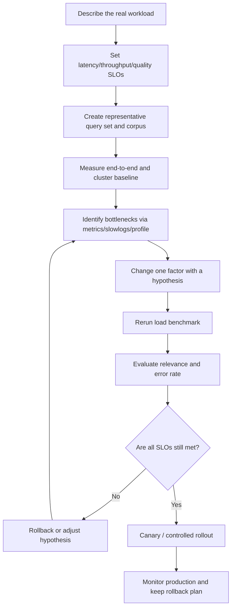

# Defining Latency, Throughput, and Search Quality Goals

Performance optimization for Spring Data Elasticsearch is not just about making a single query run faster. A search system needs to balance at least three goals: **latency**, **throughput**, and **search quality**. If you optimize only one goal, the system may perform poorly on the other two: increasing requests per second by returning fewer results can reduce quality; forcing a refresh after every write can improve freshness but lower indexing throughput; increasing concurrency can raise throughput up to a point and then cause tail latency and rejections to spike sharply.

Therefore, before changing mappings, queries, shards, or JVM configuration, you need to define the actual workload and set measurable goals. Then build a benchmark with data, queries, and load close to production, track results by percentile, check relevance, and change one factor at a time deliberately.

## 1. Three goals to optimize together

| Goal | Question to answer | Commonly used metrics |
|---|---|---|
| Latency | How long does an operation take from the caller's perspective? | p50, p95, p99, max, timeout rate |
| Throughput | How much work can the system process per unit of time? | Search QPS, indexing documents/s, bulk bytes/s, event lag |
| Search quality | Are the returned results accurate and useful to users? | Precision@k, Recall@k, MRR, NDCG@k, zero-result rate, task success |

All three goals must be evaluated under the same workload. A configuration with low p95 when there is only 1 concurrent request may not meet p95 when there are 200 requests/second and bulk indexing is running. A query that quickly returns 10 results is still not good if relevant results are pushed to the bottom of the list.

## 2. Defining the workload before setting SLOs

There is no single optimal configuration for every application. Describe the workload groups that the cluster actually has to serve.

For example, with an e-commerce catalog:

| Workload group | Example | Characteristics to measure |
|---|---|---|
| Interactive search | Searching products by keyword, filter, and sort | p95/p99, QPS, relevance, zero-result rate |
| Autocomplete | Suggestions as the user types character by character | Low latency, high QPS, small payload |
| Detail by ID | Reading a document after a click | GET latency, cache, and access permissions |
| Faceted search | Terms/range aggregations by category/price | Bucket count, aggregation latency, memory |
| Synchronous indexing | Writing products from a database or events | Documents/s, queue lag, refresh visibility |
| Bulk import | Loading a large catalog | Bulk throughput, batch failure, merge pressure |
| Reporting | Aggregations over a wide dataset | Runtime, resource usage, lower concurrency |

Do not lump every request into a single average number. Autocomplete and reporting have different characteristics; a 5-second aggregation query may be acceptable for reporting, but it is unsuitable for an interactive search box.

### 2.1. Describing the workload with concrete data

For each group, record:

- Average and peak requests per second/minute.
- Concurrent requests and how bursts occur.
- Proportion of simple queries, full-text, filters, sorts, aggregations, and nested queries.
- Average and maximum number of results/page size.
- Document size and number of fields typically returned.
- Read/write ratio, bulk size, and required refresh time.
- Distribution of tenants, categories, popular keywords, and field cardinality.
- Level of data freshness users expect.

For example, "10,000 requests/day" is not enough to design capacity. 10,000 requests spread evenly across the day is completely different from 5,000 requests concentrated into a single minute when a campaign starts.

## 3. Setting latency SLOs

Latency is the time a request takes to complete. You should clearly define the start and end points of the measurement.

A search request may go through:

1. Client sends request to backend.
2. Spring Security and controller handle request.
3. Service validates permissions, builds `NativeQuery`, and calls Spring Data.
4. HTTP client sends request to Elasticsearch.
5. Coordinator and shards process query.
6. Response is deserialized and mapped into `SearchHits`.
7. Backend converts results into DTOs and returns response.

The time Elasticsearch takes to process a query does not equal the total latency experienced by the user. If you only look at Elasticsearch's `took`, you may miss backend queue time, network, connection pool, serialization, or DTO processing.

### 3.1. Use percentiles instead of only averages

Common percentiles:

- **p50**: half of requests are faster than or equal to this value; represents the typical experience.
- **p95**: 95% of requests complete at or below this value; useful for user-facing SLOs.
- **p99**: 99% of requests complete at or below this value; shows tail latency.
- **Max**: the slowest request in the measurement window; sensitive to outliers and useful when investigating incidents.

For example, a benchmark has the following results:

| Metric | Latency |
|---|---:|
| p50 | 35 ms |
| p95 | 120 ms |
| p99 | 420 ms |
| Max | 1.8 s |

The average might be 55 ms while p99 is still 420 ms. If you only report the average, the slow requests experienced by users will be hidden.

### 3.2. Writing concrete SLOs

A good SLO specifies the workload, percentile, time window, and load conditions. Illustrative examples:

- Interactive search: p95 under 200 ms at 150 QPS with 80 concurrent requests.
- Autocomplete: p95 under 80 ms at 300 QPS.
- Bulk indexing: sustain at least 5,000 documents/second while search p95 does not exceed 250 ms.
- Timeout and server error rate under 0.1% over a 30-minute window.

These are only sample numbers, not defaults for Elasticsearch. Actual targets should be based on the product's latency budget, data size, hardware, network, and user experience.

### 3.3. Tail latency and coordinated omission

When the system slows down, a closed-loop load generator usually waits for the current request to finish before sending the next one. If the server stalls for 2 seconds, the generator also stops generating load for 2 seconds and may underestimate how slow the system actually is.

For workloads with a fixed arrival rate, consider an open-loop model or a benchmark tool that handles coordinated omission. Otherwise, p99 in a benchmark may look better than real-world experience when traffic continues arriving while the system is overloaded.

## 4. Setting throughput targets

Throughput is the amount of work processed per unit of time. Do not use a single unit for both search and indexing.

| Operation | Suggested measurement unit |
|---|---|
| Search | Queries per second (QPS) |
| Indexing | Documents per second |
| Bulk indexing | Documents/s and MB/s |
| Event synchronization | Events/s and consumer lag |
| Update/delete | Operations/s and conflict/failure rate |
| Aggregation | Queries/s by aggregation type and bucket count |

Throughput is always tied to quality and latency conditions. "The cluster handles 1,000 QPS" means very little if p99 is 8 seconds, 20% of requests time out, or search results fail relevance expectations.

### 4.1. Throughput under mixed load

In production, indexing and search often run concurrently. Bulk imports can increase segment merges, disk I/O, and indexing pressure; search can be affected even when queries do not change.

A benchmark should include at least three scenarios:

1. Search-only to establish baseline search capacity.
2. Indexing-only to establish data ingestion capacity.
3. Mixed workload to measure ability to serve real traffic when reads and writes run together.

If the SLO requires stable search during data synchronization, benchmarking search-only will not reflect production.

## 5. Search quality is a measurable goal

A query that is fast but returns irrelevant results is a failed query from a product standpoint. Search quality needs to be measured using a representative query set and evaluating whether the results are relevant.

For example, a user searches for "wireless noise cancelling headphones". Good results should prioritize wireless headphones with active noise cancellation; a product that only mentions the word "wireless" in its description may be less relevant.

Questions to define:

- Which results are considered relevant?
- Must the most important results appear in the top 3, top 5, or top 10?
- Is it necessary to prioritize in-stock products, the right tenant, or the right region?
- Does relevance need to be balanced with freshness, price, or popularity?
- Do users often get no results because of missing data, wrong analyzers, or overly strict queries?

### 5.1. Precision@k

Precision@k measures the proportion of relevant results in the top k:

\[
Precision@k = \frac{\text{number of relevant results in top k}}{k}
\]

If the top 5 contain 4 relevant results, Precision@5 = 0.8. This metric is useful when you want the first displayed results to have high quality.

### 5.2. Recall@k

Recall@k measures the proportion of relevant results found in the top k out of all known relevant results:

\[
Recall@k = \frac{\text{number of relevant results in top k}}{\text{total known relevant results}}
\]

If there are 10 relevant documents and the top 10 find 7, Recall@10 = 0.7. Recall is important when users need to find many matching results, such as document lookup or large catalogs.

### 5.3. MRR (Mean Reciprocal Rank)

MRR measures the position of the first relevant result. For a query, the reciprocal rank is `1 / rank` of the first relevant result; MRR is the average across the query set.

If the first relevant result is at rank 1, the score is 1. If it is at rank 4, the score is 0.25. MRR is useful for use cases where users usually only need the first good result.

### 5.4. NDCG@k

NDCG@k (Normalized Discounted Cumulative Gain) supports multi-level relevance, for example 0 = irrelevant, 1 = somewhat relevant, 2 = relevant, 3 = highly relevant. Relevant results at higher positions are valued more than the same results at lower positions.

NDCG fits cases where relevance is not simply binary and the order of top results matters. Build consistent relevance judgments and clearly define how scores are assigned.

### 5.5. Complementary product metrics

Not all quality aspects are captured by a single offline metric. You can also track:

- Zero-result rate: percentage of queries returning no results.
- Query reformulation rate: how often users have to modify their keywords.
- Click-through rate by position and query type.
- Search-to-conversion or task completion rate.
- Abandonment rate: users leaving the page after searching.
- Rate of wrong-tenant, wrong-status, or expired results; this is a correctness/security requirement, not a relevance metric to trade off.

Click-through rate has position bias: top results get clicked more simply because they appear first. Do not use CTR alone as ground truth for relevance.

## 6. Building a query set for quality evaluation

A relevance benchmark requires real or representative queries and relevance labels provided by humans or a reliable evaluation process.

Example query set for a catalog:

| Query | High-relevance results | Evaluation purpose |
|---|---|---|
| `wireless headphones` | Wireless headphones | Basic full-text |
| `sony wh-1000xm5` | Exact model | Exact identifier/phrase |
| `tai nghe chống ồn` | Products with noise-cancelling features | Vietnamese, synonym/analyzer |
| `usb c charger 65w` | 65W USB-C charger | Multiple attributes in one query |
| `running shoes size 42` | Running shoes in the right size | Filter combined with text |
| `nonexistent model xyz` | No matching results | Zero-result behavior |

The query set should include:

- Popular and rare queries.
- Short queries, long queries, and multi-attribute queries.
- Typos, Vietnamese diacritics, synonyms, and language variants.
- Exact identifiers, SKUs, product names, and descriptions.
- Queries with tenant, category, date, or availability filters.
- Queries with no matching results.
- Queries that previously caused complaints or frequent reformulations.

Keep a fixed query set as a regression set. When changing analyzers, boosts, synonyms, or mappings, rerun the same set to compare relevance.

## 7. Defining a layered latency budget

To find bottlenecks, break down total latency into components:


End-to-end latency is approximately the sum of the steps plus queueing and contention. You cannot simply add `took` to every metric if layers overlap in time or metrics are measured at different boundaries; instrumentation must be defined precisely.

Example latency budget for a 200 ms search API:

| Component | Illustrative budget |
|---|---:|
| Gateway/network into backend | 15 ms |
| Authentication/authorization | 10 ms |
| Query build and validation | 5 ms |
| Elasticsearch request + response | 130 ms |
| DTO mapping/serialization | 20 ms |
| Buffer | 20 ms |

This budget helps the team know which layer needs optimization. If Elasticsearch only takes 30 ms while the API takes 250 ms, adding shards or tweaking queries may not solve the bottleneck.

## 8. Measuring latency in a Spring service

Micrometer `Timer` can measure the duration of an operation at the application layer. Example:

```java
import io.micrometer.core.instrument.MeterRegistry;
import io.micrometer.core.instrument.Timer;
import org.springframework.stereotype.Service;

@Service
public class ProductSearchService {

    private final ElasticsearchOperations operations;
    private final Timer searchTimer;

    public ProductSearchService(
            ElasticsearchOperations operations,
            MeterRegistry meterRegistry) {
        this.operations = operations;
        this.searchTimer = Timer.builder("catalog.search.duration")
            .description("End-to-end duration of product search in the service")
            .tag("operation", "search")
            .register(meterRegistry);
    }

    public SearchHits<ProductDocument> search(Query query) {
        return searchTimer.record(() ->
            operations.search(
                query,
                ProductDocument.class,
                IndexCoordinates.of("products")
            )
        );
    }
}
```

This timer measures the time spent calling Spring Data from the service, including client/network wait and related response handling. It does not necessarily equal Elasticsearch's `took` time.

Do not add `userId`, `tenantId`, query strings, or document IDs as metric tags. High-cardinality tags can bloat the metrics system and consume excessive memory. Use tags with a small set of values such as operation type, index family, outcome, or classified query class.

For reactive APIs, do not wrap `Mono` creation in a synchronous `Timer.record(...)`, because the publisher may not have executed yet when the method returns. Use Micrometer/Observation-compatible reactive instrumentation or measure with `doOnEach`/`elapsed` inside the pipeline with properly managed lifecycle.

## 9. Measuring Elasticsearch query execution time

If you need to separate Elasticsearch execution time from end-to-end time, you can read the `took` field from the Search API response when using the Elasticsearch Java API Client:

```java
SearchResponse<ProductDocument> response = client.search(
    request -> request
        .index("products")
        .query(query -> query
            .match(match -> match
                .field("name")
                .query("wireless headphones")
            )
        ),
    ProductDocument.class
);

long elasticsearchTookMillis = response.took();
```

`took` reflects the time Elasticsearch spent processing the search request according to response semantics. It does not include all the time the client waited in the gateway, Spring service, connection pool, or DTO serialization.

If using `ElasticsearchOperations.search(...)`, the `SearchHits` type and exposed metadata vary by Spring Data version. Check the API of your project's release to retrieve execution duration if available; do not assume all versions have the same accessor.

## 10. Monitoring Elasticsearch metrics

API latency needs to be correlated with cluster state. Commonly used stats APIs:

```http
GET _cluster/health
GET _nodes/stats/jvm,process,os,fs,thread_pool,indices,breaker
GET products/_stats/docs,store,indexing,search,merge,refresh,segments
GET _cat/shards/products?v
GET _cat/nodes?v
```

Metric groups worth monitoring:

| Group | Metric/symptom | Question |
|---|---|---|
| Search | Query/fetch time, query count, search queue/rejected | Are queries slow due to execution or waiting in the queue? |
| Indexing | Indexing time, operations, indexing pressure | Are bulks too large or are there too many workers? |
| JVM | Heap usage, GC pause, old-gen pressure | Is heap/GC increasing tail latency? |
| Disk | IOPS, throughput, latency, free space | Are search/fetch/merge bottlenecked by storage? |
| Merge | Merge time, segment count, throttling | Is ingestion creating too many segments or a merge backlog? |
| Refresh | Refresh count/time | Is overly frequent refresh reducing throughput? |
| Shards | Shard count, shard size, allocation | Are there too many small shards or unbalanced shards? |
| Circuit breakers | Breaker trips, request rejection | Are aggregations/queries consuming too much memory? |
| Cluster | Node health, relocation, pending tasks | Is the cluster rebalancing or experiencing an incident? |

Stats field names may change across Elasticsearch versions. Use stats APIs and monitoring compatible with your cluster version, and ensure dashboards have clear units and time windows.

## 11. Slow logs and Profile API

### 11.1. Search slow logs

Search slow logs record query or fetch phases that exceed configured thresholds. They are useful for finding slow requests on specific shards in production workloads.

Illustrative threshold configuration example:

```json
PUT products/_settings
{
  "index.search.slowlog.threshold.query.warn": "2s",
  "index.search.slowlog.threshold.fetch.warn": "1s"
}
```

Do not immediately set thresholds too low on every index if log volume is high. Choose thresholds based on SLOs and check log rotation/retention. Slow logs help detect slow queries but do not explain the entire root cause on their own.

### 11.2. Profile API

The Profile API shows the timing and execution structure of query parts on shards. It can be used to see which clause takes the most time, but profiling adds overhead and profile numbers do not perfectly represent end-to-end latency.

Example:

```json
GET products/_search
{
  "profile": true,
  "query": {
    "bool": {
      "must": [
        { "match": { "name": "wireless headphones" } }
      ],
      "filter": [
        { "term": { "status": "ACTIVE" } }
      ]
    }
  }
}
```

Use profiling when a specific problematic query has already been identified. Do not enable profiling on every production request as a permanent metrics mechanism.

## 12. Designing a meaningful benchmark

A good benchmark needs to reproduce both the data and user behavior. Benchmarking with 1,000 small documents and one repeated query does not predict performance on a multi-million-document index with high cardinality.

### 12.1. Data must be representative

Prepare a corpus close to production in terms of:

- Total document count and total `_source` size.
- Document size distribution.
- Mappings, nested fields, and multi-valued fields.
- Cardinality of keyword fields.
- Rate of missing/null fields.
- Keyword distribution and term popularity.
- Number of shards, replicas, and refresh interval.
- Segment count and warm/cold cache state.

If a benchmark uses overly uniform data, the query cache and filesystem cache may give artificially good results compared to production.

### 12.2. Query set must be representative

Do not just repeat one easy query. Group queries by:

- Simple match, multi-match, phrase, and fuzzy.
- Filter-only and text + filter.
- Sort by score, date, price, or geo distance.
- Aggregations and nested aggregations.
- Deep pagination or `search_after`.
- Zero-result queries and queries with very many hits.
- Tenants with varying small/large data sizes.

Record the query set and random seed so the benchmark is repeatable. Do not use sensitive production data in test environments without proper protection/anonymization.

### 12.3. Load and concurrency

Run across multiple load levels:

1. Single-client or low-load baseline.
2. Gradually increase QPS/concurrency.
3. Sustain peak load long enough to observe steady state.
4. Burst load to see how the system recovers.
5. Mixed search + indexing.
6. Long soak test to detect accumulating memory/segments/queues.

Measure achieved throughput, p95/p99, error rate, rejections, and resource utilization. The optimal operating point is usually before queues and tail latency grow out of control.

### 12.4. Using Elasticsearch Rally when appropriate

Elasticsearch Rally is a dedicated benchmark tool that can run tracks, challenges, and workloads with defined data and queries. It is useful for reproducible benchmarks, comparing Elasticsearch versions, or testing configuration changes on a cluster.

A benchmark workflow can:

1. Prepare a track describing the corpus and operations.
2. Choose a challenge that reflects the workload.
3. Run a baseline on a stable cluster.
4. Record latency, throughput, and service time results.
5. Change one factor.
6. Rerun the same track/challenge and compare.

Rally does not replace end-to-end API testing of the Spring application. Combine cluster-level benchmarks with load tests through the backend to measure auth, query construction, network, and mapping as well.

## 13. Separating latency benchmarks from search quality

Search quality requires a separate set of relevance judgments. Do not use a QPS benchmark to conclude that relevance is better.

Offline evaluation process:

1. Collect representative queries.
2. Build the set of relevant documents for each query.
3. Assign relevance grades following consistent guidelines.
4. Run the current query version and the experimental query version.
5. Compute Precision@k, Recall@k, MRR, or NDCG@k.
6. Analyze queries whose quality dropped, not just the overall average.
7. Promote changes to online experimentation only when offline metrics meet thresholds.

A change can make a query faster by removing synonym expansion or lowering `minimum_should_match`, while hurting relevance. Conversely, adding more phrase/fuzzy clauses can improve recall at the cost of higher CPU usage. Record both results.

## 14. Factors that commonly affect latency and throughput

### 14.1. Query shape

- Prefer `bool.filter` for exact/range conditions that do not need scoring.
- Avoid broad wildcard/regexp queries on high-cardinality fields if unnecessary.
- Limit deep nested queries/aggregations and large bucket counts.
- Request only the necessary fields in `_source` or use `fields`/projections appropriately.
- Limit `track_total_hits` if the UI does not need exact totals across the entire index.
- Avoid deep pagination with `from`/`size`; consider `search_after` and PIT for deep pagination.
- Limit `inner_hits`, aggregation size, and response payload.

These changes can affect search quality or API contracts. For example, reducing `track_total_hits` may make total hits no longer exact; align with the frontend.

### 14.2. Mapping and data

- Use `keyword` for exact filters/sorts/aggregations and `text` for full-text search as needed.
- Choose analyzers appropriate for the language and domain.
- Avoid uncontrolled dynamic field mapping.
- Use nested only when relationships between child objects must be preserved.
- Reduce `_source` payload if documents are too large and the use case does not need all of it.
- Evaluate doc values for sort/aggregation fields.

Mapping is a long-term decision. Changing mappings usually requires creating a new index and reindexing; do not change them based on a single small benchmark.

### 14.3. Shards and replicas

Too few shards can limit parallelism and create oversized shards; too many small shards increase cluster, heap, and metadata management overhead. Replicas increase search capacity and availability, but also increase storage and indexing costs.

Do not pick a shard count using a rigid formula without measuring. Consider index size, node count, ingest rate, query concurrency, recovery time, and scalability. Benchmark with a topology close to production.

### 14.4. Refresh and indexing

Frequent refreshes make new data search-visible faster, at the cost of segment creation and merging. For bulk imports, batching operations and choosing an appropriate refresh interval/policy can significantly improve throughput.

If the SLO requires low search freshness lag, include freshness in the mixed workload benchmark. Do not optimize indexing throughput by disabling refresh and ignoring the impact on users.

### 14.5. Connection pool and concurrency in the application

The Spring backend needs enough connections to serve concurrency, but should not open an unlimited number of requests. Check connection pools, request timeouts, executor queues, and backpressure.

If the service sends too many concurrent requests, Elasticsearch may see increased search queues/rejections and higher p99. Bounding concurrency at the application layer and applying backpressure is usually better than continually adding threads.

## 15. Relevance quality and query tuning

Query components can affect both quality and cost:

| Component | Quality impact | Performance impact to monitor |
|---|---|---|
| `multi_match` across multiple fields | Finds documents matching terms across multiple content areas | Number of fields and query type increase scoring work |
| Phrase query | Improves word-order precision | Can be more expensive than a simple match |
| Fuzzy query | Supports typos | Expansion can dramatically increase considered terms |
| Synonym graph | Expands synonyms | Query rewrite and branch count increase |
| Function score/decay | Incorporates popularity, freshness, or distance | Script/function scoring adds overhead |
| Nested query | Preserves correlation between child object properties | Join-like nested processing and nested docs |
| Aggregation | Provides facets/statistics | Consumes resources based on document and bucket counts |

Do not remove a relevance component just to hit a latency target without evaluating the impact on results. Analyzer/synonym changes require rerunning the regression query set and comparing offline/online metrics.

## 16. Monitoring relevance in production

Online metrics should be interpreted carefully:

- CTR can rise due to position changes, UI design, or traffic sources, not just relevance.
- Conversion can be affected by price, inventory, promotions, and seasonality.
- Zero-result rate can drop when relaxing queries, while irrelevant results increase.
- Query reformulation can increase due to autocomplete or UI changes.

Combine telemetry with query sampling, human review, and A/B testing. When running A/B tests, keep bucket assignment stable and avoid giving the same user two different rankings in the same session if that distorts measurements.

Do not log raw queries or user identifiers if they may contain personal/sensitive data without a clear policy. Use sampling, masking, and appropriate retention.

## 17. Reading benchmark results properly

Suppose two configurations produce these results:

| Metric | Config A | Config B |
|---|---:|---:|
| Search throughput | 500 QPS | 620 QPS |
| p95 | 140 ms | 210 ms |
| p99 | 320 ms | 690 ms |
| Error/rejection | 0.02% | 0.4% |
| NDCG@10 | 0.91 | 0.90 |

Config B increases throughput, but p95/p99 and error rate are worse. If the p95 SLO is 200 ms and error rate must be under 0.1%, B fails despite higher QPS. A may be the more suitable choice, or further tuning is needed to raise throughput within SLO limits.

When comparing, ensure:

- Same corpus, mapping, and query set.
- Same topology, shards/replicas, and hardware.
- Same warm/cold cache conditions.
- Same traffic mix and concurrency model.
- Same steady-state duration.
- Recorded Elasticsearch, Spring Data, Java versions, and configuration.
- Repeated benchmark runs to understand variance.

If multiple factors are changed at once, it is hard to tell which change produced the result. Test one variable independently first, then run a mixed workload to verify their interaction.

## 18. Iterative optimization process



Practical process:

1. Classify workloads and determine peak traffic.
2. Set separate SLOs for latency, throughput, freshness, and relevance.
3. Prepare the corpus, query set, and relevance judgments.
4. Measure baseline at both the application layer and Elasticsearch.
5. Find bottlenecks using metrics, slow logs, and Profile API.
6. State a concrete hypothesis before changing queries/mappings/configuration.
7. Change one factor and rerun the benchmark under the same conditions.
8. Check p50/p95/p99, throughput, error rate, and relevance metrics.
9. Run mixed workload and soak tests if the change affects indexing/refresh/resources.
10. Roll out with control, monitor production, and maintain rollback capability.

## 19. Common mistakes

| Mistake | Why it misleads | How to fix |
|---|---|---|
| Measuring only average latency | Hides tail latency | Track p50, p95, p99, and timeout rate. |
| Benchmarking a single query | Does not reflect production query mix | Use a representative query set and traffic mix. |
| Using a tiny corpus | Cache and segment behavior differ from production | Use data with realistic scale and distribution. |
| Running search-only when production searches and indexes concurrently | Ignores contention, merges, and refreshes | Run a mixed workload. |
| Continuously increasing concurrency | Queues/rejections and p99 may spike | Find the maximum throughput that still meets SLOs. |
| Looking only at Elasticsearch `took` | Ignores backend, network, and mapping | Measure end-to-end with Micrometer/Observation. |
| Optimizing latency alone | Can hurt relevance or increase indexing lag | Evaluate quality and freshness simultaneously. |
| Using CTR as the sole relevance signal | Clicks are biased by position and UI | Use offline judgments, NDCG/MRR, and A/B tests. |
| Changing multiple settings at once | Cannot tell what caused improvement/degradation | Change one factor, record hypothesis and baseline. |
| Testing only with warm caches | Does not reflect cold starts or new queries | Measure both warm/cold and soak conditions. |
| Not measuring errors/rejections | Throughput can look high by ignoring failed requests | Report error rate, timeouts, and partial failures. |
| Not keeping benchmarks reproducible | Cannot reliably compare before/after | Version corpus, query set, config, and load scripts. |

## 20. Data checklist to record for every benchmark

A benchmark report should record at a minimum:

| Group | Information |
|---|---|
| Goals | Latency, throughput, relevance, and freshness SLOs |
| Application | Spring Boot, Spring Data Elasticsearch, Java, client versions |
| Cluster | Elasticsearch version, node count/type, heap, disk, zone |
| Index | Mapping version, document count, store size, shards/replicas, refresh interval |
| Corpus | Data source, size, field/cardinality distribution |
| Query | Query set version, ratio of each query type, page size, aggregations |
| Load | QPS, concurrency, open/closed-loop model, warm-up, duration |
| Results | p50/p95/p99/max, throughput, errors, rejections, timeouts |
| Quality | Precision/Recall/MRR/NDCG, zero-result and task success |
| Resources | CPU, heap, GC, disk I/O, merge, refresh, queue |
| Change | Single variable changed, hypothesis, and rollback plan |

Keep reports comparable across runs. A single number like "QPS = 800" is insufficient without knowing the query set, latency, error rate, topology, and cache conditions.

## 21. Conclusion

Search performance must be managed as a multi-objective problem. Latency must be measured using percentiles and at both end-to-end and Elasticsearch layers; throughput must be tied to query mix, concurrency, and error rate; search quality must be evaluated with relevance judgments and metrics such as Precision@k, Recall@k, MRR, or NDCG@k. Freshness and indexing throughput must also be included in the workload when the system continuously synchronizes data.

With Spring Data Elasticsearch, measure time from the service via Micrometer/Observation, compare it against Elasticsearch's `took`, and use cluster/node/index stats, slow logs, or the Profile API to find bottlenecks. Benchmarks must use a corpus, mapping, query set, and load close to production, covering search-only, indexing-only, and mixed workloads. Elasticsearch Rally is useful for reproducible cluster benchmarks, while load testing through the backend reveals the real application experience.

Optimize iteratively with hypotheses: measure a baseline, identify bottlenecks, change one factor, rerun the same benchmark, check latency, throughput, error rate, and relevance simultaneously, and roll out in a controlled manner. Do not trade search quality for a QPS number or reduce p95 by ignoring failed requests. When goals and measurements are clearly defined, teams can make evidence-based tuning decisions and maintain a stable search experience as load grows.
