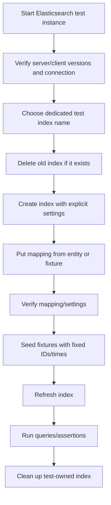

# Preparing Deterministic Indices, Settings, Mappings, and Data

An integration test with Spring Data Elasticsearch is only reliable when it runs on an index with a known structure and reproducible data. If a test reuses an old index from a previous run, relies on dynamic mapping, waits for refresh using `Thread.sleep()`, or generates random fixtures, results can pass or fail intermittently even when the code has not changed.

Test preparation needs to control four parts:

- **Index lifecycle**: the index is created fresh for the test with a clear name and scope, then cleaned up after the test finishes.
- **Settings**: shards, replicas, refresh interval, and related settings are configured explicitly for the test environment.
- **Mapping**: field types, analyzers, date formats, nested paths, and required attributes are created before loading data.
- **Fixtures**: IDs, timestamps, field values, and data ordering are predetermined so results are repeatable.

The goal is not to simulate the entire production cluster in every test. The goal is to make test preconditions explicit, independent, and reproducible; intentional differences between test and production must be documented.

## 1. Why Do Tests Need Deterministic Indices and Data?

Suppose a test searches for active products:

```java
SearchHits<ProductDocument> hits = operations.search(
    NativeQuery.builder()
        .withQuery(q -> q.term(t -> t.field("status").value("ACTIVE")))
        .build(),
    ProductDocument.class
);
```

If the `products` index already existed from an earlier test, its mapping might differ from the current entity. A field previously created as `text` might lack the `keyword` subfield the test expects. If old fixtures remain, results may include unexpected documents. If a refresh has not occurred yet, search may return fewer documents than were saved.

Common sources of flaky tests:

- Sharing an index with the development environment or other tests.
- Failing to clear data before loading fixtures.
- Relying on dynamic mapping inferred from the first document.
- Not creating the mapping before indexing data.
- Using `Instant.now()`, `UUID.randomUUID()`, or random data without a fixed seed.
- Assuming search result ordering matches insertion order.
- Using `Thread.sleep(1000)` to guess when a refresh happens.
- Running tests in parallel against the same index while deleting/recreating it concurrently.
- Depending on external cluster index templates or aliases that the test does not control.

A good test must be runnable in isolation, repeatable across runs, and executable in CI without depending on the execution order of the test suite.

## 2. Distinguishing Unit Tests and Elasticsearch Integration Tests

Not every test needs to start Elasticsearch.

| Test type | Goal | Needs real Elasticsearch? |
|---|---|---|
| Service unit test | Verify business rules, validation, authorization | No; can mock repository/ports |
| Mapping metadata test | Verify Java annotations/entity metadata | Can inspect metadata, though it does not prove cluster mapping |
| Repository integration test | Verify converters, queries, save/read, and real mapping | Yes |
| Search integration test | Verify analyzers, filters, sorting, aggregations, refresh | Yes |
| Cluster/operations test | Verify settings, aliases, templates, shard behavior | Requires compatible cluster; typically Testcontainers or dedicated environment |

Unit tests should not try to mock every detail of the Elasticsearch DSL. Conversely, integration tests do not need to boot the whole application if they only verify a repository or mapping operation. Pick the smallest test scope that still proves the behavior under test.

## 3. Using a Dedicated Elasticsearch Instance for Tests

Never point integration tests at a production cluster or a shared developer index. Start a dedicated Elasticsearch node in CI/dev tests using Testcontainers or use a separately managed test cluster.

Example with Testcontainers:

```java
import org.junit.jupiter.api.Test;
import org.springframework.boot.test.context.SpringBootTest;
import org.springframework.test.context.DynamicPropertyRegistry;
import org.springframework.test.context.DynamicPropertySource;
import org.testcontainers.elasticsearch.ElasticsearchContainer;
import org.testcontainers.junit.jupiter.Container;
import org.testcontainers.junit.jupiter.Testcontainers;

@Testcontainers
@SpringBootTest
class ProductRepositoryIntegrationTest {

    @Container
    static final ElasticsearchContainer elasticsearch =
        new ElasticsearchContainer(
            "docker.elastic.co/elasticsearch/elasticsearch:8.15.0"
        );

    @DynamicPropertySource
    static void elasticsearchProperties(DynamicPropertyRegistry registry) {
        registry.add("spring.elasticsearch.uris", elasticsearch::getHttpHostAddress);
    }

    @Test
    void contextStartsAgainstTestCluster() {
        // Test body
    }
}
```

This example illustrates Spring Boot configured with `spring.elasticsearch.uris` and a compatible Testcontainers Elasticsearch module. Choose an Elasticsearch image with the same major version as your project's Java API Client/Spring Data Elasticsearch; image versions, Testcontainers packages, and security/TLS configuration may differ by release.

Some Elasticsearch images enable security by default or require credentials/certificates. In those cases, Testcontainers and Spring properties must capture the exact endpoint, username/password, or CA certificate provided by the container. Do not disable TLS verification in production just to make tests run; if tests run with security disabled, confine that to an isolated test container.

### 3.1. Why Is Testcontainers Useful?

Testcontainers gives tests a real Elasticsearch environment with:

- Server version declared in code/build.
- Real index settings and mappings.
- Query DSL, analyzers, and converters executed on the cluster.
- Container lifecycle tied to the test suite.
- Reproducible CI environments wherever Docker/a compatible container runtime is available.

Testcontainers does not automatically make tests deterministic. Tests must still create indices, mappings, and fixtures explicitly while controlling refreshes and cleanup.

### 3.2. Keeping Server and Client Versions Compatible

Do not pick an arbitrary Elasticsearch image newer than your client just because it pulls cleanly. Rely on the compatibility matrix of Spring Boot, Spring Data Elasticsearch, Elasticsearch Java API Client, and Elasticsearch server. Record the version explicitly in build/test configuration so upgrades are intentional.

If CI uses an external test cluster, check the cluster version before tests begin and fail fast on mismatch. A test passing against a different server version than production may miss mapping/query differences.

## 4. Choosing the Index Scope for Tests

There are three common approaches:

| Scope | Organization | When appropriate |
|---|---|---|
| One index per test class | Delete/recreate index before each test method | Sequential tests with small indices |
| One index per test suite | Created once, seed isolated data per test | Many tests needing a large shared fixture, with clear cleanup |
| Dedicated index per test | Generate a unique index name per test | Parallel execution or tests requiring strictly independent state |

For a Repository using `@Document(indexName = "products-test")`, the simplest approach is a fixed index per test class, deleting and recreating it before each test. Do not run tests in parallel if they concurrently delete/recreate that same index.

If each test method needs a dedicated index, generate a dynamic index name and pass `IndexCoordinates.of(indexName)` to `ElasticsearchOperations` calls. Repositories normally read the index from `@Document` metadata, so dynamic names must be explicitly designed via mapping metadata/SpEL or a separate adapter; do not assume merely changing an `IndexCoordinates` variable makes a Repository switch indices.

Do not use production index names like `products` in integration tests. Choose recognizable suffixes such as `products-it`, `products-test-<run-id>`, or a test-specific prefix.

## 5. Declaring Entities with Explicit Mappings

Example product entity:

```java
import java.time.Instant;

import org.springframework.data.annotation.Id;
import org.springframework.data.elasticsearch.annotations.Document;
import org.springframework.data.elasticsearch.annotations.Field;
import org.springframework.data.elasticsearch.annotations.FieldType;
import org.springframework.data.elasticsearch.annotations.Setting;

@Document(indexName = "products-test", createIndex = false)
@Setting(
    shards = 1,
    replicas = 0,
    refreshInterval = "-1"
)
public class ProductDocument {

    @Id
    private String id;

    @Field(type = FieldType.Keyword)
    private String sortKey;

    @Field(type = FieldType.Text)
    private String name;

    @Field(type = FieldType.Keyword)
    private String status;

    @Field(type = FieldType.Long)
    private Long priceInCents;

    @Field(type = FieldType.Date)
    private Instant createdAt;

    protected ProductDocument() {
    }

    public ProductDocument(
            String id,
            String sortKey,
            String name,
            String status,
            Long priceInCents,
            Instant createdAt) {
        this.id = id;
        this.sortKey = sortKey;
        this.name = name;
        this.status = status;
        this.priceInCents = priceInCents;
        this.createdAt = createdAt;
    }

    public String getId() {
        return id;
    }
}
```

The choices in this example serve clear purposes:

- `createIndex = false`: disables Spring Data automatic index creation during metadata initialization, letting tests control when the index is created.
- `shards = 1`: reduces overhead and keeps local tests predictable.
- `replicas = 0`: replicas are unnecessary on a single-node test cluster.
- `refreshInterval = "-1"`: disables automatic background refreshes during fixture setup; tests will refresh explicitly after seeding.
- `keyword`: used for exact filtering/sorting.
- `text`: used for full-text search.
- `date`: used for time-based ranges/sorting.

These values are test settings, not production defaults. If a test needs to verify refresh behavior or replica allocation, create a separate test group with dedicated settings reflecting that use case.

## 6. Creating Index, Settings, and Mapping in Order

Data creation order matters:

1. Delete the old index if it exists.
2. Create the index with deterministic settings.
3. Apply the explicit mapping to the index.
4. Verify the index exists and mapping/settings match expectations.
5. Load fixtures.
6. Refresh so search sees the fixtures.
7. Run the test.

When using `@Setting` and mapping annotations on the entity, Spring Data can create the index with its mapping via `createWithMapping()`:

```java
IndexOperations indexOperations = operations.indexOps(ProductDocument.class);

if (indexOperations.exists()) {
    indexOperations.delete();
}

boolean created = indexOperations.createWithMapping();
if (!created) {
    throw new IllegalStateException("Could not create products-test index");
}
```

`createWithMapping()` uses entity metadata to create the index and mapping. This is convenient when verifying the exact mapping declared by Spring Data annotations.

If a test needs to verify settings independently or apply a separate JSON mapping fixture, create the index with settings and call `putMapping()` using the `IndexOperations` API for your version. Equivalent REST request:

```json
PUT products-test
{
  "settings": {
    "number_of_shards": 1,
    "number_of_replicas": 0,
    "refresh_interval": "-1"
  },
  "mappings": {
    "properties": {
      "sortKey": { "type": "keyword" },
      "name": {
        "type": "text",
        "fields": {
          "keyword": { "type": "keyword" }
        }
      },
      "status": { "type": "keyword" },
      "priceInCents": { "type": "long" },
      "createdAt": { "type": "date" }
    }
  }
}
```

Do not mix creating mappings from annotations and applying a different JSON mapping unintentionally. Pick a single source of truth per test: entity mapping to verify Spring Data metadata, or JSON mapping fixtures when testing templates/migrations.

## 7. Distinguishing Static Settings and Updatable Settings

Not every index setting can be modified while an index is open.

| Setting group | Examples | Notes |
|---|---|---|
| Index creation settings | `number_of_shards`, mapping-related analyzers/normalizers | Usually must be defined at index creation; some changes require a new index and reindexing |
| Updatable settings | `number_of_replicas`, `refresh_interval` | Many can be changed via the Update Index Settings API |
| Mapping field type | `keyword`, `text`, `date`, `nested` | Cannot arbitrarily change the type of a field with existing data |
| Mapping field parameters | Analyzer, normalizer, doc_values, and certain attributes | Updatability depends on parameter; usually requires a new index when changes affect already-indexed data |

In tests, creating a new index for each settings/mapping combination avoids trying to update immutable settings on an existing index. If the test specifically verifies migration, test the new-index/reindex/alias workflow separately.

## 8. Verifying Actual Mapping and Settings

Do not rely solely on Java annotations. After creating the index, inspect it directly:

```http
GET products-test/_mapping
GET products-test/_settings?include_defaults=true
```

The mapping should reflect the intended field types, for example:

```json
{
  "properties": {
    "name": {
      "type": "text",
      "fields": {
        "keyword": { "type": "keyword" }
      }
    },
    "status": { "type": "keyword" },
    "priceInCents": { "type": "long" },
    "createdAt": { "type": "date" }
  }
}
```

Key settings in tests include:

- Number of primary shards.
- Number of replicas.
- Refresh interval.
- Analyzers/normalizers if queries depend on tokenization.
- Routing, similarity, or codec settings if the test actually depends on them.

With Spring Data, `IndexOperations` provides APIs to read mappings/settings; method signatures and return types vary by version. You can use the REST/Java API Client in integration tests when exact assertions on server-returned structures are needed.

## 9. Creating Deterministic Fixtures

A fixture is a standard dataset created before running tests. Fixtures should use fixed IDs, field values, and timestamps.

Example:

```java
import java.time.Instant;
import java.util.List;

List<ProductDocument> fixtures = List.of(
    new ProductDocument(
        "P-001", "001", "Wireless Headphones", "ACTIVE", 129900L,
        Instant.parse("2026-01-10T08:00:00Z")
    ),
    new ProductDocument(
        "P-002", "002", "Studio Headphones", "ACTIVE", 189900L,
        Instant.parse("2026-01-11T08:00:00Z")
    ),
    new ProductDocument(
        "P-003", "003", "USB-C Charger", "INACTIVE", 49900L,
        Instant.parse("2026-01-12T08:00:00Z")
    )
);
```

Fixed fixtures let tests express conditions and expected results clearly. For instance, a test querying `ACTIVE` can expect precisely `P-001` and `P-002`.

Avoid:

```java
Instant createdAt = Instant.now();
String id = UUID.randomUUID().toString();
```

in fixtures where tests perform exact comparisons. If you need to test random ID generation or current time logic, inject a `Clock`/ID generator and fix its values in tests.

### 9.1. Using a Fixed Clock for Time-Based Logic

A service can accept a `Clock`:

```java
@Service
public class ProductService {

    private final Clock clock;

    public ProductService(Clock clock) {
        this.clock = clock;
    }

    public ProductDocument create(String id, String name) {
        return new ProductDocument(
            id,
            id,
            name,
            "ACTIVE",
            10000L,
            clock.instant()
        );
    }
}
```

In tests, supply `Clock.fixed(...)`:

```java
@TestConfiguration
static class FixedClockConfiguration {

    @Bean
    @Primary
    Clock testClock() {
        return Clock.fixed(
            Instant.parse("2026-01-01T00:00:00Z"),
            ZoneOffset.UTC
        );
    }
}
```

This keeps date ranges, audit timestamps, and time-based sorting stable across every run.

### 9.2. Using Stable IDs and Avoiding Insertion-Order Dependencies

Stable IDs help with:

- Reading documents back by ID in assertions.
- Correlating fixtures and bulk item errors easily.
- Cleaning up or updating specific records.
- Reproducing the exact same dataset when a test fails.

However, Elasticsearch search does not guarantee returning results in insertion order. If a test requires ordering, the query must declare an explicit sort.

If multiple documents share the same `createdAt` or `_score`, the order among them can be non-deterministic. Add a unique sort key field—mapped as an appropriate `keyword`/numeric field with doc values—as a tie-breaker:

```java
Query query = NativeQuery.builder()
    .withQuery(q -> q.term(t -> t.field("status").value("ACTIVE")))
    .withSort(s -> s.field(f -> f.field("createdAt").order(SortOrder.Asc)))
    .withSort(s -> s.field(f -> f.field("sortKey").order(SortOrder.Asc)))
    .build();
```

`sortKey` must be unique within the result set if the test requires total ordering. Do not rely on `_id` as a regular sort field if mapping/cluster settings do not support it; `_id` has specific limitations for sorting and aggregations.

## 10. Seeding Fixtures and Refreshing Before Search

Once the index is created and the mapping is ready, load data:

```java
fixtures.forEach(product -> operations.save(product));
```

Then refresh the index before running search assertions:

```java
operations.indexOps(ProductDocument.class).refresh();
```

When a test needs search to see newly written data, explicit refresh is deterministic. Do not use:

```java
Thread.sleep(1000);
```

because the refresh interval can vary, CI may run slower or faster than local machines, and sleeping does not prove a refresh completed.

If testing the `refresh=wait_for` policy, execute the write with that policy and search immediately after the write returns. If testing default NRT behavior, verify GET by ID and search before/after refresh as two distinct behaviors.

### 10.1. Seeding Many Documents with Bulk

For large fixtures, bulk indexing reduces overhead compared to calling `save` per document:

```java
List<IndexQuery> indexQueries = fixtures.stream()
    .map(product -> new IndexQueryBuilder()
        .withId(product.getId())
        .withObject(product)
        .build())
    .toList();

operations.bulkIndex(
    indexQueries,
    IndexCoordinates.of("products-test")
);

operations.indexOps(IndexCoordinates.of("products-test")).refresh();
```

If bulk indexing encounters item failures, handle the corresponding `BulkFailureException`/response instead of continuing assertions as if the fixture were complete. Tests should fail with the document ID and error reason for quick diagnosis.

## 11. Structuring Setup and Cleanup in JUnit

A common pattern is deleting/recreating the index and seeding fixtures before each test:

```java
import org.junit.jupiter.api.AfterEach;
import org.junit.jupiter.api.BeforeEach;
import org.springframework.beans.factory.annotation.Autowired;
import org.springframework.boot.test.context.SpringBootTest;
import org.springframework.data.elasticsearch.core.ElasticsearchOperations;
import org.springframework.data.elasticsearch.core.IndexOperations;
import org.springframework.data.elasticsearch.core.mapping.IndexCoordinates;

@SpringBootTest
class ProductSearchIntegrationTest {

    @Autowired
    ElasticsearchOperations operations;

    @Autowired
    ProductRepository repository;

    private IndexOperations indexOperations;

    @BeforeEach
    void setUp() {
        indexOperations = operations.indexOps(ProductDocument.class);

        if (indexOperations.exists()) {
            indexOperations.delete();
        }

        if (!indexOperations.createWithMapping()) {
            throw new IllegalStateException("Could not create test index");
        }

        repository.saveAll(fixtures());
        indexOperations.refresh();
    }

    @AfterEach
    void tearDown() {
        if (indexOperations != null && indexOperations.exists()) {
            indexOperations.delete();
        }
    }

    private List<ProductDocument> fixtures() {
        // Return a new list with fixed IDs and fixed values.
        return List.of(/* deterministic fixtures */);
    }
}
```

This example assumes `ProductDocument` has `@Document(indexName = "products-test", createIndex = false)` and an appropriate `@Setting`. If the index is shared across multiple test classes, do not run classes that concurrently delete/recreate it in parallel. For parallel tests, provide a separate index or separate cluster/container per worker.

### 11.1. Cleanup When Tests Fail

JUnit executes `@AfterEach` even when assertions or the test body fail during normal execution. However, killed processes or container crashes can skip cleanup. Using temporary containers and a test index prefix keeps leftover data from affecting other environments; you can also clean up all indices matching the prefix in suite teardown if needed.

Do not write wildcard cleanup that could delete indices outside test scope. Only delete indices created by tests or matching a strictly controlled prefix.

## 12. Creating Mapping from Entity vs JSON Fixture?

Both approaches are useful but serve different goals.

| Creation approach | What it verifies | Risks to know |
|---|---|---|
| `createWithMapping()` from entity | Annotations and Spring Data mapping metadata produce the right mapping | Does not verify external templates/migrations if they are not involved |
| JSON mapping fixture | Desired server-side mapping, e.g., analyzers and multi-fields | May drift from actual converter/entity metadata |
| Index template | Auto-application rules for an index pattern | Needs testing for pattern/priority and template ordering |
| Migration script | Process of moving from an old index to a new index | Requires representative legacy data and alias/reindex lifecycle |

If the goal is verifying `@Field(type = FieldType.Keyword)` translates properly, create the mapping from the entity and read the server-side mapping back. If the goal is testing an index template, create an index matching its pattern and verify the template was applied. If the goal is testing a migration, test the new versioned index, reindex, and alias switch flow separately.

Do not apply a hand-written JSON fixture that already matches expectations and only run queries against it if the real question is whether Spring Data annotations generate the right mapping. Tests must exercise the component being verified.

## 13. Preparing Deterministic Analyzers and Normalizers

If queries rely on analyzers, the test mapping must declare those analyzers explicitly. Example of a multi-field property:

```java
@MultiField(
    mainField = @Field(type = FieldType.Text, analyzer = "standard"),
    otherFields = {
        @InnerField(suffix = "keyword", type = FieldType.Keyword)
    }
)
private String name;
```

Tests can then use `name` for full-text search and `name.keyword` for exact matching/sorting. Default analyzers can vary by index configuration or template; tests must declare the exact analyzer/normalizer queries depend on.

With custom analyzers, settings must be created together with the index before field mappings reference that analyzer. REST example:

```json
PUT products-test
{
  "settings": {
    "analysis": {
      "analyzer": {
        "catalog_analyzer": {
          "type": "custom",
          "tokenizer": "standard",
          "filter": ["lowercase"]
        }
      }
    }
  },
  "mappings": {
    "properties": {
      "name": {
        "type": "text",
        "analyzer": "catalog_analyzer"
      }
    }
  }
}
```

Do not create the index first and try to add required analyzers afterward when Elasticsearch requires analyzers to be declared at index creation. If an analyzer changes, you typically need to create a new index and reindex the data.

## 14. Preparing Date, Numeric, and Nested Fixtures

Mapping/query tests should have fixtures covering meaningful boundary values:

- Dates before, equal to, and after filter thresholds.
- Numbers equal to, just below, and just above thresholds.
- Keywords testing case sensitivity according to the chosen analyzer/normalizer.
- Missing, null, or empty field values if allowed by the domain.
- Arrays with one and multiple elements.
- Nested objects with intentionally distinct field combinations to verify correlation.

Date range example:

```java
Instant before = Instant.parse("2026-01-01T00:00:00Z");
Instant atBoundary = Instant.parse("2026-01-10T00:00:00Z");
Instant after = Instant.parse("2026-01-11T00:00:00Z");
```

Never use the test runner machine's local timezone to construct fixtures. Use `Instant` or `OffsetDateTime` with explicit offsets, then verify mapping/date formats.

For nested mappings, create fixtures with at least two nested objects containing different value pairs. For instance, object A has `color=black, size=S` and object B has `color=white, size=L`; a query `color=black AND size=L` must not match when same-object semantics are required. This dataset catches confusing `object` with `nested`.

## 15. Ensuring Deterministic Result Ordering

Elasticsearch does not guarantee search results follow insertion order. When multiple hits share the same score or sort value, tie ordering can change across runs, shards, or segments.

For stable tests:

1. Declare explicit sorting in the query.
2. Add a unique tie-breaker, such as a `keyword` `sortKey` with doc values.
3. Do not compare lists by order if the API does not guarantee order.
4. If only verifying the result set, compare IDs as a set.
5. If testing pagination, use a stable sort and verify no duplicates/missing IDs across pages.

Example when order does not matter:

```java
Set<String> ids = hits.getSearchHits().stream()
    .map(hit -> hit.getId())
    .collect(Collectors.toSet());

assertThat(ids).containsExactlyInAnyOrder("P-001", "P-002");
```

When order matters:

```java
assertThat(sortedIds)
    .containsExactly("P-001", "P-002", "P-003");
```

Only assert order when the query defines a deterministic sort. Never rely on Elasticsearch's default return order.

## 16. Controlling Data and Indices Between Tests

You can choose to delete the whole index or delete individual documents:

| Strategy | Advantages | Trade-offs |
|---|---|---|
| Delete + recreate index | Resets mapping, settings, and data to a clean state | Slower; unsuitable for parallel tests sharing an index |
| Delete all documents | Preserves mapping/settings, faster seeding | Does not catch stale mapping/settings; requires refresh after delete |
| Dedicated index per test | Strong isolation, parallel-friendly | Creates/deletes many indices, name management and shard overhead |
| Dedicated container per suite | Clean cluster state between suites | Startup takes time and resources |

If a test verifies mapping or settings, you must recreate the index. Deleting documents alone is insufficient because the old mapping remains.

If a test only verifies business queries on an already controlled mapping, you can delete documents and reseed to save time. Ensure tests do not rely on leftover data.

## 17. Index Templates and Aliases in Integration Tests

Some applications do not create indices directly from entities, instead using index templates and versioned aliases, for example:

```text
products-v1  <- aliases products-read, products-write
products-v2  <- aliases products-read, products-write after migration
```

If production relies on templates, tests must create the template before the index and use an index name matching the pattern. After creating the index, inspect actual settings/mappings to verify template priority and component templates took effect.

If testing an alias switch:

1. Create the old-version index.
2. Create the new-version index with expected mapping/settings.
3. Seed data or reindex.
4. Verify document counts and sample documents.
5. Perform the atomic alias switch via the API.
6. Confirm read/write aliases point to the right index.
7. Clean up test indices.

Never let tests rely on production aliases or cluster-wide templates that can change outside the test. Use dedicated template names/patterns for integration tests.

## 18. Refresh and Visibility in Tests

Tests must distinguish write acknowledgement from search visibility. After `save` or bulk writes, search may not see data yet because Elasticsearch is near real-time.

Synchronization options:

- `IndexOperations.refresh()` after seeding fixtures.
- `WAIT_UNTIL` refresh policy when testing read-after-write semantics.
- GET by ID when testing real-time GET semantics without needing search.
- Never use `Thread.sleep()` to wait for refresh.

If a test sets `refresh_interval = -1`, call refresh explicitly before searching. Do not use `refresh=wait_for` when no refreshes occur, as the request may wait indefinitely or time out depending on configuration.

Tests for refresh policies should use a separate index/settings to avoid changing timing for other tests.

## 19. Structure of a Complete Integration Test

Combined example with Repository, index lifecycle, fixed fixtures, and explicit refresh:

```java
import static org.assertj.core.api.Assertions.assertThat;

import java.time.Instant;
import java.util.List;
import java.util.Set;
import java.util.stream.Collectors;

import org.junit.jupiter.api.AfterEach;
import org.junit.jupiter.api.BeforeEach;
import org.junit.jupiter.api.Test;
import org.springframework.beans.factory.annotation.Autowired;
import org.springframework.boot.test.context.SpringBootTest;
import org.springframework.data.elasticsearch.core.ElasticsearchOperations;
import org.springframework.data.elasticsearch.core.IndexOperations;
import org.springframework.data.elasticsearch.core.SearchHits;
import org.springframework.data.elasticsearch.core.query.Query;
import org.springframework.data.elasticsearch.client.elc.NativeQuery;

@SpringBootTest
class ProductSearchIntegrationTest {

    @Autowired
    ElasticsearchOperations operations;

    @Autowired
    ProductRepository repository;

    private IndexOperations indexOperations;

    @BeforeEach
    void prepareIndexAndFixtures() {
        indexOperations = operations.indexOps(ProductDocument.class);

        if (indexOperations.exists()) {
            indexOperations.delete();
        }

        indexOperations.createWithMapping();
        repository.saveAll(List.of(
            new ProductDocument(
                "P-001", "001", "Wireless Headphones", "ACTIVE", 129900L,
                Instant.parse("2026-01-10T08:00:00Z")
            ),
            new ProductDocument(
                "P-002", "002", "Studio Headphones", "ACTIVE", 189900L,
                Instant.parse("2026-01-11T08:00:00Z")
            ),
            new ProductDocument(
                "P-003", "003", "USB-C Charger", "INACTIVE", 49900L,
                Instant.parse("2026-01-12T08:00:00Z")
            )
        ));

        indexOperations.refresh();
    }

    @AfterEach
    void removeTestIndex() {
        if (indexOperations != null && indexOperations.exists()) {
            indexOperations.delete();
        }
    }

    @Test
    void findsOnlyActiveProducts() {
        Query query = NativeQuery.builder()
            .withQuery(q -> q.term(t -> t.field("status").value("ACTIVE")))
            .build();

        SearchHits<ProductDocument> hits = operations.search(
            query,
            ProductDocument.class
        );

        Set<String> ids = hits.getSearchHits().stream()
            .map(hit -> hit.getId())
            .collect(Collectors.toSet());

        assertThat(ids).containsExactlyInAnyOrder("P-001", "P-002");
    }
}
```

This is an illustrative skeleton; the entity needs matching constructors/getters and `@Document(indexName = "products-test", createIndex = false)`. If `createWithMapping()` returns false or throws an exception, the test should fail immediately rather than continuing on an invalid index. In real code, check the index creation result and configure Testcontainers/connections before running assertions.

## 20. Common Errors

| Symptom | Possible cause | Resolution |
|---|---|---|
| Passes alone, fails in full suite | Shared index or leftover data | Reset index/fixtures and isolate parallel tests. |
| `.keyword` query does not work | Mapping lacks keyword multi-field | Create explicit mapping and inspect `_mapping`. |
| Search misses newly saved document | Not refreshed yet | Call explicit refresh or use wait-for policy where appropriate. |
| Occasional timeout with wait-for | Refresh interval disabled with no refreshes | Refresh actively or configure an appropriate interval. |
| Hit ordering changes across runs | Missing sort or sort without tie-breaker | Add stable sort or compare ID sets. |
| Date range passes/fails intermittently | Fixtures use local timezone/clock or `now` | Use fixed `Instant` and explicit UTC boundaries. |
| Mapping varies by seed order | Relying on dynamic mapping | Declare mapping before indexing fixtures. |
| Test deletes unrelated data | Shared index or broad wildcard cleanup | Use dedicated prefix and delete only test-owned indices. |
| Parallel tests lose their index | Multiple tests concurrently delete/create same index | Use dedicated index per test or serialize tests. |
| CI differs from local | Different server/client version, settings, or Docker image | Pin versions and inspect cluster settings in tests. |
| Test template not applied | Index name misses pattern or wrong priority | Use dedicated pattern, create template before index, and verify mapping. |
| Bulk seed misses documents | Item-level bulk failure ignored | Inspect bulk response/exception before searching. |

## 21. Checklist of Information to Fix per Test

| Category | Values to control |
|---|---|
| Elasticsearch | Server version, image, security/TLS, and endpoint |
| Spring | Spring Boot, Spring Data Elasticsearch, Java API Client versions |
| Index | Name/prefix, lifecycle, cleanup, and parallelism |
| Settings | Shards, replicas, refresh interval, and analyzer settings |
| Mapping | Field types, date formats, multi-fields, nested paths, normalizers |
| Fixture | IDs, timestamps, numeric values, null/missing fields, and document count |
| Search | Query, filters, sort, tie-breaker, page size, and aggregations |
| Visibility | Refresh policy or explicit refresh point |
| Isolation | Dedicated index, dedicated container, or pre/post-test cleanup |
| Assertions | ID set, sorted order, expected count, and boundary values |

Record this metadata alongside the test configuration so someone else can reproduce results. When tests fail in CI, logging the index name, server version, fixture IDs, and query class aids investigation without logging full sensitive documents.

## 22. Process for Preparing Indices and Fixtures



Practical sequence:

1. Choose a server version compatible with Spring Data/client.
2. Start Testcontainers or a dedicated test cluster.
3. Configure endpoints/credentials via test properties without hardcoding secrets.
4. Choose the test index and parallelism rules.
5. Delete the old index if the test owns that index.
6. Create the index with fixed settings.
7. Create explicit mapping and verify server-side mapping.
8. Seed data with deterministic IDs, timestamps, and values.
9. Check bulk failures if seeding via bulk.
10. Refresh before running search assertions.
11. Use queries with stable sorting or compare ID sets.
12. Clean up the exact index in teardown.
13. For template/migration tests, create dedicated templates/indices/aliases and verify the entire lifecycle.

## 23. Conclusion

Reliable Spring Data Elasticsearch integration tests start with an index that has a clear lifecycle, fixed settings, a mapping created before data ingestion, and reproducible fixtures. Use a dedicated Elasticsearch instance for tests, pin server/client versions, configure shards/replicas/refresh intervals appropriately, and never rely on unintended dynamic mappings.

Fixtures should use fixed IDs, timestamps, and values; inject `Clock` when logic needs the current time. Search does not guarantee insertion order, so declare sorting with a unique tie-breaker or compare results as sets. After seeding data, refresh explicitly before search assertions; never use `Thread.sleep()` to guess refresh timing.

Spring Data `IndexOperations` helps check, delete, and create indices; `createWithMapping()` is handy when testing mappings generated from entity annotations. When verifying index templates or migrations, test those exact templates/migrations using dedicated index patterns. Isolate indices/containers by test scope, clean up only owned resources, and avoid parallel execution on a shared index. When preconditions are controlled, tests run repeatably on developer machines and CI while catching real bugs in mappings, converters, queries, and refresh behavior.
