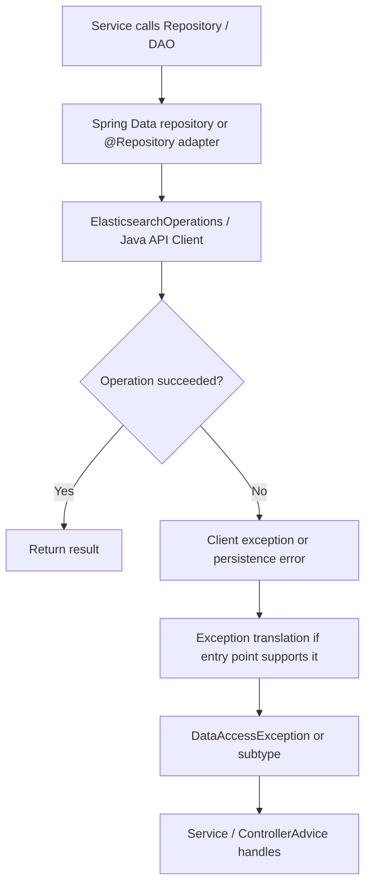
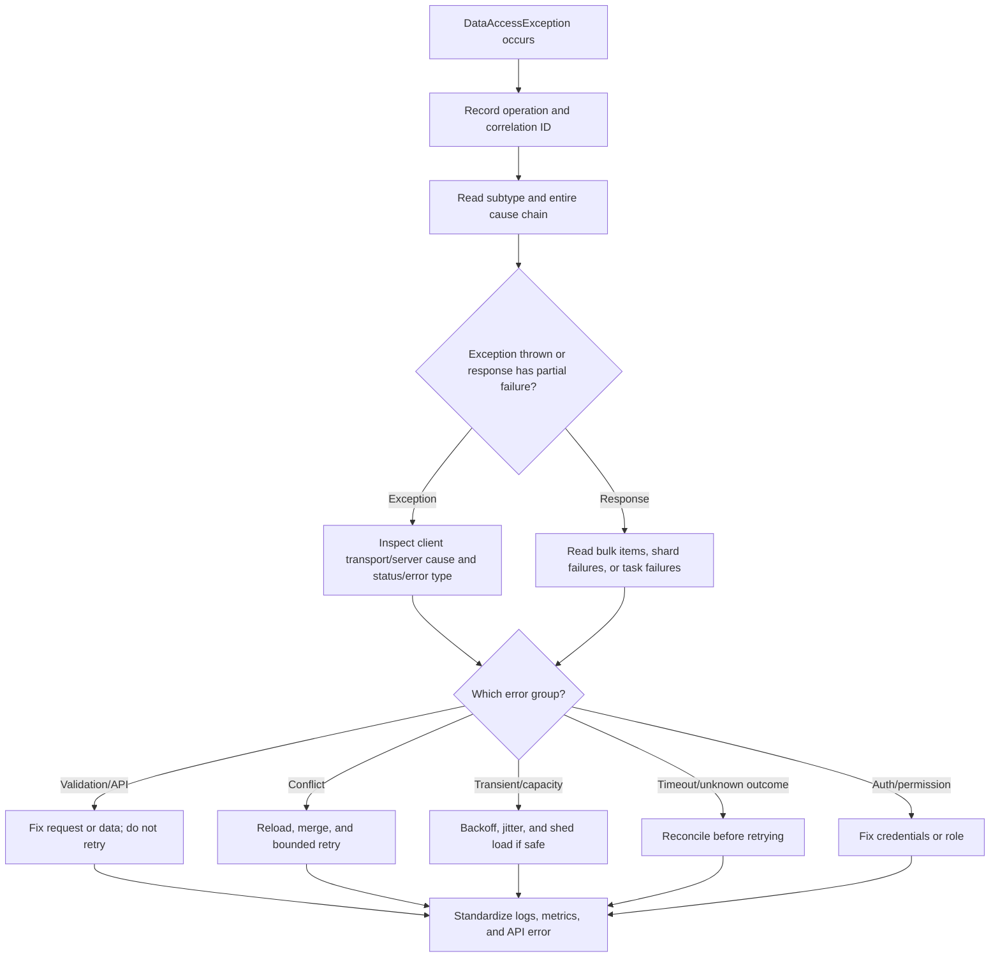

# Reading DataAccessException and Client Cause Chains

When Spring Data Elasticsearch cannot complete an operation, the exception received by the service is sometimes not the original error from Elasticsearch. Spring can translate persistence client errors into an exception in the `DataAccessException` hierarchy. The outer exception describes the error from a data-access perspective; nested exceptions inside often contain more specific details such as HTTP status, Elasticsearch error type, transport errors, timeouts, or connection failures.

For accurate diagnosis, you must read both **the outer exception type and the entire cause chain**. Logging only `ex.getMessage()` is usually insufficient. At the same time, not every error is thrown as an exception: the Bulk API can return a successful HTTP status while some items fail; the Search API can return partial results accompanied by shard failures or timeouts. Those cases must be inspected in the response.

This lesson covers how to read `DataAccessException`, find the root cause from the client, distinguish request errors from per-item errors, classify retryability, and translate errors into safe application responses.

## 1. What is `DataAccessException`?

`DataAccessException` belongs to the `org.springframework.dao` package. It is Spring's unchecked exception hierarchy used to represent data access failures, independent of the specific storage technology.

Spring Data can use the same exception hierarchy across multiple persistence stores. As a result, the service layer can catch a common error family without depending directly on a specific client's exceptions.

Example:

```java
import org.springframework.dao.DataAccessException;

try {
    ProductDocument saved = productRepository.save(product);
} catch (DataAccessException ex) {
    log.error("Could not save product", ex);
    throw ex;
}
```

`DataAccessException` is the base class for many concrete exceptions and is itself abstract. Therefore, applications typically catch it to handle failures at the persistence boundary, while retry logic or HTTP mapping should rely on the subtype and actual underlying cause.

Benefits of this abstraction:

- The service layer has fewer dependencies on the client implementation.
- Some errors can be classified by general data semantics such as optimistic locking or integrity violations.
- Consistent exception handling is easier to build across repositories and persistence adapters.
- The original exception can be preserved as the cause for detailed investigation when needed.

However, abstraction does not mean every Elasticsearch error is mapped to the exact same Spring subtype across all versions. You must check the actual exceptions produced by your Spring Data Elasticsearch release and the entry point your application calls.

## 2. Where does Spring exception translation operate?

Spring uses exception translation to convert persistence-technology-specific exceptions into exceptions under `org.springframework.dao`.

With Spring Data Repositories, the repository infrastructure provides proxies and store-appropriate exception translation. With a custom-written DAO class, the `@Repository` annotation together with exception translation infrastructure can participate in translating exceptions.

General flow:



An important point to remember is that the call path determines which exception appears:

| Entry point | Note |
|---|---|
| `ElasticsearchRepository` | Goes through Spring Data repository infrastructure and store exception translation. |
| `ElasticsearchOperations` | Uses the Spring Data abstraction; persistence errors may be translated into Spring DAO exceptions depending on implementation/version. |
| Custom DAO with `@Repository` | Can participate in exception translation when Spring exception translation infrastructure is configured. |
| Calling `ElasticsearchClient` directly | Client exceptions are usually thrown directly; not translated into `DataAccessException` by default. |
| Custom HTTP/REST client | Exceptions depend on the client and adapter; the application must standardize at its own boundary. |

If a service calls the Java API Client directly and receives `TransportException`, do not assume it will appear as `DataAccessResourceFailureException`. If you want the service layer to depend only on Spring DAO, wrap direct client calls in an adapter/repository with explicit error translation responsibility.

## 3. Common `DataAccessException` subtypes

Spring provides many subtypes describing error categories. Several can be useful when working with Elasticsearch:

| Exception | Meaning | Common interpretation |
|---|---|---|
| `DataAccessResourceFailureException` | Unable to access the data resource | Cluster/connection/resource unavailable; read cause for specifics |
| `TransientDataAccessResourceException` | Transient resource failure | Bounded retry can be considered if the operation is safe |
| `TransientDataAccessException` | Potentially transient data access errors | A signal for retry policy, not a guarantee that retries will succeed |
| `QueryTimeoutException` | Query exceeded the allowed time | Check query, timeout, cluster load, and whether the request was already processed |
| `DataIntegrityViolationException` | Data integrity/constraint violation | Check data, mapping, or business constraints |
| `DuplicateKeyException` | Duplicate key | May result from creating a document with an existing ID or application unique-key semantics |
| `OptimisticLockingFailureException` | Update based on a stale version | Reload the document and resolve the conflict |
| `InvalidDataAccessApiUsageException` | Invalid persistence API usage | Fix query/request or API usage; do not retry as-is |
| `IncorrectResultSizeDataAccessException` | Result count does not match expectations | Check query and application assumptions |
| `UncategorizedDataAccessException` | Error not categorized into a specific subtype | Read the cause chain and metadata from the client |

The subtypes above are Spring's common vocabulary. Do not infer that an Elasticsearch HTTP status always maps to the exact same subtype across all releases. Exception translators, operations, and client versions can affect the result.

### 3.1. Example of distinguishing errors by meaning

- If an entity is saved with a stale version and Spring Data detects a conflict, the application may receive `OptimisticLockingFailureException`.
- If a query builder is called with invalid parameters, an API usage error may be thrown.
- If the cluster is unreachable, a resource failure error or another exception preserving the client cause may be thrown.
- If a document contains data incompatible with the mapping, an integrity-related exception or general exception may be thrown depending on translation.

Treat the subtype as the first classification layer, then inspect the cause and error metadata to confirm the actual reason.

## 4. What is a cause chain?

One exception can wrap another exception. Example:

```text
DataAccessResourceFailureException
  caused by: TransportException
    caused by: IOException
      caused by: SocketTimeoutException
```

The outermost exception typically reflects Spring's abstraction. Inner exceptions can indicate whether the error occurred in transport, network, or server.

In Java, read the direct cause using:

```java
Throwable cause = exception.getCause();
```

Then keep calling `getCause()` until no cause remains. You should not assume the first cause is the final root cause.

Spring's `NestedRuntimeException`, the superclass in Spring's nested exception hierarchy, provides helpers:

```java
Throwable root = ex.getRootCause();
Throwable mostSpecific = ex.getMostSpecificCause();
```

- `getRootCause()` returns the deepest cause if present; it can return `null` when there is no cause.
- `getMostSpecificCause()` returns the root cause if present, otherwise it returns the current exception itself.

Example:

```java
catch (DataAccessException ex) {
    Throwable root = ex.getMostSpecificCause();

    log.error(
        "Persistence failure: outerType={}, rootType={}, rootMessage={}",
        ex.getClass().getName(),
        root.getClass().getName(),
        root.getMessage(),
        ex
    );
}
```

`getMostSpecificCause()` is convenient when you need a deepest cause for preliminary classification. For full investigation, still traverse the entire chain because an intermediate exception may hold useful details that the lowest root cause lacks.

## 5. Safely traversing the entire cause chain

A helper can print the exception type and message at each layer:

```java
import java.util.ArrayList;
import java.util.Collections;
import java.util.IdentityHashMap;
import java.util.List;
import java.util.Set;

public final class ExceptionChains {

    private ExceptionChains() {
    }

    public static List<Throwable> causes(Throwable error) {
        List<Throwable> result = new ArrayList<>();
        Set<Throwable> visited = Collections.newSetFromMap(
            new IdentityHashMap<>()
        );

        Throwable current = error;
        while (current != null && visited.add(current)) {
            result.add(current);
            current = current.getCause();
        }

        return List.copyOf(result);
    }
}
```

Using `IdentityHashMap` avoids infinite loops if an unusual exception graph contains circular references. In practice, cause chains are usually linear, but a safe helper should not rely on that assumption.

Logging each layer:

```java
catch (DataAccessException ex) {
    int depth = 0;

    for (Throwable cause : ExceptionChains.causes(ex)) {
        log.error(
            "Persistence cause depth={}, type={}, message={}",
            depth++,
            cause.getClass().getName(),
            cause.getMessage()
        );
    }

    throw ex;
}
```

In production, logging the exception once with `log.error("...", ex)` is usually sufficient to preserve the stack trace and cause chain. The helper is useful when building diagnostic events or testing exception translation; avoid repeatedly logging stack traces at every layer.

## 6. Suppressed exceptions and stack traces

The cause chain is not the only structure that can contain error information. Java supports suppressed exceptions via `Throwable.getSuppressed()`.

For example, suppressed exceptions often appear when a primary error occurs inside `try` and another error occurs while closing a resource in try-with-resources.

```java
try (SomeResource resource = openResource()) {
    performOperation(resource);
} catch (Exception ex) {
    for (Throwable suppressed : ex.getSuppressed()) {
        log.warn(
            "Suppressed exception: type={}, message={}",
            suppressed.getClass().getName(),
            suppressed.getMessage()
        );
    }
    throw ex;
}
```

The stack trace shows the path of the error in code; the cause chain shows which layers wrapped the error. When logging an exception with a logger:

```java
log.error("Elasticsearch operation failed", ex);
```

the logger records the stack trace along with causes/suppressed exceptions according to its formatter. Avoid logging only `ex.getMessage()`, as most diagnostic details will be lost.

## 7. Reading exceptions from the Elasticsearch Java API Client

When using the Elasticsearch Java API Client directly, errors generally fall into two broad groups:

- **Transport/client-side failure**: failed to send or properly read a response, such as connection failures, timeouts, TLS, serialization, or transport errors.
- **Elasticsearch server error**: the server returned an error response for the request, such as an invalid query, incompatible mapping, version conflict, missing privileges, or missing resource.

The Java API Client has transport-layer exceptions; specific class and package names depend on the dependency version. Some server errors are represented by an exception containing the error response from Elasticsearch. Do not write code relying on class names remembered from another version without checking your current dependency.

Example calling the client directly and preserving the error:

```java
try {
    SearchResponse<ProductDocument> response = client.search(
        request -> request
            .index("products")
            .query(query -> query
                .match(match -> match
                    .field("name")
                    .query("wireless headphones")
                )
            ),
        ProductDocument.class
    );

    return response;
} catch (RuntimeException ex) {
    log.error("Direct Elasticsearch client call failed", ex);
    throw ex;
}
```

This example does not classify every runtime exception as an Elasticsearch error. In real code, catch the exact client exceptions provided by your dependency, or let exceptions propagate to the adapter responsible for standardization.

### 7.1. Reading status and error type

When the server returns an error, useful details usually include:

- HTTP status.
- Elasticsearch error type.
- Reason/message.
- `caused_by` and `root_cause` if present.
- Related index, shard, or resource.

Illustrative error response example:

```json
{
  "error": {
    "type": "mapper_parsing_exception",
    "reason": "failed to parse field [price]",
    "caused_by": {
      "type": "number_format_exception",
      "reason": "For input string: \"unknown\""
    }
  },
  "status": 400
}
```

HTTP 400 indicates the request/document is invalid; `mapper_parsing_exception` and `number_format_exception` explain the specific error. If Spring wraps this response in a `DataAccessException`, the cause chain may retain some or all of the details depending on the translator/client version.

Do not classify solely by status. The same status 400 can stem from many error types; the same status 409 can be a version conflict or another conflict.

## 8. Transport errors and server errors are not the same

| Group | Example | Symptoms to inspect | Initial handling direction |
|---|---|---|---|
| DNS/connect | Host unresolved, connection refused | `UnknownHostException`, `ConnectException`, or corresponding transport cause | Check endpoint, DNS, network, and cluster availability |
| Socket timeout | Request/response timed out | `SocketTimeoutException`, client timeout exception | Check latency, timeout, and request state |
| TLS/certificate | Untrusted certificate, hostname mismatch | SSL/TLS exception in chain | Check CA, certificate, and hostname verification |
| Serialization | Document/query cannot be serialized | Jackson/JSON mapper or serialization exception | Check DTO, custom serializer, and request model |
| Authentication | Invalid or expired credentials | HTTP 401 or auth error | Fix credentials/rotation; do not retry continuously |
| Authorization | Role lacks privileges | HTTP 403 or security error | Fix role/index privileges using least privilege |
| Bad request | Invalid query/mapping/request | HTTP 400 and error type | Fix query, field, or data |
| Conflict | Version/OCC or duplicate operation | HTTP 409 and error type | Reload/reconcile per business logic |
| Capacity/rejection | Cluster overloaded or queue full | HTTP 429/503, rejection cause | Reduce concurrency and retry with backoff if safe |
| Server/internal | Cluster-side processing failure | HTTP 5xx and error response | Check cluster logs/health; bounded retry if operation is safe |

A transport failure does not prove the server did not execute the operation. For example, if the client times out after sending a write, the server may have already written the document while the response never reached the client. This is an unknown outcome state and requires reconciliation before retrying a non-idempotent operation.

## 9. Distinguishing exceptions from errors inside responses

A common diagnostic mistake is only catching exceptions without inspecting the response. Elasticsearch has several APIs that return a normal response containing partial failure details.

### 9.1. Bulk API

The Bulk API can return HTTP 200 even if one or more items fail. You must check:

```java
BulkResponse response = client.bulk(request);

if (response.errors()) {
    for (BulkResponseItem item : response.items()) {
        if (item.error() != null) {
            log.warn(
                "Bulk item failed: index={}, id={}, status={}, type={}, reason={}",
                item.index(),
                item.id(),
                item.status(),
                item.error().type(),
                item.error().reason()
            );
        }
    }
}
```

Package/import names and accessors of the Java API Client must match the project version. The semantics remain the same: `errors()` is the summary flag, and `items()` contains the result of each operation in request order.

Spring Data can report bulk errors via `BulkFailureException` with the list of failed documents. If you need both successful results and per-operation error details, the response from the Java API Client often provides richer metadata.

### 9.2. Search API

A search response can contain:

- `timed_out` indicating whether the search timed out.
- `_shards.failed` indicating shard failures.
- Some hits returned even though another shard failed, depending on request settings and server behavior.
- `terminated_early` if the request used a relevant early termination mechanism.

Example partial response:

```json
{
  "timed_out": true,
  "_shards": {
    "total": 5,
    "successful": 4,
    "skipped": 0,
    "failed": 1
  },
  "hits": {
    "total": { "value": 120, "relation": "eq" },
    "hits": []
  }
}
```

Do not treat receiving `SearchHits` or HTTP 200 as proof of complete results. If the use case requires complete results, check timeouts and shard failures according to your version's response API.

### 9.3. Update By Query and Delete By Query

Query-based tasks can return responses containing `failures`, `version_conflicts`, `timed_out`, counts of updated/deleted documents, and batch counts. A task may have partially updated documents before reporting errors.

Do not rely solely on a generic exception or HTTP status. Read the counters and failure list in the response, then reconcile remaining documents.

## 10. Reading `BulkFailureException` and specialized exceptions

When a Spring Data bulk operation detects failed items, it may throw `BulkFailureException`. This is a case where you need to read the failed documents map instead of logging only a generic message.

Example using a Spring Data Elasticsearch API with `FailureDetails`:

```java
try {
    operations.bulkIndex(indexQueries, IndexCoordinates.of("products"));
} catch (BulkFailureException ex) {
    ex.getFailedDocuments().forEach((id, failure) ->
        log.error(
            "Bulk index failed: id={}, status={}, reason={}",
            id,
            failure.status(),
            failure.errorMessage()
        )
    );
}
```

The return type of `getFailedDocuments()` varies by Spring Data Elasticsearch version. In some older releases, the value is a message string; newer releases may use a `FailureDetails` record containing status and message. Verify the actual signature in your dependency before copying code.

Other exceptions may also provide dedicated details, such as `OptimisticLockingFailureException` for update conflicts. Catch specific subtypes when there is a clear recovery action; otherwise, preserve the exception and cause chain for higher layers to handle.

## 11. A helper to standardize exception information

An application can create an internal diagnostic DTO for logging, metrics, or sending to an observability system:

```java
public record ExceptionDiagnostic(
    String outerType,
    String outerMessage,
    String rootType,
    String rootMessage,
    int causeDepth
) {
}
```

Mapper:

```java
public final class ExceptionDiagnosticMapper {

    private ExceptionDiagnosticMapper() {
    }

    public static ExceptionDiagnostic from(Throwable error) {
        List<Throwable> chain = ExceptionChains.causes(error);
        Throwable root = chain.get(chain.size() - 1);

        return new ExceptionDiagnostic(
            error.getClass().getName(),
            error.getMessage(),
            root.getClass().getName(),
            root.getMessage(),
            chain.size() - 1
        );
    }
}
```

This is an internal diagnostic, not a public API response. Messages may contain index names, field names, query fragments, or input data; apply an appropriate redaction policy before storing or displaying them.

If you need to analyze error types/statuses from Elasticsearch, attach the extracted fields at the adapter where the client response still has full metadata. Do not try to regex-parse message strings as the primary data source when a structured error response exists.

## 12. Classifying errors to decide on retries

Not every error should be retried. A good strategy classifies by Spring subtype, cause chain, server status/error type, and operation idempotency.

| Error group | Example | Retry? | Action |
|---|---|---|---|
| Validation/mapping | `mapper_parsing_exception`, wrong field type | Do not retry as-is | Fix data or mapping |
| API usage/query | Wrong field query, invalid builder, invalid arguments | No | Fix code/request |
| Authentication/authorization | 401/403 | Do not retry automatically | Check credentials and roles |
| Version conflict | `OptimisticLockingFailureException`, 409 | Do not retry with stale entity | Reload, merge intent, and bounded retry |
| Capacity/rejection | 429, queue rejection | Possible | Backoff, jitter, reduce concurrency/batch |
| Temporary unavailability | Certain 503/5xx or resource failures | Possible | Bounded retry if operation is idempotent and outcome is clear |
| Timeout | Query/write timeout | Caution needed | Determine if query is retryable; reconcile outcome for writes |
| Unknown outcome | Client disconnects after sending write | Do not retry blindly | GET/reconcile by ID or revision first |

The `TransientDataAccessException` subtype is a helpful signal, but not the sole condition. A transport error may be transient while the write has already been processed by the server; blind retries can cause duplicate side effects.

### 12.1. Bounded backoff

For transient retryable errors, use exponential backoff and jitter:

```text
delay = min(maxDelay, baseDelay * 2^attempt) + randomJitter
```

Example policy:

- Maximum 3–5 attempts depending on use case.
- Increasing delay with an upper cap.
- Jitter so multiple workers do not retry simultaneously.
- Overall deadline for the entire operation.
- Reduce concurrency or batch size when the cluster is rejecting requests.
- Record retry counts and the final cause.

Do not use infinite retry loops or immediate retries inside a `catch` block. That can overload an already strained cluster even further.

### 12.2. Retries must account for idempotency

| Operation | Risk when retrying |
|---|---|
| Index same ID with same payload | Usually brings the document to the same desired state |
| Create with same ID | May hit duplicate/conflict if the previous attempt succeeded but response was lost |
| Update setting fixed values | Usually easier to retry if business conditions have not changed |
| Script incrementing a counter | May increment twice |
| Deducting inventory or adding points | May apply duplicate side effects without an idempotency key/version guard |
| Delete same ID | May be idempotent in business logic, but `not_found` must be handled properly |

If the client times out after sending a request, treat the outcome as unknown until reconciled. Using stable document IDs, idempotency keys, or source revisions helps handle this case.

## 13. Handling optimistic locking conflicts

If Spring Data throws `OptimisticLockingFailureException`, another writer usually modified the document after the current request read it.

Do not do the following:

```java
catch (OptimisticLockingFailureException ex) {
    // Wrong: resubmitting the same entity with the stale version.
    repository.save(staleEntity);
}
```

Instead:

1. Reload the latest document.
2. Check whether the request's update intent is still valid.
3. Apply the change to the new version.
4. Save with the new version.
5. Limit retries and return conflict if it still collides.

Example operation setting a field:

```java
public ProductDocument changePrice(String id, long newPrice) {
    for (int attempt = 1; attempt <= 3; attempt++) {
        ProductDocument current = repository.findById(id)
            .orElseThrow(() -> new ProductNotFoundException(id));

        current.setPriceInCents(newPrice);

        try {
            return repository.save(current);
        } catch (OptimisticLockingFailureException ex) {
            if (attempt == 3) {
                throw new ProductUpdateConflictException(id, ex);
            }
        }
    }

    throw new IllegalStateException("Unreachable retry state");
}
```

This example only fits when the price assignment rule can be reapplied to the latest document. For add/subtract operations, recalculate business logic or use atomic/versioned commands; do not apply the same retry loop to every kind of update.

## 14. Handling timeouts and unknown outcomes

Timeouts can occur at many layers:

- Connection pool fails to lease a connection in time.
- Network connect/read timeout.
- Elasticsearch query timeout.
- Gateway/backend request timeout.
- Client gives up waiting while the server continues processing.

A timeout does not mean the server cancelled the request. For a write, the server may have indexed the document while the response was lost. For bulk, some items may have succeeded.

Safe procedure:

1. Determine whether the timeout occurred before or after sending the request.
2. If you have a document ID, check state using GET or a query with the relevant revision.
3. If the operation uses external version/OCC/idempotency key, use that token to reconcile.
4. Retry only when the operation is safe to repeat or you confirmed the prior attempt was not applied.
5. Record `UNKNOWN_OUTCOME` state if the result cannot yet be confirmed.

Do not automatically turn every timeout into a 503 error telling the client to resend the same non-idempotent write command.

## 15. Standardizing errors at the repository/adapter layer

If the application calls the Java API Client directly, place the client behind an adapter with a clear contract. The adapter can translate transport/server errors into business exceptions or Spring DAO exceptions understood by the service.

Example application exceptions:

```java
public class SearchStoreUnavailableException extends RuntimeException {

    public SearchStoreUnavailableException(String message, Throwable cause) {
        super(message, cause);
    }
}

public class SearchStoreRejectedException extends RuntimeException {

    public SearchStoreRejectedException(String message, Throwable cause) {
        super(message, cause);
    }
}
```

Adapter:

```java
@Repository
public class ProductSearchAdapter {

    private final ElasticsearchClient client;

    public ProductSearchAdapter(ElasticsearchClient client) {
        this.client = client;
    }

    public SearchResponse<ProductDocument> search(Query query) {
        try {
            return executeSearch(query);
        } catch (RuntimeException ex) {
            if (isCapacityRejection(ex)) {
                throw new SearchStoreRejectedException(
                    "Elasticsearch rejected the search operation",
                    ex
                );
            }

            if (isTransportUnavailable(ex)) {
                throw new SearchStoreUnavailableException(
                    "Elasticsearch is temporarily unavailable",
                    ex
                );
            }

            throw ex;
        }
    }
}
```

`executeSearch`, `isCapacityRejection`, and `isTransportUnavailable` are implementation parts dependent on the client version and structured error metadata; do not classify by matching arbitrary message substrings. The example shows where exception standardization lives, not a complete copy-pasteable adapter.

If using the Spring DAO hierarchy for the adapter, you can throw `DataAccessResourceFailureException`, `TransientDataAccessResourceException`, or an appropriate subtype, keeping the original cause. Do not pick a semantically wrong subtype just to force all errors into one bucket.

## 16. Translating errors into safe HTTP responses

REST APIs should not return class names, stack traces, full error bodies, or cluster details directly to clients. Use `@RestControllerAdvice` to map errors according to the product contract.

Example:

```java
@RestControllerAdvice
public class ApiExceptionHandler {

    @ExceptionHandler(ProductNotFoundException.class)
    ResponseEntity<ApiError> notFound(ProductNotFoundException ex) {
        return ResponseEntity.status(HttpStatus.NOT_FOUND)
            .body(new ApiError("PRODUCT_NOT_FOUND", "Product was not found"));
    }

    @ExceptionHandler(OptimisticLockingFailureException.class)
    ResponseEntity<ApiError> conflict(OptimisticLockingFailureException ex) {
        return ResponseEntity.status(HttpStatus.CONFLICT)
            .body(new ApiError(
                "CONCURRENT_MODIFICATION",
                "The product changed. Reload it and try again."
            ));
    }

    @ExceptionHandler(DataAccessResourceFailureException.class)
    ResponseEntity<ApiError> unavailable(DataAccessResourceFailureException ex) {
        return ResponseEntity.status(HttpStatus.SERVICE_UNAVAILABLE)
            .body(new ApiError(
                "SEARCH_STORE_UNAVAILABLE",
                "The search service is temporarily unavailable"
            ));
    }

    @ExceptionHandler(DataAccessException.class)
    ResponseEntity<ApiError> dataAccess(DataAccessException ex) {
        return ResponseEntity.status(HttpStatus.INTERNAL_SERVER_ERROR)
            .body(new ApiError(
                "DATA_ACCESS_FAILED",
                "The data operation could not be completed"
            ));
    }
}
```

`ApiError` is an application DTO. In production, the handler should log the exception once with a correlation ID, while the response only contains standardized codes/messages.

Do not map every `DataAccessException` to 400. Many errors are server/cluster issues, not client request errors. Nor should you map every exception to 503: mapping or API misuse errors need to be fixed, and conflicts need their own semantics.

## 17. Structured logging of cause chains

A useful diagnostic log typically needs:

- Operation: search, index, update, delete, bulk, or update-by-query.
- Index/alias family, not necessarily the full internal index name.
- Correlation/request ID.
- Outermost exception type.
- Root cause type and status/error type if available.
- Execution duration and retry attempt.
- Document ID or business key masked if necessary.

Example:

```java
log.error(
    "Elasticsearch operation failed: operation={}, index={}, correlationId={}, " +
        "exceptionType={}, rootCauseType={}",
    operation,
    indexName,
    correlationId,
    ex.getClass().getName(),
    ex.getMostSpecificCause().getClass().getName(),
    ex
);
```

Avoid logging:

- Passwords, API keys, bearer tokens, or TLS secrets.
- The entire `_source` of a document.
- Queries containing personal data or sensitive information.
- Full client request bodies without masking.
- Exception messages as a high-cardinality metric label.

Log an exception at a single responsible layer. If adapter, service, and controller all log the same exception with a stack trace, log volume increases without adding new information. Upper layers can add business context and rethrow without repeating the stack trace.

## 18. Metrics and tracing for persistence errors

In addition to logs, monitor:

| Metric | Meaning |
|---|---|
| Errors by operation | Know where search/index/update/bulk is failing |
| Errors by exception category | Distinguish conflict, timeout, resource failure, and validation |
| Retry count | Detect when the system relies too heavily on retries |
| Timeout rate | Track requests not completing in time |
| Bulk item failure rate | Detect partial failures despite successful HTTP requests |
| Search shard failure rate | Detect partial search results |
| Cluster rejection rate | Detect overload or excessive concurrency |
| End-to-end latency | Separate backend/network time from Elasticsearch processing time |

With Micrometer, use low-cardinality tags such as `operation`, `outcome`, `exception_category`, or `index_family`. Do not use document ID, user ID, query string, or exception message as tags.

Distributed tracing can record spans from the service to the Elasticsearch client. When investigating, correlate span latency, client exceptions, Elasticsearch slow logs, and cluster metrics by the same correlation/trace ID.

## 19. Error handling in reactive pipelines

If an API returns `Mono`/`Flux`, errors propagate as terminal error signals. You can standardize with `onErrorMap` or handle conditionally with `onErrorResume`:

```java
public Mono<ProductDocument> findProduct(String id) {
    return reactiveOperations.get(id, ProductDocument.class)
        .onErrorMap(DataAccessException.class, ex ->
            new SearchStoreUnavailableException(
                "Could not read product from search store",
                ex
            )
        );
}
```

This example is illustrative; reactive operation signatures and exception translation depend on module/version. Do not call `block()` inside a reactive service just to catch exceptions synchronously.

When using `onErrorResume`, only fall back when semantics are valid. For instance, returning a cached value may fit certain transient errors, but you should not silently turn authorization, mapping, or bad-data errors into empty results.

If reactive retries are needed, use a retry operator with an explicit predicate, backoff, and limits. Do not retry every `onError` because validation errors and conflicts require different handling from transient failures.

## 20. Common mistakes when reading exceptions

| Symptom | Cause | How to handle |
|---|---|---|
| Only seeing generic `DataAccessException` | Cause chain unread or translator did not specialize | Log each layer's type and root cause. |
| First cause is not the final reason | Multi-layer nested exceptions | Traverse to the deepest cause and retain intermediate causes. |
| No exception thrown yet bulk has failed docs | Bulk response contains partial failures | Check `errors()` and each item or `BulkFailureException`. |
| Search returns results but missing shards | Search response has shard failure/timeout | Check `timed_out` and `_shards.failed`. |
| Direct Java API Client does not throw `DataAccessException` | Bypassed Spring Data exception translation | Standardize errors in an adapter or catch appropriate client exceptions. |
| Retry increments a counter twice | Non-idempotent operation | Use idempotency keys/version guards and reconcile before retrying. |
| Retrying conflicts continuously | Resubmitting entity with stale version | Reload, merge, and limit retries. |
| Timeout yet document still exists | Server may have processed the write; response lost | Check by ID/revision before resending. |
| API returns stack trace to client | Exposing internal exceptions | Use `@RestControllerAdvice` and stable error DTOs. |
| Excessive logging or data exposure | Logging stack traces at every layer or full requests | Log once, mask data, and use correlation IDs. |
| Metric backend cardinality explosion | Using ID/message/query as tags | Use only tags with small value sets. |

## 21. Workflow for diagnosing a DataAccessException



Practical steps:

1. Identify the operation, index/alias, and correlation ID.
2. Record the outermost exception, not just the message.
3. Traverse the cause chain, obtain the root cause, and check suppressed exceptions when present.
4. Identify whether the entry point is a Repository, `ElasticsearchOperations`, or direct Java API Client.
5. If there is no exception, check response-level failures such as bulk items, search shards, or update-by-query failures.
6. Read HTTP status, Elasticsearch error type/reason, and transport cause if present.
7. Classify into validation, conflict, auth, timeout, capacity, or unknown outcome.
8. Retry only when the error is recoverable and the operation is safe to repeat.
9. Standardize into an appropriate exception/API error while preserving the original cause.
10. Record structured logs/metrics, mask sensitive data, and monitor error/retry rates.

## 22. Conclusion

`DataAccessException` is Spring's unchecked abstraction for data access failures. In Spring Data Elasticsearch, exception translation may wrap persistence client errors into Spring DAO subtypes. The outermost exception indicates the application-layer error category; the cause chain can hold specific transport, network, or server exceptions. Use `getCause()`, `getRootCause()`, and `getMostSpecificCause()` to dig deeper while preserving stack traces and suppressed exceptions during diagnosis.

Not every failure surfaces as an exception. The Bulk API can return HTTP 200 with some failed items; the Search API can return partial results with timeouts or shard failures; Update By Query can partially update documents before reporting failures. Always check response metadata appropriate to the API.

Classify errors by subtype, cause, status/error type, and operation idempotency. Do not retry mapping/validation/auth errors; handle version conflicts with reload/merge; use backoff and jitter for transient failures; reconcile before retrying writes with unknown outcomes. If calling the Java API Client directly, standardize exceptions in an adapter rather than assuming automatic Spring DAO translation. Finally, log structured cause chains, protect sensitive data, and translate errors into stable API responses. This approach diagnoses Elasticsearch errors more accurately and prevents turning transient errors into recurring incidents through improper retries.
