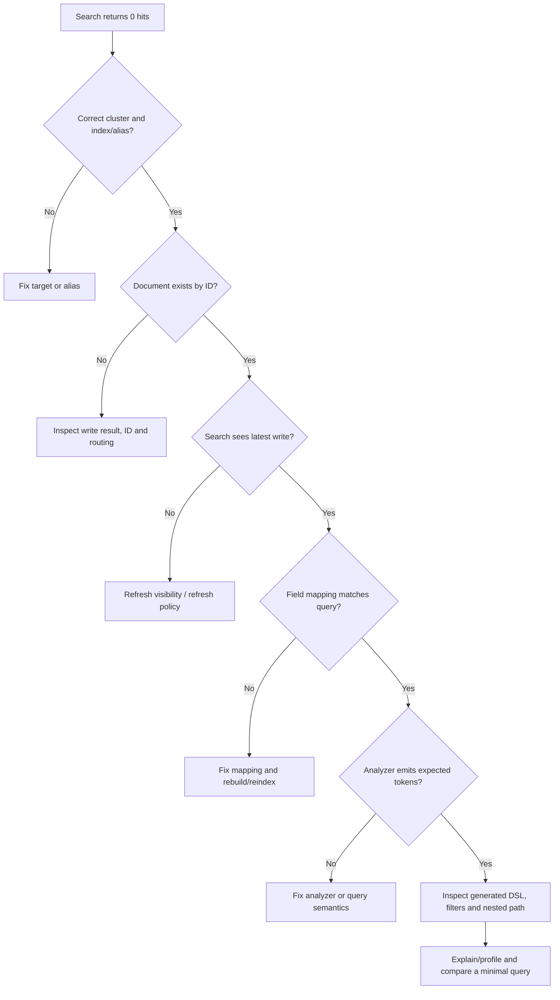

# Empty Results Due to Analyzer, Mapping, or Refresh

An Elasticsearch query can execute successfully yet return `0 hits`. This is a difficult situation to diagnose because there is not necessarily an exception, HTTP error, or failure in Spring Data Elasticsearch. The document may have been written but is not yet searchable; the field may have the wrong mapping type; the analyzer may tokenize differently than expected; or the query may be targeting the wrong index, alias, field, or routing.

When encountering empty results, do not rush to change the query or increase `size`. Check in order: **target and whether data exists, whether the mapping is right, what tokens the analyzer produces, whether the actual Query DSL is right, and whether changes have been refreshed for search visibility**. Each root cause group has distinct symptoms and verification methods.

## 1. Distinguishing types of "not found"

Before looking at analyzers or mappings, identify exactly which operation is returning empty results:

| Operation | Behavior when document is absent | What to distinguish |
|---|---|---|
| `GET /index/_doc/id` | Returns `found: false` | Does the document exist by `_id`? |
| Search API | Returns `hits.total.value: 0` | Does the query match any documents? |
| Spring Data `findById(id)` | Usually returns `Optional.empty()` | Is the ID right and is the target index right? |
| Spring Data `search(...)` | Empty search hits | Query, mapping, analyzer, filters, and refresh |
| Count query | Returns `0` | Do count criteria match and are writes searchable yet? |
| Aggregation | Empty buckets or no buckets | Did the query/filter before aggregation exclude all documents? |

A document may be readable via GET by ID yet not appear in search results. GET by ID is real-time by default; search depends on refresh. Therefore, when GET finds the document but search does not, check refresh first.

Conversely, if GET by ID also returns `found: false`, check the ID, index/alias, routing, and write outcome before concluding that an analyzer caused empty query results.

## 2. General diagnostic procedure

When a query unexpectedly returns `0 hits`, follow this sequence:

1. Confirm the application is querying the right cluster, index, and alias.
2. Check whether the document exists and was written successfully.
3. Check the document count and a sample document's `_source`.
4. Read the mapping of the field used by the query.
5. Inspect the analyzer/normalizer and actual tokens using `_analyze`.
6. Inspect the actual Query DSL sent by Spring Data.
7. Check filters, nested paths, routing, tenant, and extra conditions.
8. Determine whether writes have been refreshed so search can see them.
9. Use `_explain` or query profiling when you need to understand why a document did not match.

This flow helps isolate the cause rather than changing multiple things at once:



Do not start with `_refresh` in every case. Refresh only addresses search visibility of recent changes; it does not fix wrong mappings, incompatible analyzers, or queries referencing wrong fields.

## 3. Check cluster, index, and alias first

A simple but often overlooked cause is the application writing to one index while reading from another. This occurs across multiple environments, multiple aliases, versioned indices, or per-operation `IndexCoordinates`.

### 3.1 Inspect existing indices

```http
GET /_cat/indices/products-*?v
```

Check physical indices, status, document counts, and sizes. If the application uses aliases, inspect where they point:

```http
GET /_alias/products-read
```

```http
GET /_alias/products-write
```

The alias names `products-read` and `products-write` are examples. Replace them with your application's actual names.

### 3.2 Confirm targets in Spring Data Elasticsearch

With repositories, the index is typically declared via `@Document`:

```java
@Document(indexName = "products-read")
public class ProductDocument {
    @Id
    private String id;
}
```

With `ElasticsearchOperations`, the index can be passed directly:

```java
IndexCoordinates readIndex = IndexCoordinates.of("products-read");

SearchHits<ProductDocument> hits = operations.search(
    query,
    ProductDocument.class,
    readIndex
);
```

If one service uses `products-v2`, another repository uses `products-read`, and the writer uses `products-write`, verify that those names point to the right physical index. Do not assume `@Document` annotations and `IndexCoordinates` across all call sites always match.

### 3.3 Inspect a document by ID and _source

```http
GET /products-v2/_doc/product-1001
```

If found, read `_source` to verify field names, data types, and actual values:

```json
{
  "_index": "products-v2",
  "_id": "product-1001",
  "found": true,
  "_source": {
    "sku": "KB-1001",
    "name": "Mechanical Keyboard",
    "active": true,
    "price": 135.0
  }
}
```

Fields in `_source` can differ from Java property names if `@Field(name = "...")`, converters, or projection worker transforms are used. Queries must use field names from the Elasticsearch mapping rather than inferring field names from Java property names.

### 3.4 Check routing

If an index uses custom routing, documents are routed to shards by the routing value. GET/search with the wrong routing may fail to find expected data.

For example, a document indexed with routing `tenant-42`:

```http
PUT /products/_doc/product-1001?routing=tenant-42
{
  "sku": "KB-1001",
  "name": "Mechanical Keyboard"
}
```

When fetching by ID, if precise routing is needed:

```http
GET /products/_doc/product-1001?routing=tenant-42
```

For search, verify the request has appropriate routing and the application applies routing consistently across index, update, get, and search. A multi-tenant system may also filter by `tenantId`; a valid document with the wrong tenant filter also returns empty results.

## 4. Verify the document was written successfully

Do not assume calling `save()` or sending a bulk request means every document was indexed successfully.

### 4.1 Check Bulk results

The Bulk API can partially succeed. One item failing due to mapping or version conflict does not roll back other items:

```http
POST /_bulk
{ "index": { "_index": "products", "_id": "product-1001" } }
{ "sku": "KB-1001", "name": "Mechanical Keyboard" }
{ "index": { "_index": "products", "_id": "product-1002" } }
{ "sku": "MS-2001", "name": "Wireless Mouse" }
```

Check `errors` and per-item results in the response. If an item failed, record `_id`, status, and error type. Do not check only the overall HTTP status.

In Spring Data, inspect bulk operation responses according to the API version in use. If a service only logs "bulk finished" without checking individual items, missing documents can be mistaken for a search bug.

### 4.2 Check an unconditional count

```http
GET /products/_count
```

If count is 0, the specific query is not the first thing to investigate: the index may not be populated yet, the app may be writing elsewhere, bulk failed, or the alias points to the wrong target.

If count is greater than 0, inspect a sample document and then test the simplest possible query:

```http
GET /products/_search
{
  "query": {
    "match_all": {}
  },
  "size": 5
}
```

If `match_all` returns data while the business query gets no hits, focus on mapping, analyzer, and query conditions.

## 5. Mapping determines how fields are searched

Mapping tells Elasticsearch the data type and how each field is indexed. A JSON value that looks like a string does not mean the field is `text`; the mapping might be `keyword`, `date`, numeric, boolean, object, or nested.

Example mapping:

```json
{
  "properties": {
    "sku": {
      "type": "keyword"
    },
    "name": {
      "type": "text",
      "analyzer": "standard"
    },
    "price": {
      "type": "double"
    },
    "active": {
      "type": "boolean"
    }
  }
}
```

### 5.1 text and keyword have different semantics

| Field type | How it is indexed | Typically suitable queries |
|---|---|---|
| `text` | Analyzed into tokens by an analyzer | `match`, `match_phrase`, full-text queries |
| `keyword` | Indexed as a single whole term | `term`, `terms`, exact filters, sort/aggregation |

Example when `name` is `text`:

```http
GET /products/_search
{
  "query": {
    "match": {
      "name": "mechanical keyboard"
    }
  }
}
```

Example when `sku` is `keyword`:

```http
GET /products/_search
{
  "query": {
    "term": {
      "sku": "KB-1001"
    }
  }
}
```

Using `term` to search a string on a `text` field often surprises developers because `term` does not run a search analyzer on the query value. It matches indexed terms directly. For full-text fields, use `match` unless there is an explicit reason to query raw terms.

### 5.2 Case of using the wrong query type

Suppose the document has:

```json
{
  "name": "Mechanical Keyboard"
}
```

Mapping for `name` is `text` with the standard analyzer. The analyzer can produce two tokens: `mechanical` and `keyboard`.

The following query may not match:

```json
{
  "query": {
    "term": {
      "name": "Mechanical Keyboard"
    }
  }
}
```

Because the whole query string is not an indexed term. Use:

```json
{
  "query": {
    "match": {
      "name": "Mechanical Keyboard"
    }
  }
}
```

If you need an exact match on a text field with a multi-field, query `name.raw` or `name.keyword` according to the actual mapping:

```json
{
  "query": {
    "term": {
      "name.raw": "Mechanical Keyboard"
    }
  }
}
```

The subfield name is not `raw` or `keyword` by default; read the mapping.

### 5.3 Read the actual mapping

```http
GET /products/_mapping
```

Inspect only one field:

```http
GET /products/_mapping/field/name
```

Field capabilities help check what types the same field has across multiple indices:

```http
GET /products-*/_field_caps?fields=name,sku,price
```

This is especially useful when an alias points to multiple indices with differing mappings. A query may work on one index and fail to behave as expected on another.

### 5.4 Wrong field type or dynamic mapping

If mappings are created dynamically, the first document written to a field can determine its type. For example, a date value sent as an unrecognized string format can be dynamically mapped as `text` instead of `date`, or numeric fields can get the wrong type from the initial payload.

Once the mapping is created, sending data of another type can trigger parsing errors or rejections. Read `_mapping` rather than looking only at `_source`.

For fields already created with the wrong mapping, you cannot arbitrarily change their type on an index holding data. Create a new index with the right mapping, reindex/rebuild data, and switch the alias.

### 5.5 Wrong field name or field path

Common causes:

- Java property `status` is mapped as `product_status`.
- Field sits under object `manufacturer.name`, yet the query uses `name`.
- Field sits inside nested path `variants.sku`, yet the query omits a nested query.
- Query uses subfield `name.keyword`, yet the mapping does not declare that multi-field.
- Field names are case-sensitive and the application sends the wrong path.

Always compare query fields against the actual mapping and document `_source`.

## 6. Object and nested queries

Elasticsearch maps arrays of objects to `object` by default, flattening child fields. When conditions must match on the same array element, you must use `nested` mapping and a `nested` query.

Example document:

```json
{
  "variants": [
    { "sku": "RED-M", "color": "red" },
    { "sku": "BLUE-L", "color": "blue" }
  ]
}
```

If `variants` is `nested`, the query must declare the nested path:

```json
{
  "query": {
    "nested": {
      "path": "variants",
      "query": {
        "bool": {
          "filter": [
            { "term": { "variants.sku": "RED-M" } },
            { "term": { "variants.color": "red" } }
          ]
        }
      }
    }
  }
}
```

If the field is `object`, a nested query is inappropriate. If the field is `nested`, a normal query against `variants.sku` may not return expected results because nested documents are indexed separately according to nested mapping semantics.

Check the mapping:

```http
GET /products/_mapping
```

Check whether `variants` has `"type": "nested"` or `"type": "object"`. If you need to switch from object to nested, create a new index and reindex; you cannot change an existing field's type directly.

## 7. Analyzers affect indexed and queried tokens

An analyzer is a text-processing pipeline applied before indexing or before analyzing a query. An analyzer typically consists of:

1. Character filters: transform input characters before tokenization.
2. Tokenizer: splits strings into tokens.
3. Token filters: normalization, lowercasing, stemming, stop words, synonyms, or other transformations.

For example, the standard analyzer can transform:

```text
Input:  "The QUICK Brown Foxes"
Tokens: "the", "quick", "brown", "foxes"
```

Depending on the analyzer, stop words may be removed, and words may be lowercased or stemmed. Thus, the string shown in `_source` is not necessarily identical to the terms stored in the inverted index.

### 7.1 Index analyzer and search analyzer

`analyzer` is used when indexing a field. `search_analyzer` is used when analyzing queries on that field. The two analyzers must emit compatible tokens so queries can find documents.

Example:

```json
{
  "settings": {
    "analysis": {
      "analyzer": {
        "product_index": {
          "tokenizer": "standard",
          "filter": ["lowercase", "asciifolding"]
        },
        "product_search": {
          "tokenizer": "standard",
          "filter": ["lowercase", "asciifolding"]
        }
      }
    }
  },
  "mappings": {
    "properties": {
      "name": {
        "type": "text",
        "analyzer": "product_index",
        "search_analyzer": "product_search"
      }
    }
  }
}
```

If index analyzer and search analyzer emit different tokens, queries can miss documents. For example, indexing uses stemming while searching does not, or indexing drops stop words while searching keeps them.

### 7.2 Inspecting tokens with _analyze

Do not guess which tokens an analyzer produces. Call the Analyze API:

```http
POST /products/_analyze
{
  "field": "name",
  "text": "The QUICK Brown Foxes"
}
```

When passing `field`, Elasticsearch uses the analyzer configured for that field. You can also test a specific analyzer:

```http
POST /products/_analyze
{
  "analyzer": "product_search",
  "text": "The QUICK Brown Foxes"
}
```

The response contains the token list, positions, and offsets. Compare tokens from indexed text against tokens from the query. If they do not intersect as required by the query, results can be empty.

### 7.3 Testing index analyzer and search analyzer separately

Example testing the index analyzer:

```http
POST /products/_analyze
{
  "analyzer": "product_index",
  "text": "Café KEYBOARD"
}
```

Testing the search analyzer:

```http
POST /products/_analyze
{
  "analyzer": "product_search",
  "text": "cafe keyboard"
}
```

If the index analyzer includes `asciifolding`, `café` can be normalized into a token compatible with `cafe`. Without that filter, the two tokens can differ.

### 7.4 Lowercase and case sensitivity

For `text` fields, analyzers usually lowercase tokens. `match` queries also apply the search analyzer, so `Keyboard`, `KEYBOARD`, and `keyboard` usually match the same token.

For `keyword`, values are usually preserved verbatim. `term` on a keyword field can be case-sensitive:

```json
{
  "query": {
    "term": {
      "sku": "kb-1001"
    }
  }
}
```

If the indexed value is `KB-1001`, a lowercase query may not match. You can normalize in the application or configure a normalizer on the keyword field.

### 7.5 Normalizers apply only to keyword

A normalizer transforms the entire keyword value into a single term. It does not split strings into multiple tokens like a text field's analyzer.

Example:

```json
{
  "settings": {
    "analysis": {
      "normalizer": {
        "lowercase_normalizer": {
          "type": "custom",
          "filter": ["lowercase", "asciifolding"]
        }
      }
    }
  },
  "mappings": {
    "properties": {
      "sku": {
        "type": "keyword",
        "normalizer": "lowercase_normalizer"
      }
    }
  }
}
```

With a keyword normalizer, term queries are normalized by the field's normalizer. Do not use a normalizer instead of an analyzer for full-text search.

### 7.6 Stop words can turn a query empty

Some analyzers strip stop words such as `the`, `a`, `and`. If a query contains only stop words, analysis may leave no tokens to search. Depending on the query and analyzer, Elasticsearch may return 0 hits or handle empty queries according to query semantics.

When users enter a short phrase or only stop words, inspect `_analyze` output to see whether any tokens remain. Avoid manually stripping words in the application layer if the server analyzer already handles them, unless there is a clear consistency reason.

### 7.7 Stemming, synonyms, and languages

Stemming can reduce word variants to a common stem; synonym filters can expand or replace tokens. For Vietnamese, English, and languages with different tokenization rules, the default analyzer may not fit search requirements.

Do not conclude data "is missing" from a single query string. Check the active analyzer, token output, and design analyzers for the actual language. If you change an analyzer after data has been indexed, you must reindex to rebuild the inverted index with the new analyzer.
## 8. Multi-fields and legacy data

A field can be indexed in multiple ways:

```json
{
  "mappings": {
    "properties": {
      "name": {
        "type": "text",
        "fields": {
          "keyword": {
            "type": "keyword"
          }
        }
      }
    }
  }
}
```

`name` serves full-text search; `name.keyword` serves exact match, sort, or aggregation.

If you add a multi-field to the mapping after documents have already been indexed, Elasticsearch does not automatically regenerate indexed terms for all older documents. The new mapping may show up in `_mapping`, yet `name.keyword` still has no indexed values for old documents until data is reindexed or updated so the field is re-indexed.

You can use `_update_by_query` with a no-op source script to trigger re-indexing documents under the new mapping, or create a new index and reindex. For important mapping migrations, a new index is usually easier to control and verify.

## 9. match queries, term queries, and combined conditions

Even when mappings/analyzers are right, queries can return empty due to using the wrong query type or overly restrictive filter conditions.

### 9.1 match

`match` analyzes query text with the search analyzer:

```json
{
  "query": {
    "match": {
      "name": {
        "query": "wireless keyboard",
        "operator": "and"
      }
    }
  }
}
```

With `operator: "and"`, every token must match. If one token was stripped by an analyzer or a document lacks that token, the query may return no results. By default, `match` typically uses OR across tokens; choose semantics appropriately.

### 9.2 term

`term` matches an already indexed term, typically appropriate for keyword, boolean, or numeric fields:

```json
{
  "query": {
    "term": {
      "active": true
    }
  }
}
```

Do not use `term` for full-text fields if the goal is analyzing user-entered words.

### 9.3 bool filter

A query may match text yet be filtered out completely by filters:

```json
{
  "query": {
    "bool": {
      "must": [
        {
          "match": {
            "name": "wireless keyboard"
          }
        }
      ],
      "filter": [
        {
          "term": {
            "active": true
          }
        },
        {
          "range": {
            "price": {
              "lte": 100
            }
          }
        }
      ]
    }
  }
}
```

If a document has price `135`, the filter `price <= 100` excludes it even though the text match succeeded. During diagnosis, remove filters one by one to find which condition drops results to 0, then restore each condition.

### 9.4 Ranges and data types

Range queries require fields of compatible types:

```json
{
  "query": {
    "range": {
      "price": {
        "gte": 100,
        "lt": 200
      }
    }
  }
}
```

If `price` is mapped as `keyword`, ranges may carry different semantics or be rejected depending on the query. If dates are stored as text, date ranges will not work as intended. Read the mapping and test a minimal query first.

### 9.5 Exists queries

To verify whether a field has an indexed value:

```json
{
  "query": {
    "exists": {
      "field": "name"
    }
  }
}
```

`exists` checks whether the field has an indexed value per Elasticsearch semantics. Missing fields, nulls, or values producing no indexed tokens may not match. Having a key in `_source` does not always mean the field can be queried as expected.

## 10. Inspecting the Query DSL Spring Data actually sends

A simple-looking repository method name can generate a different query than the author intended. Example:

```java
List<ProductDocument> findByName(String name);
```

Spring Data generates the query based on mapping metadata and its version's query derivation rules. Do not assume this method always translates to a specific `term` or `match` query without verifying.

### 10.1 Query methods and @Query

Query method:

```java
Optional<ProductDocument> findBySku(String sku);
```

For a keyword field, this is usually appropriate for exact matches.

Raw query:

```java
@Query("""
{
  "match": {
    "name": {
      "query": "?0"
    }
  }
}
""")
List<ProductDocument> searchByName(String text);
```

`@Query` allows defining explicit JSON queries. Parameter binding syntax and text blocks depend on Java/Spring Data versions. Verify the actual query sent and value escaping.

### 10.2 NativeQuery

With the Elasticsearch Java Client query builder:

```java
Query query = NativeQuery.builder()
    .withQuery(q -> q.match(m -> m
        .field("name")
        .query("wireless keyboard")
    ))
    .withPageable(PageRequest.of(0, 20))
    .build();

SearchHits<ProductDocument> hits = operations.search(
    query,
    ProductDocument.class,
    IndexCoordinates.of("products")
);
```

If exact filtering is needed:

```java
Query query = NativeQuery.builder()
    .withQuery(q -> q.bool(b -> b
        .must(m -> m.match(mm -> mm
            .field("name")
            .query("wireless keyboard")
        ))
        .filter(f -> f.term(t -> t
            .field("active")
            .value(true)
        ))
    ))
    .build();
```

Builder/import names may differ across Spring Data Elasticsearch and Elasticsearch Java Client versions. What matters is verifying field paths and query types in the final JSON.

### 10.3 Enabling logging to observe requests

During debugging, enable appropriate logging for the client/transport in use to inspect Elasticsearch requests and responses. Logger packages change across client generations; check your version's documentation rather than copying an outdated logger name.

Do not enable sensitive payload logging in production. Queries can contain user information, tenants, search terms, or business values. Enable only in test/debug environments and for a limited duration.

## 11. Using _explain to find why a document does not match

If you know a document ID that the query failed to return, `_explain` tells you whether the document matches the query and why:

```http
GET /products/_explain/product-1001
{
  "query": {
    "match": {
      "name": "wireless keyboard"
    }
  }
}
```

If the response has `"matched": false`, read the explanation section to see which clause failed to match. For complex bool queries, this is a great way to identify which condition excluded the document.

`_explain` does not replace checking mappings and analyzers. It explains the query for one specific document, rather than telling you why all other documents were excluded.

## 12. Using the Profile API when query analysis is needed

The Profile API provides execution details for query components:

```http
GET /products/_search
{
  "profile": true,
  "query": {
    "bool": {
      "must": [
        {
          "match": {
            "name": "wireless keyboard"
          }
        }
      ],
      "filter": [
        {
          "term": {
            "active": true
          }
        }
      ]
    }
  }
}
```

Profiling is useful when you need to understand query execution and the cost of each clause. It is not the first tool for every `0 hits` case; starting with a minimal query, mapping, and `_analyze` is usually faster.

## 13. Refresh and near-real-time search

Elasticsearch is a near-real-time system. Once a write is acknowledged, the document may be stored yet remain invisible to searches until the shard refreshes and opens a new searcher.

This leads to the scenario:

1. The application calls `save(document)`.
2. Elasticsearch returns a successful response.
3. The application searches immediately.
4. Search still does not see the new document because refresh has not occurred yet.
5. After the next refresh, the same query starts returning results.

### 13.1 Write acknowledgement does not mean immediately searchable

Index/update/delete responses confirm the write operation per Elasticsearch semantics. Search visibility is a separate step. GET by ID is real-time by default, while search requires a refresh.

Therefore:

- GET by ID sees the document, but search does not: check refresh.
- GET by ID does not see the document: check write result, ID, routing, and target index.
- Old search sees the document, but new query does not: check query/mapping/analyzer/filters.

### 13.2 Periodic refresh

Elasticsearch usually refreshes indices on a configured interval, commonly defaulting to around one second when an index is actively searched. Do not write tests or business logic that depend on an exact sleep duration; the refresh interval can be configured and loaded clusters can experience delays.

Check the setting:

```http
GET /products/_settings?include_defaults=true
```

Look for `index.refresh_interval`. A value of `-1` disables periodic refresh; during bulk loads, systems may intentionally disable refresh to boost indexing throughput and re-enable it afterward.

### 13.3 Refresh API

You can explicitly request an index refresh:

```http
POST /products/_refresh
```

Once the refresh completes, previously indexed changes become searchable. Refresh does not fix mappings, does not re-run analyzers for old documents, and does not make an invalid query valid.

### 13.4 refresh=false, wait_for, and true

Elasticsearch write APIs have refresh policies:

| Value | Meaning |
|---|---|
| `false` | Does not trigger refresh on this request; search sees changes on a future refresh |
| `wait_for` | Waits for a refresh to make this request's changes searchable |
| `true` | Immediately refreshes affected shards before returning the response |

Example:

```http
PUT /products/_doc/product-1001?refresh=wait_for
{
  "sku": "KB-1001",
  "name": "Mechanical Keyboard"
}
```

`refresh=wait_for` usually fits when read-after-write is needed for a test/API operation without forcing an immediate refresh. `refresh=true` has higher overhead when used frequently because refreshes create segments and hurt indexing throughput.

### 13.5 Refresh in Spring Data Elasticsearch

Spring Data Elasticsearch exposes refresh options via request/query APIs depending on the version. Some APIs use `RefreshPolicy` with values corresponding to `NONE`, `IMMEDIATE`, and `WAIT_UNTIL`; exact enum/overload names may vary by version.

Conceptual example with `IndexQuery`:

```java
IndexQuery indexQuery = new IndexQueryBuilder()
    .withId(product.getId())
    .withObject(product)
    .build();

operations.index(
    indexQuery,
    IndexCoordinates.of("products")
);

operations.indexOps(ProductDocument.class).refresh();
```

The snippet above illustrates writing and then refreshing index operations. Check the Javadoc for your exact version to pick the per-request refresh policy overload if `WAIT_UNTIL` is needed. Do not call refresh after every document in high-volume ingestion flows.

### 13.6 Using refresh in tests

In repository integration tests, you can:

1. Write fixtures.
2. Refresh the index.
3. Run search assertions.

Example:

```java
products.save(product);
operations.indexOps(ProductDocument.class).refresh();

assertThat(products.findBySku("KB-1001")).isPresent();
```

APIs return synchronous/reactive types depending on the template. With reactive templates, compose publishers and wait for refresh completion before searching; do not call detached `subscribe()` and assert immediately.

If a test only uses GET by ID, refresh may not be needed. Refresh only when assertions rely on search/query/aggregation.

## 14. Refresh is not an analyzer or mapping migration

Three concepts are easily confused:

| Mechanism | What it solves | What it does not solve |
|---|---|---|
| Refresh | Makes already-indexed writes searchable | Does not fix analyzers/mappings/queries |
| Reindex | Rebuilds indexed terms/documents under target mapping and analyzer | Does not automatically sync writes occurring after scan |
| Update mapping | Changes allowed mapping metadata | Cannot arbitrarily change field types or automatically re-analyze old data |

For example: after adding the `name.keyword` multi-field, calling `_refresh` does not automatically index old values into the new subfield. You must reindex or update documents to generate indexed values for that field.

Similarly, changing an analyzer in the mapping does not automatically re-analyze existing documents. The new analyzer applies only when indexing/reindexing documents. To change how old data is tokenized, reindex into a new index.
## 8. Multi-fields and legacy data

A field can be indexed in multiple ways:

```json
{
  "mappings": {
    "properties": {
      "name": {
        "type": "text",
        "fields": {
          "keyword": {
            "type": "keyword"
          }
        }
      }
    }
  }
}
```

`name` serves full-text search; `name.keyword` serves exact match, sort, or aggregation.

If you add a multi-field to the mapping after documents have already been indexed, Elasticsearch does not automatically regenerate indexed terms for all older documents. The new mapping may show up in `_mapping`, yet `name.keyword` still has no indexed values for old documents until data is reindexed or updated so the field is re-indexed.

You can use `_update_by_query` with a no-op source script to trigger re-indexing documents under the new mapping, or create a new index and reindex. For important mapping migrations, a new index is usually easier to control and verify.

## 9. match queries, term queries, and combined conditions

Even when mappings/analyzers are right, queries can return empty due to using the wrong query type or overly restrictive filter conditions.

### 9.1 match

`match` analyzes query text with the search analyzer:

```json
{
  "query": {
    "match": {
      "name": {
        "query": "wireless keyboard",
        "operator": "and"
      }
    }
  }
}
```

With `operator: "and"`, every token must match. If one token was stripped by an analyzer or a document lacks that token, the query may return no results. By default, `match` typically uses OR across tokens; choose semantics appropriately.

### 9.2 term

`term` matches an already indexed term, typically appropriate for keyword, boolean, or numeric fields:

```json
{
  "query": {
    "term": {
      "active": true
    }
  }
}
```

Do not use `term` for full-text fields if the goal is analyzing user-entered words.

### 9.3 bool filter

A query may match text yet be filtered out completely by filters:

```json
{
  "query": {
    "bool": {
      "must": [
        {
          "match": {
            "name": "wireless keyboard"
          }
        }
      ],
      "filter": [
        {
          "term": {
            "active": true
          }
        },
        {
          "range": {
            "price": {
              "lte": 100
            }
          }
        }
      ]
    }
  }
}
```

If a document has price `135`, the filter `price <= 100` excludes it even though the text match succeeded. During diagnosis, remove filters one by one to find which condition drops results to 0, then restore each condition.

### 9.4 Ranges and data types

Range queries require fields of compatible types:

```json
{
  "query": {
    "range": {
      "price": {
        "gte": 100,
        "lt": 200
      }
    }
  }
}
```

If `price` is mapped as `keyword`, ranges may carry different semantics or be rejected depending on the query. If dates are stored as text, date ranges will not work as intended. Read the mapping and test a minimal query first.

### 9.5 Exists queries

To verify whether a field has an indexed value:

```json
{
  "query": {
    "exists": {
      "field": "name"
    }
  }
}
```

`exists` checks whether the field has an indexed value per Elasticsearch semantics. Missing fields, nulls, or values producing no indexed tokens may not match. Having a key in `_source` does not always mean the field can be queried as expected.

## 10. Inspecting the Query DSL Spring Data actually sends

A simple-looking repository method name can generate a different query than the author intended. Example:

```java
List<ProductDocument> findByName(String name);
```

Spring Data generates the query based on mapping metadata and its version's query derivation rules. Do not assume this method always translates to a specific `term` or `match` query without verifying.

### 10.1 Query methods and @Query

Query method:

```java
Optional<ProductDocument> findBySku(String sku);
```

For a keyword field, this is usually appropriate for exact matches.

Raw query:

```java
@Query("""
{
  "match": {
    "name": {
      "query": "?0"
    }
  }
}
""")
List<ProductDocument> searchByName(String text);
```

`@Query` allows defining explicit JSON queries. Parameter binding syntax and text blocks depend on Java/Spring Data versions. Verify the actual query sent and value escaping.

### 10.2 NativeQuery

With the Elasticsearch Java Client query builder:

```java
Query query = NativeQuery.builder()
    .withQuery(q -> q.match(m -> m
        .field("name")
        .query("wireless keyboard")
    ))
    .withPageable(PageRequest.of(0, 20))
    .build();

SearchHits<ProductDocument> hits = operations.search(
    query,
    ProductDocument.class,
    IndexCoordinates.of("products")
);
```

If exact filtering is needed:

```java
Query query = NativeQuery.builder()
    .withQuery(q -> q.bool(b -> b
        .must(m -> m.match(mm -> mm
            .field("name")
            .query("wireless keyboard")
        ))
        .filter(f -> f.term(t -> t
            .field("active")
            .value(true)
        ))
    ))
    .build();
```

Builder/import names may differ across Spring Data Elasticsearch and Elasticsearch Java Client versions. What matters is verifying field paths and query types in the final JSON.

### 10.3 Enabling logging to observe requests

During debugging, enable appropriate logging for the client/transport in use to inspect Elasticsearch requests and responses. Logger packages change across client generations; check your version's documentation rather than copying an outdated logger name.

Do not enable sensitive payload logging in production. Queries can contain user information, tenants, search terms, or business values. Enable only in test/debug environments and for a limited duration.
## 11. Using _explain to find why a document does not match

If you know a document ID that the query failed to return, `_explain` tells you whether the document matches the query and why:

```http
GET /products/_explain/product-1001
{
  "query": {
    "match": {
      "name": "wireless keyboard"
    }
  }
}
```

If the response has `"matched": false`, read the explanation section to see which clause failed to match. For complex bool queries, this is a great way to identify which condition excluded the document.

`_explain` does not replace checking mappings and analyzers. It explains the query for one specific document, rather than telling you why all other documents were excluded.

## 12. Using the Profile API when query analysis is needed

The Profile API provides execution details for query components:

```http
GET /products/_search
{
  "profile": true,
  "query": {
    "bool": {
      "must": [
        {
          "match": {
            "name": "wireless keyboard"
          }
        }
      ],
      "filter": [
        {
          "term": {
            "active": true
          }
        }
      ]
    }
  }
}
```

Profiling is useful when you need to understand query execution and the cost of each clause. It is not the first tool for every `0 hits` case; starting with a minimal query, mapping, and `_analyze` is usually faster.

## 13. Refresh and near-real-time search

Elasticsearch is a near-real-time system. Once a write is acknowledged, the document may be stored yet remain invisible to searches until the shard refreshes and opens a new searcher.

This leads to the scenario:

1. The application calls `save(document)`.
2. Elasticsearch returns a successful response.
3. The application searches immediately.
4. Search still does not see the new document because refresh has not occurred yet.
5. After the next refresh, the same query starts returning results.

### 13.1 Write acknowledgement does not mean immediately searchable

Index/update/delete responses confirm the write operation per Elasticsearch semantics. Search visibility is a separate step. GET by ID is real-time by default, while search requires a refresh.

Therefore:

- GET by ID sees the document, but search does not: check refresh.
- GET by ID does not see the document: check write result, ID, routing, and target index.
- Old search sees the document, but new query does not: check query/mapping/analyzer/filters.

### 13.2 Periodic refresh

Elasticsearch usually refreshes indices on a configured interval, commonly defaulting to around one second when an index is actively searched. Do not write tests or business logic that depend on an exact sleep duration; the refresh interval can be configured and loaded clusters can experience delays.

Check the setting:

```http
GET /products/_settings?include_defaults=true
```

Look for `index.refresh_interval`. A value of `-1` disables periodic refresh; during bulk loads, systems may intentionally disable refresh to boost indexing throughput and re-enable it afterward.

### 13.3 Refresh API

You can explicitly request an index refresh:

```http
POST /products/_refresh
```

Once the refresh completes, previously indexed changes become searchable. Refresh does not fix mappings, does not re-run analyzers for old documents, and does not make an invalid query valid.

### 13.4 refresh=false, wait_for, and true

Elasticsearch write APIs have refresh policies:

| Value | Meaning |
|---|---|
| `false` | Does not trigger refresh on this request; search sees changes on a future refresh |
| `wait_for` | Waits for a refresh to make this request's changes searchable |
| `true` | Immediately refreshes affected shards before returning the response |

Example:

```http
PUT /products/_doc/product-1001?refresh=wait_for
{
  "sku": "KB-1001",
  "name": "Mechanical Keyboard"
}
```

`refresh=wait_for` usually fits when read-after-write is needed for a test/API operation without forcing an immediate refresh. `refresh=true` has higher overhead when used frequently because refreshes create segments and hurt indexing throughput.

### 13.5 Refresh in Spring Data Elasticsearch

Spring Data Elasticsearch exposes refresh options via request/query APIs depending on the version. Some APIs use `RefreshPolicy` with values corresponding to `NONE`, `IMMEDIATE`, and `WAIT_UNTIL`; exact enum/overload names may vary by version.

Conceptual example with `IndexQuery`:

```java
IndexQuery indexQuery = new IndexQueryBuilder()
    .withId(product.getId())
    .withObject(product)
    .build();

operations.index(
    indexQuery,
    IndexCoordinates.of("products")
);

operations.indexOps(ProductDocument.class).refresh();
```

The snippet above illustrates writing and then refreshing index operations. Check the Javadoc for your exact version to pick the per-request refresh policy overload if `WAIT_UNTIL` is needed. Do not call refresh after every document in high-volume ingestion flows.

### 13.6 Using refresh in tests

In repository integration tests, you can:

1. Write fixtures.
2. Refresh the index.
3. Run search assertions.

Example:

```java
products.save(product);
operations.indexOps(ProductDocument.class).refresh();

assertThat(products.findBySku("KB-1001")).isPresent();
```

APIs return synchronous/reactive types depending on the template. With reactive templates, compose publishers and wait for refresh completion before searching; do not call detached `subscribe()` and assert immediately.

If a test only uses GET by ID, refresh may not be needed. Refresh only when assertions rely on search/query/aggregation.

## 14. Refresh is not an analyzer or mapping migration

Three concepts are easily confused:

| Mechanism | What it solves | What it does not solve |
|---|---|---|
| Refresh | Makes already-indexed writes searchable | Does not fix analyzers/mappings/queries |
| Reindex | Rebuilds indexed terms/documents under target mapping and analyzer | Does not automatically sync writes occurring after scan |
| Update mapping | Changes allowed mapping metadata | Cannot arbitrarily change field types or automatically re-analyze old data |

For example: after adding the `name.keyword` multi-field, calling `_refresh` does not automatically index old values into the new subfield. You must reindex or update documents to generate indexed values for that field.

Similarly, changing an analyzer in the mapping does not automatically re-analyze existing documents. The new analyzer applies only when indexing/reindexing documents. To change how old data is tokenized, reindex into a new index.
## 15. Mapping in Spring Data Elasticsearch

Spring Data uses annotations to describe mappings for entities:

```java
@Document(indexName = "products")
public class ProductDocument {

    @Id
    private String id;

    @Field(type = FieldType.Keyword)
    private String sku;

    @MultiField(
        mainField = @Field(type = FieldType.Text, analyzer = "product_index"),
        otherFields = {
            @InnerField(
                suffix = "keyword",
                type = FieldType.Keyword,
                normalizer = "lowercase_normalizer"
            )
        }
    )
    private String name;

    @Field(type = FieldType.Double)
    private Double price;

    @Field(type = FieldType.Boolean)
    private Boolean active;
}
```

`@MultiField` defines a main field and subfields. `@InnerField` describes a subfield such as `name.keyword`. Exact annotations and attributes depend on the Spring Data Elasticsearch version; verify the generated mapping rather than assuming annotations were applied.

### 15.1 Creating mapping before indexing fixtures

In tests or migration environments, you can use index operations:

```java
IndexOperations indexOperations =
    operations.indexOps(ProductDocument.class);

if (!indexOperations.exists()) {
    indexOperations.createWithMapping();
}
```

Index/mapping creation API names vary by version and may require separate settings configuration. The important point is creating the index with the desired mapping before the first document triggers dynamic mapping to decide field types.

### 15.2 Inspecting the mapping generated from annotations

Do not look only at the Java class. Call:

```http
GET /products/_mapping
```

Confirm `sku`, `name`, `name.keyword`, `price`, analyzers, normalizers, and nested paths match expectations. If the index already existed before new mappings were deployed, annotations may not modify the existing physical mapping.

### 15.3 @Document(createIndex = true)

Spring Data Elasticsearch can automatically create indices/mappings from metadata when configured and the index does not exist yet. However, do not assume changing annotations automatically migrates an existing index. If the index already has an old mapping, a dedicated migration/reindex workflow is required.

In production, many teams manage index templates/mappings with versioned migrations instead of letting each application instance create indices at startup. This prevents multiple instances starting concurrently from creating differing mappings or an older code version creating the initial index.

## 16. End-to-end diagnostic example

Suppose a repository has the method:

```java
List<ProductDocument> findByName(String name);
```

A user searches for `Mechanical Keyboard` but gets empty results. Follow these steps.

### Step 1: Confirm the index has data

```http
GET /products/_count
```

If count is 0, check the writer/index alias/bulk results. If count is greater than 0, continue.

### Step 2: Read a specific document

```http
GET /products/_doc/product-1001
```

Confirm `_source.name` is `Mechanical Keyboard`.

### Step 3: Read the mapping

```http
GET /products/_mapping/field/name
```

Suppose the field is `text` with analyzer `standard`.

### Step 4: Check the analyzer

```http
POST /products/_analyze
{
  "field": "name",
  "text": "Mechanical Keyboard"
}
```

Suppose output has tokens `mechanical` and `keyboard`.

### Step 5: Test a direct query

```http
GET /products/_search
{
  "query": {
    "match": {
      "name": "Mechanical Keyboard"
    }
  }
}
```

If the direct query gets hits while the repository does not, inspect the Query DSL generated by Spring Data, field mapping metadata, index coordinates, and extra filters.

### Step 6: Check refresh

If GET by ID finds a new document yet direct search returns no hits, try:

```http
POST /products/_refresh
```

Then re-run the query. If the query starts returning hits, the cause was post-write search visibility.

### Step 7: Check for unintended term queries

If the actual query uses `term` on `name`, switch to `match` for full-text search or use a keyword subfield for exact matches. Inspect request logs before altering repository methods.
## 17. Common mapping and query mismatch examples

### 17.1 term query on text

Mapping:

```json
{
  "name": {
    "type": "text",
    "analyzer": "standard"
  }
}
```

Error-prone query:

```json
{
  "term": {
    "name": "Mechanical Keyboard"
  }
}
```

Appropriate full-text query:

```json
{
  "match": {
    "name": "Mechanical Keyboard"
  }
}
```

### 17.2 match query on keyword

Mapping:

```json
{
  "sku": {
    "type": "keyword"
  }
}
```

Exact query:

```json
{
  "term": {
    "sku": "KB-1001"
  }
}
```

For a keyword field, using `match` usually lacks full-text meaning because there is no tokenization as with `text`. Use exact term or normalize via a normalizer as required.

### 17.3 Querying the wrong subfield

Mapping only has:

```json
{
  "name": {
    "type": "text"
  }
}
```

Query:

```json
{
  "term": {
    "name.keyword": "Mechanical Keyboard"
  }
}
```

Subfield `name.keyword` does not exist. Inspect the mapping and add a multi-field via a new index/reindex if exact search is required.

### 17.4 Filter excludes all documents

Document:

```json
{
  "name": "Mechanical Keyboard",
  "active": true,
  "price": 135
}
```

Query:

```json
{
  "query": {
    "bool": {
      "must": [
        {
          "match": {
            "name": "Mechanical Keyboard"
          }
        }
      ],
      "filter": [
        {
          "term": {
            "active": false
          }
        }
      ]
    }
  }
}
```

The text match succeeds, yet the `active=false` filter excludes the document. Remove filters and re-add each condition one by one.

## 18. Symptoms for quick isolation

| Observed symptom | Cause to check first |
|---|---|
| GET by ID finds document, search misses right after write | Refresh visibility |
| `_count` is 0 | Wrong index/alias, not written yet, bulk failed, or not refreshed |
| `match_all` has hits yet business query is empty | Mapping, analyzer, field path, or filter |
| `match` query has results yet `term` does not | Full-text vs. exact term semantics mismatch |
| Only different casing fails to match | Keyword lacks normalizer or app normalizes inconsistently |
| Accented words do not match unaccented words | Missing appropriate asciifolding/normalizer |
| One index in alias has results, another does not | Inconsistent mappings across indices |
| New field appears in mapping yet old docs miss | Multi-field not backfilled/reindexed yet |
| Nested query returns no results | Field is object or nested path/query is wrong |
| App search is empty yet direct REST query hits | Different app Query DSL, index coordinates, routing, or filter |
| GET by ID also fails to find document | ID, routing, index target, or write failure |

## 19. Investigation checklist

When documenting an empty-search incident, gather:

- [ ] Cluster URL/environment the application connects to.
- [ ] Actual index or alias used for reads and writes.
- [ ] Document ID, routing, and tenant if applicable.
- [ ] Result of GET by ID and `_source`.
- [ ] `_count` and `match_all` on the target index.
- [ ] Write/bulk item response.
- [ ] Relevant field and multi-field mappings.
- [ ] Configured analyzer/normalizer for the field.
- [ ] `_analyze` output for document text and query text.
- [ ] Actual Query DSL, including bool/filter/nested/range clauses.
- [ ] Refresh interval and most recent refresh time if relevant.
- [ ] `_explain` output for a sample document.
- [ ] Mappings/versions of old and new indices if the alias has multiple targets.

You do not need to collect every item in every case. Start from observed symptoms to pick what to inspect.

## 20. Common diagnostic mistakes

### 20.1 Calling refresh continuously

Refresh can make new writes visible to search, yet frequent refreshes increase indexing overhead. Use `refresh=wait_for` or manual refresh only when read-after-write is genuinely needed; do not use it to mask mapping/analyzer bugs.

### 20.2 Changing analyzer without reindexing

Changing the mapping analyzer does not re-analyze old documents. Create a new index and reindex/rebuild if you want to change indexed tokens.

### 20.3 Adding a multi-field and querying old data immediately

Having `name.keyword` in the mapping does not ensure old documents already have terms in the subfield. Reindex or update documents to backfill.

### 20.4 Looking only at _source

`_source` stores original JSON, not indexed tokens. Use mapping, `_analyze`, and queries to understand the inverted index.

### 20.5 Using term for full-text

`term` does not analyze query text like `match`. Choose queries based on field type and search intent.

### 20.6 Looking only at Java code

Query methods, converters, and mapping metadata can generate different requests than anticipated. Check Query DSL/transport logs and test a minimal REST query.

### 20.7 Confusing search errors with write errors

A bulk item can fail while the overall request returns a response. Check item-level errors and GET by ID.

### 20.8 Assuming an alias has one index

An alias can point to multiple indices. Field mappings across indices can differ. Check `_alias` and `_field_caps`.

## 21. Remediation principles

- Confirm cluster, index, alias, ID, and routing before changing queries.
- Use `_count`, `match_all`, and GET by ID to verify data actually exists.
- Check bulk item results instead of only overall HTTP status.
- Read the actual mapping; do not infer types from Java properties or `_source`.
- Use `match` for full-text fields and `term` for exact term/keyword/boolean/numeric fields per proper semantics.
- Use `_analyze` to compare tokens of indexed content and queries.
- Check `search_analyzer`, normalizers, lowercasing, asciifolding, stop words, stemming, and synonyms.
- Check field paths, multi-fields, nested paths, bool filters, and ranges.
- Use `_explain` for a specific unmatched document; use the Profile API when execution analysis is needed.
- Remember search is near-real-time; GET by ID can see writes before search does.
- Use `refresh=wait_for` for deliberate read-after-write; avoid `refresh=true` on every write.
- If changing field types or analyzers, create a new index and reindex/rebuild.
- If adding a multi-field, backfill old documents before querying that subfield.

## 22. Summary

Empty search results can originate from multiple layers. First confirm the application reads from the right cluster/index/alias and documents were written successfully. Next inspect field mappings, since `text`, `keyword`, numeric, date, object, and nested fields have distinct query semantics. For text fields, analyzers determine indexed and searched tokens; use `_analyze` to inspect actual tokens instead of guessing. Next examine Query DSL, bool filters, nested paths, routing, and tenant conditions. Finally check refresh if a write just succeeded yet search does not see it yet.

Elasticsearch is near-real-time: write acknowledgement does not guarantee search sees the document immediately. GET by ID is real-time by default, while search requires refresh. `refresh=wait_for` fits when waiting for searchability without forcing an immediate refresh; refresh does not fix mappings or analyzers. Changing analyzers or field types typically requires a new index version and reindexing; adding multi-fields also requires backfilling old documents.

Spring Data Elasticsearch is simply a layer that builds and sends operations/queries. When a repository returns empty results, compare its index coordinates, mapping metadata, and the Query DSL it actually sends against a minimal REST query. Following a diagnostic order of target → data → mapping → analyzer → query → refresh identifies the root cause quickly and avoids unrelated configuration changes.

## References

- [Elasticsearch — Analyze API](https://www.elastic.co/guide/en/elasticsearch/reference/current/indices-analyze.html)
- [Elasticsearch — Mapping](https://www.elastic.co/guide/en/elasticsearch/reference/current/mapping.html)
- [Elasticsearch — Text analysis](https://www.elastic.co/guide/en/elasticsearch/reference/current/analysis.html)
- [Elasticsearch — Refresh API](https://www.elastic.co/guide/en/elasticsearch/reference/current/indices-refresh.html)
- [Elasticsearch — Near real-time search](https://www.elastic.co/guide/en/elasticsearch/reference/current/near-real-time.html)
- [Elasticsearch — Match query](https://www.elastic.co/guide/en/elasticsearch/reference/current/query-dsl-match-query.html)
- [Elasticsearch — Term query](https://www.elastic.co/guide/en/elasticsearch/reference/current/query-dsl-term-query.html)
- [Elasticsearch — Explain API](https://www.elastic.co/guide/en/elasticsearch/reference/current/search-explain.html)
- [Elasticsearch — Profile search requests](https://www.elastic.co/guide/en/elasticsearch/reference/current/search-profile.html)
- [Spring Data Elasticsearch Reference — Mapping](https://docs.spring.io/spring-data/elasticsearch/reference/elasticsearch/object-mapping.html)
- [Spring Data Elasticsearch Reference — Query methods and repositories](https://docs.spring.io/spring-data/elasticsearch/reference/elasticsearch/repositories.html)
