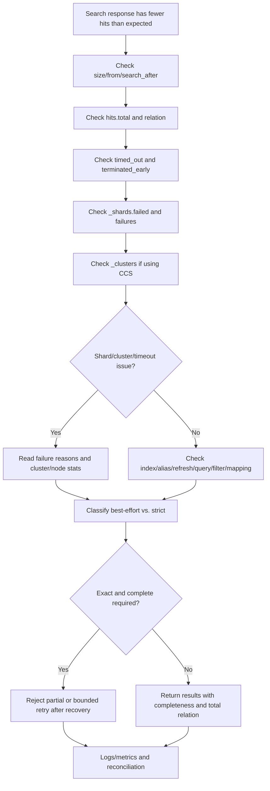

# Diagnosing Incomplete Results, Failed Shards, and Approximate Totals

An Elasticsearch search request can return a successful HTTP status yet still produce incomplete results. One or more shards may have failed, the query may have timed out, or Elasticsearch may have counted total hits only up to a threshold to save cost. Therefore, when a Spring Data Elasticsearch application sees fewer results than expected, do not inspect only the hits list or HTTP status.

At least four concepts must be distinguished:

- **Page size**: number of hits requested to return in the current page (`size`).
- **Total hits**: total matching documents within the range Elasticsearch counted.
- **Total hits relation**: whether that total is exact (`eq`) or only a lower bound (`gte`).
- **Completeness**: whether results are complete across all shards and finished before timing out.

A response can report `hits.total.value = 10000` with relation `gte`, meaning at least 10,000 documents matched, not asserting the exact total is 10,000. Another response may report relation `eq` while a failed shard still causes documents from that shard to be missing. Counter accuracy and query completeness are two separate concerns.

## 1. Distinguishing page hit count from total hits

The Search API can return a small page even when many more documents match.

Example:

```http
GET products/_search
{
  "from": 0,
  "size": 20,
  "query": {
    "term": {
      "status": "ACTIVE"
    }
  }
}
```

`size: 20` requests at most 20 hits in the response. It does not cap total matching documents at 20. The `hits.total` metadata shows the counted hit total if the request asks to track total hits.

Example response:

```json
{
  "hits": {
    "total": {
      "value": 4287,
      "relation": "eq"
    },
    "hits": [
      { "_id": "P-001", "_source": { "status": "ACTIVE" } },
      { "_id": "P-002", "_source": { "status": "ACTIVE" } }
    ]
  }
}
```

The abbreviated example shows only two hits for readability; an actual request can return up to 20. `value: 4287` with `relation: eq` means the exact total counted during that execution was 4,287.

In Spring Data Elasticsearch, `SearchHits<T>` typically exposes the `getSearchHits()` list and total `getTotalHits()`. Total hits is not the element count of the current list. For example, a page may have 20 items while `getTotalHits()` is much larger than 20.

Do not use `hits.getSearchHits().size()` as the total result count if the application supports pagination.

## 2. `hits.total.relation`: `eq` and `gte`

Elasticsearch represents total-hits accuracy via `relation`:

| Relation | Meaning | Interpretation |
|---|---|---|
| `eq` | Total hits counted accurately | `value` is the total hits for this search within successfully executed scope |
| `gte` | Total hits is a lower bound | At least `value` hits exist; the actual total may be higher |

Example:

```json
"total": {
  "value": 10000,
  "relation": "gte"
}
```

This response does not say the total is exactly 10,000. It says Elasticsearch found at least 10,000 hits and stopped counting all matches per request configuration.

### 2.1. Why doesn't Elasticsearch always count accurately?

Counting every matching document accurately adds extra work, especially on large datasets, many shards, or complex queries. For many UIs, knowing "at least 10,000 results" suffices to display "10,000+".

The Search API provides the `track_total_hits` parameter:

- `true`: request exact counting of all total hits.
- `false`: do not track total hits; responses may omit `hits.total`.
- A positive integer: track accurately up to that threshold; beyond it, `relation` can be `gte`.

Example requesting exact total hits:

```http
GET products/_search
{
  "track_total_hits": true,
  "query": {
    "term": {
      "status": "ACTIVE"
    }
  }
}
```

Example needing exact counts only up to 500:

```http
GET products/_search
{
  "track_total_hits": 500,
  "query": {
    "term": {
      "status": "ACTIVE"
    }
  }
}
```

If hits exceed the 500 threshold, the application may receive `value: 500` and `relation: gte`. This suits UIs that only need to know there are more than 500 results.

### 2.2. Defaults and counting limits

Elasticsearch commonly defaults to a threshold of 10,000 for `track_total_hits`. Therefore, for queries matching more than the threshold, responses can return `value: 10000` and `relation: gte`. Inspect the actual request, as the application may override this parameter or disable total-hit tracking.

Do not turn on exact counting mechanically for every request. Exact counting can raise query cost and reduce throughput. Choose according to the product contract:

- UI only needs to know results exist and show "10,000+": use a threshold or skip exact counts.
- API needs exact totals for reconciliation or reporting: consider `track_total_hits: true` and measure cost.
- Standard pagination: an appropriate threshold can replace exact whole-index counts.

### 2.3. `eq` does not guarantee complete results

`relation: eq` states that the reported hit count is exact across the shards that participated and completed. If a shard failed or the query timed out, the response can still miss data from the incomplete portion.

Therefore, always inspect `timed_out`, shard statistics, and partial-result flags alongside `hits.total.relation`.

## 3. Why can a search return partial results?

Elasticsearch splits indices into primary shards and replica shards. Searches are coordinated across relevant shards; each shard runs its portion of the query, and the coordinator merges results.

If a shard fails to complete, the coordinator may still return results from the remaining successful shards, depending on request/cluster partial-results policies.

Common causes:

- Shard is unassigned or transitioning states.
- Node holding the shard is unresponsive or left the cluster.
- Shard query hits an exception due to mapping, script, field, or data issues.
- Search timed out before all shards finished.
- Circuit breakers or resource limits rejected execution.
- Cluster is undergoing recovery, relocation, or heavy load.
- A remote cluster in cross-cluster search is unavailable.

In those cases, the response can hold valid hits yet fail to represent the entire target dataset.

## 4. Reading shard statistics in search responses

Search responses contain `_shards` metadata:

```json
{
  "_shards": {
    "total": 5,
    "successful": 4,
    "skipped": 0,
    "failed": 1
  },
  "hits": {
    "total": {
      "value": 120,
      "relation": "eq"
    },
    "hits": []
  }
}
```

Meaning:

- `total`: total shards accounted for in the search operation.
- `successful`: shards that completed successfully.
- `skipped`: shards legitimately skipped via pre-filtering/optimization mechanisms.
- `failed`: shards that encountered errors.

`skipped` does not mean `failed`. Elasticsearch can determine a shard definitely cannot match the query and skip it. This is a normal optimization when query conditions permit pruning shards.

If `failed > 0`, inspect the `failures` list to see shard, index, node, status, and reason. Do not log only the aggregate count.

Abbreviated failure example:

```json
{
  "_shards": {
    "total": 5,
    "successful": 4,
    "skipped": 0,
    "failed": 1,
    "failures": [
      {
        "shard": 2,
        "index": "products-000001",
        "node": "node-3",
        "reason": {
          "type": "query_shard_exception",
          "reason": "failed to create query"
        },
        "status": "400"
      }
    ]
  }
}
```

Real responses can contain `root_cause`, `caused_by`, resources, and richer details. Retain the full error object in internal diagnostic logs while avoiding returning raw cluster details to end clients.

## 5. `timed_out` and search timeouts

A response may include:

```json
{
  "timed_out": true,
  "_shards": {
    "total": 5,
    "successful": 5,
    "skipped": 0,
    "failed": 0
  }
}
```

Even with zero shard failures, `timed_out: true` indicates the search did not complete within the requested time limit. Depending on execution paths, the response may hold partial hits collected so far.

You can set a timeout in the Search API:

```http
GET products/_search?timeout=2s
{
  "query": {
    "match": {
      "name": "wireless headphones"
    }
  }
}
```

Timeout caps wait time for search processing per API semantics; it is not a way to guarantee all shards finished. If SLOs require complete results, treat `timed_out: true` as an incomplete state and do not report it as a fully successful search.

Timeouts at the gateway, Spring client, and Elasticsearch are also separate layers. An HTTP client timeout can leave the application without response metadata showing how far the server got. Distinguish:

- Elasticsearch search response with `timed_out: true`.
- Client timeout waiting for response.
- Gateway timeout before the backend completes.

Each type must be observed at its corresponding layer.

## 6. `allow_partial_search_results`

Elasticsearch provides `allow_partial_search_results` to decide whether partial results are permitted on shard failures.

Example allowing partial results:

```http
GET products/_search?allow_partial_search_results=true
{
  "query": {
    "match_all": {}
  }
}
```

Example requiring all involved shards to succeed:

```http
GET products/_search?allow_partial_search_results=false
{
  "query": {
    "match_all": {}
  }
}
```

When partial results are disallowed, shard failures can fail the whole search request instead of returning an incomplete hit list. This fits certain reporting, reconciliation, or business APIs demanding complete results.

No single policy fits every endpoint:

| Use case | Potentially suitable policy |
|---|---|
| Suggestions/autocomplete, tolerating temporary partial omissions | Can accept partial results while emitting telemetry/warning flags |
| Operational dashboards where approximate data is acceptable | Can allow partial results and display data completeness status |
| Financial/reconciliation reports needing full data | Consider rejecting partial results and returning explicit errors |
| Full data exports matching criteria | Usually requires strict completeness, checking shard failures and timeouts |
| Standard interactive search | Decide per product requirements; never silently treat partial as complete |

This option does not replace checking `timed_out` and total hits relation. A request can time out without shard failures; `allow_partial_search_results=false` does not automatically make every response exact/complete if the query is bounded in other ways.

## 7. Early termination with `terminate_after`

The Search API can cap how many documents are collected per shard using `terminate_after`:

```http
GET products/_search?terminate_after=1000
{
  "query": {
    "term": {
      "status": "ACTIVE"
    }
  }
}
```

This parameter halts collection after the specified threshold per shard during the query phase. The response may report `terminated_early: true`.

This is an intentional optimization when the application needs only a bounded sample of results. It is unsuitable if you need:

- All documents matching the query.
- Accurate total hit counts.
- Aggregations representing the full dataset.
- Complete exports or reconciliation.

Do not confuse `terminate_after` with `size`. `size` caps how many hits are returned after search processing; `terminate_after` stops collection early per shard and affects result completeness.

## 8. Cross-cluster search and partial results

If the application searches across multiple clusters, responses can contain `_clusters` metadata in addition to `_shards`. Remote clusters may succeed, fail, be skipped, or return partial results.

Conceptual example:

```json
{
  "_clusters": {
    "total": 3,
    "successful": 2,
    "skipped": 0,
    "running": 0,
    "partial": 0,
    "failed": 1
  }
}
```

With cross-cluster search, check both remote cluster statuses and shards within each cluster. The `skip_unavailable` setting can allow skipping unreachable remote clusters in certain setups; in that case, the response does not necessarily fail overall.

If business logic requires all data sources, do not treat a skipped remote cluster as full success. The API should return partial/unavailable status or fail per contract.

## 9. Exact total hits can still miss data

This is an easily misunderstood case:

```json
{
  "timed_out": false,
  "_shards": {
    "total": 5,
    "successful": 4,
    "skipped": 0,
    "failed": 1
  },
  "hits": {
    "total": {
      "value": 120,
      "relation": "eq"
    }
  }
}
```

`relation: eq` does not prove the entire index total is 120, because one shard did not succeed. It only states the reported count is exact across the completed execution scope. If the failed shard held matching documents, those documents are absent from the result.

Conversely, a response where all shards succeeded yet `relation: gte` can be complete in shard execution while the total hits count is only a lower bound due to the `track_total_hits` threshold.

Therefore, treat completeness as a composite status derived from multiple signals:

- `timed_out` must be false.
- `shards.failed` must be 0.
- For cross-cluster search, required clusters must be successful and non-partial.
- `terminated_early` must be false when full results are required.
- `hits.total.relation` must be `eq` when exact counts are required.
- Queries must not be unintentionally bounded by pagination, filters, or policies.

## 10. Diagnosing missing results not always caused by shards

If all shards succeed without timeouts, results can still be fewer than expected due to queries or how indices are accessed.

### 10.1. Wrong index, alias, or data stream

Check which index/alias the request actually hits:

```http
GET _resolve/index/products
GET _alias/products
```

Common causes:

- Alias has not switched to the new index after rollover.
- Search reads a read alias different from the write alias.
- Index pattern omits new indices.
- Query targets a specific index while documents were written to another index.
- Data stream backing indices changed over time.

Do not accept arbitrary index names from user requests if the service must enforce data scope.

### 10.2. Not refreshed yet after write

Elasticsearch is near-real-time. Writes can be acknowledged before documents appear in search. GET by ID is usually real-time, whereas search sees only refreshed segments.

If searching immediately after writing, inspect refresh policies (`false`, `true`, `wait_for`) and refresh intervals. In tests, call refresh explicitly instead of `Thread.sleep()`.

### 10.3. Filters, tenants, and security policies

Check conditions injected by the service:

- Tenant/owner filters.
- Soft-delete or status filters.
- Date ranges and timezones.
- `post_filter`.
- `min_score`.
- Alias filters.
- Document-level security (DLS) or field-level security (FLS).
- Routing or preference passed in the request.

If a service injects a tenant filter from the principal, the query visible in client logs may not match the final query. Log query class/correlation IDs and masked filter metadata to cross-check.

### 10.4. Mappings and analyzers

A match query may fail to return documents due to unexpected analyzer/tokenization behavior, wrong field types, or queries referencing non-existent subfields.

Check the mapping:

```http
GET products/_mapping
```

Test analyzers with the Analyze API when needed:

```http
POST products/_analyze
{
  "field": "name",
  "text": "Wireless Headphones"
}
```

Do not use exact `term` queries on `text` fields when exact matching is desired; a corresponding `keyword` field is usually needed. Conversely, `match` on keyword lacks text-style word analysis.

### 10.5. Pagination and sorting

If a response contains only 20 hits, check `size`, `from`, `search_after`, and cursors. `hits.total` is not the number of elements in the page.

Sorting can also make users think data is missing if they inspect only the first page. When using `search_after`, keep sort values and queries/PITs consistent. For deep pagination, consider Point in Time (PIT) combined with `search_after` instead of raising `from` indefinitely.

### 10.6. Collapse and aggregations

Field collapse can return one representative hit per field value, resulting in fewer hits than matching documents. Aggregations may use `post_filter` or filter aggregations with differing scopes. Check query semantics before concluding shard errors.

## 11. Reading responses with the Elasticsearch Java API Client

When you need finer metadata than Spring Data abstractions expose, you can use the Elasticsearch Java API Client inside a diagnostic adapter.

Example reading key flags:

```java
SearchResponse<ProductDocument> response = client.search(
    request -> request
        .index("products")
        .query(query -> query
            .term(term -> term
                .field("status")
                .value("ACTIVE")
            )
        )
        .trackTotalHits(track -> track.enabled(true)),
    ProductDocument.class
);

boolean timedOut = response.timedOut();
long failedShards = response.shards().failed();
long successfulShards = response.shards().successful();
boolean terminatedEarly = Boolean.TRUE.equals(response.terminatedEarly());

var totalHits = response.hits().total();
if (totalHits != null) {
    long totalValue = totalHits.value();
    var relation = totalHits.relation();
    log.info("totalHits={}, relation={}", totalValue, relation);
}

response.shards().failures().forEach(failure ->
    log.warn(
        "Search shard failure: index={}, shard={}, node={}, status={}, reason={}",
        failure.index(),
        failure.shard(),
        failure.node(),
        failure.status(),
        failure.reason()
    )
);
```

Builder names and generated types can vary by Elasticsearch Java API Client version; confirm signatures in your project dependencies. What to check are timeouts, shard counters, early termination, total hits value/relation, and failure lists.

If you want a threshold instead of exact counting, the builder can accept `trackTotalHitsUpTo(...)` depending on client version. Do not enable exact counting in diagnostic code and leave it as default production behavior without measuring cost.

## 12. Reading metadata via Spring Data Elasticsearch

With `ElasticsearchOperations.search(...)`, results are typically returned as `SearchHits<T>`:

```java
SearchHits<ProductDocument> searchHits = operations.search(
    query,
    ProductDocument.class,
    IndexCoordinates.of("products")
);

long totalHits = searchHits.getTotalHits();
List<SearchHit<ProductDocument>> hits = searchHits.getSearchHits();
```

`getTotalHits()` returns the total count provided by the response; do not assume it is always exact. Depending on the release, `SearchHits` may also expose total-hits relation, execution duration, and `SearchShardStatistics`. Check your API version to read those metadata fields.

If the current abstraction exposes only total hits without full failure reasons, you can:

- Use the Java API Client in a dedicated adapter for endpoints requiring completeness metadata.
- Extend the adapter to retain metadata from raw responses where Spring Data APIs permit.
- Use logging/observability at the client transport or cluster layer.

Never silently discard error metadata solely because a current DTO holds only `List<T>`. If business rules require complete results, the service must know whether the request timed out or suffered shard failures before reporting success.

### 12.1. SearchHits and SearchPage

When using Spring Data Repositories, `SearchPage<T>` or `SearchHits<T>` can provide results, pages, and total hits. However, page abstractions do not automatically solve partial shard responses or total-hits relations. Inspect raw search metadata whenever completeness is a business requirement.

## 13. Designing API responses with completeness status

Do not return a plain list of hits if clients need to know whether data is complete. You can design a response envelope:

```java
public record SearchCompleteness(
    boolean complete,
    boolean timedOut,
    long totalShards,
    long successfulShards,
    long skippedShards,
    long failedShards,
    boolean totalHitsExact,
    boolean terminatedEarly
) {
}

public record ProductSearchResponse(
    List<ProductResponse> items,
    long totalHits,
    String totalHitsRelation,
    SearchCompleteness completeness
) {
}
```

`complete` is a composite status computed by the application per contract. For example, an export endpoint may require `failedShards == 0`, `timedOut == false`, `terminatedEarly == false`, and no partial remote clusters. `totalHitsExact` reflects relation `eq`, yet does not guarantee complete if shards failed.

Example response:

```json
{
  "items": [],
  "totalHits": 10000,
  "totalHitsRelation": "gte",
  "completeness": {
    "complete": true,
    "timedOut": false,
    "totalShards": 5,
    "successfulShards": 5,
    "skippedShards": 0,
    "failedShards": 0,
    "totalHitsExact": false,
    "terminatedEarly": false
  }
}
```

This response may be complete in shard execution while the total count is only a lower bound. Clients can display "10,000+".

Another response might have `totalHitsRelation: eq` yet `failedShards: 1`, in which case `complete` must be false if the endpoint requires all shards.

## 14. Strict and best-effort policies

Two endpoint styles may require different policies:

### Best-effort search

Suitable for some interactive experiences:

- Allows partial results.
- Still displays hits already received.
- Flags partial/incomplete status in responses or telemetry.
- Does not display an exact count if relation is `gte`.
- Can prompt users to retry when data is incomplete.

### Strict search

Suitable for reports, exports, or reconciliation:

- Rejects shard failures.
- Rejects timeouts or early termination.
- Can set `allow_partial_search_results=false`.
- Requires exact total hits if business logic needs exact totals.
- If the response is incomplete, returns an explicit error code instead of a partial list posing as final data.

Do not share one `complete` flag across all endpoints if product semantics differ. Document which endpoints allow partial results and which enforce strict completeness.

## 15. Diagnosing shard failures in the cluster

When a response reports `failed > 0`, start from failure reasons and cross-check cluster state.

Useful APIs:

```http
GET _cluster/health
GET _cat/nodes?v
GET _cat/shards/products?v
GET _cluster/pending_tasks
GET _nodes/stats/jvm,process,os,fs,thread_pool,breaker
```

If a shard is unassigned, inspect allocation explain:

```http
GET _cluster/allocation/explain
{
  "index": "products",
  "shard": 2,
  "primary": false
}
```

Causes to check:

- Nodes disconnected or restarted.
- Disk watermarks blocking allocation.
- Insufficient eligible nodes to allocate replicas.
- Shards initializing/relocating.
- Circuit breakers or heap pressure.
- Search thread pool queue full or requests rejected.
- Mapping/script/query exceptions on a specific shard.
- Closed indices or incomplete shard recovery.

`yellow` cluster health usually means primary shards are allocated while some replicas are unassigned; that does not automatically mean searches fail. Conversely, `red` usually indicates at least one primary shard is unassigned and can make that shard's data unavailable. Even when health is green, an individual request can still time out or encounter query exceptions.

Cluster health is an overall signal, not a replacement for search response shard metadata.

## 16. Rejections, circuit breakers, and resource failures

Searches can fail when the cluster lacks resources:

- Search thread pool queue is full and requests are rejected.
- Request circuit breaker prevents a request from consuming excessive heap.
- Fielddata or aggregations demand too much memory.
- Disk I/O or merge pressure inflates latency and causes timeouts.
- Node restarts or prolonged GC pauses.

When seeing rejections/429/503 or breaker errors:

1. Check node stats and thread pool queue/rejected counters.
2. Check heap/GC and breaker statistics.
3. Check whether queries use high-cardinality aggregations, scripts, or large nested expansions.
4. Reduce concurrency/batch sizes or cap bucket/page sizes.
5. Retry only with backoff and jitter for transient errors, avoiding retry storms.

Do not raise timeouts endlessly to mask an overloaded cluster. Longer timeouts hold requests and resources longer, making queues worse.

## 17. Checking total hits in Java code

A service should retain both value and relation instead of reading a single `long` and assuming exactness:

```java
public record TotalHitsInfo(long value, String relation) {

    public boolean isExact() {
        return "eq".equalsIgnoreCase(relation);
    }
}
```

When using the Java API Client:

```java
var total = response.hits().total();

TotalHitsInfo totalInfo = total == null
    ? null
    : new TotalHitsInfo(
        total.value(),
        total.relation().toString()
    );
```

This illustrates preserving the relation. In real applications, prefer an enum/domain type over strings to avoid typos. If `track_total_hits` is disabled, `total` may be null; API responses must represent the absence of a total count.

Do not write:

```java
long exactTotal = response.hits().total().value();
```

and return a field named `exactTotal` without checking `relation` or null.

## 18. Pagination and total result counts

Pagination can lead users to think data is missing:

- `size` is the hit count in the page.
- `from` is the page offset.
- `search_after` uses sort values from the previous page's last hit.
- PIT maintains a steadier view of data across multi-page traversal.

For deep pagination, large `from`/`size` forces Elasticsearch to retain and process many intermediate hits. `search_after` usually fits better when paginating deeply.

Example:

```http
GET products/_search
{
  "size": 100,
  "sort": [
    { "createdAt": "asc" },
    { "sortKey": "asc" }
  ],
  "search_after": [
    "2026-01-10T08:00:00Z",
    "P-100"
  ],
  "query": {
    "match_all": {}
  }
}
```

Sorts must be deterministic with a unique tie-breaker to avoid duplicate or skipped hits across pages. For data changing during pagination, consider PIT to maintain a consistent search snapshot.

`hits.total` describes total matches, while the current page is only a slice. If the UI only needs "is there a next page?", fetching `pageSize + 1` hits sometimes suffices instead of counting all matches.

## 19. Aggregations can also be incomplete

Aggregations are computed across participating shards. If a shard fails or the query times out, buckets and metric aggregations may not represent the entire dataset.

Terms aggregations also expose dedicated metadata such as `doc_count_error_upper_bound` and `sum_other_doc_count` depending on aggregation/order. Those fields describe aggregation error bounds/omitted buckets, distinct from shard failures.

Do not assume aggregations are exact solely because `hits.total.relation` is `eq`. Check:

- Shard successes/failures and timeouts.
- Aggregation-specific error bounds.
- `size` of terms buckets and `shard_size`.
- `min_doc_count`, include/exclude, and filter scope.
- `post_filter` vs. query filters.

If exact aggregate reconciliation is required, design suitable aggregations, inspect error bounds, and enforce shard completeness.

## 20. Testing partial results and total hits relation

Integration tests should verify each semantic individually:

1. Queries matching fewer documents than threshold return exact relation (`eq`) when all shards succeed.
2. Queries matching more documents than threshold return lower-bound relation (`gte`) when using a threshold.
3. `track_total_hits: true` requests exact counts and its cost is measured appropriately.
4. `track_total_hits: false` handles absent total metadata gracefully.
5. `size` smaller than total matches still returns a small page and large total.
6. Shard failures are detected and never misreported as complete.
7. `timed_out: true` is represented as incomplete.
8. `terminated_early: true` is not treated as full results.
9. Cross-cluster partial/failed states are handled if the system uses CCS.
10. Aggregation error bounds are checked when business logic requires exact numbers.

Do not intentionally break shards in every routine test suite. You can test response handling using fixtures/mock responses in unit tests, paired with dedicated integration tests for failure behavior on a controlled cluster.

## 21. Common mistakes

| Symptom | Possible cause | How to handle |
|---|---|---|
| Page has only 20 hits despite large total | `size` is set to 20 | Normal pagination; check total hits and next page. |
| Total is always 10,000 | `track_total_hits` uses default threshold | Read `relation`; use exact count only when truly needed. |
| UI displays "10,000 results" when more exist | Ignoring `gte` relation | Display "10,000+" or raise threshold. |
| `relation=eq` yet data still missing | A shard failed or partial request | Check `timed_out`, `_shards.failed`, and `_clusters`. |
| Search returns HTTP 200 yet misses hits | Partial search results permitted | Check shard failures and completeness policy. |
| `failed=0` yet results incomplete | `timed_out`, `terminated_early`, filters, or query scope | Check all flags and final query. |
| `skipped` shards treated as errors | Confusing skipped with failed | Verify pre-filtering; skipped is usually a valid optimization. |
| Search times out on some shards | Heavy query, overloaded cluster, or timeout too low | Use slow logs/Profile API and check node stats. |
| Results missing right after write | Not refreshed yet | Use refresh policies or explicit refresh. |
| One tenant sees fewer results | Tenant/DLS/alias filter | Check principal and final filters. |
| ID lookup misses custom-routed document | Missing required routing on GET by ID | Send the exact routing used at index time. |
| Aggregation counts lower than expected | Partial shards, bucket size, or error bounds | Check shard metadata and aggregation-specific metadata. |
| Cross-cluster search misses a source | Remote cluster partial/failed/skipped | Check `_clusters` and `skip_unavailable` policy. |
| Retries overload cluster further | Immediate retries without backoff | Limit retries, exponential backoff, and jitter. |

## 22. Diagnostic workflow for an incomplete search response



Practical steps:

1. Verify `size`, `from`, `search_after`, sort, and current page.
2. Read `hits.total.value` alongside `hits.total.relation`; never assume `gte` is exact.
3. Check `timed_out` and `terminated_early`.
4. Check `_shards.total/successful/skipped/failed` and every entry in `failures`.
5. If using cross-cluster search, inspect `_clusters` and remote cluster states.
6. If shards failed, cross-check cluster health, shard allocation, node stats, rejections, breakers, and logs.
7. If no failures occurred, inspect index/alias, refresh, query, routing, tenant filters, DLS/FLS, analyzers, and mappings.
8. Determine whether the endpoint allows best-effort or enforces strict completeness.
9. Retain total hits relation and completeness metadata in internal/API responses when needed.
10. Retry only on transient errors, bounded and with backoff; avoid retry storms.
11. For reports/exports, never publish partial results as complete data.

## 23. Conclusion

Incomplete search results can stem from pagination, total-hits thresholds, timeouts, shard failures, early termination, wrong index/alias, unrefreshed writes, or unexpected filters/analyzers. Separate page size, total hits, total hits relation, and execution completeness.

`hits.total.relation = eq` means the reported count is exact across the executed scope, while `gte` is a lower bound. `track_total_hits: true` requests exact counts at potential extra cost; numeric values cap exact counting, while `false` omits total metadata. A 20-hit page can still belong to 4,000 matching documents.

`_shards.failed`, `timed_out`, `terminated_early`, and `_clusters` are essential signals for spotting partial results. `skipped` is usually a valid pre-filter optimization, not an error. Even `eq` relation does not guarantee completeness if a shard or remote cluster failed. In Spring Data Elasticsearch, retain `SearchHits` metadata and use the Java API Client/adapters when you need failure details not exposed by higher-level abstractions.

Design two clear policies: best-effort search can return hits flagged as partial; strict search for reports/exports must reject timeouts, shard failures, or early termination per contract. Combining response metadata inspection, query scope checks, cluster health, shard allocation, and observability enables applications to distinguish "no data", "one page of data", "lower-bound total", and "incomplete results".
