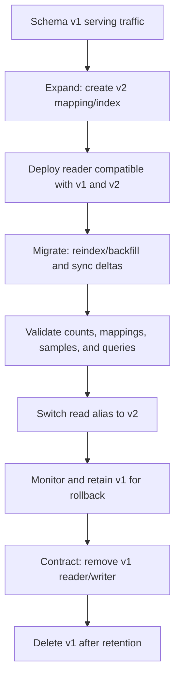
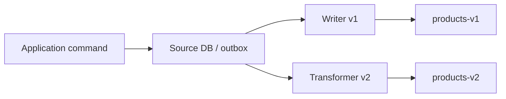
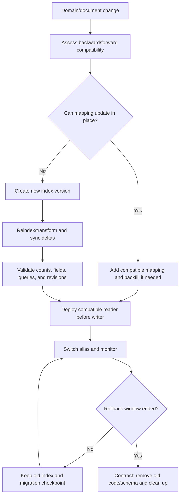

# Managing Document Versions and Index Schemas

Documents in Elasticsearch often outlive a single version of an application. As a domain evolves, a new field may appear, a data type may change, an analyzer may be tuned, or an object structure may turn into `nested`. If you merely edit a Java entity and deploy the new application, existing indices keep their old mappings and existing documents keep their old structure.

Therefore, a Spring Data Elasticsearch application must manage **document structure versions** and **index schema versions** separately. A document created by an older application version may be read by a newer version; a new index may have a different mapping from an old index; and multiple application versions may run side by side during a rolling deployment.

Three concepts are easy to confuse:

- **Document schema version**: the version of the business data structure stored in `_source`, typically in a field such as `schemaVersion`.
- **Index schema version**: the version of an index's mapping/settings/template, typically expressed through index names like `products-v1`, `products-v2`, or template/mapping metadata.
- **Concurrency version**: the version used to detect concurrent updates, such as Elasticsearch `_version` or Spring Data `@Version`. It does not describe document structure.

Managing these three concepts properly enables reading old data, rolling out changes safely, reindexing under control, and rolling back when migrations fail.

## 1. Why do documents and indices need versioning?

Suppose the first version of a catalog stores products as:

```json
{
  "id": "P-100",
  "name": "Wireless Headphones",
  "price": 129900,
  "category": "audio"
}
```

Later, domain requirements change:

- Prices must be stored in minor units to avoid currency rounding errors.
- Category becomes an object with code and name.
- Products need `availability` and `brandId`.
- Product names need a new analyzer supporting multilingual search.

The new document might become:

```json
{
  "id": "P-100",
  "schemaVersion": 2,
  "name": "Wireless Headphones",
  "priceInCents": 129900,
  "category": {
    "id": "audio",
    "name": "Audio"
  },
  "brandId": "B-10",
  "availability": "IN_STOCK"
}
```

Changing the Java entity alone does not automatically migrate existing documents. Nor does an existing index automatically change `category` from `keyword` to `object`, or change `price` to a new type. If the application reads old documents as if they already had the new structure, you may encounter nulls, conversion errors, missed queries, or inconsistent search results.

Versioning answers:

- Under which structure was this document written?
- With which mapping/settings was this index created?
- Can the current application read old documents/indices?
- When field types or analyzers change, how is existing data transformed?
- Can old and new application versions run concurrently during rolling deployments?
- If migration fails, can we revert to the previous index?

## 2. Distinguishing document schema version, index version, and concurrency version

| Concept | Where stored | Purpose | Example |
|---|---|---|---|
| Document schema version | Field inside `_source` | Identify each document's format | `schemaVersion: 2` |
| Index schema version | Index name, template, or metadata | Identify index mapping/settings | `products-v2` |
| Elasticsearch `_version` | Document metadata in Elasticsearch | Track write/concurrency version per Elasticsearch semantics | `_version: 17` |
| Spring Data `@Version` | Entity property mapped to version metadata | Optimistic locking when updating entities | `@Version private Long version;` |

`schemaVersion` does not increment on every document update. It changes only when the document structure changes to a new schema version.

Conversely, `_version` can increment across document writes and serves update control. Never use `_version` to determine whether a document is schema v1 or v2.

Spring Data's `@Version` is an optimistic locking mechanism, not a schema version annotation. A document can have `schemaVersion = 2` while its concurrency version is `17`.

## 3. Designing documents with a schema version

If the application needs to read multiple document formats in the same index, store the version explicitly inside `_source`:

```java
import org.springframework.data.annotation.Id;
import org.springframework.data.elasticsearch.annotations.Document;
import org.springframework.data.elasticsearch.annotations.Field;
import org.springframework.data.elasticsearch.annotations.FieldType;

@Document(indexName = "products-write")
public class ProductDocument {

    @Id
    private String id;

    @Field(type = FieldType.Integer)
    private Integer schemaVersion;

    @Field(type = FieldType.Keyword)
    private String name;

    @Field(type = FieldType.Long)
    private Long priceInCents;

    protected ProductDocument() {
    }

    public Integer getSchemaVersion() {
        return schemaVersion;
    }
}
```

When creating a new document, the service sets the schema version to the current writer version:

```java
private static final int CURRENT_SCHEMA_VERSION = 2;

public ProductDocument createProduct(CreateProductRequest request) {
    ProductDocument document = new ProductDocument();
    document.setSchemaVersion(CURRENT_SCHEMA_VERSION);
    document.setName(request.name());
    document.setPriceInCents(request.priceInCents());
    return document;
}
```

The version field should be numeric with an explicit mapping. Avoid storing versions as strings unless required for specific compatibility reasons.

### 3.1. Does every document need `schemaVersion`?

Not every application needs this field. If an index holds only a uniform schema and every change is performed via full reindexing, index names/versions and migration history may suffice.

`schemaVersion` is useful when:

- An index temporarily holds documents written by multiple writer versions.
- Consumers need to know how to interpret older documents.
- Migrations happen incrementally without converting all data at once.
- An event or job must choose the right transformation/upcaster.
- You need to measure how many documents remain on older schemas.

If each index contains only a single schema version, this field can still aid data verification, though duplicating metadata is unnecessary without a clear use case.

### 3.2. Mapping `_meta` is not the document version

Elasticsearch mappings support mapping-level `_meta` metadata. You can store details like schema owner, mapping revision, or migration identifier there. `_meta` describes the mapping/index, not a per-document field inside `_source`.

Example:

```json
PUT products-v2
{
  "mappings": {
    "_meta": {
      "schemaVersion": 2,
      "migration": "products-v1-to-v2"
    },
    "properties": {
      "schemaVersion": { "type": "integer" },
      "name": { "type": "text" },
      "priceInCents": { "type": "long" }
    }
  }
}
```

Here `_meta.schemaVersion` is the mapping's version; `properties.schemaVersion` is the version field stored on each document. They share the same name yet have different scopes.

## 4. Managing index schemas with versioned index names

A common strategy is creating physical indices with versioned names:

```text
products-v1
products-v2
products-v3
```

The index name communicates the schema/mapping contract of that index. Applications access it through stable aliases:

```text
products-read  -> products-v2
products-write -> products-v2 (is_write_index = true)
```

When preparing a new schema, create `products-v3`, load and verify data, and then switch aliases. Clients keep using the aliases without needing to know which physical index is active.

### 4.1. Why avoid writing directly to versioned index names?

If every service hardcodes `products-v2`, every migration requires updating configs and redeploying across multiple services. Aliases decouple access contracts from physical indices:

- Services use `products-read` for searches.
- Services use `products-write` for indexing/updates.
- Migrations build new index versions independently.
- Alias switches change read/write targets without modifying repository-calling code.

In Spring Data applications, `@Document(indexName = "products-write")` can point to a write alias when aliases and indices are properly configured. Read operations can also target a separate read alias via `IndexCoordinates` or appropriate repository mappings. Verify the API and how Spring Data resolves indices/aliases in your project version.

## 5. Mappings and settings are a schema contract

Mappings govern how Elasticsearch stores and searches fields. Key parts include:

- Field types: `keyword`, `text`, `long`, `integer`, `date`, `boolean`, `object`, `nested`, `geo_point`, etc.
- Analyzers and normalizers.
- Multi-fields, e.g., `name` and `name.keyword`.
- Nested paths and object structures.
- `doc_values`, `index`, `store`, and other mapping parameters.
- Dynamic mapping policy.
- Index settings such as shard count, replica count, refresh interval, and analysis settings.

Mappings are not just converter metadata. They directly control query semantics, sorting, aggregations, storage, and performance.

Example intentional mapping:

```json
PUT products-v2
{
  "settings": {
    "number_of_shards": 3,
    "number_of_replicas": 1,
    "analysis": {
      "analyzer": {
        "product_name": {
          "type": "custom",
          "tokenizer": "standard",
          "filter": ["lowercase"]
        }
      }
    }
  },
  "mappings": {
    "dynamic": "strict",
    "_meta": {
      "schemaVersion": 2
    },
    "properties": {
      "schemaVersion": { "type": "integer" },
      "name": {
        "type": "text",
        "analyzer": "product_name",
        "fields": {
          "keyword": { "type": "keyword" }
        }
      },
      "priceInCents": { "type": "long" },
      "category": {
        "properties": {
          "id": { "type": "keyword" },
          "name": { "type": "keyword" }
        }
      },
      "availability": { "type": "keyword" }
    }
  }
}
```

`dynamic: strict` rejects documents containing undeclared fields. This catches writers sending out-of-schema fields early, though it requires updating mappings before deploying new writers. If choosing `dynamic: false`, undeclared fields remain in `_source` without being indexed per mapping; understand the semantics before using it.

## 6. Mapping changes that can and cannot be made in place

Not every schema change can be applied via `PUT _mapping` on an existing index.

| Change | Usually possible on existing index? | Notes |
|---|---|---|
| Add a new field | Yes | Old documents lack values; new documents or backfills populate it |
| Add a multi-field | Mapping can be added | Old documents need reindexing/updating to populate the subfield from `_source` |
| Change `keyword` to `text` | Cannot change type directly | Create new index and reindex |
| Change `long` to `double` | Cannot change type directly | Create new index, transform data |
| Change `object` to `nested` | Cannot change directly | Create new index and reindex |
| Change analyzer of populated field | Cannot re-analyze existing tokens via mapping update alone | Create new field/index and reindex to re-analyze data |
| Remove field from mapping | Not supported for declared fields normally | Create new index if field must be removed from schema/source |
| Change primary shard count | Not changeable directly normally | Create new index or use split/shrink mechanisms where appropriate |
| Change replica count/refresh interval | Can be updated | Use Update Index Settings API |

Rule of thumb: if a change alters how existing data is indexed or interpreted, prepare a new index and reindex. Adding a field mapping does not automatically populate values for existing documents.

## 7. Dynamic mapping and controlling schema drift

Dynamic mapping lets Elasticsearch infer mappings automatically when encountering new fields. While convenient for prototyping, it can introduce schema drift in production systems.

For instance, two writers send the same `price` field with different types:

```json
{ "price": 100 }
```

```json
{ "price": "100 USD" }
```

The first document causes the field to be mapped as numeric; the second triggers a parsing error. A field with the same name but different meanings also creates hard-to-detect bugs.

Dynamic mapping options:

- `true`: new fields are automatically added to the mapping.
- `false`: new fields may still remain in `_source` without being mapped/indexed as normal fields.
- `strict`: rejects documents containing undeclared fields.

For domains with explicit schemas, manage mappings proactively and choose the appropriate policy. Dynamic templates can map groups of fields by rules, but still test carefully to avoid unintended field names creating wrong mappings.

## 8. Managing mappings with Spring Data Elasticsearch

Spring Data Elasticsearch provides annotations and `IndexOperations` to describe/create indices.

Example entity:

```java
@Document(indexName = "products-write", createIndex = false)
@Setting(shards = 3, replicas = 1)
public class ProductDocument {

    @Id
    private String id;

    @Field(type = FieldType.Integer)
    private Integer schemaVersion;

    @Field(type = FieldType.Text, analyzer = "product_name")
    private String name;

    @Field(type = FieldType.Long)
    private Long priceInCents;
}
```

`createIndex = false` lets the application or a migration tool control when the index is created. In environments with dedicated mapping/template management, avoid letting multiple application instances auto-create or mutate schemas outside the deployment pipeline.

Creating an index and mapping via operations:

```java
IndexOperations indexOperations = operations.indexOps(
    IndexCoordinates.of("products-v2")
);

if (!indexOperations.exists()) {
    boolean created = indexOperations.createWithMapping();
    if (!created) {
        throw new IllegalStateException("Could not create products-v2");
    }
}
```

`createWithMapping()` uses mapping/settings metadata from the entity referenced by `IndexOperations`. If dynamic index names are needed, use corresponding `IndexCoordinates` and check how the mapping context resolves in your Spring Data Elasticsearch release.

### 8.1. Creating and updating mappings

Spring Data offers `putMapping()` on `IndexOperations` to push mappings generated from an entity or mapping object. Conceptual example:

```java
IndexOperations indexOperations = operations.indexOps(
    IndexCoordinates.of("products-v2")
);

indexOperations.putMapping();
```

`putMapping()` only applies mapping additions/changes allowed by Elasticsearch; it does not convert a populated field to another type or reindex old documents. Verify actual resulting mappings afterward.

Method names, overloads, and `IndexCoordinates` creation may vary by version. Check the Javadoc of your project's dependencies before using them in migration code.

## 9. Storing schema versions per document and controlling writers

When multiple writer versions run concurrently, define which writer is permitted to write which schema.

For example:

| Writer | Writable schema | Condition |
|---|---|---|
| Application v1 | Document schema 1 | Writes only to indices/aliases still compatible with v1 |
| Application v2 | Document schema 2 | Writes only after mappings and readers support schema 2 |
| Migration worker | Schema 2 from schema 1 source | Uses versioned, idempotent transformations |

If a v2 writer sends a new field to a strict v1 mapping index, Elasticsearch may reject the write. If a v1 writer keeps writing to a v2 index, new documents may lack fields expected by v2 readers.

Therefore, deployment order must ensure compatible readers and mappings exist before switching writers. This is the expand-migrate-contract principle.

## 10. Expand-Migrate-Contract strategy

This is a safe workflow for high-impact schema changes:

### Phase 1: Expand

- Create the new mapping/index or add compatible fields.
- Deploy readers capable of reading both old and new schemas.
- If needed, deploy writers that emit the new format while staying compatible with old readers.
- Do not remove old fields immediately.

### Phase 2: Migrate

- Create the new index version.
- Reindex or backfill old documents.
- If source data keeps changing, synchronize deltas via outbox/change events or controlled dual-writes.
- Verify document counts, sample data, queries, and aggregations.
- Switch the read alias once the new index passes checks.

### Phase 3: Contract

- Wait until all old instances stop writing the old schema.
- Stop dual-writes/backfills.
- Remove code reading old fields once no old documents remain.
- Delete the old index after the rollback and retention window expires.
- Update schema documentation and migration history.



Never drop old fields or indices in the same deployment that introduces new fields. Rolling deployments can keep old and new instances running simultaneously for minutes or longer.

## 11. Creating a new index instead of changing field types in place

Suppose `products-v1` has:

```json
{
  "properties": {
    "price": { "type": "long" },
    "category": { "type": "keyword" }
  }
}
```

Schema v2 needs:

```json
{
  "properties": {
    "priceInCents": { "type": "long" },
    "category": {
      "properties": {
        "id": { "type": "keyword" },
        "name": { "type": "keyword" }
      }
    }
  }
}
```

You cannot directly change `category` from `keyword` to `object` on a populated index. Create `products-v2` with the new mapping and migrate the data.

Example index creation:

```http
PUT products-v2
{
  "settings": {
    "number_of_shards": 3,
    "number_of_replicas": 1
  },
  "mappings": {
    "dynamic": "strict",
    "properties": {
      "schemaVersion": { "type": "integer" },
      "name": { "type": "text" },
      "priceInCents": { "type": "long" },
      "category": {
        "properties": {
          "id": { "type": "keyword" },
          "name": { "type": "keyword" }
        }
      }
    }
  }
}
```

## 12. Reindexing and transforming documents

Elasticsearch `_reindex` can read documents from a source index and write them into a destination index. Scripts can transform structures during reindexing.

Example converting `price` to `priceInCents`, string `category` to an object, and setting the schema version:

```http
POST _reindex
{
  "source": {
    "index": "products-v1"
  },
  "dest": {
    "index": "products-v2",
    "op_type": "create"
  },
  "script": {
    "lang": "painless",
    "source": """
      ctx._source.schemaVersion = 2;
      ctx._source.priceInCents = ctx._source.remove('price');
      def oldCategory = ctx._source.remove('category');
      if (oldCategory != null) {
        ctx._source.category = ['id': oldCategory, 'name': oldCategory];
      }
    """
  }
}
```

This script illustrates only a simple transformation. Real migrations must handle missing/null values, currency conversions, category lookups, invalid values, ID collisions, and domain version conflicts.

### 12.1. Monitoring reindex results

A reindex response can include:

- `total`: documents examined.
- `created`, `updated`, `deleted`, `noops`.
- `version_conflicts`.
- `failures`.
- `timed_out` and task status when run asynchronously.

Do not check only for HTTP 200. Verify expected document counts, zero unexpected failures, and that critical transformations took effect.

For large datasets, run reindex asynchronously with `wait_for_completion=false`, record the task ID, and monitor the task to completion. Consider `requests_per_second` to throttle load while measuring impact on production clusters.

### 12.2. Reindex does not automatically sync changes made after it starts

If the source index continues receiving writes while `_reindex` runs, a document updated after `_reindex` has already passed it may not be reflected in the destination as intended. You need a delta strategy:

- Pause writers during a short migration window.
- Use outbox/event logs to replay changes after the snapshot.
- Dual-write to both indices with controlled idempotency and retries.
- Use change capture or a checkpointed cutover workflow.

Do not assume a single `_reindex` call solves synchronization while the source keeps changing.

## 13. Dual-write and delta synchronization

During a migration window, the application may need to write to both the old and new indices to keep data up to date in both places.



Direct dual-writes from a service risk partial success: writing v1 succeeds while v2 fails, or vice versa. Elasticsearch does not offer atomic transactions across two indices.

If using dual-writes:

- Record events/commands durably in an outbox or replayable log.
- Use stable document IDs and idempotent transformations.
- Carry source revisions to detect stale events.
- Retry each target independently and monitor lag.
- Reconcile counts and revisions before cutover.
- Establish poison-event and dead-letter handling.

The outbox pattern typically commits source data and events in the same relational database transaction. Workers then update both old and new indices by checkpoint.

## 14. Switching aliases for cutover

Aliases let you switch read/write targets without changing physical index names. Multiple alias actions can run in a single `_aliases` request, making the alias swap atomic at the cluster level.

Example switching read and write aliases from v1 to v2:

```http
POST _aliases
{
  "actions": [
    { "remove": { "index": "products-v1", "alias": "products-read" } },
    { "add": { "index": "products-v2", "alias": "products-read" } },
    { "remove": { "index": "products-v1", "alias": "products-write" } },
    {
      "add": {
        "index": "products-v2",
        "alias": "products-write",
        "is_write_index": true
      }
    }
  ]
}
```

If `products-read` or `products-write` targets multiple indices, clearly define behavior before and after switching. For write aliases, set `is_write_index` explicitly when needed.

Before cutover:

1. Verify mappings/settings of v2.
2. Compare document counts and sample documents.
3. Run query regression and relevance tests.
4. Confirm deltas caught up to the target checkpoint.
5. Verify reader/writer applications are compatible with schema v2.
6. Prepare an alias rollback plan and post-switch monitoring.

## 15. Rollback after cutover

Keeping `products-v1` for a period after switching aliases enables quick rollback if new queries or mappings cause issues.

However, rolling back the alias does not automatically sync writes sent to v2 after cutover back into v1. If v2 received new writes, reverting to v1 can lose visibility of those changes when the application reads the old index.

A rollback plan must answer:

- Can the alias be switched back to v1?
- How will data written to v2 post-cutover be replayed back to v1?
- Can writers compatible with both schemas run during the rollback window?
- When is v1 considered no longer needed?
- Who approves rollback and which metrics trigger it?

Keeping an event log/outbox or reverse reindex capability aids data recovery. If the v2 transformation dropped information present in v1, data rollback may not be completely lossless.

## 16. Readers compatible with multiple schema versions

During rolling deployments, newer application instances may read both v1 and v2 documents. You can place a mapper/upcaster at the adapter layer:

```java
public ProductView toCurrentView(Map<String, Object> source) {
    int version = ((Number) source.getOrDefault("schemaVersion", 1)).intValue();

    return switch (version) {
        case 1 -> fromV1(source);
        case 2 -> fromV2(source);
        default -> throw new UnsupportedDocumentSchemaException(version);
    };
}
```

In this example, v1 documents lacking `schemaVersion` default to version 1. Only use this default if historical data genuinely conforms to schema v1; do not assume every document missing a version field is v1 without evidence.

An upcaster converts legacy structures into a current domain view without immediately rewriting the stored document. This helps when reading legacy data during migration windows.

Do not scatter schema conversion logic across controllers/services. Place it in a dedicated adapter or mapper with tests for every supported version.

## 17. Writer compatibility across application versions

Rolling deployments may have v1 and v2 instances active simultaneously. Consider the compatibility matrix:

| Reader | Document v1 | Document v2 |
|---|---|---|
| Application v1 | Readable | Readable only if v2 preserves the v1 contract |
| Application v2 | Readable if upcaster/backward compatibility exists | Readable |

A safe sequence:

1. Deploy reader v2 capable of reading v1 and v2.
2. Confirm all old instances are replaced or compatible.
3. Enable writer v2.
4. Reindex/backfill old documents.
5. Monitor the remaining ratio of schema v1 documents.
6. Remove v1 reader code only once no v1 writers or v1 documents remain.

If a v1 writer keeps writing old documents after migration passed those documents, v2 indices can end up holding old-schema documents again. Stop old writers or ensure dual-write/upcasting handles every new write.

## 18. Versioning in Spring Data entities differs from schema versions

Spring Data provides `@Version` for optimistic locking:

```java
import org.springframework.data.annotation.Version;

@Document(indexName = "products-write")
public class ProductDocument {

    @Id
    private String id;

    @Version
    private Long version;

    @Field(type = FieldType.Integer)
    private Integer schemaVersion;
}
```

The two fields serve different roles:

- `version`: concurrency metadata managed by Spring Data/Elasticsearch for versioning semantics.
- `schemaVersion`: document structure version managed by the application.

For instance, a document may have `schemaVersion = 2` and `version = 17`. After the next update, the concurrency version increments while `schemaVersion` remains 2.

Never map a business field named `version` to `@Version` unless it carries optimistic locking semantics. Likewise, never use `@Version` to drive migrations or select upcasters.

## 19. Index templates and component templates also need versioning

When multiple indices are created with identical mappings/settings, use index templates or component templates to manage the shared contract.

Example index template:

```http
PUT _index_template/products-v2-template
{
  "index_patterns": ["products-v2-*"],
  "priority": 200,
  "template": {
    "settings": {
      "number_of_shards": 3,
      "number_of_replicas": 1
    },
    "mappings": {
      "dynamic": "strict",
      "_meta": {
        "schemaVersion": 2
      },
      "properties": {
        "schemaVersion": { "type": "integer" },
        "name": { "type": "text" },
        "priceInCents": { "type": "long" }
      }
    }
  }
}
```

Templates apply when a new index matching the pattern is created. Updating a template does not automatically change mappings/settings of existing indices.

Manage templates as code:

- Store templates in repositories or deployment artifacts.
- Version names and metadata.
- Review mapping changes like API contract changes.
- Test templates by creating a temporary index matching the pattern.
- Verify template priority and component composition.
- Do not let multiple services overwrite shared templates outside the pipeline.

## 20. Migrations should be versioned, checkpointed, and resumable

A well-designed migration specifies:

- Source index and destination index.
- Source and target schema versions.
- Transformation logic and code version.
- Checkpoints or task IDs.
- Failed document handling.
- Version conflict handling.
- Delta synchronization during migration.
- Completion verification criteria.

Example migration tracking record:

```json
{
  "migrationId": "products-v1-to-v2-2026-11",
  "sourceIndex": "products-v1",
  "targetIndex": "products-v2",
  "sourceSchemaVersion": 1,
  "targetSchemaVersion": 2,
  "status": "RUNNING",
  "lastCheckpoint": "P-500000",
  "startedAt": "2026-11-13T10:00:00Z"
}
```

This is migration management metadata, not a product document. Store it in an administrative database or dedicated migration store.

Transformations must be idempotent: re-running on the same document must cause no duplicate side effects or data corruption. Use stable IDs, `op_type=create` when appropriate, revision guards, or controlled upsert semantics.

## 21. Reconciling before and after migration

Do not check only total document count. A migration can match counts while corrupting fields or values.

Verify:

1. Source/destination document counts, accounting for intentionally filtered or excluded documents.
2. Document counts by `schemaVersion`.
3. Transformation success and failure rates.
4. Critical fields such as ID, price, tenant, owner, and status.
5. Null/missing values and edge cases.
6. Business-meaningful summary aggregations.
7. Query regressions and search relevance.
8. Read/write aliases point to the right indices.
9. Delta checkpoints have caught up with the source.
10. Cluster health and indexing/search latency during migration.

Example checking schema version distribution:

```http
GET products-v2/_search
{
  "size": 0,
  "aggs": {
    "schema_versions": {
      "terms": {
        "field": "schemaVersion"
      }
    }
  }
}
```

If index v2 should contain only schema version 2, any bucket other than 2 must be investigated. Never declare migration finished merely because task status says completed.

## 22. Managing schema code and migration history

Store related artifacts in your repository or deployment package:

```text
search-schema/
  products/
    v1/
      mapping.json
      settings.json
    v2/
      mapping.json
      settings.json
    migrations/
      v1-to-v2.painless
      v1-to-v2-notes.md
```

Or organize to match how your team manages index templates, component templates, and migration jobs. What matters is tracing which schema artifacts created an index and which transformations ran.

Never edit an old mapping file in place and lose track of prior versions. Keeping history supports comparison, debugging, and rollback.

## 23. Common mistakes

| Symptom | Possible cause | Fix |
|---|---|---|
| New entity field missing on old documents | Deployed code without backfilling data | Add compatible field and run migration/backfill if needed |
| Unable to change field type | Existing field mappings cannot change type directly | Create new index and reindex |
| v1 documents fail when v2 reader deserializes | Reader assumes all documents have new schema | Use upcaster or migrate before cutover |
| v1 writer sends old fields to strict v2 index | Rolling deployment still has old instances | Deploy compatible readers/mappings first and control writer cutover |
| Added multi-field returns no hits on old data | Old documents not reindexed to populate subfield | Reindex or update affected data |
| Reindex completes yet misses recent changes | Source kept receiving writes during migration | Sync deltas via outbox/change capture/dual-write |
| Dual-write succeeds on only one index | Two writes lack atomic transaction | Use outbox, separate retries, idempotency, and reconciliation |
| Alias switches to new index with staler data | Deltas lagged or validation insufficient | Verify checkpoints/revisions before alias switch |
| Alias rollback loses new writes | Post-cutover writes exist only in v2 | Replay data back to v1 or dual-write during rollback window |
| `@Version` used as schema version | Confusing concurrency metadata with document format | Use a dedicated `schemaVersion` field |
| Template updated but old index unchanged | Templates apply only when new matching indices are created | Create new index or update allowed settings/mappings |
| Dynamic mapping creates wrong field type | Writers send inconsistent data | Explicit mappings, dynamic templates, or `strict` |

## 24. Schema version management workflow from dev to production



Implementation steps:

1. Identify domain changes and their impact on mappings/queries.
2. Increment document schema version whenever `_source` format genuinely changes.
3. Create a new index schema version for incompatible mapping changes.
4. Store mappings/settings/templates as versioned artifacts.
5. Deploy readers compatible with both old and new schemas before switching writers.
6. Create the target index and reindex/backfill via versioned transformations.
7. Synchronize deltas while the source continues receiving writes.
8. Reconcile counts, fields, revisions, aggregations, and query relevance.
9. Switch read/write aliases in a controlled operation.
10. Monitor latency, errors, schema version ratios, and new data.
11. Retain the old index during the rollback window and define reverse write replay.
12. Once safe, remove old readers/writers and delete the old index per retention policy.

## 25. Conclusion

Managing document and index schema versions requires separating data format, index mapping, and concurrency versioning. The `schemaVersion` field describes document structure; index names/templates or mapping metadata describe index schemas; Elasticsearch `_version` and Spring Data `@Version` serve optimistic locking. Never substitute one concept for another.

Elasticsearch mappings have strict limits on in-place changes. Adding fields is usually allowed, whereas changing field types, converting `object` to `nested`, or changing analyzers to re-analyze existing data generally requires a new index and reindexing. Manage mappings/settings/templates as versioned code, control dynamic mapping, and place versioned physical indices behind stable aliases.

For major migrations, apply expand-migrate-contract: deploy compatible readers, create the new index, reindex/transform data, sync deltas, verify counts and queries, and switch aliases. Retain the old index during a rollback window and account for writes occurring after cutover; rolling back an alias alone will not move new writes back to the old index. Transformations must be idempotent, checkpointed, and reconcilable.

In Spring Data Elasticsearch, use entity annotations and `IndexOperations` to describe or create mappings where appropriate, while ensuring migrations and index provisioning have clear ownership. Combining schema versions, index versions, reader/writer compatibility, migration history, and integration tests lets applications evolve documents safely across versions without losing data or disrupting search.
