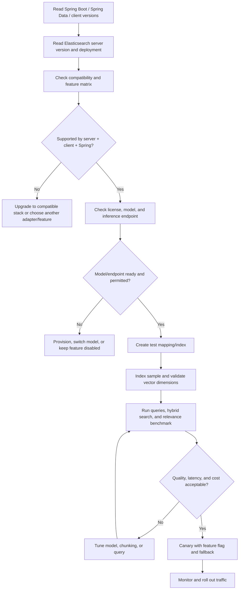

# Checking Versions, Embedding Models, and Feature Prerequisites

Semantic search in Elasticsearch is not a single switch that works identically on every version. Applications can generate their own vectors and store them in `dense_vector`, use `semantic_text` fields so Elasticsearch coordinates inference and search, use sparse representations such as ELSER, or combine semantic search with BM25. Each approach imposes distinct requirements on server version, Spring Data Elasticsearch, Java API Client, models, inference endpoints, license/deployment, mappings, and operational resources.

Before choosing a feature, verify the entire path:

1. The running Elasticsearch server version and deployment type.
2. The actual Spring Boot, Spring Data Elasticsearch, and Elasticsearch Java API Client versions on the runtime classpath.
3. Field types, query APIs, and retrievers supported by the server.
4. Mapping/query expressiveness of your Spring Data release; if the abstraction lacks support, you may need an adapter using the Java API Client.
5. Embedding model, vector dimensions, similarity, language, license, and where inference runs.
6. CPU/GPU/ML node resources, memory, disk, network, and latency budget.
7. Data policies, model access permissions, and security requirements for embedded content.

Never conclude "Elasticsearch supports vectors" is enough to enable every semantic feature. A server may store `dense_vector` while the client lacks a convenient builder for newer queries; a Spring Data version may map dense vectors yet lack abstractions for `semantic_text`; a model may run yet fail product language or latency requirements.

## 1. Semantic Search Encompasses Multiple Implementation Paths

Common approaches:

| Approach | Stored data | Query mechanism | Application responsibilities |
|---|---|---|---|
| Self-managed dense vectors | `dense_vector` | kNN or `script_score` | Invoke model to create embeddings, maintain matching `dims`/model, and sync vectors |
| `semantic_text` | Raw text plus inference configuration | Semantic query on the field | Configure inference endpoint/model and verify server version semantics |
| Sparse semantic | Sparse representation, e.g., learned sparse models | Corresponding query expansion/sparse retrieval API | Compatible model, inference, and query API |
| Hybrid search | Lexical fields and dense/sparse semantic fields | Combine BM25 with vector/semantic retrievers | Normalize rankings, balance relevance and latency |

These approaches are not interchangeable. `dense_vector` gives applications explicit control over vectors and the embedding pipeline. `semantic_text` can reduce embedding boilerplate in application code, yet depends more heavily on inference integration and server capabilities. Hybrid search helps when users need both exact terms/SKUs and semantic meaning.

## 2. Verify Versions Across the Entire Stack

A feature works only when all involved components are compatible. Checking only the server version is insufficient.

| Component | What to verify | Version mismatch risk |
|---|---|---|
| Elasticsearch server | Major/minor/build and deployment type | Server lacks required field type, query, retriever, or inference API |
| Spring Boot | Release train and dependency management | Pulls an incompatible Spring Data/client set |
| Spring Data Elasticsearch | Module version and mapping/query APIs | Annotations, converters, or query abstractions lack feature support |
| Elasticsearch Java API Client | Version on runtime classpath | Generated request/response types missing APIs or differing in signatures |
| Elasticsearch plugins/model service | Plugin, model, and inference endpoint version | Model fails to deploy or endpoint/API differs |
| License/deployment | Subscription, Elastic Cloud/Serverless/self-managed, and feature entitlements | API unavailable under current deployment or license |

### 2.1. Do Not Upgrade the Elasticsearch Java API Client Standalone

Spring Data Elasticsearch uses a client/transport managed by its release train. Never bump only `elasticsearch-java` to a newer major/minor release just to obtain a request builder while assuming Spring Data converters and transport remain compatible.

Rely on the corresponding Spring Boot / Spring Data dependency management, then verify against the official compatibility matrix for that release. If a newer server API is not yet exposed by Spring Data abstractions, use the Java API Client compatible with the current stack inside a dedicated adapter; never force an incompatible client major version into the same application context.

### 2.2. Inspect Actual Resolved Dependencies in the Build

With Gradle, inspect runtime dependencies:

```bash
./gradlew dependencyInsight \
  --dependency spring-data-elasticsearch \
  --configuration runtimeClasspath

./gradlew dependencyInsight \
  --dependency elasticsearch-java \
  --configuration runtimeClasspath
```

Or print the dependency tree:

```bash
./gradlew dependencies --configuration runtimeClasspath
```

With Maven:

```bash
mvn dependency:tree \
  -Dincludes=org.springframework.data:spring-data-elasticsearch,co.elastic.clients:elasticsearch-java
```

These commands verify dependencies on developer machines/CI; inspect the final resolved version, not just versions written in `build.gradle` or `pom.xml`. Versions may be governed transitively by a Spring Boot BOM, platform, or dependency constraint.

### 2.3. Check the Running Server Version

Inspect cluster metadata via the root endpoint:

```http
GET /
```

The response typically contains `version.number`, build metadata, and cluster details. When using multiple clusters or remote clusters, check every endpoint actively serving requests.

Never infer the server version from the client dependency. Java API Client and Elasticsearch server carry independent version numbers.

## 3. Build a Feature Matrix Before Implementation

Before writing code, construct a capability table for your target environment:

| Feature | Supported by server? | Supported by Spring Data? | Supported by client? | Additional prerequisites |
|---|---|---|---|---|
| Store `dense_vector` | Check server mapping support | Check `FieldType`, converters, and mapping metadata | Newer query builder not strictly needed to write | Valid dimensions and vectors |
| Approximate kNN | Check server kNN API/field options | Check `NativeQuery`/query abstraction | Needs matching request types if called directly | Vector indexing, memory, and index options |
| Exact vector scoring | Check `script_score` and vector functions | Usable via native query or adapter | Needs script/query request support | Can be expensive when scanning many documents |
| `semantic_text` | Check field/query APIs in server release | Check mapping converter/annotations; may need raw mapping | Must serialize semantic queries if calling client directly | Inference endpoint/model and entitlements |
| Sparse semantic / ELSER | Check model and query APIs | Check corresponding abstraction | Client must support target APIs | Model deployment, inference, and license |
| Hybrid / RRF | Check retriever/fusion APIs in server release | Check whether query builders expose it | May require a newer Java API Client | Ranking strategy and relevance evaluation |

Do not treat this table as a static compatibility matrix across all releases. Fill it in using the real versions running in development, staging, and production.

## 4. Choosing Between `dense_vector` and `semantic_text`

### 4.1. `dense_vector`: Application-Managed Embeddings

With dense vectors, the pipeline typically consists of:

1. Application fetches searchable content.
2. Calls an embedding model to turn text into a float array.
3. Writes text and vectors into the Elasticsearch document.
4. At search time, calls the same model (or a compatible model in the same vector space) to build the query vector.
5. Sends a kNN or scoring query to Elasticsearch.

Example mapping:

```json
PUT articles-v1
{
  "mappings": {
    "properties": {
      "title": { "type": "text" },
      "content": { "type": "text" },
      "embedding": {
        "type": "dense_vector",
        "dims": 384,
        "index": true,
        "similarity": "cosine"
      }
    }
  }
}
```

`384` is just an example. `dims` must match the model's exact output. Vector indexing properties and `index_options` have evolved across versions; check the target server's mapping reference and select index options suited to your workload.

Example document:

```json
POST articles-v1/_doc/A-100
{
  "title": "Reactive search architecture",
  "content": "A guide to non-blocking search pipelines...",
  "embedding": [0.012, -0.031, 0.087]
}
```

The array in the example is shortened for illustration. When the mapping declares 384 dimensions, real vectors must contain all 384 elements; the three-element vector above would be rejected under that mapping.

### 4.2. `semantic_text`: Field-Integrated Inference

`semantic_text` is a field type tailored for semantic search, enabling Elasticsearch to integrate inference/embedding via a configured endpoint. Depending on server release, it can manage text processing and chunking through Elasticsearch-managed mechanisms.

Conceptual mapping example:

```json
PUT articles-semantic-v1
{
  "mappings": {
    "properties": {
      "title": { "type": "text" },
      "content_semantic": {
        "type": "semantic_text",
        "inference_id": "article-embedding-endpoint"
      }
    }
  }
}
```

`inference_id` must point to an inference endpoint already created and configured compatibly for the task/model. Endpoint creation APIs, service settings, chunking, and query syntax depend on server version/deployment. Never copy this mapping onto a cluster lacking `semantic_text` support or the corresponding endpoint.

The upside is less embedding orchestration in application code. The trade-off is tighter coupling to the inference service, endpoint lifecycle, model availability, API/version support, and server-side inference costs.

### 4.3. When to Choose Which Path?

| Condition | Path to consider |
|---|---|
| External embedding pipeline already exists | `dense_vector` |
| Need direct control over model, batching, retries, and embedding cache | `dense_vector` |
| Want Elasticsearch to manage inference for semantic fields | `semantic_text`, if supported by server/deployment |
| Need learned sparse models integrated with Elasticsearch | Sparse semantic path, if model/API is supported |
| Need exact SKUs/proper names alongside semantic meaning | Hybrid lexical + vector/semantic |
| No suitable model or data yet | Hold off on semantic search; start with a lexical baseline and assess need |

## 5. Embedding Model Prerequisites

An embedding model is not evaluated solely on returning an array of numbers. Verify the model's contract before writing vectors into an index.

Details to record in configuration or a model registry:

- Model ID and provider.
- Model version or immutable revision.
- Task type: text embedding, query embedding, or instruction-specific mode.
- Vector dimensions.
- Similarity and normalization expectations.
- Languages and domains supported by the model.
- Max input tokens and truncation behavior.
- Chunking strategy and overlap for long content.
- Output precision/data type.
- License, data retention, and data processing terms.
- Endpoint, region, timeouts, rate limits, and credential owner.

Do not record only a friendly alias like `embedding-model`. If a provider updates the underlying model behind an alias without changing its ID, vectors produced today may diverge from vectors indexed last month. Pin model revisions or log actual revisions whenever supported by the provider.

## 6. Dimensions Must Match the Mapping

If a model outputs 384-element vectors, the field mapping must declare `dims: 384`. Query vectors must also contain 384 elements.

Pre-request validation example:

```java
public final class EmbeddingContract {

    private final int expectedDimensions;

    public EmbeddingContract(int expectedDimensions) {
        this.expectedDimensions = expectedDimensions;
    }

    public void validate(float[] vector) {
        if (vector == null || vector.length != expectedDimensions) {
            throw new IllegalArgumentException(
                "Expected " + expectedDimensions + " dimensions"
            );
        }
    }
}
```

Never pad or truncate vectors to make dimensions match a mapping. Doing so distorts vector meaning and renders similarity unreliable.

When switching from a 384-dimensional model to a 768-dimensional model, create a new mapping/index for that vector field and re-embed documents. You cannot alter `dims` on a populated vector field as an in-place mapping update.

Even when two models output identical dimensions, their vector spaces are not automatically compatible. Never compare vectors from two distinct models unless the provider guarantees they inhabit the same embedding space.

## 7. Similarity and Vector Normalization

Common dense vector options include cosine similarity, dot product, and L2 norm. Each measures proximity differently.

| Similarity | High-level meaning | What to verify |
|---|---|---|
| `cosine` | Angle between two vectors, largely independent of vector magnitude | Non-zero vectors; model output fits cosine |
| `dot_product` | Inner product | May depend on whether the model already normalized vectors |
| `l2_norm` | Euclidean distance | Understand scale and distance interpretation |

Never change similarity solely by tweaking queries. Mapping, model training, and normalization must align between indexed vectors and query vectors.

If a model requires normalizing outputs, apply the exact same rule to both documents and queries. Never normalize only one side arbitrarily.

## 8. Query and Document Models Must Be Compatible

Some models/providers distinguish `document` and `query` tasks or require different instructions/prefixes for the two input types. When indexing documents with one task and querying with another, call the model exactly as specified by the provider.

Application abstraction example:

```java
public interface EmbeddingService {

    float[] embedDocument(String text);

    float[] embedQuery(String text);
}
```

Services must not assume both methods always send identical prompts. Some models require distinct prefixes like `passage:` and `query:` or task-specific instructions. Those details belong to the model contract and must be versioned.

When changing models or instructions, re-embed documents if the vector space shifts. Changing only the query-side model while leaving old document vectors intact typically degrades search quality sharply.

## 9. Verifying Inference Endpoint Prerequisites

If using `semantic_text` or integrated inference, verify:

1. The server release supports the inference API and required task type.
2. The deployment provides the required model/service (built-in, Elastic inference service, or external provider integration per environment).
3. The inference endpoint has been created and reports ready.
4. Credentials have permission to invoke inference as well as index/search.
5. Sufficient compute resources exist for the model, or remote endpoints carry adequate quotas/rate limits.
6. Input sizes, chunking, timeouts, and retries are defined.
7. Text sent to the model is permitted under data policies and provider agreements.

Inference endpoint management APIs and inspection calls can vary among self-managed, Elastic Cloud, and Serverless deployments. Use the endpoint API matching your server/deployment rather than assuming identical model registries or deployment flows everywhere.

Never create endpoints on every request. Endpoints and model deployments are operational resources with their own lifecycles; provision them ahead of time during setup/migrations and verify readiness before enabling traffic.

## 10. License, Deployment, and Entitlements

Availability of semantic features can depend on distribution, deployment type, license/subscription, and external model services. Basic vector storage/query APIs may be available more broadly than integrated inference/model management or semantic workflows.

Before implementing, verify:

- Current license and feature matrix for your exact server release.
- Whether the deployment supports ML nodes/model deployments or remote inference only.
- Whether Elastic Cloud/Serverless enables the corresponding capability.
- Whether the model/provider requires separate subscriptions or usage billing.
- Whether API keys/roles hold permissions for the inference endpoint.
- Whether model terms permit processing your product's data in your deployment region.

Do not infer licensing solely because an API endpoint responds or a mapping command succeeds. Verify license/deployment status and model terms before committing to a production architecture.

## 11. Operational Resources and Performance Limits

Vector search carries distinct resource costs compared to lexical search. Evaluate:

- Document count and vector/chunk count.
- Dimensions per vector.
- Storage format/precision supported by the server.
- HNSW graphs or approximate nearest neighbor structures.
- Shard count, replica count, and vectors per shard.
- RAM, filesystem cache, disk, and merge/indexing pressure.
- Query concurrency, `k`, `num_candidates`, and filter selectivity.
- Inference throughput, batch size, and model latency.

Rough memory estimate for `float32` vector payloads:

\[
\text{bytes} \approx N \times D \times 4
\]

Where `N` is vector count and `D` is dimensions. With 1 million vectors × 384 dimensions, numeric `float32` payloads alone take roughly 1,536,000,000 bytes (about 1.43 GiB in binary units), excluding `_source`, graphs, metadata, replicas, allocators, and other overhead. This is not a complete RAM sizing estimate.

If each document is split into multiple chunks, actual vector counts can far exceed document counts. Size capacity around chunk counts, not article/product record counts alone.

### 11.1. Approximate kNN and Exact Scoring

Approximate kNN typically uses ANN structures like HNSW to quickly locate candidates. Parameters such as `k` and `num_candidates` govern the latency-vs-recall trade-off.

Exact scoring such as `script_score` can suit small datasets or narrowly filtered candidate sets, yet becomes costly when scoring large numbers of documents.

Never set `num_candidates` too low solely to cut latency without measuring recall. Conversely, raising it excessively consumes search resources. Benchmark on real data and filters.

## 12. Chunking and Text Length Limits

Embedding models enforce input token limits. When content exceeds the limit, providers may reject requests, silently truncate, or require chunking. Silent truncation can drop critical content near the end of a document.

When chunking, decide:

- Whether to chunk by paragraph, heading, sentence, or token window.
- Chunk size and overlap.
- Retaining source metadata such as document ID, tenant, heading, and chunk position.
- How to aggregate multiple chunks into document-level results.
- How to update/delete all chunks when source documents change.
- Whether near-duplicate chunks require deduplication.

Chunk document example:

```json
{
  "documentId": "DOC-100",
  "chunkId": "DOC-100-03",
  "chunkIndex": 3,
  "schemaVersion": 2,
  "embeddingModel": "e5-small-v2",
  "text": "The section describing reactive repositories...",
  "embedding": [0.01, -0.02, 0.03]
}
```

The example vector is abbreviated. Storing `documentId`, `chunkIndex`, and model metadata links hits back to source documents and aids migrations when chunking strategies evolve.

## 13. Mapping and Query Prerequisites for Dense Vectors

Before indexing vectors, confirm:

- The field is mapped as `dense_vector`.
- `dims` equals model output dimensions.
- `similarity` matches the model contract.
- Indexing/ANN options are supported by the server version and enabled as needed.
- Vectors contain valid numeric types with no `NaN`/infinity values.
- Query vectors share the same dimensions and model space.
- Tenant/ACL filters apply inside search with proper semantics.

Conceptual kNN query example:

```http
GET articles-v1/_search
{
  "knn": {
    "field": "embedding",
    "query_vector": [0.01, -0.02, 0.03],
    "k": 10,
    "num_candidates": 100
  },
  "_source": ["title", "content"]
}
```

The illustrative vector has three elements, valid only for a `dims: 3` mapping; replace it with an actual vector matching your model's dimensions. kNN filter syntax and ANN options vary by version; consult your server's reference.

### 13.1. Exact Scoring with Scripts

Another option is `script_score`:

```http
GET articles-v1/_search
{
  "query": {
    "script_score": {
      "query": {
        "match": {
          "content": "reactive repository"
        }
      },
      "script": {
        "source": "cosineSimilarity(params.query_vector, 'embedding') + 1.0",
        "params": {
          "query_vector": [0.01, -0.02, 0.03]
        }
      }
    }
  }
}
```

This example combines a lexical filter with a vector score to demonstrate script scoring. Scripts can evaluate every document matched by the inner query, so constrain the candidate set and benchmark. Vector functions and syntax can differ across server versions.

## 14. Prerequisites for Using `semantic_text`

Before selecting `semantic_text`, verify:

- The server supports the field type and semantic queries in your running release.
- The inference endpoint ID is valid, task type is compatible, and the model is ready.
- The endpoint handles both indexing inference and query inference per feature semantics.
- Mapping templates/entity converters do not overwrite the field type improperly.
- Chunking and metadata behavior fit how the application returns results.
- Your API client can serialize semantic queries or the application uses an appropriate adapter.
- License/deployment entitles the target endpoint and model.

Illustrative query:

```http
GET articles-semantic-v1/_search
{
  "query": {
    "semantic": {
      "field": "content_semantic",
      "query": "How does a reactive repository execute a request?"
    }
  }
}
```

This example applies to server releases supporting `semantic` queries on `semantic_text`. Do not assume this syntax exists on every Elasticsearch version or deployment. Confirm against your exact version's API reference and test on staging before rollout.

## 15. How Far Does Spring Data Elasticsearch Support Go?

Spring Data Elasticsearch supplies mapping annotations, `IndexOperations`, `ElasticsearchOperations`, repository abstractions, and native query integration. Support for any given semantic feature depends on the release.

For dense vectors, verify:

- Whether `FieldType.Dense_Vector` exists in that release's enum.
- Whether `@Field` exposes required `dims`, `similarity`, and index options.
- Whether mapping converters serialize `float[]`/collections in the exact format expected by the server.
- Whether query abstractions support required kNN/filter parameters.

Illustrative annotation example—use only if your Spring Data release defines these attributes:

```java
@Field(
    type = FieldType.Dense_Vector,
    dims = 384,
    similarity = "cosine"
)
private float[] embedding;
```

Do not copy annotations assuming compile/runtime support. Inspect enums and signatures in your actual dependency. If a Spring Data release lacks a setting, manage mappings via index templates or `IndexOperations`/client APIs, ensuring converters do not overwrite provisioned mappings.

For `semantic_text`, check whether your release provides matching enum/mapping support and converters. If absent, you may still need raw JSON/template mappings and invoke semantic queries via a compatible Elasticsearch Java API Client. Isolate version-specific code inside an adapter so domain services stay insulated from generated client APIs.

## 16. Keeping Abstractions Stable with Adapters

An application can decouple embedding and vector search logic from Spring Data generated APIs:

```java
public interface SemanticSearchPort {

    List<SemanticHit> search(
        String query,
        SearchScope scope,
        int limit
    );
}
```

Implementations can:

- Call `EmbeddingService` and then use `ElasticsearchOperations`/native queries.
- Use the Java API Client directly for newer kNN APIs.
- Execute `semantic_text` queries when server and client support them.
- Fall back to lexical search when semantic capabilities are unavailable.

Business services depend solely on `SemanticSearchPort`. Upgrading Spring Data or switching semantic strategies then causes minimal disruption to controllers and domain logic.

For reactive APIs, the port should return `Flux<SemanticHit>` or `Mono<List<SemanticHit>>` based on semantics and volume; never switch to blocking inside WebFlux applications.

## 17. Hybrid Search and RRF Prerequisites

Lexical BM25 excels at proper names, product codes, SKUs, and exact phrases. Semantic vectors excel at questions phrased differently from document keywords. Hybrid search combines both ranking signals.

A popular fusion method is Reciprocal Rank Fusion (RRF). RRF merges ranks from multiple retrievers instead of directly summing uncalibrated scores.

Conceptual illustration:

```text
Lexical ranking:  A, B, C, D
Vector ranking:   C, A, E, B

RRF score(document) = sum(1 / (rank_constant + rank))
```

Retriever/RRF APIs and configuration syntax depend on Elasticsearch release. If the server lacks native RRF, you can prototype fusion in the application layer or use alternative hybrid patterns, accounting for candidate retrieval per branch and ranking normalization.

Never add raw BM25 and cosine `_score` values arbitrarily. Their distributions and meanings differ. Evaluate with a labeled query set rather than eyeballing a few manual searches.

## 18. Versioning Models and Embedding Data

Vectors are derived from content and a model. Changing the model, dimensions, prompts, tokenizer, chunking, or normalization can render older vectors incompatible.

Store appropriate metadata:

```json
{
  "documentId": "DOC-100",
  "schemaVersion": 2,
  "embeddingModel": "e5-small-v2",
  "embeddingRevision": "2026-01",
  "embeddingDimensions": 384,
  "chunkStrategy": "paragraph-v2",
  "embedding": [0.01, -0.02, 0.03]
}
```

The vector above is shortened; field `dims` must match the mapping. Model/version metadata helps detect documents still on older models and track re-embedding progress.

### 18.1. When Is Re-embedding Required?

Re-embedding is usually needed when:

- Switching to a different embedding model.
- A model revision shifts the vector space.
- Dimensions change.
- Document/query instructions or prefixes change in ways affecting the vector space.
- Chunking strategies change and require fresh vectors for new chunk boundaries.
- Normalization or preprocessing changes.
- The old model is deprecated or no longer permitted.

Re-embedding is generally unnecessary if only hybrid ranking weights change while document/vector representations remain intact. Separate vector data changes from query ranking adjustments.

### 18.2. Blue-Green Indexes for New Models

A safe strategy:

1. Keep `articles-v1` running on model A.
2. Create `articles-v2` with mappings/dimensions/model B.
3. Re-embed from the source of truth into v2.
4. Sync document updates occurring during backfill.
5. Evaluate recall, latency, and relevance on the query set.
6. Switch aliases once v2 passes criteria.
7. Retain v1 through a rollback window.
8. Delete v1 once rollback is no longer needed.

Even if models A and B share identical dimensions yet occupy different vector spaces, never mix vectors from both models in the same field and compare cosine scores as if they were compatible.

## 19. Permission Checks and Data Safety During Embedding

Embeddings do not remove authorization requirements. A semantic query can surface content missed by previous lexical queries, so tenant/ACL filters must be enforced within the proper query scope.

Checks to verify:

- Tenant/owner filters are applied in vector and hybrid searches.
- Model endpoints do not receive out-of-scope data.
- PII, secrets, and sensitive content follow data governance policies.
- Provider retention duration and processing region are approved.
- API keys/model credentials are managed as secrets.
- Logs do not record raw documents or sensitive queries.
- Deleting source documents removes derived chunks/vectors per retention policy.

Vector embeddings can still leak information or support reconstruction attacks against source text. Never treat vectors as fully anonymized data.

## 20. Quality Prerequisites and Model Evaluation

Before committing to a model, build a representative domain query set:

- Natural-language questions.
- Short keywords and exact identifiers.
- Vietnamese with and without diacritics if supported by the product.
- Domain jargon, acronyms, and proper names.
- Multilingual queries when data spans multiple languages.
- Queries filtered by tenant, category, date, or status.
- Queries with no valid answer.

Assign relevance labels to documents/chunks and compare:

- Recall@k: are relevant documents found?
- Precision@k: are top results low in noise?
- MRR/NDCG@k: do good results rank near the top?
- Latency p50/p95/p99 and inference latency.
- Throughput, timeouts, rate limits, and cost per request/document.

Do not pick a model based only on dimension size or public vendor benchmarks. Smaller models may meet latency/cost targets yet underperform on Vietnamese or internal jargon. Benchmark on permitted domain data and real queries.

## 21. Fallbacks and Feature Gates

Semantic search may become unavailable due to unready endpoints, model quotas, licensing, node resources, or client/server version mismatches. Applications must define behavior when the semantic path is unavailable.

Options:

- Temporarily fall back to lexical BM25.
- Disable semantic search via environment/tenant feature flags.
- Return an explicit error if semantic search is mandatory and fallback alters business meaning.
- Serve cached query/document embeddings when freshness and privacy policies permit.
- Cap concurrency and queue inference requests.

Never silently serve lexical results as if they were semantic results when clients need to know the search mode. Include metadata such as `searchMode: LEXICAL_FALLBACK` so telemetry and UIs interpret results accurately.

## 22. Pre-Launch Verification Checklist

| Area | Questions to answer |
|---|---|
| Server | Exact Elasticsearch version? Self-managed, Cloud, or Serverless? Is the feature in this release/deployment? |
| Spring | Which Spring Boot and Spring Data Elasticsearch versions? Are dependencies resolved properly? |
| Client | Which Elasticsearch Java API Client version? Does it include needed request/response types? |
| Mapping | Are `dense_vector`, `semantic_text`, or sparse fields supported? Are dimensions and settings right? |
| Model | What are the model ID/revision, task, language, dimensions, normalization, and license? |
| Inference | Is the endpoint provisioned and ready? Are credentials, quotas, region, and timeouts configured? |
| Data | Are chunking, source metadata, tenant/ACL, and re-embedding plans defined? |
| Infra | Have RAM, disk, ML/GPU/CPU, network, concurrency, and costs been benchmarked? |
| Quality | Do you have a lexical baseline and labeled query relevance set for comparison? |
| Security | Is data permitted to be sent to the model? Do vectors/chunks have deletion and retention lifecycles? |
| Rollout | Are feature flags, fallbacks, monitoring, and rollback indexes/aliases ready? |

If any mandatory prerequisite remains unverified, keep the feature experimental or feature-disabled until verified.

## 23. Environment Verification Workflow



Actionable steps:

1. Record server version, deployment type, and runtime dependencies.
2. Cross-check release compatibility for Spring Data and the Elasticsearch Java API Client.
3. Explicitly select `dense_vector`, `semantic_text`, sparse semantic, or hybrid.
4. Verify field, query, and retriever APIs exist in the server version.
5. Verify Spring mapping/query abstractions; use an adapter if needed.
6. Lock down model ID/revision, task, dimensions, similarity, language, and chunking.
7. Verify licensing, endpoint readiness, credentials, region, and quotas.
8. Create a test index with explicit mappings and settings.
9. Index a sample, checking dimensions, missing vectors, and inference failures.
10. Run a query relevance benchmark alongside a lexical baseline.
11. Measure latency, throughput, memory, inference cost, and failure rate.
12. Configure feature flags, fallbacks, model/index versioning, and rollback plans.
13. Canary on a slice of traffic, monitor, and expand gradually.

## 24. Conclusion

Using semantic search in Spring Data Elasticsearch requires verifying versions and prerequisites across the server, Spring Data, Java API Client, deployment/licensing, and model inference. `dense_vector` lets applications manage embeddings and vector queries directly; `semantic_text` integrates inference deeper inside Elasticsearch; sparse semantic and hybrid search each carry distinct APIs, models, and requirements. No blanket claim applies that any arbitrary Spring Data or Elasticsearch version supports every path.

The embedding model must be treated as part of the schema contract: model ID/revision, task, dimensions, similarity, normalization, language, and chunking must stay consistent between index time and query time. Switching models or vector spaces typically requires re-embedding and a new index version, even when dimensions stay unchanged. Vector mappings must match exact dimensions; never pad or truncate vectors to bypass errors.

Before enabling the feature, verify server APIs, client request types, Spring Data mapping/query support, licensing, inference endpoints, credentials, resources, and data policies. Measure relevance on domain query sets alongside real latency and cost. Use adapters and feature gates to isolate version differences, maintain lexical fallbacks where appropriate, and roll out via canary deployments with rollback ready. This ensures you select the right semantic capabilities for your running environment rather than relying on feature names or API examples from another release.
