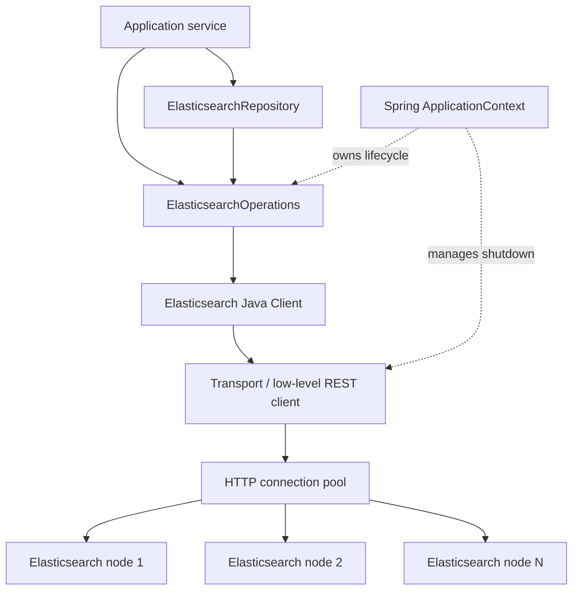
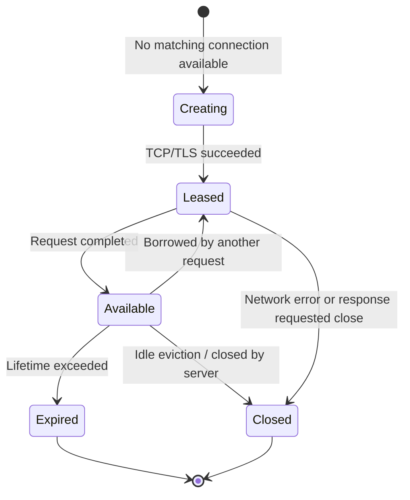

# Connection Pool, Keep-Alive, and Client Lifecycle Management

Spring Data Elasticsearch is typically used through `ElasticsearchOperations` or Elasticsearch Repositories. Underneath these abstractions sit the Elasticsearch Java Client and HTTP transport. The transport manages sending requests to nodes, distributing requests, reusing connections, handling timeouts, and releasing network resources.

In a Spring Boot application, the client should be created once, shared across services and repositories, and closed when the application context shuts down. A connection pool retains reusable HTTP connections, avoiding TCP connection setup and TLS handshakes for every request. Keep-alive lets connections persist across multiple requests; timeouts and idle eviction policies help the pool adapt to servers, load balancers, and network infrastructure.

Three concepts should be distinguished upfront:

- **Connection pool** manages the set of connections currently in use, idle, and waiting to be leased to requests.
- **HTTP keep-alive** allows reusing a single HTTP connection for multiple sequential or concurrent requests depending on client capabilities.
- **Client lifecycle** defines when the client—along with its underlying threads, sockets, and connection manager—is created, shared, and closed.

Creating a new client per request causes the application to repeatedly spin up and tear down pools, increases connection overhead, spawns extra threads and sockets, and forfeits keep-alive benefits. Failing to close the client on shutdown can leave background resources running or prevent clean shutdown.

## 1. Client architecture in Spring Data Elasticsearch

With the common imperative setup in Spring Data Elasticsearch 5.x, the call flow can be represented as:



Repositories use `ElasticsearchOperations` underneath. `ElasticsearchOperations` works with the Java Client; the Java Client delegates HTTP communication to the transport and low-level REST client. Connection pooling lives at the HTTP client layer, not inside individual repository methods.

Spring Data provides configuration to create these beans. With standard configuration, the application simply injects `ElasticsearchOperations`, repositories, or the Java Client when low-level APIs are truly required. Most business code should interact with repositories/operations rather than manually building HTTP requests and managing sockets.

### 1.1 What are the responsibilities of each layer?

| Component | Responsibility |
|---|---|
| `ElasticsearchRepository` | Repository API for entities: save, delete, find by ID, and query methods |
| `ElasticsearchOperations` | More flexible operations and search API than repositories |
| `ElasticsearchClient` | Strongly typed Java API Client for Elasticsearch APIs |
| Transport | Converts requests/responses between Java Client and HTTP client |
| Low-level REST client | Sends HTTP, selects nodes, load balances, fails over, and manages connections |
| Connection pool | Allocates and reuses connections to endpoints |

Do not create a separate `RestClient` or `ElasticsearchClient` inside each service. High-level abstractions are designed to share the configured client.

### 1.2 One client can connect to multiple nodes

A client can be configured with multiple endpoints belonging to the same cluster. The low-level REST client manages nodes and distributes requests according to its policy; when a node errors, the client can temporarily avoid that node and try another endpoint via failover.

```java
ClientConfiguration.builder()
    .connectedTo(
        "es-node-1.internal:9200",
        "es-node-2.internal:9200",
        "es-node-3.internal:9200"
    )
    .build();
```

The endpoint list should point to nodes appropriate for serving application HTTP requests. If only a load balancer address is configured, the pool connects to that address; further distribution to Elasticsearch nodes is handled by the load balancer. Understand the real topology to avoid misconfiguring internal transport ports, non-HTTP nodes, or endpoints reachable only from a different network.

## 2. How does a connection pool work?

Opening a TCP connection requires a network handshake. With HTTPS, the client also performs a TLS handshake and certificate verification. When every request opens a fresh connection, these costs repeat continuously and increase latency.

A connection pool holds established connections so subsequent requests can borrow and reuse them. When a request completes, the connection returns to the pool if still valid. The pool also caps concurrent connections to bound application resources and the number of connections the cluster must serve.

### 2.1 Lifecycle of a pooled connection



A request requires a connection leased from the pool. If an idle connection is available, the pool can lease it immediately. Otherwise, the client may open a new connection up to configured limits or wait until a connection is returned. If the pool is at capacity and the acquisition wait times out, the request fails due to connection pool exhaustion or a connection request timeout.

### 2.2 Total connections and connections per route

With Apache HttpAsyncClient used by the low-level `RestClient` in Spring Data Elasticsearch 5.x, two limits are commonly relevant:

- `maxConnTotal`: maximum connections across the entire pool.
- `maxConnPerRoute`: maximum connections for a single route, usually corresponding to a scheme/host/port combination.

For example, a client connects to three nodes with a total limit of 120 and a per-route limit of 40. The pool cannot exceed 120 connections overall, and each node endpoint cannot exceed 40 connections along its route. Actual limits also depend on topology, node list, routes, and client node selection.

Do not blindly set connection limits equal to application thread counts. A thread might not continuously call Elasticsearch; a request might hold a connection for an extended time; or a client might process requests asynchronously. Measure actual concurrency, connection hold times, latency, and node count before tuning.

### 2.3 What happens when the pool is exhausted?

Suppose a pool allows at most 50 connections to a route. If 50 requests are actively using connections, the 51st request must wait for one to return or fail when the acquisition timeout expires.

Pool exhaustion can stem from:

- Higher-than-expected concurrent requests.
- Search, aggregation, or bulk requests holding connections for long periods.
- Overly long timeouts keeping connections occupied when the server responds slowly.
- Slow nodes or networks delaying connection release.
- Pool limits configured too low for the concurrency level.
- The application spawning multiple clients/pools and fragmenting capacity unnecessarily.

Raising pool limits does not automatically cure the root cause. If Elasticsearch is already overloaded, opening more connections can add pressure to nodes and worsen latency. Examine application queues, connection pools, thread pools, and cluster health together.

## 3. HTTP keep-alive and connection reuse

HTTP keep-alive generally refers to keeping an HTTP connection open after a response finishes so the client can send subsequent requests over the same connection. HTTP/1.1 enables persistent connections by default unless one side requests closing the connection.

Keep-alive cuts down TCP connection setups and TLS handshakes. It is especially effective when an application sends frequent requests to the same cluster throughout its process lifetime.

### 3.1 One connection, multiple requests

Without keep-alive, a simplified flow looks like:

```text
Request A -> TCP connect -> TLS handshake -> HTTP request/response -> close
Request B -> TCP connect -> TLS handshake -> HTTP request/response -> close
Request C -> TCP connect -> TLS handshake -> HTTP request/response -> close
```

With connection pooling and persistent connections:

```text
TCP connect -> TLS handshake
       |
       +--> HTTP request A / response A
       +--> HTTP request B / response B
       +--> HTTP request C / response C
       |
       +--> connection returned to pool / reused
```

Keeping a connection in the pool does not mean one request holds it indefinitely. Once a request finishes, the connection becomes available for other requests to use.

### 3.2 HTTP Keep-Alive vs. TCP keepalive

These two terms sound similar but operate at different layers.

**HTTP keep-alive** is the practice of keeping an HTTP connection open for reuse across subsequent request/response exchanges. Client and server can exchange headers regarding connection persistence or keep-alive duration. The pool may also enforce maximum lifetimes and idle connection eviction policies.

**TCP keepalive** is a socket/operating-system feature. After a period with no traffic, the OS can send TCP keepalive probes to check whether the peer still responds. It helps detect connections silently broken by network failures or middleboxes.

| Criterion | HTTP keep-alive | TCP keepalive |
|---|---|---|
| Operating layer | HTTP/application protocol | TCP/socket/OS |
| Purpose | Reuse connections across multiple requests | Detect unresponsive peers or dead network paths |
| Mechanism | Persistent connections, pool, and idle/TTL policies | TCP probes emitted by the OS |
| Mutually interchangeable? | No | No |

TCP keepalive does not guarantee the server will keep an HTTP connection open. Servers, reverse proxies, or load balancers can still actively close idle HTTP connections. Conversely, HTTP keep-alive does not detect every case where a network path broke while the client-side socket still appears open.

### 3.3 Keep-Alive header and idle time

A server or proxy may send a `Keep-Alive` header containing timeout or max-request hints depending on implementation. The client can use that hint when deciding whether a connection remains eligible for reuse.

Connection retention times must be evaluated across the entire network path:

```text
Application client
      |
      v
Load balancer / reverse proxy
      |
      v
Elasticsearch HTTP endpoint
```

If a load balancer closes connections after 60 seconds of idleness while the client keeps pooled connections longer, a subsequent request may borrow a connection already closed by the intermediary. Depending on detection timing, the request can hit connection reset, broken pipe, or timeout errors.

A practical rule is aligning the client's connection lifetime and idle eviction with intermediary timeouts, typically evicting connections client-side before the load balancer closes them. Do not rely on one magic number across every environment; obtain actual timeouts from infrastructure configuration and verify behavior empirically.

### 3.4 Idle eviction and connection TTL

Pools can evict connections that have been idle too long or exceed a time-to-live (TTL). The two concepts are related but distinct:

- **Idle timeout** measures how long a connection sits unused.
- **TTL** measures total connection age since creation, even if the connection sees occasional use.

Idle eviction keeps the pool from holding onto connections that servers or proxies may have closed. TTL limits connection lifespan so the client periodically opens fresh connections and refreshes network/TLS state. Values set too short cause churn by constantly opening connections; values set too long increase the odds of stale connections in some environments.

Do not disable connection management completely just to avoid stale connection errors. Identify which side closes connections, inspect real timeouts, and tune the pool policies of your HTTP client.

## 4. Configuring the client in Spring Data Elasticsearch 5.x

For imperative applications using Spring Data Elasticsearch 5.x, the standard setup extends `ElasticsearchConfiguration` and supplies a `ClientConfiguration`. Spring Data creates client/operations beans from this configuration for repositories to use.

Example configuring endpoints and timeouts:

```java
import java.time.Duration;

import org.springframework.context.annotation.Configuration;
import org.springframework.data.elasticsearch.client.ClientConfiguration;
import org.springframework.data.elasticsearch.client.elc.ElasticsearchConfiguration;

@Configuration
public class ElasticsearchClientConfig extends ElasticsearchConfiguration {

    @Override
    public ClientConfiguration clientConfiguration() {
        return ClientConfiguration.builder()
            .connectedTo(
                "es-node-1.internal:9200",
                "es-node-2.internal:9200"
            )
            .withConnectTimeout(Duration.ofSeconds(3))
            .withSocketTimeout(Duration.ofSeconds(30))
            .build();
    }
}
```

The durations are merely examples illustrating where configuration goes. Tune them according to real latency, request sizes, business requirements, and network topology. If the cluster uses HTTPS, configure SSL and authentication appropriately; never disable certificate checks just to make connections work.

`ElasticsearchConfiguration` provides injectable beans including `ElasticsearchOperations`, the Java `ElasticsearchClient`, and the low-level REST client. Repositories rely on `ElasticsearchOperations` under the hood. In most business code, inject `ElasticsearchOperations` or repositories rather than managing transport directly.

### 4.1 Customizing the low-level RestClient connection pool

`ClientConfiguration` exposes common parameters like endpoints, SSL, connect timeout, socket timeout, headers, and callbacks. When deeper pool tuning is needed in the Spring Data Elasticsearch 5.x branch using low-level `RestClient` backed by Apache HttpAsyncClient, you can use `ElasticsearchHttpClientConfigurationCallback`.

Example:

```java
import java.time.Duration;

import org.springframework.context.annotation.Configuration;
import org.springframework.data.elasticsearch.client.ClientConfiguration;
import org.springframework.data.elasticsearch.client.elc.ElasticsearchConfiguration;

import static org.springframework.data.elasticsearch.client.elc.ElasticsearchClients.*;

@Configuration
public class ElasticsearchClientConfig extends ElasticsearchConfiguration {

    @Override
    public ClientConfiguration clientConfiguration() {
        return ClientConfiguration.builder()
            .connectedTo("es-node-1.internal:9200", "es-node-2.internal:9200")
            .withConnectTimeout(Duration.ofSeconds(3))
            .withSocketTimeout(Duration.ofSeconds(30))
            .withClientConfigurer(
                ElasticsearchHttpClientConfigurationCallback.from(httpClientBuilder ->
                    httpClientBuilder
                        .setMaxConnTotal(120)
                        .setMaxConnPerRoute(40)
                )
            )
            .build();
    }
}
```

In this example, the callback receives the Apache HttpComponents 4 `HttpAsyncClientBuilder` used underneath the low-level `RestClient`. `maxConnTotal` caps total pooled connections; `maxConnPerRoute` caps connections per route. The numbers 120 and 40 are examples, not defaults or fixed recommendations.

Callbacks enable lower-level adjustments such as connection managers, keep-alive strategies, or other HTTP client settings not directly exposed on `ClientConfiguration`. Add custom tuning only when supported by measurements and clear understanding of its impact.

### 4.2 Customizing connection acquisition timeout

Time spent acquiring a connection from the pool differs from TCP connection setup time and response wait time:

- Connect timeout: bounds network connection creation, including TLS setup depending on transport.
- Connection request timeout: bounds waiting for the pool to lease an available connection.
- Socket/read timeout: bounds waiting on socket I/O as applied by the HTTP client.
- Response timeout: bounds waiting to receive a response if supported separately by the HTTP client.

On the 5.x `RestClient` branch using Apache HttpAsyncClient, connection request timeout can be customized via the request config callback. Illustrative example:

```java
import java.util.concurrent.TimeUnit;

.withClientConfigurer(
    ElasticsearchRestClientConfigurationCallback.from(restClientBuilder ->
        restClientBuilder.setRequestConfigCallback(requestConfigBuilder ->
            requestConfigBuilder.setConnectionRequestTimeout(500)
        )
    )
)
```

This snippet is a callback fragment suitable for chaining onto `ClientConfiguration`'s builder and requires imports/APIs matching your Spring Data Elasticsearch version. The value `500` is in milliseconds in the illustrated Apache HttpClient 4 API. On branches using `Rest5Client`/Apache HttpComponents 5, builder types and timeout units may differ.

When pools run dry, a short connection request timeout helps detect pool queuing quickly. However, too short a timeout can fail requests during brief traffic spikes. Base limits on latency targets and application backpressure design.

### 4.3 Should you customize the Keep-Alive strategy?

HTTP clients usually include default persistent-connection policies and `Keep-Alive` header handling. Avoid overriding defaults without knowing what the server or proxy returns.

If a custom connection retention time is needed, Apache HttpAsyncClient 4 supports configuring `ConnectionKeepAliveStrategy` in the callback, for example:

```java
.withClientConfigurer(
    ElasticsearchHttpClientConfigurationCallback.from(httpClientBuilder ->
        httpClientBuilder.setKeepAliveStrategy(
            (response, context) -> TimeUnit.SECONDS.toMillis(30)
        )
    )
)
```

This illustrates a fixed 30-second policy, not a value to copy blindly. A fixed strategy can ignore timeout hints provided by the server or proxy. Before overriding, confirm the value does not exceed load balancer idle timeouts and pair it with an appropriate idle eviction policy.

If the server already sends suitable Keep-Alive timeouts, prefer letting the client honor them. When proxies or load balancers sit in the path, verify each hop's timeout and keep client-side retention shorter than infrastructure limits that could close the connection.

## 5. Understanding and choosing timeouts

Timeouts are part of connection management, with each timeout protecting a distinct phase. Using one blanket timeout for everything often causes an application either to hang too long or cancel requests prematurely.

| Timeout | Where It Applies | Typical Symptom on Expiry |
|---|---|---|
| Connect timeout | TCP/TLS setup | Cannot open connection to node |
| Connection request timeout | Waiting to lease from pool | Pool busy or exhausted |
| Socket/read timeout | Waiting for data on socket | No data received within allowed interval |
| Response timeout | Waiting for response per request config | Client stops waiting for response |
| Idle timeout | Unused connection | Pool closes connection idle too long |
| Connection TTL | Connection age | Pool replaces aged connection |

### 5.1 Connect timeout

Connect timeout should be short enough to detect unreachable endpoints promptly, yet not so short that normal network jitter or TLS handshakes fail. When the client knows multiple nodes, failing to reach one endpoint does not necessarily render the whole cluster unusable; failover depends on the node list and client behavior.

### 5.2 Connection request timeout

This timeout measures how long a request waits for a pooled connection. If hit frequently, check active/leased connections, request concurrency, response latency, and max connection limits. It can signal an undersized pool, slow requests, or sluggish Elasticsearch processing.

### 5.3 Socket and response timeout

Search, aggregation, bulk, or administrative requests can take substantial time depending on data volume and cluster load. Too short a socket/read timeout can cause client errors while Elasticsearch is still executing the request.

A client-side timeout does not prove the server-side operation was cancelled. For writes, the request may have reached the server and executed even though the response missed the deadline. Blind retries can cause duplicate operations or unintended results.

Do not rely solely on a short response timeout to detect dead networks. TCP keepalive and connection health mechanisms are better suited for detecting unresponsive peers, while response timeouts should align with legitimate API processing durations.

## 6. Client lifecycle in a Spring application

The client, transport, and connection pool are long-lived resources. They typically own background threads, reactors, sockets, connection managers, and node state. Consequently, their lifecycle should match the application's lifecycle.

### 6.1 Create once and share

The standard pattern is declaring `ElasticsearchConfiguration` once in the Spring application context. Spring creates the client and related beans; services and repositories receive them via constructor injection.

```java
@Service
public class ProductSearchService {

    private final ElasticsearchOperations operations;

    public ProductSearchService(ElasticsearchOperations operations) {
        this.operations = operations;
    }

    public Product findById(String id) {
        // Use the Spring-managed operations bean.
        // Do not create a new RestClient/ElasticsearchClient here.
        return operations.get(id, Product.class);
    }
}
```

The method above only demonstrates injecting and using `operations`. In real applications, queries are built according to search requirements. The key takeaway is that the service uses the configured, managed bean rather than instantiating a fresh transport per call.

The Elasticsearch Java Client is designed to be thread-safe and shared across threads when backed by its standard transport. Repositories and `ElasticsearchOperations` are likewise used as shared beans across a Spring application.

### 6.2 Closing the client on application shutdown

On application context shutdown, closeable resources must close in the proper order to release connection pools, sockets, and background threads. For Spring Data-configured clients, let Spring Data's bean configuration/lifecycle handle resource cleanup.

If you manually instantiate a low-level REST client or transport, register it as a Spring bean with an explicit lifecycle and configure `close` on context shutdown. Conceptual example:

```java
import org.apache.http.HttpHost;
import org.elasticsearch.client.RestClient;
import org.springframework.context.annotation.Bean;

@Bean(destroyMethod = "close")
public RestClient restClient() {
    return RestClient.builder(
        new HttpHost("es-node-1.internal", 9200, "http")
    ).build();
}
```

This is a standalone low-level client example, not something to add alongside a standard `ElasticsearchConfiguration`. When manually assembling the Java Client, transport, and low-level client, establish clear ownership so resources are closed exactly once. Never wire two beans sharing one connection pool so that both attempt to close it.

### 6.3 Do not close a shared client inside a service

Never call `close()` after a repository method or HTTP request finishes. If one service closes an injected client, other services may continue calling a closed client and hit connection failures.

Closing the client belongs solely to the component owning its lifecycle—typically the Spring context or a dedicated factory/manager. Business code only uses the client.

### 6.4 Avoid creating clients in loops or request handlers

Anti-pattern to avoid:

```java
public Product findProduct(String id) throws IOException {
    try (RestClient client = RestClient.builder(
            new HttpHost("localhost", 9200, "http")).build()) {
        // Creates and closes a connection pool on every call.
        // Transport and query details omitted.
        return loadProduct(client, id);
    }
}
```

Each invocation spins up a new pool, opens new connections, and spawns new threads. This inflates latency, defeats connection reuse, and can overwhelm the system under concurrent load.

Instead, instantiate the client at the application context level and inject it into services. Connection reuse happens internally within the client-owned pool.

## 7. One cluster or multiple clients?

Normally, one Spring application uses one client per Elasticsearch cluster. Configuring multiple nodes of the same cluster does not mean creating multiple clients; those are multiple endpoints managed by one client and pool.

Multiple clients may be required when the application accesses independent clusters, for instance:

- Business search cluster and logging cluster have distinct endpoints.
- Two clusters require different credentials, TLS truststores, or network policies.
- A query path must access a cluster in another environment.

Each separate client maintains its own connection pool and resources. Therefore, do not create multiple clients just to split services by module if all talk to the same cluster under the same security policy.

When multiple clusters exist, assign clear bean names, inject using qualifiers, and manage lifecycles independently. Prevent services from accidentally injecting a client with the wrong credentials or index namespace.

## 8. Reactive clients have their own pools

Spring Data Elasticsearch offers both imperative and reactive configurations. Reactive configuration builds on `ReactiveElasticsearchConfiguration`, using the reactive client stack and its corresponding HTTP client. Pooling, timeouts, connection providers, and lifecycles in the reactive transport can differ from the imperative `RestClient` backed by Apache HttpAsyncClient.

Accordingly, do not copy imperative `ElasticsearchHttpClientConfigurationCallback` code to a reactive client. Confirm which client type the application uses before tuning pools. For the reactive stack, inspect WebClient/Reactor Netty settings and connection provider limits appropriate for your Spring Data version.

Reactive APIs do not eliminate the need for connection pooling. Under high concurrency, connection limits and backpressure remain vital. Without capping concurrent requests, a reactive application can still flood a cluster beyond what it can handle.

## 9. Observing and diagnosing connection pools

When requests slow down or fail intermittently, determine whether the bottleneck lies in the pool, network, Elasticsearch nodes, or queries.

### 9.1 Signs of pool trouble

Possible indicators include:

- Requests frequently wait long before being dispatched to a node.
- Connection request timeouts appear under rising load.
- Leased/active connections repeatedly hit pool limits.
- Pending/waiting connection requests climb.
- Latency climbs even when Elasticsearch-side execution time stays flat.
- Frequent connection reset, broken pipe, or stale connection errors after idle periods.
- Abnormal growth in threads/sockets caused by creating multiple clients.

Do not diagnose pool exhaustion from a single socket timeout. Correlate client logs, pool metrics (if exposed by the HTTP client), request latencies, and cluster statistics.

### 9.2 Checking cluster status

Several APIs inspect node status and processing load:

```http
GET /_cluster/health
GET /_cat/nodes?v
GET /_cat/thread_pool?v
GET /_nodes/stats/http,thread_pool,process,jvm
```

These APIs do not replace application-side connection pool metrics. They help check whether nodes are overloaded, thread pools are queuing/rejecting, or JVM resources are strained.

### 9.3 HTTP client trace logging

Spring Data Elasticsearch 5.x supports enabling the transport's `tracer` logger to observe HTTP-level requests and responses. Example logging configuration:

```xml
<logger name="tracer" level="trace"/>
```

Trace logs help inspect endpoints, requests, and responses, but generate heavy log volume and may capture sensitive payloads or headers. Enable only briefly as needed, restrict log access, and turn it off after troubleshooting.

### 9.4 Separating client errors from server errors

| Symptom | First Place to Check |
|---|---|
| Connection refused | Endpoint, port, firewall, node HTTP service |
| Connect timeout | Network path, DNS, TLS handshake, overloaded endpoint |
| Connection request timeout | Pool limit, request concurrency, connection hold duration |
| Socket/read timeout | Slow request execution, slow node, packet loss, or timeout too short |
| Connection reset/broken pipe | Server/proxy closed connection, stale idle connection, network reset |
| HTTP 429 or 503 | Cluster overload, rejections, shard/node availability, and retry policy |
| Many clients/threads/sockets | Check where clients are created and bean lifecycles |

## 10. Retries and connections: avoiding unsafe duplicates

The low-level client may perform failover or retry certain failures per its policy. The application may also implement retries at the service layer or via a resilience library. If both layers retry aggressively, an incident can amplify traffic rapidly and place extra strain on the cluster.

In particular, a timeout does not prove the server never executed a write. The request may have been processed while the response got lost on the return trip. When retrying:

- Indexing a document with an explicit `_id` is easier to keep idempotent because repeating the request overwrites the same document ID.
- Indexing with auto-generated IDs can create duplicate documents if the first attempt succeeded without the client receiving the response.
- Scripted updates that add or increment values can apply twice unless retries are carefully guarded.
- Bulk responses can report per-item successes and failures; inspect each item rather than blindly retrying the entire batch.

Retry policies need attempt limits, backoff, jitter, and error classification. Never retry authentication errors, mapping errors, or invalid requests as if they were transient network glitches. For writes, verify idempotency and potential post-timeout states.

## 11. Common pitfalls

### 11.1 Creating a new client per request

This continually allocates pools, threads, and sockets, eliminating connection reuse. Create the client at the application level and inject it into services.

### 11.2 Sizing a pool too small or raising limits without data

Too small a pool stalls requests; too large a pool strains the cluster and OS. Track concurrency, latency, active/waiting connections, and node capacity before changing limits.

### 11.3 Confusing HTTP keep-alive with TCP keepalive

HTTP keep-alive supports HTTP connection reuse. TCP keepalive detects unresponsive peers or dead network paths. Know which layer applies before tuning.

### 11.4 Keeping idle connections longer than load balancer timeouts

The client may borrow connections already closed by a proxy. Align idle eviction and TTL with real timeouts along the network path.

### 11.5 Setting socket timeout too short

Valid queries or bulk calls may legitimately need more time. Client timeouts can trigger application retries while the server keeps working, adding load or duplicate writes.

### 11.6 Closing a shared client in a service

A client bean shared across services must be closed by its lifecycle owner, not after individual requests.

### 11.7 Copying online pool snippets without checking versions

Spring Data Elasticsearch 5.x typically uses callbacks for low-level `RestClient` and Apache HttpAsyncClient 4. Newer releases may use `Rest5Client` and Apache HttpComponents 5 with different callbacks, builders, and timeout units. Never copy imports or callback code across generations blindly.

## 12. Production design checklist

When configuring the client for production, verify:

1. Whether the application uses the imperative or reactive client.
2. Spring Data Elasticsearch version and the actual low-level transport type.
3. Whether endpoints are direct nodes or a load balancer/proxy.
4. Node count and request distribution strategy.
5. Total and per-route pool limits grounded in measured concurrency.
6. Connect timeout, connection request timeout, and socket/response timeouts per stage.
7. HTTP keep-alive, server/proxy idle timeouts, and idle eviction/TTL policies.
8. TCP keepalive at the client/OS/network layers as needed for dead-connection detection.
9. Bounded retry policy with backoff and idempotency guarantees for writes.
10. Client created once, shared, and closed on application context shutdown.
11. Metrics/logs sufficient to distinguish pool saturation, network errors, and cluster overload.
12. TLS, credentials, and secrets configured securely.

## 13. Conclusion

Connection pools allow Spring Data Elasticsearch to reuse HTTP connections and regulate concurrent connections to the cluster. HTTP keep-alive keeps connections open for multiple requests, while TCP keepalive helps detect unresponsive network paths. Idle timeouts, TTLs, and connection acquisition timeouts govern how the pool retires or leases connections under real conditions.

The client should live as long as the application: configured once through Spring, shared via repositories, operations, and services, and closed on context shutdown. Creating clients per request or closing shared clients inside services forfeits pooling benefits and causes operational failures. When tuning, start from concurrency, latency, pool wait times, timeouts, and cluster load metrics, then apply callbacks matching the HTTP client generation used by your Spring Data Elasticsearch version.

## References

- [Spring Data Elasticsearch 5.5 — Elasticsearch Clients](https://docs.spring.io/spring-data/elasticsearch/reference/5.5/elasticsearch/clients.html)
- [Elasticsearch Java REST Client — REST 5 Client](https://www.elastic.co/docs/reference/elasticsearch/clients/java/transport/rest5-client)
- [Elasticsearch Java REST 5 Client — Configuring timeouts](https://www.elastic.co/docs/reference/elasticsearch/clients/java/transport/rest5-client/config/timeouts)
