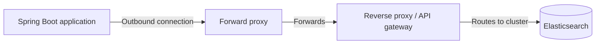

# Proxies, Path Prefixes, and Custom Headers

When a Spring Data Elasticsearch application connects to Elasticsearch through an internal network, API gateway, or reverse proxy, connection configuration may require a proxy, a path prefix, and custom HTTP headers. These three mechanisms solve three distinct problems: a proxy routes network connections, a path prefix prepends a path segment to every HTTP request, and headers carry metadata or authentication credentials according to system conventions.

Understanding each mechanism accurately helps avoid errors such as requests hitting the wrong port, duplicated path segments, gateways returning 401/403, or proxies rejecting connections. Exact settings depend on the Elasticsearch client generation and Spring Data Elasticsearch version in use. The `ClientConfiguration` examples below illustrate the configuration API for Spring Data Elasticsearch using the Elasticsearch Java API Client; if your project uses an older line or a different transport, verify the API of that specific version.

## 1. Distinguishing proxies, path prefixes, and headers

| Mechanism | Purpose | Example Scenario |
|---|---|---|
| HTTP forward proxy | Intermediary used by the application to send outbound requests to target networks | Corporate network mandates all outbound connections go through `proxy.corp.example:8080` |
| Reverse proxy / API gateway | Endpoint sitting in front of Elasticsearch that receives requests from the application | Elasticsearch is only accessible via `search.example.com` |
| Path prefix | Prepends a path segment before Elasticsearch's REST endpoints | Gateway exposes Elasticsearch under `/elasticsearch/` |
| Custom header | Sends additional information in HTTP requests | Gateway requires `X-Application-Name` or a routing header |

Forward proxies and reverse proxies are often both loosely called proxies, yet they sit in different positions along the network path.



In another environment, the application may connect directly to a reverse proxy without a forward proxy. Alternatively, both an outbound forward proxy and a reverse proxy in front of the cluster may be present simultaneously. Confirm the exact network topology before configuring.

## 2. What is a path prefix?

The Elasticsearch REST API exposes endpoints such as:

```text
GET /
GET /_cluster/health
GET /products/_search
PUT /products
```

A reverse proxy may expose these endpoints under a dedicated prefix, such as:

```text
https://search.example.com/elasticsearch/
https://search.example.com/elasticsearch/_cluster/health
https://search.example.com/elasticsearch/products/_search
```

In that case, the application must prepend `elasticsearch` to the start of every request path. A path prefix lets you configure this once on the client; repository code still queries the `products` index as usual.

### A path prefix is not an index name

The following concepts mean different things:

- Host and port identify the network endpoint, e.g., `search.example.com:443`.
- Path prefix specifies the path segment required by the gateway, e.g., `/elasticsearch`.
- Index name specifies the target index, e.g., `products`.
- Repository or query specifies the data operation, e.g., searching documents in `products`.

Do not put the path prefix into index names or manually prepend it in individual queries. If you configure a prefix on the client while code also adds the prefix, requests can turn into `/elasticsearch/elasticsearch/products/_search` and trigger 404 responses from the gateway.

### When is a path prefix needed?

A path prefix is needed when a public or internal gateway endpoint serves Elasticsearch under a subpath. No path prefix is needed when the application connects directly to Elasticsearch at the root path, or when the reverse proxy has already stripped the prefix before forwarding requests to the backend.

The final point is crucial: some gateways preserve the prefix when forwarding while others strip the prefix before forwarding. Client configuration must match the path that the external endpoint actually expects to receive, not how the backend is deployed internally.

## 3. Configuring via Spring Data `ClientConfiguration`

In Spring Data Elasticsearch versions using the Elasticsearch Java API Client, `ClientConfiguration` can describe host, SSL, proxy, path prefix, timeouts, and default headers. The example below shows configuring an application connecting to Elasticsearch through an HTTPS gateway, a forward proxy, and an application-identification header.

```java
import org.springframework.context.annotation.Configuration;
import org.springframework.data.elasticsearch.client.ClientConfiguration;
import org.springframework.data.elasticsearch.client.elc.ElasticsearchConfiguration;
import org.springframework.http.HttpHeaders;

@Configuration
public class SearchClientConfiguration extends ElasticsearchConfiguration {

    @Override
    public ClientConfiguration clientConfiguration() {
        return ClientConfiguration.builder()
            .connectedTo("search.example.com:443")
            .usingSsl()
            .withProxy("proxy.corp.example:8080")
            .withPathPrefix("elasticsearch")
            .withHeaders(() -> {
                HttpHeaders headers = new HttpHeaders();
                headers.add("X-Application-Name", "catalog-service");
                return headers;
            })
            .build();
    }
}
```

This example uses the ELC-based Spring Data Elasticsearch configuration API. Package names, configuration classes, and builder methods may vary across Spring Data generations. Check the Javadoc or reference documentation for your project's actual dependency before copying.

Meaning of each part:

- `connectedTo(...)` declares the endpoint the client connects to. With a reverse proxy, this is typically the gateway's host and port.
- `usingSsl()` enables TLS connections. The HTTPS gateway must have a valid certificate and trust chain.
- `withProxy(...)` declares the forward proxy the client uses for outbound connections.
- `withPathPrefix(...)` prepends a prefix to REST request paths. For example, `elasticsearch` corresponds to the `/elasticsearch` path segment.
- `withHeaders(...)` supplies additional HTTP headers. The supplier produces `HttpHeaders` for the client to attach per your Spring Data version's mechanism.

If only a path prefix is needed without a forward proxy, omit `withProxy(...)`. If the gateway does not require custom headers, omit `withHeaders(...)`. Only enable mechanisms actually present in the application's network topology.

### Integrating configuration with Spring Boot

In a Spring Boot application, the Data Elasticsearch starter can auto-configure the client from properties. If customizations are needed that current properties cannot express, you can provide a customizer or custom client configuration using the extension point of your exact Boot/Spring Data version.

The example above extends `ElasticsearchConfiguration` to illustrate Spring Data building client configuration from `ClientConfiguration`. When using this approach, inspect Spring Boot auto-configuration to avoid creating two client sets, two `ElasticsearchOperations` beans, or duplicate beans with overlapping roles. Pick one primary client configuration source and verify the beans injected into repositories/templates come from that single configuration.

### Customizing `RestClientBuilder` in supported Spring Boot versions

Some Spring Boot lines using Elasticsearch `RestClient` expose the `RestClientBuilderCustomizer` extension point. This allows customizing the lower-level builder, such as setting a path prefix, default headers, or an HTTP client callback for a forward proxy.

Illustrative example for versions providing `RestClientBuilderCustomizer` and corresponding Apache HttpComponents types:

```java
import org.apache.http.Header;
import org.apache.http.HttpHost;
import org.apache.http.message.BasicHeader;
import org.elasticsearch.client.RestClientBuilder;
import org.springframework.boot.autoconfigure.elasticsearch.RestClientBuilderCustomizer;
import org.springframework.context.annotation.Bean;
import org.springframework.context.annotation.Configuration;

@Configuration
public class ElasticsearchRestClientCustomization {

    @Bean
    RestClientBuilderCustomizer elasticsearchRestClientCustomizer() {
        return (RestClientBuilder builder) -> {
            builder.setPathPrefix("/elasticsearch");
            builder.setDefaultHeaders(new Header[] {
                new BasicHeader("X-Application-Name", "catalog-service")
            });
            builder.setHttpClientConfigCallback(httpClientBuilder ->
                httpClientBuilder.setProxy(
                    new HttpHost("proxy.corp.example", 8080)
                )
            );
        };
    }
}
```

This example is tied to `RestClientBuilder` and Apache HttpComponents' `HttpHost` used by the corresponding dependency. Do not apply it verbatim to newer client lines using a different transport or HTTP stack. If your IDE cannot find `RestClientBuilderCustomizer`, `RestClientBuilder`, or `HttpHost`, check your Spring Boot version, Elasticsearch client, and actual imports; do not add an outdated client dependency solely to make an example compile.

In a Spring Boot project, Boot-provided extension points are usually appropriate when you only need to tweak the Boot-managed builder. If you replace the entire configuration with `ElasticsearchConfiguration`, avoid simultaneously registering another customizer that mutates the same settings unintentionally.

## 4. Configuring a forward proxy

A forward proxy sits between the application and the Elasticsearch endpoint. For instance, network policy may block direct outbound access to the Internet or another subnet while permitting traffic through an approved proxy.

Request flow:

```text
Spring Boot application
    |
    | HTTP CONNECT or proxy mechanism matching the target protocol
    v
proxy.corp.example:8080
    |
    | Forwards to target endpoint
    v
search.example.com:443
```

In Spring Data `ClientConfiguration`, a proxy can be declared with:

```java
ClientConfiguration.builder()
    .connectedTo("search.example.com:443")
    .usingSsl()
    .withProxy("proxy.corp.example:8080")
    .build();
```

The address in `withProxy` is the forward proxy, while the address in `connectedTo` is the Elasticsearch endpoint or the reverse proxy in front of Elasticsearch. Do not swap these two addresses.

### Authenticated proxies

Some proxies require authentication before permitting connections. How proxy credentials are supplied depends on the HTTP client stack used by your Spring Data version. You may need a client configuration callback or an HTTP client extension point to configure a credentials provider.

When deploying:

- Read username/password or tokens from a secret manager or managed environment variables.
- Never hardcode credentials in source code or commit config files containing secrets.
- Never log `Proxy-Authorization` or authentication credentials.
- Confirm the proxy supports `CONNECT` when the target is HTTPS.
- Check host/port allowlists and outbound proxy policies.

Not all HTTP clients automatically read `HTTP_PROXY` or `HTTPS_PROXY` from environment variables. Verify your specific client's behavior and prefer explicit configuration via supported APIs rather than assuming environment variables take effect automatically.

### Proxies and timeouts

When using a proxy, connection establishment time can include DNS resolution, connecting to the proxy, tunnel negotiation, and the TLS handshake with the destination endpoint. Thus, overly short timeouts can fail even when Elasticsearch is healthy.

Tune connect timeout and socket/response timeout to match real network latency. Large timeouts cannot fix a wrong proxy host, wrong port, invalid credentials, or a blocking firewall; diagnose the root cause before increasing timeouts.

## 5. Configuring a path prefix through a reverse proxy

Suppose a reverse proxy exposes Elasticsearch at:

```text
https://search.example.com/es/
```

And preserves the `/es` segment when forwarding to the backend. In that case, the client must send requests with the `/es` prefix.

Example:

```java
ClientConfiguration.builder()
    .connectedTo("search.example.com:443")
    .usingSsl()
    .withPathPrefix("es")
    .build();
```

If the reverse proxy strips `/es` before forwarding requests to Elasticsearch, external clients must still send `/es`, because that is the public route the gateway accepts. The backend may receive paths rewritten to `/_search` or `/products/_search`. Do not configure the prefix a second time in query code.

### Distinguishing path prefix from application context path

`server.servlet.context-path` in Spring Boot controls the URLs of the Spring MVC/Servlet application itself. It does not automatically add a prefix to outbound requests sent by the Elasticsearch client.

Similarly, `spring.elasticsearch.uris` (where supported in your Boot version) sets the connection URI, but do not assume every Boot version handles path suffixes identically. Use the dedicated path-prefix property or client customization supported by your specific version.

### Common path prefix errors

| Symptom | Possible Cause | What to Check |
|---|---|---|
| `404 Not Found` | Missing or incorrect prefix | Check actual request URLs and gateway routing rules |
| `404` with duplicated path | Prefix added both on the client and in code/proxy | Inspect the path after each rewrite step |
| `502 Bad Gateway` | Gateway cannot forward requests to the backend | Check upstream host, port, health, and network |
| Root endpoint works but `_search` fails | Gateway routes only certain paths or rules omit subpaths | Check rules for `/_search`, `/_bulk`, and `/_cluster/health` under the prefix |
| Writes fail while reads succeed | Gateway or WAF restricts HTTP methods/paths/bodies | Check PUT/POST/DELETE policies and body size limits |

The Elasticsearch client can call many different endpoints, not just search endpoints. The gateway must forward all endpoints the application uses, including index, bulk, health, or cluster metadata operations where applicable.

## 6. Custom headers

HTTP headers carry supplementary information alongside requests. Elasticsearch clients or gateways may use headers to identify applications, route tenants, pass correlation IDs, or satisfy infrastructure authentication conventions.

Example headers:

```http
X-Application-Name: catalog-service
X-Correlation-Id: 8d3f1a2b
X-Tenant-Id: tenant-42
```

Elasticsearch server does not understand arbitrary custom headers by default. A header is meaningful when a client, reverse proxy, API gateway, plugin, or security layer is configured to process it.

### Static headers

Static headers keep the same value across all client requests, such as service name:

```java
.withHeaders(() -> {
    HttpHeaders headers = new HttpHeaders();
    headers.add("X-Application-Name", "catalog-service");
    headers.add("X-Environment", "staging");
    return headers;
})
```

This suits application metadata that does not vary per user or request.

### Dynamic headers

Spring Data `ClientConfiguration` can accept a supplier producing `HttpHeaders`. The supplier allows headers to be generated when the client needs them, such as generating a correlation ID or fetching a short-lived token via an application mechanism:

```java
.withHeaders(() -> {
    HttpHeaders headers = new HttpHeaders();
    headers.add("X-Application-Name", "catalog-service");
    headers.add("X-Correlation-Id", correlationIdProvider.currentId());
    return headers;
})
```

`correlationIdProvider` here is an application-defined component. The example illustrates the concept rather than a built-in Spring Data API. Ensure values come from the proper request context and remain safe to access when the client executes requests asynchronously or on another thread.

Do not store `X-Tenant-Id`, user tokens, or per-user access details in fixed default headers of a singleton client shared across all requests. Doing so can leak one user's identity into another user's request. For per-request data, use client mechanisms for per-request/transport options, or design per-tenant clients if required by the architecture.

### Authentication headers

If Elasticsearch uses Basic Authentication, prefer the auth mechanism provided by Spring Data or Spring Boot, such as `withBasicAuth(...)` or the corresponding properties of your version. If a gateway requires an API key or token in a custom header, retrieve the secret from a secret manager and attach the header via a supported extension point.

Never transmit tokens or passwords over unencrypted HTTP across untrusted networks. Use HTTPS/TLS, scope credential privileges, and rotate secrets per system policy. Avoid logging entire request headers, as doing so can expose `Authorization`, cookies, or API keys.

### Headers added or modified by proxies/gateways

A gateway may inject `X-Forwarded-For`, `X-Forwarded-Proto`, request IDs, or routing headers. It may also strip headers absent from an allowlist or overwrite certain client-supplied headers. If a custom header fails to reach the backend, inspect both gateway configuration and proxy access logs.

Never use custom headers as a substitute for Elasticsearch access control. A gateway may validate headers, yet Elasticsearch and related services still require proper authorization so arbitrary client-forged headers are never trusted blindly.

## 7. Combining all three mechanisms

A system may require a forward proxy, a reverse proxy path prefix, and custom headers at the same time. For example:

- The application is only permitted outbound access via `proxy.corp.example:8080`.
- The forward proxy relays requests to gateway `search.example.com:443`.
- The gateway exposes Elasticsearch under `/elasticsearch`.
- The gateway requires an `X-Application-Name` header to identify the calling service.

The configuration may then look like:

```java
ClientConfiguration.builder()
    .connectedTo("search.example.com:443")
    .usingSsl()
    .withProxy("proxy.corp.example:8080")
    .withPathPrefix("elasticsearch")
    .withHeaders(() -> {
        HttpHeaders headers = new HttpHeaders();
        headers.add("X-Application-Name", "catalog-service");
        return headers;
    })
    .build();
```

A repository query against the `products` index is still written using standard Spring Data APIs. The client attaches the prefix and headers per configuration before sending requests through the proxy to the gateway.

## 8. Verifying configuration at runtime

After configuring, test both the network path and actual HTTP requests. A configuration may compile cleanly yet still fail to route properly through the gateway.

### Verifying endpoints from the application environment

If reachable from the machine running the application, use `curl` to verify the public route. For example:

```bash
curl -i https://search.example.com/elasticsearch/
```

If the endpoint requires headers:

```bash
curl -i \
  -H "X-Application-Name: catalog-service" \
  https://search.example.com/elasticsearch/
```

If a forward proxy is required, use curl's `--proxy` option to test that path:

```bash
curl -i \
  --proxy http://proxy.corp.example:8080 \
  https://search.example.com/elasticsearch/
```

Never place tokens or passwords directly in commands that may be saved in shell history or CI logs. Use your test environment's secure secret mechanism.

### Verifying from the application

Execute a minimal set of operations through `ElasticsearchOperations` or a repository:

1. Connect to the endpoint and read cluster info if permissions allow.
2. Create or confirm a test index.
3. Save a document with an explicit ID.
4. Read the document by ID and run a search query.
5. Delete the test document when finished.

Checking only the root endpoint can miss cases where the gateway blocks `POST /_search`, `PUT /products`, or `POST /_bulk`. Verify the actual HTTP methods and endpoints the application uses.

### Interpreting error codes

| Code or Error | Common Meaning | What to Check |
|---|---|---|
| 401 Unauthorized | Missing or invalid credentials at Elasticsearch/gateway | Credentials, tokens, token expiry, and whether headers are forwarded |
| 403 Forbidden | Request authenticated, but lacks permission | Roles, index permissions, application allowlist, or tenant |
| 404 Not Found | Incorrect path prefix or route | Final URL after client prefixing and rewrite rules |
| 407 Proxy Authentication Required | Forward proxy requires authentication | Proxy credentials and HTTP client configuration |
| 502/503 | Gateway cannot reach upstream or upstream is unavailable | Backend address, health checks, firewall, and DNS |
| Connect timeout | Failed to establish connection within limit | Proxy host/port, DNS, firewall, timeouts, and network routes |
| TLS handshake error | Could not complete TLS negotiation | HTTPS scheme, certificate, hostname, and truststore |

Error codes are only an initial clue. A gateway can translate upstream errors into different codes, so correlate request IDs with gateway and Elasticsearch logs to pinpoint the exact failure point.

## 9. Production deployment considerations

### Protecting credentials and headers

- Use HTTPS between the application and gateway; where possible, secure the leg from gateway to Elasticsearch as well.
- Read API keys, tokens, and proxy credentials from a secret manager or deployment platform secret mechanism.
- Never commit secrets to `application.yml`, Dockerfiles, or build scripts.
- Never log `Authorization`, `Proxy-Authorization`, cookies, or headers containing sensitive data.
- Send headers only to trusted endpoints; avoid forwarding user tokens to unrelated hosts.

### Ensuring tenant and request context correctness

If a header identifies a tenant, ensure the tenant is authenticated and authorized before sending the request. Never take an arbitrary tenant ID from client input and trust that header as a security boundary.

In multi-tenant applications, test concurrent request behavior. One tenant's header must never leak into another tenant's request. Simple suppliers or `ThreadLocal` values can break when requests run asynchronously or switch threads; use intentional context propagation and request-scoped options.

### Monitoring and operations

Monitor the following:

- Connection success and error rates per endpoint.
- Connect timeouts, response timeouts, and request latency.
- Counts of 401/403/404/407/502/503 responses.
- TLS errors and gateway certificate changes.
- Rates of proxy rejections or gateway routing failures.

When changing proxies, prefixes, or headers, coordinate deployments between the application and gateway configuration. A path rewrite change at the gateway can break older application instances immediately even if the Elasticsearch server itself did not change.

## 10. Common configuration mistakes

### Treating the forward proxy as the Elasticsearch host

`connectedTo(...)` must point to the Elasticsearch endpoint or the reverse proxy in front of it. The forward proxy is configured separately via the proxy option. Putting the proxy host in `connectedTo` directs requests to the wrong destination.

### Adding a prefix to the URI and configuring a prefix again

If a URI already contains a path prefix and the client also appends a prefix, paths can be duplicated. Decide clearly where the prefix is managed and apply it only once.

### Confusing application context path with outbound path prefix

`server.servlet.context-path` controls the application's inbound URLs. It does not replace path prefix configuration for the Elasticsearch client.

### Using shared headers for per-user data

Default headers on a singleton client apply across multiple requests. Never attach a user token or current tenant to a static default header on a client shared by all users.

### Assuming proxies are picked up automatically from environment variables

Each HTTP client handles proxies differently. Verify whether your client reads environment variables and prefer explicit configuration through supported APIs.

### Disabling TLS verification to fix certificate errors

Turning off certificate checks weakens endpoint authentication and opens the door to spoofed connections. Install the right trust chain, match hostnames to certificates, and fix the TLS configuration.

### Testing only a single endpoint

The root endpoint may work while the gateway blocks `_search`, `_bulk`, or write HTTP methods. Test the full set of operations the application actually depends on.

## 11. Recommended configuration workflow

When introducing Elasticsearch in an environment with proxies or gateways, follow this sequence:

1. Diagram the network path from the application to Elasticsearch; identify forward proxies, reverse proxies, and actual endpoints.
2. Confirm scheme, host, port, and TLS of the endpoint visible to the application.
3. Determine whether the gateway preserves or strips the path prefix when forwarding.
4. List required custom headers, their purpose, and which component validates them.
5. Choose the extension point matching your Spring Boot/Spring Data/client versions.
6. Configure proxy, path prefix, and headers in one clearly managed place.
7. Verify endpoints and HTTP methods over the application's real network path.
8. Run integration tests covering index, get, search, update, delete, and bulk operations if used.
9. Verify authentication failures, timeouts, TLS, tenant isolation, and ensure logs leak no secrets.
10. Roll out gateway/proxy changes in coordination and monitor metrics post-release.

## 12. Conclusion

Proxies, path prefixes, and custom headers are three separate aspects of HTTP connection configuration. A forward proxy controls outbound routing; a path prefix adjusts the URLs sent by the Elasticsearch client; custom headers pass metadata or values expected by gateways or clients.

In Spring Data Elasticsearch, you can use `ClientConfiguration` or the Spring Boot/client extension points suited to your running version. Distinguish configurations across client generations, avoid creating duplicate client beans, keep secrets safe, and test all endpoints through the actual proxy/gateway path. With these boundaries clear, repositories and `ElasticsearchOperations` continue interacting with indices normally while the client layer handles network details.
