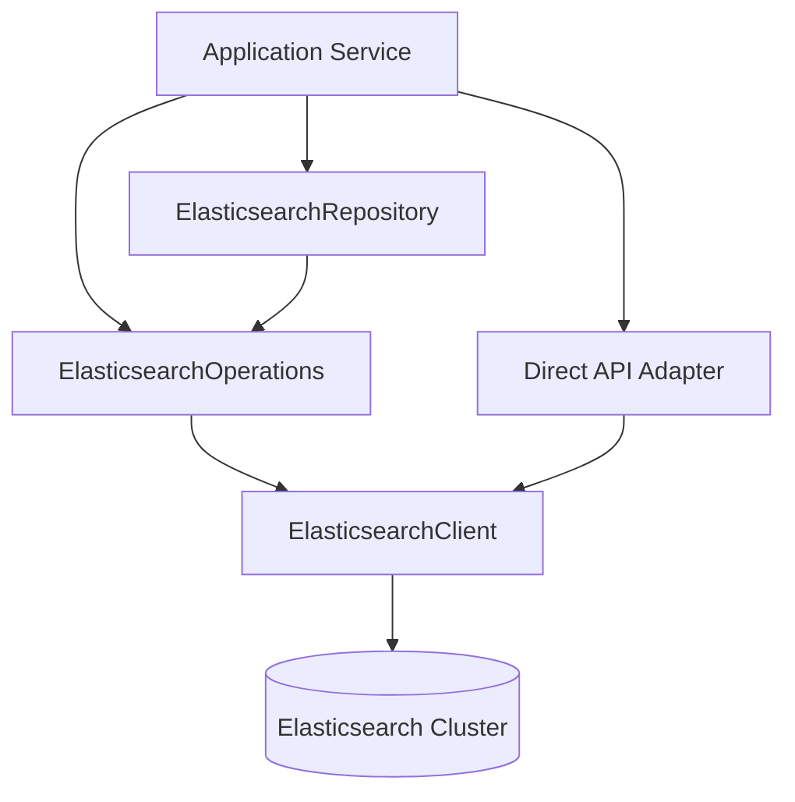
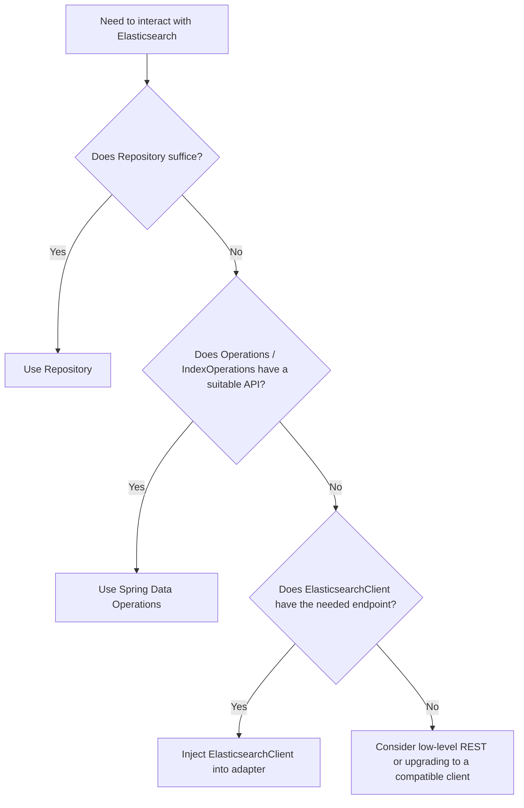

# Injecting the Client Directly When Operations Lacks a Needed API

`ElasticsearchOperations` is Spring Data Elasticsearch's primary abstraction for document and index operations. However, Elasticsearch also exposes many cluster, node, snapshot, task, or newer feature APIs that the Spring Data abstraction does not yet cover completely. When a use case requires such an API, the application can **inject the Elasticsearch Java API Client (`ElasticsearchClient`) directly** and invoke the corresponding endpoint.

This approach preserves Spring Data's convenience for everyday CRUD and queries while allowing raw Elasticsearch API usage precisely where needed. This lesson covers obtaining the client from Spring, structuring direct API call classes, handling responses and errors, and key caveats when using it alongside `ElasticsearchOperations`.

## 1. Client layers in Spring Data Elasticsearch

In a Spring Boot application, common components play distinct roles:

| Component | Role | When to Use |
|---|---|---|
| `ElasticsearchRepository` | Entity-centric repository API following Spring Data conventions | CRUD and derived queries in the domain layer. |
| `ElasticsearchOperations` | Spring Data API for documents, queries, search results, and indices | Dynamic queries, entity mapping, `SearchHits`, bulk, and supported index operations. |
| `ElasticsearchClient` | Official Java API Client providing strongly typed request builders and response models | Calling Elasticsearch endpoints or options not yet wrapped by Spring Data. |
| Low-level REST client / transport | Underlying HTTP communication layer beneath the Java API Client | Only when HTTP or transport-level control is required beyond the typed client. |

In modern Spring Data Elasticsearch versions, `ElasticsearchOperations` uses the Elasticsearch Java API Client underneath. Therefore, injecting `ElasticsearchClient` directly does not mean creating an independent Elasticsearch connection. With default Spring Boot configuration, let Spring manage the client and transport, and inject that bean into an adapter needing native API calls.

General flow:



Repositories and Operations fit Spring Data-level data operations. A direct client adapter handles a specific API that Operations does not provide or whose options it does not fully expose. Both paths can coexist in the same application.

## 2. First, identify the missing API

Do not inject the client directly just to write Elasticsearch queries. `ElasticsearchOperations` already supports multiple query types, including `CriteriaQuery`, `StringQuery`, and `NativeQuery`. `NativeQuery` lets you express Query DSL using the Java API Client's strongly typed builders.

Start by pinpointing exactly what is missing:

- Is the target endpoint a document, index, cluster, node, or task API?
- Does `ElasticsearchOperations` or `IndexOperations` already provide a matching method?
- Is a specific request option missing, or is the entire endpoint unsupported by the abstraction?
- Does the response contain fields not exposed by Spring Data's result types?

For example, searching documents with `match`, `bool`, sorting, and pagination is normally handled via `NativeQuery`. Checking whole-cluster health via `_cluster/health`, however, is a cluster-level operation rather than an entity operation. That is a strong fit for calling `ElasticsearchClient` directly.

## 3. Let Spring Boot configure the client

In a Spring Boot application with the Spring Data Elasticsearch starter added, declare the cluster address in `application.yml`:

```yaml
spring:
  elasticsearch:
    uris: ${ELASTICSEARCH_URIS:http://localhost:9200}
```

The `ELASTICSEARCH_URIS` environment variable allows changing URIs per deployment environment. If the cluster requires authentication or TLS, configure connection settings for your Spring Boot version and store credentials in secrets or environment variables—never commit passwords to the repository.

With standard auto-configuration, Spring Boot creates the client and necessary Elasticsearch components from dependencies and `spring.elasticsearch.*` properties. The application can inject `ElasticsearchClient` via constructor injection without manually creating a new HTTP client.

Example application bootstrap class:

```java
package com.example.catalog;

import org.springframework.boot.SpringApplication;
import org.springframework.boot.autoconfigure.SpringBootApplication;

@SpringBootApplication
public class ProductCatalogApplication {

    public static void main(String[] args) {
        SpringApplication.run(ProductCatalogApplication.class, args);
    }
}
```

Place configuration, service, and adapter packages under this class's root package so Spring discovers them via default component scanning.

### 3.1. Injecting the `ElasticsearchClient` bean

A component can receive the client directly through its constructor:

```java
package com.example.catalog.elasticsearch;

import co.elastic.clients.elasticsearch.ElasticsearchClient;
import org.springframework.stereotype.Component;

@Component
public class ElasticsearchClusterApi {

    private final ElasticsearchClient client;

    public ElasticsearchClusterApi(ElasticsearchClient client) {
        this.client = client;
    }
}
```

Spring resolves the `ElasticsearchClient` bean in the Application Context and passes it to the constructor when creating `ElasticsearchClusterApi`. Constructor injection makes dependencies explicit, allows `final` fields, and simplifies testing.

If the application has only one client bean, `@Qualifier` is unnecessary. If the application deliberately configures multiple clusters or multiple client beans, assign distinct bean names and use `@Qualifier` to avoid injecting the wrong cluster.

### 3.2. When is manual client configuration needed?

Configure the client manually only when auto-configuration does not fit or the application has specialized connection requirements—for example, multiple independent clusters, a custom transport, custom authentication, or settings unsupported by Boot properties.

In such cases, use the client configuration mechanism supported by your project's Spring Data Elasticsearch / Spring Boot versions. Keep the client, transport, and converters used by `ElasticsearchOperations` consistent; avoid creating an extra client with its own connection pool just to call a single endpoint unless there is a clear operational reason.

Manually building a client typically involves `RestClient`, `ElasticsearchTransport`, a JSON-P mapper, and resource shutdown lifecycles. If you create those beans manually, ensure they are managed and closed properly. Never copy client setup code from a different Elasticsearch version without verifying library compatibility.

## 4. Calling cluster APIs directly

Suppose the application needs to display cluster status for an internal diagnostics page. `ElasticsearchOperations` focuses on documents and indices; the cluster health API can be called directly via `ElasticsearchClient`.

Create a DTO for the data the application needs:

```java
package com.example.catalog.elasticsearch;

public record ClusterHealthSnapshot(
    String clusterName,
    String status,
    int nodeCount,
    int activeShards
) {
}
```

Create an adapter calling the endpoint:

```java
package com.example.catalog.elasticsearch;

import java.io.IOException;

import co.elastic.clients.elasticsearch.ElasticsearchClient;
import org.springframework.stereotype.Component;

@Component
public class ElasticsearchClusterApi {

    private final ElasticsearchClient client;

    public ElasticsearchClusterApi(ElasticsearchClient client) {
        this.client = client;
    }

    public ClusterHealthSnapshot readHealth() {
        try {
            var response = client.cluster().health();

            return new ClusterHealthSnapshot(
                response.clusterName(),
                response.status().toString(),
                response.numberOfNodes(),
                response.activeShards()
            );
        } catch (IOException exception) {
            throw new IllegalStateException(
                "Cannot read Elasticsearch cluster health",
                exception
            );
        }
    }
}
```

`client.cluster().health()` invokes the Cluster Health API. The Java API Client provides the builder, response type, and serialization for this endpoint. The application only needs to map the needed response fields into its own DTO rather than crafting HTTP requests or parsing JSON manually.

Synchronous `ElasticsearchClient` methods can throw `IOException` on request/response I/O failures. The adapter should handle this exception per application policy. The example translates it into an unchecked exception for centralized handling; in production applications, you may define a dedicated exception to distinguish connection failures, timeouts, and Elasticsearch errors.

`status` reflects cluster health such as `green`, `yellow`, or `red`. It is diagnostic telemetry and does not by itself prove whether a specific use case succeeds or fails. Interpret it alongside replica counts, shards, and cluster configuration.

## 5. Using the client directly for document requests needing native options

Another scenario is needing a search request with a specialized option not exposed by the active abstraction. In that case, `ElasticsearchClient` lets you construct the request directly via the Java API Client.

Example searching documents by name with the typed client:

```java
package com.example.catalog.product.search;

public record ProductSearchDocument(
    String sku,
    String name,
    String category,
    Double price
) {
}
```

```java
package com.example.catalog.product.search;

import java.io.IOException;
import java.util.List;
import java.util.Objects;

import co.elastic.clients.elasticsearch.ElasticsearchClient;
import co.elastic.clients.elasticsearch.core.search.Hit;
import org.springframework.stereotype.Component;

@Component
public class DirectProductSearchApi {

    private final ElasticsearchClient client;

    public DirectProductSearchApi(ElasticsearchClient client) {
        this.client = client;
    }

    public List<ProductSearchDocument> searchByName(String text) {
        try {
            var response = client.search(search -> search
                    .index("products")
                    .size(20)
                    .query(query -> query
                        .match(match -> match
                            .field("name")
                            .query(text)
                        )
                    ),
                ProductSearchDocument.class
            );

            return response.hits().hits().stream()
                .map(Hit::source)
                .filter(Objects::nonNull)
                .toList();
        } catch (IOException exception) {
            throw new IllegalStateException(
                "Cannot search products in Elasticsearch",
                exception
            );
        }
    }
}
```

This example demonstrates building requests and reading responses with the Java API Client. A `match` query on `name` is a common query that can also be written via `NativeQuery`; do not drop down to the direct client merely to replace this example. In real use cases, choose the direct path only when a request needs an option or endpoint not suitably exposed by `ElasticsearchOperations`.

`ProductSearchDocument` is a DTO used to deserialize `_source`. The direct client uses the JSON mapper attached to its transport and does not automatically apply Spring Data's `MappingElasticsearchConverter`. Consequently, when using the direct client to read or write documents, ensure field names, data types, date formats, custom serializers, and JSON structures match explicitly. Using a separate DTO for direct API calls prevents assuming all Spring Data entity annotations automatically take effect.

## 6. Placing direct calls inside a dedicated adapter

Do not couple every business service to `ElasticsearchClient` and scatter request builders across the codebase. Encapsulate native APIs inside a dedicated adapter or gateway named for its responsibility.

Example split:

```text
ProductApplicationService
    ├── ProductRepository
    │     └── Simple CRUD and domain queries
    │
    ├── ProductSearchService
    │     └── ElasticsearchOperations
    │           └── Search queries with dynamic filters
    │
    └── ElasticsearchClusterApi
          └── ElasticsearchClient
                └── Cluster Health API
```

The Application Service calls the adapter via application-meaningful methods like `readHealth()` or `readIndexStats()`. It does not need to know Elasticsearch request classes, Query DSL, or response models.

An adapter provides a clean boundary to:

- Select specific endpoints and options.
- Map Elasticsearch responses into internal DTOs.
- Translate technical exceptions into meaningful application exceptions.
- Record request-level logs and metrics appropriately.
- Isolate client API changes when upgrading Elasticsearch versions.

Avoid leaking raw Elasticsearch response models through every business layer when the application only needs a small subset of fields. Internal DTOs reduce coupling to library types and clarify application contracts.

## 7. Handling errors, timeouts, and retries

When calling APIs directly, distinguish at least these error categories:

| Error Category | Examples | How to Handle |
|---|---|---|
| Connection errors | Unreachable host, DNS or TLS failure | Check configuration, network, and certificates; return an appropriate infrastructure error. |
| Timeouts | Cluster responds slowly or request waits too long | Tune timeouts for the use case, observe latency, and retry only when safe. |
| HTTP/Elasticsearch errors | Invalid request, missing index, insufficient privileges | Inspect status and error response, fix request or permissions; do not retry blindly. |
| Conversion errors | JSON mismatches DTO or mapper cannot handle type | Check mappings, serializers, and Java types. |
| I/O errors | Reading/writing response fails | Preserve root cause, log safely, and wrap in an appropriate application error. |

The synchronous Java API Client can throw `IOException` for transport errors. Elasticsearch server errors can also surface as client exceptions containing HTTP response details. Never catch all exceptions and return an empty list or fake success status, as doing so hides failure signals and makes systems hard to diagnose.

Retries must reflect the nature of the operation. A cluster health read may tolerate bounded retries on transient failures. A write or update requires checking idempotency and duplicate-execution risks before retrying. Never retry `4xx` errors or mapping failures automatically.

Connection and socket/read timeouts should be configured per your Boot/client versions. Avoid timeouts so long they tie up web threads, or so short normal requests fail. For diagnostic APIs, rate-limit calls and consider short-lived caching rather than calling cluster health on every user request unnecessarily.

## 8. Client lifecycle and resource management

With Spring Boot auto-configuration, Spring manages the client and transport lifecycle. Inject the managed bean and let the Application Context handle shutdown.

Never instantiate a new `ElasticsearchClient` inside a method call:

```java
// Avoid: repeatedly building transport/client per request.
public void doSomething() {
    // Builds RestClient, transport, and ElasticsearchClient here.
}
```

Repeated client instantiation adds overhead, creates multiple connection pools, and complicates resource cleanup. Clients should be configured and reused at the application or cluster scope.

If you configure clients manually, clearly establish which bean owns the `RestClient`/transport and which closes them. Never let both Spring and manual code close the same resource, and never leave resources unclosed on context shutdown.

## 9. Using `ElasticsearchOperations` and the direct client together

An application can inject both abstractions into different components:

```java
@Service
public class ProductSearchService {

    private final ElasticsearchOperations operations;

    public ProductSearchService(ElasticsearchOperations operations) {
        this.operations = operations;
    }

    // Uses Spring Data Query and SearchHits for business search.
}
```

```java
@Component
public class ElasticsearchClusterApi {

    private final ElasticsearchClient client;

    public ElasticsearchClusterApi(ElasticsearchClient client) {
        this.client = client;
    }

    // Uses Cluster Health API or other cluster-level endpoints.
}
```

Both components can share the Spring-managed connection settings. Maintain clear boundaries:

1. Repositories/Operations own Spring Data entity operations and mapping.
2. Direct client adapters own specialized endpoints or options.
3. Never let both mechanisms define independent mappings for the same document type.
4. When the direct client reads/writes `_source`, confirm its JSON mapper is compatible with data stored by Spring Data.
5. Keep index and field names consistent; consider centralizing them in configuration or shared metadata if multiple adapters use them.

Using both APIs does not mean every operation should touch both. Each use case should have one clear execution path for maintainability and testability.

## 10. Distinguishing `ElasticsearchClient` from the low-level REST client

`ElasticsearchClient` is the typed Java API Client. It provides methods like `client.cluster().health()` or `client.search(...)` alongside request builders and response models generated from Elasticsearch APIs.

The low-level REST client is the HTTP layer underneath. It works closer to HTTP methods, paths, query parameters, and raw request bodies. Only consider dropping to that lower layer when even the typed Java API Client lacks a required endpoint or option, or another library specifically demands that transport/client.

Do not confuse the modern `ElasticsearchClient` with the legacy `RestHighLevelClient`. `RestHighLevelClient` belongs to an older client generation and is deprecated in the modern Elasticsearch ecosystem. For modern Spring Boot/Spring Data projects, use the client supported by your project's dependency management.

## 11. Testing adapters that call the client directly

Because an adapter receives `ElasticsearchClient` via constructor injection, you can substitute a mock in unit tests to verify the application calls the adapter properly and handles results per its internal contract. However, the Java API Client's request builders use deeply nested types; avoid writing overly brittle mock tests just to mirror builder structures.

A practical testing strategy includes:

- Unit tests verifying response-to-DTO conversion using realistic response fixtures.
- Unit tests verifying exception handling in adapters or services using clean test doubles.
- Integration tests against a compatible Elasticsearch instance to verify real requests, permissions, mappings, and responses.
- Context/configuration tests when the application defines multiple clusters or custom transports.

Mock tests do not prove an endpoint actually exists in the running Elasticsearch version. Integration tests verify compatibility across the Java API Client, server, and cluster configuration.

## 12. Common pitfalls when injecting the client

| Symptom | Causes to Check |
|---|---|
| `ElasticsearchClient` bean not found | Missing starter/client dependency, auto-configuration not active, or invalid client configuration. |
| Multiple beans of the same type | Application configured multiple clusters without appropriate `@Qualifier` or `@Primary`. |
| Direct client and Operations hit different clusters | Two beans created from different configs/transports; check config sources and bean ownership. |
| API method does not exist on client | Incompatible Java API Client version or API not generated in the active version. |
| API call runs but fails permissions | Elasticsearch user lacks the corresponding cluster/index privileges. |
| `_source` deserialization fails | DTO mismatches JSON or mapper skips Spring Data conversions. |
| Multiple connection pools created | Client instantiated manually multiple times instead of reusing the Spring bean. |
| Requests time out | Review timeouts, cluster load, network, or request size. |

When an endpoint is missing from `ElasticsearchOperations`, also check whether your current Java API Client version supports that endpoint. If not, you may need to upgrade to a compatible dependency set or consider the low-level REST API; never write code assuming a non-existent method exists.

## 13. Selection workflow



When implementing, follow this sequence:

1. Identify the exact endpoint and options required by the use case.
2. Check the capabilities of Repository, `ElasticsearchOperations`, and `IndexOperations` in your project's version.
3. If the abstraction does not cover it, inject the Spring-managed `ElasticsearchClient` bean.
4. Encapsulate the call in a dedicated adapter, map responses to internal DTOs, and handle errors explicitly.
5. Verify version compatibility, privileges, timeouts, and real behavior with appropriate integration tests.

## 14. Conclusion

`ElasticsearchOperations` should remain the default choice for document, query, and mapping operations supported by Spring Data. When a native endpoint or option is missing from the abstraction, inject `ElasticsearchClient` directly via constructor injection and isolate the call inside a dedicated adapter.

Spring Boot can manage the client and transport via auto-configuration. Reusing that bean keeps connection configuration and resource lifecycles consistent across the application. When calling the client directly, keep in mind that requests and responses follow the Java API Client's API and JSON mapper; Spring Data's mapping converter does not automatically apply to direct calls.

Drop down to a lower-level API only when driven by a concrete requirement, keep adapter boundaries crisp, and verify compatibility against your running Elasticsearch version. This structure lets the application access Elasticsearch's full capabilities while keeping everyday business code on maintainable Spring Data abstractions.
