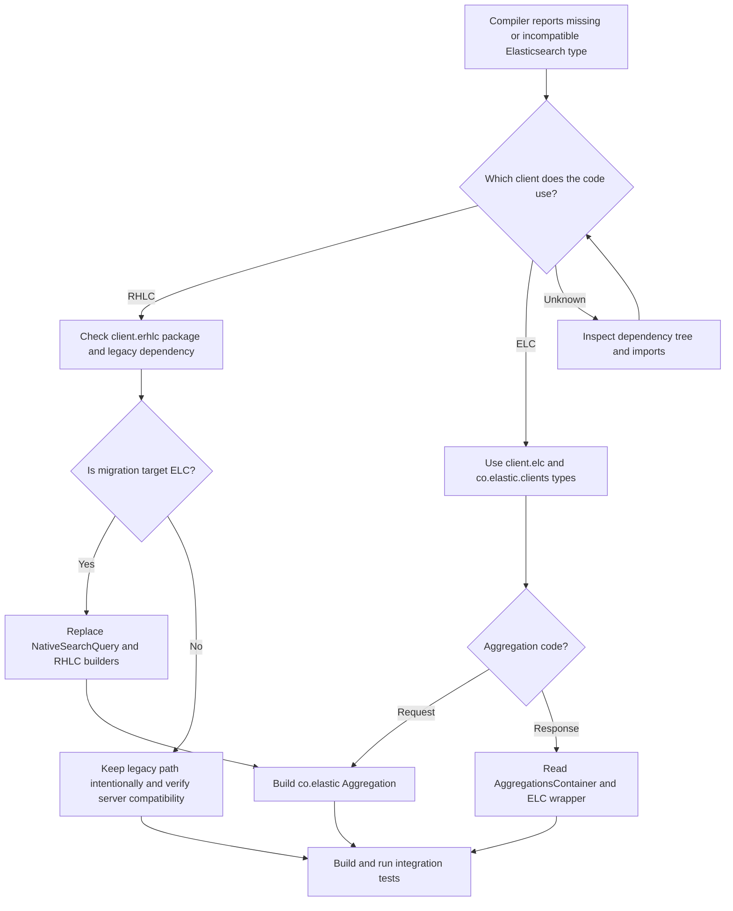

# Checking Package, Builder, and Aggregation Type Changes

When upgrading Spring Data Elasticsearch, compilation errors often surface in places that look like simple import issues: `NativeSearchQueryBuilder` is no longer in the old package, `RestHighLevelClient` has been replaced by the Elasticsearch Java API Client, or `SearchHits.getAggregations()` no longer returns the aggregation type that legacy code casts to. This is a consequence of Spring Data separating client-independent APIs from client-specific implementations.

To upgrade safely, inspect three distinct layers:

1. **Packages and clients:** does the class belong to the shared Spring Data API, the legacy REST High Level Client (RHLC), or the new Elasticsearch Java API Client (ELC)?
2. **Query builders:** does the code build queries using `NativeSearchQueryBuilder` and the legacy Elasticsearch `QueryBuilder`, or `NativeQuery` and Java API Client lambda builders?
3. **Aggregation requests/responses:** do the builder type used to send the aggregation and the object type returned match the same client implementation?

Do not fix imports mechanically one compiler error at a time. Determine the actual Spring Data Elasticsearch version, the active client, and the module's migration direction first, then update packages, builders, and result types accordingly.

## 1. Identify the version before editing code

Spring Data Elasticsearch has multiple API generations. A package change that is valid in 4.4 may be wrong in 5.0; an example using `NativeQuery` may be ELC code in 4.4, whereas 5.x applications use ELC as the default client.

Key milestones:

| Spring Data Elasticsearch Line | Client and Notable Characteristics |
|---|---|
| 4.0–4.2 | Primarily uses the Elasticsearch REST High Level Client; many query/aggregation types come from `org.elasticsearch.*` |
| 4.3 | Begins decoupling several abstractions from the client; aggregation packages and some APIs are adjusted |
| 4.4 | Supports an implementation based on the Elasticsearch Java API Client alongside RHLC; `NativeQuery` appears in `client.elc` |
| 5.0 | New Java client becomes the default direction; RHLC-dependent classes move to `client.erhlc` and are deprecated; new code uses `NativeQuery` |
| 5.1–5.x | Continues refining the ELC API with minor changes to packages, data types, exceptions, and methods |
| 6.x | Continues using the ELC package for the Java API Client; cross-check the exact API/Javadoc of the running major version |

These milestones provide migration orientation, not a complete compatibility table across Spring Boot, Spring Data, Elasticsearch server, and Java. Always consult the version matrix of the release train your project uses.

### 1.1 Check actual dependencies

With Gradle:

```bash
./gradlew dependencyInsight --dependency spring-data-elasticsearch --configuration runtimeClasspath
./gradlew dependencyInsight --dependency elasticsearch-java --configuration runtimeClasspath
./gradlew dependencyInsight --dependency elasticsearch-rest-high-level-client --configuration runtimeClasspath
```

With Maven:

```bash
mvn dependency:tree -Dincludes=org.springframework.data:spring-data-elasticsearch,co.elastic.clients:elasticsearch-java,org.elasticsearch.client:elasticsearch-rest-high-level-client
```

Check both compile and runtime classpaths if the IDE compiles cleanly yet the application fails on startup. Dependencies can be pulled in transitively by starters or other libraries.

### 1.2 Let Spring Boot manage versions via the BOM

If the application uses Spring Boot, you should generally let Spring Boot dependency management choose compatible Spring Data Elasticsearch and client versions. Avoid independently upgrading `spring-data-elasticsearch`, `elasticsearch-java`, or Elasticsearch server client libraries without verifying compatibility.

Gradle example:

```gradle
dependencies {
    implementation("org.springframework.boot:spring-boot-starter-data-elasticsearch")
}
```

If overriding a version is necessary, verify the Spring Data release train, Spring Framework, Java version, and compatible Elasticsearch Java client. Do not include both client generations simultaneously just to make a legacy import compile.

## 2. Distinguish client-independent APIs from client-dependent APIs

Spring Data keeps core abstractions in `org.springframework.data.elasticsearch.core`, for example:

- `ElasticsearchOperations`
- `SearchOperations`
- `SearchHits<T>`
- `SearchHit<T>`
- `IndexOperations`
- `IndexCoordinates`
- `ElasticsearchConverter`
- `AggregationsContainer<T>`

These abstractions keep application code decoupled from a specific client library.

Meanwhile, client-dependent implementations are grouped by package:

| Package | Meaning |
|---|---|
| `org.springframework.data.elasticsearch.client.elc` | Implementation using the Elasticsearch Java API Client (`co.elastic.clients:elasticsearch-java`) |
| `org.springframework.data.elasticsearch.client.erhlc` | Compatibility implementation for the legacy REST High Level Client |
| `org.springframework.data.elasticsearch.core` | Core abstractions and shared components of Spring Data Elasticsearch |
| `org.springframework.data.elasticsearch.core.query` | Shared query abstractions/builders and client-agnostic query implementations |

In application code, prefer injecting abstractions like `ElasticsearchOperations`. Only import implementation/client-specific types when specialized APIs are truly required, such as reading raw aggregation responses or using a native query builder.

## 3. Package changes when moving from 4.4 to 5.0

In 5.0, Spring Data cleanly separated code depending on the legacy REST High Level Client from code using the new Java API Client. Classes using or depending on RHLC were moved into `org.springframework.data.elasticsearch.client.erhlc`.

Examples of legacy imports to review:

| Purpose | Legacy API / RHLC | New API / ELC |
|---|---|---|
| Client | `org.elasticsearch.client.RestHighLevelClient` | `co.elastic.clients.elasticsearch.ElasticsearchClient` |
| Native query | `NativeSearchQuery` | `NativeQuery` |
| Native query builder | `NativeSearchQueryBuilder` | `NativeQuery.builder()` / `NativeQueryBuilder` |
| Elasticsearch aggregation request | `org.elasticsearch.search.aggregations.*` | `co.elastic.clients.elasticsearch._types.aggregations.*` |
| Template implementation | `ElasticsearchRestTemplate` (RHLC) | `ElasticsearchTemplate` (ELC) |
| Configuration base | `client.erhlc.AbstractElasticsearchConfiguration` in RHLC line | `client.elc.ElasticsearchConfiguration` |
| Aggregation response wrapper | `client.erhlc.ElasticsearchAggregations` | `client.elc.ElasticsearchAggregations` |

`ElasticsearchOperations` remains in the core package and is the preferred choice to inject into services. If code injects `ElasticsearchRestTemplate` or `ElasticsearchTemplate` directly, determine which implementation it is before editing imports.

### 3.1 Be careful with the name ElasticsearchTemplate

Earlier versions had an `org.springframework.data.elasticsearch.core.ElasticsearchTemplate` backed by `TransportClient`. That class was removed when Spring Data Elasticsearch 4.4 dropped `TransportClient`.

In the new client line, `ElasticsearchTemplate` is the implementation in `org.springframework.data.elasticsearch.client.elc`. The same simple class name in different documentation or versions does not mean it is the same implementation.

If code injects the template directly, inspect the fully qualified package in imports and constructors. If template-specific APIs are unnecessary, switch to `ElasticsearchOperations` to reduce coupling.

### 3.2 RHLC can still appear in 5.x applications

Spring Data Elasticsearch 5.x retains some RHLC classes in `client.erhlc` as deprecated to ease migration. The existence of this package does not mean it is the default choice for new code.

If a project intentionally stays on RHLC:

- You must declare the RHLC dependency explicitly because Spring Data no longer pulls it in automatically as before.
- You must verify Elasticsearch server compatibility; legacy RHLC targets Elasticsearch 7 clusters primarily.
- Avoid mixing RHLC request/response classes with ELC inside the same query or aggregation pipeline.
- Plan to migrate off deprecated APIs rather than expanding RHLC-dependent code.

## 4. Migrating from NativeSearchQueryBuilder to NativeQuery

The legacy `NativeSearchQueryBuilder` accepts query builders from the old Elasticsearch library, such as `org.elasticsearch.index.query.QueryBuilder`. `NativeQuery` uses query types from the Java API Client, such as `co.elastic.clients.elasticsearch._types.query_dsl.Query`.

This is a builder model change, not just a class rename.

### 4.1 Legacy example with RHLC

4.x/RHLC-style code typically looks like:

```java
import org.elasticsearch.index.query.QueryBuilders;
import org.springframework.data.elasticsearch.core.query.NativeSearchQuery;
import org.springframework.data.elasticsearch.core.query.NativeSearchQueryBuilder;

NativeSearchQuery query = new NativeSearchQueryBuilder()
    .withQuery(
        QueryBuilders.matchQuery("name", "wireless keyboard")
    )
    .withPageable(PageRequest.of(0, 20))
    .build();

SearchHits<Product> hits = operations.search(query, Product.class);
```

`QueryBuilders.matchQuery(...)` constructs an Elasticsearch `QueryBuilder` belonging to the RHLC API. You cannot pass this object into the new `NativeQuery` because the two clients have separate type systems.

### 4.2 New example with ELC

With ELC, use `NativeQuery` and lambda builders:

```java
import co.elastic.clients.elasticsearch._types.query_dsl.Query;
import org.springframework.data.elasticsearch.client.elc.NativeQuery;
import org.springframework.data.elasticsearch.core.SearchHits;

Query nativeQuery = Query.of(q -> q
    .match(m -> m
        .field("name")
        .query("wireless keyboard")
    )
);

NativeQuery query = NativeQuery.builder()
    .withQuery(nativeQuery)
    .withPageable(PageRequest.of(0, 20))
    .build();

SearchHits<Product> hits = operations.search(query, Product.class);
```

You can also write the lambda directly inside `withQuery`:

```java
NativeQuery query = NativeQuery.builder()
    .withQuery(q -> q
        .match(m -> m
            .field("name")
            .query("wireless keyboard")
        )
    )
    .withPageable(PageRequest.of(0, 20))
    .build();
```

Lambda builders are generated APIs from the Elasticsearch Java API Client. Each builder method typically accepts a lambda to configure a child object and returns an `ObjectBuilder<T>`. Do not look for an equivalent `QueryBuilders.matchQuery` method in the old package and try to mix it with ELC.

### 4.3 NativeQuery already existed in 4.4

Spring Data Elasticsearch 4.4 already introduced `NativeQuery` in `org.springframework.data.elasticsearch.client.elc`. At that stage, ELC was a new implementation available alongside RHLC; do not assume all 4.4 applications had already switched clients.

The query class package depends on both version and client:

| Version/Client | Native Query | Builder |
|---|---|---|
| 4.4 with RHLC | `org.springframework.data.elasticsearch.core.query.NativeSearchQuery` | `org.springframework.data.elasticsearch.core.query.NativeSearchQueryBuilder` |
| 4.4 with ELC | `org.springframework.data.elasticsearch.client.elc.NativeQuery` | `org.springframework.data.elasticsearch.client.elc.NativeQueryBuilder` or factory `NativeQuery.builder()` |
| 5.0+ with ELC | `org.springframework.data.elasticsearch.client.elc.NativeQuery` | `NativeQuery.builder()` |
| 5.0+ RHLC compatibility | `org.springframework.data.elasticsearch.client.erhlc.NativeSearchQuery` | `org.springframework.data.elasticsearch.client.erhlc.NativeSearchQueryBuilder` (deprecated) |

In Spring Data Elasticsearch 5.0, RHLC classes moved to `client.erhlc` and were deprecated, while ELC became the default direction. Therefore, during migration:

1. Determine whether code uses `NativeSearchQuery` from RHLC or `NativeQuery` from ELC.
2. Replace all RHLC query builder objects with corresponding ELC types.
3. Verify package imports for `NativeQuery`, `NativeQueryBuilder`, and client configuration.
4. Inspect the final query JSON, especially filters, post-filters, sorting, highlighting, and pagination.

### 4.4 When is NativeQuery unnecessary?

Not every query needs a native builder:

- Use `CriteriaQuery` when conditions are cleanly expressed with the Criteria API.
- Use `StringQuery` if you already have JSON queries and want to keep the Query DSL intact.
- Use repository query methods for simple field-based queries.
- Use `NativeQuery` when complex Elasticsearch features or aggregation DSLs are needed that other abstractions cannot express.

Keeping queries at higher abstractions reduces the number of client-specific packages needing migration.

## 5. How does the builder API change?

The legacy RHLC builder typically uses method chaining:

```java
new NativeSearchQueryBuilder()
    .withQuery(QueryBuilders.matchQuery("name", text))
    .withFilter(QueryBuilders.termQuery("active", true))
    .withSort(SortBuilders.fieldSort("createdAt").order(SortOrder.DESC))
    .build();
```

ELC uses lambda builders:

```java
NativeQuery query = NativeQuery.builder()
    .withQuery(q -> q.bool(b -> b
        .must(m -> m.match(mm -> mm
            .field("name")
            .query(text)
        ))
        .filter(f -> f.term(t -> t
            .field("active")
            .value(true)
        ))
    ))
    .withSort(s -> s.field(f -> f
        .field("createdAt")
        .order(SortOrder.Desc)
    ))
    .withPageable(PageRequest.of(0, 20))
    .build();
```

Enum names, imports, and overloads may vary with the Elasticsearch Java API Client version managed by the Spring Data release train. The example illustrates builder structure; rely on your IDE/Javadoc for the exact dependency to confirm method signatures.

### 5.1 Query and filter are not always equivalent

When migrating builders, preserve filter placement:

- `withQuery(...)` defines the main query.
- `withFilter(...)` in `NativeQuery` configures the search-request-level filter per the Spring Data API.
- Elasticsearch `post_filter` executes after aggregations and has different semantics from a filter inside a `bool` query.

Do not move every legacy `withFilter` into `withQuery` or vice versa without inspecting the query JSON and aggregation semantics. In particular, if aggregations must be computed over the filtered document set, the filter belongs in the query/`bool` filter rather than a post-filter.

### 5.2 Sort, pageable, and source filtering

After migrating builders, verify:

- `withPageable(...)` still bounds page/size accurately.
- Sort fields and order are passed correctly.
- Source filters still restrict `_source` as intended.
- `trackTotalHits`, timeout, routing, preference, and `search_after` are not dropped.
- Queries preserve `minimum_should_match`, boost, nested paths, and scripts.

A query that compiles cleanly does not guarantee it preserves the legacy query's semantics.

## 6. Aggregation requests: changing builder types

Aggregation requests are where client differences stand out clearly.

### 6.1 Aggregation request with RHLC

Terms aggregation example in the legacy API:

```java
import org.elasticsearch.search.aggregations.AggregationBuilders;
import org.springframework.data.elasticsearch.core.query.NativeSearchQuery;
import org.springframework.data.elasticsearch.core.query.NativeSearchQueryBuilder;

NativeSearchQuery query = new NativeSearchQueryBuilder()
    .withQuery(QueryBuilders.matchAllQuery())
    .withAggregations(
        AggregationBuilders.terms("by_category")
            .field("category")
            .size(10)
    )
    .build();
```

`AggregationBuilders` produces types from `org.elasticsearch.search.aggregations.*`. These types are tied to RHLC/Elasticsearch 7 and cannot be used directly in ELC.

### 6.2 Aggregation request with ELC

With the Java API Client:

```java
import co.elastic.clients.elasticsearch._types.aggregations.Aggregation;
import org.springframework.data.elasticsearch.client.elc.NativeQuery;

NativeQuery query = NativeQuery.builder()
    .withQuery(q -> q.matchAll(m -> m))
    .withAggregation("by_category", Aggregation.of(a -> a
        .terms(t -> t
            .field("category")
            .size(10)
        )
    ))
    .build();
```

Key points:

- `Aggregation` in the request example is `co.elastic.clients.elasticsearch._types.aggregations.Aggregation`.
- The aggregation name (`by_category`) is the key used later to retrieve results.
- `field` must match the mapping; terms aggregations on `text` fields usually require a `keyword` subfield.
- The builder uses ELC types, not `AggregationBuilders` from RHLC.

Do not confuse request `co.elastic.clients...Aggregation` with the response wrapper `org.springframework.data.elasticsearch.client.elc.Aggregation`.

## 7. Aggregation responses: AggregationsContainer

In newer Spring Data Elasticsearch versions, `SearchHits.getAggregations()` is designed to return the `AggregationsContainer<?>` abstraction instead of forcing every client to return `org.elasticsearch.search.aggregations.Aggregations`.

This is an important change during migration:

```java
SearchHits<Product> hits = operations.search(query, Product.class);
AggregationsContainer<?> container = hits.getAggregations();
```

Do not cast directly as in legacy RHLC code if the application has moved to ELC:

```java
// Do not use the legacy cast in ELC code:
// org.elasticsearch.search.aggregations.Aggregations aggregations =
//     hits.getAggregations();
```

`AggregationsContainer<T>` is a Spring Data abstraction. The concrete type of `T` depends on the client implementation in use.

### 7.1 ELC response types

For the ELC client, Spring Data provides:

- `org.springframework.data.elasticsearch.client.elc.ElasticsearchAggregations`
- `org.springframework.data.elasticsearch.client.elc.ElasticsearchAggregation`
- `co.elastic.clients.elasticsearch._types.aggregations.Aggregate`

`ElasticsearchAggregations` is the container for the list of ELC aggregations. It provides:

- `aggregations()` to retrieve the list of wrappers.
- `aggregationsAsMap()` to retrieve a map keyed by aggregation name.
- `get(name)` to look up an aggregation by name.

`ElasticsearchAggregation` holds a named aggregation and has an `aggregation()` method returning the `org.springframework.data.elasticsearch.client.elc.Aggregation` wrapper. That wrapper holds the name and the raw ELC `Aggregate`.

Example:

```java
import org.springframework.data.elasticsearch.core.AggregationsContainer;
import org.springframework.data.elasticsearch.client.elc.ElasticsearchAggregations;
import org.springframework.data.elasticsearch.client.elc.ElasticsearchAggregation;

AggregationsContainer<?> container = hits.getAggregations();

if (container instanceof ElasticsearchAggregations aggregations) {
    ElasticsearchAggregation byCategory = aggregations.get("by_category");

    if (byCategory != null) {
        var namedAggregation = byCategory.aggregation();
        var rawAggregate = namedAggregation.getAggregate();
        // Process according to the specific Aggregate variant.
    }
}
```

Check for `null` before accessing an aggregation by name. The response may lack the aggregation if the query omitted it, the aggregation name is wrong, or the API returned nothing for that section.

### 7.2 RHLC response types in 5.x

If the application still uses the RHLC implementation in Spring Data 5.x, the legacy wrapper lives in package:

`org.springframework.data.elasticsearch.client.erhlc.ElasticsearchAggregations`

This wrapper holds `org.elasticsearch.search.aggregations.Aggregations` and is deprecated as of 5.0. Do not use the RHLC wrapper to read responses produced by ELC.

In 4.4, aggregation wrapper packages shifted according to client implementation. Specifically, RHLC classes remained in the core package in 4.4 while ELC had its own wrappers in `client.elc`. When upgrading 4.4 to 5.0, consult the compiler/Javadoc of the target version to update packages accurately.

## 8. Reading Aggregate types in the Elasticsearch Java API Client

Unlike RHLC, the Java API Client represents aggregation results via the tagged union `Aggregate`. It is an object with many variants: terms, range, histogram, date histogram, stats, sum, average, cardinality, top hits, and more.

You cannot treat every aggregation response as a generic `Terms` object as legacy RHLC code often did. Before extracting data, inspect the actual variant.

### 8.1 Reading a string terms aggregation

```java
import co.elastic.clients.elasticsearch._types.aggregations.Aggregate;
import co.elastic.clients.elasticsearch._types.aggregations.StringTermsBucket;

if (rawAggregate.isSterms()) {
    for (StringTermsBucket bucket : rawAggregate.sterms().buckets().array()) {
        String category = bucket.key().stringValue();
        long documentCount = bucket.docCount();

        System.out.println(category + ": " + documentCount);
    }
}
```

In the new Java API Client, `Aggregate` provides variant-checking methods like `isSterms()` and accessors like `sterms()`. An accessor throws an exception if called on the wrong variant, so check first.

### 8.2 Other terms variants

The field type determines the aggregate response variant:

| Field/Aggregation | Common Variant in Java API Client |
|---|---|
| Terms on keyword/string | `sterms()` |
| Terms on long | `lterms()` |
| Terms on double | `dterms()` |
| Significant string terms | `sigsterms()` |
| Significant long terms | `siglterms()` |

Do not cast an `Aggregate` to `StringTermsAggregate` if the underlying field is numeric. Use the appropriate variant and read keys with the matching type.

### 8.3 Reading metric aggregations

Sum aggregation example:

```java
if (rawAggregate.isSum()) {
    double totalPrice = rawAggregate.sum().value();
}
```

Stats aggregation example:

```java
if (rawAggregate.isStats()) {
    var stats = rawAggregate.stats();

    double min = stats.min();
    double max = stats.max();
    double average = stats.avg();
    double sum = stats.sum();
    long count = stats.count();
}
```

`Aggregate` is a tagged union. Each variant has its own response class and accessor set. For nested aggregations, buckets themselves contain `aggregations()`; continue reading the corresponding wrapper/variant rather than assuming a single flat level.

## 9. Complete example: terms aggregation with ELC

The following example searches products by name and aggregates document counts by category:

```java
import co.elastic.clients.elasticsearch._types.aggregations.Aggregate;
import co.elastic.clients.elasticsearch._types.aggregations.Aggregation;
import co.elastic.clients.elasticsearch._types.aggregations.StringTermsBucket;
import org.springframework.data.elasticsearch.client.elc.ElasticsearchAggregation;
import org.springframework.data.elasticsearch.client.elc.ElasticsearchAggregations;
import org.springframework.data.elasticsearch.client.elc.NativeQuery;
import org.springframework.data.elasticsearch.core.SearchHits;

NativeQuery query = NativeQuery.builder()
    .withQuery(q -> q.match(m -> m
        .field("name")
        .query("keyboard")
    ))
    .withAggregation("by_category", Aggregation.of(a -> a
        .terms(t -> t
            .field("category")
            .size(10)
        )
    ))
    .build();

SearchHits<Product> hits = operations.search(query, Product.class);

if (hits.hasAggregations()
        && hits.getAggregations() instanceof ElasticsearchAggregations aggregations) {

    ElasticsearchAggregation wrapper = aggregations.get("by_category");

    if (wrapper != null) {
        Aggregate aggregate = wrapper.aggregation().getAggregate();

        if (aggregate.isSterms()) {
            for (StringTermsBucket bucket : aggregate.sterms().buckets().array()) {
                String category = bucket.key().stringValue();
                long count = bucket.docCount();
                System.out.printf("%s: %d%n", category, count);
            }
        }
    }
}
```

The `Aggregation` import in the example is the Elasticsearch Java API Client class. If your IDE auto-imports `org.springframework.data.elasticsearch.client.elc.Aggregation` for the request builder, fix it: that is the response wrapper sharing the same simple name.

### 9.1 When an aggregation returns no buckets

If the code runs yet returns no buckets:

- Check whether the field has an appropriate `keyword`/numeric mapping.
- Check whether the main query filters out all documents.
- Check the aggregation name in `get("by_category")`.
- Check whether the aggregation response uses the right variant.
- Check whether the field values are actually indexed rather than existing only in `_source`.

If the aggregation is nested or composite, response types and bucket extraction differ from standard terms aggregations.

## 10. Aggregation package changes across phases

Aggregation packages changed while Spring Data was separating client implementations. Do not take a single package name from an old blog post and apply it to every version.

| Phase | Wrapper/Response to Recognize |
|---|---|
| 4.3 | `ElasticsearchAggregations` and `ElasticsearchAggregation` moved into `core.clients.elasticsearch7` while preparing multi-client support |
| 4.4 RHLC | RHLC classes were placed back in `org.springframework.data.elasticsearch.core` |
| 4.4 ELC | Dedicated wrappers appeared in `org.springframework.data.elasticsearch.client.elc` |
| 5.0+ RHLC compatibility | Legacy classes moved to `org.springframework.data.elasticsearch.client.erhlc`, deprecated |
| 5.0+ ELC | Uses `org.springframework.data.elasticsearch.client.elc.ElasticsearchAggregations` and `ElasticsearchAggregation` |

`SearchHits.getAggregations()` returns `AggregationsContainer<?>` from the Spring Data API. Keep application code on the abstraction type until raw responses actually need to be read; only then check/cast to the specific implementation.

## 11. Other changes commonly appearing alongside migration

Beyond packages, builders, and aggregations, the 4.4 → 5.0 migration includes several changes that frequently break legacy compilation:

### 11.1 HttpHeaders

Client configuration previously used:

```java
import org.springframework.http.HttpHeaders;
```

In 5.0, Spring Data Elasticsearch introduced its own class:

```java
import org.springframework.data.elasticsearch.support.HttpHeaders;
```

If configuring headers directly, check imports. The Spring Data class can accept Spring Web headers via `addAll(...)`.

### 11.2 Record accessors instead of getters

Several classes were converted to Java records, changing accessors from `getProp()` to `prop()`. For example, types like `SeqNoPrimaryTerm`, `ScriptData`, `Version`, or `ScoreDoc` may require updating accessor calls.

Do not blindly replace every `get...()` with `...()` by guesswork. Only update types converted to records in the target version's Javadoc.

### 11.3 Query SearchType and VersionType

Several enums moved into Spring Data abstractions:

- `Query.SearchType`
- `Document.VersionType`

If code imports enums from legacy Elasticsearch core, check the new types in Spring Data annotations/interfaces.

### 11.4 IndicesOptions

Spring Data uses `org.springframework.data.elasticsearch.core.query.IndicesOptions` instead of `org.elasticsearch.action.support.IndicesOptions` in related APIs. This further keeps RHLC types out of core abstractions.

### 11.5 RuntimeField and ScriptType in 5.2

In Spring Data Elasticsearch 5.2, `RuntimeField` and `ScriptType` moved to `org.springframework.data.elasticsearch.core.query`. When upgrading minor versions, check these imports if the IDE reports the old package is invalid.

### 11.6 Range in 5.2

`org.springframework.data.elasticsearch.core.Range` was removed; use `org.springframework.data.domain.Range` instead.

### 11.7 BulkFailureException

In 5.2, `BulkFailureException.getFailedDocuments()` changed from `Map<String, String>` to `Map<String, FailureDetails>`. If code reads error messages as `String`, update it to read status and `errorMessage` from `FailureDetails`.

These changes are not directly queries/aggregations, yet they commonly surface during the same upgrade and should be searched for before building.

## 12. How to locate imports needing migration

Before editing, search for all occurrences of legacy clients and builders:

```bash
rg -n "NativeSearchQuery|NativeSearchQueryBuilder|NativeQuery|AggregationBuilders|AggregationsContainer|ElasticsearchAggregations|RestHighLevelClient|ElasticsearchClient|IndicesOptions|HttpHeaders|ScriptType|RuntimeField" src
```

Then group the matches:

| Match Group | Action |
|---|---|
| `NativeSearchQueryBuilder`, `QueryBuilders` | Determine RHLC vs. ELC; migrate builders if moving to ELC |
| `org.elasticsearch.search.aggregations.*` | Replace with ELC aggregation request/response types if dropping RHLC |
| `RestHighLevelClient` | Migrate client/configuration or retain legacy intentionally |
| `ElasticsearchRestTemplate` | Identify implementation/package and consider `ElasticsearchOperations` |
| `SearchHits.getAggregations()` | Move to `AggregationsContainer<?>` and client-specific wrapper |
| `org.springframework.http.HttpHeaders` | Check whether header config needs the new Spring Data `HttpHeaders` |
| `IndicesOptions`, `RuntimeField`, `ScriptType`, `Range` | Verify replacement package/type per release |

Do not refactor in bulk based on name strings alone. For instance, `NativeQuery` and `NativeSearchQuery` can validly coexist in a 4.4 app using both clients; inspect the actual class imports.

## 13. Verifying APIs in the IDE and Javadoc

When unsure where a class resides:

1. Use Go to Declaration on the class in the IDE.
2. Check the fully qualified name in auto-import.
3. Open External Libraries/Gradle dependencies to confirm the jar version.
4. Cross-check the version-specific Javadoc, not just the `current` page.
5. Read the package summary to see whether the implementation uses ELC or RHLC.
6. Inspect constructors, method return types, and generic parameters of the aggregation container.

Classes sharing the same simple name in two different packages can have completely different semantics. For example, `Aggregation` in `co.elastic.clients...` is a request definition, whereas `Aggregation` in `org.springframework.data.elasticsearch.client.elc` is a named response wrapper.

### 13.1 Prefer versioned API docs

When upgrading 4.4 to 5.0, use 5.0.x API docs to check packages and methods. When upgrading 5.1 to 5.2, read the 5.1 → 5.2 migration guide. When using 6.x, open the corresponding 6.x Javadoc.

The `current` page helps show today's API, but it does not prove a class existed in the version your project is upgrading to.

## 14. Controlled migration workflow

A practical workflow:

1. Record the current Spring Boot, Spring Data Elasticsearch, Elasticsearch server, and Java versions.
2. Inspect the dependency tree to identify RHLC/ELC and actual resolved versions.
3. Choose the target release train from the compatibility matrix.
4. Find all imports of `NativeSearchQuery*`, `RestHighLevelClient`, aggregation builders, and aggregation response classes.
5. Decide whether to keep RHLC temporarily or migrate fully to ELC.
6. If moving to ELC, replace client configuration and native query builders.
7. Migrate aggregation requests to `co.elastic.clients...Aggregation`.
8. Migrate aggregation responses to `AggregationsContainer<?>` and ELC wrappers.
9. Review other minor-version changes such as `HttpHeaders`, `IndicesOptions`, record accessors, `Range`, and `RuntimeField`.
10. Build to catch compile errors, then run integration tests against a compatible Elasticsearch version.
11. Compare query JSON, aggregation results, and behavior before/after migration.
12. Remove unused RHLC dependencies/imports.

## 15. Common mistakes when changing packages and builders

### 15.1 Only changing imports while keeping old QueryBuilder

`NativeQuery` does not accept `org.elasticsearch.index.query.QueryBuilder`. You must construct `co.elastic.clients.elasticsearch._types.query_dsl.Query` using the new builder.

### 15.2 Mixing two clients in one aggregation

Do not pass RHLC's `AggregationBuilders.terms(...)` into ELC's `NativeQuery.withAggregation(...)`. One is `AbstractAggregationBuilder<?>`, while the other is ELC `Aggregation`.

### 15.3 Casting aggregation responses to RHLC

`SearchHits.getAggregations()` returns an abstraction. If the implementation is ELC, casting to `org.elasticsearch.search.aggregations.Aggregations` will fail. Check the client-specific wrapper first.

### 15.4 Importing the wrong Aggregation class

`co.elastic.clients.elasticsearch._types.aggregations.Aggregation` builds requests. `org.springframework.data.elasticsearch.client.elc.Aggregation` wraps responses. Use explicit imports and verify which class the IDE picks.

### 15.5 Assuming every aggregation is a terms aggregation

`Aggregate` is a tagged union. Check `isSterms()`, `isStats()`, `isSum()`, or the matching variant before calling accessors.

### 15.6 Migrating builders while dropping post_filter

Filters inside a query versus `post_filter` can yield different aggregation results. Preserve filter placement when migrating builders.

### 15.7 Using packages from current Javadoc for older dependencies

Packages may have moved in minor/major releases. Open the Javadoc matching your exact version and check resolved dependencies.

### 15.8 Upgrading the client independently of Spring Data

Spring Data Elasticsearch manages compatibility with the Java API Client. Overriding the client version independently can cause `NoSuchMethodError`, serialization failures, or compile mismatches.

### 15.9 Assuming ElasticsearchOperations also changed packages

Core abstractions remain in `org.springframework.data.elasticsearch.core`. Usually only implementation/client-specific classes change packages.

## 16. Post-migration verification checklist

### Dependencies and client

- [ ] Spring Boot and Spring Data Elasticsearch belong to a compatible release train.
- [ ] Runtime client is confirmed as ELC or RHLC.
- [ ] No unintended RHLC dependencies remain.
- [ ] Elasticsearch server version is compatible with the client.
- [ ] Client version is not overridden without verification.

### Packages and builders

- [ ] `NativeQuery` is imported from `client.elc` when using ELC.
- [ ] Query builders use `co.elastic.clients` types, not RHLC `QueryBuilder`.
- [ ] Legacy `NativeSearchQuery*` is kept in RHLC packages only when compatibility is required.
- [ ] Templates/configurations import the right implementation.
- [ ] Core abstractions such as `ElasticsearchOperations` are still used where appropriate.

### Aggregations

- [ ] Aggregation requests use builders matching the active client.
- [ ] `SearchHits.getAggregations()` is read via `AggregationsContainer<?>`.
- [ ] Response wrappers are cast to the right ELC/RHLC type.
- [ ] Aggregation names match the exact keys.
- [ ] `Aggregate` variants are checked before reading.
- [ ] Terms key/bucket types match string, long, or double.
- [ ] Nested aggregations are read at the right level.
- [ ] Filter/query semantics preserve aggregation results.

### Testing

- [ ] Build compiles cleanly.
- [ ] Repository queries preserve previous semantics.
- [ ] Terms, metric, and nested aggregations return accurate results.
- [ ] Pagination/sorting/highlighting/filtering are preserved.
- [ ] Integration tests run against a compatible Elasticsearch server.
- [ ] Verification goes beyond compilation to cover runtime deserialization.

## 17. Decision flowchart for compile errors



## 18. Implementation principles

- Determine version and client before editing packages.
- Let the Spring Boot BOM manage Spring Data/client versions whenever possible.
- Use `ElasticsearchOperations` and `SearchHits` to keep code on shared abstractions.
- Use `NativeQuery` for ELC, and `NativeSearchQuery` only when still on the corresponding RHLC line.
- Never pass RHLC query/aggregation builders into ELC APIs.
- Use `AggregationsContainer<?>` as the response abstraction type.
- Cast to `client.elc.ElasticsearchAggregations` when responses come from ELC.
- Read `Aggregate` by variant rather than forcing every result to be terms.
- Check packages per version; do not apply `current` documentation packages backward.
- Compare query semantics and aggregation outputs after migration rather than stopping at a green build.

## 19. Summary

Package, builder, and aggregation changes in Spring Data Elasticsearch reflect the transition from the REST High Level Client to the Elasticsearch Java API Client. Version 4.4 provided both implementations side by side; starting in 5.0, ELC became the default direction and RHLC code moved into `client.erhlc` as deprecated. `NativeSearchQueryBuilder` uses query types from the legacy client, whereas `NativeQuery` uses lambda builders and types from `co.elastic.clients`.

Aggregations changed on both the request and response sides. ELC requests use `co.elastic.clients...Aggregation`; responses are wrapped in `AggregationsContainer<?>`, specifically `client.elc.ElasticsearchAggregations` and `ElasticsearchAggregation`. The raw `Aggregate` is a tagged union, so variant checks such as `isSterms()` or `isStats()` must precede data extraction. This is a common source of runtime failures if imports are simply changed to make code compile.

A clean migration begins with the dependency tree and version-accurate Javadoc, classifies shared/ELC/RHLC code, migrates builders and aggregations to match the chosen client, and verifies both compilation and integration behavior. Whenever possible, keep application code on `ElasticsearchOperations` and Spring Data abstractions to minimize changes in future upgrades.

## References

- [Spring Data Elasticsearch — Upgrading from 4.4.x to 5.0.x](https://docs.spring.io/spring-data/elasticsearch/reference/migration-guides/migration-guide-4.4-5.0.html)
- [Spring Data Elasticsearch 5.0 — NativeQuery and Elasticsearch Operations](https://docs.spring.io/spring-data/elasticsearch/docs/5.0.x/reference/html/)
- [Spring Data Elasticsearch 4.4 — NativeSearchQuery and NativeQuery API](https://docs.spring.io/spring-data/elasticsearch/docs/4.4.x/api/)
- [Spring Data Elasticsearch 5.5 — ElasticsearchAggregations API](https://docs.spring.io/spring-data/elasticsearch/reference/5.5/api/java/org/springframework/data/elasticsearch/client/elc/ElasticsearchAggregations.html)
- [Spring Data Elasticsearch 5.5 — ElasticsearchAggregation API](https://docs.spring.io/spring-data/elasticsearch/reference/5.5/api/java/org/springframework/data/elasticsearch/client/elc/ElasticsearchAggregation.html)
- [Spring Data Elasticsearch — Upgrading from 5.1.x to 5.2.x](https://docs.spring.io/spring-data/elasticsearch/reference/migration-guides/migration-guide-5.1-5.2.html)
- [Elasticsearch Java API Client — Aggregate API](https://artifacts.elastic.co/javadoc/co/elastic/clients/elasticsearch-java/8.19.19/co/elastic/clients/elasticsearch/_types/aggregations/Aggregate.html)
- [Elasticsearch Java API Client — StringTermsAggregate API](https://artifacts.elastic.co/javadoc/co/elastic/clients/elasticsearch-java/8.19.19/co/elastic/clients/elasticsearch/_types/aggregations/StringTermsAggregate.html)
