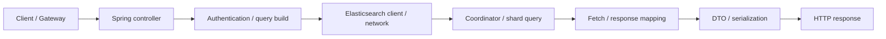
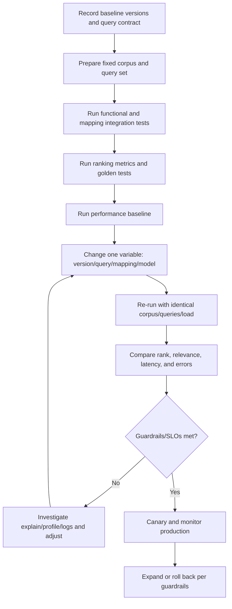

# Regression Testing Queries, Ranking Scores, and Performance

Upgrading Elasticsearch, Lucene, Spring Data Elasticsearch, analyzers, mappings, or ranking models can alter search results even when application code stays unchanged. A query may still succeed and return HTTP 200 yet produce different document ordering, changed total hit counts, altered aggregations, or noticeably higher latency. Consequently, search regression testing must evaluate **functional correctness**, **ranking quality**, and **performance targets** together.

A strong regression test suite does not simply snapshot an entire JSON response and compare it verbatim. It defines what the product actually guarantees: which documents must appear, within which top-K positions key documents must rank, whether filters/tenants are strictly enforced, whether total hits must be exact, which aggregations must remain stable, and under what load conditions latency is measured.

In Spring Data Elasticsearch, queries can be tested across multiple layers: unit tests for query builders and business rules, integration tests against real Elasticsearch for mapping/query semantics, relevance tests with labeled query sets, and benchmarks/load tests for latency/throughput. These layers complement one another; a passing repository test does not prove good ranking or that production latency meets SLOs.

## 1. Why is regression testing needed for search?

Search behavior can shift due to many factors:

- Upgrading Elasticsearch or Lucene can change implementations, scoring details, or execution plans.
- Upgrading Spring Data Elasticsearch can change converters, query serialization, default parameters, or generated mapping metadata.
- Changing analyzers, tokenizers, synonyms, or normalizers alters generated tokens and match sets.
- Changing a field mapping from `text` to `keyword`, adding multi-fields, or adding nested paths changes query semantics.
- Changing query clauses, boosts, `minimum_should_match`, fuzziness, or function scores changes ranking order.
- Changing shard counts, replicas, routing, or refresh behavior can affect execution and latency.
- Changing embedding models, vector dimensions, ANN parameters, or hybrid fusion alters semantic ranking.
- Changing dataset size, term distributions, or concurrency shifts latency away from baseline.

A change can improve one dimension while degrading another. For example, adding fuzzy matching can boost recall while increasing latency and introducing noisy results into the top 10. Increasing `num_candidates` can improve approximate kNN recall while making queries more resource-intensive.

## 2. Distinguishing types of regression tests

| Test Type | Primary Question | Typical Tools/Methods |
|---|---|---|
| Query construction test | Does the app build the expected query/filter/sort/boost? | Unit tests, inspecting request objects/JSON |
| Mapping integration test | Are mappings and analyzers on the cluster accurate? | Testcontainers, `IndexOperations`, mapping APIs |
| Functional search test | Do matching documents appear and filters apply properly? | Elasticsearch integration tests |
| Ranking/relevance test | Do relevant results rank in appropriate positions? | Golden query sets, relevance judgments, NDCG/MRR |
| Score diagnostic test | Why did a document receive a specific score? | `_explain`, Profile API, score inspection |
| Performance benchmark | Did latency/throughput/resource usage change? | Elasticsearch Rally, load tests, Micrometer |
| Upgrade compatibility test | Does the new stack uphold application contracts? | Version matrix, CI upgrade suite, canary |

Never substitute one test type for all of them. Unit tests prove a query builder adds a tenant filter, whereas only integration tests confirm the server applies field mappings/analyzers as expected. Relevance tests measure ranking quality on labeled queries.

## 3. Defining the search contract before writing tests

A query test should specify what constitutes correctness. Avoid asserting only "query returns 10 results" when the product depends on a specific order or result set.

For each use case, specify:

- Query text and language.
- Index/alias and schema version.
- Tenant/owner/ACL scope.
- Mandatory filters such as status, category, date, or availability.
- Sort, tie-breakers, and page size.
- Documents that must appear or must be excluded.
- Which documents must rank in top 1 / top 3 / top 10.
- Whether exact total hits are required or a lower bound suffices.
- Which aggregations/buckets form part of the API contract.
- Whether search accepts partial results or requires completeness.
- Latency SLO by percentile and load conditions.

Example contract for a catalog:

| Scenario | Functional Expectation | Ranking Expectation |
|---|---|---|
| Exact SKU search | Matching SKU product gets highest priority | Exact SKU must be at position 1 |
| Product name search | Products with matching names appear | Exact phrase ranks ahead of weaker matches |
| Synonym search | Products using synonyms are still found | More exact matches still rank higher |
| In-stock filter | Out-of-stock items excluded when filter is required | Never trade off filters for higher scores |
| Tenant A | Never return Tenant B documents | This is a correctness/security contract, not a negotiable relevance metric |
| Zero results | Return zero hits per contract | Never return irrelevant items just to avoid an empty list |

## 4. Building a stable test corpus

A corpus is the document set used to verify search. It should be small enough to run frequently yet representative enough to catch meaningful regressions.

A good corpus should contain:

- Exact-match documents and partial-match documents.
- Nearly identical documents to test ranking ties.
- Synonyms, spelling variations, Vietnamese diacritics, and abbreviations if supported by the product.
- Missing/`null`/empty fields and boundary values.
- Business states such as ACTIVE/INACTIVE, in-stock/out-of-stock.
- Documents across multiple tenants/owners to test security filters.
- Dates before, on, and after range boundaries.
- Documents with identical scores or sort values to verify tie-breakers.
- Cases yielding zero results.

Fixtures should use deterministic IDs and timestamps. Do not populate a corpus with `Instant.now()` or unseeded random data when tests compare exact results.

Example fixture documents:

```json
{ "id": "P-001", "sku": "WH-100", "name": "Wireless Headphones", "status": "ACTIVE", "tenantId": "A" }
{ "id": "P-002", "sku": "WH-101", "name": "Noise Cancelling Headset", "status": "ACTIVE", "tenantId": "A" }
{ "id": "P-003", "sku": "KB-200", "name": "Wireless Keyboard", "status": "ACTIVE", "tenantId": "A" }
{ "id": "P-004", "sku": "WH-102", "name": "Wireless Headphones", "status": "INACTIVE", "tenantId": "A" }
{ "id": "P-005", "sku": "WH-103", "name": "Wireless Headphones", "status": "ACTIVE", "tenantId": "B" }
```

This small corpus exercises exact phrase matching, semantic/synonym matching, status filtering, and tenant boundaries. Large performance datasets should be managed separately; do not draw production throughput conclusions from a handful of documents.

## 5. Creating a query set and relevance judgments

A query set is a representative list of queries. Each query needs an evaluation goal and relevance labels for a set of documents.

Example:

| Query ID | Query | Goal |
|---|---|---|
| Q-001 | `WH-100` | Exact SKU |
| Q-002 | `wireless headphones` | Full-text name search |
| Q-003 | `tai nghe chống ồn` | Language/synonyms |
| Q-004 | `wireless` + `status=ACTIVE` | Text combined with filter |
| Q-005 | `nonexistent item xyz` | Zero-result behavior |
| Q-006 | `wireless headphones` + tenant A | Tenant scoping |

Relevance judgments can use a graded scale:

| Grade | Meaning |
|---:|---|
| 0 | Irrelevant |
| 1 | Partially relevant |
| 2 | Relevant |
| 3 | Highly relevant / exact primary intent |

Labels should follow consistent annotation guidelines. When multiple annotators are involved, establish tie-breaking rules and review critical queries. Do not treat raw clicks alone as ground truth, since clicks suffer from position bias, UI layout, and traffic source effects.

Keep query sets and judgments versioned. When changing analyzers or ranking, evaluate against the exact same corpus/queries/judgments so you know where changes actually originate.

## 6. Measuring ranking quality with metrics

### 6.1. Precision@k

Precision@k measures the fraction of relevant results in the top k:

\[
Precision@k = \frac{\text{relevant hits in top k}}{k}
\]

If 4 out of the top 5 documents are relevant, Precision@5 is 0.8. This metric helps when initial results must contain minimal noise.

### 6.2. Recall@k

Recall@k measures the fraction of all known relevant documents retrieved in the top k:

\[
Recall@k = \frac{\text{relevant hits in top k}}{\text{all known relevant documents}}
\]

Recall matters when users need to find comprehensive matches, such as knowledge bases or reference catalogs.

### 6.3. Mean Reciprocal Rank (MRR)

MRR focuses on the rank of the first relevant result. If the first relevant result is at rank 1, reciprocal rank is 1; if at rank 4, it is 0.25. MRR averages this across queries.

This metric is well suited when users typically only need the single top result.

### 6.4. NDCG@k

NDCG@k evaluates ordering across multi-level relevance grades. A grade-3 result near the top contributes more than a grade-1 result lower down. This metric fits scenarios where quality is graded rather than binary.

### 6.5. Complementary product metrics

Also track zero-result rate, query reformulation, click-through by position, search-to-conversion, abandonment, and task completion. Online metrics must be interpreted alongside UI changes, traffic shifts, and price/inventory changes; they do not replace offline relevance judgments.

## 7. Why should you not compare `_score` by absolute value?

Elasticsearch `_score` is a relative ranking score produced by the query/scoring model. It is valuable for ordering hits and diagnostics, yet rarely forms a stable contract across versions.

Scores can change when:

- Lucene changes scoring implementations or details.
- BM25 parameters or similarity configurations change.
- Document counts, term frequencies, or document frequencies change.
- Shard topology or corpus distribution differs.
- Analyzers/tokenization change.
- Query rewrites, boosts, or clauses change.
- Script/function scores or vector similarities change.
- Candidate sets in approximate kNN differ.

For example, document A scoring `8.2` in one version and `7.6` in another does not automatically mean relevance dropped. If A still ranks 1st and relevant items stay in the top 5, user experience may be identical. Conversely, scores could stay nearly constant while critical document ordering flips.

Therefore:

- Prefer asserting document IDs, ranking order, and relevance metrics.
- Assert absolute scores only for specific reasons in tightly controlled environments.
- If scores must be checked, use tolerance rather than exact equality and document the exact version/corpus/configuration.
- Do not expose raw `_score` in public API contracts unless clients have a genuine business need.

## 8. Verifying ranking with golden tests

Golden tests store a query set and expected result behaviors without necessarily locking entire hit payloads byte-for-byte.

A test can assert:

- Exact-match document ranks first.
- Relevant documents appear within the top 5.
- INACTIVE documents are excluded when the ACTIVE filter applies.
- Tenant B documents never appear in Tenant A queries.
- Zero-result queries return empty hits.
- Sort tie-breakers enforce deterministic order when scores tie.

Example test with Spring Data:

```java
@Test
void exactSkuMustRankFirst() {
    Query query = NativeQuery.builder()
        .withQuery(q -> q
            .bool(b -> b
                .should(s -> s.term(t -> t
                    .field("sku")
                    .value("WH-100")
                    .boost(10.0f)
                ))
                .should(s -> s.match(m -> m
                    .field("name")
                    .query("WH-100")
                ))
                .minimumShouldMatch("1")
            )
        )
        .withMaxResults(5)
        .build();

    SearchHits<ProductDocument> hits = operations.search(
        query,
        ProductDocument.class,
        IndexCoordinates.of("products-test")
    );

    assertThat(hits.getSearchHits()).isNotEmpty();
    assertThat(hits.getSearchHits().get(0).getId()).isEqualTo("P-001");
}
```

The example assumes `sku` is mapped as `keyword`, `name` as `text`, and fixtures are seeded and refreshed. Query builder signatures may vary by Spring Data/Java API Client release; tests should use your project's dependency APIs.

### 8.1. Checking result sets when order is not part of the contract

If an API guarantees only membership, do not assert list order:

```java
Set<String> actualIds = hits.getSearchHits().stream()
    .map(SearchHit::getId)
    .collect(Collectors.toSet());

assertThat(actualIds).containsExactlyInAnyOrder("P-001", "P-002");
```

### 8.2. Checking top-k when order matters

When the product requires ranking, extract ordered IDs and assert key constraints:

```java
List<String> rankedIds = hits.getSearchHits().stream()
    .map(SearchHit::getId)
    .toList();

assertThat(rankedIds).startsWith("P-001");
assertThat(rankedIds.subList(0, Math.min(3, rankedIds.size())))
    .contains("P-002");
```

Avoid asserting exact ordering across every lower position if lower ranks are not part of the product contract. Multiple documents may tie or rank comparably; tests should lock only meaningful invariants.

## 9. Checking scores with tolerance when truly needed

If scores are needed for diagnostics, use a delta tolerance:

```java
float actualScore = hits.getSearchHits().get(0).getScore();

assertThat(actualScore)
    .isCloseTo(expectedScore, within(0.5f));
```

Do not pick an arbitrary tolerance. First verify:

- Are server/Lucene versions pinned?
- Are corpus and document frequencies fixed?
- Are shard counts and query semantics fixed?
- Did analyzers, similarities, or queries change?
- Is the score used for business logic or purely diagnostics?

Without those guarantees, asserting absolute scores causes flaky tests and false regressions. Prefer rank constraints and NDCG/MRR over a query set.

## 10. Using `_explain` to understand why a document ranked where it did

When a document unexpectedly rises or drops in rank, `_explain` reveals how query clauses contributed to its score:

```http
GET products-test/_explain/P-001
{
  "query": {
    "bool": {
      "should": [
        { "term": { "sku": { "value": "WH-100", "boost": 10 } } },
        { "match": { "name": "wireless headphones" } }
      ],
      "minimum_should_match": 1
    }
  }
}
```

The explain response shows whether the document matched and how each scoring component contributed. It is an investigative tool for specific queries/documents, not a routine latency benchmarking tool.

When comparing two versions, save explain output for key queries as diagnostic artifacts. You do not need to snapshot-compare full explain JSON, as internal details can change across Lucene versions.

## 11. Using the Profile API to investigate slow queries

The Profile API breaks down query execution time per shard:

```http
GET products-test/_search
{
  "profile": true,
  "query": {
    "bool": {
      "must": [
        { "match": { "name": "wireless headphones" } }
      ],
      "filter": [
        { "term": { "status": "ACTIVE" } }
      ]
    }
  }
}
```

Profiling pinpoints expensive clauses or collectors. It incurs overhead and does not perfectly reflect end-to-end latency. Never enable profiling on all production requests.

Diagnostic workflow:

1. Use latency metrics to identify slow queries.
2. Capture the exact query and corresponding data/corpus.
3. Run Profile in a controlled environment.
4. Inspect expensive clauses, shards, and collectors.
5. Change one variable at a time such as filters, sorting, aggregations, or analyzers.
6. Re-run relevance and latency benchmarks.

## 12. Checking total hits, partial results, and aggregations

Regression tests must distinguish page size, total hits, and response completeness.

Conditions to assert:

- `hits.total.relation` is `eq` or `gte` per contract.
- `track_total_hits` is configured appropriately for exact count needs.
- `timed_out` is `false` when the endpoint requires completion.
- `_shards.failed` equals `0` when completeness is required.
- `terminated_early` is `false` unless early termination is acceptable.
- Cross-cluster metadata has no failed/partial required clusters.
- Aggregation error bounds and bucket limits meet requirements.

An HTTP 200 response does not prove results are complete. Do not let regression tests assert only that `SearchHits` has elements while ignoring shard failures or timeouts.

## 13. Testing mappings and analyzers during upgrades

Before running ranking tests, verify the corpus was indexed under the expected mapping.

Useful assertions:

- `keyword` fields are used for exact match/sort/aggregations.
- `text` fields use the intended analyzer.
- Multi-fields such as `name.keyword` exist.
- Date formats and timezones are parsed as expected.
- `nested` queries preserve correlation across child fields.
- Synonym/analyzer outputs did not shift unexpectedly.
- Dynamic mapping did not create unexpected field types.

Inspect mappings:

```http
GET products-test/_mapping
```

And test analyzers:

```http
POST products-test/_analyze
{
  "field": "name",
  "text": "Tai nghe chống ồn"
}
```

When upgrading Elasticsearch/Lucene, re-run analyzer tests on domain-specific terms. Tokenization changes can alter match sets and rankings even when query JSON stays identical.

## 14. Setting up integration tests with Testcontainers

Testcontainers runs a pinned version of real Elasticsearch in CI. A test can create a dedicated index, apply explicit mappings, seed deterministic fixtures, and refresh before searching.

Example structure:

```java
@Testcontainers
@SpringBootTest
class ProductSearchRegressionTest {

    @Container
    static final ElasticsearchContainer elasticsearch =
        new ElasticsearchContainer(
            "docker.elastic.co/elasticsearch/elasticsearch:8.15.0"
        );

    @DynamicPropertySource
    static void properties(DynamicPropertyRegistry registry) {
        registry.add("spring.elasticsearch.uris", elasticsearch::getHttpHostAddress);
    }

    @Autowired
    ElasticsearchOperations operations;

    @BeforeEach
    void setUp() {
        IndexOperations index = operations.indexOps(ProductDocument.class);
        if (index.exists()) {
            index.delete();
        }
        index.createWithMapping();
        seedDeterministicFixtures();
        index.refresh();
    }
}
```

This is an illustrative skeleton. Choose an image version compatible with your project's Spring Data/Java API Client and configure security/TLS to match the container. Never run tests against production indexes. If tests run in parallel, isolate each worker with its own index or container/cluster.

### 14.1. Do not use `Thread.sleep()` to wait for refresh

After seeding fixtures, call `IndexOperations.refresh()` or use an appropriate refresh policy. Sleeping for one second does not guarantee a refresh occurred and makes tests slow and flaky.

### 14.2. Sorting must be deterministic

Elasticsearch does not guarantee insertion order. If tests rely on order, queries must include deterministic sorting and a unique tie-breaker. If order is not part of the contract, compare a `Set` of IDs instead of a `List`.

## 15. Measuring end-to-end latency in Spring

User-experienced latency spans multiple layers:



Measuring only Elasticsearch's `took` time excludes gateway, backend, connection pool, network, and DTO serialization overhead. Measure both service-level end-to-end timers and server-side query time to locate bottlenecks.

Micrometer example:

```java
@Service
public class ProductSearchService {

    private final ElasticsearchOperations operations;
    private final Timer searchTimer;

    public ProductSearchService(
            ElasticsearchOperations operations,
            MeterRegistry registry) {
        this.operations = operations;
        this.searchTimer = Timer.builder("catalog.search.duration")
            .tag("operation", "search")
            .register(registry);
    }

    public SearchHits<ProductDocument> search(Query query) {
        return searchTimer.record(() -> operations.search(
            query,
            ProductDocument.class,
            IndexCoordinates.of("products")
        ));
    }
}
```

This example uses the synchronous API. For reactive publishers, do not wrap `Mono`/`Flux` creation in a synchronous timer; use reactive instrumentation/`Observation` or timers bound to the subscription lifecycle.

Never use query strings, document IDs, user IDs, or tenant IDs as metric tags due to high cardinality. Use low-cardinality tags such as operation, outcome, query family, or index family.

## 16. Performance metrics to compare

Do not measure average latency alone. Track:

| Metric | Meaning |
|---|---|
| p50 | Typical latency |
| p95 | Tail latency affecting slower requests |
| p99 | Severe tail latency |
| Max | Outliers during the benchmark window |
| QPS | Search requests processed per second |
| Indexing throughput | Documents/s or MB/s under ingest |
| Error/timeout rate | Fraction of incomplete requests |
| Rejection rate | Requests rejected due to queues/capacity |
| CPU/heap/GC | Application and cluster resource usage |
| Disk I/O/merge/refresh | Index/search storage cost |
| Search visibility lag | Delay from write until data becomes searchable |

Example baseline report:

| Metric | Baseline Version | Candidate Version | Change |
|---|---:|---:|---:|
| p50 | 32 ms | 34 ms | +6.3% |
| p95 | 110 ms | 128 ms | +16.4% |
| p99 | 280 ms | 390 ms | +39.3% |
| Throughput | 500 QPS | 520 QPS | +4.0% |
| Error rate | 0.02% | 0.03% | +0.01 percentage points |
| NDCG@10 | 0.91 | 0.92 | +0.01 |

The candidate achieves better relevance and throughput while p95/p99 worsen. Acceptance depends on SLOs; you cannot decide from a single metric alone.

## 17. Designing reproducible performance benchmarks

A reliable benchmark fixes:

- Elasticsearch version/build.
- Java, Spring Boot, Spring Data, and client versions.
- Node types/counts, heap, disk, and topology.
- Index mapping/settings and shard/replica counts.
- Corpus document count, size, and field distributions.
- Query set, query class ratios, and page sizes.
- Cache state (cold/warm), warm-up, and steady-state duration.
- Concurrency/QPS and load generator model.
- Search-only, indexing-only, and mixed workloads.
- Run duration and iteration counts.

If multiple variables change simultaneously, pinpointing the cause of a latency shift becomes difficult. Start by comparing the same environment while changing one variable at a time.

### 17.1. Warm-up and caching

Initial searches can be slow due to JVM/JIT, filesystem caches, query caches, or shard initialization. Benchmarks must explicitly define warm-up windows and report cold-start separately if cold-start matters to the product.

Do not flush caches between every request unless production behaves that way. Conversely, do not measure only warm caches if production regularly sees novel queries or datasets exceeding memory.

### 17.2. Closed-loop vs. open-loop load

A closed-loop load generator issues the next request only after the previous request finishes. When the server slows down, the generator throttles itself and can mask queueing.

An open-loop generator maintains a constant arrival rate, exposing how the system behaves as requests keep arriving during slowdowns. When benchmarking latency at fixed throughput, account for coordinated omission so tail latency is not underestimated.

### 17.3. Mixed workloads

If production searches and indexes concurrently, benchmarks must run both together. Bulk indexing increases merge/refresh/disk I/O and degrades search p95. Search-only benchmarks miss this contention.

## 18. Using Elasticsearch Rally

Elasticsearch Rally is a dedicated benchmarking tool capable of executing reproducible tracks and challenges. It is useful for comparing server versions, mappings, shard layouts, or query workloads.

Typical workflow:

1. Prepare a track containing a representative corpus and operations.
2. Select a challenge reflecting search/index workloads.
3. Run a baseline against a stable cluster.
4. Record latency, throughput, and service times.
5. Change one variable.
6. Re-run the same track/challenge and compare.

Rally measures cluster-level performance. It does not replace end-to-end load tests passing through the Spring application; add end-to-end tests to cover security, query construction, connection pools, and response mapping.

## 19. Regression testing during version upgrades

Maintain a clear upgrade matrix:

| Component | Baseline | Candidate |
|---|---|---|
| Elasticsearch | Current production version | Proposed target version |
| Spring Boot | Current version | New compatible version |
| Spring Data Elasticsearch | Current version | Release train version |
| Java API Client | Current resolved version | Dependency-managed version |
| Mapping/template | Current schema | Unchanged schema or controlled migration |
| Analyzer/model | Current model | Same model to isolate server upgrade, or new version evaluated separately |

When upgrading the server, keep the corpus, queries, mappings, and models unchanged on the first comparison pass. Changing server, analyzers, and models simultaneously makes it impossible to attribute regressions to a single cause.

Then run separate migration/schema/model tests for any corresponding changes.

## 20. Tiering tests in CI

Not every heavy benchmark needs to run on every commit. Split tests into tiers:

| Tier | Scope | Frequency |
|---|---|---|
| Unit | Query builders, filter rules, boost config, and DTO mapping | Every commit |
| Small integration | Testcontainers, mappings, and small corpus | Every PR |
| Relevance regression | Golden query set and NDCG/MRR/Precision/Recall | Every PR or before merging ranking changes |
| Full integration | Larger corpus, aggregations, pagination, partial result handling | Nightly or pre-release |
| Performance benchmark | Rally/load tests, mixed workloads, p95/p99 | Nightly, release candidates, or upgrades |
| Production canary | Live traffic monitoring, relevance proxies, and latency | Every major rollout |

CI tests should fail with actionable diagnostics: query ID, expected/actual IDs, relation, shard failures, server version, and benchmark configuration. Never log full sensitive payloads or credentials.

## 21. Setting regression thresholds and handling noise

Benchmarks exhibit natural variance from CPU scheduling, caches, GC, cluster noise, and networking. Never fail a build solely because p95 rose by 1 ms in a single run.

Designing thresholds:

- Base thresholds on real SLOs rather than arbitrary percentages.
- Use multiple runs or multiple steady-state windows.
- Inspect both the median across runs and percentiles within each run.
- Set thresholds for p95/p99, error rate, throughput, and relevance.
- Use separate thresholds for query classes of differing complexity.
- Distinguish minor noise from budget-breaching regressions.
- Archive raw results for investigation.

Illustrative policy example: fail if p95 increases by more than 15% across multiple runs while exceeding the 200 ms SLO; warn on slight increases still inside the budget. This is only an example; set thresholds based on your real system.

For relevance, enforce a maximum allowed drop in NDCG@10 or require critical guardrail queries not to drop in rank. Do not look only at overall averages, since a vital query segment can degrade sharply while the global average barely moves.

## 22. A/B testing and canary rollouts for ranking changes

Offline regression tests cannot simulate all user behavior. Roll out major ranking changes gradually:

1. Run offline relevance benchmarks.
2. Run performance benchmarks.
3. Enable the candidate ranking for a slice of traffic or user cohort.
4. Keep cohort assignment sticky so the same user does not flip rankings repeatedly.
5. Monitor CTR, reformulations, conversion/task completion, and latency.
6. Compare across query classes, languages, and tenant segments.
7. Roll back if SLOs or guardrails are breached.

Click-through rate carries position and UI biases. Combine online metrics with human evaluation, offline judgments, and correctness/security guardrails.

## 23. Semantic/vector search requires dedicated regression tests

When queries use vector or hybrid ranking, add these checks:

- Model ID/revision and dimensions are pinned.
- Corpus vectors were generated by the exact model version.
- Similarity metric and normalization remain consistent.
- `k`, `num_candidates`, filters, and ANN index options are recorded.
- Query embeddings and document embeddings use matching tasks/prefixes.
- Relevance judgments cover semantic queries, exact identifiers, and multilingual cases.
- Hybrid fusion parameters (such as RRF rank constant/window) are versioned.
- Inference latency and rate limits are measured separately.

Approximate kNN can exhibit slight variance in candidate sets due to algorithm/index state. Regression tests should focus on `recall@k`, `NDCG@k`, and critical documents rather than expecting identical absolute scores.

If changing models, do not evaluate the new ranking against old vectors as if only the server changed. Re-embed the corpus or build a new versioned index so query and document vectors share the same vector space.

## 24. Common mistakes

| Symptom | Possible Cause | Resolution |
|---|---|---|
| Tests fail because `_score` differs by a few percent after upgrade | Score is not a stable contract | Compare IDs/ranks/relevance metrics; use tolerance only when justified |
| Queries return hits yet top results are wrong | No ranking regression tests | Maintain golden queries and relevance judgments |
| Ordering tests flake between pass and fail | Missing sort/tie-breaker or tied scores | Lock key ranks or add deterministic sorting |
| Local latency looks fast yet production is slow | Corpus, concurrency, topology, and caches differ | Benchmark production-like data, mixed workloads, and p95/p99 |
| Candidate benchmark looks faster due to fewer errors? | Errors/rejections were excluded | Report throughput alongside error/timeout/rejection rates |
| Average relevance rises while critical queries degrade | Averages mask segment regressions | Track metrics per query class and guardrail queries |
| Exact total hits slow down queries | `track_total_hits=true` on every request | Choose thresholds/exactness per contract and measure cost |
| Spring Data upgrade alters query JSON | Converter/API/default changes | Test query construction and raw request/behavior on cluster |
| Analyzer change drops matches | Tokenization/synonyms shifted | Run analyzer regression tests and relevance suite |
| Vector ranking shifts drastically | Model/dimensions/normalization mismatch | Pin model contract and re-embed into a new index |
| Flaky CI benchmarks | Shared/noisy cluster or single-run tests | Isolate resources, warm up, repeat runs, and set SLO-based thresholds |
| Search misses data yet tests pass | Did not assert timeout/shard/partial metadata | Verify completeness flags in responses |

## 25. Regression testing workflow for a search change



Practical steps:

1. Record baseline Elasticsearch, Spring Data, Java API Client, mapping, and model versions.
2. Define query contracts, filter/security scopes, sorting, total hits, and completeness rules.
3. Build a deterministic corpus with fixed IDs and timestamps.
4. Build a versioned query set and relevance judgments.
5. Run unit tests for query builders and business rules.
6. Run integration tests on real Elasticsearch with proper mappings/analyzers.
7. Run golden tests for document membership and top-rank constraints.
8. Compute Precision@k, Recall@k, MRR, and NDCG@k per query class.
9. Measure p50/p95/p99, QPS, error rates, and resource usage under defined load conditions.
10. When rankings surprise you, use `_explain`; when queries lag, use the Profile API/slow logs.
11. Compare candidate against baseline under identical corpus, queries, caches, and load conditions.
12. Roll out via canary/A-B test, monitor guardrails, and retain a rollback plan.

## 26. Conclusion

Search regression testing must verify three distinct things: functional correctness, ranking relevance, and SLO performance compliance. An HTTP 200 response or a passing repository test proves none of the three by itself. Define query contracts, version your corpus and query sets, assign relevance judgments, and keep fixtures deterministic.

Never treat `_score` as a stable absolute number across Elasticsearch/Lucene versions. Prefer asserting document IDs, rank constraints, and metrics such as Precision@k, Recall@k, MRR, or NDCG@k. Use `_explain` to diagnose individual document scores and the Profile API/slow logs to diagnose slow queries. Verify mappings/analyzers, total hits relations, timeouts, shard failures, and partial results so tests do not pass on incomplete responses.

Measure performance via p50/p95/p99, throughput, error/rejection rates, and resource utilization under production-like corpora, query mixes, topologies, and concurrency. Elasticsearch Rally excels at reproducible cluster benchmarks; load tests through the Spring backend additionally cover security, client/network overhead, and response mapping. Tier CI into unit, integration, relevance, and performance suites to balance speed with confidence.

When upgrading versions or changing rankings, hold other variables constant on the initial comparison, analyze regressions per query class, and roll out via canary with guardrails. For vector/hybrid search, pin model revisions, dimensions, similarities, and ANN/fusion parameters. This disciplined workflow catches ranking shifts or latency regressions before they reach users and grounds upgrade decisions in evidence.
