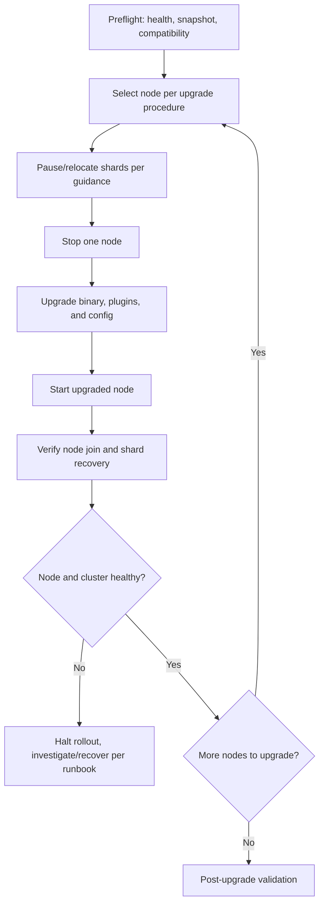
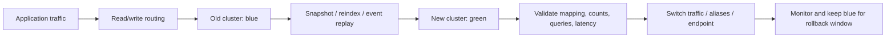
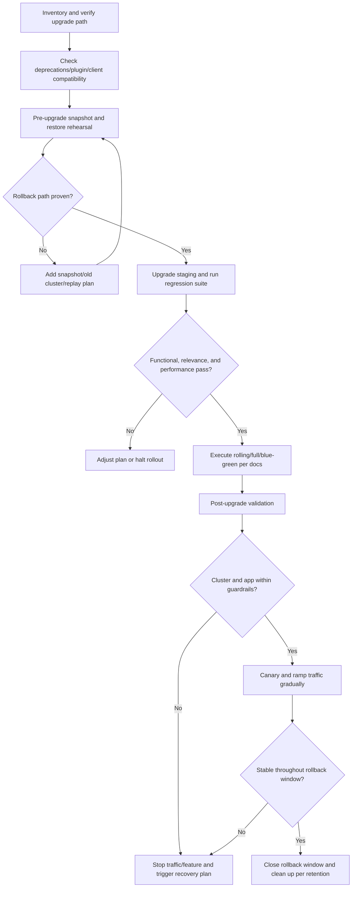

# Planning Cluster and Application Upgrades with Safe Rollback

Upgrading Elasticsearch is an infrastructure change that can simultaneously affect data, mappings, shard allocation, client protocols, query behavior, security, and performance. Upgrading a Spring Data Elasticsearch application can also alter converters, repository behavior, query serialization, and Elasticsearch Java API Client dependencies. Simply bumping versions and restarting risks compatibility failures or data migrations that interrupt search or make reverting to the previous version extremely difficult.

A safe upgrade plan must establish four things upfront:

1. **Is the upgrade target supported?** Verify the current version, target version, intermediate upgrade steps, plugins, JVM, Spring Data, and client compatibility.
2. **How will data and schemas change?** Separate cluster binary upgrades from index mapping/document schema changes.
3. **How do we verify upgrade success?** Define health, shard allocation, search correctness, indexing, latency, error rates, and business checks.
4. **How do we roll back if it fails?** Define snapshots, old clusters, application artifacts, aliases, event replay, and downgrade constraints before starting.

Critical point: Elasticsearch does not support reinstalling an old binary over upgraded data as a safe downgrade operation. When rolling back a cluster version, the standard path is restoring a compatible snapshot into a cluster running the old version or routing traffic back to a preserved old cluster. If new data was written after cutover, you need a separate sync/replay plan; switching an alias or DNS back does not automatically copy new writes back to the old system.

## 1. Scope of an upgrade

First, separate changes that frequently get bundled into a single release:

| Component | Example Change | Primary Risk |
|---|---|---|
| Elasticsearch cluster | Upgrading server version, nodes, plugins, or deployment | Cluster compatibility, shard recovery, API behavior, performance |
| JVM/runtime | Upgrading Java runtime required by server/client | Bytecode, GC, TLS providers, memory behavior |
| Spring Boot | Upgrading framework platform | Dependency alignment, configuration, and lifecycle |
| Spring Data Elasticsearch | Upgrading mapping/repository/operations module | Converters, annotations, query abstractions, repository behavior |
| Elasticsearch Java API Client | Upgrading generated client and transport | Request/response types, serialization, compatibility |
| Index schema | Mappings, analyzers, templates, shard strategies | Reindexing, data conversion, query semantics |
| Document schema | Adding/changing fields or representations | Reader/writer compatibility, backfills |
| Search model/ranking | Embedding models, synonyms, boosts, retrievers | Relevance, latency, vector migration |

Avoid changing every component at once when your goal is isolating the risk of an upgrade. Whenever possible, upgrade cluster binaries separately, then upgrade the application/client, and finally perform schema/model migrations in a controlled pass. If dependency compatibility forces upgrading together, document them as a single change set and test that exact combination.

## 2. Identifying current and target versions

Gather real-world facts before scheduling:

- Elasticsearch server version/build across every node.
- Cluster topology, node roles, data tiers, and deployment model.
- Spring Boot, Spring Data Elasticsearch, and Elasticsearch Java API Client versions on the runtime classpath.
- Java runtime of both the cluster and the application.
- Plugins, custom plugins, ingest processors, and external integrations.
- Index templates, component templates, mappings, aliases, and data streams.
- Security configuration, TLS certificates, roles, API keys, and remote cluster settings.
- Snapshot repositories and the latest snapshot status.

Fetch the server version from the root endpoint:

```http
GET /
```

Inspect nodes and cluster state:

```http
GET _cluster/health
GET _cat/nodes?v
GET _cat/master?v
GET _cat/shards?v
```

In Gradle, check resolved dependencies:

```bash
./gradlew dependencyInsight \
  --dependency spring-data-elasticsearch \
  --configuration runtimeClasspath

./gradlew dependencyInsight \
  --dependency elasticsearch-java \
  --configuration runtimeClasspath
```

Do not rely solely on versions declared in build files. Spring Boot BOMs, platforms, or dependency constraints may resolve different versions.

## 3. Checking the official upgrade path

Elasticsearch enforces version-specific upgrade requirements and constraints. Certain paths require stepping through intermediate versions; some changes require running deprecation checks or reindexing before moving to a new major version.

Before planning, consult the upgrade documentation for your exact source and target versions to determine:

- Whether a direct upgrade is allowed or one or more intermediate versions are required.
- Whether Upgrade Assistant or deprecation APIs must be run beforehand.
- Which settings, APIs, query syntaxes, or plugins are deprecated/removed.
- Which index formats remain readable and whether reindexing is required.
- JVM and operating system requirements.
- Whether rolling upgrades are supported along this upgrade path.
- Steps required before, during, and after upgrading nodes.
- Snapshot/restore compatibility limits across versions.

Do not assume a rule like "you can always jump across one major" or "all versions support rolling upgrades." Upgrade paths are strictly version-specific. Record official links/docs and verified versions in the change plan.

### 3.1. Checking deprecations before upgrading

Deprecated APIs or settings may be removed in the target version. Run deprecation checks/Upgrade Assistant supported by your current version and address items related to:

- Query DSL and search request parameters.
- Index settings and mapping parameters.
- Cluster settings and node configuration.
- Security APIs, roles, and authentication settings.
- Plugins or external integrations.
- Scripts, ingest pipelines, and Painless usage.
- Index template and component template formats.

Do not treat clean application compilation as proof that all runtime queries remain compatible. A query may compile because it serializes to JSON, yet the target server may reject or interpret it differently.

### 3.2. Plugins and integrations

Every plugin needs a version compatible with the target server version. Old plugins can prevent nodes from starting or halt a rolling upgrade.

Inventory plugins by node role, check whether a plugin became built-in in the new version or must be reinstalled, and verify checksums/package sources. Do not copy an entire plugin directory from an old node to a new node if documentation requires reinstalling the exact package version.

## 4. Building a compatibility matrix for the Spring application

The Elasticsearch server and the Spring application are two independent version axes. Verify the full combination:

| Layer | What to Verify |
|---|---|
| Spring Boot | Which Java runtime and Spring Data release train the version supports |
| Spring Data Elasticsearch | Compatible server/client versions, available mapping and query APIs |
| Elasticsearch Java API Client | Actual resolved version, generated APIs, and transport behavior |
| Elasticsearch server | API/query/mapping behavior of the target version |
| Java runtime | JDK versions required by framework, client, and server |
| Serialization | Jackson/custom converters, date/time, and numeric behavior |
| Security | TLS, certificates, authentication, API keys, and role privileges |

Spring Data Elasticsearch typically manages a matching set of clients/transports for its release. Do not bump `elasticsearch-java` independently to an arbitrary version just to access one request builder. If the new server exposes an API not yet surfaced by Spring Data abstractions, consider a dedicated adapter with a compatible client or upgrade the whole Spring stack according to the compatibility matrix.

### 4.1. Auditing the APIs the application actually uses

List all call paths:

- `ElasticsearchRepository` and derived query methods.
- `ElasticsearchOperations`/`ReactiveElasticsearchOperations`.
- `NativeQuery`, criteria queries, aggregations, sorting, and pagination.
- Bulk, update-by-query, delete-by-query, and reindex.
- Aliases, index templates, mappings, and settings provisioning.
- kNN, `dense_vector`, `semantic_text`, retrievers, or hybrid search if used.
- Custom Java API Client calls and custom transports/interceptors.

For each API, capture current request JSON, response fields the code relies on, and corresponding tests. This focuses testing on actual application behavior rather than relying on a generic smoke test.

### 4.2. Compatibility mode is not a long-term plan

Some versions/clients support a REST API compatibility mechanism during transitions. If used, verify the exact version pair and supported headers/APIs. Compatibility mode does not make removed APIs, incompatible mappings, or broken plugins compatible. Set a sunset deadline for this mode and verify with tests.

## 5. Choosing a cluster upgrade strategy

There are three common strategies, depending on deployment topology and supported upgrade paths.

| Strategy | Description | Pros | Risks / Trade-offs |
|---|---|---|---|
| Rolling upgrade | Upgrade nodes one by one using supported procedure while cluster stays online | Minimizes downtime, preserves existing cluster | Requires cross-version node compatibility during transition; demands sufficient capacity and shard relocation |
| Full-cluster restart | Stop the entire cluster, upgrade all nodes, and restart | Simpler procedure on certain upgrade paths | Explicit downtime; requires strict shutdown/startup ordering and recovery checks |
| Blue-green / new cluster | Stand up a separate target cluster, migrate/sync data, then switch traffic | Strong isolation, faster traffic rollback | Higher resource cost; requires data synchronization and precise cutover |

Do not pick rolling upgrades solely to avoid downtime. If the version path or plugins do not support it, follow the strategy mandated by documentation. Blue-green is often ideal when fast rollback or major topology/mapping/model changes are required.

## 6. Rolling upgrade: planning capacity and node order

During a rolling upgrade, nodes are upgraded sequentially while the rest of the cluster continues serving traffic. The prerequisite is that the upgrade path permits rolling upgrades and the cluster has enough headroom to absorb load with a node offline.

Before upgrading:

- Confirm cluster health and verify no unexpected unassigned shards exist.
- Ensure sufficient replicas to preserve availability requirements.
- Check disk watermarks, heap, CPU, network, and recovery bandwidth.
- Ensure remaining nodes can handle search/index traffic.
- Determine the upgrade order for master-eligible, coordinating, ingest, and data nodes per version-specific docs.
- Check shard allocation awareness and zone distribution.
- Identify which nodes can be stopped without losing primary shard availability.

High-level flow:



This diagram illustrates the loop only. Exact commands such as allocation filtering, voting configuration, node ordering, and restart sequences must follow your exact version's documentation; never apply a generic command sequence blindly across clusters.

### 6.1. Do not upgrade multiple nodes simultaneously without care

Stopping multiple data nodes can cause shard unavailability or trigger heavy recovery storms when nodes return. Stopping too many master-eligible nodes can break quorum. Upgrade in controlled batches and wait for cluster stability between steps.

### 6.2. Monitoring shard recovery

After each node restarts, verify:

```http
GET _cluster/health
GET _cat/nodes?v
GET _cat/shards?v
GET _cluster/pending_tasks
```

Do not proceed to the next node simply because the process started. Wait until the node joins the cluster cleanly, shard allocation/recovery reaches an acceptable state, and error logs show no recurring failures.

## 7. Full-cluster restart

If the upgrade path requires a full restart or the deployment does not support rolling upgrades, schedule a maintenance window and a shutdown/startup runbook.

Before shutdown:

- Complete a snapshot and verify status `SUCCESS`.
- Check cluster health and record critical cluster state.
- Pause or throttle indexing/bulk jobs if needed.
- Communicate downtime to consumers and clients per operational procedures.
- Record node lists, roles, configs, plugins, and startup order.
- Confirm adequate disk/memory and an accessible snapshot repository.

During shutdown/startup:

- Follow the exact sequence required by version documentation.
- Never delete data paths to "clean up" without explicit instructions.
- Preserve cluster identity/configuration.
- Upgrade all nodes and plugins to the exact target version.
- Start the cluster in proper order, verifying master election and shard recovery.
- Do not reopen full traffic until validation completes.

A full restart is not a substitute for snapshots. If a node fails to start after upgrading, never arbitrarily copy data paths from another node or downgrade binaries back to the old version.

## 8. Blue-green or standing up a new cluster

With blue-green, the old cluster keeps serving while a new cluster is built independently:



Steps:

1. Provision the green cluster with the target version, node roles, security, and topology.
2. Create required templates, mappings, pipelines, roles, and aliases.
3. Choose snapshot restore, remote reindex, or a data pipeline to populate data.
4. Synchronize writes occurring after the snapshot via event logs/outbox/controlled dual-write.
5. Compare document counts, revisions, aggregations, and sample documents.
6. Run functional, relevance, and performance regression tests.
7. Switch read traffic, then write traffic per the cutover plan.
8. Monitor errors/latency/queue lag and preserve the blue cluster throughout the rollback window.

Blue-green enables fast traffic rollback, but it does not automatically reconcile post-cutover data divergence. You must plan replay or dual-write if green accepts new writes.

## 9. Snapshots and backups before upgrading

Snapshots are the foundation for recovering cluster state and data. Before upgrading:

- Verify the snapshot repository is registered and reachable from all required nodes.
- Verify repository read/write permissions and credentials.
- Take a snapshot per policy, covering required indexes and feature states.
- Wait for snapshot completion and confirm `state: SUCCESS`.
- Record snapshot name, repository, timestamp, source version, and included indexes/feature states.
- Rehearse restoring on a test cluster or isolated environment.

Example snapshot creation:

```http
PUT _snapshot/prod-backups/pre-upgrade-2026-11-13?wait_for_completion=true
{
  "indices": "*",
  "include_global_state": true
}
```

Adjust this example to match your repository, retention, and feature-state requirements. On modern Elasticsearch versions, check documentation for backing up feature states/security state; `include_global_state` should not be assumed to cover every metadata category alone.

Inspect snapshots:

```http
GET _snapshot/prod-backups/pre-upgrade-2026-11-13
GET _snapshot/prod-backups/_all
```

An `IN_PROGRESS` or `PARTIAL` snapshot is not a fully verified backup. Inspect failure details and decide whether a fresh snapshot is required.

### 9.1. Snapshots are not binary downgrades

Snapshots store data and metadata in the source version's format. Restore rules depend on source and target versions; restoring a snapshot from a newer version into an older cluster is generally unsupported. Therefore:

- Create pre-upgrade snapshots on the old version.
- Do not rely on post-upgrade snapshots to downgrade to the old version.
- Verify official restore compatibility before choosing snapshots as a rollback path.
- Keep the old cluster or pre-upgrade snapshot until the rollback window closes.
- Rehearse restores on the exact target version of your recovery plan.

## 10. Do not treat Elasticsearch downgrade as routine rollback

Elasticsearch does not support downgrading binaries directly on an upgraded data path as a simple rollback operation. Index metadata, cluster state, or internal storage formats may have changed.

Practical recovery options are typically:

1. **Restore the pre-upgrade snapshot into a compatible old-version cluster** following supported restore procedures.
2. **Switch traffic back to an intact old cluster** under a blue-green strategy.
3. **Rebuild the old cluster from the source of truth** or replay event logs if snapshots do not cover post-cutover writes.

Do not:

- Reinstall old binaries over data directories opened by a newer version.
- Copy a newer node's data path into an older cluster.
- Restore a newer-version snapshot into an older version when unsupported.
- Delete the old cluster immediately after cutover.

Cluster version rollback and application version rollback are distinct procedures. You can roll back an application to an old artifact while keeping the upgraded cluster if client/server compatibility holds; conversely, you may need to stand up an old cluster independently if a server upgrade introduces severe failures.

## 11. Preparing the Spring Data Elasticsearch application

Before deploying the new application:

- Upgrade dependencies per the Spring Boot/Spring Data compatibility matrix.
- Verify the Java runtime.
- Run unit and integration tests against the target Elasticsearch version.
- Verify repository derived queries, `NativeQuery`, aggregations, sorting, and pagination.
- Verify serialization/deserialization for dates, numerics, enums, nested types, and vectors.
- Verify timeouts, retries, connection pools, and TLS settings.
- Verify security role/API key privileges.
- Verify `@Document`, `@Field`, `@Setting`, index templates, and alias provisioning.
- Verify response metadata used by services: total hits relation, shard failures, bulk failures, and version conflicts.

### 11.1. Do not alter mappings accidentally when upgrading the app

A newer Spring Data version may emit different mapping JSON due to annotation support or converter changes. Compare live mappings before and after:

```http
GET products/_mapping
GET products/_settings?include_defaults=true
```

If the application auto-creates indexes on startup, understand its production behavior. Many systems should decouple index provisioning/migrations from application startup so multiple instances do not race to mutate schemas.

### 11.2. Readers and writers must stay compatible during rolling deployments

During rolling deployments, old and new application versions run concurrently. Before a new writer emits new fields or representations, old readers must continue functioning or stop receiving traffic.

Use the expand-migrate-contract strategy:

1. Expand mappings/schemas compatibly.
2. Deploy readers that understand both old and new formats.
3. Switch writers to the new schema.
4. Backfill/reindex old documents.
5. Confirm no old writers/schemas remain active.
6. Remove legacy compatibility code in a later release.

Never delete an old field in the same deployment that begins writing a new field while old instances still run.

## 12. Separating cluster upgrades from index schema migrations

Upgrading Elasticsearch binaries does not automatically require changing every index's mapping. Conversely, changing a field's mapping type can require reindexing even when the server version stays constant.

| Change | Strategy |
|---|---|
| Server upgrade with unchanged mappings | Cluster upgrade + regression tests |
| Additive compatible field mapping | Controlled mapping update, backfill if needed |
| Change `keyword` to `text` or `object` to `nested` | Create a new index and reindex |
| Change analyzer to re-tokenize data | New index / reindex |
| Change vector dimensions/model | New index and re-embed |
| Change aliases/topology | Dedicated provisioning/cutover |

If both a server upgrade and a schema migration are needed, consider splitting them into separate milestones. For instance, upgrade the cluster first while preserving old mappings/queries; once the cluster stabilizes, create the v2 index and switch aliases. This makes root-causing regressions much easier.

## 13. Planning data handling when reindexing

If schema migration is part of the upgrade, identify the source of truth and how writes during reindexing are synchronized.

Options:

- Pause writers during a migration window.
- Snapshot/reindex and replay events from an outbox.
- Dual-write to both indexes with idempotency and revision guards.
- Use remote reindex between old and new clusters if network/auth/versions permit.
- Switch the read alias after confirming the destination has caught up with the source.

Reindexing does not guarantee writes occurring after a source document was read appear in the destination. Delta synchronization or a write-freeze cutover window is required.

Verify:

- Source/destination document counts.
- Error counts and version conflicts.
- Final revision/checkpoint.
- Critical fields, nulls/missing values, and transformations.
- Summary aggregations and query regressions.
- Read/write aliases and index routing.

## 14. Building a rollback plan for the application

Every application release should have an identified prior artifact and matching configuration:

- Old container/image or binary version.
- Dependency lock/resolved dependency record.
- Compatible configuration/secret references.
- Feature flags and switches to disable new capabilities.
- Mapping/index alias assumptions.
- API contracts with frontends/consumers.
- Database/event schema compatibility if applicable.

Application rollback is only safe if the old artifact can still talk to the live cluster and live data. If the new application wrote fields the old reader cannot understand, preserve backward compatibility or keep feature flags off until old instances are gone.

### 14.1. Expand-migrate-contract for applications

Example renaming `price` to `priceInCents`:

1. New readers handle both `price` and `priceInCents`.
2. New mapping permits the new field.
3. Writers begin writing the new field; if needed, temporarily dual-write the old field.
4. Backfill legacy data.
5. Verify no documents contain only the old field.
6. After the rollback window, drop the fallback reading the old field.

If rolling back to the old application still requires `price`, continue maintaining that field or keep a compatible transformation/replay mechanism throughout the rollback window.

## 15. Rollback when using aliases and blue-green

Alias switches are atomic within a cluster:

```http
POST _aliases
{
  "actions": [
    { "remove": { "index": "products-v1", "alias": "products-read" } },
    { "add": { "index": "products-v2", "alias": "products-read" } }
  ]
}
```

To roll back, you can point the alias back if the old index remains intact and consistent. However, if v2 accepted writes after cutover, v1 will be stale.

Before cutover, clarify:

- Is there a write freeze or dual-write?
- Is there an outbox/event log available for replay?
- Is there a source revision for reconciliation?
- Does rollback require replaying v2 deltas back into v1?
- Are read and write aliases switched together?
- Who is authorized to execute the switch and verify completion?

Do not treat flipping an alias as a complete rollback plan. It only redirects traffic targets.

## 16. Post-upgrade validation

Do not declare the upgrade finished as soon as every node reports started. Validate across multiple layers.

### 16.1. Cluster health and nodes

```http
GET _cluster/health
GET _cat/nodes?v
GET _cat/shards?v
GET _cluster/pending_tasks
```

Check:

- All expected nodes joined the cluster.
- Node versions/builds match the target.
- Master election is stable.
- Primary/replica shard allocation complies with policy.
- No abnormal pending tasks remain.
- Disk/heap/CPU/GC stay within bounds.
- Plugins and ingest pipelines function properly.

### 16.2. Data and indexes

- Indexes, aliases, data streams, and templates exist accurately.
- Mappings/settings were not unexpectedly altered.
- Document counts and sample check aggregations match.
- Snapshot repositories remain accessible.
- Ingest pipelines and ILM/SLM policies operate properly.
- Security roles, API keys, and TLS connections succeed.

### 16.3. Search and indexing

Run smoke tests:

- `GET` document by ID.
- Exact term queries.
- Full-text/analyzer queries.
- Tenant/ACL filters.
- Sorting, pagination, and aggregations.
- Bulk index/update/delete.
- Read-after-write per refresh contract.
- Vector/hybrid queries if used.
- Inspect total hits relation, timeouts, and shard failure metadata.

Do not check response status alone. Verify expected document IDs, ranking constraints, and response completeness.

### 16.4. Performance and errors

Compare against baseline:

- p50/p95/p99 search latency.
- Indexing throughput and refresh visibility lag.
- Error, timeout, rejection, and retry rates.
- Search/index thread pool queues.
- Heap, GC pauses, CPU, disk I/O, and merge pressure.
- Circuit breaker trips and shard recovery.
- Query relevance metrics if ranking changed.

## 17. Canary and phased traffic ramp-up

When deployment infrastructure supports it, ramp traffic gradually:

1. Internal smoke tests with minimal traffic.
2. Canary a single application instance or small query slice.
3. Observe errors/latency/cluster resources over a meaningful window.
4. Ramp traffic incrementally.
5. Keep guardrails and rollback triggers explicit.

With blue-green clusters, you can shadow a percentage of read traffic to green without returning results to users; compare result IDs, rankings, and latency. Be cautious with write traffic: never shadow writes if operations have side effects or data is not synchronized.

### 17.1. Defining rollback triggers

Example triggers to tailor to real SLOs:

- Cluster health turns `red` or primary shards fail to allocate.
- Error/timeout rate exceeds threshold across consecutive windows.
- p95/p99 breaches defined SLOs.
- Search regression produces incorrect business results or data leaks.
- Indexing backlog/consumer lag grows without recovering.
- Authentication/TLS or plugin integrations fail.
- Snapshot/restore or recovery paths become unavailable.

A severe security/data isolation bug may demand halting traffic immediately even if latency and cluster health appear green.

## 18. Runbook when an upgrade fails

### 18.1. Node fails to join cluster

1. Read node logs and cluster formation messages.
2. Check version/build, plugins, JVM, configs, and certificates.
3. Verify discovery/cluster name/network and node roles.
4. Check disk permissions, data paths, and startup settings.
5. Never delete data paths or alter cluster identity arbitrarily.
6. Halt upgrading subsequent nodes until root cause is clear.

### 18.2. Shards fail to allocate

1. Inspect `_cat/shards` and cluster health.
2. Run allocation explain for the specific shard.
3. Check disk watermarks, awareness, node capacity, and recovery status.
4. Check primary/replica state and cluster logs.
5. Never force-allocate a stale primary without understanding data loss risks.

### 18.3. Application receives errors after upgrade

1. Capture exception/cause, HTTP status, and Elasticsearch error type.
2. Determine whether the failure is transport, authentication, API incompatibility, or mapping/query.
3. Compare raw requests/responses against baseline.
4. Check client versions and the compatibility matrix.
5. Disable feature flags or revert to the old application artifact if compatible.
6. Never downgrade cluster binaries over upgraded data paths.

### 18.4. Ranking or latency regression

1. Re-run the exact corpus/query set and load conditions.
2. Check analyzers, mappings, similarity settings, and shard topology.
3. Use `_explain` for documents that shifted rank.
4. Use the Profile API/slow logs for slow queries.
5. Separate server upgrades from query/model/schema changes.
6. Roll back queries/features or shift traffic per plan.

## 19. Timeline-based planning

| Phase | Tasks | Completion Evidence |
|---|---|---|
| T-2 to T-4 weeks | Inventory, compatibility, deprecations, and upgrade path | Version matrix, blocker list, change plan |
| T-1 to T-2 weeks | Restore rehearsal, staging tests, benchmarks, and runbooks | Snapshot restore test, test report, rollback rehearsal |
| T-1 day | Freeze unrelated schema/query changes, verify snapshot/repository | Go/no-go checklist and snapshot status |
| Upgrade window | Rolling/full restart or blue-green migration | Node/cluster state at each checkpoint |
| Immediately post-upgrade | Functional, data, security, and performance validation | Validation report |
| Canary window | Monitor traffic, errors, latency, lag, and relevance | Metrics within guardrails |
| Post-rollback window | Confirm stability, clean up legacy resources per retention | Sign-off and archived artifacts |

Timelines are illustrative only. Large systems or compliance-regulated environments require longer rehearsal and approval windows.

## 20. Upgrade plan template to record

A change record should contain:

```text
Change ID:
Current Elasticsearch version:
Target Elasticsearch version:
Supported upgrade path:
Deployment strategy: rolling / full restart / blue-green
Current Spring Boot / Spring Data / Java API Client:
Target application versions:
Java runtime:
Plugins and integrations:
Index/mapping/template changes:
Snapshot repository and pre-upgrade snapshot:
Restore rehearsal result:
Maintenance window:
Owners and communication channel:
Preflight checks:
Step-by-step upgrade sequence:
Post-upgrade validation:
SLO and rollback triggers:
Application rollback artifact:
Cluster recovery/rollback strategy:
Write freeze / dual-write / event replay plan:
Old cluster/index retention period:
Final sign-off:
```

Capture actual commands, endpoints, versions, and timestamps in the change log. Never store passwords, API keys, or secrets directly in documents; reference secret manager/credential identifiers only.

## 21. Pre-start checklist

| Area | Go/No-Go Criterion |
|---|---|
| Upgrade path | Target version and intermediate steps are officially documented and supported |
| Cluster | Health stable, shard allocation normal, sufficient capacity |
| Plugins | Every plugin/integration has a compatible version |
| Runtime | JVM/OS/configs meet target version requirements |
| Snapshot | Pre-upgrade snapshot complete, repository accessible, restore rehearsed |
| Application | Spring Data/client compatibility verified and tested in staging |
| Schema | Mapping/template/document compatibility evaluated |
| Security | TLS, certificates, roles, API keys, and feature permissions verified |
| Observability | Dashboards, logs, alerts, and baseline metrics ready |
| Rollback | Prior artifact, old cluster, or restore plan ready; write divergence addressed |
| Operations | Owners, maintenance window, comms, and stop/go decision authority clear |

If snapshots are unverified, the upgrade path is unclear, plugins are incompatible, or the rollback path has not been rehearsed, do not start production changes.

## 22. Post-completion checklist

- All nodes run the target version/build.
- Cluster health and shard allocation match the desired state.
- Zero plugin, TLS, authentication, or cluster formation errors.
- Indexes, aliases, templates, data streams, and ingest pipelines exist accurately.
- Repository/operations smoke tests pass.
- Search ranking, pagination, aggregations, and total-hit semantics are accurate.
- Bulk and indexing pipelines operate without abnormal partial failures.
- p95/p99, QPS, error/rejection rates, and resources stay within SLOs.
- Scheduled backups/snapshots continue running.
- Application rollback artifacts and cluster recovery assets are retained for the defined period.
- Runbooks, version inventory, and migration history are updated.

## 23. Upgrade and rollback workflow



Practical sequence:

1. Record current versions, topology, plugins, dependencies, and schemas.
2. Verify the official upgrade path and resolve deprecations.
3. Check plugin, JVM, security, client, and Spring compatibility.
4. Create a pre-upgrade snapshot, confirm success, and rehearse restore.
5. Lock in the application rollback artifact, old cluster/restore path, and event replay strategy.
6. Upgrade staging with matching configs and run regression/benchmarks.
7. Choose rolling, full restart, or blue-green per the support matrix.
8. Execute checkpoint by checkpoint, verifying node joins and shard recovery.
9. Run functional, data, security, ranking, and performance validation.
10. Canary traffic, watch guardrails, and hold the rollback window.
11. If rollback is needed, switch traffic or restore a compatible cluster; never downgrade binaries over upgraded data paths.
12. Once stable, close the rollback window, update documentation, and clean up old resources per retention policy.

## 24. Conclusion

Upgrading an Elasticsearch cluster and a Spring Data Elasticsearch application must be treated as a planned, evidence-backed change with a proven recovery path. Before upgrading, verify the exact server version's upgrade path, deprecations, plugins, JVM, Spring Data, and Java API Client compatibility. Separate cluster binary upgrades from index schema/model migrations whenever possible to isolate regressions cleanly.

Choose rolling upgrades only when supported by the version path and cluster capacity; use full-cluster restarts when procedures mandate downtime; consider blue-green when clean isolation and rapid traffic rollback are priorities. Pre-upgrade snapshots must complete cleanly, and restores must be rehearsed. Snapshots from newer versions are not downgrade tools for older versions, and old binaries must never be installed onto upgraded data paths.

Applications need reader/writer compatibility across rolling deployments, thorough repository/query/mapping/security testing, and prior artifacts capable of running against the live cluster if app rollback is needed. For incompatible schema changes, use expand-migrate-contract, newly versioned indexes, reindexing, and delta synchronization. An alias switch only changes the target pointer; it does not send new writes back to an old index or cluster.

After upgrading, verify node/shard health, mappings/templates, data, security, search correctness, ranking, bulk indexing, and p95/p99 latency. Canaries paired with explicit rollback triggers catch issues before full traffic exposure. A plan backed by snapshots, restore rehearsals, validation, and write-divergence handling gives teams full control and an actionable path if reverting becomes necessary.
