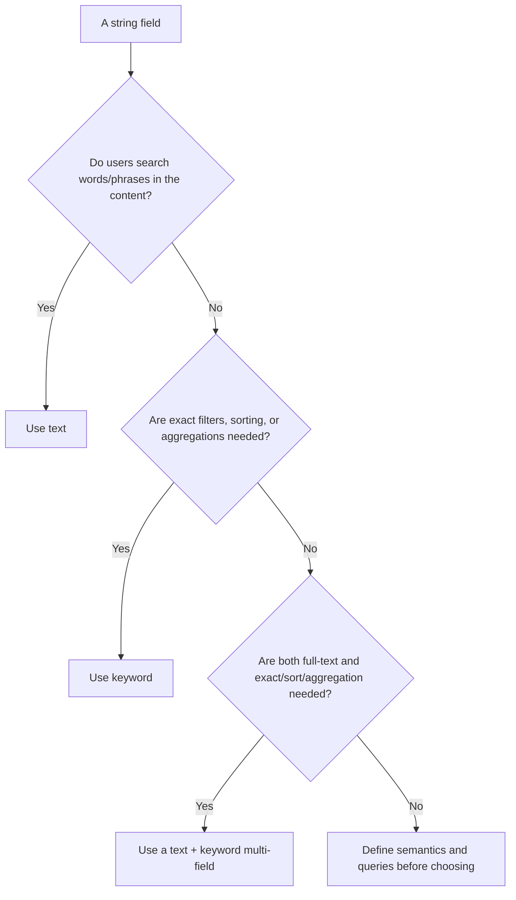

# Mapping text and keyword Based on Search Needs

In Elasticsearch, a field's mapping type determines how data is indexed and which kinds of queries can be used effectively. The two most common types when handling strings are **`text`** and **`keyword`**. Both store string-form values in a document, but they serve two different purposes:

- `text` is intended for full-text search. Elasticsearch analyzes content into tokens so searches can match by words, phrases, and relevance.
- `keyword` is intended for values that must be kept as a single unit for exact matching, filtering, sorting, and aggregations.

A product name field might need both usages: users type keywords to search for approximate names, while the UI also needs to sort names alphabetically or filter by the exact full name. In that case, **multi-fields** allow indexing the same value into multiple sub-fields with different mappings.

## 1. Why Must We Choose a Mapping Type for Strings?

Suppose a document has the following content:

```json
{
  "name": "Wireless Headphones",
  "category": "Audio Equipment",
  "sku": "WH-1001"
}
```

Each field has a different usage:

| Field | Primary need | Appropriate mapping |
|---|---|---|
| `name` | Search products by words or phrases in the name | `text` |
| `category` | Exact category filtering, aggregation by category | `keyword` |
| `sku` | Exact product code matching | `keyword` |

If all strings are declared as `text`, full-text search can work, but exact filtering, sorting, and aggregations will not be convenient. If all are declared as `keyword`, each string is treated as a whole intact value; searching for a word inside a name or description will not have the expected text-analysis behavior.

Therefore, you should start from the question: will the application search this field as free text, or use it as an identifier/classification value?

## 2. `text`: Analyzing Text for Full-Text Search

A `text` field is processed through an **analyzer** when indexing and when running full-text queries. An analyzer typically consists of three steps:

1. **Character filters**: can transform the input string before tokenization, such as replacing or removing certain characters.
2. **Tokenizer**: splits text into tokens.
3. **Token filters**: transforms tokens, such as lowercasing, removing stop words, or stemming when the analyzer is configured that way.

For example, the standard analyzer can transform:

```text
Input:  "Wireless Headphones"
Tokens: ["wireless", "headphones"]
```

Elasticsearch indexes these tokens in an inverted index. When a user searches for `wireless`, a `match` query can find documents containing the corresponding token even though the original string is `Wireless Headphones`.

### 2.1. Declaring a `text` Field

In Spring Data Elasticsearch:

```java
import org.springframework.data.elasticsearch.annotations.Document;
import org.springframework.data.elasticsearch.annotations.Field;
import org.springframework.data.elasticsearch.annotations.FieldType;

@Document(indexName = "products")
public class ProductDocument {

    @Field(type = FieldType.Text)
    private String name;

    @Field(type = FieldType.Text, analyzer = "standard")
    private String description;
}
```

`FieldType.Text` declares a `text` mapping type. The `analyzer` attribute specifies the analyzer used when indexing content. If unspecified, Elasticsearch uses the default analyzer according to the mapping and index settings. When exact control is needed, declare the analyzer in the index settings and reference it by name.

### 2.2. The `match` Query

`match` is a common full-text query. The search value is analyzed by the corresponding search analyzer, after which Elasticsearch searches for the tokens in the field:

```json
GET products/_search
{
  "query": {
    "match": {
      "name": "wireless headphones"
    }
  }
}
```

By default, `match` typically combines tokens with `OR`: documents containing one of the tokens can be returned and ranked by relevance score. You can use `operator: "and"` if you want to require all tokens to appear:

```json
GET products/_search
{
  "query": {
    "match": {
      "name": {
        "query": "wireless headphones",
        "operator": "and"
      }
    }
  }
}
```

`match` is well suited for names, titles, descriptions, article bodies, and fields where users enter keywords to search.

### 2.3. `match_phrase` When Token Order Must Be Preserved

If you require searching for a phrase in token order, you can use `match_phrase`:

```json
GET products/_search
{
  "query": {
    "match_phrase": {
      "name": "wireless headphones"
    }
  }
}
```

This query uses token positions in the inverted index to find phrases in order. It does not mean comparing the original string character by character; the analyzer can still lowercase, remove punctuation, or transform tokens before searching.

### 2.4. Key Characteristics of `text`

- Content is analyzed into tokens; one field can produce multiple terms in the inverted index.
- Can support searching by words, phrases, boolean conditions, and relevance scoring.
- Not suitable by default for sorting or terms aggregations directly like a `keyword` field.
- `fielddata` can be enabled to perform certain operations on `text`, but it can consume large amounts of heap memory. Usually, you should use a `keyword` multi-field instead of enabling `fielddata` for names or descriptions.

## 3. `keyword`: Keeping a Value as a Single Unit

A `keyword` field is indexed as a single intact value without being split into words by a tokenizer. For example:

```text
Input:  "Wireless Headphones"
Token:  ["Wireless Headphones"]
```

Because the value is treated as a single term, `keyword` is suitable for:

- Product codes, order codes, and business IDs.
- Categories, statuses, account types, and country codes.
- Emails, URLs, or labels that require full-value matching.
- Values used for sorting, terms aggregations, and filters.

### 3.1. Declaring a `keyword` Field

```java
@Field(type = FieldType.Keyword)
private String sku;

@Field(type = FieldType.Keyword)
private String category;
```

Spring Data converts this metadata into the corresponding mapping for Elasticsearch when the index is created from entity metadata. If the index is managed by a separate template or migration, make sure the actual mapping has the desired `keyword` type.

### 3.2. The `term` Query

With a `keyword` field, the `term` query is typically used to find an exact value:

```json
GET products/_search
{
  "query": {
    "term": {
      "category": {
        "value": "audio"
      }
    }
  }
}
```

`term` does not analyze the input string like `match`. If the value in the index is `Audio Equipment`, a `term` query with `audio` will not find the document just because the word `audio` appears inside the value. It matches the indexed term against the query value.

### 3.3. Sorting and Aggregation

`keyword` has doc values enabled by default, making it suitable for operations that need to read values per document, such as sorting and aggregations.

Sorting by name if the name has a `keyword` mapping:

```json
GET products/_search
{
  "sort": [
    {
      "name.raw": {
        "order": "asc"
      }
    }
  ]
}
```

Counting products by category:

```json
GET products/_search
{
  "size": 0,
  "aggs": {
    "products_by_category": {
      "terms": {
        "field": "category"
      }
    }
  }
}
```

With a `text` field, sorting or terms aggregations are usually not enabled by default because this field does not have doc values like `keyword`. Enabling `fielddata` on `text` can sharply increase heap usage. If a property needs both full-text search and sorting/aggregation, create a multi-field.

## 4. Comparing `text` and `keyword`

| Criterion | `text` | `keyword` |
|---|---|---|
| Purpose | Full-text search | Exact value, filter, sort, aggregation |
| Tokenization | Yes | Does not split into words; processed as a single term |
| Analyzer | Has analyzer and search analyzer | Can use a normalizer, does not use a typical tokenizer |
| Commonly used queries | `match`, `match_phrase`, `multi_match` | `term`, `terms`, `prefix`, and appropriate exact-value queries |
| Relevance scoring | Suitable for relevance scoring | Commonly used for filters/exact matching |
| Sorting | Not convenient by default | Suitable, has doc values by default |
| Terms aggregation | Requires `fielddata` if used directly, generally not recommended | Suitable by default |
| Examples | `name`, `description`, `content` | `sku`, `status`, `category`, `countryCode` |

The two mapping types are not mutually exclusive choices for an entire document. A single document can contain `text` fields, `keyword` fields, and multi-fields depending on usage needs.

## 5. Using Multi-Fields When One Value Needs Multiple Search Patterns

Suppose `name` must simultaneously satisfy these requirements:

1. Users search for `wireless` and expect to see `Wireless Headphones`.
2. The system filters strictly by the entire product name.
3. The UI sorts names alphabetically.
4. Reports can aggregate by name values.

Using only `text` does not conveniently meet requirements 2, 3, and 4. Using only `keyword` does not support full-text search. Multi-fields solve this by indexing the same value as a main field and sub-fields with separate mappings.

Elasticsearch mapping example:

```json
PUT products
{
  "mappings": {
    "properties": {
      "name": {
        "type": "text",
        "fields": {
          "raw": {
            "type": "keyword",
            "ignore_above": 256
          }
        }
      },
      "category": {
        "type": "keyword"
      },
      "sku": {
        "type": "keyword"
      }
    }
  }
}
```

After the mapping is created, the same `name` value is indexed in two ways:

- `name`: a `text` field, processed by an analyzer for full-text search.
- `name.raw`: a `keyword` field, keeping the value as a single term for exact filtering, sorting, or aggregation.

The name `raw` is just a conventional suffix. You can use `keyword`, `exact`, or another name as long as queries reference the exact mapping that was created.

### 5.1. Declaring a Multi-Field with Spring Data Elasticsearch

Spring Data provides `@MultiField` and `@InnerField` to describe the main field alongside sub-fields:

```java
import org.springframework.data.elasticsearch.annotations.Document;
import org.springframework.data.elasticsearch.annotations.Field;
import org.springframework.data.elasticsearch.annotations.FieldType;
import org.springframework.data.elasticsearch.annotations.InnerField;
import org.springframework.data.elasticsearch.annotations.MultiField;

@Document(indexName = "products")
public class ProductDocument {

    @MultiField(
        mainField = @Field(type = FieldType.Text, analyzer = "standard"),
        otherFields = {
            @InnerField(
                suffix = "raw",
                type = FieldType.Keyword,
                ignoreAbove = 256
            )
        }
    )
    private String name;

    @Field(type = FieldType.Keyword)
    private String category;
}
```

In the example:

- `mainField` creates the `name` field of type `text`.
- `otherFields` creates the `name.raw` sub-field of type `keyword`.
- `ignoreAbove = 256` avoids indexing overly long keyword values exceeding the chosen threshold. Long values can still remain in `_source`, but will not have a corresponding term in the keyword field for searching/sorting/aggregation.

If using a separate index template or migration, ensure the actual mapping matches the annotations. Do not assume that changing annotations will automatically alter the mapping of an existing index.

### 5.2. Querying the Two Fields for Two Purposes

Full-text search on the main field:

```json
GET products/_search
{
  "query": {
    "match": {
      "name": "wireless"
    }
  }
}
```

Exact match on the sub-field:

```json
GET products/_search
{
  "query": {
    "term": {
      "name.raw": {
        "value": "Wireless Headphones"
      }
    }
  }
}
```

Sorting by the sub-field:

```json
GET products/_search
{
  "sort": [
    {
      "name.raw": "asc"
    }
  ]
}
```

Multi-fields do not create separate Java properties. They are multiple ways of indexing a single source property. When building queries, you must reference the sub-field name in Elasticsearch, such as `name.raw`.

## 6. Combining Full-Text and Filters in the Same Query

A product search screen often needs to search by name while filtering by category. You can use a `bool` query:

```json
GET products/_search
{
  "query": {
    "bool": {
      "must": [
        {
          "match": {
            "name": "wireless headphones"
          }
        }
      ],
      "filter": [
        {
          "term": {
            "category": "audio"
          }
        }
      ]
    }
  }
}
```

Here:

- `must` contains the full-text condition and can affect the relevance score.
- `filter` contains the exact category condition and does not participate in score calculation.
- `name` is `text`, so `match` is used.
- `category` is `keyword`, so `term` is used.

This is a common combination: use `text` for content users search against and `keyword` for filters such as category, status, code, or exact values.

In a Spring Data Elasticsearch application, you can express the same query using `NativeQuery` and execute it through `ElasticsearchOperations`:

```java
import co.elastic.clients.elasticsearch._types.FieldValue;
import org.springframework.data.elasticsearch.client.elc.NativeQuery;
import org.springframework.data.elasticsearch.core.ElasticsearchOperations;
import org.springframework.data.elasticsearch.core.SearchHits;
import org.springframework.data.elasticsearch.core.query.Query;

public class ProductSearchService {

    private final ElasticsearchOperations operations;

    public ProductSearchService(ElasticsearchOperations operations) {
        this.operations = operations;
    }

    public SearchHits<ProductDocument> search(String text, String category) {
        Query query = NativeQuery.builder()
            .withQuery(q -> q
                .bool(b -> b
                    .must(m -> m
                        .match(match -> match
                            .field("name")
                            .query(text)
                        )
                    )
                    .filter(f -> f
                        .term(term -> term
                            .field("category")
                            .value(FieldValue.of(category))
                        )
                    )
                )
            )
            .build();

        return operations.search(query, ProductDocument.class);
    }
}
```

Here `name` is a `text` field so `match` is used; `category` is a `keyword` field so `term` is used. `NativeQuery` lets you use typed Query DSL while still letting Spring Data map the results into `ProductDocument`.

## 7. Normalizer for `keyword`

`keyword` does not use an analyzer to split tokens, but it can use a **normalizer** to normalize a value into a single term. A normalizer is often used when case-insensitive matching or accent normalization is needed.

For example, if stored data is `Audio` but the application receives input `AUDIO`, default exact matching may fail due to case differences. You can define a normalizer:

```json
PUT products
{
  "settings": {
    "analysis": {
      "normalizer": {
        "lowercase_normalizer": {
          "type": "custom",
          "filter": ["lowercase", "asciifolding"]
        }
      }
    }
  },
  "mappings": {
    "properties": {
      "category": {
        "type": "keyword",
        "normalizer": "lowercase_normalizer"
      }
    }
  }
}
```

With this normalizer, the keyword value is lowercased and `asciifolding` is applied before indexing and when normalizing query values. For example, `AUDIO` and `audio` can match the same term.

When using Spring Data annotations, you can reference the normalizer name declared in the index settings:

```java
@Field(
    type = FieldType.Keyword,
    normalizer = "lowercase_normalizer"
)
private String category;
```

Normalizers must be declared in settings before the index is created. You cannot arbitrarily add a new normalizer to an existing index like changing a Java property; you must check mapping/settings constraints and may need to create a new index.

`asciifolding` helps normalize certain accented characters to their ASCII equivalents. This can assist accent-insensitive search in some languages, but it does not replace a language-specific tokenizer or word segmenter. For Vietnamese, spaces often separate syllables rather than always marking compound-word boundaries; test analyzers against real data before deciding on accent-sensitive or accent-insensitive search behavior.

## 8. Inspecting Analyzers with `_analyze`

Do not guess which tokens an analyzer has produced. Elasticsearch provides the Analyze API to directly observe the analysis process.

Example testing the `name` field:

```json
POST products/_analyze
{
  "field": "name",
  "text": "Wireless Headphones"
}
```

Or testing a specific analyzer:

```json
POST products/_analyze
{
  "analyzer": "standard",
  "text": "Tai nghe không dây"
}
```

The response contains the list of tokens along with positions and offsets. Use that result to verify:

- Which tokens is the string split into?
- Is letter casing normalized?
- How are punctuation and special characters handled?
- Are stop words removed?
- Are token order and positions suitable for `match_phrase`?
- Is Vietnamese data or the product's language segmented as expected?

If accent-insensitive search is required, you can try `asciifolding` in an appropriate analyzer or normalizer, but test both the index analyzer and search analyzer. If language-specific word segmentation is needed, evaluate an analyzer/plugin suitable for your Elasticsearch version and application data.

## 9. Dynamic Mapping and String Fields

When Elasticsearch receives a document with a field that has no declared mapping, dynamic mapping can infer the type automatically. For strings, the default configuration typically creates a `text` field alongside a `keyword` sub-field to support both full-text search and exact-value operations. For example, you may see a mapping like:

```json
{
  "name": {
    "type": "text",
    "fields": {
      "keyword": {
        "type": "keyword",
        "ignore_above": 256
      }
    }
  }
}
```

This is standard dynamic mapping behavior, not a reason to skip mapping design. In systems with clear search requirements, declare mappings or index templates proactively. If relying on dynamic mapping, sub-field names, `ignore_above` limits, and analyzers depend on default configuration or the active template.

Inspect the actual mapping:

```http
GET products/_mapping
```

If a field has already been created with the wrong type, simply editing annotations will not make the index change its mapping automatically. You need to plan creating a new index, reindexing, and switching aliases/the application if the change is incompatible.

## 10. Common Design Mistakes

| Practice | Problem | Resolution |
|---|---|---|
| Using `term` to search words inside a `text` field | `term` does not analyze input like a full-text query | Use `match` or an appropriate full-text query. |
| Using `match` on an SKU requiring exactness | The analyzer may split or normalize the string unexpectedly | Use a `keyword` field and `term`. |
| Sorting directly on `text` | `text` does not have doc values by default | Use a `keyword` sub-field such as `name.raw`. |
| Aggregating on `text` by enabling `fielddata` | Can consume large amounts of heap memory | Create a `keyword` field or multi-field. |
| Using one field for both description and status | Both needs have different search semantics | Separate fields by meaning or use multi-fields. |
| Changing annotations and expecting old mappings to auto-update | Existing index mappings do not automatically change types | Inspect the mapping and perform migration/reindex. |
| Using a lowercase normalizer while forgetting to declare settings | The index does not recognize the normalizer name or mapping creation fails | Declare the normalizer before creating the index. |
| Assuming the default analyzer handles Vietnamese like a complete language search engine | Tokenization may not fit compound words and diacritic requirements | Test with `_analyze`, evaluate analyzers/plugins, and test with real data. |

## 11. Workflow for Choosing Mappings Based on Needs



You can apply the following steps:

1. List the search, filter, sort, and aggregation operations the application needs on each field.
2. Choose `text` if the content needs to be analyzed into tokens for full-text search.
3. Choose `keyword` if the value needs to be matched as a single unit or used as a key for sorting/aggregation.
4. Choose a multi-field if the same value requires both usages.
5. Choose an appropriate analyzer/normalizer, then verify with `_analyze` and test queries on representative data.
6. Verify the actual mapping after the index is created; manage changes via migration when needed.

## 12. Conclusion

`text` and `keyword` solve two different problems. `text` analyzes content into tokens for full-text search and relevance scoring. `keyword` keeps values as a single term for exact matching, filtering, sorting, and aggregations. Multi-fields allow a single property to have both indexing strategies without duplicating data in Java classes.

Choose mappings based on actual search behavior, not merely because a Java property has type `String`. Pair `match` with `text`, `term` with `keyword`, use multi-fields when multiple access patterns are needed, and verify analyzers using `_analyze`. This approach ensures search results match expectations, avoids unnecessary `fielddata` overhead, and keeps mappings well aligned as search features grow.
