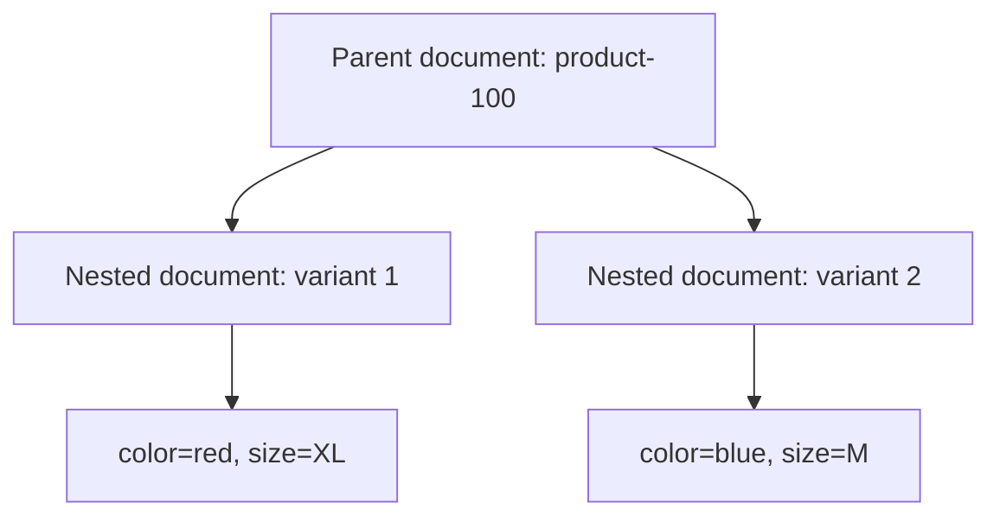

# `object`, `nested`, and Differences When Filtering Multiple Sub-Properties

Elasticsearch allows a document to contain nested objects and arrays of objects. For instance, a product can contain manufacturer details, a shipping address, or a list of variants with color, size, and selling price. In mappings, the two types commonly used to describe such structures are `object` and `nested`.

The crucial difference does not lie in the JSON shape. Both can accept an object or an array of objects. The difference lies in how Elasticsearch indexes and preserves relationships among sub-fields. With `object`, Elasticsearch flattens sub-fields into multi-valued fields and does not preserve relationships between properties belonging to the same array element. With `nested`, each object element in the array is indexed as a separate nested document, enabling queries to require multiple conditions to match on the exact same element.

This distinction matters especially when filtering multiple sub-properties at the same time. If `object` is used for an array of objects, a query can return a parent document even when no child element satisfies all conditions. If business rules require conditions to belong to the same element, use `nested` and wrap the conditions inside a `nested` query.

## 1. Data Model with Nested Objects

Suppose an application manages products. Each product has a name and a list of variants. A variant has color, size, price, and availability status.

```json
{
  "id": "product-100",
  "name": "Windbreaker jacket",
  "variants": [
    {
      "color": "red",
      "size": "XL",
      "price": 450000,
      "available": true
    },
    {
      "color": "blue",
      "size": "M",
      "price": 420000,
      "available": true
    }
  ]
}
```

A search requirement might be: find products that have a variant that is both red (`color = red`) and size M (`size = M`). With the document above, the right answer must be no product found, because the red variant is size XL while the size M variant is blue.

This is the classic scenario illustrating the difference between `object` and `nested`.

## 2. Object Mapping: Flattened JSON Structure

The `object` type is the default type Elasticsearch typically infers for a JSON object when dynamic mapping is enabled. Sub-properties are placed into the mapping by hierarchical path, such as `variants.color`, `variants.size`, and `variants.price`.

Illustrative mapping:

```json
PUT /products-object
{
  "mappings": {
    "properties": {
      "name": {
        "type": "text"
      },
      "variants": {
        "type": "object",
        "properties": {
          "color": { "type": "keyword" },
          "size": { "type": "keyword" },
          "price": { "type": "double" },
          "available": { "type": "boolean" }
        }
      }
    }
  }
}
```

When indexing an array of objects, Elasticsearch treats the values of each sub-field as multi-valued sets. For the example document, the conceptual field-level view looks like this:

| Field | Indexed values |
|---|---|
| `variants.color` | `red`, `blue` |
| `variants.size` | `XL`, `M` |
| `variants.price` | `450000`, `420000` |
| `variants.available` | `true`, `true` |

The link showing that `red` belongs to the same variant as `XL`, and `blue` belongs to the same variant as `M`, is not preserved for an `object` query to verify. Elasticsearch knows the parent document has those color and size values, but no longer retains enough information to tell which pair came from the same array element.

### 2.1 Why Can Querying Multiple Sub-Properties Be Wrong?

Consider the query:

```json
GET /products-object/_search
{
  "query": {
    "bool": {
      "filter": [
        { "term": { "variants.color": "red" } },
        { "term": { "variants.size": "M" } }
      ]
    }
  }
}
```

This query can return `product-100`. That does not mean Elasticsearch found a red, size M variant. The first condition matched the value `red` in the document; the second condition matched the value `M` in the same document. Those two values can come from different array elements.

In other words, `bool.filter` at the parent document level means the document must contain `red` in `variants.color` and `M` in `variants.size`. It does not express the constraint "both conditions must hold on a single child object".

This is not an Elasticsearch bug. This is the intended semantics of `object` mapping: sub-properties are indexed independently and do not retain cross-element correlation within an object array.

### 2.2 When Is Object Appropriate?

`object` remains the right choice in many situations:

- A single object whose properties need to be read or filtered independently.
- A nested structure that is not an array of objects requiring per-element correlation.
- An object array where queries only need to know whether the document has certain values in each field, without requiring values to come from the same element.
- Simple metadata structures not needing nested queries, nested sorting, or nested aggregations.

For example, a product with manufacturer details:

```json
{
  "manufacturer": {
    "name": "Northwind",
    "country": "VN"
  }
}
```

If you only need to filter products where `manufacturer.name = Northwind` and `manufacturer.country = VN`, and this is a single object rather than a list of objects, `object` is usually sufficient. Do not use `nested` merely because JSON contains nested curly braces.

## 3. Nested Mapping: Preserving Relationships of Each Child Object

The `nested` type is designed for object arrays where the application needs to query each element as an independent unit. Elasticsearch indexes each child object as a hidden nested document linked to the parent document. Queries can match nested documents satisfying conditions and return the corresponding parent document.

Mapping for the `products` index:

```json
PUT /products
{
  "mappings": {
    "properties": {
      "name": {
        "type": "text"
      },
      "variants": {
        "type": "nested",
        "properties": {
          "color": { "type": "keyword" },
          "size": { "type": "keyword" },
          "price": { "type": "double" },
          "available": { "type": "boolean" }
        }
      }
    }
  }
}
```

With this mapping, each element in `variants` is indexed as a separate nested document. The relationship among `color`, `size`, `price`, and `available` of the same variant is preserved. The parent document remains the object the application searches for and receives.

You can visualize the indexing structure like this:



This is a conceptual view. Nested documents are internal structures managed by Elasticsearch, not standalone documents for which the application has to generate IDs and manage separately.

### 3.1 The Right Query: Grouping Conditions into One Nested Query

To find products with a variant that is both red and size M, use a `nested` query with `path` pointing to `variants`. Put both conditions inside the same sub-query:

```json
GET /products/_search
{
  "query": {
    "nested": {
      "path": "variants",
      "query": {
        "bool": {
          "filter": [
            { "term": { "variants.color": "red" } },
            { "term": { "variants.size": "M" } }
          ]
        }
      }
    }
  }
}
```

The `nested` query executes the sub-query within the scope of each nested document under path `variants`. A nested document only matches if that single element has both `color = red` and `size = M`. With the example data, the first variant fails the size condition; the second fails the color condition. Thus, the parent document is not returned.

If you change the size condition to `XL`, the nested query matches the first variant and returns the parent product `product-100`.

### 3.2 Important Rule: Conditions Must Be in the Same Nested Scope

To express that conditions must belong to the same element, place them inside **one** nested query:

```json
{
  "nested": {
    "path": "variants",
    "query": {
      "bool": {
        "filter": [
          { "term": { "variants.color": "red" } },
          { "term": { "variants.size": "XL" } }
        ]
      }
    }
  }
}
```

If you write two separate nested queries at the parent document level:

```json
{
  "bool": {
    "filter": [
      {
        "nested": {
          "path": "variants",
          "query": { "term": { "variants.color": "red" } }
        }
      },
      {
        "nested": {
          "path": "variants",
          "query": { "term": { "variants.size": "M" } }
        }
      }
    ]
  }
}
```

the query means something different: the parent document must have at least one nested document with red color and at least one nested document with size M. Those two nested documents can be different elements. With the initial example, this query still matches `product-100`.

The two forms are not equivalent:

| Query structure | Meaning |
|---|---|
| One nested query containing multiple conditions in `bool` | All conditions must match on the same nested element |
| Multiple independent nested queries in a parent-level bool | Each nested query can match a different element |

This is an essential rule to remember when designing multi-attribute child filters.

## 4. Nested Mapping in Spring Data Elasticsearch

In Spring Data Elasticsearch, you can declare the parent entity with `@Document`, its identifier with `@Id`, and specify the nested type for a list property using `@Field(type = FieldType.Nested)`.

Example class representing a variant:

```java
import org.springframework.data.elasticsearch.annotations.Field;
import org.springframework.data.elasticsearch.annotations.FieldType;

public class ProductVariant {

    @Field(type = FieldType.Keyword)
    private String color;

    @Field(type = FieldType.Keyword)
    private String size;

    @Field(type = FieldType.Double)
    private Double price;

    @Field(type = FieldType.Boolean)
    private Boolean available;

    public String getColor() {
        return color;
    }

    public String getSize() {
        return size;
    }

    public Double getPrice() {
        return price;
    }

    public Boolean getAvailable() {
        return available;
    }
}
```

Parent entity:

```java
import java.util.List;

import org.springframework.data.annotation.Id;
import org.springframework.data.elasticsearch.annotations.Document;
import org.springframework.data.elasticsearch.annotations.Field;
import org.springframework.data.elasticsearch.annotations.FieldType;

@Document(indexName = "products")
public class Product {

    @Id
    private String id;

    @Field(type = FieldType.Text)
    private String name;

    @Field(type = FieldType.Nested)
    private List<ProductVariant> variants;

    public String getId() {
        return id;
    }

    public String getName() {
        return name;
    }

    public List<ProductVariant> getVariants() {
        return variants;
    }
}
```

`FieldType.Nested` is metadata that lets Spring Data describe the property's mapping. It must match the actual mapping on the index. If the `products` index was previously created with `variants` as `object`, merely changing the Java annotation does not convert the existing field to `nested`.

For a single child object or an object array that does not need per-element correlation, you can use `FieldType.Object` or let the framework infer it according to mapping configuration. Declare explicitly when data types are critical to queries and you want to avoid relying on dynamic mapping.

### 4.1 Checking the Mapping Elasticsearch Is Using

After creating the index, inspect it directly:

```http
GET /products/_mapping
```

In the response, the `variants` field should have:

```json
"variants": {
  "type": "nested",
  "properties": {
    "color": { "type": "keyword" },
    "size": { "type": "keyword" },
    "price": { "type": "double" },
    "available": { "type": "boolean" }
  }
}
```

If the result shows `"type": "object"`, nested queries on that path will not work as expected. The actual mapping on the cluster is what determines query semantics.

## 5. Querying Nested Fields from a Spring Data Repository

Derived query methods fit simple conditions. For nested queries requiring explicit control over the scope of multiple conditions, the clearest and least ambiguous approach is declaring explicit Query DSL.

Repository example:

```java
import java.util.List;

import org.springframework.data.elasticsearch.annotations.Query;
import org.springframework.data.elasticsearch.repository.ElasticsearchRepository;

public interface ProductRepository
        extends ElasticsearchRepository<Product, String> {

    @Query("{\"nested\":{\"path\":\"variants\",\"query\":{\"bool\":{\"filter\":[{\"term\":{\"variants.color\":\"?0\"}},{\"term\":{\"variants.size\":\"?1\"}}]}}}}")
    List<Product> findProductsWithVariant(String color, String size);
}
```

The method above uses a single nested query. The first parameter binds to the color condition, and the second binds to the size condition. Both conditions sit inside the same `bool.filter`, so they must match on the same nested document.

`@Query` supports declaring JSON queries with parameter placeholders per Spring Data Elasticsearch's mechanism. Exact syntax must be compatible with your project's dependency version. For complex queries, dynamic queries, or when needing `inner_hits`, sorting, and aggregations, `ElasticsearchOperations` with `NativeQuery` is generally easier to extend than a long JSON string inside an annotation.

### 5.1 When Dynamic Queries Are Needed

Suppose users can supply color, size, and availability status; some filters might be omitted. In that case, the application can construct a dynamic nested query using `NativeQuery` or a version-appropriate client API.

Query DSL concept:

```json
{
  "nested": {
    "path": "variants",
    "query": {
      "bool": {
        "filter": [
          { "term": { "variants.color": "red" } },
          { "term": { "variants.available": true } }
        ]
      }
    }
  }
}
```

If size is omitted, add only the color and available conditions. If all three filters are provided, add all three into the same nested `bool.filter`. This preserves the semantics "one variant must satisfy all supplied filters".

Do not create multiple independent nested queries simply because each condition is added by a separate helper method. If conditions must belong to the same element, collect them into one sub-query before wrapping with `nested`.

## 6. Retrieving Matched Nested Elements with `inner_hits`

A nested query normally returns parent documents. That suffices if the UI only needs a product list. But if the UI needs to display which exact variant matched, you can use `inner_hits`.

```json
GET /products/_search
{
  "query": {
    "nested": {
      "path": "variants",
      "query": {
        "bool": {
          "filter": [
            { "term": { "variants.color": "blue" } },
            { "term": { "variants.available": true } }
          ]
        }
      },
      "inner_hits": {
        "name": "matching_variants",
        "size": 10
      }
    }
  }
}
```

The response has two notable parts:

- `hits.hits`: the parent `Product` documents matching the nested query.
- `hits.hits[i].inner_hits.matching_variants.hits`: the specific nested documents satisfying the sub-query.

`inner_hits` can return the `_source` of the nested object, score, and nested position metadata. This lets the application show the exact in-stock blue variant rather than re-filtering the entire variant list in Java.

Abbreviated response example:

```json
{
  "hits": {
    "hits": [
      {
        "_id": "product-100",
        "_source": {
          "name": "Windbreaker jacket"
        },
        "inner_hits": {
          "matching_variants": {
            "hits": {
              "hits": [
                {
                  "_nested": { "field": "variants", "offset": 1 },
                  "_source": {
                    "color": "blue",
                    "size": "M",
                    "price": 420000,
                    "available": true
                  }
                }
              ]
            }
          }
        }
      }
    ]
  }
}
```

The response only illustrates the relevant structure; other metadata has been omitted. `inner_hits` can increase processing overhead and response size, so cap `size`, select required fields, and enable it only when the application genuinely needs the matched nested data.

## 7. Nested Queries with Advanced Conditions

A nested query can contain standard Query DSL queries. For example, finding products with a red variant that is in stock and priced at most 500,000:

```json
GET /products/_search
{
  "query": {
    "nested": {
      "path": "variants",
      "query": {
        "bool": {
          "filter": [
            { "term": { "variants.color": "red" } },
            { "term": { "variants.available": true } },
            {
              "range": {
                "variants.price": {
                  "lte": 500000
                }
              }
            }
          ]
        }
      },
      "score_mode": "none"
    }
  }
}
```

All filters must match on the same nested document. `score_mode` controls how nested document scores are combined into the parent document's score. Common choices include `avg`, `max`, `min`, `sum`, and `none`. If the query uses only filters and does not need relevance scores from nested documents, `none` may be appropriate.

### 7.1 Combining Nested Conditions with Parent Document Conditions

Conditions can apply to both parent documents and nested documents simultaneously. For example, finding products in category `outdoor` with a red, size M variant:

```json
GET /products/_search
{
  "query": {
    "bool": {
      "filter": [
        { "term": { "category": "outdoor" } },
        {
          "nested": {
            "path": "variants",
            "query": {
              "bool": {
                "filter": [
                  { "term": { "variants.color": "red" } },
                  { "term": { "variants.size": "M" } }
                ]
              }
            }
          }
        }
      ]
    }
  }
}
```

`category` is evaluated on the parent document. `color` and `size` are evaluated within the scope of a single `variants` element. The query structure clearly separates parent and nested child scopes.

### 7.2 Negating Nested Conditions

One edge case to watch out for is the requirement "products with no red variants". Putting `must_not` inside the nested query means finding a nested document that is not red; the product will still be returned if it has a blue variant.

If business logic wants to exclude any product that has any red variant, place a positive nested query inside `must_not` at the parent level:

```json
GET /products/_search
{
  "query": {
    "bool": {
      "must_not": [
        {
          "nested": {
            "path": "variants",
            "query": {
              "term": {
                "variants.color": "red"
              }
            }
          }
        }
      ]
    }
  }
}
```

This means no nested document exists matching `color = red`. This is how negation at the parent document level is expressed.

## 8. Nested Sort: Sorting by Child Properties

With `object`, multi-valued child values can be used in some sorts following multi-value rules. But when sorting on nested documents while considering only child elements that meet a filter, you must use nested sort.

Example sorting products by the lowest price among in-stock variants:

```json
GET /products/_search
{
  "query": {
    "match_all": {}
  },
  "sort": [
    {
      "variants.price": {
        "order": "asc",
        "mode": "min",
        "nested": {
          "path": "variants",
          "filter": {
            "term": {
              "variants.available": true
            }
          }
        }
      }
    }
  ]
}
```

`nested.path` identifies the nested field to sort on. `nested.filter` restricts which nested documents participate in computing the sort value. `mode: min` picks the lowest price among in-stock variants. Without the nested filter, an out-of-stock variant with a low price could still affect product ordering.

If the nested field is deeper than one level, the nested sort configuration must specify the appropriate path and may require nested contexts matching the mapping hierarchy.

## 9. Nested Aggregation: Statistics on Child Properties

When aggregating variant counts by color, the aggregation must enter the nested context. You can then use `terms` on the sub-field. To return to the parent document scope to count products, use `reverse_nested`.

```json
GET /products/_search
{
  "size": 0,
  "aggs": {
    "variants_scope": {
      "nested": {
        "path": "variants"
      },
      "aggs": {
        "by_color": {
          "terms": {
            "field": "variants.color"
          },
          "aggs": {
            "parent_products": {
              "reverse_nested": {}
            }
          }
        }
      }
    }
  }
}
```

Here:

- `variants_scope` switches the aggregation into nested documents under `variants`.
- `by_color` groups nested documents by color.
- `parent_products` uses `reverse_nested` to step back to the parent document and count how many products have a variant in the corresponding color bucket.

If you only need the number of variants, the document count in the nested bucket is the number of nested entries. If you need the number of parent products, you must use `reverse_nested`; these two numbers are not necessarily equal because one product can have multiple variants of the same color.

## 10. Costs and Limits of Nested

Nested preserves relationships among child objects, but at a higher cost than `object`. Each nested object is stored as a hidden document linked to its parent. A parent document with many nested objects increases the number of Lucene documents that must be indexed.

Nested queries, nested sorts, nested aggregations, and `inner_hits` all incur extra processing overhead. If data contains thousands or tens of thousands of child elements per document, evaluate the design carefully rather than defaulting everything to nested.

Limits on the number of nested fields and nested objects in a single document are controlled by Elasticsearch index settings. Check defaults and setting names for your deployed Elasticsearch version; do not raise limits merely to mask an oversized document model.

### 10.1 When Should You Choose Nested?

Use `nested` when all of these hold:

- The property is an array of objects.
- Queries must preserve relationships among properties of the same element.
- Results should return the parent document, optionally alongside matched child elements via `inner_hits`.
- The number of child elements per document is reasonable for nested mapping.

Good examples: product variants, order line items, pricing history by market, certificate lists with issue and expiration dates, or time intervals carrying multiple attributes.

### 10.2 When Is Object Sufficient?

Use `object` when sub-fields are queried independently or the structure is just a single object. If the application only needs to filter "products having any red color" and "products having any size M" without requiring both conditions to belong to the same variant, `object` can satisfy the requirement.

The key is that query semantics must match business intent. Do not pick `nested` merely to dodge a false positive in an ill-defined query; first clarify whether the conditions must belong to the same element.

### 10.3 When Should You Split into a Separate Index?

If child elements have an independent lifecycle, appear in very large numbers, are frequently updated individually, or must be searched as standalone entities, consider modeling them as separate documents in another index. The application can store a parent ID for logical linking and perform multi-step queries, or evaluate parent-child if appropriate.

Splitting indices lets child documents be managed and searched independently, at the cost of increased application responsibility for data synchronization and result joining. Parent-child also carries its own routing constraints and overhead; do not choose it simply to replace `nested` without evaluating query patterns.

## 11. Changing Object to Nested Requires Migration

A field already created with type `object` cannot simply be altered directly to `nested` on the live index. The two types have different indexing structures. To switch, create a new index with the nested mapping and reindex data.

Typical workflow:

1. Read the current mapping and confirm the field is `object`.
2. Identify business queries that must preserve correlation among child elements.
3. Create a new index with the corresponding field set to `nested`.
4. Reindex documents from the old index to the new index.
5. Verify parent document counts, nested object counts, and representative query results.
6. Switch the application or alias to the new index.
7. Monitor errors and latency after switching; remove the old index only after a safe rollback window.

Example creating the target index:

```http
PUT /products-v2
{
  "mappings": {
    "properties": {
      "name": { "type": "text" },
      "variants": {
        "type": "nested",
        "properties": {
          "color": { "type": "keyword" },
          "size": { "type": "keyword" },
          "price": { "type": "double" },
          "available": { "type": "boolean" }
        }
      }
    }
  }
}
```

Reindexing data:

```http
POST /_reindex
{
  "source": {
    "index": "products-v1"
  },
  "dest": {
    "index": "products-v2"
  }
}
```

Reindex copies `_source` and re-indexes according to the target mapping. It does not automatically transform business content; if the old document structure does not fit the new mapping, use an ingest pipeline/script or a deliberate transformation step.

## 12. How to Diagnose False Positives Caused by Object Mapping

When a query over multiple sub-fields returns unexpected documents, inspect in this order:

1. Read the mapping via `GET /index/_mapping`.
2. Confirm whether the field containing the object array is `object` or `nested`.
3. Inspect `_source` of the returned document to verify actual child data.
4. Determine whether conditions must match on the same array element.
5. If same-element matching is required, change the mapping to `nested` in a new index and use a single nested query containing all correlated conditions.
6. Test both the single-nested-query case and the multiple-independent-nested-queries case to confirm accurate semantics.

You can inspect a specific document:

```http
GET /products/_doc/product-100
```

And run the query directly on Elasticsearch before moving it into a repository:

```http
GET /products/_search
{
  "query": {
    "nested": {
      "path": "variants",
      "query": {
        "bool": {
          "filter": [
            { "term": { "variants.color": "red" } },
            { "term": { "variants.size": "XL" } }
          ]
        }
      },
      "inner_hits": {}
    }
  }
}
```

`inner_hits` lets you see which nested object caused the parent document to match. This provides visual confirmation that conditions are evaluated within the proper scope.

## 13. Illustrative Scenario Set

Suppose there are three products:

```json
[
  {
    "id": "p1",
    "variants": [
      { "color": "red", "size": "XL" },
      { "color": "blue", "size": "M" }
    ]
  },
  {
    "id": "p2",
    "variants": [
      { "color": "red", "size": "M" },
      { "color": "blue", "size": "XL" }
    ]
  },
  {
    "id": "p3",
    "variants": [
      { "color": "green", "size": "M" }
    ]
  }
]
```

Expected results for each requirement:

| Requirement | Expected result |
|---|---|
| Has red in any variant | `p1`, `p2` |
| Has size M in any variant | `p1`, `p2`, `p3` |
| Has a single variant that is both red and size M | `p2` |
| Has a red variant and has a size M variant, possibly different | `p1`, `p2` |
| Has no red variants at all | `p3` |

The third and fourth requirements are frequently confused. The third requires a single nested query containing both conditions. The fourth requires two independent nested queries at the parent level.

### 13.1 Query Requiring One Element to Satisfy All Conditions

```json
{
  "nested": {
    "path": "variants",
    "query": {
      "bool": {
        "filter": [
          { "term": { "variants.color": "red" } },
          { "term": { "variants.size": "M" } }
        ]
      }
    }
  }
}
```

Result: `p2`.

### 13.2 Two Elements Can Be Different

```json
{
  "bool": {
    "filter": [
      {
        "nested": {
          "path": "variants",
          "query": { "term": { "variants.color": "red" } }
        }
      },
      {
        "nested": {
          "path": "variants",
          "query": { "term": { "variants.size": "M" } }
        }
      }
    ]
  }
}
```

Result: `p1`, `p2`.

## 14. Design Principles

When designing nested objects, start from query questions rather than looking solely at JSON shape:

- If sub-fields are only filtered independently, `object` may be enough.
- If multiple conditions must match together on one element of an object array, use `nested`.
- When using `nested`, group conditions sharing the same element scope into a single nested query.
- If conditions can span different elements, express them as multiple independent nested queries at the parent level.
- If exact matched child elements must be displayed, use `inner_hits` and cap response size.
- When sorting or aggregating by nested fields, declare the appropriate nested context and filters.
- Evaluate nested object counts per document and query cost before choosing `nested` for large datasets.
- Verify the actual mapping on Elasticsearch; Java annotations do not alter the type of an existing index.
- When switching `object` to `nested`, create a new index and reindex via a migration workflow.

## 15. Conclusion

`object` and `nested` both represent nested JSON data, but only `nested` preserves relationships among properties of each object inside an array. With `object` mapping, sub-fields are flattened into multi-valued arrays; thus, two conditions on different sub-fields can match different array elements. That is the root cause of false positives when filtering multiple sub-properties.

With `nested` mapping, each child object becomes a hidden nested document. A single nested query containing multiple conditions inside its sub-query ensures all conditions are evaluated on the same element. Placing independent nested queries at the parent level allows each query to match a different element. Understanding this scoping ensures mappings, repository queries, sorts, and aggregations match business semantics.

In Spring Data Elasticsearch, declare `@Field(type = FieldType.Nested)` for nested properties and use explicit Query DSL when same-element matching must be enforced. Always verify the actual mapping, test queries directly on the cluster, and weigh nested overhead before deploying at scale.
