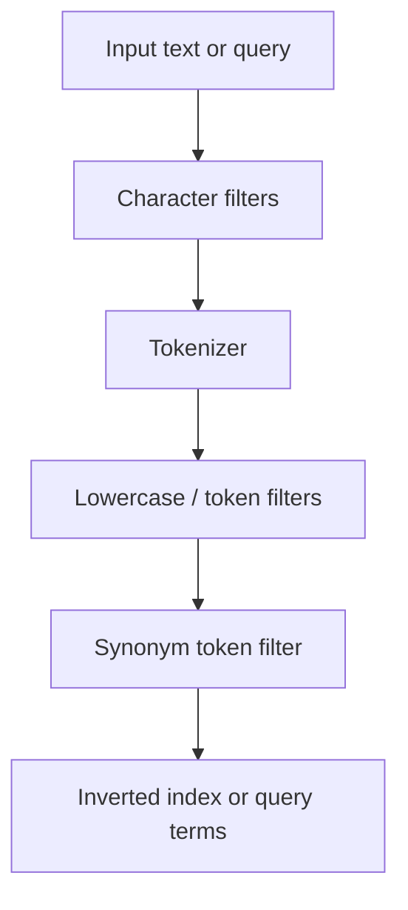
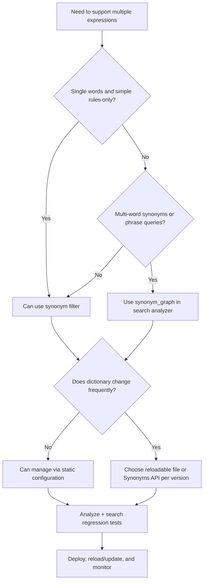

# Synonyms, Synonym Graphs, and Managing Synonym Changes

In full-text search, users may use different words to express the same idea. For example, someone searching for `laptop` might also want to see products described as `notebook`; someone searching for `TV` might want results containing `television`. **Synonyms** help Elasticsearch expand or normalize queries so related expressions can match the same group of documents.

Elasticsearch supports synonyms via token filters inside analyzers. For single words, the `synonym` filter can cover many scenarios. For multi-word synonyms such as `new york` and `nyc`, you need to understand **token graphs** and typically use `synonym_graph` in the search analyzer to preserve phrase structure. When the synonym list changes, how it is configured and when the analyzer is reloaded determine how changes take effect.

This lesson explains how to define rules, choose filters, integrate analyzers with Spring Data Elasticsearch, inspect tokens, update files or synonym sets, and manage changes safely while the system is running.

## 1. Why are synonyms needed in search?

A product or piece of content can be described with many different words:

| User types | Document content | Expectation |
|---|---|---|
| `laptop` | `notebook computer` | Should find the same product. |
| `tv` | `television` | Both terms can be treated as equivalent. |
| `điện thoại` | `smartphone` | Results can be expanded via a business dictionary. |
| `nyc` | `new york city` | An abbreviation can represent a multi-word phrase. |
| `wi-fi` | `wifi` | Normalize spelling variants. |

Without synonyms, the application might have to manually inject multiple OR conditions into every query or store multiple lexical variants in the data. That makes search logic scattered and difficult to maintain.

Synonyms move lexical equivalence rules into the text analysis layer. When the analyzer processes a query, Elasticsearch can expand tokens or phrases according to the synonym dictionary before executing the search.

Synonyms are appropriate when:

- Users have multiple ways to refer to the same concept.
- There are abbreviations, trade names, common names, or spelling variants.
- Content originates from multiple sources with inconsistent terminology.
- You want to update search expansion rules without modifying individual endpoints or query builders.

Do not add synonyms merely because two words are related. For example, `phone` and `case` are both related to phones, but they are not synonymous. Overly broad rules can introduce noisy results, increase hit counts, and degrade relevance ranking accuracy.

## 2. Where do synonyms operate in an analyzer?

An analyzer for a `text` field can consist of character filters, a tokenizer, and token filters. Synonyms are applied as a token filter in that processing chain.



For example, a user enters `TV`. The analyzer can lowercase it to `tv`, and then the synonym filter expands it to `television`. The resulting query can match documents indexed with any of the corresponding terms.

Crucially, the analyzer used when indexing documents and the analyzer used when searching can be different:

- **Index analyzer** processes text when documents are written to the inverted index.
- **Search analyzer** processes user-entered strings when executing queries.

For frequently changing synonyms, a common pattern is keeping the index analyzer stable and placing the synonym filter in the search analyzer. When the dictionary changes, you only need to update/reload the search analyzer without reindexing all documents just to apply new synonyms to queries.

## 3. Synonym rule syntax

Elasticsearch supports two basic rule formats: **equivalent synonyms** and **explicit mappings**.

### 3.1. Equivalent synonyms

Words separated by commas are treated as equivalent. For example:

```text
laptop, notebook
tv, television
wifi, wi-fi, wireless fidelity
```

With the rule `laptop, notebook`, Elasticsearch can expand an input token into the corresponding variants depending on how the filter is configured. This rule format fits cases where terms are interchangeable in search.

A single line can list multiple variants, but ensure they are genuinely equivalent in the business context. If two terms are only near-synonyms or differ in scope, use a directional rule or omit the synonym.

### 3.2. Explicit mappings with `=>`

When you want a one-way mapping, use the `=>` operator:

```text
smartphone => mobile phone
nyc => new york city
```

The left-hand side is the expression matched; the right-hand side is the replacement tokens. This format fits cases where a specific input should be normalized to a target term.

For example, the rule:

```text
nyc => new york city
```

expands the query `nyc` into the phrase `new york city`. The rule does not automatically mean that querying `new york city` expands back to `nyc`.

If you want bidirectional matching, use an equivalent rule:

```text
nyc, new york city
```

### 3.3. Synonym file formatting rules

Example `product-synonyms.txt` file:

```text
# Product terminology
laptop, notebook
tv, television
wifi, wi-fi

# One-way normalization
nyc => new york city
```

Lines starting with `#` are comments. Each rule sits on one line. You can group rules by domain for readability, but avoid putting too many semantically unrelated words on a single line.

Synonym rules are analyzed by the preceding part of the analyzer chain up to the synonym filter's position. Therefore, token filter ordering matters. If a `lowercase` filter precedes the synonym filter, write rules consistently in lowercase or ensure synonym parsing normalizes them as expected.

## 4. Distinguishing `synonym` and `synonym_graph`

These two token filters have similar names but handle token streams differently.

| Criterion | `synonym` | `synonym_graph` |
|---|---|---|
| Purpose | Replaces or expands synonyms in a traditional token stream | Represents synonyms as a token graph to preserve position relationships and token branches |
| Single words | Supported | Supported |
| Multi-word synonyms | Limited when representing phrases/positions | Handles multi-word synonyms properly |
| Phrase queries | May fail to represent phrase branches accurately | Preserves graph structure so query builders understand token paths |
| Common placement | Simple cases, or index-time depending on design | Search analyzer for full-text search, especially with multi-word phrases |

### 4.1. Why does the token graph matter?

Suppose we have an equivalent rule:

```text
nyc, new york city
```

A single token `nyc` corresponds to three tokens `new`, `york`, `city`. If replacement tokens are merely stacked at the same position in a flat token stream, phrase structure can be lost. Phrase queries can misinterpret token relationships and produce unintended results.

`synonym_graph` builds a token graph with branches and appropriate positions to represent multiple expressions. When the search analyzer uses this filter, full-text queries can translate the graph into proper query branches.

Illustration of two representation paths:

```text
Path 1:  nyc
Path 2:  new -> york -> city
```

Both paths represent the same concept while having different token counts. The token graph preserves the metadata required to handle alternative phrases.

### 4.2. Place `synonym_graph` at search time

`synonym_graph` is designed for the search analyzer. Typically, you do not use this filter in the index analyzer to build the inverted index. Placing synonyms at search time offers several benefits:

- Update the synonym dictionary without reindexing all documents.
- Keep original content in the inverted index, avoiding multiplying term counts solely for synonym expansion.
- Support multi-word synonyms with token graphs for queries.
- Tune search rules independently from the data ingestion pipeline.

If synonyms are expanded at index time, terms written to the index reflect the dictionary at that moment. Changing the synonym file later will not automatically transform old terms. Updating results under new rules may require reindexing data or running an equivalent update process.

## 5. Analyzer ordering and how synonym rules are parsed

Token filter order directly affects rules. For example, if the analyzer has `lowercase` before the synonym filter:

```json
{
  "filter": [
    "lowercase",
    "product_synonyms"
  ]
}
```

then tokens are already lowercased before the synonym filter processes them. Rules should be written consistently:

```text
tv, television
wifi, wi-fi
```

If rules contain stop words, consider the placement of the stop filter. A stop filter before the synonym filter may remove tokens inside a rule or invalidate certain rules. Placing the stop filter after the synonym filter also affects replacement tokens differently. There is no universal order suited to every language and rule set; verify the actual analyzer using `_analyze`.

A common configuration for product search is:

```text
standard tokenizer
    -> lowercase
    -> synonym_graph
```

Other filters such as `asciifolding`, stemming, or stop words should be added based on language requirements and tested alongside synonym rules. Do not assume rules will be processed identically if you reorder the tokenizer or token filters.

## 6. Declaring a synonym file in Elasticsearch

For self-managed clusters, rules can be stored in a synonym configuration file. Example file:

`config/analysis/product-synonyms.txt`

```text
laptop, notebook
tv, television
wifi, wi-fi
nyc, new york city
```

Then declare the filter and analyzers in index settings:

```json
PUT products
{
  "settings": {
    "analysis": {
      "filter": {
        "product_synonyms": {
          "type": "synonym_graph",
          "synonyms_path": "analysis/product-synonyms.txt",
          "updateable": true
        }
      },
      "analyzer": {
        "product_index_analyzer": {
          "type": "custom",
          "tokenizer": "standard",
          "filter": ["lowercase"]
        },
        "product_search_analyzer": {
          "type": "custom",
          "tokenizer": "standard",
          "filter": ["lowercase", "product_synonyms"]
        }
      }
    }
  },
  "mappings": {
    "properties": {
      "name": {
        "type": "text",
        "analyzer": "product_index_analyzer",
        "search_analyzer": "product_search_analyzer"
      }
    }
  }
}
```

In this configuration:

- `product_index_analyzer` only lowercases and tokenizes text at index time.
- `product_search_analyzer` adds the synonym graph when analyzing queries.
- `updateable: true` marks the synonym filter as reloadable in the search analyzer via Elasticsearch's search analyzer reload mechanism.
- `synonyms_path` is a file path relative to the Elasticsearch configuration directory on each node.

The file must be present on every node that may execute related analysis operations. Deploy the file consistently across the cluster and ensure read permissions. Do not update the file on a single node and assume the entire cluster is using the new dictionary.

### 6.1. Why separate the index analyzer and search analyzer?

In the example, the `name` field is indexed with an analyzer that has no synonym filter. At search time, the query string is processed by an analyzer with a synonym graph. As a result, documents retain tokens from original content while synonyms are expanded flexibly at query time.

If both analyzers used synonyms, rule changes could affect both indexing and search pipelines. For dictionaries requiring frequent updates, search-time synonym design is usually easier to operate.

## 7. Integrating settings and mappings with Spring Data Elasticsearch

Spring Data Elasticsearch supports declaring settings from classpath resources via `@Setting`, while configuring field analyzers with `@Field`.

Example document:

```java
import org.springframework.data.elasticsearch.annotations.Document;
import org.springframework.data.elasticsearch.annotations.Field;
import org.springframework.data.elasticsearch.annotations.FieldType;
import org.springframework.data.elasticsearch.annotations.Setting;

@Document(indexName = "products")
@Setting(settingPath = "/elasticsearch/product-settings.json")
public class ProductDocument {

    @Field(
        type = FieldType.Text,
        analyzer = "product_index_analyzer",
        searchAnalyzer = "product_search_analyzer"
    )
    private String name;
}
```

The `/elasticsearch/product-settings.json` resource contains the `analysis` section matching the index settings configuration in the previous example. The resource can be placed under:

```text
src/main/resources/
└── elasticsearch/
    └── product-settings.json
```

When Spring Data creates the index from entity metadata, the settings resource is used to configure analyzers and filters. If indices are created via external templates or migrations, ensure settings and mappings are deployed before the application uses the index.

Note that `@Setting` is metadata used during index creation. It is not a mechanism that automatically updates production index settings whenever the resource file changes. An existing index keeps the settings applied at creation unless a supported management operation is executed.

## 8. Inspecting synonyms with the Analyze API

Before pushing rules to production, inspect the actual token graph produced by the analyzer.

Example testing the search analyzer:

```json
POST products/_analyze
{
  "analyzer": "product_search_analyzer",
  "text": "tv"
}
```

Testing a multi-word synonym:

```json
POST products/_analyze
{
  "analyzer": "product_search_analyzer",
  "text": "nyc",
  "explain": true
}
```

`explain: true` provides extra details across analysis steps, useful for inspecting tokens and positions in the graph. Depending on the Elasticsearch version, response structure may vary; inspect `token`, `position`, and `positionLength` rather than looking only at token strings.

A test workflow should verify at least:

1. Does querying with the base term produce the expected variants?
2. Does querying with a synonym match documents using the alternate term?
3. Do one-way rules expand in the intended direction only?
4. Do phrase queries preserve proper ordering and phrasing?
5. How are casing, punctuation, hyphens, and Vietnamese diacritics handled?
6. Do overlapping or duplicate-term rules cause excessive expansion?

After the Analyze API, run searches against a representative set of documents. A valid token graph does not automatically guarantee business-appropriate relevance ranking; observe actual results and scores.

## 9. Updating the synonym file and reloading search analyzers

With a synonym file declared via `synonyms_path`, editing the file contents does not mean the running analyzer has loaded the new rules. You must invoke Elasticsearch's supported search analyzer reload mechanism.

General workflow:

1. Edit the synonym file following your configuration management process.
2. Validate syntax and deploy the file uniformly across required nodes.
3. Call the reload search analyzers API for the affected index.
4. Check the response to confirm analyzers were reloaded.
5. Re-run `_analyze` and representative queries to verify the new rules are active.

The reload API looks like:

```http
POST products/_reload_search_analyzers
```

For reload to work, the synonym filter must be configured appropriately for a search analyzer, such as `updateable: true`. This mechanism applies to reloadable analyzers; changing an index analyzer or mapping structure usually requires a different plan and may require creating an index and reindexing.

In a multi-node cluster, ensure files are identical before reloading. If nodes load different rule versions, search results can become inconsistent depending on which node handles the request. Deploy files as a versioned configuration artifact, then reload through an observable, controlled procedure.

### 9.1. Reloading does not replace testing

A successful reload only indicates the analyzer loaded the new configuration per the API. It does not validate that the new dictionary has high quality. After reloading, still run the Analyze API and search regression tests against key business queries.

If a file contains malformed rules, loading the analyzer may fail or the index may be unable to use the analyzer as expected. Therefore, validate files before deployment and keep the previous version available for rollback.

## 10. Managing synonym sets via API

In Elasticsearch versions supporting the Synonyms API, you can manage synonym sets via API instead of distributing files to every node. A synonym set has an identifier and a list of rules managed inside Elasticsearch.

Example creating or updating a synonym set:

```json
PUT _synonyms/product-synonyms
{
  "synonyms_set": [
    {
      "id": "laptop-notebook",
      "synonyms": "laptop, notebook"
    },
    {
      "id": "tv-television",
      "synonyms": "tv, television"
    },
    {
      "id": "nyc-new-york",
      "synonyms": "nyc, new york city"
    }
  ]
}
```

Then configure the synonym graph filter to reference the set:

```json
{
  "type": "synonym_graph",
  "synonyms_set": "product-synonyms",
  "updateable": true
}
```

The set name in `synonyms_set` must match the name created via the API. Each rule has an `id` so it can be identified and updated via the corresponding API.

The Synonyms API was introduced in newer Elasticsearch versions; verify your server version and Java API Client before choosing this approach. Not every Elasticsearch version or Elasticsearch-compatible service supports the same API set.

When using an Elasticsearch-managed synonym set, the update lifecycle differs from a `synonyms_path` file: an application or administrative process calls the API to modify the set, and Elasticsearch manages updating analyzers referencing that set according to that version's mechanics. Check reload status and behavior in the documentation for your deployed version; do not mix file-based rules and set-based rules in the same filter without a clear design.

### 10.1. Choosing file-based vs. synonym set

| Criterion | `synonyms_path` file | Synonym set API |
|---|---|---|
| Where rules live | Configuration file on nodes | Synonym set managed by Elasticsearch |
| Distribution | Must deploy identical files across nodes | Updated via set management API |
| Update workflow | Edit file, then reload search analyzer | Call API to update set and follow version-specific reload behavior |
| Best suited for | Self-managed clusters, GitOps-style configuration | Versions supporting Synonyms API needing centralized management |
| Things to watch | Paths, file permissions, node sync, reload | API permissions, version compatibility, managing rule IDs and set contents |

Choose one mechanism as the source of truth for each synonym collection. If storing rules in Git, define how changes sync from Git to the file or API set, how changes are reviewed, and how to roll back.

## 11. Managing synonym changes in production

Synonyms are part of search quality and can alter results broadly. A new rule can increase hit counts, shift scores, or pull previously unrelated documents into results. Therefore, managing synonyms requires a process similar to any configuration change affecting product behavior.

### 11.1. Versioning and reviewing rules

Manage synonyms as versioned data:

- Store rule files or manifests in source control when using file-based configuration.
- Annotate each rule with business context, requester, and rationale.
- Review rules with broad scope or potential to produce excessive irrelevant matches.
- Prevent teams from independently adding duplicate or conflicting rules.
- Retain previous releases so you can roll back.

With synonym sets, keep an export or source definition in a repository so it can be reproduced, audited, and reviewed, even if runtime data lives in Elasticsearch.

### 11.2. Regression testing

Build a benchmark query suite covering:

- Base terms and synonym variants.
- Multi-word phrases and abbreviations.
- Accented, unaccented, and mixed-case queries.
- Similar-looking terms that are not synonyms.
- Queries that must exclude a specific group of documents.

Evaluate both expected results and unexpected results. Verifying that a new synonym returns more documents is not enough; ensure noisy documents are not pushed into results excessively.

### 11.3. Rollback-ready deployment

A deployment workflow should include these steps:

1. Prepare the new rule version and validate syntax.
2. Run the Analyze API on representative examples.
3. Run search regression tests on test data.
4. Deploy rules to staging and evaluate results.
5. Release to production as an identified version.
6. Reload search analyzers or update the synonym set using the active mechanism.
7. Verify token graphs and search results after the change.
8. Monitor hit counts, latency, query errors, and user feedback.
9. Roll back rules if results degrade or analyzer loading fails.

Do not edit synonym files directly in production without recording the changes. If an emergency edit is necessary, record before/after versions and sync back to configuration management afterward.

## 12. Common pitfalls with synonyms

### 12.1. Synonyms can increase query branching

A rule expands one term into multiple variants. If multiple rules fire in one query, the query graph can produce many branches. This can increase execution cost and shift relevance ranking. Avoid overly broad synonyms or chaining word groups that are not truly equivalent.

### 12.2. Synonyms do not replace stemming or fuzzy search

Synonyms handle terms declared in a dictionary. Stemming reduces words to root forms via language rules; fuzzy search finds words within a character edit distance. The three mechanisms serve different purposes and can be combined, while weighing analyzer order, query cost, and accuracy.

### 12.3. Be careful with stop words and multi-word rules

If a stop filter removes a word appearing in a synonym rule, the rule may not parse as intended. With multi-word synonyms, use `synonym_graph` in the search analyzer and check `position`/`positionLength`. Do not evaluate solely by inspecting a flattened token list.

### 12.4. Synonyms do not automatically update indexed documents

Search-time synonyms only change how queries are analyzed. They do not rewrite `_source` and do not change indexed tokens. If index-time synonyms change, old documents retain terms under the old analyzer; achieving consistency may require reindexing.

### 12.5. Exact identifiers usually should not expand synonyms

SKUs, serial numbers, order codes, and IDs typically require exact matching. Do not pass these fields through synonym filters unless there is an explicit business requirement. Keeping them as `keyword` and using exact queries is usually safer.

## 13. Decision workflow



Determine word count in synonyms, phrase search requirements, update frequency, and cluster operations before choosing the filter and rule storage mechanism.

## 14. Conclusion

Synonyms help search recognize multiple expressions of the same concept. Equivalent rules fit interchangeable terms; `=>` rules fit directional mappings. `synonym` handles simple cases, while `synonym_graph` preserves the token graph structure needed for multi-word synonyms and phrase search.

In Spring Data Elasticsearch, declare analyzers in index settings and bind `analyzer`/`searchAnalyzer` on fields. For dictionaries needing frequent updates, prefer a search-time synonym design to avoid reindexing whenever rules change. Rules can be managed via `synonyms_path` files combined with search analyzer reload, or via the Synonyms API if supported by your Elasticsearch version.

All synonym changes should be versioned, verified with the Analyze API and search regression tests, deployed uniformly across the cluster, and paired with a rollback plan. When managed this way, synonyms become a controllable lever for search quality rather than an unpredictable rule set.
