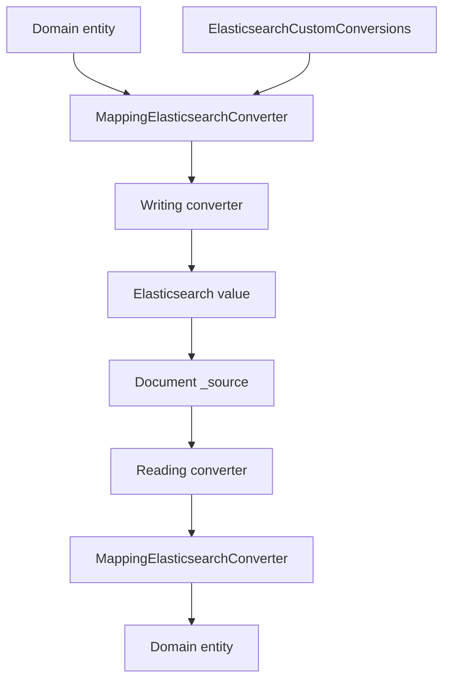

# Registering ElasticsearchCustomConversions

In a Spring Data Elasticsearch application, Java entities often do not share the exact same structure as the JSON documents stored in Elasticsearch. The domain model may use value objects, custom identifier types, specialized temporal types, or wrapper classes designed to enforce business rules. Elasticsearch, on the other hand, requires values that can be represented by types supported in its mapping, such as `keyword`, `text`, numbers, booleans, dates, objects, or arrays.

Spring Data Elasticsearch uses a conversion mechanism to translate between those two worlds. `ElasticsearchCustomConversions` is where additional converters are registered for `MappingElasticsearchConverter` to use when writing an entity into a document and reading a document back into an entity.

For example, the domain model has a dedicated `Sku` type to represent a product code. On the Java side, the application wants to use `Sku` rather than passing arbitrary strings everywhere. In Elasticsearch, the `sku` field can be stored as a `keyword`. A writing converter converts `Sku` to `String`; a reading converter converts `String` back to `Sku`. Once these two converters are registered in `ElasticsearchCustomConversions`, Spring Data can perform the conversion during the mapping flow.

## 1. Why Are Custom Conversions Needed?

The domain model usually prioritizes business semantics and rules. The Elasticsearch document prioritizes data structure and field types for search. The two models can differ.

For example, an application might have:

```java
public class Product {
    private Sku sku;
    private Money price;
    private ProductStatus status;
}
```

While the document needs to be stored as JSON:

```json
{
  "sku": "SKU-1001",
  "price": {
    "amount": 185000,
    "currency": "VND"
  },
  "status": "ACTIVE"
}
```

Types like `Sku`, `Money`, and `ProductStatus` carry domain meaning. Elasticsearch does not inherently know how to interpret a custom Java class into an appropriate field. Without proper conversion, the mapping converter might treat that class as an object whose sub-properties need mapping, or fail to convert it if the type lacks a structure it understands.

Custom conversion lets you explicitly define how a domain type is represented in `_source` and how that type is restored when reading a document.

Common cases that need custom converters:

- Value objects like `Sku`, `EmailAddress`, `PhoneNumber`, `Money`, or business identifiers.
- Custom data types that need to be stored as a simple Elasticsearch type.
- A Java type that requires a standardized storage format, such as a date-time string following a custom convention.
- A Java structure that needs to be converted into a map, list, or another Elasticsearch data type.
- Reverse conversion from the document data type back to the domain type when reading.

You should not create custom converters for every property. Common Java types already supported by Spring Data generally do not need separate converters. Only add a conversion when there is a genuine difference in representation or when you want explicit control over the storage contract.

## 2. Where Does Conversion Happen in the Architecture?

In Spring Data Elasticsearch, `ElasticsearchCustomConversions` provides metadata and converters to the mapping converter. `MappingElasticsearchConverter` uses the mapping context alongside custom conversions to convert between Java objects and document data.



Write flow:

1. The application calls `repository.save(product)` or a write operation via `ElasticsearchOperations`.
2. Spring Data reads the entity and field metadata.
3. The mapping converter checks for a custom conversion matching the property type.
4. The writing converter transforms the domain value into a storable data type.
5. The mapping converter builds the document to send to Elasticsearch.

Read flow:

1. Elasticsearch returns a JSON document.
2. The mapping converter reads metadata for the target entity.
3. For fields with custom conversions, the reading converter converts the stored type into the domain type.
4. The mapping converter instantiates the Java entity and populates its properties.

Converters are invoked during the data mapping process. They are not repositories, query builders, or index creation mechanisms. The actual Elasticsearch mapping must still align with the data type produced by the writing converter.

## 3. Distinguishing Reading Converters and Writing Converters

A custom conversion typically has two directions:

| Direction | Source | Target | When Used |
|---|---|---|---|
| Writing | Domain type | Elasticsearch-compatible type | When writing an entity to a document |
| Reading | Elasticsearch-compatible type | Domain type | When reading a document to an entity |

Spring Data uses two annotations to make the conversion direction explicit:

- `@WritingConverter`: marks a converter used for the write direction.
- `@ReadingConverter`: marks a converter used for the read direction.

Both annotations belong to the `org.springframework.data.convert` package.

Converters typically implement Spring's `Converter<S, T>` interface:

```java
import org.springframework.core.convert.converter.Converter;

public class SomeConverter implements Converter<SourceType, TargetType> {

    @Override
    public TargetType convert(SourceType source) {
        // Convert source to target.
        return ...;
    }
}
```

When source and target types could be ambiguous—especially with simple types like `String`, `Long`, `BigDecimal`, or other scalar types—you should mark the converter with its direction. This prevents Spring Data from having to guess intent from the type pair.

Do not build a bidirectional converter by trying to handle both directions inside a single `convert` method. Each converter has one concrete source type and target type; declare separate reading and writing converters to make them easy to read, test, and register.

## 4. Domain Value Object Example: Sku

Suppose every product has an SKU code. On the domain side, this code is represented by a dedicated type to normalize data and avoid passing raw strings throughout the application.

### 4.1 Declaring the value object

```java
import java.util.Locale;
import java.util.Objects;

public record Sku(String value) {

    public Sku {
        Objects.requireNonNull(value, "sku must not be null");

        String normalized = value.trim().toUpperCase(Locale.ROOT);
        if (normalized.isEmpty()) {
            throw new IllegalArgumentException("sku must not be blank");
        }

        value = normalized;
    }
}
```

`Sku` keeps normalization rules in one place. After creating the object, the value is always trimmed and uppercased using `Locale.ROOT`. Normalization does not depend on the server's locale.

This is a simple domain type example. A real-world value object might include additional format validation, length rules, or factory constructors.

### 4.2 Writing converter: Sku to String

```java
import org.springframework.core.convert.converter.Converter;
import org.springframework.data.convert.WritingConverter;

@WritingConverter
public class SkuToStringConverter implements Converter<Sku, String> {

    @Override
    public String convert(Sku source) {
        return source.value();
    }
}
```

The writing converter accepts `Sku` and returns `String`. With `Sku("sku-1001")`, the stored value is `"SKU-1001"` because the value object constructor already normalized it.

The target type `String` is a simple type that Elasticsearch can store. The corresponding field should have an appropriate mapping, such as `keyword` if the SKU code is used for filtering or exact matching.

### 4.3 Reading converter: String to Sku

```java
import org.springframework.core.convert.converter.Converter;
import org.springframework.data.convert.ReadingConverter;

@ReadingConverter
public class StringToSkuConverter implements Converter<String, Sku> {

    @Override
    public Sku convert(String source) {
        return new Sku(source);
    }
}
```

The reading converter receives the string value from the document and reconstructs `Sku`. The `Sku` constructor continues to enforce normalization and validation rules.

When legacy data in the index does not conform to the current format, the constructor may throw an exception. This is a signal of invalid data; you should not silently return a default value that distorts domain meaning. If legacy data must be supported, handle it explicitly in the converter or via a migration.

### 4.4 Using Sku in an entity

```java
import org.springframework.data.annotation.Id;
import org.springframework.data.elasticsearch.annotations.Document;
import org.springframework.data.elasticsearch.annotations.Field;
import org.springframework.data.elasticsearch.annotations.FieldType;

@Document(indexName = "products")
public class Product {

    @Id
    private String id;

    @Field(type = FieldType.Keyword)
    private Sku sku;

    @Field(type = FieldType.Text)
    private String name;

    protected Product() {
    }

    public Product(String id, Sku sku, String name) {
        this.id = id;
        this.sku = sku;
        this.name = name;
    }

    public String getId() {
        return id;
    }

    public Sku getSku() {
        return sku;
    }

    public String getName() {
        return name;
    }
}
```

In the entity, the property remains `Sku`. `@Field(type = FieldType.Keyword)` describes the field type in Elasticsearch. Custom converters determine how the `sku` property value is converted to a string before writing and converted back to `Sku` when reading.

The desired mapping on the index looks like:

```json
{
  "properties": {
    "sku": {
      "type": "keyword"
    },
    "name": {
      "type": "text"
    }
  }
}
```

When writing the entity, `_source` may contain:

```json
{
  "id": "product-1001",
  "sku": "SKU-1001",
  "name": "Mechanical Keyboard"
}
```

When reading this document as `Product`, the `sku` property receives a `Sku` object, not a `String`.

## 5. Registering ElasticsearchCustomConversions

Writing the converters only defines the conversion logic. For the mapping converter to use them, the converters must be registered in `ElasticsearchCustomConversions`.

With Java configuration based on Spring Data Elasticsearch 5.x's `ElasticsearchConfiguration`, you can override the `elasticsearchCustomConversions()` method:

```java
import java.time.Duration;
import java.util.List;

import org.springframework.context.annotation.Configuration;
import org.springframework.data.elasticsearch.client.ClientConfiguration;
import org.springframework.data.elasticsearch.client.elc.ElasticsearchConfiguration;
import org.springframework.data.elasticsearch.core.convert.ElasticsearchCustomConversions;

@Configuration
public class ElasticsearchConfig extends ElasticsearchConfiguration {

    @Override
    public ClientConfiguration clientConfiguration() {
        return ClientConfiguration.builder()
            .connectedTo("localhost:9200")
            .withConnectTimeout(Duration.ofSeconds(3))
            .withSocketTimeout(Duration.ofSeconds(10))
            .build();
    }

    @Override
    public ElasticsearchCustomConversions elasticsearchCustomConversions() {
        return new ElasticsearchCustomConversions(List.of(
            new SkuToStringConverter(),
            new StringToSkuConverter()
        ));
    }
}
```

The `elasticsearchCustomConversions()` method returns an object holding the list of converters. Spring Data uses this bean when configuring `MappingElasticsearchConverter`. When entities are written or read through repositories or operations using that converter, the registered conversions are applied.

The `clientConfiguration()` part only illustrates a minimal client setup so the example can stand as a complete configuration class. In a real application, keep endpoints, TLS, authentication, and timeouts appropriate for your deployment environment.

### 5.1 If configuring the client with Spring Boot auto-configuration

An application may be using Spring Boot auto-configuration instead of extending `ElasticsearchConfiguration`. In that case, you can register `ElasticsearchCustomConversions` as a bean if your Spring Data/Spring Boot version picks up this bean to configure the converter:

```java
@Configuration
public class ElasticsearchConversionConfig {

    @Bean
    public ElasticsearchCustomConversions elasticsearchCustomConversions() {
        return new ElasticsearchCustomConversions(List.of(
            new SkuToStringConverter(),
            new StringToSkuConverter()
        ));
    }
}
```

Choose one configuration approach that fits your current architecture. If a configuration class already extends `ElasticsearchConfiguration`, use its override method. If the project uses auto-configuration, register the bean through the mechanism supported by the version in use. Do not create multiple competing conversion beans or manually instantiate a separate `MappingElasticsearchConverter` without replacing the converter used by repositories.

Package names and extension points may vary across Spring Data Elasticsearch lines. Check the API of your project's exact dependency version before applying examples.

### 5.2 The converter list can contain multiple pairs

A single `ElasticsearchCustomConversions` can accept multiple converters:

```java
@Override
public ElasticsearchCustomConversions elasticsearchCustomConversions() {
    return new ElasticsearchCustomConversions(List.of(
        new SkuToStringConverter(),
        new StringToSkuConverter(),
        new EmailAddressToStringConverter(),
        new StringToEmailAddressConverter(),
        new ExternalCodeToStringConverter(),
        new StringToExternalCodeConverter()
    ));
}
```

Each converter should have a specific responsibility and a clear source/target type pair. Do not bundle unrelated domain rules into a single generic converter just because they all convert to `String`.

## 6. Role of @ReadingConverter and @WritingConverter

Spring Data can infer some conversion directions from source and target types, but simple type pairs can cause ambiguity. For example, converters `String -> Sku` and `Sku -> String` have two obvious directions to the author, yet when multiple converters use `String`, marking the direction ensures conversion metadata does not rely on uncertain inference.

For a converter from a custom domain type to an Elasticsearch simple type, annotate with `@WritingConverter`:

```java
@WritingConverter
public class SkuToStringConverter implements Converter<Sku, String> {
    @Override
    public String convert(Sku source) {
        return source.value();
    }
}
```

For a converter from a simple document type to a custom domain type, annotate with `@ReadingConverter`:

```java
@ReadingConverter
public class StringToSkuConverter implements Converter<String, Sku> {
    @Override
    public Sku convert(String source) {
        return new Sku(source);
    }
}
```

These annotations do not replace registering the converters. They describe the converter's intent; `ElasticsearchCustomConversions` remains the place that collects and supplies them to the mapping converter.

## 7. What Data Types Can a Converter Return?

The target type of a writing converter must be appropriately representable by both the mapping converter and Elasticsearch. Typically, you can use simple types or structures supported by Spring Data:

| Target Type | Usage Example | Commonly Suitable Elasticsearch Mapping |
|---|---|---|
| `String` | SKU, external code, status | `keyword` or `text` depending on query needs |
| `Long`, `Integer`, `Double` | Normalized numeric values | Corresponding numeric type |
| `Boolean` | Status flags | `boolean` |
| Supported date/time types | Date or instant | `date` |
| `Map<String, Object>` | Multi-field value object | `object` with matching properties |
| `List<?>` | List of values | Multi-valued field or `object`/`nested` depending on mapping |

Just because a conversion works in Java does not mean the Elasticsearch mapping automatically matches. For example, if a converter returns `String` while the index mapping is `long`, indexing operations may fail or data may not satisfy the desired queries or sorts. The written data type and the index mapping must agree.

### 7.1 Example: Money to Map

If you want to store `Money` as an object containing amount and currency, the converter can return `Map<String, Object>`:

```java
import java.math.BigDecimal;
import java.util.LinkedHashMap;
import java.util.Map;

public record Money(BigDecimal amount, String currency) {
}
```

Writing converter:

```java
import java.util.Map;
import java.util.LinkedHashMap;

import org.springframework.core.convert.converter.Converter;
import org.springframework.data.convert.WritingConverter;

@WritingConverter
public class MoneyToMapConverter implements Converter<Money, Map<String, Object>> {

    @Override
    public Map<String, Object> convert(Money source) {
        Map<String, Object> result = new LinkedHashMap<>();
        result.put("amount", source.amount());
        result.put("currency", source.currency());
        return result;
    }
}
```

Reading converter:

```java
import java.math.BigDecimal;
import java.util.Map;

import org.springframework.core.convert.converter.Converter;
import org.springframework.data.convert.ReadingConverter;

@ReadingConverter
public class MapToMoneyConverter implements Converter<Map<String, Object>, Money> {

    @Override
    public Money convert(Map<String, Object> source) {
        Object amountValue = source.get("amount");
        Object currencyValue = source.get("currency");

        if (amountValue == null || currencyValue == null) {
            throw new IllegalArgumentException("Invalid money document");
        }

        BigDecimal amount = new BigDecimal(amountValue.toString());
        String currency = currencyValue.toString();
        return new Money(amount, currency);
    }
}
```

The corresponding field mapping can be `object`:

```json
"price": {
  "type": "object",
  "properties": {
    "amount": { "type": "scaled_float", "scaling_factor": 100 },
    "currency": { "type": "keyword" }
  }
}
```

This example illustrates the conversion structure. Currency precision and `scaling_factor` must align with business rules. If you need to filter or sort by amount, the amount field must be indexed as a numeric type; if you write the entire `Money` as a single string, Elasticsearch cannot run numeric range queries on that string as a number.

## 8. Global Conversion and Property-Specific Conversion

`ElasticsearchCustomConversions` registers converters at the mapping converter level, so they can be used across multiple entities sharing the same type pairs. This is the right choice when a value object has a consistent representation across the entire application.

Sometimes the same Java type needs to be stored differently on two properties. For instance, a `LocalDateTime` on field A needs to be stored as a UTC timestamp, whereas field B needs to be stored as a string in a business timezone. A single global converter cannot express two different rules per property.

Spring Data Elasticsearch offers property-specific conversion via `@ValueConverter` and `PropertyValueConverter` in supported versions. This mechanism binds a converter to a specific property rather than registering a global conversion.

Conceptual example:

```java
@Field(type = FieldType.Keyword)
@ValueConverter(SkuPropertyConverter.class)
private Sku sku;
```

Property converters implement `PropertyValueConverter` according to the API of your Spring Data Elasticsearch version. This mechanism fits when the same Java type has multiple representations depending on where it is used.

Choose:

- `ElasticsearchCustomConversions` when a domain type always has the same conversion everywhere.
- `@ValueConverter` when the conversion applies only to one property or requires per-field rules.

Do not register both a global conversion and a property converter for the same field without clearly understanding precedence and semantics. Avoid overlapping configurations that make it hard for readers to tell which rule is actually taking effect.

## 9. Custom Conversions and Field Mapping

Custom converters determine how Java values are represented. `@Field` and Elasticsearch mapping determine how that field is indexed. These two parts must be designed together.

For example, `SkuToStringConverter` returns a `String`. If `sku` is used for:

- Exact code lookup: use `keyword`.
- Full-text search by token: consider `text`, though it is usually unsuitable for SKU codes.
- Sorting or aggregation: `keyword` can be suitable if the field and configuration allow doc values.

A converter does not automatically create a `keyword` mapping. The mapping must be declared with annotations or managed via index templates or migrations. If the mapping already exists, changing the converter does not automatically alter the old mapping.

### 9.1 Inspecting `_source` and actual mapping

After saving an entity, inspect the document:

```http
GET /products/_doc/product-1001
```

Confirm that `sku` was written as the expected normalized string. Then inspect the mapping:

```http
GET /products/_mapping
```

The `sku` field must have a type matching the value produced by the converter. Do not only inspect the Java object after calling `save()`, because an in-memory object does not prove that data on the cluster has the correct structure.

## 10. Do Custom Conversions Automatically Convert Queries?

Do not assume that every query value in every API is converted identically to an entity property when writing a document. The mapping converter may participate in certain query-building flows or convert values using metadata, but exact behavior depends on the specific API.

In particular, distinguish between:

- Writing an entity via repository/operations: the mapping converter converts properties based on metadata.
- Reading results into an entity: the mapping converter converts stored values back into Java types.
- Derived queries or query methods: Spring Data builds queries based on metadata and the version's query creator mechanism.
- Explicit Query DSL via `NativeQuery`/Java Client: query authors typically specify fields and values matching the Elasticsearch mapping.

With `Sku`, querying the `sku` field in Elasticsearch needs to use the canonical string, such as `SKU-1001`. Do not pass a Java `Sku` object directly into raw Query DSL and assume the transport layer will automatically know how to convert it.

REST query example:

```json
GET /products/_search
{
  "query": {
    "term": {
      "sku": "SKU-1001"
    }
  }
}
```

If using repository derived queries, inspect the generated query and verify behavior with the Spring Data version in use. If using a raw query builder, convert `Sku` to its stored value explicitly or use mapping-aware APIs supported by your version's documentation.

## 11. Testing Custom Converters

Converters contain pure conversion logic, so they can be tested independently before testing against Elasticsearch. For `Sku`, verify:

- The writing converter returns the exact canonical string.
- The reading converter recreates a `Sku` with the expected value.
- Empty or invalid values are handled according to domain rules.
- Round-tripping preserves data semantics.

JUnit unit test example:

```java
import static org.junit.jupiter.api.Assertions.assertEquals;
import static org.junit.jupiter.api.Assertions.assertThrows;

import org.junit.jupiter.api.Test;

class SkuConverterTest {

    private final SkuToStringConverter writing = new SkuToStringConverter();
    private final StringToSkuConverter reading = new StringToSkuConverter();

    @Test
    void writesCanonicalSku() {
        assertEquals("SKU-1001", writing.convert(new Sku(" sku-1001 ")));
    }

    @Test
    void readsSkuFromStoredString() {
        assertEquals(new Sku("sku-1001"), reading.convert("SKU-1001"));
    }

    @Test
    void rejectsBlankSku() {
        assertThrows(IllegalArgumentException.class, () -> new Sku("  "));
    }
}
```

After unit tests, integration tests against a compatible Elasticsearch instance are needed to confirm registration is actually picked up by `MappingElasticsearchConverter` and repositories/operations.

An integration test should:

1. Initialize an application context configured with `ElasticsearchCustomConversions`.
2. Create the index with the corresponding mapping or verify the index is created from entity metadata.
3. Save an entity containing `Sku`.
4. Read `_source` via the Elasticsearch REST API and confirm `sku` is the canonical string.
5. Read the document through the repository or operations.
6. Verify the returned Java property is a `Sku`, not a `String` or an unintended map object.
7. Test legacy or malformed data if the converter has dedicated handling rules.

Unit tests only prove the converter works in isolation. Integration tests confirm the converter is properly registered and participates in the application's mapping pipeline.

## 12. Common Pitfalls

### 12.1 Writing a converter but forgetting to register it

Having a converter class in source code does not mean Spring Data automatically uses it. You must include the converter in `ElasticsearchCustomConversions` configured for the mapping converter. If a converter is not registered, the field may be treated as a regular object or fail to read/write as intended.

### 12.2 Swapping reading and writing directions

If the wrong annotation is applied, Spring Data may select a converter in the wrong direction or fail to recognize conversion intent. Check the source and target types:

- Domain `Sku` to `String`: writing.
- `String` from document to `Sku`: reading.

Name classes after their conversion direction to avoid confusion.

### 12.3 Converter returns a type that mismatches the mapping

A converter may run successfully in Java, yet Elasticsearch rejects the document due to incompatible mapping. For instance, the converter returns a string while the field mapping is `long`. Check both the written value and the current mapping.

### 12.4 Asymmetric converters

If the writing converter produces a format that the reading converter cannot parse, written data cannot be read back. Design both directions as a storage contract and write round-trip tests.

### 12.5 Changing formats while forgetting existing data

If `Sku` was previously stored as a lowercase string and the converter now writes uppercase, the reading converter still needs to handle existing data or a migration must occur. Changing a converter does not automatically rewrite already-stored documents.

### 12.6 Using a global converter for single-field rules

If the same Java type has different representations across properties, a global converter can cause unintended side effects. Consider `@ValueConverter` for property-specific conversion.

### 12.7 Converters depending on services or making network calls

Converters should perform deterministic, fast conversions without side effects. Do not call databases, REST APIs, or external services inside `convert()`. Mapping can invoke converters many times during reads and writes; network calls here increase latency and make mapping operations unpredictable.

### 12.8 Instantiating a separate MappingElasticsearchConverter

If the application manually creates a separate converter while repositories still use the Spring-configured converter bean, custom conversions may not apply. Register `ElasticsearchCustomConversions` through the proper extension point used by Spring Data configuration rather than creating an extra converter disconnected from the pipeline.

## 13. Changing Converters and Existing Data

A converter is part of the storage contract. When changing how a type is represented, consider both new documents and existing documents.

For example, the first version stored `sku` as a plain string; the new version wants to store an object containing `code` and `source`. This is not just a Java converter change. It may require changing the mapping from `keyword` to `object`, migrating old data, and adjusting queries.

A change process should include:

1. Identify the current format in `_source` and the mapping.
2. Design the new format along with reading and writing converters.
3. Decide whether the reading converter must support both old and new formats during a transition period.
4. Create a new index if the mapping changes in a way Elasticsearch does not allow updating in place.
5. Reindex or transform documents in a controlled process.
6. Verify queries, sorts, aggregations, and data-reading applications.
7. Switch the application to the new index/mapping and monitor conversion errors.

Do not assume a new converter will automatically run over all existing data. Converters only execute when the application performs mapping; old documents remain in the index with their old `_source` until updated or reindexed.

## 14. Design Principles for Custom Converters

A well-designed converter needs a clear contract:

- Specify exact source and target types.
- Mark the proper reading or writing direction when needed.
- Perform deterministic conversion independent of global state.
- Avoid network access or side effects.
- Handle nulls and invalid data under a consistent policy.
- Preserve required information; do not lose numeric precision or timezone info.
- Produce a data type compatible with Elasticsearch mapping.
- Provide a corresponding reading converter if the application needs to read back into the domain type.
- Include unit tests for logic and integration tests for registration and the pipeline.
- Assess impact on existing documents when changing formats.

Especially for monetary amounts, dates/times, and high-precision data, design representations carefully. For example, `double` may not suit every financial use case; `scaled_float`, integers in minor units, or an amount/currency structure may be better depending on requirements. For time, distinguish between calendar dates and timezone-aware instants.

## 15. Summary

`ElasticsearchCustomConversions` is the mechanism for registering converters used by Spring Data Elasticsearch in the mapping pipeline. Writing converters transform domain types into storable Elasticsearch data types; reading converters transform document data back into domain types. `@WritingConverter` and `@ReadingConverter` clarify conversion direction, especially when simple types could cause ambiguity.

To implement this, define converters, register them in `ElasticsearchCustomConversions` through the Spring Data configuration appropriate for your version, and ensure field mappings are compatible with the converter output types. Use global conversions when a type shares the same representation everywhere; use property-specific conversions when a rule applies to a single field. Finally, run round-trip and Elasticsearch integration tests to confirm that repositories and operations actually use the registered converters.

## References

- [Spring Data Elasticsearch Reference — Object Mapping](https://docs.spring.io/spring-data/elasticsearch/reference/elasticsearch/object-mapping.html)
- [Spring Data Elasticsearch Reference — Configuration](https://docs.spring.io/spring-data/elasticsearch/reference/elasticsearch/clients.html)
- [Spring Data Commons — Custom Conversions](https://docs.spring.io/spring-data/commons/reference/custom-conversions.html)
