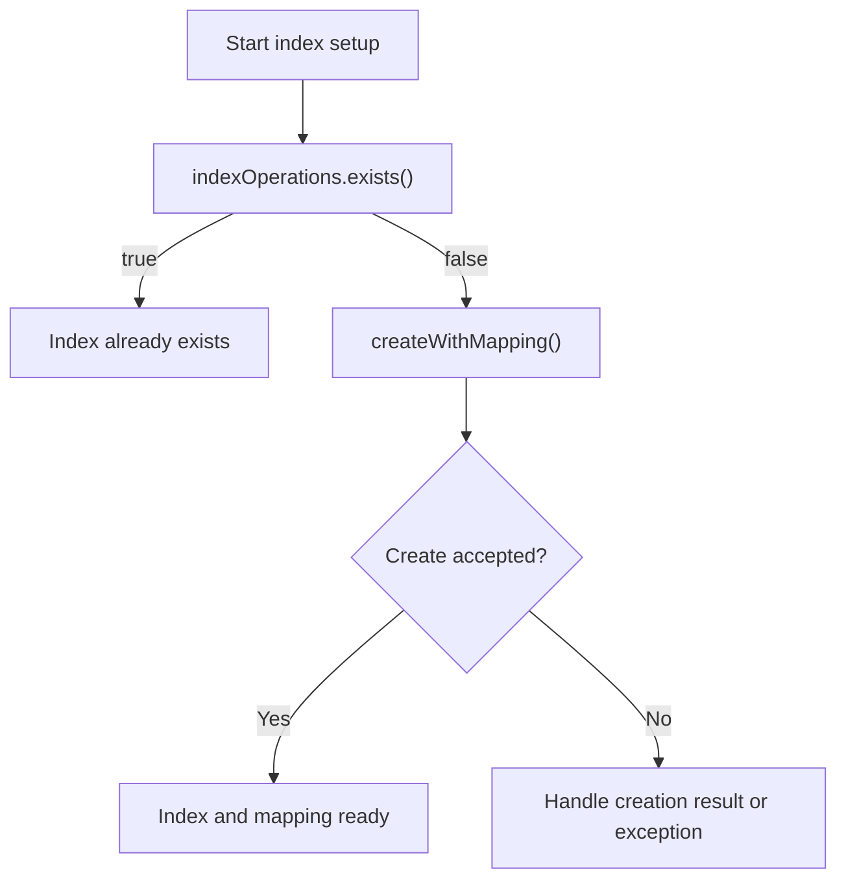
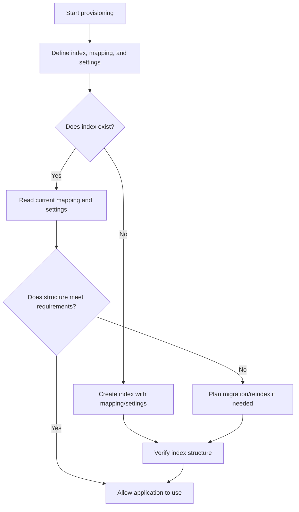

# Checking Existence, Creating, and Deleting an Index

Elasticsearch stores documents inside an **index**. Before writing data, the application needs an index with the appropriate name, settings, and mapping. In Spring Data Elasticsearch, index management operations are typically performed through **`IndexOperations`**, an API belonging to `ElasticsearchOperations`.

This lesson presents how to check whether an index exists, create an index along with its mapping from entity metadata, delete an index, and manage the index lifecycle intentionally. We also look at how to call the Index API directly using `ElasticsearchClient` when raw request control is needed.

## 1. What Is an Index and Why Must It Be Managed?

Elasticsearch stores data using a JSON document model. Documents are grouped into indexes. An index has the following main components:

- **Index name**: the identifier where documents are stored, such as `products`.
- **Mapping**: defines data types and how Elasticsearch indexes each field.
- **Settings**: index configurations such as primary shard count, replica count, analyzers, and other index options.
- **Documents**: the actual JSON data stored in the index.

For example, the `products` index may contain a document:

```json
{
  "sku": "SKU-1001",
  "name": "Wireless Headphones",
  "category": "audio",
  "price": 129.90
}
```

The mapping determines how queries behave. For example, `name` can be `text` for full-text search, while `category` is `keyword` for exact filtering. Settings determine how the index is structured and how analyzers process content.

An application can let Spring Data create the index automatically at startup, or explicitly create the index in a provisioning/migration process. In production environments, creating, modifying, and deleting indexes usually need to be managed as part of the data deployment process.

## 2. `IndexOperations` in Spring Data Elasticsearch

`IndexOperations` is the abstraction providing index management operations. We obtain an instance from `ElasticsearchOperations`:

```java
import org.springframework.data.elasticsearch.core.ElasticsearchOperations;
import org.springframework.data.elasticsearch.core.IndexOperations;

public class ProductIndexService {

    private final IndexOperations indexOperations;

    public ProductIndexService(ElasticsearchOperations operations) {
        this.indexOperations = operations.indexOps(ProductDocument.class);
    }
}
```

`operations.indexOps(ProductDocument.class)` creates an index operations object based on the metadata of the `ProductDocument` entity. Spring Data can read the index name, mapping, and settings from annotations on the document class.

If there is no corresponding entity class or you want to operate on an index specified by name, use `IndexCoordinates`:

```java
import org.springframework.data.elasticsearch.core.mapping.IndexCoordinates;

IndexOperations indexOperations = operations.indexOps(
    IndexCoordinates.of("products")
);
```

The two ways of obtaining `IndexOperations` have slightly different purposes:

| Way to Obtain | Meaning |
|---|---|
| `indexOps(ProductDocument.class)` | Uses entity metadata to determine the index and mapping. |
| `indexOps(IndexCoordinates.of("products"))` | Specifies an index by name, suitable for standalone index operations or dynamic indexes. |

Commonly used methods of `IndexOperations` include:

| Method | Purpose |
|---|---|
| `exists()` | Checks whether the index exists. |
| `create()` | Creates the index with the configured settings. |
| `createWithMapping()` | Creates the index and mapping from entity metadata. |
| `putMapping()` | Applies a mapping to an existing index when Elasticsearch allows it. |
| `getMapping()` | Reads the current mapping. |
| `getSettings()` | Reads the index settings. |
| `delete()` | Deletes the index. |
| `refresh()` | Requests an index refresh so indexed changes can appear in search. |

Specific overloads and parameter types may vary by Spring Data Elasticsearch version. Use the API corresponding to the version managed by your project's Spring Boot dependency management.

## 3. Declaring the Entity and Mapping

Suppose an application manages products. We declare the document:

```java
package com.example.catalog.product.document;

import org.springframework.data.annotation.Id;
import org.springframework.data.elasticsearch.annotations.Document;
import org.springframework.data.elasticsearch.annotations.Field;
import org.springframework.data.elasticsearch.annotations.FieldType;

@Document(indexName = "products", createIndex = false)
public class ProductDocument {

    @Id
    private String id;

    @Field(type = FieldType.Keyword)
    private String sku;

    @Field(type = FieldType.Text)
    private String name;

    @Field(type = FieldType.Keyword)
    private String category;

    @Field(type = FieldType.Double)
    private Double price;

    protected ProductDocument() {
    }

    public ProductDocument(
            String id,
            String sku,
            String name,
            String category,
            Double price) {
        this.id = id;
        this.sku = sku;
        this.name = name;
        this.category = category;
        this.price = price;
    }

    public String getId() {
        return id;
    }

    public String getSku() {
        return sku;
    }

    public String getName() {
        return name;
    }

    public String getCategory() {
        return category;
    }

    public Double getPrice() {
        return price;
    }
}
```

`@Document(indexName = "products")` links the entity to the index. `@Field` describes the mapping for properties. `@Id` maps the Java ID to Elasticsearch's `_id` metadata.

In this example, `createIndex = false` is set to illustrate an explicit index creation flow using `IndexOperations`. The `createIndex` attribute of `@Document` defaults to `true`; when using a repository, Spring Data can automatically create the index and mapping at startup if the index does not exist yet. If you want to manage indexes via separate migrations or provisioning, set `createIndex = false` to avoid the repository's automatic index creation mechanism.

## 4. Checking Whether an Index Exists

Before creating an index, you often need to check its current state. Use the `exists()` method:

```java
import org.springframework.data.elasticsearch.core.ElasticsearchOperations;
import org.springframework.data.elasticsearch.core.IndexOperations;
import org.springframework.stereotype.Service;

@Service
public class ProductIndexService {

    private final IndexOperations indexOperations;

    public ProductIndexService(ElasticsearchOperations operations) {
        this.indexOperations = operations.indexOps(ProductDocument.class);
    }

    public boolean exists() {
        return indexOperations.exists();
    }
}
```

`exists()` returns `true` if the index exists and `false` if it is not found. Usage example:

```java
if (productIndexService.exists()) {
    System.out.println("Index products is ready");
} else {
    System.out.println("Index products does not exist");
}
```

Checking existence is useful before running create, delete, or migration operations. However, the result of `exists()` only reflects the state at the moment the request is processed. Another process can still create or delete the index immediately afterward.

In a secured cluster, the user needs appropriate permissions to check an index. Authentication or authorization failures can throw exceptions; do not catch every exception and assume the index does not exist. Clearly distinguish a missing-index state from connection or authorization errors.

## 5. Creating an Index with Mapping

When the index does not exist yet, you can use `createWithMapping()` to create the index and mapping based on the entity metadata:

```java
public boolean createIfMissing() {
    if (indexOperations.exists()) {
        return false;
    }

    return indexOperations.createWithMapping();
}
```

`createWithMapping()` uses the mapping metadata of `ProductDocument`, including `@Field` annotations, and any settings declared for the entity. The boolean result indicates whether the create operation was acknowledged; connection, permission, or invalid request errors can still be thrown as exceptions.

### 5.1. Separating Check and Create into Two Steps

Common flow:



You can write this more explicitly in a service:

```java
public void ensureIndex() {
    if (indexOperations.exists()) {
        return;
    }

    boolean created = indexOperations.createWithMapping();
    if (!created) {
        throw new IllegalStateException(
            "Could not create Elasticsearch index products"
        );
    }
}
```

This code works well for simple examples or a one-off administrative tool. In a system where multiple application instances start concurrently, two instances may both see that the index does not exist and both call create. One request may succeed while the other receives a resource already exists error. This is the race condition of the check-then-create pattern.

When multiple instances exist, let a single migration/provisioning job manage index creation, or handle creation conflicts intentionally and re-verify the state and mapping. Do not assume `exists()` plus `createWithMapping()` is an atomic operation.

### 5.2. Creating an Index with Custom Settings

Index settings can include shard count, replicas, and analyzers. With Spring Data Elasticsearch, you can declare settings using `@Setting` pointing to a JSON resource:

```java
import org.springframework.data.elasticsearch.annotations.Setting;

@Document(indexName = "products", createIndex = false)
@Setting(settingPath = "/elasticsearch/product-settings.json")
public class ProductDocument {
    // Fields and mapping
}
```

Resource `src/main/resources/elasticsearch/product-settings.json`:

```json
{
  "index": {
    "number_of_shards": 1,
    "number_of_replicas": 0
  }
}
```

`number_of_replicas: 0` is appropriate for a single-node development cluster to avoid unassigned replicas. For production, choose the replica count based on availability requirements, fault tolerance, and actual node count. Do not copy a single-node configuration to production without evaluating topology.

When calling `createWithMapping()`, Spring Data uses the settings and mapping metadata attached to the entity. If the index is created entirely via an external migration or index template, ensure the template's settings and mapping are ready before the application writes documents.

## 6. Creating an Index by Name with `IndexCoordinates`

There is not always a fixed entity class. Some systems manage indexes per tenant, per month, or per data version. In such cases, you can obtain `IndexOperations` by name:

```java
import org.springframework.data.elasticsearch.core.IndexOperations;
import org.springframework.data.elasticsearch.core.mapping.IndexCoordinates;

IndexOperations indexOperations = operations.indexOps(
    IndexCoordinates.of("products-2026")
);

if (!indexOperations.exists()) {
    indexOperations.create();
}
```

`create()` creates the index using the provided or appropriately configured settings, but does not automatically infer a mapping from an entity class when using `IndexCoordinates` alone. If a mapping is needed, provide it separately via the corresponding API or create the index using entity metadata.

For dynamic indexes, manage index names and mappings consistently. Do not concatenate index names from user input without validating naming rules and access permissions. If each tenant has a separate index, evaluate index count, shard overhead, and manageability before choosing this model.

## 7. Reading Mapping and Settings After Creation

After creating an index, you can read its mapping to confirm that fields were declared properly:

```java
import org.springframework.data.elasticsearch.core.document.Document;

public Document readMapping() {
    return indexOperations.getMapping();
}
```

For the `products` index, the expected mapping contains fields such as:

```json
{
  "properties": {
    "sku": {
      "type": "keyword"
    },
    "name": {
      "type": "text"
    },
    "category": {
      "type": "keyword"
    },
    "price": {
      "type": "double"
    }
  }
}
```

You can inspect settings:

```java
public Document readSettings() {
    return indexOperations.getSettings();
}
```

Depending on the Spring Data Elasticsearch version, the settings-reading API may provide overloads to fetch default settings or applied settings. Refer to the return type of your project's version.

Checking the actual mapping is especially important when the index already existed beforehand. Java annotations describe what the application expects; the mapping running on the cluster is the configuration Elasticsearch actually uses.

## 8. Updating the Mapping of an Existing Index

If an index already exists and needs a new field added, Elasticsearch allows certain mapping changes within server limits. Spring Data provides `putMapping()` to send the mapping from entity metadata:

```java
boolean mappingUpdated = indexOperations.putMapping();
```

However, not all mapping changes are permitted. Typically, you can add new fields, but you cannot change an already-indexed field's type from `text` to `keyword` or vice versa with a simple `putMapping` call.

For example, if `name` is currently `text` and a new requirement calls for adding a `name.raw` field of type `keyword`, you can add the multi-field if the mapping and version allow it. Old documents may need to be reindexed/updated so the subfield is populated for existing data; updating the mapping alone does not re-analyze all existing `_source`.

For incompatible changes, the typical workflow is:

1. Create a new index, such as `products-v2`, with the desired mapping/settings.
2. Reindex data from the old index to the new index.
3. Verify document counts, mapping, and query results.
4. Switch the alias or application configuration to the new index.
5. Retain the old index during a rollback window per operational policy.

Do not delete the old index right after creating the new one before verifying the data and rollback capability.

## 9. Deleting an Index

`IndexOperations.delete()` deletes the entire corresponding index:

```java
public boolean deleteIndex() {
    if (!indexOperations.exists()) {
        return false;
    }

    return indexOperations.delete();
}
```

Deleting an index means deleting:

- All documents in the index.
- The index's mapping.
- The index's settings.
- Associated index-level data.

This is a destructive data operation. Do not use `delete()` as a way to clean up a few documents. If you only want to delete a single document, use the repository's `deleteById` or the appropriate document delete API.

In real applications, place index deletion inside a controlled administrative workflow. Before deleting, verify the exact index name, check whether any alias points to the index, evaluate snapshots/backups, and confirm no other application is still using the index.

If the index does not exist, `exists()` helps avoid sending an unnecessary delete request. However, the check-then-delete pattern still has a race condition if another process modifies the index concurrently. Handle errors according to the actual cluster state.

## 10. Example Index Lifecycle Management Service

Grouping common operations into a service:

```java
package com.example.catalog.product.service;

import org.springframework.data.elasticsearch.core.ElasticsearchOperations;
import org.springframework.data.elasticsearch.core.IndexOperations;
import org.springframework.stereotype.Service;

import com.example.catalog.product.document.ProductDocument;

@Service
public class ProductIndexService {

    private final IndexOperations indexOperations;

    public ProductIndexService(ElasticsearchOperations operations) {
        this.indexOperations = operations.indexOps(ProductDocument.class);
    }

    public boolean indexExists() {
        return indexOperations.exists();
    }

    public void createIndexIfMissing() {
        if (indexOperations.exists()) {
            return;
        }

        boolean created = indexOperations.createWithMapping();
        if (!created) {
            throw new IllegalStateException(
                "Could not create index products"
            );
        }
    }

    public boolean deleteIndexIfPresent() {
        if (!indexOperations.exists()) {
            return false;
        }

        return indexOperations.delete();
    }
}
```

This service is suitable for illustrating the API and can be used in an administrative tool or a controlled migration process. In production, do not expose `deleteIndexIfPresent()` as a public endpoint. If an administrative endpoint is required, restrict access permissions, authenticate the operation, and validate the index name before execution.

## 11. Calling the Index API Directly with `ElasticsearchClient`

When you need endpoints or options not exposed by `IndexOperations`, you can inject `ElasticsearchClient` and call the Indices API directly.

Example checking whether an index exists:

```java
import java.io.IOException;

import co.elastic.clients.elasticsearch.ElasticsearchClient;
import org.springframework.stereotype.Component;

@Component
public class DirectIndexApi {

    private final ElasticsearchClient client;

    public DirectIndexApi(ElasticsearchClient client) {
        this.client = client;
    }

    public boolean exists(String indexName) throws IOException {
        return client.indices()
            .exists(request -> request.index(indexName))
            .value();
    }
}
```

Creating an index with the Java API Client:

```java
public boolean create(String indexName) throws IOException {
    var response = client.indices().create(
        request -> request.index(indexName)
    );

    return response.acknowledged();
}
```

Deleting an index:

```java
public boolean delete(String indexName) throws IOException {
    var response = client.indices().delete(
        request -> request.index(indexName)
    );

    return response.acknowledged();
}
```

The direct client examples illustrate minimal requests. When creating an index this way, the application must provide settings and mappings if the index requires a specific structure. The Java API Client does not automatically extract `@Document` and `@Field` annotations to build a mapping like `IndexOperations` does when using entity metadata.

If both Spring Data and the direct client manage an index, agree on a single source of truth for mapping/settings. Avoid having one place create an empty index while another expects the mapping to already exist.

## 12. Automatic Index Creation vs. Explicit Management

Spring Data Elasticsearch can automatically create an index when a repository initializes if the entity is annotated with `@Document(createIndex = true)`. This is the default value.

Two common management approaches:

| Approach | Characteristics | Suitable For |
|---|---|---|
| Automatic creation via `@Document` | Less code, convenient for examples and development environments | Small applications or simple indexes. |
| Explicit creation via `IndexOperations`/migration | Controls ordering, settings, mapping, and deployment permissions | Production, complex indexes, or when migrations are needed. |

If the application chooses explicit management, set `createIndex = false` on `@Document`, then use a provisioning/migration step to create the index before the Repository performs data operations.

Do not let multiple mechanisms manage the same index without a convention. For example, if a migration creates `products-v2` with a separate mapping while the entity still points to `products`, the application may continue writing to the old index.

## 13. Aliases and Index Versioning

In production, applications should generally not depend directly on versioned physical index names. You can use aliases, for example:

```text
products-read  -> products-v2
products-write -> products-v2
```

When upgrading a mapping, you can create `products-v3`, reindex the data, and switch the aliases to the new index. The application continues using the `products-read` or `products-write` alias, reducing application configuration changes.

Aliases can be managed via Elasticsearch's alias APIs or the corresponding API in Spring Data, depending on the version. Switching aliases should use an atomic update aliases operation on the Elasticsearch side to avoid a window where the alias points to no index or simultaneously points to the wrong index.

Before deleting the old index, confirm that no alias or application still needs it. Deleting an index currently referenced by an alias can cause subsequent requests to fail.

## 14. Common Errors When Managing Indexes

| Symptom | Causes to Check |
|---|---|
| `exists()` returns false even though the application wrote data | You may be checking the wrong index name, using a different alias/index, or connected to the wrong cluster. |
| `createWithMapping()` fails | Index already exists, missing permissions, invalid settings/mapping, or server does not support the configuration. |
| Index is created but field mapping is wrong | Called `create()` instead of creating with mapping, incorrect entity annotations, or a different index template was applied. |
| Annotations changed but mapping did not | Index already exists; the old mapping remains the active configuration. |
| Cannot change `text` to `keyword` | This is an incompatible mapping change; need to create a new index and reindex. |
| Deleted index but data still appears | The application may be reading a different alias or index. |
| 403 error when checking/creating/deleting | The Elasticsearch user lacks the corresponding cluster/index privileges. |
| Index creation conflicts when multiple instances start | Race condition between exists and create steps. |

When diagnosing, verify the connected cluster, index/alias names, actual mapping, and user privileges. Do not infer that an index does not exist solely from a connection exception.

## 15. Safe Index Management Workflow



A deployment workflow can include:

1. Identify the physical index or alias the application will use.
2. Prepare mapping and settings aligned with queries and data.
3. Check index existence using `IndexOperations.exists()` or the corresponding API.
4. Create the index with mapping if it does not exist.
5. If it already exists, read mapping/settings and confirm compatibility.
6. If incompatible changes are needed, create a new index and reindex.
7. Switch the alias or application configuration after verifying data.
8. Only delete the old index after the rollback window and once sure no consumers still use it.

## 16. Conclusion

`IndexOperations` is a convenient entry point in Spring Data Elasticsearch for checking, creating, reading mapping/settings, and deleting indexes. Use `operations.indexOps(Entity.class)` when you want to rely on entity metadata; use `IndexCoordinates` when you need to operate by index name.

`createWithMapping()` is suitable when you want to create an index along with the mapping described by annotations. `exists()` checks state before acting, while `delete()` removes the entire index and its documents. For index APIs not exposed by Spring Data, you can inject `ElasticsearchClient` and call the Indices API directly.

In production, manage indexes through a workflow with a clear source of truth for mapping/settings, handle race conditions when multiple instances start together, and use migration/reindex for incompatible changes. Deleting an index must be treated as a destructive data operation, with confirmation and an appropriate recovery plan.
