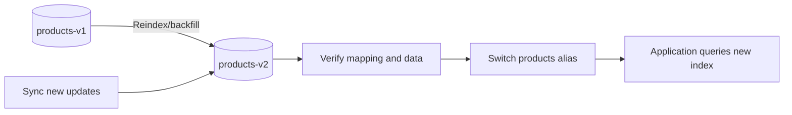

# Generating Mapping from Document and Applying Mapping

In Spring Data Elasticsearch, a Java class annotated with `@Document` describes the type of document an application stores in an Elasticsearch index. Annotations such as `@Id`, `@Field`, `@MultiField`, `@InnerField`, `@Setting`, and `@Mapping` provide metadata so Spring Data can translate the class structure into mappings and index settings. The mapping determines how Elasticsearch stores, analyzes, and queries each field.

Declaring annotations in Java does not automatically alter the mapping of an existing index. The application needs to create the index with the mapping when the index does not exist yet, or apply the mapping to an existing index using index management APIs. When a mapping changes the data type of a field that has already been indexed, you normally have to create a new index and reindex the data.

## 1. Document, Index, and Mapping

These three concepts are related but not identical:

- **Document** is a JSON record stored in Elasticsearch, such as a product with `id`, `name`, `price`, and `categories`.
- **Index** is where documents with similar structure and search purposes are stored. You can think of it as roughly analogous to a table in a relational database, though storage and querying work differently.
- **Mapping** describes the field structure of documents: data types, analyzers, normalizers, how objects/nested structures are handled, date formats, and other indexing properties.

Example document:

```json
{
  "id": "p-1001",
  "name": "Coffee Maker",
  "sku": "COFFEE-001",
  "price": 3250000,
  "available": true,
  "categories": ["Home Appliances", "Coffee Maker"]
}
```

The corresponding mapping may declare `name` as `text`, `sku` as `keyword`, `price` as a numeric type, and `available` as `boolean`. The same JSON value can be processed differently depending on the mapping. For instance, `name` is analyzed into tokens for full-text search, whereas `sku` is kept intact for exact matching.

In Spring Data Elasticsearch, the document class is the Java model used to convert between objects and JSON. The mapping is the configuration on the Elasticsearch side. Both sides should stay consistent, though they do not have to have an identical structure: a mapping can contain subfields, analyzers, or query optimization settings that the Java class does not need to represent as separate properties.

## 2. Spring Data Generates Mapping from `@Document`

`@Document` marks a class as an Elasticsearch entity and specifies the target index. The class's properties are inspected by Spring Data through mapping metadata and `MappingElasticsearchConverter`.

Basic example:

```java
import org.springframework.data.annotation.Id;
import org.springframework.data.elasticsearch.annotations.Document;
import org.springframework.data.elasticsearch.annotations.Field;
import org.springframework.data.elasticsearch.annotations.FieldType;

@Document(indexName = "products")
public class ProductDocument {

    @Id
    private String id;

    @Field(type = FieldType.Text)
    private String name;

    @Field(type = FieldType.Keyword)
    private String sku;

    @Field(type = FieldType.Double)
    private Double price;

    @Field(type = FieldType.Boolean)
    private Boolean available;

    // Constructors, getters and setters
}
```

Key annotations:

- `@Document(indexName = "products")` specifies the index that the entity represents.
- `@Id` marks the property used as the document identifier `_id`.
- `@Field(type = ...)` declares the Elasticsearch type for a property.
- `@Document(createIndex = true)` enables Spring Data's automatic index initialization mechanism to create the index if it does not exist during supported startup flows. Verify the configuration and behavior of the version in use.
- `@Setting` declares index settings, such as shard count, replicas, and analyzers.
- `@Mapping` can point to a JSON file containing custom mappings.

If you do not declare `@Field` on every property, Spring Data can still infer some types from the Java types. However, for fields important to search, declare them explicitly to control analyzers, numeric types, date formats, and object structures.

### Field Names in Java and Field Names in Elasticsearch

You can use `name` in `@Field` to map a Java property to a different field name:

```java
@Field(name = "created_at", type = FieldType.Date)
private Instant createdAt;
```

The JSON document will use `created_at`, while Java code continues to use `createdAt`. Keep field naming conventions consistent across the entire index and queries. Renaming a field in a live mapping is generally treated as a data structure change requiring a migration plan.

## 3. Choosing Field Types When Creating Mapping

The field type determines how Elasticsearch indexes data and which queries are supported. Do not choose a type solely based on the Java type or because current data happens to look like strings.

| Need | Common Elasticsearch Type | Example |
|---|---|---|
| Full-text search | `text` | Name, description, article content |
| Exact match, filter, sort, aggregation by string | `keyword` | SKU, status, category code |
| Integers | `integer`, `long` | Quantity, counters |
| Floating-point numbers | `float`, `double`, `scaled_float` | Weight, rating score |
| Boolean | `boolean` | In stock, published |
| Date/time | `date` | Created time, updated time |
| Nested object | `object` | Brand details |
| Array of objects preserving per-element relationships | `nested` | Product variants |
| Geographic coordinates | `geo_point` | Store location |

For example, an SKU should generally be `keyword`, even if it contains only digits. If declared as a numeric type, leading zeros could be lost and queries would take on unintended arithmetic semantics.

### `text` and `keyword`

`text` is analyzed into tokens by an analyzer. It is suitable for searching words or phrases within content. `keyword` keeps the value as a single unit, suitable for exact matching, filtering, sorting, and aggregations.

A property may need both ways of indexing. In that case, use a multi-field:

```java
import org.springframework.data.elasticsearch.annotations.InnerField;
import org.springframework.data.elasticsearch.annotations.MultiField;

@MultiField(
    mainField = @Field(type = FieldType.Text, analyzer = "standard"),
    otherFields = {
        @InnerField(suffix = "keyword", type = FieldType.Keyword)
    }
)
private String name;
```

The generated mapping has a `name` field of type `text` and a `name.keyword` subfield of type `keyword`. The application can run full-text search on `name`, while sorting or aggregating on `name.keyword`.

### Object and Nested

`object` is suitable for nested objects when properties can be queried independently. `nested` is suitable for arrays of objects when query conditions must match together on a single specific element.

For example, a product with two variants:

```json
{
  "variants": [
    { "color": "black", "size": "small" },
    { "color": "silver", "size": "large" }
  ]
}
```

If you need to find a variant that is both black and large, `nested` preserves the relationship between `color` and `size` within the same element. Using regular `object` can cause Elasticsearch to combine conditions from different elements after flattening the object array.

Declaration in Java:

```java
public class VariantDocument {

    @Field(type = FieldType.Keyword)
    private String color;

    @Field(type = FieldType.Keyword)
    private String size;
}

@Field(type = FieldType.Nested)
private List<VariantDocument> variants;
```

`nested` incurs higher storage and query costs than regular objects. Choose it only when queries need to preserve relationships between fields within each element.

## 4. Mapping for Dates and Analyzers

### Dates

Elasticsearch commonly uses `date` to index points in time. In Java, you can use `Instant`, `LocalDate`, `LocalDateTime`, or a type matching the system's time conventions. Timezone and format must be consistent during serialization.

```java
import java.time.Instant;

@Field(type = FieldType.Date)
private Instant createdAt;
```

If input data uses a custom format, declare the corresponding format/pattern and ensure the serializer writes values accepted by the mapping. For absolute points in time, `Instant` is usually clearer in meaning than a timezone-less `LocalDateTime`.

### Analyzers

An analyzer defines how Elasticsearch processes text when indexing and when analyzing queries. You can declare analyzers in index settings and reference them in `@Field`:

```java
@Field(
    type = FieldType.Text,
    analyzer = "product_name_index",
    searchAnalyzer = "product_name_search"
)
private String name;
```

The analyzer name must be defined in the index settings before indexing documents. If the analyzer does not exist or a required plugin is not installed, index creation can fail.

### Index Settings with `@Setting`

`@Setting` can reference a JSON file on the classpath:

```java
import org.springframework.data.elasticsearch.annotations.Setting;

@Document(indexName = "products")
@Setting(settingPath = "/elasticsearch/product-settings.json")
public class ProductDocument {
    // fields
}
```

Example file `src/main/resources/elasticsearch/product-settings.json`:

```json
{
  "index": {
    "number_of_shards": 1,
    "number_of_replicas": 1
  },
  "analysis": {
    "analyzer": {
      "product_name_index": {
        "type": "custom",
        "tokenizer": "standard",
        "filter": ["lowercase", "asciifolding"]
      },
      "product_name_search": {
        "type": "custom",
        "tokenizer": "standard",
        "filter": ["lowercase", "asciifolding"]
      }
    }
  }
}
```

Settings are index-level configurations such as shards, replicas, and analysis. Mapping is field configuration. Both are usually created together at index initialization, though they serve distinct purposes.

## 5. Using a Custom JSON Mapping File

For complex mappings, teams can manage the mapping in a JSON file instead of expressing every detail through annotations. Spring Data Elasticsearch supports `@Mapping(mappingPath = "...")` in versions that provide this annotation.

Example:

```java
import org.springframework.data.elasticsearch.annotations.Document;
import org.springframework.data.elasticsearch.annotations.Mapping;
import org.springframework.data.elasticsearch.annotations.Setting;

@Document(indexName = "products")
@Setting(settingPath = "/elasticsearch/product-settings.json")
@Mapping(mappingPath = "/elasticsearch/product-mapping.json")
public class ProductDocument {
    // Java properties
}
```

Example file `src/main/resources/elasticsearch/product-mapping.json`:

```json
{
  "properties": {
    "name": {
      "type": "text",
      "analyzer": "product_name_index",
      "search_analyzer": "product_name_search",
      "fields": {
        "keyword": {
          "type": "keyword",
          "ignore_above": 256
        }
      }
    },
    "sku": {
      "type": "keyword"
    },
    "price": {
      "type": "scaled_float",
      "scaling_factor": 100
    },
    "created_at": {
      "type": "date"
    },
    "variants": {
      "type": "nested",
      "properties": {
        "color": { "type": "keyword" },
        "size": { "type": "keyword" }
      }
    }
  }
}
```

The mapping file must be packaged on the classpath, and the path must match how the application runs in the IDE, tests, and built artifact. Treat the JSON file as a versioned schema and review it like code.

### Annotations or JSON File?

| Declaration Method | Advantages | Suitable When |
|---|---|---|
| `@Field` annotations | Close to Java properties, easy to understand for simple mappings | Mapping largely mirrors the document structure directly |
| `@Setting` + `@Mapping` JSON files | Expresses full Elasticsearch configuration, easy to review separately | Analyzers, nested, multi-fields, or complex mappings |
| Managing mapping via migration/API | Decouples index lifecycle from application deploy lifecycle | Production requires versioning, rollouts, and controlled reindexing |

Do not maintain two independent mapping definitions without synchronization rules. If the same field is declared in annotations and a JSON file with different types or names, verify which source is used when creating the index in your running Spring Data version. For projects using a separate mapping file, treat that file as the primary schema and verify the actual mapping after creating the index.

## 6. Creating an Index with Mapping Using `IndexOperations`

Spring Data provides `ElasticsearchOperations` to interact with Elasticsearch. From it, obtain `IndexOperations` for the entity class and create the index with the mapping generated from entity metadata.

Example:

```java
import org.springframework.data.elasticsearch.core.ElasticsearchOperations;
import org.springframework.data.elasticsearch.core.IndexOperations;
import org.springframework.stereotype.Component;

@Component
public class ProductIndexInitializer {

    private final ElasticsearchOperations operations;

    public ProductIndexInitializer(ElasticsearchOperations operations) {
        this.operations = operations;
    }

    public void createIndexIfMissing() {
        IndexOperations indexOperations =
            operations.indexOps(ProductDocument.class);

        if (!indexOperations.exists()) {
            indexOperations.createWithMapping();
        }
    }
}
```

`createWithMapping()` creates the index with the settings and mapping attached to the entity according to the capabilities of the Spring Data version. When the index already exists, this code does not overwrite the current mapping. This is a simple control mechanism for initialization, though in production you should manage index migrations separately so you know the exact schema version deployed.

### Creating an Index via Repository Auto-Configuration

In some Spring Data repository flows, `@Document(createIndex = true)` lets Spring Data automatically create the index if it does not exist when the repository initializes. This mechanism is useful in small applications or development environments.

However, do not rely on application startup to modify production schemas. A deployment may start multiple instances simultaneously; mapping changes also require controlled workflows and reindexing. For production environments, it is usually better to create indexes via migrations or a separate deployment step, after which the application simply uses the ready index.

## 7. Applying Mapping to an Existing Index

If the index already exists, you can use `IndexOperations.putMapping()` to send the mapping generated from entity metadata to Elasticsearch. Example:

```java
public void applyMappingToExistingIndex() {
    IndexOperations indexOperations =
        operations.indexOps(ProductDocument.class);

    if (!indexOperations.exists()) {
        indexOperations.createWithMapping();
        return;
    }

    indexOperations.putMapping();
}
```

`putMapping()` applies the mapping within Elasticsearch's update capabilities. It is not a command to replace the entire mapping and cannot arbitrarily change the type of an existing field. Adding new fields is generally supported; changing the type of a field that already holds data is usually disallowed.

### Inspecting the Current Mapping

You can retrieve the mapping via the Spring Data API:

```java
IndexOperations indexOperations =
    operations.indexOps(ProductDocument.class);

var currentMapping = indexOperations.getMapping();
```

Or call the Elasticsearch REST API:

```http
GET /products/_mapping
```

Compare the actual mapping with the desired schema before applying changes. Do not assume the mapping in code always matches the running index's mapping; the index may have been created by an older application version or modified manually.

### Verifying Results After Applying

After creating or updating a mapping:

1. Read back the actual mapping.
2. Confirm field names and field types.
3. Verify analyzers/normalizers are declared properly.
4. Try indexing a sample document.
5. Use `_analyze` to inspect tokens if analyzers are used.
6. Run the expected queries, sorts, and aggregations.

Example mapping check:

```http
GET /products/_mapping
```

Example analyzer check:

```http
POST /products/_analyze
Content-Type: application/json

{
  "field": "name",
  "text": "Coffee Maker"
}
```

The `_analyze` result shows the tokens produced for the declared field. This is a quick way to catch missing analyzers or text processing that differs from expectations.

## 8. Dynamic Mapping and Explicit Mapping

Elasticsearch supports dynamic mapping: when receiving a document with an undeclared field, Elasticsearch can infer the type and add the field to the mapping. This mechanism is convenient for flexible data, but carries risks if the first field value is unrepresentative or if field names proliferate unboundedly.

For example, a first document sending `rating: 5` can cause the field to be created as an integer type. A later document sending `rating: 4.5` might not be processed as desired. Similarly, dynamic fields from user data can cause the mapping to grow rapidly.

For important fields, declare explicit mappings. You can use `dynamic: strict` if you want to reject fields outside the schema, or choose a dynamic policy suited to your requirements. The `dynamic` setting can be managed in a JSON mapping file or the corresponding mapping configuration of your Spring Data version.

Example JSON mapping:

```json
{
  "dynamic": "strict",
  "properties": {
    "name": { "type": "text" },
    "sku": { "type": "keyword" },
    "price": { "type": "long" }
  }
}
```

With `strict`, documents containing undeclared fields are rejected. This is suitable when the schema must be strictly controlled, though you must ensure all application versions send the expected structure.

## 9. Mapping Changes That Can and Cannot Be Applied Directly

Elasticsearch allows adding certain mapping configurations to an existing index, but some changes cannot be applied directly because data has already been indexed under the old structure.

| Change | Can Be Applied Directly? | How to Handle |
|---|---|---|
| Adding a new field | Usually yes | Send incremental mapping with `putMapping()` |
| Adding a new multi-field to an existing field | Mapping can be added, but old data lacks indexed subfield values | Update mapping then reindex/update old data so the subfield is populated |
| Changing `integer` to `long` | Cannot change type directly | Create new index and reindex |
| Changing `text` to `keyword` | Cannot change type directly | Create new field/index and backfill |
| Changing analyzer of a field that already has data | Cannot re-tokenize old data by simply editing mapping | Create new index and reindex |
| Changing `object` to `nested` | Cannot change directly | Create new index with nested mapping and reindex |
| Renaming a field | No simple mapping rename operation | Create new field, migrate data, and update application |

Some changes can add new mapping entries without automatically rebuilding the inverted index for old documents. For example, adding `name.keyword` to the mapping does not mean previously indexed documents automatically have data in the new subfield. Old documents must be updated or reindexed.

## 10. Reindexing When Structural Changes Are Required

When you need to change a field type, analyzer, object/nested structure, or make major changes, the safe workflow is usually creating a new index and reindexing the data.

Example deployment flow:



Key steps:

1. Create `products-v2` with the new settings and mapping.
2. Load existing data from the authoritative source or use the `_reindex` API if appropriate.
3. Sync changes that occurred during the backfill window.
4. Compare document counts and inspect representative records.
5. Test queries, sorts, aggregations, and analyzers on the new index.
6. Switch the alias or application configuration to the new index.
7. Retain the old index as long as needed to support rollback.

If using `_reindex`, note that it copies document data; it does not automatically synchronize business changes occurring after it starts. The system needs a catch-up mechanism such as an outbox, CDC, controlled dual-write, or an appropriate write-pause window.

### Using an Alias to Switch Indexes

Instead of having the application access `products-v1` directly, you can use a `products` alias pointing to the physical index. Once the new index is ready, switch the alias in a single alias update operation:

```http
POST /_aliases
Content-Type: application/json

{
  "actions": [
    { "remove": { "index": "products-v1", "alias": "products" } },
    { "add": { "index": "products-v2", "alias": "products" } }
  ]
}
```

Ensure the alias already exists and points to the old index before running the remove/add operation. If the alias does not exist yet, use an appropriate add action. For applications that write data, configure a write index when an alias points to multiple indexes.

## 11. Complete Mapping Example for a Product

A product document can combine multi-fields, numbers, dates, objects, and nested structures:

```java
import java.time.Instant;
import java.util.List;

import org.springframework.data.annotation.Id;
import org.springframework.data.elasticsearch.annotations.Document;
import org.springframework.data.elasticsearch.annotations.Field;
import org.springframework.data.elasticsearch.annotations.FieldType;
import org.springframework.data.elasticsearch.annotations.InnerField;
import org.springframework.data.elasticsearch.annotations.MultiField;

@Document(indexName = "products")
public class ProductDocument {

    @Id
    private String id;

    @MultiField(
        mainField = @Field(type = FieldType.Text, analyzer = "standard"),
        otherFields = {
            @InnerField(suffix = "keyword", type = FieldType.Keyword)
        }
    )
    private String name;

    @Field(type = FieldType.Keyword)
    private String sku;

    @Field(type = FieldType.Scaled_Float, scalingFactor = 100)
    private Double price;

    @Field(type = FieldType.Boolean)
    private boolean available;

    @Field(type = FieldType.Date)
    private Instant createdAt;

    @Field(type = FieldType.Nested)
    private List<VariantDocument> variants;

    // Constructors, getters and setters
}
```

This mapping supports full-text search on `name`, sorting or aggregating by `name.keyword`, filtering by SKU, price, and availability, and querying variants with nested semantics.

If `price` represents currency requiring exact precision, consider storing it as a `Long` in the smallest currency unit rather than `scaled_float`. The example above uses `scaled_float` to illustrate a decimal field with two-digit precision; the actual choice should follow currency rules.

## 12. Verifying Mapping in the Application Lifecycle

Mapping is part of the schema and should be version-controlled. Operational guidelines:

- Create the index before ingesting data to avoid unwanted dynamic mapping.
- Pin physical index names by version when migrations are needed, such as `products-v1`, `products-v2`.
- Use stable aliases for the application if you need to switch indexes without modifying query code.
- Check the actual mapping using `GET /{index}/_mapping` after every schema deployment.
- Check settings using `GET /{index}/_settings`.
- Use `_analyze` to test analyzers and token filters.
- Do not assume modifying Java annotations fixes an existing index.
- Have a rollback procedure and retain the old index when changes carry risk.

In multi-instance environments, avoid having every instance run schema migrations on startup. A dedicated deployment step or controlled migration job prevents race conditions and clarifies when the new schema is ready.

## 13. Common Errors When Creating and Applying Mappings

### Index Already Exists and Mapping Does Not Change

`createWithMapping()` is typically called in the branch for creating a new index. If the index already exists, that method is not a mapping-overwrite command. Use `putMapping()` for permitted updates or create a new index when incompatible changes are required.

### Analyzer Does Not Exist

The mapping references an analyzer not declared in settings or a plugin not installed on the node. Check settings, analyzer names, and plugin status before creating the index.

### Java Class and Actual Mapping Differ

The index may have been created by older code or manual actions. Read the actual mapping, compare it with current metadata, and plan a migration; do not rely on the Java class to assume the index is in sync.

### Field Has the Wrong Type Due to Dynamic Mapping

The first document may cause Elasticsearch to infer an unsuitable type. Declare the mapping before indexing data and test edge-case values.

### Subfield Added but Sort/Aggregation Misses Old Data

The new mapping only applies to data indexed after the subfield was created. Reindex or update old documents so the subfield gets indexed.

### Changing Field Type on a Live Index

Elasticsearch does not support arbitrarily changing the type of an existing field. Create a new index, migrate data, and switch the alias after verification.

## 14. Practical Workflow to Create and Apply Mapping

When designing a mapping for a new document, you can follow this sequence:

1. Identify the queries, filters, sorts, and aggregations the application needs.
2. Design the Java document class and decide which fields are identifiers, text, keyword, numeric, date, object, or nested.
3. Choose annotations or JSON files for the mapping; establish one clear schema source.
4. Declare index settings such as analyzers, normalizers, shards, and replicas.
5. Create the index with mapping via `createWithMapping()` or the corresponding migration.
6. Read back the actual mapping and settings from Elasticsearch.
7. Index sample data and verify queries, analyzers, sorts, and aggregations.
8. When changes occur, classify whether they can be added to the mapping or require a new index.
9. Reindex/backfill and sync new changes if creating a new index.
10. Switch the alias and monitor after deployment.

## 15. Conclusion

Spring Data Elasticsearch generates mappings from `@Document` class metadata and annotations like `@Field`, `@MultiField`, `@InnerField`, and `@Setting`. For complex mappings, settings and mappings can be managed via JSON files or a separate migration process. `IndexOperations.createWithMapping()` creates the index along with its mapping; `putMapping()` applies changes permitted by Elasticsearch to an existing index.

Mapping is the schema of the index, not merely a description of the Java class. Check the actual mapping, create the index before loading important data, and understand the limits of mapping updates. When you need to change a field type, analyzer, or object/nested structure, create a new index, reindex the data, and switch the alias after verification. This management approach keeps document structures in the application consistent with how Elasticsearch indexes data across schema versions.
