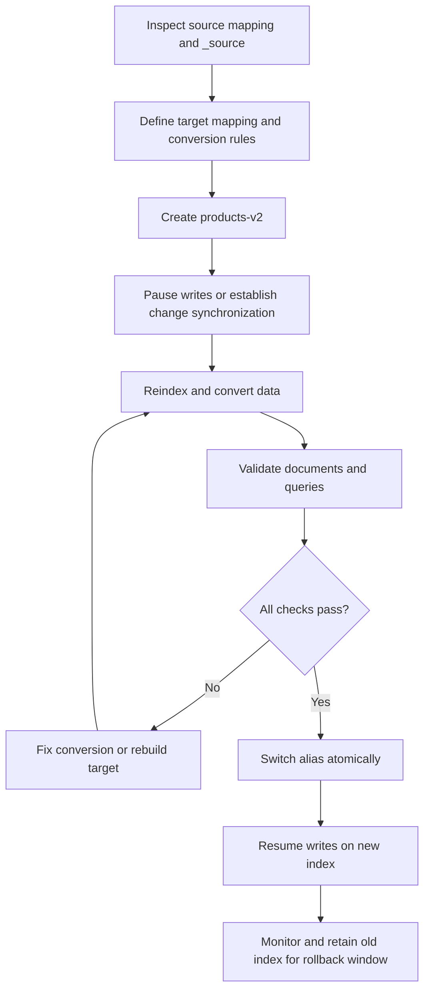

# Why Already-Indexed Field Types Cannot Be Arbitrarily Changed

In Elasticsearch, a mapping defines how a field is interpreted and indexed. For example, `price` can be declared as `double`, `title` as `text`, `sku` as `keyword`, and `publishedAt` as `date`. These choices do not merely describe JSON types. They dictate how Elasticsearch analyzes, encodes, stores, and searches values inside the Lucene index.

Therefore, once a field has been indexed with one data type, Elasticsearch normally does not allow directly changing that field to another type on the same index. For instance, you cannot change `price` from `keyword` to `double` simply by submitting a new mapping. When a type change is needed, the common and safe approach is creating a new index with the target mapping, migrating data using `_reindex` or a transformation pipeline, verifying results, and switching the application to the new index via an alias.

In Spring Data Elasticsearch, editing `@Field(type = ...)` on an entity does not automatically convert an existing index either. Annotations describe metadata for the application's mapping; the actual mapping applied by Elasticsearch on the index stays intact until an appropriate data migration workflow runs.

## 1. Mapping Is Not Just a JSON Type Declaration

An Elasticsearch document is stored as JSON in `_source`, yet Elasticsearch does not simply keep JSON and scan it sequentially on every search. When indexing a document, Elasticsearch uses the mapping to build data structures for searching, filtering, sorting, and aggregating.

Example product document:

```json
{
  "sku": "SKU-1001",
  "name": "Mechanical Keyboard",
  "price": 185000,
  "available": true,
  "createdAt": "2025-03-12T10:30:00Z"
}
```

The corresponding mapping might be:

```json
PUT /products
{
  "mappings": {
    "properties": {
      "sku": { "type": "keyword" },
      "name": { "type": "text" },
      "price": { "type": "double" },
      "available": { "type": "boolean" },
      "createdAt": { "type": "date" }
    }
  }
}
```

Field types produce different index structures:

- `text` is usually analyzed into tokens by an analyzer to support full-text search.
- `keyword` preserves the value as an exact term, commonly used for filtering, sorting, and aggregations.
- Numeric types such as `integer`, `long`, `float`, and `double` use representations and structures tailored for numeric comparisons, range queries, and sorting.
- `date` converts temporal values into a representation supporting range queries and sorting.
- `boolean` stores true/false states according to boolean semantics.
- `object` and `nested` organize subfields differently and directly affect queries.

Mappings can also specify analyzers, normalizers, date formats, doc values, index options, and other parameters. These choices affect indexed data, not merely JSON presentation.

## 2. Why Can't an Indexed Field's Type Be Arbitrarily Changed?

Elasticsearch builds Lucene indexes from ingested documents. Lucene stores specialized structures for each data type. These structures are organized into segments and are not designed to arbitrarily reinterpret all historical data under a different mapping from a single metadata update command.

### 2.1 Data Types Determine How Values Are Indexed

For `text`, an analyzer may split a string into multiple tokens, normalize case, remove stop words, or apply stemming. Once a document is indexed, Lucene has already built the term dictionary and inverted index based on those tokens.

For `keyword`, the entire value is typically indexed as a single term. If changing from `keyword` to `text`, Elasticsearch needs to re-analyze the string into tokens. The required tokens cannot be produced merely by renaming the field type in the mapping; source data must be read back and reindexed.

For numbers and dates, Elasticsearch must represent values in appropriate types to perform range queries, sorting, and aggregations. A string `"185000"` indexed as `keyword` is not the same as a number `185000` indexed as `double`. Changing the mapping to `double` does not convert existing terms into numeric values.

### 2.2 Doc Values and Structures for Sorting/Aggregations

Many field types can use doc values to support efficient sorting and aggregations. Doc values are built during indexing according to the field's type and configuration. If a field is indexed as `keyword`, the doc values structure reflects string semantics; if `long` or `double`, it reflects numeric values.

Changing types can require rebuilding both the inverted index and doc values. Elasticsearch cannot automatically infer and reconstruct all required structures for historical data from a mapping update request alone.

### 2.3 Mapping Must Be Consistent Across Documents in the Same Index

A field in an index needs uniform semantics. If the first document causes `price` to be inferred as `keyword`, subsequent documents sending numbers into the same field may no longer fit. Conversely, if the field is already `double`, a string that cannot be parsed as a number will cause a mapping/parsing error.

Elasticsearch does not let each document independently define a different type for the same field within the same index. This keeps queries on the index semantically consistent: when querying `price` with a range, Elasticsearch knows to perform numeric comparisons across all documents having that field.

### 2.4 Changing Mapping Does Not Mean Converting Data

Suppose the current mapping is:

```json
"price": {
  "type": "keyword"
}
```

The application wants to change it to:

```json
"price": {
  "type": "double"
}
```

If only metadata is edited, already-indexed values remain stored in Lucene under the old structure. Elasticsearch needs a step that reads source values, converts them to numbers, and reindexes them under the new type. That is why reindexing or an equivalent migration workflow is needed.

## 3. Data Type Conflict Example

Suppose dynamic mapping is enabled and the first document contains:

```json
PUT /catalog/_doc/1
{
  "price": "185000"
}
```

Elasticsearch may infer `price` as `text` or `keyword` depending on content and dynamic mapping rules. Then the application sends:

```json
PUT /catalog/_doc/2
{
  "price": 210000
}
```

The new data type is not necessarily compatible with the created mapping. The result may be a parsing error or mapping conflict. Do not rely on dynamic mapping to handle a field with unstable type rules.

Check the actual mapping:

```http
GET /catalog/_mapping
```

If the result shows `price` as `keyword`, editing the entity to `Double` does not change the index's type. You must examine the current data, target mapping, and conversion workflow.

### 3.1 Common Type-Change Examples

| Current Mapping | Desired Mapping | Why Is Migration Needed? |
|---|---|---|
| `keyword` | `double` | Need to parse strings into numbers and rebuild numeric index structures |
| `text` | `keyword` | Need to reindex values under exact semantics without tokenization |
| `keyword` | `text` | Need to run an analyzer on historical data to produce tokens |
| `long` | `date` | Need to determine timestamp unit/format and reindex as date |
| `object` | `nested` | Need to rebuild index structures to preserve per-child-object relationships |
| `integer` | `long` | Need to recreate the field in the target numeric type; cannot just alter mapping on an indexed field |

Even when existing data looks compatible, such as strings containing only digits, changing type is still a change in semantics and index structure. Perform a migration rather than assuming Elasticsearch will automatically convert old data.

## 4. Which Mapping Changes Can Be Performed?

Not all mapping updates are forbidden. Elasticsearch permits extending mappings in many cases, while disallowing arbitrarily changing the type of an existing field.

### 4.1 Adding a New Field

You can add a new field to a mapping:

```http
PUT /products/_mapping
{
  "properties": {
    "description": {
      "type": "text"
    }
  }
}
```

After the mapping is updated, new documents can write `description`. Existing documents do not automatically receive values for the new field. If historical data is needed, they must be updated/reindexed in a separate process.

### 4.2 Adding a Multi-Field to an Existing Field

In some cases, you can add a multi-field to an existing field. For example, `name` is `text` and needs a `keyword` sub-field for sorting or aggregations:

```http
PUT /products/_mapping
{
  "properties": {
    "name": {
      "type": "text",
      "fields": {
        "raw": {
          "type": "keyword"
        }
      }
    }
  }
}
```

The new mapping allows subsequently indexed documents to populate `name.raw`. However, documents that already existed before the multi-field was added will not have data in the new sub-field yet. To sort/aggregate across all data, run `_update_by_query` or reindex to regenerate sub-field values from `_source`.

Example updating old documents:

```http
POST /products/_update_by_query
{
  "query": {
    "exists": {
      "field": "name"
    }
  }
}
```

This operation asks Elasticsearch to read and reindex matching documents to apply the new mapping. Evaluate load, runtime, and conflicts with concurrent writes before running it.

### 4.3 Changing Certain Non-Type Parameters

Some mapping parameters can be updated within Elasticsearch limits; others can only be set when creating the field/index or require reindexing to apply to historical data. You cannot assume that because one mapping parameter is updatable, all others are as well.

For example, some search-related settings can change for future queries, whereas changing an index-time analyzer does not re-run the analyzer on already-stored terms. Check the documentation for the exact field type and parameter before updating.

### 4.4 Renaming Fields and Field Aliases

Mappings do not offer a field rename operation in the sense of moving old data to a new name. You can add a new field and migrate data; in some cases, a field alias can provide an alternate name pointing to an existing field.

A field alias does not convert data types, regenerate data, and has its own usage limitations. It merely lets another field name reference an already-indexed field. If semantics or data types need changing, you still must migrate.

## 5. Why Editing @Field in Spring Data Is Not Enough

In Spring Data Elasticsearch, an entity may declare:

```java
@Document(indexName = "products")
public class Product {

    @Id
    private String id;

    @Field(type = FieldType.Keyword)
    private String price;
}
```

Later the development team changes it to:

```java
@Field(type = FieldType.Double)
private Double price;
```

This change only updates metadata in Java code. It can affect the mapping generated when creating a new index, but does not automatically fix the mapping of the `products` index already existing on the cluster.

When the application starts and the index already exists, Spring Data cannot automatically convert all historical data from string to number simply by reading the new annotation. If attempting to apply an incompatible mapping, Elasticsearch will reject the update or write operations may fail because data and mapping mismatch.

### 5.1 Annotations Are Descriptions; Cluster Mapping Is the Actual State

Two sources must be distinguished:

| Source | Role |
|---|---|
| `@Document`, `@Field` | Entity metadata that Spring Data uses when mapping and generating mappings |
| Mapping in Elasticsearch | Actual rules used by the index to index and query |

When discrepancies occur, the mapping on the cluster dictates how Elasticsearch processes documents. Therefore, after changing an entity, check `GET /index/_mapping` and plan a migration if existing field types need to change.

### 5.2 IndexOperations Is Not a Field-Type Conversion Tool

Spring Data provides `IndexOperations` to check indexes, create indexes, read mappings, perform permitted mapping updates, and execute index management operations.

Example:

```java
IndexOperations indexOps = operations.indexOps(Product.class);

if (!indexOps.exists()) {
    indexOps.create();
    indexOps.putMapping(indexOps.createMapping());
}
```

This snippet illustrates creating an index and mapping when the index does not exist yet. `putMapping(...)` is not an API to arbitrarily convert an existing field from `keyword` to `double`. If a mapping update violates Elasticsearch's constraints, the operation will fail.

In production, separate index/mapping management into a controlled migration or deployment step rather than expecting the application to modify index structures on every startup.

## 6. Standard Strategy: Create a New Index and Reindex

When a field type must change, the standard approach is creating a new index with the target mapping and migrating data from the old index to the new index. This workflow is commonly called index migration.

Suppose the current index is `products-v1`:

```json
{
  "properties": {
    "sku": { "type": "keyword" },
    "price": { "type": "keyword" }
  }
}
```

The application wants to move `price` to `double`. Create a new index `products-v2`:

```http
PUT /products-v2
{
  "settings": {
    "number_of_shards": 1,
    "number_of_replicas": 1
  },
  "mappings": {
    "properties": {
      "sku": { "type": "keyword" },
      "price": { "type": "double" }
    }
  }
}
```

The settings above are illustrative only. The destination index needs the settings, analyzers, mappings, and configurations required for the real index. The `_reindex` API does not automatically copy all settings, mappings, or aliases from source to destination; the destination index must be created beforehand.

### 6.1 Direct Reindex When Data Is Already Compatible

If `_source.price` of every document is a valid numeric string, you can reindex and convert the field using a script:

```http
POST /_reindex
{
  "source": {
    "index": "products-v1"
  },
  "dest": {
    "index": "products-v2"
  },
  "script": {
    "lang": "painless",
    "source": "if (ctx._source.price != null) { ctx._source.price = Double.parseDouble(ctx._source.price.toString()); }"
  }
}
```

The script reads the old value from `_source`, converts it to `double`, and writes it to the destination index. If data contains empty strings, thousands separators, currency symbols, or non-standard formats, this simple script can fail. Analyze real data and design controlled conversion rules.

### 6.2 Handling Invalid Data

Before reindexing, identify values that cannot be converted. For example:

```json
[
  { "price": "185000" },
  { "price": "210000.50" },
  { "price": "unknown" },
  { "price": "" },
  { "price": null }
]
```

The application must explicitly decide how to handle each case:

- Valid numeric string: convert to number.
- Empty string: convert to `null`, drop the field, or send to an error list depending on business rules.
- Invalid string: fix source data, quarantine the document, or halt migration.
- `null`/absent field: preserve corresponding semantics.

Do not silently turn all invalid values into `0`. Doing so can distort reports, sorts, and range queries without leaving clear signs.

A guarded script can flag failing documents:

```http
POST /_reindex
{
  "source": {
    "index": "products-v1"
  },
  "dest": {
    "index": "products-v2"
  },
  "script": {
    "lang": "painless",
    "source": "if (ctx._source.price != null) { def raw = ctx._source.price.toString().trim(); if (raw == '') { ctx._source.remove('price'); } else { try { ctx._source.price = Double.parseDouble(raw); } catch (Exception e) { ctx._source.migrationError = 'INVALID_PRICE'; ctx._source.remove('price'); } } }"
  }
}
```

This is only an example of expressing policy. In real migrations, do not drop fields and continue if business rules require preserving values. You may need to write errors to a separate inspection index, use an ingest pipeline, or clean data prior to reindexing. Define error document handling before running on real data.

### 6.3 Running Reindex Asynchronously and Tracking Tasks

For large datasets, you can run reindex asynchronously:

```http
POST /_reindex?wait_for_completion=false
{
  "source": {
    "index": "products-v1"
  },
  "dest": {
    "index": "products-v2"
  }
}
```

The response returns a task ID. You can monitor it:

```http
GET /_tasks/<task_id>
```

The task response provides progress, processed document count, errors, and completion status. For large workloads, consider slicing, throttling, and batch size limits to control resource consumption. Do not run multiple large reindexes simultaneously if the cluster lacks sufficient capacity.

### 6.4 Reindex Does Not Automatically Sync Changes After Snapshot

`_reindex` reads source documents from a point-in-time view at the start of the task. If the application continues writing to `products-v1` while reindexing is running, updates occurring after the snapshot is taken may be missing from `products-v2`.

This is a critical aspect of cutover. A completed reindex run does not prove the destination index has all latest changes if the source continues receiving writes.

Two common deployment approaches:

1. **Pause writes:** pause or lock write flows, run reindex, verify data, switch the alias, and resume writes on the new index. This is simple and easy to control, but incurs write downtime.
2. **Sync changes during migration:** use dual-write or a change capture/replay mechanism to bring all changes occurring after the snapshot into the destination index, then pause writes for a brief cutover window and confirm no unsynced changes remain. This reduces downtime but is more complex and requires handling idempotency, update ordering, deletes, and per-target write failures.

Do not switch the alias without a plan for writes occurring during reindexing.

## 7. Using an Alias to Switch Indexes Without Changing Logical Names in the Application

Instead of having the application connect directly to `products-v1`, use a stable alias such as `products`. The alias points to the current physical index. Once migration completes, the alias can be switched to the new index in an atomic `_aliases` operation.

### 7.1 Creating the Initial Alias

```http
POST /_aliases
{
  "actions": [
    {
      "add": {
        "index": "products-v1",
        "alias": "products"
      }
    }
  ]
}
```

The application configures `indexName = "products"`. When the alias points to `products-v1`, all requests through `products` go to that index.

### 7.2 Switching the Alias After the New Index Is Ready

Once `products-v2` has been reindexed, refreshed, and verified, switch the alias:

```http
POST /_aliases
{
  "actions": [
    {
      "remove": {
        "index": "products-v1",
        "alias": "products"
      }
    },
    {
      "add": {
        "index": "products-v2",
        "alias": "products",
        "is_write_index": true
      }
    }
  ]
}
```

Actions within the same aliases request are applied as an atomic metadata change. The application continues using the name `products`; you do not have to change code everywhere to `products-v2`.

If an alias points to multiple indexes for reading, configure the write index explicitly before writing through the alias. An alias without a unique write index can cause write operations to fail or become ambiguous depending on configuration.

### 7.3 Rollback Must Account for Post-Cutover Writes

Keeping `products-v1` for a period lets you revert if read issues are detected after migration. However, if the application has already written new data to `products-v2`, simply switching the alias back to `products-v1` makes post-cutover writes disappear from the application's view.

Therefore, rollback must include a data strategy: pausing writes and reverse-syncing, replaying events, or accepting a business-approved data loss window. Do not delete the old index immediately after switching the alias; yet do not assume keeping the old index alone suffices for a safe rollback.

## 8. Complete Migration Workflow

A field-type migration can be organized into the following stages:



### 8.1 Inspecting the Source

Before creating the new index, check:

- Current mapping via `GET /products-v1/_mapping`.
- Settings and analyzers via `GET /products-v1/_settings`.
- Whether `_source` is enabled and contains the field to convert.
- Whether real data contains invalid values or multiple formats.
- Which queries, sorts, aggregations, ingest pipelines, and applications depend on the old field.
- Whether there are routing, parent-child, or alias filters to preserve.

If `_source` is disabled or fields are excluded from `_source`, reindex/conversion capabilities may be limited because original data is no longer intact for reconstruction. Identify another authoritative data source before migrating.

### 8.2 Designing the Target Mapping

The target mapping must reflect the right data types and expected query patterns. Do not just change `price` to `double`; inspect analyzers, multi-fields, nested fields, dynamic mapping, doc values, and related fields.

Example new Spring Data entity:

```java
@Document(indexName = "products")
public class Product {

    @Id
    private String id;

    @Field(type = FieldType.Keyword)
    private String sku;

    @Field(type = FieldType.Double)
    private Double price;
}
```

`indexName` uses the stable `products` alias. During migration, the new physical index is `products-v2`; the alias will point to that index after cutover. Field names and Java types must match the target mapping.

### 8.3 Creating the Destination Index Before Reindexing

Create `products-v2` with full settings and mapping. Do not rely on `_reindex` to copy source index structure automatically. If custom analyzers are needed, declare them in settings before creating field mappings that use those analyzers.

### 8.4 Converting Data

Choose an appropriate mechanism:

- Direct `_reindex` if `_source` already has a compatible structure.
- `_reindex` with a Painless script if simple in-place conversion is needed.
- An ingest pipeline if conversion logic can be expressed with processors.
- An application job or dedicated ETL if complex validation, reference data lookup, or error quarantine is needed.

Record counts of succeeded, failed, and skipped documents. Do not look only at the task status `completed`; inspect the `failures` section and actual results.

### 8.5 Verifying the Destination Index

After reindexing, refresh the destination index and check:

```http
POST /products-v2/_refresh
GET /products-v2/_count
GET /products-v2/_mapping
```

Compare source and destination document counts according to migration criteria. If there are failed or filtered documents, explain the discrepancy. Test edge-case samples: null, valid negative numbers, decimals, large numbers, empty strings, and legacy data.

Run critical queries on the destination index: exact match, range queries, sorting, aggregations, and application query methods. Comparing document counts alone is not enough; verify query semantics behave properly with the new type.

### 8.6 Cutover and Monitoring

Once the destination index passes checks and concurrent writes are synchronized, switch the alias. Then verify the application via the alias, monitoring mapping errors, conversion exceptions, latency, and business results. Retain the old index for the defined rollback window; delete it only after safety is confirmed and retention policies are met.

## 9. Approach from Spring Data Elasticsearch

Spring Data provides `IndexOperations` to work with indexes and mappings. However, a field-type migration goes beyond a `putMapping` call; it requires creating a new index, migrating data, and switching aliases.

### 9.1 Checking and Creating an Index with IndexOperations

```java
import org.springframework.data.elasticsearch.core.ElasticsearchOperations;
import org.springframework.data.elasticsearch.core.IndexOperations;

public class ProductIndexSetup {

    private final ElasticsearchOperations operations;

    public ProductIndexSetup(ElasticsearchOperations operations) {
        this.operations = operations;
    }

    public void createIndexIfMissing() {
        IndexOperations indexOps = operations.indexOps(Product.class);

        if (!indexOps.exists()) {
            indexOps.create();
            indexOps.putMapping(indexOps.createMapping());
        }
    }
}
```

This is an example of creating an index from entity metadata. In systems with dedicated migrations, separate creating new versioned indexes from normal application startup. Ensure the mapping is created properly before writing data.

### 9.2 Do Not Use putMapping to Change Field Types

The following example is not a valid way to change an existing field from `keyword` to `double`:

```java
Map<String, Object> mapping = Map.of(
    "properties", Map.of(
        "price", Map.of("type", "double")
    )
);

indexOps.putMapping(mapping);
```

`putMapping` can be used for mapping updates permitted by Elasticsearch, such as adding fields. If the `price` field already has type `keyword`, updating it to `double` will be rejected. Create a destination index with the new mapping and reindex.

### 9.3 Application Using an Alias

An entity can declare its index name as a stable alias:

```java
@Document(indexName = "products")
public class Product {
    // fields
}
```

The `products` alias points to the active physical index. Switching aliases is a cluster administration operation, performed via REST API or migration tools. After switching, repositories continue using the same alias.

This reduces coupling between the application and versioned index names. The application does not need to change `@Document(indexName = "products-v1")` to `products-v2` on every migration.

## 10. Alternatives When Immediate Reindexing Is Not Possible

Immediate migration is not always feasible. Several approaches can help bridge transitions, though they do not fully replace recreating the index when a type change is needed.

### 10.1 Creating a New Field with a Different Name

You can keep the old field and add a new field:

```json
{
  "price": "185000",
  "priceNumeric": 185000
}
```

Mapping:

```json
{
  "properties": {
    "price": { "type": "keyword" },
    "priceNumeric": { "type": "double" }
  }
}
```

The application can write both fields during a transition phase. Once old data is backfilled, new queries switch to `priceNumeric`. This can be done within the same index because it is a new field rather than changing the type of an old field.

### 10.2 Runtime Fields

Runtime fields compute values at query time rather than storing and indexing values under a new structure. For example, a runtime field can parse a numeric string from `_source` into a number to support certain queries or aggregations.

Runtime fields are useful for experimentation, transitions, or cases where immediate reindexing is impossible. However, they incur computation cost at query time and are not equivalent to a fully indexed numeric field. If used frequently for range queries/sorts/aggregations over large datasets, consider creating a properly typed physical field/index.

### 10.3 Field Aliases

A field alias can provide an alternate name for an existing field, helping preserve name compatibility in certain queries. It does not convert data from the old type to the new type and does not alter the target field's semantics.

### 10.4 Application-Layer Conversion

The application can parse strings into numbers after reading from Elasticsearch, but that only converts values in Java. It does not make Elasticsearch perform numeric range queries, sorting, or aggregations on a `keyword` field. If search functionality requires numeric semantics, the index mapping still needs a numeric field.

## 11. Common Mistakes

### 11.1 Only Editing Annotations and Restarting the Application

New annotations do not automatically migrate an existing index. Inspect the mapping on the cluster and perform an index migration if field types need to change.

### 11.2 Assuming Update Mapping Will Re-Parse `_source`

Updating a mapping changes metadata within supported rules; it does not re-read all of `_source` to build new index structures for existing fields.

### 11.3 Reindexing Without Creating the Target Mapping

If the destination index is created automatically via dynamic mapping, the first value may cause the field to be inferred with the wrong type once again. Create the destination index with an explicit mapping before running reindex.

### 11.4 Reindexing While Still Writing to Source and Switching Alias Immediately

Writes occurring after the reindex snapshot may not appear in the destination. Pause writes or sync changes during migration before cutover.

### 11.5 Comparing Only Document Counts

Two indexes with identical document counts can still differ in values, mappings, or query results. Check representative documents, converted fields, queries, sorts, and aggregations.

### 11.6 Using Default Values to Mask Bad Data

Converting every unparseable string to `0`, invalid dates to the current date, or unknown states to `false` loses information and can cause business bugs. Establish explicit error-handling rules.

### 11.7 Deleting the Old Index Right After Cutover

Retain the old index for the rollback window, while accounting for writes made to the new index. Rollback must have a data synchronization strategy, not just switching the alias back.

## 12. Checklist Before Changing a Field Type

Before executing a migration, confirm:

- Actual mapping and settings of the source index have been read.
- `_source` data is intact enough to reconstruct the target field.
- Historical data formats have been audited and conversion rules defined.
- Target mapping is explicitly designed, including required settings/analyzers.
- Destination index is created before reindexing.
- Handling for error documents, nulls, missing fields, and edge values is clear.
- Strategy for concurrent writes during reindexing has been chosen.
- Reindex task, failures, throttling, and progress are monitored.
- Validation covers counts, sample records, queries, sorts, and aggregations.
- Alias has the proper write index and cutover is controlled.
- Rollback plan accounts for post-cutover writes.
- Old index is deleted only after the rollback window ends and safety is confirmed.

## 13. Conclusion

Field types in Elasticsearch govern how data is analyzed and organized inside the Lucene index. Once a field is indexed, changing its type can require rebuilding the inverted index, doc values, and related structures from source data. Consequently, Elasticsearch allows many mapping updates like adding new fields, but does not allow arbitrarily changing the type of an existing field.

In Spring Data Elasticsearch, editing `@Field(type = ...)` only updates application metadata; it does not convert the index on the cluster. When a type change is required, create a new index with the target mapping, transform data using reindex or an appropriate pipeline, handle concurrent writes during migration, verify results, and switch the alias. This approach keeps mappings consistent, makes historical data transformation explicit, and supports planned cutover and rollback.

## References

- [Elasticsearch — Update mapping API](https://www.elastic.co/guide/en/elasticsearch/reference/current/indices-put-mapping.html)
- [Elasticsearch — Reindex documents](https://www.elastic.co/guide/en/elasticsearch/reference/current/docs-reindex.html)
- [Elasticsearch — Index aliases](https://www.elastic.co/guide/en/elasticsearch/reference/current/aliases.html)
- [Spring Data Elasticsearch — Index operations](https://docs.spring.io/spring-data/elasticsearch/reference/elasticsearch/misc.html)
