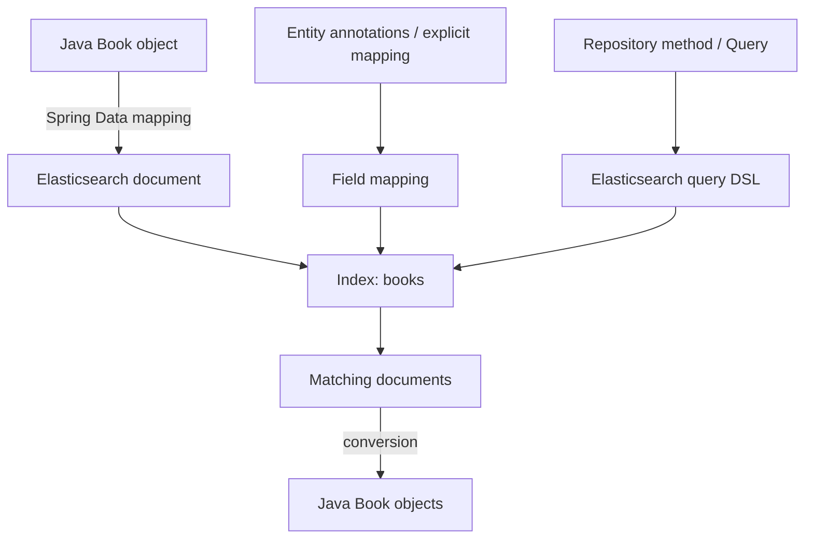

# Document, index, mapping, query và Repository trong cùng một mô hình

Spring Data Elasticsearch giúp ứng dụng Java làm việc với Elasticsearch thông qua các khái niệm quen thuộc của Spring Data: entity, repository, truy vấn và chuyển đổi dữ liệu. Tuy nhiên, để sử dụng đúng, cần hiểu các khái niệm nền tảng của Elasticsearch trước. Một đối tượng Java được lưu thành document; document thuộc về một index; mapping mô tả cách từng trường được lập chỉ mục và truy vấn; query xác định tập document cần tìm; còn repository là lớp API mà ứng dụng sử dụng để thực hiện các thao tác đó.

Các khái niệm này liên kết với nhau thành một mô hình thống nhất. Repository không thay thế index hay mapping, và annotation trên entity cũng không làm Elasticsearch trở thành một cơ sở dữ liệu quan hệ. Spring Data cung cấp lớp trừu tượng và cơ chế ánh xạ; Elasticsearch vẫn quyết định cách lưu trữ, phân tích, lập chỉ mục và tìm kiếm dữ liệu.

## 1. Nhìn toàn bộ mô hình trước khi đi vào từng thành phần

Giả sử ứng dụng quản lý danh mục sách. Một cuốn sách có mã định danh, tiêu đề, tác giả, ngày xuất bản và giá. Ứng dụng cần lưu sách, tìm theo tiêu đề, lọc theo tác giả và sắp xếp theo ngày xuất bản.

Mô hình có thể hình dung như sau:



| Thành phần | Ý nghĩa | Câu hỏi mà nó trả lời |
|---|---|---|
| Document | Một bản ghi JSON độc lập | Dữ liệu của một cuốn sách trông như thế nào? |
| Index | Tập hợp document có cùng mục đích tìm kiếm | Các document được lưu và tìm trong tập nào? |
| Mapping | Định nghĩa kiểu và cách xử lý từng trường | Trường nào là văn bản, số, ngày hay định danh? |
| Query | Điều kiện và cách tìm document | Cần tìm những document nào? |
| Repository | API truy cập dữ liệu ở tầng ứng dụng | Java code gọi thao tác lưu và tìm kiếm ra sao? |

Ví dụ, `Book` là kiểu Java, một instance `Book` là đối tượng trong bộ nhớ, còn document là biểu diễn JSON của instance đó trong Elasticsearch. Nhiều document sách được lưu trong index `books`. Mapping quy định `title` là trường văn bản có thể phân tích, `price` là số và `publishedAt` là ngày. Repository cung cấp phương thức `findByAuthor`, sau đó Spring Data chuyển yêu cầu thành truy vấn Elasticsearch phù hợp.

## 2. Document: đơn vị dữ liệu được tìm kiếm

Document là đơn vị dữ liệu cơ bản mà Elasticsearch lập chỉ mục và trả về trong kết quả tìm kiếm. Về mặt nội dung, document là một cấu trúc JSON gồm các trường và giá trị. Nó thường tương ứng với một đối tượng nghiệp vụ mà ứng dụng muốn tìm kiếm độc lập, chẳng hạn một sản phẩm, bài viết, hồ sơ khách hàng hoặc cuốn sách.

Ví dụ một document sách:

```json
{
  "id": "book-1001",
  "title": "Spring Data thực hành",
  "author": "Nguyen An",
  "price": 185000,
  "publishedAt": "2025-04-12",
  "tags": ["java", "spring", "search"]
}
```

Document có một định danh duy nhất trong phạm vi index, thường được gọi là `_id`. Khi ghi document, ứng dụng có thể cung cấp ID để cập nhật hoặc thay thế đúng document về sau. Nếu không cung cấp ID, Elasticsearch có thể tạo ID tự sinh. Trong ứng dụng nghiệp vụ, ID do ứng dụng quản lý thường giúp việc đồng bộ và tham chiếu dữ liệu rõ ràng hơn.

Document có thể chứa object lồng nhau và mảng. Ví dụ một sản phẩm có thể có `manufacturer` gồm `name` và `country`, hoặc có danh sách `variants`. Cấu trúc JSON linh hoạt giúp biểu diễn dữ liệu phong phú, nhưng kiểu và cách truy vấn các trường vẫn chịu ảnh hưởng của mapping.

### 2.1 Ánh xạ document với Java entity

Spring Data Elasticsearch cho phép mô tả document bằng một lớp Java. Annotation `@Document` đánh dấu lớp được ánh xạ vào một index. Annotation `@Id` đánh dấu thuộc tính dùng làm định danh document.

```java
import java.time.LocalDate;
import java.util.List;

import org.springframework.data.annotation.Id;
import org.springframework.data.elasticsearch.annotations.Document;
import org.springframework.data.elasticsearch.annotations.Field;
import org.springframework.data.elasticsearch.annotations.FieldType;

@Document(indexName = "books")
public class Book {

    @Id
    private String id;

    @Field(type = FieldType.Text)
    private String title;

    @Field(type = FieldType.Keyword)
    private String author;

    @Field(type = FieldType.Double)
    private Double price;

    @Field(type = FieldType.Date, pattern = "uuuu-MM-dd")
    private LocalDate publishedAt;

    @Field(type = FieldType.Keyword)
    private List<String> tags;

    protected Book() {
    }

    public Book(String id, String title, String author,
                Double price, LocalDate publishedAt, List<String> tags) {
        this.id = id;
        this.title = title;
        this.author = author;
        this.price = price;
        this.publishedAt = publishedAt;
        this.tags = tags;
    }

    public String getId() { return id; }
    public String getTitle() { return title; }
    public String getAuthor() { return author; }
    public Double getPrice() { return price; }
    public LocalDate getPublishedAt() { return publishedAt; }
    public List<String> getTags() { return tags; }
}
```

Trong ví dụ này:

- `@Document(indexName = "books")` liên kết lớp `Book` với index `books`.
- `@Id` liên kết thuộc tính `id` với định danh document `_id`.
- `@Field` cung cấp metadata về kiểu Elasticsearch cho từng thuộc tính.
- Spring Data sử dụng mapping metadata và converter để chuyển đổi giữa object Java và dữ liệu document.

Tên thuộc tính Java thường được dùng làm tên trường document nếu không cấu hình tên trường khác. Có thể cấu hình tên trường rõ ràng bằng thuộc tính `name` của `@Field`, ví dụ `@Field(name = "published_at", type = FieldType.Date)`. Khi đổi tên trường, cần bảo đảm mapping, truy vấn và dữ liệu hiện có cùng tuân theo một quy ước.

Entity không bắt buộc phải chứa mọi metadata nội bộ của Elasticsearch. Ví dụ `_index`, `_score` hoặc thông tin phân trang thường thuộc về kết quả tìm kiếm hay lớp response riêng, không nhất thiết là thuộc tính của document nghiệp vụ.

## 3. Index: không gian chứa document

Index là một tập hợp document được quản lý và tìm kiếm như một đơn vị. Trong ví dụ trên, `books` là index chứa các document sách. Index có tên, settings và mappings. Settings cấu hình những đặc điểm như số shard, số replica và analyzer mặc định; mapping định nghĩa cấu trúc và kiểu dữ liệu của các trường.

Không nên hiểu index giống hoàn toàn một bảng SQL. Index là cấu trúc phục vụ tìm kiếm và phân tích dữ liệu phân tán. Một index có thể được chia thành nhiều primary shard; mỗi shard là một Lucene index độc lập. Replica shard có thể tăng khả năng chịu lỗi và hỗ trợ tải đọc. Việc phân shard ảnh hưởng đến vận hành, phân bổ dữ liệu và hiệu năng, nhưng người viết repository thông thường không phải tự thao tác shard trong mỗi truy vấn.

### 3.1 Khai báo index trong Spring Data

`@Document(indexName = "books")` cho Spring Data biết index gắn với entity. Annotation này là metadata ở phía ứng dụng. Tùy cấu hình phiên bản và cách khởi tạo index, Spring Data có thể hỗ trợ tạo index và mapping từ metadata entity. Trong môi trường triển khai thực tế, cần chủ động quyết định ai chịu trách nhiệm tạo index, áp dụng settings và quản lý thay đổi mapping.

Có thể khai báo một số tùy chọn trên `@Document`, ví dụ:

```java
@Document(
    indexName = "books",
    createIndex = false
)
public class Book {
    // fields
}
```

Đặt `createIndex = false` thể hiện ứng dụng không yêu cầu Spring Data tự tạo index theo cơ chế annotation. Điều này hữu ích khi index được quản lý bằng hạ tầng triển khai hoặc migration riêng. Tên thuộc tính và khả năng cụ thể có thể thay đổi theo phiên bản Spring Data Elasticsearch, vì vậy cần đối chiếu API đúng với phiên bản Spring Boot đang sử dụng.

### 3.2 Tạo index và kiểm tra mapping

Khi cần kiểm soát index rõ ràng, có thể tạo index bằng API quản trị của Elasticsearch hoặc bằng `IndexOperations` của Spring Data. Ví dụ khái quát với `ElasticsearchOperations`:

```java
import org.springframework.data.elasticsearch.core.ElasticsearchOperations;
import org.springframework.data.elasticsearch.core.IndexOperations;

public class BookIndexInitializer {

    private final ElasticsearchOperations operations;

    public BookIndexInitializer(ElasticsearchOperations operations) {
        this.operations = operations;
    }

    public void createIndexIfMissing() {
        IndexOperations indexOps = operations.indexOps(Book.class);

        if (!indexOps.exists()) {
            indexOps.create();
            indexOps.putMapping(indexOps.createMapping());
        }
    }
}
```

Đây là ví dụ về luồng thao tác, không phải một cơ chế migration hoàn chỉnh. Trong ứng dụng thật, cần xử lý đồng thời khi nhiều instance khởi động, kiểm soát quyền tạo index, áp dụng settings trước khi tạo và xác định hành vi khi index đã tồn tại nhưng mapping không còn phù hợp. Tránh để mọi lần khởi động ứng dụng tùy ý sửa cấu trúc index đang chứa dữ liệu quan trọng.

Các thao tác kiểm tra hữu ích trong Elasticsearch:

```http
GET /books
GET /books/_mapping
GET /books/_settings
GET /books/_doc/book-1001
```

`GET /books/_mapping` cho biết Elasticsearch đang hiểu các trường ra sao. Đây là bằng chứng thực tế quan trọng hơn việc chỉ đọc annotation trong mã Java, bởi index có thể đã được tạo trước đó hoặc mapping thực tế được quản lý độc lập.

## 4. Mapping: hợp đồng về kiểu và cách tìm kiếm trường

Mapping mô tả cách Elasticsearch lưu và lập chỉ mục các trường của document. Mapping quyết định trường là `text`, `keyword`, `date`, `integer`, `long`, `double`, `boolean`, `object`, `nested` hay một kiểu chuyên biệt khác. Lựa chọn này ảnh hưởng trực tiếp đến cách tìm kiếm, lọc, sắp xếp và tổng hợp dữ liệu.

Một mapping minh họa cho index `books`:

```json
{
  "mappings": {
    "properties": {
      "title": {
        "type": "text",
        "fields": {
          "keyword": {
            "type": "keyword"
          }
        }
      },
      "author": {
        "type": "keyword"
      },
      "price": {
        "type": "double"
      },
      "publishedAt": {
        "type": "date",
        "format": "uuuu-MM-dd||strict_date_optional_time"
      },
      "tags": {
        "type": "keyword"
      }
    }
  }
}
```

### 4.1 `text` và `keyword` giải quyết hai nhu cầu khác nhau

Đây là khác biệt quan trọng nhất khi thiết kế mapping cho dữ liệu dạng chuỗi.

`text` thường được dùng cho nội dung cần tìm kiếm toàn văn. Khi index một giá trị text, analyzer có thể chuẩn hóa và tách nội dung thành token. Ví dụ tiêu đề `Spring Data Elasticsearch` có thể được phân tích thành các token để truy vấn theo từ. Vì vậy, `text` phù hợp với tìm kiếm nội dung, nhưng thường không phù hợp để sắp xếp hoặc aggregation trực tiếp.

`keyword` lưu chuỗi như một giá trị nguyên vẹn để so khớp chính xác, lọc, sắp xếp và aggregation. Nó phù hợp với mã, trạng thái, tên định danh, nhãn hoặc giá trị phân loại. Ví dụ `author = "Nguyen An"` có thể được lọc như một giá trị chính xác.

Khi một trường cần cả tìm kiếm toàn văn lẫn lọc/sắp xếp chính xác, có thể dùng multi-field:

```json
"title": {
  "type": "text",
  "fields": {
    "keyword": { "type": "keyword" }
  }
}
```

Khi đó có thể tìm nội dung qua `title`, đồng thời sắp xếp hoặc aggregation qua `title.keyword` (nếu mapping và giới hạn kích thước phù hợp). Tên `keyword` ở đây là tên sub-field do người thiết kế chọn, không phải một cú pháp bắt buộc.

### 4.2 Kiểu số, ngày và boolean

Các trường số nên dùng kiểu số phù hợp với miền giá trị và thao tác cần hỗ trợ. `integer` phù hợp với số nguyên trong phạm vi 32-bit; `long` cho phạm vi lớn hơn; `float`, `double` cho số dấu phẩy động; `scaled_float` có thể phù hợp với giá trị thập phân được lưu theo hệ số scaling. Với tiền tệ, cần xác định độ chính xác và quy tắc làm tròn; không nên chọn kiểu số chỉ dựa trên kiểu Java mà bỏ qua yêu cầu nghiệp vụ.

Trường ngày được Elasticsearch chuẩn hóa để hỗ trợ lọc theo khoảng và sắp xếp thời gian. Cần thống nhất định dạng ngày, múi giờ và cách chuyển đổi giữa `Instant`, `LocalDate`, `LocalDateTime` hoặc kiểu Java tương ứng. Một ngày lịch (`LocalDate`) không có múi giờ; một thời điểm (`Instant`) đại diện một điểm tuyệt đối trên dòng thời gian.

Boolean biểu diễn trạng thái đúng/sai. Nếu một thuộc tính có thể chưa được xác định, cần phân biệt `false` với `null` và xác định cách truy vấn cho cả hai trường hợp.

### 4.3 Object và nested

Một trường kiểu `object` cho phép document chứa cấu trúc con. Tuy nhiên, Elasticsearch thường làm phẳng các trường object khi lập chỉ mục. Điều này có thể gây ra kết quả kết hợp sai khi một object chứa mảng các object con và truy vấn cần bảo toàn quan hệ giữa các trường trong cùng một phần tử.

Ví dụ document đơn hàng:

```json
{
  "items": [
    { "product": "A", "color": "red" },
    { "product": "B", "color": "blue" }
  ]
}
```

Với mapping object thông thường, truy vấn đồng thời `items.product = A` và `items.color = blue` có thể khớp do các giá trị được lập chỉ mục độc lập, dù không có phần tử nào vừa là sản phẩm A vừa có màu blue. Kiểu `nested` lưu mỗi phần tử mảng object như một document nội bộ riêng, cho phép truy vấn giữ đúng quan hệ giữa các trường của cùng phần tử. Đổi lại, nested query và nested aggregation phức tạp và tốn tài nguyên hơn.

Trong Spring Data, có thể mô tả nested field bằng metadata tương ứng, chẳng hạn `@Field(type = FieldType.Nested)`. Chỉ chọn nested khi yêu cầu truy vấn thực sự cần bảo toàn quan hệ của từng object con.

### 4.4 Dynamic mapping và rủi ro kiểu dữ liệu

Nếu một trường chưa được khai báo trong mapping, Elasticsearch có thể tự suy luận kiểu khi nhận document mới, tùy dynamic mapping. Cách này thuận tiện lúc thử nghiệm nhưng có rủi ro: một giá trị đầu tiên có thể khiến Elasticsearch chọn kiểu không phù hợp cho dữ liệu về sau. Ví dụ một trường mã số được index đầu tiên dưới dạng số có thể không còn phù hợp nếu sau đó xuất hiện mã có số 0 ở đầu hoặc chứa chữ.

Với dữ liệu có cấu trúc ổn định, nên định nghĩa mapping có chủ đích và kiểm soát các trường động. Có thể cấu hình `dynamic` ở mức mapping hoặc object để cho phép, từ chối hoặc chỉ lưu những trường chưa khai báo theo chính sách phù hợp. Trước khi áp dụng, cần hiểu tác động tới khả năng tìm kiếm và lưu trữ của các trường chưa biết.

### 4.5 Mapping không phải schema có thể tùy ý đổi kiểu

Mapping có thể được mở rộng trong nhiều trường hợp, chẳng hạn thêm field mới, nhưng thường không thể đổi trực tiếp kiểu của một field đã được index theo kiểu cũ. Nếu `price` đang là `keyword` mà cần chuyển thành `double`, cách an toàn phổ biến là tạo index mới với mapping đúng, reindex dữ liệu, kiểm tra kết quả rồi chuyển alias hoặc luồng ghi/đọc sang index mới.

Quy trình thay đổi mapping cần được xem như migration dữ liệu:

1. Xác định mapping hiện tại và dữ liệu thực tế.
2. Thiết kế mapping đích, bao gồm analyzer, multi-field và nested nếu cần.
3. Tạo index mới với settings và mapping đích.
4. Reindex hoặc chuyển đổi dữ liệu từ index cũ.
5. Kiểm tra số lượng document, trường dữ liệu và truy vấn quan trọng.
6. Chuyển ứng dụng hoặc alias sang index mới.
7. Chỉ xóa index cũ sau khi đã có kế hoạch khôi phục và xác nhận an toàn.

## 5. Query: diễn đạt điều kiện tìm kiếm

Elasticsearch cung cấp Query DSL dưới dạng JSON. Một query có thể tìm văn bản, lọc giá trị chính xác, lọc theo khoảng, kết hợp nhiều điều kiện, sắp xếp và phân trang.

Ví dụ tìm sách có tiêu đề chứa nội dung liên quan đến Spring:

```json
GET /books/_search
{
  "query": {
    "match": {
      "title": "spring data"
    }
  }
}
```

`match` thường dùng cho trường `text`, vì giá trị truy vấn được phân tích theo analyzer tương ứng. Truy vấn này là tìm kiếm theo nội dung, không đòi hỏi toàn bộ chuỗi phải bằng chính xác `spring data`.

Để lọc tác giả chính xác và giới hạn giá:

```json
GET /books/_search
{
  "query": {
    "bool": {
      "filter": [
        { "term": { "author": "Nguyen An" } },
        { "range": { "price": { "lte": 200000 } } }
      ]
    }
  },
  "sort": [
    { "publishedAt": { "order": "desc" } }
  ]
}
```

`term` so khớp giá trị chính xác và thường phù hợp với `keyword`, số, boolean hoặc ngày. Không nên dùng `term` như thể nó tự phân tích văn bản trên trường `text`. `range` dùng cho điều kiện lớn hơn, nhỏ hơn hoặc nằm trong một khoảng. `bool` kết hợp điều kiện qua các nhánh `must`, `filter`, `should` và `must_not`.

### 5.1 `must`, `filter`, `should` và `must_not`

- `must`: điều kiện phải khớp và có thể đóng góp vào điểm relevance `_score`.
- `filter`: điều kiện phải khớp nhưng không tính điểm relevance; thích hợp cho ràng buộc cấu trúc như trạng thái, tác giả, khoảng giá.
- `should`: điều kiện tùy chọn hoặc điều kiện tăng điểm; ý nghĩa bắt buộc hay không phụ thuộc cấu trúc bool và `minimum_should_match`.
- `must_not`: loại các document khớp điều kiện khỏi kết quả.

Tách điều kiện lọc khỏi điều kiện tìm kiếm văn bản giúp ý định truy vấn rõ hơn. Ví dụ người dùng tìm sách liên quan đến `spring` trong số sách của tác giả cụ thể: phần nội dung có thể nằm trong `must`, còn tác giả và khoảng giá nằm trong `filter`.

### 5.2 Phân trang và sắp xếp

Truy vấn tìm kiếm thường cần giới hạn số kết quả. Query DSL hỗ trợ `from` và `size` cho phân trang offset:

```json
GET /books/_search
{
  "from": 20,
  "size": 10,
  "query": { "match_all": {} },
  "sort": [
    { "publishedAt": "desc" },
    { "_id": "asc" }
  ]
}
```

Thêm tiêu chí sắp xếp phụ giúp thứ tự ổn định hơn khi nhiều document có cùng giá trị `publishedAt`. Tuy nhiên, offset sâu có thể tốn tài nguyên vì Elasticsearch phải xử lý các kết quả đứng trước. Với tập kết quả lớn hoặc cuộn dữ liệu dài, nên cân nhắc `search_after` cùng sort ổn định; với quy trình cần snapshot nhất quán, có thể kết hợp point in time theo khả năng phiên bản Elasticsearch.

### 5.3 Relevance và `_score`

Tìm kiếm toàn văn thường xếp hạng kết quả theo độ liên quan. Elasticsearch tính `_score` dựa trên loại query, nội dung và thống kê của index. Vì vậy, hai document cùng thỏa điều kiện vẫn có thể xuất hiện ở thứ tự khác nhau. Khi truy vấn phục vụ tìm kiếm người dùng, cần kiểm tra analyzer, từ khóa, trường tìm kiếm và cách kết hợp điều kiện; không nên mặc định kết quả được sắp xếp theo thời gian hoặc ID.

## 6. Repository: API thao tác từ tầng ứng dụng

Spring Data Elasticsearch cung cấp repository abstraction tương tự các module Spring Data khác. Repository cho phép ứng dụng thao tác entity mà không phải tự viết toàn bộ HTTP request hoặc Query DSL cho các thao tác phổ biến.

Ví dụ khai báo repository:

```java
import java.util.List;

import org.springframework.data.elasticsearch.repository.ElasticsearchRepository;

public interface BookRepository extends ElasticsearchRepository<Book, String> {

    List<Book> findByAuthor(String author);

    List<Book> findByPriceLessThanEqual(Double maxPrice);

    List<Book> findByAuthorAndPriceLessThanEqual(
        String author,
        Double maxPrice
    );
}
```

`ElasticsearchRepository<Book, String>` cho biết repository quản lý entity `Book` và kiểu ID là `String`. Spring Data tạo implementation lúc chạy dựa trên repository interface và cấu hình hạ tầng tương ứng.

Các phương thức kế thừa cung cấp thao tác lưu, xóa, tìm theo ID và truy vấn danh sách. Các phương thức truy vấn dẫn xuất như `findByAuthor` được Spring Data phân tích từ tên phương thức để tạo truy vấn phù hợp. Khả năng diễn đạt của derived query có giới hạn; với truy vấn phức tạp, cần dùng annotation query hoặc API truy vấn cấp thấp hơn.

### 6.1 Sử dụng repository trong service

```java
import java.util.List;

import org.springframework.stereotype.Service;
import org.springframework.transaction.annotation.Transactional;

@Service
public class BookService {

    private final BookRepository repository;

    public BookService(BookRepository repository) {
        this.repository = repository;
    }

    public Book getById(String id) {
        return repository.findById(id)
            .orElseThrow(() -> new IllegalArgumentException(
                "Book not found: " + id
            ));
    }

    public List<Book> findByAuthor(String author) {
        return repository.findByAuthor(author);
    }

    public Book save(Book book) {
        return repository.save(book);
    }

    public void delete(String id) {
        repository.deleteById(id);
    }
}
```

Đây là cách dùng đơn giản để minh họa vai trò của repository. Ứng dụng thực tế nên dùng exception và response phù hợp với miền nghiệp vụ, validate đầu vào và quyết định rõ hành vi khi document không tồn tại. `@Transactional` trong ví dụ không có nghĩa Elasticsearch cung cấp transaction đa document giống cơ sở dữ liệu quan hệ; cần hiểu giới hạn transaction của Elasticsearch và cách Spring Data hỗ trợ trước khi áp dụng annotation này cho nghiệp vụ.

### 6.2 Derived query từ tên phương thức

Một số tên phương thức thường gặp:

```java
List<Book> findByAuthor(String author);

List<Book> findByPriceBetween(Double min, Double max);

List<Book> findByPublishedAtAfter(LocalDate date);

List<Book> findByTitleContaining(String words);

long countByAuthor(String author);

boolean existsById(String id);
```

Tên phương thức phải được hỗ trợ bởi parser và query creator của phiên bản Spring Data Elasticsearch đang dùng. Cú pháp tên method nhìn giống các repository Spring Data khác, nhưng semantics tìm kiếm vẫn phụ thuộc mapping Elasticsearch. Chẳng hạn tìm kiếm chuỗi trên trường `text` và so khớp chính xác trên `keyword` là hai nhu cầu khác nhau. Không nên suy luận rằng mọi keyword như `Containing`, `StartingWith` hay `IgnoreCase` đều tạo đúng loại query mong muốn mà không kiểm tra tài liệu phiên bản và truy vấn được sinh ra.

Khi cần phân trang, có thể dùng `Pageable` với các phương thức repository được hỗ trợ:

```java
import org.springframework.data.domain.Page;
import org.springframework.data.domain.Pageable;

Page<Book> findByAuthor(String author, Pageable pageable);
```

Đối với kết quả tìm kiếm lớn, hãy đánh giá giới hạn phân trang của Elasticsearch và cân nhắc kiểu cursor/search-after thay vì tạo số trang offset rất sâu.

### 6.3 Truy vấn tường minh

Với truy vấn đơn giản, có thể dùng `@Query` để khai báo query Elasticsearch trực tiếp. Ví dụ dưới đây minh họa cách viết query JSON trong repository:

```java
import java.util.List;

import org.springframework.data.elasticsearch.annotations.Query;
import org.springframework.data.elasticsearch.repository.ElasticsearchRepository;

public interface BookRepository extends ElasticsearchRepository<Book, String> {

    @Query("{\"match\": {\"title\": {\"query\": \"?0\"}}}")
    List<Book> searchTitle(String text);
}
```

`?0` tham chiếu tham số đầu tiên theo quy ước của Spring Data query annotation. Cần kiểm tra chính xác cách binding tham số và cú pháp query theo phiên bản đang dùng. Tránh nối chuỗi đầu vào người dùng vào JSON query bằng thao tác thủ công; sử dụng cơ chế binding được framework hỗ trợ để tránh lỗi escaping và rủi ro injection ở tầng truy vấn.

### 6.4 Khi nào dùng `ElasticsearchOperations`

Repository phù hợp với CRUD và các truy vấn có cấu trúc ổn định. Khi cần dựng query động, kết hợp nhiều loại query, aggregation, highlight, projection hoặc kiểm soát request/response chi tiết, `ElasticsearchOperations` cung cấp API linh hoạt hơn.

Ví dụ minh họa truy vấn bằng `NativeQuery` trong các phiên bản Spring Data Elasticsearch hiện đại:

```java
import java.util.List;

import org.springframework.data.elasticsearch.client.elc.NativeQuery;
import org.springframework.data.elasticsearch.core.ElasticsearchOperations;
import org.springframework.data.elasticsearch.core.SearchHits;
import org.springframework.data.elasticsearch.core.query.Query;

public class BookSearchService {

    private final ElasticsearchOperations operations;

    public BookSearchService(ElasticsearchOperations operations) {
        this.operations = operations;
    }

    public List<Book> searchTitle(String phrase) {
        Query query = NativeQuery.builder()
            .withQuery(q -> q.match(m -> m
                .field("title")
                .query(phrase)
            ))
            .build();

        SearchHits<Book> hits = operations.search(query, Book.class);

        return hits.getSearchHits().stream()
            .map(hit -> hit.getContent())
            .toList();
    }
}
```

API client và builder cụ thể thay đổi giữa các thế hệ Spring Data Elasticsearch. Ví dụ trên đại diện cho phong cách API dùng Elasticsearch Java client hiện đại; nếu dự án dùng phiên bản cũ hơn, package hoặc builder có thể khác. Luôn dùng dependency version được Spring Boot quản lý và tra cứu Javadoc tương ứng thay vì sao chép ví dụ từ phiên bản khác.

## 7. Luồng ghi và đọc: các thành phần phối hợp ra sao?

### 7.1 Luồng ghi document

Khi ứng dụng gọi `repository.save(book)`, các bước khái quát diễn ra như sau:

1. Spring Data nhận entity `Book` và đọc metadata từ `@Document`, `@Id`, `@Field`.
2. Mapping converter chuyển object Java thành dữ liệu document.
3. Spring Data gửi thao tác index tới Elasticsearch, xác định index đích từ metadata của entity.
4. Elasticsearch kiểm tra và áp dụng mapping của index, sau đó ghi document.
5. Kết quả được chuyển lại thành đối tượng Java theo API repository.

Nếu ID của entity đã tồn tại, thao tác save/index thường ghi document dưới cùng ID và thay thế nội dung document theo semantics của API được sử dụng. Vì vậy, cần phân biệt thao tác index toàn bộ document với cập nhật một phần bằng update API. Không nên giả định `save` luôn chỉ sửa các field có giá trị khác null hoặc tự động merge object theo ý muốn.

### 7.2 Luồng đọc theo ID

Khi gọi `repository.findById("book-1001")`:

1. Repository xác định entity và index tương ứng.
2. Spring Data tạo thao tác lấy document theo ID.
3. Elasticsearch trả về document nếu tồn tại.
4. Mapping converter chuyển các trường JSON về thuộc tính Java.
5. Repository trả về `Optional<Book>`.

Đọc theo ID là thao tác truy xuất document cụ thể, khác với tìm kiếm toàn văn. Kết quả tìm kiếm toàn văn thường có thêm metadata như score, sort values và thông tin shard; khi cần các metadata đó, hãy dùng API tìm kiếm tương ứng thay vì chỉ lấy danh sách entity.

### 7.3 Luồng tìm kiếm

Khi gọi `findByAuthor("Nguyen An")` hoặc một phương thức search:

1. Spring Data phân tích derived query hoặc query được khai báo.
2. Query được chuyển thành request phù hợp với Elasticsearch.
3. Elasticsearch đánh giá query trên các shard của index.
4. Kết quả từ shard được phối hợp, sắp xếp và trả về.
5. Spring Data chuyển từng hit thành entity Java.

Mapping là điểm nối quan trọng trong cả hai chiều. Lúc ghi, nó quyết định biểu diễn trường; lúc đọc, nó quyết định cách chuyển dữ liệu về kiểu Java. Query phải tương thích với mapping thực tế, nếu không có thể gặp lỗi kiểu dữ liệu hoặc kết quả không như kỳ vọng.

## 8. Cấu hình kết nối và dependency

Trong ứng dụng Spring Boot, thông thường nên dùng starter Spring Data Elasticsearch và để Spring Boot quản lý phiên bản tương thích. Không tự chọn phiên bản Spring Data Elasticsearch và Elasticsearch Java client độc lập nếu chưa kiểm tra ma trận tương thích.

Ví dụ dependency Gradle:

```groovy
dependencies {
    implementation 'org.springframework.boot:spring-boot-starter-data-elasticsearch'
}
```

Địa chỉ cluster được cấu hình theo cơ chế của phiên bản Spring Boot đang dùng. Với các dòng Spring Boot hiện đại, cấu hình thường nằm dưới namespace `spring.elasticsearch`:

```yaml
spring:
  elasticsearch:
    uris: http://localhost:9200
```

Khi cluster yêu cầu xác thực hoặc TLS, cần cấu hình credential và chứng thư theo hướng dẫn bảo mật của phiên bản client. Không commit mật khẩu hoặc API key vào file cấu hình được quản lý bằng Git. Môi trường production nên dùng secret management, TLS và tài khoản có quyền tối thiểu cần thiết.

Spring Boot thường tự cấu hình client và các bean Spring Data cần thiết khi dependency và cấu hình hợp lệ. Trong trường hợp ứng dụng có nhiều cluster, nhiều client hoặc cấu hình đặc biệt, cần khai báo cấu hình riêng và kiểm soát rõ repository nào dùng operations/template nào.

## 9. Ví dụ hoàn chỉnh: tìm sách theo tiêu đề và bộ lọc

Giả sử yêu cầu sản phẩm là: người dùng nhập từ khóa tiêu đề, có thể lọc theo tác giả, giới hạn giá tối đa và sắp xếp theo ngày xuất bản mới nhất.

Với yêu cầu này, có thể chọn:

- Document `Book` biểu diễn dữ liệu một cuốn sách.
- Index `books` chứa toàn bộ document sách.
- Mapping đặt `title` là `text`, `author` là `keyword`, `price` là `double`, `publishedAt` là `date`.
- Query dùng `match` cho tiêu đề, `term` cho tác giả và `range` cho giá.
- Repository phục vụ các thao tác CRUD; `ElasticsearchOperations` phục vụ truy vấn động theo những bộ lọc tùy chọn.

Một service có thể dựng query theo điều kiện đầu vào:

```java
import java.util.List;

import org.springframework.data.elasticsearch.client.elc.NativeQuery;
import org.springframework.data.elasticsearch.core.ElasticsearchOperations;
import org.springframework.data.elasticsearch.core.SearchHits;
import org.springframework.data.elasticsearch.core.query.Query;
import org.springframework.stereotype.Service;

@Service
public class BookCatalogSearchService {

    private final ElasticsearchOperations operations;

    public BookCatalogSearchService(ElasticsearchOperations operations) {
        this.operations = operations;
    }

    public List<Book> search(String text, String author, Double maxPrice) {
        Query query = NativeQuery.builder()
            .withQuery(q -> q.bool(b -> {
                if (text != null && !text.isBlank()) {
                    b.must(m -> m.match(match -> match
                        .field("title")
                        .query(text)
                    ));
                }
                if (author != null && !author.isBlank()) {
                    b.filter(f -> f.term(term -> term
                        .field("author")
                        .value(author)
                    ));
                }
                if (maxPrice != null) {
                    b.filter(f -> f.range(range -> range
                        .number(number -> number
                            .field("price")
                            .lte(maxPrice)
                        )
                    ));
                }
                return b;
            }))
            .build();

        SearchHits<Book> hits = operations.search(query, Book.class);
        return hits.getSearchHits().stream()
            .map(hit -> hit.getContent())
            .toList();
    }
}
```

Đoạn code minh họa ý tưởng dựng bool query theo các bộ lọc tùy chọn. Builder lambda và kiểu giá trị cụ thể phụ thuộc phiên bản Elasticsearch Java client được Spring Data Elasticsearch sử dụng; có thể cần điều chỉnh cú pháp theo Javadoc của dự án. Với hệ thống thực tế, nên tách việc xây dựng query thành hàm riêng, thêm phân trang/sắp xếp có giới hạn, validate `maxPrice`, và kiểm tra query sinh ra bằng integration test chạy với Elasticsearch tương thích.

## 10. Những nhầm lẫn thường gặp

### 10.1 Nghĩ rằng `@Document` tự tạo ra một index luôn đúng

`@Document` mô tả liên kết entity với index và cung cấp metadata cho Spring Data. Index thực tế có thể đã tồn tại với mapping khác. Khi đó annotation không tự sửa được kiểu field không tương thích. Hãy kiểm tra mapping trực tiếp trên cluster.

### 10.2 Dùng `text` cho mọi chuỗi

Tên trạng thái, mã sản phẩm, email, mã khách hàng hoặc tên dùng để lọc chính xác thường phù hợp với `keyword`. Dùng `text` có thể khiến giá trị bị phân tích thành token và truy vấn `term` không cho kết quả mong muốn. Hãy xác định thao tác cần hỗ trợ trước khi chọn kiểu.

### 10.3 Dùng `term` để tìm câu văn trên trường `text`

`term` so khớp term chính xác ở tầng index. Để tìm nội dung tự nhiên, thường cần `match` hoặc query toàn văn phù hợp. Ngược lại, để lọc trạng thái hoặc mã chính xác, `term` trên `keyword` thường phù hợp hơn.

### 10.4 Cho rằng repository là một ORM quan hệ

Repository abstraction giúp gọi phương thức Java thuận tiện, nhưng Elasticsearch không có join và transaction theo cùng mô hình cơ sở dữ liệu quan hệ. Quan hệ giữa document thường được thiết kế bằng cách denormalize dữ liệu, dùng object/nested, hoặc thực hiện nhiều truy vấn tùy nhu cầu. Cần thiết kế document theo cách dữ liệu sẽ được đọc và tìm kiếm.

### 10.5 Thay đổi kiểu mapping ngay trên index đang chạy

Một field đã được index với kiểu cụ thể thường không thể đổi sang kiểu khác bằng cập nhật mapping đơn giản. Cần tạo index mới, chuyển đổi/reindex và chuyển hướng ứng dụng theo quy trình có kiểm soát.

### 10.6 Coi `save` như một partial update

`save` thường biểu diễn thao tác ghi document theo ID. Nếu muốn cập nhật một số field mà giữ nguyên field khác, cần chọn API partial update thích hợp và hiểu rõ semantics khi field vắng mặt, null hoặc bị xóa.

### 10.7 Bỏ qua giới hạn phân trang và kích thước kết quả

Không nên trả về hàng chục nghìn document chỉ vì repository cho phép nhận `List`. Hãy đặt page size tối đa, giới hạn trường trả về nếu phù hợp và dùng cơ chế cuộn/search-after cho tập kết quả lớn.

## 11. Cách kiểm tra khi kết quả không như mong đợi

Khi một repository method trả về rỗng hoặc lỗi, kiểm tra theo thứ tự từ dữ liệu thực tế đến lớp trừu tượng:

1. Xác nhận ứng dụng kết nối đúng cluster và đúng index.
2. Dùng API Elasticsearch lấy document theo `_id` hoặc `_search` để xác nhận dữ liệu tồn tại.
3. Kiểm tra `_mapping` để biết kiểu field, tên field và sub-field đang được áp dụng.
4. Chạy query DSL tương đương trực tiếp trên Elasticsearch để phân biệt lỗi query với lỗi mapping/conversion.
5. Kiểm tra annotation entity, tên thuộc tính, converter và kiểu Java.
6. Kiểm tra repository scanning, bean cấu hình và phiên bản Spring Data Elasticsearch.
7. Với tìm kiếm text, kiểm tra analyzer và token thực tế bằng API `_analyze`.

Ví dụ kiểm tra analyzer:

```http
POST /books/_analyze
{
  "field": "title",
  "text": "Spring Data Elasticsearch"
}
```

Nếu query DSL chạy trực tiếp cho kết quả đúng nhưng repository method không đúng, tập trung kiểm tra cách Spring Data sinh query và cách converter ánh xạ kết quả. Nếu query DSL cũng không đúng, kiểm tra mapping, analyzer, dữ liệu và logic query trước.

## 12. Nguyên tắc thiết kế mô hình bền vững

Thiết kế document bắt đầu từ các truy vấn và màn hình nghiệp vụ cần hỗ trợ. Hãy xác định người dùng cần tìm theo trường nào, lọc chính xác hay tìm toàn văn, sắp xếp theo tiêu chí nào, có cần aggregation hay không và dữ liệu có cần cập nhật từng phần không. Từ đó mới chọn cấu trúc document, kiểu mapping và chiến lược index.

Một số nguyên tắc thực hành:

- Chọn document theo đơn vị tìm kiếm và đọc phổ biến; tránh sao chép nguyên mô hình quan hệ mà không xem xét truy vấn.
- Thiết kế mapping có chủ đích cho các trường quan trọng; hạn chế dynamic mapping ngoài kiểm soát.
- Dùng `text` cho tìm kiếm toàn văn và `keyword` cho so khớp chính xác, lọc, sort hoặc aggregation.
- Dùng kiểu ngày và số phù hợp; thống nhất định dạng, múi giờ và độ chính xác.
- Dùng `nested` khi cần bảo toàn quan hệ giữa các object trong mảng; đánh giá chi phí trước khi chọn.
- Quản lý settings và mapping như một phần của triển khai/migration có kiểm soát.
- Dùng repository cho thao tác phổ biến, dùng `ElasticsearchOperations` hoặc API client khi cần query linh hoạt.
- Đặt giới hạn phân trang và kiểm soát số lượng document trả về.
- Dùng alias và chiến lược index versioning khi cần thay đổi mapping lớn mà vẫn duy trì khả năng chuyển đổi.
- Kiểm tra bằng Elasticsearch thật trong integration test cho các hành vi phụ thuộc analyzer, mapping, scoring và nested query.

## 13. Tổng kết mối liên hệ

`Document`, `index`, `mapping`, `query` và `Repository` là năm góc nhìn của cùng một luồng dữ liệu:

- Java entity biểu diễn dữ liệu ở phía ứng dụng.
- Document là cấu trúc JSON mà Elasticsearch lưu và lập chỉ mục.
- Index là tập hợp document cùng settings và mapping.
- Mapping quy định cách mỗi trường được hiểu, phân tích và truy vấn.
- Query mô tả điều kiện tìm kiếm trên index.
- Repository là API Spring Data giúp ứng dụng lưu và truy vấn entity; các API cấp thấp hơn cho phép kiểm soát truy vấn chi tiết.

Khi các thành phần này thống nhất, mã Java có thể làm việc với Elasticsearch qua một abstraction quen thuộc mà vẫn khai thác được khả năng tìm kiếm của engine. Khi chúng không thống nhất, lỗi thường biểu hiện thành document không được ánh xạ đúng, truy vấn không khớp, sort/aggregation thất bại hoặc dữ liệu trả về không đúng kiểu. Vì vậy, mỗi thay đổi entity, mapping hay query cần được nhìn trong toàn bộ mô hình, từ object Java đến index thực tế trên cluster.
