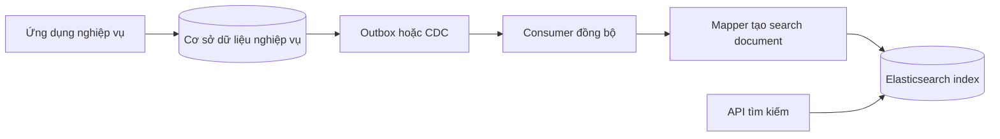
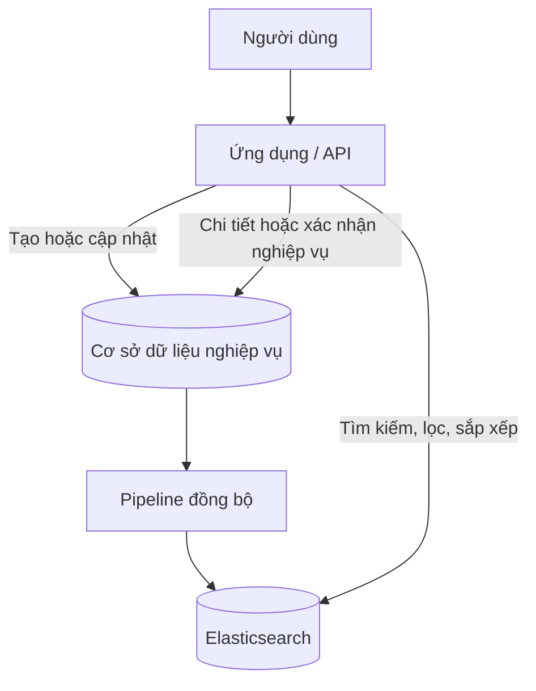

# Phân biệt cơ sở dữ liệu nghiệp vụ và mô hình dữ liệu phục vụ tìm kiếm

Trong một ứng dụng Spring Data Elasticsearch, dữ liệu được lưu trong cơ sở dữ liệu nghiệp vụ và dữ liệu được lập chỉ mục trong Elasticsearch có thể cùng mô tả một sản phẩm, khách hàng hoặc đơn hàng, nhưng chúng phục vụ hai mục đích khác nhau. Cơ sở dữ liệu nghiệp vụ quản lý trạng thái chính thức của hệ thống và các quy tắc giao dịch. Mô hình dữ liệu phục vụ tìm kiếm tổ chức thông tin theo cách giúp Elasticsearch tìm kiếm toàn văn, lọc, sắp xếp và tổng hợp nhanh.

Hiểu rõ sự khác biệt này giúp thiết kế đúng vai trò của từng kho dữ liệu, tránh biến Elasticsearch thành nơi lưu trạng thái giao dịch ngoài ý muốn và xây dựng được luồng đồng bộ dữ liệu đáng tin cậy.

## 1. Hai mô hình dữ liệu giải quyết hai bài toán

### Cơ sở dữ liệu nghiệp vụ

Cơ sở dữ liệu nghiệp vụ (thường là cơ sở dữ liệu quan hệ như PostgreSQL, MySQL hoặc SQL Server) lưu trạng thái có thẩm quyền của ứng dụng. Nó phục vụ các thao tác tạo, đọc, cập nhật và xóa dữ liệu trong quy trình nghiệp vụ, thường được gọi là OLTP (Online Transaction Processing).

Ví dụ, khi khách hàng đặt hàng, hệ thống cần bảo đảm rằng:

- Mã đơn hàng là duy nhất.
- Số lượng tồn kho được cập nhật theo quy tắc nghiệp vụ.
- Tổng tiền và chi tiết đơn hàng nhất quán.
- Việc ghi đơn hàng, dòng hàng và các thay đổi liên quan tuân theo ranh giới giao dịch.
- Các ràng buộc như khóa ngoại, tính duy nhất và tính hợp lệ được thực thi.

Vì vậy, dữ liệu nghiệp vụ thường được chia thành nhiều bảng có quan hệ rõ ràng. Thông tin dùng chung được lưu một lần và liên kết bằng khóa chính, khóa ngoại. Cách tổ chức này hạn chế dữ liệu trùng lặp và giúp cập nhật trạng thái an toàn.

### Mô hình dữ liệu phục vụ tìm kiếm

Mô hình dữ liệu phục vụ tìm kiếm (search data model hoặc search document model) được thiết kế cho cách người dùng tìm và khám phá thông tin. Trong Elasticsearch, dữ liệu thường được lập chỉ mục dưới dạng document JSON trong một index.

Ví dụ, trang tìm kiếm sản phẩm có thể cần hiển thị tên sản phẩm, tên thương hiệu, đường dẫn danh mục, giá hiện tại, tình trạng còn hàng và một số thuộc tính biến thể. Nếu các thông tin này nằm ở nhiều bảng, mỗi truy vấn tìm kiếm có thể phải thực hiện nhiều phép nối và xử lý bổ sung. Một search document có thể chứa sẵn các trường cần thiết để Elasticsearch tìm kiếm và trả về kết quả trong một lần truy vấn.

Mô hình tìm kiếm thường chấp nhận việc lặp lại một phần dữ liệu có chọn lọc. Đây là sự phi chuẩn hóa (denormalization): dữ liệu được sao chép vào document để tối ưu truy vấn. Sự lặp lại này là một quyết định thiết kế có chủ đích, đi kèm trách nhiệm cập nhật document khi dữ liệu nguồn thay đổi.

## 2. So sánh theo mục đích và cách tổ chức

| Khía cạnh | Cơ sở dữ liệu nghiệp vụ | Mô hình dữ liệu tìm kiếm |
|---|---|---|
| Mục tiêu | Ghi nhận và quản lý trạng thái chính thức của nghiệp vụ | Tìm kiếm toàn văn, lọc, sắp xếp, gợi ý và tổng hợp |
| Vai trò dữ liệu | Nguồn dữ liệu có thẩm quyền (source of truth) | Bản chiếu phục vụ truy vấn (read/search projection) |
| Đơn vị lưu trữ | Bảng và hàng trong mô hình quan hệ, hoặc cấu trúc phù hợp với DB nghiệp vụ | Document JSON trong index Elasticsearch |
| Quan hệ | Thể hiện bằng khóa và quan hệ giữa bảng; thường chuẩn hóa | Thường nhúng hoặc sao chép dữ liệu cần thiết vào document |
| Tối ưu chính | Tính toàn vẹn, giao dịch, cập nhật chính xác | Khả năng truy vấn, độ liên quan, tốc độ đọc và tổng hợp |
| Cách tìm dữ liệu | Truy vấn theo khóa, điều kiện nghiệp vụ và phép nối | Inverted index, phân tích văn bản, bộ lọc và aggregation |
| Cập nhật | Theo giao dịch và quy tắc nghiệp vụ | Theo luồng lập chỉ mục hoặc đồng bộ từ dữ liệu nguồn |
| Nhất quán | Có thể dùng transaction để bảo đảm nhất quán trong phạm vi DB | Thường có độ trễ đồng bộ; có thể đạt nhất quán cuối cùng (eventual consistency) |
| Thay đổi cấu trúc | Thường cần migration và kiểm soát tương thích ứng dụng | Có thể cần tạo index mới và reindex khi thay đổi mapping không tương thích |

Không nên hiểu bảng so sánh này là quy tắc tuyệt đối cho mọi hệ thống. Một số cơ sở dữ liệu nghiệp vụ không phải cơ sở dữ liệu quan hệ, và Elasticsearch có nhiều kiểu truy vấn khác nhau. Điểm cốt lõi là thiết kế dữ liệu phải xuất phát từ trách nhiệm của từng hệ thống.

## 3. Ví dụ: cùng một sản phẩm, hai cách biểu diễn

Giả sử một cửa hàng trực tuyến có các bảng nghiệp vụ sau:

```text
products
  id, sku, name, brand_id, price, status

brands
  id, name

categories
  id, name, parent_id

product_categories
  product_id, category_id

inventory
  product_id, warehouse_id, available_quantity

product_variants
  id, product_id, color, size, price
```

Mô hình này có thể phù hợp với nghiệp vụ vì thương hiệu, danh mục, tồn kho và biến thể có vòng đời cập nhật riêng. Một sản phẩm có thể thuộc nhiều danh mục, có nhiều biến thể và có tồn kho ở nhiều kho hàng. Khi thay đổi tên thương hiệu, ứng dụng chỉ cần cập nhật bản ghi thương hiệu; không phải sửa tên thương hiệu trong mọi hàng sản phẩm.

Trong khi đó, một trang kết quả tìm kiếm có thể cần document gần với cấu trúc sau:

```json
{
  "id": "p-1001",
  "sku": "COFFEE-001",
  "name": "Máy pha cà phê Espresso",
  "brand": {
    "id": "b-12",
    "name": "North Star"
  },
  "categoryIds": ["c-10", "c-11"],
  "categoryNames": ["Gia dụng", "Máy pha cà phê"],
  "price": 3250000,
  "available": true,
  "variants": [
    { "color": "black", "size": "compact", "price": 3250000 },
    { "color": "silver", "size": "standard", "price": 3590000 }
  ]
}
```

Document đã chứa một số thông tin lấy từ nhiều bảng. Elasticsearch có thể tìm theo tên sản phẩm và thương hiệu, lọc theo danh mục hoặc tình trạng còn hàng, sắp xếp theo giá và hiển thị thông tin cơ bản mà không cần thực hiện phép nối quan hệ như trong mô hình nghiệp vụ.

Giá trị `available` trong document là dữ liệu phục vụ tìm kiếm tại thời điểm lập chỉ mục. Khi xử lý thanh toán hoặc xác nhận đơn hàng, ứng dụng vẫn phải kiểm tra tồn kho trong hệ thống nghiệp vụ. Kết quả tìm kiếm có thể chậm hơn trạng thái mới nhất một khoảng thời gian do độ trễ đồng bộ.

## 4. Thiết kế search document trong Spring Data Elasticsearch

Spring Data Elasticsearch ánh xạ lớp Java với document trong Elasticsearch thông qua các annotation. Lớp này nên thể hiện những trường cần cho các truy vấn và màn hình tìm kiếm, thay vì sao chép nguyên xi toàn bộ entity nghiệp vụ.

Ví dụ, lớp document có thể được khai báo như sau:

```java
import java.math.BigDecimal;
import java.util.List;

import org.springframework.data.annotation.Id;
import org.springframework.data.elasticsearch.annotations.Document;
import org.springframework.data.elasticsearch.annotations.Field;
import org.springframework.data.elasticsearch.annotations.FieldType;
import org.springframework.data.elasticsearch.annotations.InnerField;
import org.springframework.data.elasticsearch.annotations.MultiField;

@Document(indexName = "products")
public class ProductSearchDocument {

    @Id
    private String id;

    @MultiField(
        mainField = @Field(type = FieldType.Text, analyzer = "standard"),
        otherFields = {
            @InnerField(suffix = "keyword", type = FieldType.Keyword)
        }
    )
    private String name;

    @Field(type = FieldType.Keyword)
    private String sku;

    @Field(type = FieldType.Keyword)
    private String brandName;

    @Field(type = FieldType.Keyword)
    private List<String> categoryIds;

    @Field(type = FieldType.Text, analyzer = "standard")
    private String description;

    @Field(type = FieldType.Double)
    private BigDecimal price;

    @Field(type = FieldType.Boolean)
    private boolean available;

    @Field(type = FieldType.Nested)
    private List<VariantSearchData> variants;

    // Constructors, getters and setters
}
```

Lớp `VariantSearchData` mô tả phần dữ liệu lồng bên trong document:

```java
import java.math.BigDecimal;

import org.springframework.data.elasticsearch.annotations.Field;
import org.springframework.data.elasticsearch.annotations.FieldType;

public class VariantSearchData {

    @Field(type = FieldType.Keyword)
    private String color;

    @Field(type = FieldType.Keyword)
    private String size;

    @Field(type = FieldType.Double)
    private BigDecimal price;

    // Constructors, getters and setters
}
```

Các annotation trên mô tả cách Spring Data Elasticsearch ánh xạ thuộc tính Java sang trường Elasticsearch:

- `@Document` xác định index mà document thuộc về.
- `@Id` đánh dấu định danh document. Giá trị này thường được chọn từ định danh ổn định của đối tượng nghiệp vụ để có thể cập nhật hoặc xóa đúng document.
- `@Field` khai báo kiểu trường, chẳng hạn `Text`, `Keyword`, `Double` hoặc `Boolean`.
- `@MultiField` kết hợp nhiều cách lập chỉ mục cho cùng một thuộc tính. Trong ví dụ, `name` có trường chính kiểu `text` để tìm kiếm toàn văn và trường phụ `name.keyword` kiểu `keyword` để hỗ trợ khớp chính xác, sắp xếp hoặc aggregation.
- `@InnerField` khai báo trường phụ trong cấu hình multi-field.

Ví dụ repository cơ bản:

```java
import org.springframework.data.elasticsearch.repository.ElasticsearchRepository;

public interface ProductSearchRepository
        extends ElasticsearchRepository<ProductSearchDocument, String> {
}
```

`ElasticsearchRepository` cung cấp các thao tác lưu, tìm và xóa document. Khi gọi `save(document)`, Spring Data Elasticsearch ghi document vào index tương ứng. Repository này không tự đọc các bảng JPA, không tự biết khi nào entity nghiệp vụ thay đổi và cũng không tự đồng bộ dữ liệu từ cơ sở dữ liệu quan hệ sang Elasticsearch. Ứng dụng cần xây dựng luồng chuyển đổi và lập chỉ mục riêng.

Trong dự án thực tế, mapping còn phụ thuộc vào phiên bản Elasticsearch và Spring Data Elasticsearch đang sử dụng. Các analyzer tùy chỉnh, synonym, normalizer và thiết lập index thường cần được khai báo trong index settings hoặc index template phù hợp. Chỉ ghi tên analyzer trong `@Field` không có nghĩa Elasticsearch tự tạo định nghĩa analyzer đó.

## 5. Chọn kiểu trường theo cách người dùng truy vấn

Chọn kiểu trường là một trong những quyết định quan trọng nhất khi thiết kế search document.

### `text` và `keyword`

`text` dành cho nội dung cần phân tích thành token để tìm kiếm toàn văn. Ví dụ tên sản phẩm hoặc mô tả có thể được phân tích thành các từ, sau đó so khớp với truy vấn của người dùng.

`keyword` lưu giá trị như một đơn vị nguyên vẹn. Kiểu này phù hợp với mã SKU, trạng thái, mã danh mục, thương hiệu cần khớp chính xác, cũng như các trường dùng để lọc, sắp xếp hoặc aggregation.

Ví dụ:

| Thuộc tính | Kiểu thường dùng | Lý do |
|---|---|---|
| Tên sản phẩm | `text` | Tìm theo từ hoặc cụm từ |
| Tên sản phẩm cần sort/aggregation | Multi-field có `keyword` | Giữ thêm phiên bản không phân tích |
| SKU | `keyword` | Mã cần khớp chính xác |
| Trạng thái | `keyword` | Lọc theo giá trị hữu hạn |
| Giá | Kiểu số phù hợp | Lọc theo khoảng và sắp xếp số học |
| Thời điểm tạo | `date` | Lọc theo thời gian và sắp xếp |
| Còn hàng | `boolean` | Bộ lọc đúng/sai |

Không nên dùng `text` cho mọi trường chỉ vì dữ liệu có dạng chuỗi. Một trường trạng thái như `PUBLISHED` thường cần lọc chính xác, không cần phân tích thành token.

### `object` và `nested`

Elasticsearch có thể lưu object lồng nhau. Với các object thông thường, Elasticsearch có thể làm phẳng cấu trúc trường khi lập chỉ mục. Điều này phù hợp nếu ứng dụng chỉ cần tìm theo các thuộc tính độc lập.

Khi một document chứa mảng object và truy vấn cần bảo đảm nhiều điều kiện cùng khớp trên đúng một phần tử của mảng, kiểu `nested` có thể cần thiết. Ví dụ, một sản phẩm có hai biến thể:

```json
{
  "variants": [
    { "color": "black", "size": "small" },
    { "color": "silver", "size": "large" }
  ]
}
```

Nếu cần tìm sản phẩm có một biến thể vừa màu đen vừa cỡ lớn, mô hình object thông thường có thể khiến điều kiện màu và cỡ khớp với hai phần tử khác nhau sau khi làm phẳng. `nested` giữ ngữ cảnh từng phần tử để truy vấn có thể yêu cầu hai điều kiện cùng đúng trên một biến thể.

`nested` có chi phí lưu trữ và truy vấn cao hơn object thông thường. Chỉ sử dụng khi ngữ nghĩa truy vấn cần giữ quan hệ giữa các thuộc tính trong cùng một phần tử mảng.

## 6. Quyết định dữ liệu nào nên được đưa vào document

Không phải mọi trường trong cơ sở dữ liệu nghiệp vụ đều cần có trong index tìm kiếm. Với mỗi trường, hãy xác định nó có phục vụ tìm kiếm, lọc, sắp xếp, aggregation, hiển thị kết quả hoặc điều hướng hay không.

Một số nguyên tắc hữu ích:

1. **Đưa vào những trường phục vụ truy vấn thực tế.** Ví dụ: tên, SKU, thương hiệu, danh mục, trạng thái hiển thị, giá và các thuộc tính người dùng có thể lọc.
2. **Sao chép dữ liệu tham chiếu khi điều đó giảm chi phí đọc.** Tên thương hiệu hoặc tên danh mục có thể được đưa vào document để hiển thị và tìm kiếm thuận tiện.
3. **Giữ định danh nguồn.** Lưu ID sản phẩm, ID thương hiệu hoặc ID danh mục để có thể truy ngược về dữ liệu nghiệp vụ và xử lý cập nhật.
4. **Tránh đưa dữ liệu nhạy cảm không cần thiết vào index.** Quyền truy cập, thời hạn lưu trữ và yêu cầu xóa dữ liệu cần được áp dụng cho cả bản sao trong Elasticsearch.
5. **Không đưa mọi quan hệ vào một document theo thói quen.** Document quá lớn làm tăng chi phí ghi, truyền tải và lập chỉ mục; cần cân bằng giữa tốc độ đọc và chi phí cập nhật.

### Khi nào nên phi chuẩn hóa?

Phi chuẩn hóa hữu ích khi một truy vấn thường xuyên cần nhiều thông tin cùng lúc và các thông tin đó tương đối phù hợp để được cập nhật như một đơn vị. Ví dụ, trang tìm kiếm sản phẩm thường cần tên thương hiệu và đường dẫn danh mục ở mỗi kết quả. Sao chép các trường này vào document giúp giảm công việc ghép dữ liệu khi đọc.

Đổi lại, khi tên thương hiệu thay đổi, mọi document sản phẩm chứa tên thương hiệu đó có thể cần được cập nhật. Nếu một giá trị được sao chép vào hàng trăm nghìn document, cần có cơ chế cập nhật hàng loạt, lập chỉ mục lại hoặc chấp nhận một khoảng thời gian dữ liệu chưa đồng nhất.

### Khi nào nên giữ dữ liệu riêng?

Nếu dữ liệu có tần suất thay đổi rất cao, kích thước lớn hoặc có vòng đời độc lập, việc nhúng toàn bộ dữ liệu vào document có thể gây ra nhiều lần ghi lại không cần thiết. Ví dụ, lịch sử giao dịch chi tiết không nên được sao chép toàn bộ vào document sản phẩm chỉ để phục vụ trang tìm kiếm sản phẩm.

Với quan hệ một-nhiều, có thể chọn một trong các cách sau:

- Nhúng thành object nếu dữ liệu nhỏ và truy vấn không cần giữ quan hệ giữa các phần tử trong mảng.
- Nhúng thành `nested` nếu cần truy vấn các điều kiện trên cùng một phần tử của mảng.
- Tạo document/index riêng nếu dữ liệu lớn, được truy vấn độc lập hoặc có vòng đời cập nhật khác biệt.
- Dùng quan hệ parent-child trong những trường hợp đặc biệt khi cần quan hệ giữa các document và chấp nhận chi phí truy vấn phức tạp hơn. Đây thường không phải lựa chọn mặc định.

## 7. Đồng bộ từ cơ sở dữ liệu nghiệp vụ sang Elasticsearch

Vì hai mô hình phục vụ mục đích khác nhau, ứng dụng cần một luồng biến đổi dữ liệu từ nguồn nghiệp vụ thành search document.

Một luồng tổng quát có thể biểu diễn như sau:



Khi người dùng cập nhật sản phẩm, ứng dụng ghi thay đổi vào cơ sở dữ liệu nghiệp vụ. Một thành phần đồng bộ nhận biết thay đổi đó, đọc dữ liệu cần thiết, chuyển đổi thành `ProductSearchDocument` rồi ghi vào Elasticsearch.

### Các cách phát hiện thay đổi

- **Đồng bộ trực tiếp trong luồng ứng dụng:** sau khi cập nhật DB, ứng dụng gọi repository Elasticsearch. Cách này đơn giản nhưng cần xử lý tình huống DB đã commit còn Elasticsearch gặp lỗi. Giao dịch của hai hệ thống không tự động trở thành một transaction phân tán chỉ vì hai lời gọi nằm trong cùng một service method.
- **Application event:** service phát sự kiện sau khi thay đổi nghiệp vụ và một listener cập nhật index. Cách này giảm kết dính giữa phần nghiệp vụ và phần tìm kiếm, nhưng sự kiện trong bộ nhớ có thể bị mất nếu tiến trình dừng ở thời điểm không phù hợp.
- **Transactional outbox:** ứng dụng ghi thay đổi nghiệp vụ và một bản ghi sự kiện vào outbox trong cùng transaction của DB. Một tiến trình riêng đọc outbox và cập nhật Elasticsearch. Cách này giúp tránh khoảng trống giữa commit nghiệp vụ và việc ghi nhận sự kiện cần đồng bộ.
- **Change Data Capture (CDC):** công cụ đọc log thay đổi của cơ sở dữ liệu và chuyển thay đổi tới pipeline đồng bộ. Cách này hữu ích khi cần xử lý lượng thay đổi lớn hoặc muốn tách pipeline khỏi mã ứng dụng.

Không có một lựa chọn phù hợp cho mọi hệ thống. Ứng dụng nhỏ có thể bắt đầu với listener đơn giản và cơ chế retry rõ ràng; hệ thống cần độ tin cậy cao thường cần outbox hoặc CDC.

### Các đặc tính cần bảo đảm

Một pipeline đồng bộ nên xem xét các tình huống sau:

- **Retry:** Elasticsearch tạm thời không truy cập được; sự kiện cần được thử lại mà không mất dấu.
- **Idempotency:** một sự kiện có thể được xử lý nhiều lần. Việc lập chỉ mục lại cùng một trạng thái nên tạo ra kết quả ổn định.
- **Thứ tự sự kiện:** hai cập nhật liên tiếp của cùng một sản phẩm có thể đến không đúng thứ tự. Có thể dùng version, sequence hoặc timestamp đáng tin cậy để tránh ghi trạng thái cũ đè lên trạng thái mới.
- **Xóa dữ liệu:** sự kiện xóa cần xóa document tương ứng hoặc đánh dấu document không còn được tìm thấy.
- **Lỗi từng phần:** lỗi của một document không nên âm thầm làm mất toàn bộ batch. Cần ghi nhận lỗi, retry và theo dõi số lượng bản ghi chưa xử lý.
- **Đối soát:** cần khả năng phát hiện document thiếu hoặc lệch so với dữ liệu nguồn.

Một điểm quan trọng là consumer thường nên dựng document từ trạng thái hiện tại trong cơ sở dữ liệu nghiệp vụ khi xử lý sự kiện, thay vì giả định payload sự kiện luôn chứa đầy đủ mọi dữ liệu liên quan. Tuy nhiên, cách này cần được thiết kế cùng cơ chế version hoặc thứ tự sự kiện để tránh đọc và ghi đè bằng một trạng thái cũ.

## 8. Ví dụ tổ chức service chuyển đổi dữ liệu

Nên tách trách nhiệm chuyển đổi dữ liệu sang search document thành một mapper hoặc một thành phần lập chỉ mục riêng. Ví dụ minh họa:

```java
public class ProductSearchMapper {

    public ProductSearchDocument toDocument(
            Product product,
            Brand brand,
            List<Category> categories,
            InventorySummary inventory) {

        ProductSearchDocument document = new ProductSearchDocument();
        document.setId(product.getId().toString());
        document.setSku(product.getSku());
        document.setName(product.getName());
        document.setBrandName(brand.getName());
        document.setCategoryIds(
            categories.stream()
                .map(category -> category.getId().toString())
                .toList()
        );
        document.setPrice(product.getPrice());
        document.setAvailable(inventory.getAvailableQuantity() > 0);

        return document;
    }
}
```

Đây là ví dụ về cấu trúc và trách nhiệm; các lớp nghiệp vụ, cách truy xuất quan hệ và cách xử lý biến thể cần được điều chỉnh theo ứng dụng cụ thể. Mapper không nên tự thực hiện quá nhiều truy vấn DB ẩn bên trong. Service hoặc một thành phần đọc dữ liệu nên cung cấp đủ dữ liệu đầu vào để mapper tạo document một cách dễ kiểm soát.

Consumer có thể dùng mapper và repository như sau:

```java
public class ProductIndexingService {

    private final ProductSearchMapper mapper;
    private final ProductSearchRepository searchRepository;

    public void index(Product product,
                      Brand brand,
                      List<Category> categories,
                      InventorySummary inventory) {

        ProductSearchDocument document =
            mapper.toDocument(product, brand, categories, inventory);

        searchRepository.save(document);
    }
}
```

Trong ứng dụng thực tế, cần bổ sung xử lý retry, logging, giám sát, version và chính sách lỗi phù hợp. Đoạn code trên chỉ minh họa ranh giới giữa dữ liệu nghiệp vụ, bước chuyển đổi và repository Elasticsearch.

## 9. Đọc và ghi dữ liệu ở đúng nơi

Thiết kế thường gặp là dùng cơ sở dữ liệu nghiệp vụ cho luồng ghi và dùng Elasticsearch cho các truy vấn tìm kiếm.



Ví dụ:

- Người dùng tìm sản phẩm theo từ khóa: truy vấn Elasticsearch.
- Người dùng lọc danh sách sản phẩm theo thương hiệu hoặc khoảng giá: truy vấn Elasticsearch nếu các trường đã được lập chỉ mục.
- Người dùng mở trang chi tiết cần dữ liệu mới nhất: ứng dụng có thể lấy dữ liệu có thẩm quyền từ DB nghiệp vụ.
- Người dùng đặt hàng: kiểm tra giá, trạng thái và tồn kho theo quy tắc nghiệp vụ từ hệ thống có thẩm quyền trước khi xác nhận giao dịch.
- Quản trị viên cập nhật tên hoặc giá sản phẩm: ghi vào DB nghiệp vụ, sau đó pipeline cập nhật search document.

Không nên dùng kết quả tìm kiếm làm bằng chứng cuối cùng cho một quyết định giao dịch. Một sản phẩm có thể vừa hết hàng trong DB nhưng document tìm kiếm chưa được cập nhật. Tương tự, giá trong search document có thể cũ hơn giá hiện hành. Những giá trị ảnh hưởng đến giao dịch phải được xác nhận lại ở nguồn nghiệp vụ.

## 10. Reindex khi mô hình tìm kiếm thay đổi

Mô hình tìm kiếm thường thay đổi khi sản phẩm bổ sung bộ lọc mới, cần analyzer mới, đổi kiểu trường hoặc thay đổi cấu trúc document. Một số thay đổi mapping không thể áp dụng trực tiếp lên dữ liệu đã lập chỉ mục theo cách mong muốn. Khi đó, cần tạo index mới và lập chỉ mục lại dữ liệu.

Một quy trình triển khai an toàn thường gồm:

1. Tạo index mới với mapping và settings mới, ví dụ `products-v2`.
2. Chạy backfill từ cơ sở dữ liệu nghiệp vụ để tạo document cho toàn bộ dữ liệu hiện có.
3. Tiếp tục xử lý các thay đổi phát sinh trong lúc backfill, bằng cách phát lại sự kiện hoặc đồng bộ theo checkpoint.
4. Đối soát số lượng và một số trường quan trọng giữa nguồn và index mới.
5. Chuyển alias tìm kiếm sang index mới sau khi dữ liệu sẵn sàng.
6. Giữ index cũ trong khoảng thời gian cần thiết để có thể quay lại nếu phát hiện vấn đề.

Alias giúp ứng dụng truy vấn một tên ổn định trong khi index vật lý có thể được thay thế theo phiên bản. Quy trình cụ thể cần tính đến lưu lượng ghi trong lúc chuyển đổi để tránh bỏ sót cập nhật.

## 11. Những lỗi thiết kế thường gặp

### Dùng Elasticsearch làm nguồn dữ liệu chính cho giao dịch

Elasticsearch được tối ưu cho tìm kiếm và phân tích. Nếu ứng dụng dùng nó làm nơi quyết định cuối cùng về tồn kho, số dư hoặc trạng thái thanh toán, độ trễ đồng bộ và cách xử lý cập nhật có thể gây sai lệch nghiệp vụ. Hãy giữ nguồn có thẩm quyền ở hệ thống quản lý giao dịch.

### Sao chép toàn bộ entity nghiệp vụ sang document

Entity nghiệp vụ thường chứa quan hệ, trường nội bộ và thông tin không cần cho tìm kiếm. Sao chép nguyên trạng làm document phình to, tăng chi phí cập nhật và khiến mapping phụ thuộc quá chặt vào cấu trúc DB. Hãy định nghĩa search document theo truy vấn thực tế.

### Dùng `text` cho mọi chuỗi

Các trường mã, trạng thái và danh mục thường cần khớp chính xác. Dùng `keyword` hoặc multi-field phù hợp để lọc và sắp xếp đúng.

### Không có cơ chế cập nhật dữ liệu sao chép

Phi chuẩn hóa làm truy vấn nhanh hơn nhưng tạo thêm trách nhiệm đồng bộ. Nếu tên thương hiệu được sao chép vào document sản phẩm, cần biết cách cập nhật các document đó khi thương hiệu đổi tên.

### Ghi DB và Elasticsearch nhưng không xử lý lỗi giữa hai bước

DB có thể commit thành công trong khi thao tác ghi Elasticsearch thất bại. Nếu không có retry, outbox hoặc cơ chế đối soát, dữ liệu tìm kiếm sẽ bị thiếu hoặc cũ mà hệ thống không biết.

### Thay đổi mapping mà không có kế hoạch reindex

Mapping ảnh hưởng đến cách Elasticsearch lưu và truy vấn dữ liệu. Cần quản lý phiên bản index, kiểm tra tương thích và chuẩn bị backfill khi thay đổi cấu trúc hoặc cách phân tích văn bản.

### Đưa dữ liệu nhạy cảm vào index mà quên vòng đời của bản sao

Elasticsearch chứa một bản sao dữ liệu. Chính sách phân quyền, thời hạn lưu trữ, xóa và bảo vệ dữ liệu phải bao gồm cả index, snapshot và pipeline đồng bộ.

## 12. Quy trình thực tế để thiết kế search data model

Khi bắt đầu thiết kế, có thể đi theo trình tự sau:

1. **Liệt kê các màn hình và truy vấn tìm kiếm.** Xác định người dùng tìm bằng từ khóa nào, lọc theo trường gì, cần sắp xếp và tổng hợp ra sao.
2. **Xác định dữ liệu nguồn.** Với từng trường kết quả, xác định bảng, entity hoặc dịch vụ nghiệp vụ có thẩm quyền cung cấp giá trị đó.
3. **Thiết kế document theo truy vấn.** Nhóm những trường thường được đọc cùng nhau; quyết định trường nào được sao chép và trường nào nên để riêng.
4. **Chọn kiểu Elasticsearch.** Phân biệt `text`, `keyword`, kiểu số, ngày giờ, boolean, object và nested dựa trên cách truy vấn.
5. **Thiết kế đồng bộ.** Chọn sự kiện, outbox, CDC hoặc cách khác; xác định retry, idempotency, thứ tự cập nhật và xóa.
6. **Lập kế hoạch nạp dữ liệu ban đầu.** Có cách backfill dữ liệu hiện có và tiếp tục bắt kịp thay đổi mới trong lúc nạp.
7. **Kiểm tra hành vi tìm kiếm.** Dùng dữ liệu mẫu đại diện để kiểm tra khớp từ, lọc, sắp xếp, aggregation, trường hợp thiếu dữ liệu và biến thể.
8. **Theo dõi độ trễ và sai lệch.** Đo thời gian từ lúc thay đổi nghiệp vụ đến khi document được cập nhật; theo dõi lỗi và có quy trình đối soát.

## 13. Kết luận

Cơ sở dữ liệu nghiệp vụ và mô hình dữ liệu phục vụ tìm kiếm là hai cách biểu diễn dữ liệu cho hai nhóm trách nhiệm khác nhau. Cơ sở dữ liệu nghiệp vụ bảo đảm trạng thái chính thức, quan hệ và quy tắc giao dịch. Search data model trong Elasticsearch tổ chức dữ liệu theo nhu cầu tìm kiếm, lọc, sắp xếp và tổng hợp; vì vậy thường dùng document phi chuẩn hóa và chấp nhận độ trễ đồng bộ có kiểm soát.

Trong Spring Data Elasticsearch, hãy tạo các lớp document riêng, dùng annotation để mô tả mapping, dùng repository hoặc `ElasticsearchOperations` để thao tác với index, và xây dựng pipeline chuyển đổi từ dữ liệu nguồn. Khi giữ rõ ranh giới này, ứng dụng có thể tận dụng khả năng tìm kiếm của Elasticsearch mà vẫn bảo toàn tính đúng đắn của nghiệp vụ.
