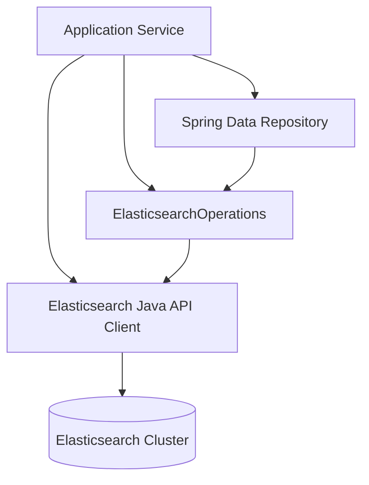
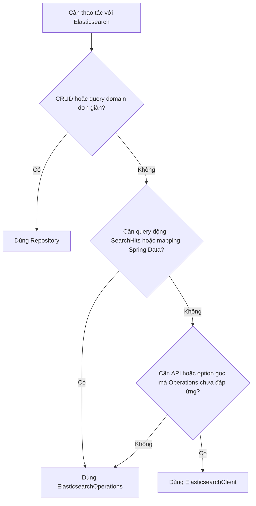

# So sánh Repository, ElasticsearchOperations và client trực tiếp

Trong Spring Data Elasticsearch, một thao tác tìm kiếm hoặc ghi document có thể được thực hiện qua ba lớp API thường gặp:

- **Repository**: giao diện hướng miền nghiệp vụ, phù hợp với các thao tác CRUD và truy vấn phổ biến.
- **`ElasticsearchOperations`**: API thao tác ở mức Spring Data, phù hợp khi cần điều khiển truy vấn, kết quả tìm kiếm, mapping hoặc vòng đời index.
- **Elasticsearch Java API Client (`ElasticsearchClient`)**: client Java chính thức của Elasticsearch, cho phép gọi trực tiếp các API mà Elasticsearch cung cấp.

Cả ba cách đều làm việc với cùng một Elasticsearch cluster. Khác biệt nằm ở mức trừu tượng, cách ánh xạ object, mức độ kiểm soát request và lượng mã mà ứng dụng phải tự quản lý. Chọn đúng lớp giúp code dễ đọc, dễ kiểm thử và vẫn đủ linh hoạt khi nghiệp vụ tìm kiếm phức tạp dần.

## 1. Bối cảnh: Spring Data Elasticsearch nằm ở đâu?

Elasticsearch lưu dữ liệu dưới dạng **document JSON** trong **index**. Một document thường có `_id`, các field và metadata tìm kiếm. Khi ứng dụng gửi request, Elasticsearch thực hiện thao tác trên index: tạo hoặc cập nhật document, xóa document, tìm kiếm, tổng hợp dữ liệu, quản lý mapping và nhiều tác vụ khác.

Spring Data Elasticsearch bổ sung một lớp làm việc theo mô hình Spring Data:

- Khai báo entity Java bằng các annotation như `@Document`, `@Id` và `@Field`.
- Chuyển đổi giữa entity Java và document Elasticsearch.
- Cung cấp Repository để ứng dụng gọi các phương thức theo kiểu Spring Data.
- Cung cấp `ElasticsearchOperations` để thực hiện các thao tác linh hoạt hơn.

Ở lớp giao tiếp với Elasticsearch, Spring Data Elasticsearch hiện sử dụng **Elasticsearch Java API Client**. Vì vậy, Repository và `ElasticsearchOperations` không phải là hai database engine khác với client. Chúng là các lớp trừu tượng Spring Data được xây dựng phía trên client và các thành phần mapping của Spring Data.

Sơ đồ khái quát:



Trong luồng thông thường, Repository được triển khai bởi Spring Data và sử dụng `ElasticsearchOperations` ở phía dưới. Khi cần, một service hoặc adapter cũng có thể gọi `ElasticsearchOperations` trực tiếp. Ứng dụng có thể inject `ElasticsearchClient` để gọi Java API Client trực tiếp.

## 2. Chuẩn bị một entity dùng trong ví dụ

Giả sử ứng dụng quản lý sản phẩm. Ta cần tìm sản phẩm theo tên, lọc theo danh mục và phân trang kết quả.

```java
import java.math.BigDecimal;

import org.springframework.data.annotation.Id;
import org.springframework.data.elasticsearch.annotations.Document;
import org.springframework.data.elasticsearch.annotations.Field;
import org.springframework.data.elasticsearch.annotations.FieldType;

@Document(indexName = "products")
public class Product {

    @Id
    private String id;

    @Field(type = FieldType.Text)
    private String name;

    @Field(type = FieldType.Keyword)
    private String category;

    @Field(type = FieldType.Double)
    private BigDecimal price;

    protected Product() {
    }

    public Product(String id, String name, String category, BigDecimal price) {
        this.id = id;
        this.name = name;
        this.category = category;
        this.price = price;
    }

    public String getId() {
        return id;
    }

    public String getName() {
        return name;
    }

    public String getCategory() {
        return category;
    }

    public BigDecimal getPrice() {
        return price;
    }
}
```

Các annotation có ý nghĩa ở lớp Spring Data:

| Annotation | Ý nghĩa |
|---|---|
| `@Document(indexName = "products")` | Khai báo index gắn với entity. |
| `@Id` | Đánh dấu thuộc tính dùng làm document ID (`_id`). |
| `@Field(type = FieldType.Text)` | Khai báo field được phân tích văn bản để phục vụ full-text search. |
| `@Field(type = FieldType.Keyword)` | Khai báo field dùng cho giá trị chính xác, lọc, sắp xếp hoặc aggregation. |
| `@Field(type = FieldType.Double)` | Khai báo kiểu số trong mapping của Elasticsearch. |

`text` và `keyword` có mục đích khác nhau. Truy vấn `match` thường phù hợp với `name` kiểu `text`; truy vấn `term` phù hợp với `category` kiểu `keyword`. Không nên dùng `term` để tìm một cụm từ tự do trên field `text` nếu chưa hiểu cách analyzer biến đổi nội dung.

Ví dụ này giả định index có mapping tương ứng. Có thể khai báo mapping bằng annotation và chủ động tạo/kiểm tra index thông qua `IndexOperations`. Với hệ thống đã chạy production, mapping cần được quản lý có chủ đích vì nhiều thay đổi kiểu field không thể áp dụng trực tiếp lên dữ liệu hiện có; có thể phải tạo index mới và reindex.

## 3. Repository: làm việc theo mô hình Spring Data

Repository là lựa chọn dễ bắt đầu nhất khi thao tác dữ liệu có thể diễn đạt thành các phương thức nghiệp vụ quen thuộc. Ta khai báo interface, Spring Data tạo implementation tại runtime.

```java
import java.util.List;

import org.springframework.data.domain.Page;
import org.springframework.data.domain.Pageable;
import org.springframework.data.elasticsearch.repository.ElasticsearchRepository;

public interface ProductRepository extends ElasticsearchRepository<Product, String> {

    List<Product> findByCategory(String category);

    Page<Product> findByCategory(String category, Pageable pageable);

    List<Product> findByName(String name);
}
```

`ElasticsearchRepository<Product, String>` cho biết entity là `Product` và kiểu ID là `String`. Repository cung cấp các thao tác cơ bản như lưu, tìm theo ID, xóa và lấy danh sách. Những phương thức có tên theo quy ước Spring Data có thể được phân tích để tạo truy vấn.

Ví dụ sử dụng:

```java
import org.springframework.data.domain.Page;
import org.springframework.data.domain.PageRequest;

Page<Product> page = productRepository.findByCategory(
    "audio",
    PageRequest.of(0, 20)
);

page.getContent().forEach(product ->
    System.out.println(product.getName())
);
```

Đoạn code thể hiện ý định nghiệp vụ khá rõ: lấy trang đầu tiên, mỗi trang 20 sản phẩm thuộc danh mục `audio`. Service không phải tự tạo request Elasticsearch, tự đọc danh sách hit hay tự chuyển JSON thành entity.

### 3.1. Truy vấn phát sinh từ tên phương thức

Spring Data hỗ trợ một số quy ước đặt tên như `findBy...`, `existsBy...`, `countBy...`, kết hợp điều kiện và các toán tử được hỗ trợ. Ví dụ:

```java
Page<Product> findByCategoryAndPriceLessThan(
    String category,
    BigDecimal maxPrice,
    Pageable pageable
);
```

Ưu điểm của cách này:

- Interface ngắn, dễ đọc và dễ mock trong unit test.
- Tên phương thức mô tả điều kiện ở mức domain, không buộc người đọc phải hiểu Query DSL.
- Các thao tác CRUD và truy vấn đơn giản có thể được dùng trực tiếp trong service.
- Spring Data xử lý phần lớn việc chuyển đổi entity và tham số truy vấn.

Giới hạn xuất hiện khi truy vấn có nhiều nhánh `bool`, nested query, aggregation, highlight, function score, pipeline hoặc logic tìm kiếm đặc thù. Tên phương thức dài sẽ khó đọc và không phải mọi cấu trúc của Elasticsearch đều diễn đạt tốt bằng derived query.

### 3.2. Dùng `@Query` khi truy vấn cần biểu đạt rõ hơn

Với một truy vấn đơn giản nhưng không phù hợp với tên phương thức, Repository có thể khai báo JSON query bằng `@Query`:

```java
import org.springframework.data.elasticsearch.annotations.Query;

public interface ProductRepository extends ElasticsearchRepository<Product, String> {

    @Query("{\"match\": {\"name\": {\"query\": \"?0\"}}}")
    List<Product> searchByName(String text);
}
```

Ở đây `?0` là tham số đầu tiên của phương thức. Nội dung annotation là JSON biểu diễn truy vấn Elasticsearch. Cách này giữ được giao diện Repository nhưng người viết phải hiểu cấu trúc query và tên field trong mapping.

Không nên biến một Repository thành nơi chứa hàng chục chuỗi JSON rất dài. Khi query có nhiều thành phần hoặc cần cấu hình động, `ElasticsearchOperations` thường dễ tổ chức hơn. Nếu truy vấn có thể tái sử dụng, cân nhắc tách thành repository fragment hoặc một adapter chuyên trách.

### 3.3. Khi nào Repository phù hợp?

Chọn Repository khi:

- Use case chủ yếu là CRUD hoặc truy vấn đơn giản theo thuộc tính.
- Phương thức có thể diễn đạt ngắn gọn bằng tên hoặc một `@Query` nhỏ.
- Ứng dụng muốn phụ thuộc vào interface theo phong cách Spring Data.
- Kết quả `Iterable`, `Optional`, `List` hoặc `Page` đáp ứng đủ nhu cầu.

Repository là điểm bắt đầu hợp lý cho phần lớn thao tác dữ liệu thông thường. Khi một truy vấn trở nên khó biểu đạt, có thể chuyển riêng use case đó sang `ElasticsearchOperations` mà không cần thay toàn bộ Repository.

## 4. `ElasticsearchOperations`: API thao tác linh hoạt của Spring Data

`ElasticsearchOperations` là interface trung tâm của Spring Data Elasticsearch cho các thao tác trên entity và index. Implementation phổ biến là `ElasticsearchTemplate`.

So với Repository, `ElasticsearchOperations` cho phép code chủ động xây dựng query, lựa chọn loại truy vấn, phân trang, sắp xếp và xử lý metadata của kết quả. Đồng thời, nó vẫn tham gia hệ thống mapping và conversion của Spring Data.

Một số nhóm thao tác thường dùng:

| Nhóm | Ví dụ |
|---|---|
| Document | `save`, `get`, `delete`, `search` |
| Bulk | Ghi hoặc xóa nhiều document theo lô |
| Query | `CriteriaQuery`, `StringQuery`, `NativeQuery` |
| Search result | `SearchHits`, score, highlight, aggregation và metadata tìm kiếm |
| Index | `indexOps(...)` để kiểm tra, tạo index, mapping và các thao tác index được hỗ trợ |

### 4.1. Tạo truy vấn động bằng `NativeQuery`

Ví dụ sau tìm sản phẩm có tên khớp với `wireless`, đồng thời lọc chính xác theo danh mục `audio`:

```java
import co.elastic.clients.elasticsearch._types.FieldValue;
import org.springframework.data.domain.PageRequest;
import org.springframework.data.elasticsearch.client.elc.NativeQuery;
import org.springframework.data.elasticsearch.core.ElasticsearchOperations;
import org.springframework.data.elasticsearch.core.SearchHit;
import org.springframework.data.elasticsearch.core.SearchHits;
import org.springframework.data.elasticsearch.core.query.Query;

public class ProductSearchService {

    private final ElasticsearchOperations operations;

    public ProductSearchService(ElasticsearchOperations operations) {
        this.operations = operations;
    }

    public void searchProducts() {
        Query query = NativeQuery.builder()
            .withQuery(q -> q
                .bool(b -> b
                    .must(m -> m
                        .match(match -> match
                            .field("name")
                            .query("wireless")
                        )
                    )
                    .filter(f -> f
                        .term(term -> term
                            .field("category")
                            .value(FieldValue.of("audio"))
                        )
                    )
                )
            )
            .withPageable(PageRequest.of(0, 20))
            .build();

        SearchHits<Product> hits = operations.search(query, Product.class);

        for (SearchHit<Product> hit : hits) {
            Product product = hit.getContent();
            float score = hit.getScore();
            System.out.println(product.getName() + " - score=" + score);
        }
    }
}
```

`NativeQuery` cho phép xây dựng Query DSL bằng các builder có kiểu của Elasticsearch Java API Client. `ElasticsearchOperations` nhận query, thực thi tìm kiếm và trả kết quả đã được Spring Data chuyển thành `Product`.

Hai phần trong truy vấn có vai trò khác nhau:

- `must` chứa điều kiện ảnh hưởng đến điểm liên quan (relevance score). `match` phân tích văn bản theo mapping/analyzer của field.
- `filter` chỉ giữ lại document thỏa điều kiện và thường không tham gia tính điểm. `term` so khớp chính xác với giá trị keyword `audio`.

Trong ví dụ, `PageRequest.of(0, 20)` giới hạn kết quả ở trang đầu với 20 hit. Nếu cần hiển thị nhiều trang sâu, hãy cân nhắc giới hạn của `from`/`size` và cơ chế `search_after` phù hợp với cách sắp xếp ổn định; không nên mặc định tăng `from` vô hạn.

### 4.2. Vì sao `SearchHits` hữu ích?

Nếu Repository trả về `List<Product>`, ứng dụng thường chỉ nhận các entity. `SearchHits<Product>` giữ thêm thông tin riêng của kết quả tìm kiếm:

- Entity tương ứng với `_source` sau khi chuyển đổi.
- `_score` của từng hit.
- Tổng số hit và thông tin phân trang mà response cung cấp.
- Metadata tìm kiếm như highlight, sort values hoặc các dữ liệu khác tùy truy vấn và phiên bản API.
- Aggregations được trả về cùng response khi query yêu cầu.

Nhờ vậy, tầng service có thể xây dựng một kết quả tìm kiếm phong phú mà không phải tự xử lý toàn bộ response JSON.

### 4.3. Quản lý index bằng `IndexOperations`

`ElasticsearchOperations` cũng cung cấp điểm truy cập đến các thao tác index. Ví dụ:

```java
import org.springframework.data.elasticsearch.core.IndexOperations;

IndexOperations indexOperations = operations.indexOps(Product.class);

if (!indexOperations.exists()) {
    indexOperations.create();
    indexOperations.putMapping();
}
```

Đoạn code minh họa cách lấy `IndexOperations` theo metadata của entity, kiểm tra index và tạo index cùng mapping. Trong ứng dụng thực tế, cần thiết kế cách chạy migration/index provisioning rõ ràng. Không nên để nhiều instance ứng dụng cùng tùy tiện thay đổi mapping của index production lúc khởi động.

### 4.4. Khi nào `ElasticsearchOperations` phù hợp?

Chọn `ElasticsearchOperations` khi:

- Truy vấn được tạo động theo bộ lọc người dùng.
- Cần kết hợp nhiều điều kiện `bool`, nested query, sort, pageable hoặc native Query DSL.
- Cần đọc score, highlight, aggregation hoặc metadata của hit.
- Cần thao tác bulk hoặc quản lý index qua abstraction của Spring Data.
- Muốn tiếp tục dùng entity mapping/conversion của Spring Data.

Đây thường là lựa chọn cân bằng cho các chức năng search có độ phức tạp trung bình đến cao trong ứng dụng Spring.

## 5. Elasticsearch Java API Client trực tiếp

Elasticsearch Java API Client là client Java chính thức để gọi API Elasticsearch. Trong Spring Boot, ứng dụng thường nhận `ElasticsearchClient` thông qua cấu hình client phù hợp với phiên bản Spring Boot/Spring Data và Elasticsearch đang dùng.

Khi gọi trực tiếp client, code làm việc gần với request/response của Elasticsearch hơn. Ta tự chỉ định index, query, sort, paging và kiểu Java dùng để giải mã `_source`.

Ví dụ tìm kiếm tương đương:

```java
import co.elastic.clients.elasticsearch.ElasticsearchClient;
import co.elastic.clients.elasticsearch.core.SearchResponse;
import co.elastic.clients.elasticsearch.core.search.Hit;
import co.elastic.clients.elasticsearch._types.FieldValue;

public class DirectProductSearchService {

    private final ElasticsearchClient client;

    public DirectProductSearchService(ElasticsearchClient client) {
        this.client = client;
    }

    public void searchProducts() throws IOException {
        SearchResponse<ProductDocument> response = client.search(search -> search
            .index("products")
            .from(0)
            .size(20)
            .query(query -> query
                .bool(bool -> bool
                    .must(must -> must
                        .match(match -> match
                            .field("name")
                            .query("wireless")
                        )
                    )
                    .filter(filter -> filter
                        .term(term -> term
                            .field("category")
                            .value(FieldValue.of("audio"))
                        )
                    )
                )
            ),
            ProductDocument.class
        );

        for (Hit<ProductDocument> hit : response.hits().hits()) {
            ProductDocument document = hit.source();
            Double score = hit.score();
            System.out.println(document + " - score=" + score);
        }
    }
}
```

`ProductDocument` là kiểu dữ liệu mà client dùng để deserialize `_source`. Ví dụ có thể định nghĩa nó thành một POJO hoặc record riêng, với cấu trúc field khớp JSON được Elasticsearch trả về. Đoạn code giả định đã có import `java.io.IOException` và kiểu `ProductDocument` phù hợp.

Điểm cần chú ý: Java API Client sử dụng JSON mapper của transport để chuyển JSON thành object. Nó **không tự động chạy qua `MappingElasticsearchConverter` của Spring Data**, vì vậy không nên mặc định các annotation `@Document`, `@Field` hoặc quy tắc conversion của entity Spring Data sẽ được áp dụng khi gọi client trực tiếp. Nếu dùng chung một class cho cả hai đường đi, hãy xác minh serializer, tên field, kiểu dữ liệu, date format và các custom conversion tương thích. Trong hệ thống lớn, tách document DTO dành cho client trực tiếp có thể làm ranh giới rõ hơn.

### 5.1. Những gì client trực tiếp đem lại

- Truy cập các endpoint và tùy chọn mà abstraction Spring Data chưa hỗ trợ hoặc chưa bộc lộ đầy đủ.
- Kiểm soát request/response sát với tài liệu Elasticsearch.
- Dùng đầy đủ các kiểu request builder và response model của Java API Client.
- Phù hợp với thao tác chuyên sâu như cluster APIs, một số thao tác index nâng cao, API mới hoặc tính năng đặc thù.

Đổi lại, ứng dụng phải tự chịu trách nhiệm nhiều hơn:

- Chọn index và tên field trong từng request.
- Xây dựng query, sort, paging và các option cần thiết.
- Chuyển đổi response thành mô hình mà tầng nghiệp vụ sử dụng.
- Quản lý khác biệt giữa JSON mapping của client và mapping/conversion của Spring Data.
- Theo dõi thay đổi của Java API Client khi nâng cấp phiên bản Elasticsearch.

Client trực tiếp không có nghĩa là phải tự gửi HTTP bằng `RestTemplate` hoặc viết chuỗi JSON thủ công. Java API Client cung cấp API builder có kiểu, request/response model và transport để giao tiếp với Elasticsearch. Cần phân biệt nó với `RestHighLevelClient` cũ của Elasticsearch 7.x, vốn đã bị deprecated trong dòng client mới.

### 5.2. Khi nào client trực tiếp phù hợp?

Chọn `ElasticsearchClient` khi:

- Cần gọi API chưa có abstraction tương ứng trong Spring Data Elasticsearch.
- Cần kiểm soát chính xác option của một request đặc thù.
- Tính năng phụ thuộc sát vào API mới của Elasticsearch.
- Đang xây dựng một adapter hạ tầng chuyên biệt, nơi request/response Elasticsearch là một phần rõ ràng của trách nhiệm.

Nếu chỉ cần CRUD hoặc một truy vấn search thông thường, dùng client trực tiếp thường làm tăng lượng code mà không đem lại lợi ích đáng kể.

## 6. So sánh ba cách theo từng tiêu chí

| Tiêu chí | Repository | `ElasticsearchOperations` | `ElasticsearchClient` trực tiếp |
|---|---|---|---|
| Mức trừu tượng | Cao, hướng domain và Spring Data | Trung bình, hướng thao tác trên entity/index | Thấp hơn, gần API Elasticsearch |
| Cách khai báo | Interface, tên phương thức, `@Query`, repository fragment | Xây dựng `Query`/`NativeQuery`, gọi operations | Request builder và API client |
| CRUD | Rất thuận tiện | Linh hoạt | Phải xây request và xử lý response |
| Truy vấn động | Hạn chế hơn; có thể cần fragment | Phù hợp | Phù hợp và kiểm soát đầy đủ API |
| Query DSL | Derived query hoặc JSON trong `@Query` | `NativeQuery` và các kiểu query của Spring Data | Java API Client Query DSL |
| Mapping entity | Dùng mapping/conversion của Spring Data | Dùng mapping/conversion của Spring Data | Dùng JSON mapper của client |
| Kết quả search | Thường là entity, `List`, `Page`, `Optional` | `SearchHits` cùng metadata tìm kiếm | `SearchResponse` và các kiểu response gốc |
| Quản lý index | Không phải mục đích chính của Repository | Có `IndexOperations` | Gọi trực tiếp các API index |
| Mức kiểm soát API | Thấp đến trung bình | Trung bình đến cao | Cao nhất |
| Lượng code ứng dụng | Thường ít nhất | Trung bình | Thường nhiều hơn |
| Phụ thuộc vào Spring Data | Cao | Cao | Có thể dùng độc lập với Spring Data, dù ứng dụng vẫn chạy trong Spring |

Không nên hiểu bảng này là thứ hạng về tốc độ. Cả ba đường đi cuối cùng đều gửi request đến Elasticsearch. Chênh lệch hiệu năng thường phụ thuộc query, network, dữ liệu, mapping, số hit và cách phân trang nhiều hơn số lớp Java được gọi. Chỉ nên chuyển sang client trực tiếp vì cần API hoặc quyền kiểm soát cụ thể; nếu nghi ngờ overhead, hãy đo bằng profiling và benchmark đại diện.

## 7. Chọn API theo tình huống thực tế

| Tình huống | Lựa chọn khởi đầu | Lý do |
|---|---|---|
| Lưu một sản phẩm, tìm theo ID, xóa sản phẩm | Repository | CRUD rõ ràng và ít mã. |
| Lọc theo category, trạng thái, khoảng giá và phân trang | Repository nếu điều kiện đơn giản; Operations nếu bộ lọc động | Chọn theo độ phức tạp của query. |
| Màn hình search có nhiều bộ lọc tùy chọn | `ElasticsearchOperations` | Có thể lắp query theo input và giữ mapping Spring Data. |
| Cần score, highlight hoặc aggregation | `ElasticsearchOperations` | `SearchHits` và metadata phù hợp với use case search. |
| Cần gọi một cluster API hoặc endpoint mới chưa được Spring Data bọc lại | `ElasticsearchClient` | Truy cập API gốc. |
| Cần thao tác index/mapping phổ biến gắn với entity | `ElasticsearchOperations` | `IndexOperations` và metadata Spring Data. |
| Cần một tùy chọn request nâng cao chỉ có trong Java API Client | `ElasticsearchClient` | Kiểm soát request trực tiếp. |

Một nguyên tắc thực tế là bắt đầu ở abstraction cao nhất vẫn diễn đạt rõ use case. Nếu Repository giải quyết được yêu cầu, không cần hạ xuống API thấp hơn. Nếu query động khiến Repository khó đọc, chuyển use case đó sang Operations. Chỉ xuống client trực tiếp khi có nhu cầu cụ thể mà Operations không đáp ứng thuận tiện.

## 8. Có thể kết hợp cả ba trong cùng ứng dụng không?

Có. Một ứng dụng có thể dùng Repository cho thao tác nghiệp vụ thông thường, `ElasticsearchOperations` cho màn hình tìm kiếm và `ElasticsearchClient` cho một API hạ tầng đặc thù. Đây là cách kết hợp hợp lý nếu mỗi thành phần có trách nhiệm rõ ràng.

Ví dụ phân chia:

```text
ProductApplicationService
    ├── ProductRepository
    │     └── CRUD và truy vấn domain đơn giản
    │
    ├── ProductSearchService
    │     └── ElasticsearchOperations
    │           └── Query động, SearchHits, highlight, aggregation
    │
    └── ElasticsearchMaintenanceAdapter
          └── ElasticsearchClient
                └── API hạ tầng đặc thù
```

Khi kết hợp, nên thống nhất một số quy ước:

1. **Quy định nơi sở hữu mapping.** Nếu entity Spring Data là nguồn khai báo mapping, hãy giữ `@Document`/`@Field` nhất quán và quản lý thay đổi index có kiểm soát.
2. **Không trộn conversion một cách vô thức.** Repository và Operations dùng conversion của Spring Data; client trực tiếp dùng JSON mapper của transport. Kiểm tra rõ ràng khi hai đường đi cùng đọc/ghi một loại document.
3. **Đóng gói truy vấn ở adapter phù hợp.** Service nghiệp vụ không nên chứa những request builder dài hoặc chuỗi JSON query. Hãy để một repository fragment hoặc search adapter sở hữu chi tiết đó.
4. **Tránh tạo hai nguồn sự thật cho tên field.** Nếu mapping có field được đổi tên, nested path hoặc custom conversion, phải xác định cách các query trực tiếp tham chiếu field Elasticsearch thực tế.
5. **Dùng đúng loại kết quả.** Nếu màn hình cần score/highlight, đừng chỉ trả `List<Product>` rồi làm mất metadata trước khi đến tầng trình bày.

## 9. Một số điểm cần hiểu dù chọn API nào

### 9.1. Elasticsearch không phải cơ sở dữ liệu quan hệ

Repository trong Spring Data Elasticsearch có giao diện quen thuộc với người dùng Spring Data JPA, nhưng không nên suy ra Elasticsearch có đầy đủ semantics của relational database. Elasticsearch không cung cấp transaction nhiều document theo cách một relational database thường cung cấp. Không nên thiết kế nghiệp vụ dựa trên giả định rằng nhiều lệnh `save` sẽ tự động rollback cùng nhau.

### 9.2. Ghi thành công không đồng nghĩa tìm kiếm thấy ngay lập tức

Elasticsearch sử dụng cơ chế refresh để làm document mới có thể xuất hiện trong search. Vì vậy, một thao tác index có thể thành công nhưng một truy vấn search ngay sau đó vẫn chưa thấy document nếu refresh chưa diễn ra. Nếu use case cần đọc ngay sau khi ghi, hãy tìm hiểu refresh policy và chi phí của việc ép refresh; không nên mặc định bật refresh tức thời cho mọi request.

Điểm này không thay đổi khi chuyển từ Repository sang Operations hoặc client trực tiếp. Đây là semantics của Elasticsearch.

### 9.3. Mapping quyết định ý nghĩa của query

Một query đúng cú pháp vẫn có thể trả kết quả sai kỳ vọng nếu mapping không phù hợp. Ví dụ:

- `text` được analyzer tách token, phù hợp tìm kiếm toàn văn.
- `keyword` giữ giá trị nguyên vẹn, phù hợp lọc chính xác và aggregation.
- Trường số/ngày nên có kiểu mapping phù hợp để range query và sort hoạt động đúng.
- Nested object cần query theo semantics `nested` nếu muốn giữ quan hệ giữa các field trong cùng nested object.

Repository, Operations và client trực tiếp đều phải tuân theo mapping của index. Abstraction cao hơn không sửa được mapping sai.

### 9.4. Phân trang sâu cần thiết kế riêng

`Pageable` rất tiện cho phân trang thông thường. Tuy nhiên, Elasticsearch giới hạn độ sâu của `from`/`size` để tránh chi phí bộ nhớ và tài nguyên lớn. Với luồng cuộn dữ liệu sâu hoặc export nhiều kết quả, hãy xem xét `search_after` cùng sort ổn định và PIT (Point in Time) khi phù hợp với phiên bản Elasticsearch. Operations hoặc client trực tiếp có thể được chọn tùy mức kiểm soát cần thiết; Repository không phải lúc nào cũng bộc lộ đủ các tùy chọn này.

### 9.5. Bulk và xử lý lỗi

Ghi nhiều document nên cân nhắc API bulk thay vì gửi từng request độc lập. Bulk có thể trả trạng thái thành công/thất bại theo từng item; không được chỉ kiểm tra request tổng thể rồi giả định mọi document đều ghi thành công. Khi dùng Operations hoặc client trực tiếp, hãy xử lý kết quả từng item theo yêu cầu nghiệp vụ.

## 10. Hướng dẫn ra quyết định

Có thể đi theo các câu hỏi sau:



Khi phân vân giữa Operations và client trực tiếp, hãy xác định điều còn thiếu cụ thể: endpoint nào, tham số nào, kiểu response nào hoặc khả năng kiểm soát nào. Nếu không chỉ ra được nhu cầu đó, Operations thường giữ được lợi ích của Spring Data với lượng mã ít hơn.

## 11. Kết luận lựa chọn

- **Repository** phù hợp với CRUD và truy vấn đơn giản, nơi tên phương thức thể hiện tốt ý định nghiệp vụ.
- **`ElasticsearchOperations`** phù hợp với search linh hoạt, query phức tạp và xử lý metadata, trong khi vẫn dùng mapping/conversion của Spring Data.
- **`ElasticsearchClient`** phù hợp với API Elasticsearch chuyên sâu hoặc tính năng chưa được abstraction Spring Data hỗ trợ đầy đủ; đổi lại ứng dụng phải quản lý request, response và JSON mapping rõ ràng hơn.

Ba API không loại trừ nhau. Hãy chọn theo yêu cầu của từng use case, giữ mapping nhất quán và đặt chi tiết truy vấn ở đúng adapter. Như vậy, phần lớn code nghiệp vụ vẫn dễ đọc, còn những chức năng search đặc thù vẫn có đủ quyền kiểm soát Elasticsearch.
