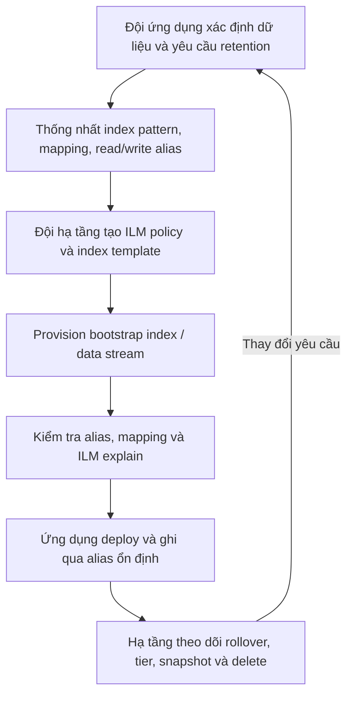

# Index Lifecycle Management và trách nhiệm của hạ tầng

Khi dữ liệu Elasticsearch tăng theo thời gian, việc tạo index mới, chuyển dữ liệu sang tầng lưu trữ phù hợp và xóa dữ liệu hết hạn cần được vận hành nhất quán. **Index Lifecycle Management (ILM)** là cơ chế của Elasticsearch để tự động thực hiện các bước trong vòng đời index theo policy. Ứng dụng Spring Data Elasticsearch thường tiếp tục đọc và ghi qua alias ổn định; đội hạ tầng hoặc nền tảng chịu trách nhiệm cấu hình policy, template, storage tier, snapshot và giám sát cluster.

Bài học này giải thích cách ILM hoạt động, các phase và action thường dùng, cách kết hợp policy với index template và rollover alias, cách kiểm tra trạng thái lifecycle, cũng như ranh giới trách nhiệm giữa code ứng dụng và hạ tầng. Mục tiêu là để ứng dụng không phải tự tạo/xóa index theo lịch, đồng thời dữ liệu vẫn được giữ đúng thời hạn và có thể truy cập theo yêu cầu nghiệp vụ.

## 1. Vì sao cần quản lý vòng đời index?

Một hệ thống log, sự kiện, audit hoặc dữ liệu theo thời gian thường liên tục ghi document mới. Nếu tất cả document được lưu mãi trong một index, index sẽ lớn dần và có thể gây khó khăn cho:

- Hiệu năng tìm kiếm và quản lý shard.
- Chi phí lưu trữ khi dữ liệu cũ ít được truy cập.
- Khả năng đáp ứng yêu cầu retention và xóa dữ liệu hết hạn.
- Snapshot, phục hồi và bảo trì cluster.
- Thay đổi mapping hoặc cấu trúc index theo từng giai đoạn.

Một giải pháp phổ biến là chia dữ liệu thành các index theo thời gian hoặc theo kích thước, sau đó chuyển index cũ qua các tầng lưu trữ và xóa khi hết hạn. Ví dụ:

```text
logs-000001  -> hot  -> warm -> delete
logs-000002  -> hot  -> warm -> delete
logs-000003  -> hot  -> warm -> delete
```

Thay vì để ứng dụng tự quyết định khi nào tạo `logs-000004` hoặc xóa `logs-000001`, ta khai báo policy và để Elasticsearch thực thi lifecycle actions.

## 2. ILM là gì?

**Index Lifecycle Management (ILM)** cho phép định nghĩa các phase và action áp dụng lên index theo thời gian hoặc điều kiện. ILM chạy ở phía Elasticsearch cluster, không phải một scheduler nằm trong ứng dụng Spring Boot.

Một ILM policy thường gồm các phase:

| Phase | Mục đích | Ví dụ thao tác |
|---|---|---|
| `hot` | Index đang nhận ghi và được truy cập thường xuyên | Rollover khi đạt tuổi hoặc kích thước; đặt shard priority. |
| `warm` | Index ít ghi hơn, vẫn cần truy vấn | Chuyển read-only, force merge, thay đổi priority hoặc placement. |
| `cold` | Dữ liệu ít truy cập, ưu tiên tiết kiệm chi phí | Chuyển sang tầng lưu trữ lạnh theo topology và action được hỗ trợ. |
| `frozen` | Dữ liệu rất ít truy cập, tối ưu chi phí lưu trữ | Có thể dùng searchable snapshot theo cấu hình phù hợp. |
| `delete` | Dữ liệu hết thời hạn lưu giữ | Xóa index theo policy. |

Không phải policy nào cũng cần đủ năm phase. Một hệ thống nhỏ có thể chỉ dùng `hot` và `delete`; hệ thống có nhiều tầng lưu trữ có thể thêm `warm`, `cold` hoặc `frozen`.

Các phase là mô hình vòng đời, còn action cụ thể phụ thuộc phiên bản Elasticsearch, topology, tính năng cluster và yêu cầu vận hành. Cần kiểm tra khả năng của phiên bản đang chạy trước khi chọn action.

## 3. ILM và rollover

Rollover tạo một index mới khi index hiện tại đạt một hoặc nhiều điều kiện. Ví dụ, khi index ghi đạt một ngày tuổi hoặc primary shard lớn hơn 50 GB, Elasticsearch có thể chuyển write alias sang index kế tiếp.

```text
logs-write (write alias)
      |
      v
 logs-000001  -- rollover -->  logs-000002
      |                              |
      +-- read alias ----------------+
```

Ứng dụng chỉ ghi vào alias `logs-write`. Khi rollover, alias này được chuyển sang index mới làm write index. Các index cũ vẫn có thể nằm dưới read alias để truy vấn lịch sử.

### 3.1. Điều kiện rollover

Các điều kiện thường gặp gồm:

- `max_age`: tuổi tối đa của index trước khi rollover.
- `max_primary_shard_size`: kích thước tối đa của primary shard lớn nhất.
- `max_size`: tổng kích thước primary shard theo điều kiện rollover được hỗ trợ.
- `max_docs`: số document tối đa.
- `min_age`, `min_docs` và các điều kiện `min_*` khác: ngưỡng tối thiểu có thể kết hợp với điều kiện tối đa.

Rollover thường được kích hoạt khi một trong các điều kiện `max_*` đạt ngưỡng, đồng thời các điều kiện `min_*` được thỏa mãn nếu policy có khai báo. Cần chọn ngưỡng dựa trên kích thước shard, tốc độ ghi, tần suất truy vấn và khả năng quản lý số lượng index.

Không nên chọn rollover chỉ dựa trên một con số phổ biến. Index quá nhỏ làm tăng số lượng shard/index và overhead quản trị; index quá lớn có thể làm recovery, relocation và tìm kiếm tốn tài nguyên. Hãy đo tốc độ ingest và kích thước shard thực tế.

### 3.2. Tên index và write alias

Với rollover alias, index thường có hậu tố số tăng dần, ví dụ `logs-000001`. ILM cần biết alias ghi thông qua setting `index.lifecycle.rollover_alias`. Index khởi tạo phải được tạo với alias đó và đánh dấu `is_write_index: true`.

Nếu tên index ban đầu không có hậu tố số phù hợp, rollover có thể không tạo được tên index kế tiếp theo quy tắc mong đợi. Hãy chọn quy ước tên ngay từ đầu và dùng nhất quán trong template, policy và cấu hình ứng dụng.

## 4. Ví dụ ILM policy cho log

Giả sử hệ thống cần giữ log trong khoảng 30 ngày. Index hoạt động ở hot phase, sau 7 ngày được chuyển sang warm phase để read-only và force merge, sau 30 ngày được xóa.

Tạo policy:

```json
PUT _ilm/policy/logs-retention
{
  "policy": {
    "phases": {
      "hot": {
        "actions": {
          "rollover": {
            "max_age": "1d",
            "max_primary_shard_size": "50gb"
          },
          "set_priority": {
            "priority": 100
          }
        }
      },
      "warm": {
        "min_age": "7d",
        "actions": {
          "readonly": {},
          "forcemerge": {
            "max_num_segments": 1
          },
          "set_priority": {
            "priority": 50
          }
        }
      },
      "delete": {
        "min_age": "30d",
        "actions": {
          "delete": {}
        }
      }
    }
  }
}
```

Ý nghĩa:

- `hot.rollover`: rollover khi index đạt một ngày tuổi hoặc primary shard lớn nhất đạt 50 GB.
- `set_priority`: đặt mức ưu tiên recovery của index trong cluster.
- `warm.min_age`: index đủ tuổi để chuyển sang warm phase theo mốc lifecycle mà ILM sử dụng.
- `readonly`: ngăn ghi thêm vào index ở phase warm.
- `forcemerge`: hợp nhất segment để giảm số segment; đây là thao tác tốn tài nguyên và cần được thực hiện ở thời điểm phù hợp.
- `delete`: xóa index khi đạt tuổi retention đã cấu hình.

Ví dụ này chỉ minh họa policy. Trước khi dùng production, hãy xác định rõ retention được tính từ thời điểm nào, xác nhận warm tier tồn tại nếu policy cần chuyển dữ liệu sang tier đó, kiểm tra chi phí force merge và thử policy trên index đại diện. `min_age` của các phase tiếp theo cần được hiểu theo mốc lifecycle của index; với policy có rollover, mốc tuổi phase được tính theo thời điểm rollover của index, trừ khi lifecycle origination date được cấu hình theo cách khác.

## 5. Gắn policy vào index template

Một policy chỉ định nghĩa hành vi. Để index mới tự động được quản lý, cần gắn policy vào index bằng setting `index.lifecycle.name`. Với rollover alias, cũng cần khai báo `index.lifecycle.rollover_alias`.

Tạo index template:

```json
PUT _index_template/logs-template
{
  "index_patterns": ["logs-*"],
  "priority": 100,
  "template": {
    "settings": {
      "index.lifecycle.name": "logs-retention",
      "index.lifecycle.rollover_alias": "logs-write",
      "number_of_shards": 1
    },
    "mappings": {
      "properties": {
        "@timestamp": {
          "type": "date"
        },
        "message": {
          "type": "text"
        },
        "level": {
          "type": "keyword"
        }
      }
    },
    "aliases": {
      "logs-read": {}
    }
  }
}
```

Template áp dụng cho các index có tên khớp `logs-*`. Mỗi index mới được tạo theo pattern sẽ nhận policy, rollover alias setting, mapping và read alias.

Trong ví dụ, `logs-read` là alias đọc được áp dụng cho các index phù hợp. `logs-write` được thiết lập làm rollover alias trong settings; write alias ban đầu sẽ được gắn vào index bootstrap ở bước tiếp theo. Khi ILM rollover, Elasticsearch cập nhật write alias để trỏ tới index mới.

Index template là trách nhiệm vận hành quan trọng: nếu template không khớp tên index, policy không được gắn; nếu template có priority thấp hơn một template khác hoặc bị component template ghi đè, settings cuối cùng có thể khác dự kiến. Hãy kiểm tra template đã được simulate/áp dụng như mong đợi trước khi phát hành.

## 6. Tạo index đầu tiên và thiết lập write alias

ILM rollover alias cần một index khởi đầu. Sau khi tạo policy và template, tạo index `logs-000001` cùng write alias:

```json
PUT logs-000001
{
  "aliases": {
    "logs-write": {
      "is_write_index": true
    }
  }
}
```

Do index khớp `logs-*`, template sẽ cung cấp policy, mapping, settings và `logs-read` alias. Lệnh bootstrap thêm `logs-write` làm write alias cho index đầu tiên.

Sau khi ILM rollover, Elasticsearch tạo index kế tiếp theo hậu tố tăng dần và chuyển write alias sang index mới. Ứng dụng tiếp tục ghi vào `logs-write` mà không cần biết index vật lý hiện tại là `logs-000001` hay `logs-000002`.

Kiểm tra alias:

```http
GET _alias/logs-write
GET _alias/logs-read
```

Kiểm tra policy đã gắn vào index:

```http
GET logs-000001/_settings?filter_path=*.settings.index.lifecycle*
```

## 7. Gắn ILM với Spring Data Elasticsearch

Ứng dụng Spring Data nên dùng alias ổn định trong `@Document` hoặc `IndexCoordinates`. Ví dụ entity log:

```java
package com.example.catalog.logs;

import java.time.Instant;

import org.springframework.data.annotation.Id;
import org.springframework.data.elasticsearch.annotations.Document;
import org.springframework.data.elasticsearch.annotations.Field;
import org.springframework.data.elasticsearch.annotations.FieldType;

@Document(indexName = "logs-write", createIndex = false)
public class LogEntry {

    @Id
    private String id;

    @Field(type = FieldType.Date)
    private Instant timestamp;

    @Field(type = FieldType.Text)
    private String message;

    @Field(type = FieldType.Keyword)
    private String level;

    protected LogEntry() {
    }

    public LogEntry(String id, Instant timestamp, String message, String level) {
        this.id = id;
        this.timestamp = timestamp;
        this.message = message;
        this.level = level;
    }
}
```

`createIndex = false` có chủ đích: index và alias đã được provision bởi hạ tầng. Spring Data không nên cố tạo một index mới tên `logs-write`, bởi `logs-write` là alias trỏ tới write index hiện tại.

Repository có thể khai báo như sau:

```java
import org.springframework.data.elasticsearch.repository.ElasticsearchRepository;

public interface LogEntryRepository
        extends ElasticsearchRepository<LogEntry, String> {
}
```

Khi gọi `save`, Repository ghi document thông qua alias được khai báo trong `@Document`:

```java
logEntryRepository.save(new LogEntry(
    "event-1001",
    Instant.now(),
    "User signed in",
    "INFO"
));
```

Elasticsearch nhận write request qua `logs-write` và định tuyến đến index đang được đánh dấu `is_write_index`. Sau rollover, alias trỏ sang index mới và ứng dụng vẫn tiếp tục ghi như cũ.

Nếu dùng `ElasticsearchOperations` trực tiếp, có thể chỉ định alias:

```java
operations.save(logEntry, IndexCoordinates.of("logs-write"));
```

Để đọc dữ liệu lịch sử, có thể query qua alias `logs-read` nếu alias này trỏ tới tất cả index cần tìm. Kiểu query và overload cụ thể phụ thuộc phiên bản Spring Data Elasticsearch; điểm quan trọng là read path dùng alias đọc và write path dùng alias ghi.

## 8. Ứng dụng và hạ tầng chịu trách nhiệm gì?

ILM chạy trong Elasticsearch cluster, vì vậy không nên đặt toàn bộ lifecycle trong một `@Scheduled` job của ứng dụng. Nếu mọi instance Spring Boot đều tự tạo index, tự rollover và xóa index theo lịch, rất dễ xảy ra race condition, xóa nhầm dữ liệu hoặc lệch policy giữa các môi trường.

Ranh giới trách nhiệm nên được xác định rõ:

| Chủ thể | Trách nhiệm chính |
|---|---|
| Đội ứng dụng | Xác định loại dữ liệu, mapping, timestamp, alias đọc/ghi, query cần hỗ trợ, yêu cầu retention nghiệp vụ và cách xử lý lỗi khi index/alias không sẵn sàng. |
| Đội hạ tầng/nền tảng | Cấu hình ILM policy, index template, shard/replica, data tier, snapshot, cluster privilege, rollout policy và giám sát trạng thái lifecycle. |
| Hai đội cùng phối hợp | Thống nhất tên index/alias, retention, SLA truy vấn lịch sử, thời điểm xóa, thay đổi mapping và quy trình phục hồi. |

### 8.1. Đội ứng dụng cần cung cấp thông tin gì?

Đội ứng dụng hiểu ý nghĩa dữ liệu và cách người dùng truy vấn. Vì vậy cần xác định:

- Dữ liệu nào là log, event, audit hay dữ liệu nghiệp vụ cần giữ lâu dài.
- Field thời gian nào được dùng làm timestamp và timezone/format ra sao.
- Dữ liệu cần truy vấn thường xuyên trong bao lâu.
- Tổng thời hạn lưu giữ theo yêu cầu nghiệp vụ hoặc chính sách nội bộ.
- Có yêu cầu xóa theo user, tenant, hợp đồng hoặc quy định dữ liệu riêng không.
- Ứng dụng có cần truy vấn lịch sử xuyên nhiều index không.
- Alias đọc/ghi nào được dùng trong code và trong cấu hình môi trường.

Ứng dụng cũng cần xử lý trường hợp alias chưa được tạo hoặc Elasticsearch tạm thời không sẵn sàng. Không nên tự tạo index rỗng trong runtime để che giấu lỗi provisioning, vì index đó có thể thiếu mapping và ILM policy.

### 8.2. Đội hạ tầng cần triển khai gì?

Đội hạ tầng chịu trách nhiệm cấu hình ILM và các thành phần cluster:

- Tạo và version hóa ILM policy.
- Tạo index template/component template và gắn policy đúng pattern.
- Tạo bootstrap index cùng write alias khi cần rollover alias.
- Cấu hình data tiers và allocation phù hợp với phần cứng/topology.
- Quản lý snapshot, backup và khả năng restore.
- Cấp quyền cho ứng dụng chỉ ở mức cần thiết.
- Theo dõi lifecycle execution, shard allocation, disk watermark và lỗi policy.
- Thử nghiệm thay đổi retention, rollover và delete trước khi áp dụng diện rộng.

Ứng dụng không nên được cấp quyền cluster-wide để sửa policy, template hoặc xóa bất kỳ index nào nếu nó chỉ cần ghi vào một alias cụ thể. Dùng quyền tối thiểu giúp giảm khả năng lỗi code ảnh hưởng đến dữ liệu của các hệ thống khác.

## 9. Vì sao không nên tự quản lý retention bằng scheduler của ứng dụng?

Một cách làm dễ nghĩ đến là dùng `@Scheduled` để mỗi ngày kiểm tra index cũ rồi gọi `deleteIndex()`. Cách này có một số vấn đề:

- Mỗi instance ứng dụng có thể chạy cùng scheduler và cùng thao tác một index.
- Logic retention bị phân tán theo phiên bản ứng dụng và môi trường.
- Scheduler của ứng dụng có thể dừng khi deployment, restart hoặc lỗi process.
- Code ứng dụng cần quyền xóa index rộng hơn mức cần thiết để ghi document.
- Việc chuyển tier, force merge, snapshot và kiểm soát shard vẫn phải tự triển khai.
- Khó theo dõi lifecycle state tập trung ở cấp cluster.

ILM giải quyết vòng đời ở nơi quản lý index và shard. Ứng dụng tập trung vào dữ liệu và use case nghiệp vụ, còn cluster thực hiện các hành động lưu trữ theo policy.

Điều này không có nghĩa ứng dụng không bao giờ được quản lý index. Một migration tool hoặc deployment job có thể tạo index, mapping và alias khi phát hành phiên bản mới. Điểm quan trọng là lifecycle retention định kỳ và thao tác phá hủy dữ liệu cần được quản lý tập trung, có quyền hạn và audit rõ ràng.

## 10. Data streams và ILM

Với dữ liệu append-only theo thời gian như log, metric hoặc event, **data stream** có thể là lựa chọn phù hợp hơn việc tự quản lý rollover alias. Data stream cung cấp một tên đích ghi ổn định và quản lý các backing indices bên dưới.

Khái quát:

```text
Application
    |
    v
  logs-prod  (data stream)
    |
    +--> .ds-logs-prod-...-000001
    +--> .ds-logs-prod-...-000002
    +--> .ds-logs-prod-...-000003
```

Ứng dụng ghi vào tên data stream `logs-prod`. Elasticsearch quản lý backing indices và rollover theo data stream configuration. ILM policy có thể được gắn vào index template áp dụng cho backing indices theo cấu hình được hỗ trợ.

Data streams phù hợp khi:

- Dữ liệu chủ yếu được thêm mới theo thời gian.
- Document có timestamp phù hợp.
- Ứng dụng thường ghi vào stream và truy vấn dữ liệu qua stream.
- Không cần cập nhật/xóa tùy ý document cũ như một workflow CRUD thông thường.

Nếu cần cập nhật document cũ hoặc thao tác theo ID trên backing index cụ thể, cần hiểu các giới hạn của data stream và cơ chế routing/targeting. Với dữ liệu có yêu cầu cập nhật tùy ý hoặc mô hình CRUD, index alias truyền thống có thể phù hợp hơn.

Data stream template sử dụng `data_stream` và policy trong index template. Cấu hình cụ thể phụ thuộc phiên bản Elasticsearch; không thêm `index.lifecycle.rollover_alias` theo mẫu rollover alias truyền thống vào data stream. Data stream có cơ chế rollover riêng.

## 11. Kiểm tra trạng thái ILM

Sau khi triển khai policy và template, cần xác nhận Elasticsearch thực sự quản lý index.

### 11.1. Xem policy

```http
GET _ilm/policy/logs-retention
```

Response cho biết policy đang được lưu trong cluster. Đây là bước xác nhận cấu hình, chưa chứng minh từng index đã nhận policy.

### 11.2. Xem lifecycle state của index

```http
GET logs-000001/_ilm/explain
```

API explain cho biết index có đang được ILM quản lý hay không, phase hiện tại, action, step, thời điểm chuyển phase và lỗi nếu có. Đây là một trong những điểm kiểm tra quan trọng nhất khi index không rollover hoặc không bị xóa như kỳ vọng.

### 11.3. Xem alias và index

```http
GET _cat/aliases/logs-*?v
GET _cat/indices/logs-*?v&s=index
```

Các lệnh này giúp xác nhận write alias trỏ tới đúng index, read alias bao gồm những index cần truy vấn và rollover đã tạo index kế tiếp.

### 11.4. Xem trạng thái ILM toàn cluster

```http
GET _ilm/status
```

API này cho biết ILM có đang chạy trên cluster hay không. Nếu ILM bị dừng hoặc lỗi, policy có thể không thực thi đúng thời điểm mong đợi.

## 12. Xử lý khi rollover hoặc lifecycle không chạy

Khi index không được rollover, warm phase không diễn ra hoặc index hết hạn vẫn còn, hãy kiểm tra theo lớp:

| Dấu hiệu | Điều cần kiểm tra |
|---|---|
| Index không có lifecycle policy | Index template không khớp pattern, policy chưa được gắn hoặc index được tạo trước khi template tồn tại. |
| ILM explain báo không tìm thấy rollover alias | `index.lifecycle.rollover_alias` sai hoặc alias không trỏ tới index đang là write index. |
| Rollover không xảy ra | Điều kiện `max_*` chưa đạt, ILM đang ở step khác, index không có hậu tố phù hợp hoặc alias sai. |
| Index mới thiếu mapping | Template không áp dụng, template priority hoặc component template tạo cấu hình cuối cùng không đúng. |
| Warm phase không chuyển dữ liệu | Tier chưa được cấu hình, allocation không đáp ứng hoặc action warm thất bại. |
| Delete phase không xóa index | `min_age` chưa đạt, phase/action đang chờ, ILM có lỗi hoặc index đang bị policy khác quản lý. |
| Alias ghi không hoạt động | Chưa đặt `is_write_index`, alias trỏ sai index hoặc quyền ghi chưa đủ. |

Đọc kết quả `_ilm/explain` và cluster logs trước khi sửa policy. Tránh xóa index thủ công chỉ vì lifecycle chưa chạy; thao tác đó có thể phá hủy dữ liệu đang cần điều tra.

## 13. Thay đổi policy và retention an toàn

Thay đổi retention có thể ảnh hưởng trực tiếp đến dữ liệu đang được quản lý. Trước khi đổi policy:

1. Xác định index nào đang dùng policy và trạng thái lifecycle hiện tại.
2. Xác nhận yêu cầu retention mới với chủ sở hữu dữ liệu và các nhóm liên quan.
3. Đánh giá ảnh hưởng đến snapshot, truy vấn lịch sử và yêu cầu khôi phục.
4. Cập nhật policy ở môi trường thử nghiệm và kiểm tra `_ilm/explain`.
5. Triển khai policy mới theo quy trình version hóa, có thể rollback.
6. Theo dõi index đã chuyển phase và index đang chờ action.

Nếu giảm retention từ 90 ngày xuống 30 ngày, một lượng lớn index cũ có thể đủ điều kiện xóa cùng lúc. Điều này có thể tạo tải đáng kể và ảnh hưởng khả năng điều tra hoặc khôi phục. Hãy đánh giá số lượng index bị tác động và kế hoạch xóa theo đợt.

Tăng retention cũng không có nghĩa dữ liệu cũ tự quay lại hot tier. Cần xác định liệu index đã chuyển sang cold/frozen hoặc searchable snapshot có thể truy cập theo SLA mới hay không.

## 14. Snapshot, backup và yêu cầu xóa dữ liệu

ILM quản lý vòng đời index nhưng không thay thế chiến lược backup. Nếu policy xóa index sau 30 ngày, cần xác định snapshot có giữ dữ liệu lâu hơn hay không và liệu yêu cầu xóa dữ liệu có áp dụng cho cả snapshot/backup hay không.

Đội hạ tầng cần thống nhất:

- Snapshot repository và lịch snapshot.
- Retention của snapshot.
- Quy trình restore và kiểm thử restore.
- Mức độ nhất quán giữa policy xóa index và policy giữ snapshot.
- Quy trình xử lý yêu cầu xóa dữ liệu cá nhân hoặc dữ liệu bị ràng buộc bởi hợp đồng.

Không được giả định rằng xóa index đồng nghĩa dữ liệu đã biến mất khỏi mọi snapshot hoặc bản backup. Yêu cầu xóa dữ liệu cần được giải quyết theo chính sách lưu trữ tổng thể của tổ chức.

## 15. Bảo mật và quyền hạn

Ứng dụng ghi vào alias thường chỉ cần quyền index/create hoặc quyền ghi phù hợp với alias/index đích. Đội hạ tầng cần tránh cấp cho service account của ứng dụng quyền quản trị cluster, chỉnh sửa ILM policy hoặc xóa mọi index nếu use case không yêu cầu.

Các thao tác sau nên thuộc service account quản trị hoặc pipeline hạ tầng riêng:

- Tạo/sửa ILM policy.
- Tạo/sửa index template và component template.
- Tạo bootstrap index và alias.
- Thay đổi data tier hoặc shard allocation.
- Xóa index theo retention hoặc migration.
- Quản lý snapshot repository và restore.

Phân tách quyền giúp hạn chế tác động khi code ứng dụng lỗi hoặc credential ứng dụng bị lộ. Cũng cần ghi nhận ai thay đổi policy, template, alias và retention để hỗ trợ audit.

## 16. Quy trình phối hợp giữa ứng dụng và hạ tầng



Một hợp đồng triển khai nên ghi rõ:

| Nội dung | Ví dụ |
|---|---|
| Index pattern | `logs-*` |
| Write target | `logs-write` hoặc data stream `logs-prod` |
| Read target | `logs-read` |
| Timestamp field | `@timestamp` |
| Mapping owner | Đội ứng dụng cung cấp schema; hạ tầng triển khai template |
| ILM policy | `logs-retention` |
| Rollover | 1 ngày hoặc primary shard 50 GB |
| Retention | 30 ngày, xác nhận theo yêu cầu dữ liệu |
| Snapshot | Repository, lịch và thời gian giữ snapshot |
| Application permissions | Chỉ quyền ghi/đọc alias cần thiết |
| Operational checks | `_ilm/explain`, alias, index size, shard allocation |

Khi thay đổi tên alias hoặc index pattern, phải triển khai template/policy và cấu hình ứng dụng theo một kế hoạch tương thích. Không đổi một phía trước rồi để phía còn lại ghi vào alias chưa tồn tại.

## 17. Checklist triển khai ILM

Trước khi đưa policy vào production, các nhóm có thể dùng danh sách sau để phối hợp:

- [ ] Xác định loại dữ liệu và retention được chủ sở hữu dữ liệu phê duyệt.
- [ ] Chọn index pattern hoặc data stream phù hợp.
- [ ] Xác định timestamp field và mapping.
- [ ] Chọn rollover conditions theo tốc độ ingest và kích thước shard.
- [ ] Tạo ILM policy với các phase/action cần thiết.
- [ ] Gắn policy và mapping vào index template.
- [ ] Tạo bootstrap index cùng write alias nếu dùng rollover alias.
- [ ] Xác nhận read alias bao gồm các index cần truy vấn.
- [ ] Kiểm tra `_ilm/explain` và `_ilm/status`.
- [ ] Xác nhận data tier, snapshot và restore.
- [ ] Cấp quyền tối thiểu cho ứng dụng và pipeline hạ tầng.
- [ ] Thử nghiệm rollover, phase transition và delete trên môi trường kiểm thử.
- [ ] Có kế hoạch rollback và theo dõi sau phát hành.

## 18. Kết luận

Index Lifecycle Management tự động hóa vòng đời index ở cấp Elasticsearch cluster thông qua policy, phase và action. Rollover giúp tạo index mới theo tuổi hoặc kích thước; warm/cold/frozen phase giúp điều chỉnh cách lưu trữ; delete phase thực hiện retention khi dữ liệu hết hạn.

Spring Data Elasticsearch nên làm việc qua alias hoặc data stream ổn định. Ứng dụng chịu trách nhiệm schema, timestamp, query và yêu cầu retention nghiệp vụ; đội hạ tầng chịu trách nhiệm ILM policy, template, tier, snapshot, quyền và giám sát. Hai bên cần thống nhất tên index/alias, retention và SLA truy vấn lịch sử.

Không dùng scheduler của từng instance ứng dụng để tự rollover hoặc xóa index định kỳ. Hãy để Elasticsearch quản lý lifecycle tập trung, kiểm tra trạng thái bằng `_ilm/explain`, version hóa thay đổi policy và luôn kết hợp retention với chiến lược backup/restore. Cách phân chia này giúp dữ liệu tăng trưởng có kiểm soát, chi phí lưu trữ phù hợp và trách nhiệm vận hành rõ ràng.
