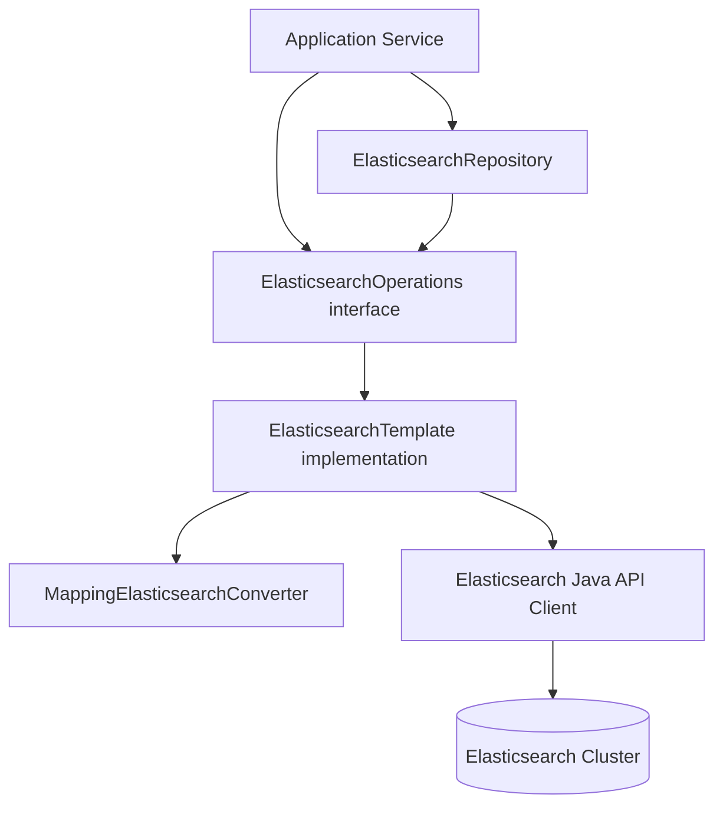
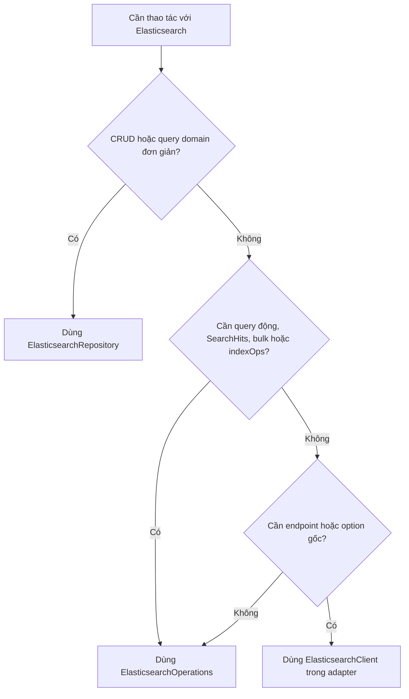

# Vai trò của ElasticsearchOperations và ElasticsearchTemplate

Trong Spring Data Elasticsearch, **`ElasticsearchOperations`** là API trung tâm để ứng dụng thao tác với document, truy vấn tìm kiếm và quản lý index. **`ElasticsearchTemplate`** là implementation cụ thể của abstraction này trong mô hình imperative (đồng bộ). Hai tên thường xuất hiện cùng nhau vì ứng dụng thường inject interface `ElasticsearchOperations`, còn Spring cung cấp một bean template thực hiện các thao tác đó.

Hiểu đúng vai trò của hai thành phần giúp tổ chức code rõ ràng: Repository phù hợp với CRUD và truy vấn domain đơn giản; `ElasticsearchOperations` phù hợp với truy vấn động, search result có metadata và thao tác index; `ElasticsearchTemplate` thực thi các lời gọi đó thông qua client Elasticsearch cùng cơ chế mapping của Spring Data.

## 1. Vị trí của Operations và Template trong kiến trúc

Spring Data Elasticsearch cung cấp nhiều mức API để ứng dụng làm việc với Elasticsearch:

- **Repository**: interface hướng domain, cung cấp CRUD và derived query theo tên phương thức.
- **`ElasticsearchOperations`**: interface thao tác ở mức Spring Data, cho phép lưu/đọc/xóa document, tìm kiếm, bulk operation và truy cập API index.
- **`ElasticsearchTemplate`**: implementation đồng bộ của `ElasticsearchOperations`, kết nối với Elasticsearch Java API Client và mapping infrastructure.
- **`ElasticsearchClient`**: Java API Client chính thức, cung cấp request builder và response model của Elasticsearch.

Sơ đồ khái quát:



Repository và Service không cần tự tạo HTTP request. Operations cung cấp API thống nhất cho ứng dụng, Template phối hợp mapping/conversion và client để gửi request đến Elasticsearch.

Trong một ứng dụng Spring Boot thông thường, Spring auto-configuration tạo các bean kết nối cần thiết. Ta inject `ElasticsearchOperations` qua constructor và để Spring cung cấp implementation tương ứng. Không cần tự `new ElasticsearchTemplate(...)` trong từng service.

## 2. `ElasticsearchOperations` là gì?

`ElasticsearchOperations` là interface thuộc Spring Data Elasticsearch, mô tả các thao tác phổ biến với Elasticsearch theo mô hình entity Java. Nó tách code nghiệp vụ khỏi chi tiết triển khai client và cung cấp một API nhất quán để làm việc với document.

Một số nhóm chức năng chính:

| Nhóm | Nhiệm vụ | Ví dụ API |
|---|---|---|
| Document | Lưu, đọc, xóa document | `save`, `get`, `delete`, `exists` |
| Search | Thực thi query và nhận kết quả | `search`, `searchOne`, `count` |
| Bulk | Gửi nhiều thao tác trong một request bulk | `bulkIndex`, `bulkUpdate`, `bulkDelete` tùy phiên bản |
| Index | Truy cập thao tác index theo entity hoặc tên index | `indexOps` |
| Mapping | Chuyển đổi giữa entity Java và JSON document | Được phối hợp qua converter và mapping metadata |
| Coordinates | Chỉ định index/alias đích cho thao tác | `IndexCoordinates` |

Operations giúp ứng dụng tập trung vào câu hỏi *muốn thao tác dữ liệu như thế nào*, thay vì tự xử lý request/response JSON, HTTP transport và mapping ở từng nơi.

### 2.1. Vì sao dùng interface?

Service nên phụ thuộc vào `ElasticsearchOperations` thay vì phụ thuộc trực tiếp vào class `ElasticsearchTemplate`:

```java
import org.springframework.data.elasticsearch.core.ElasticsearchOperations;
import org.springframework.stereotype.Service;

@Service
public class ProductSearchService {

    private final ElasticsearchOperations operations;

    public ProductSearchService(ElasticsearchOperations operations) {
        this.operations = operations;
    }
}
```

Lợi ích của cách khai báo này:

- Code nghiệp vụ chỉ phụ thuộc vào hợp đồng API của Spring Data.
- Có thể thay đổi cấu hình hoặc implementation mà không phải sửa từng service.
- Dễ thay bằng mock hoặc test double trong unit test.
- Tránh để chi tiết client, transport và converter lan ra nhiều package.
- Dễ đọc hơn khi cần phân biệt API đồng bộ với API reactive.

Nếu ứng dụng có nhiều bean `ElasticsearchOperations` cho nhiều cluster, cần dùng `@Qualifier` hoặc cấu hình bean chính phù hợp. Không nên dựa vào thứ tự Spring khởi tạo để chọn cluster.

## 3. `ElasticsearchTemplate` là gì?

`ElasticsearchTemplate` là class triển khai các thao tác imperative của `ElasticsearchOperations`. Nó kết nối phần API Spring Data với Elasticsearch Java API Client và các thành phần mapping/conversion.

Có thể hình dung trách nhiệm của Template qua các bước khi lưu một entity:

1. Nhận object Java và thông tin index đích.
2. Dùng mapping metadata và converter của Spring Data để chuyển entity thành document JSON.
3. Tạo request tương ứng thông qua Elasticsearch Java API Client.
4. Gửi request đến Elasticsearch cluster.
5. Nhận response và chuyển dữ liệu cần thiết về kiểu Java.

Khi tìm kiếm, Template thực hiện luồng ngược lại: nhận query, gửi request, đọc hits và chuyển `_source` thành entity, đồng thời giữ metadata tìm kiếm trong kiểu kết quả Spring Data.

Ở các phiên bản Spring Data Elasticsearch hiện đại, implementation `ElasticsearchTemplate` nằm trong module client dựa trên Elasticsearch Java API Client. Các lớp template cũ gắn với `RestHighLevelClient` thuộc thế hệ client trước; khi nâng cấp dự án, cần dùng đúng implementation và dependency tương thích với phiên bản Spring Boot/Spring Data đang chạy.

### 3.1. Không cần tạo Template thủ công trong service

Spring Boot thường tự cấu hình client, converter và bean operations khi starter Spring Data Elasticsearch có mặt trên classpath và cấu hình kết nối hợp lệ. Ví dụ cấu hình URI:

```yaml
spring:
  elasticsearch:
    uris: ${ELASTICSEARCH_URIS:http://localhost:9200}
```

Sau đó inject interface:

```java
@Service
public class ProductService {

    private final ElasticsearchOperations operations;

    public ProductService(ElasticsearchOperations operations) {
        this.operations = operations;
    }
}
```

Nếu cần tùy chỉnh client, converter hoặc nhiều cluster, hãy cấu hình ở tầng Spring configuration theo API của phiên bản dự án. Đừng khởi tạo client/Template mới mỗi lần gọi method; client và transport cần được tái sử dụng và quản lý vòng đời bởi Application Context.

## 4. Mapping và conversion là phần quan trọng của Operations

Một ưu điểm của `ElasticsearchOperations` so với gọi client trực tiếp là nó tích hợp mapping infrastructure của Spring Data. Entity có thể khai báo bằng annotation:

```java
package com.example.catalog.product.document;

import org.springframework.data.annotation.Id;
import org.springframework.data.elasticsearch.annotations.Document;
import org.springframework.data.elasticsearch.annotations.Field;
import org.springframework.data.elasticsearch.annotations.FieldType;

@Document(indexName = "products")
public class ProductDocument {

    @Id
    private String id;

    @Field(type = FieldType.Keyword)
    private String sku;

    @Field(type = FieldType.Text)
    private String name;

    @Field(type = FieldType.Keyword)
    private String category;

    @Field(type = FieldType.Double)
    private Double price;

    protected ProductDocument() {
    }

    public ProductDocument(
            String id,
            String sku,
            String name,
            String category,
            Double price) {
        this.id = id;
        this.sku = sku;
        this.name = name;
        this.category = category;
        this.price = price;
    }

    public String getId() {
        return id;
    }

    public String getSku() {
        return sku;
    }

    public String getName() {
        return name;
    }

    public String getCategory() {
        return category;
    }

    public Double getPrice() {
        return price;
    }
}
```

Các annotation mô tả metadata cho mapping:

- `@Document` liên kết entity với index.
- `@Id` đánh dấu thuộc tính tương ứng với `_id`.
- `@Field` khai báo kiểu field như `text`, `keyword`, `double`, `date`.

Khi gọi `operations.save(product)`, converter đọc metadata này để chuyển object thành document. Khi đọc kết quả search, converter dùng metadata và custom conversion đã cấu hình để tạo lại object Java.

### 4.1. `MappingElasticsearchConverter`

Trong Spring Data Elasticsearch, `MappingElasticsearchConverter` là thành phần chịu trách nhiệm chuyển đổi giữa đối tượng Java và cấu trúc document Elasticsearch. Nó sử dụng mapping context, entity metadata, annotation và custom conversions.

Converter có thể xử lý:

- Thuộc tính ID và field metadata.
- Kiểu ngày giờ và các kiểu dữ liệu Java phổ biến.
- Nested object và collection theo mapping.
- Custom conversions khi kiểu Java cần biểu diễn khác trong JSON.
- Tên field và các quy tắc mapping đã khai báo.

Điều này có nghĩa code dùng Operations không cần tự viết `ObjectMapper.writeValueAsString(...)` cho từng entity. Tuy nhiên, JSON cuối cùng vẫn phải tương thích với mapping thực tế của index.

### 4.2. Khi nào cần custom conversion?

Nếu domain model có kiểu riêng, ví dụ `Money`, `EmailAddress` hoặc một kiểu ID nghiệp vụ, có thể cần custom converter để xác định cách ghi/đọc field. Nên khai báo conversion tại cấu hình Spring Data phù hợp để tất cả thao tác thông qua Operations dùng cùng quy tắc.

Không nên chỉ chuyển đổi trong một service nếu cùng entity được đọc/ghi từ nhiều Repository hoặc Operations khác nhau. Conversion nhất quán giúp tránh trường hợp một đường ghi lưu chuỗi nhưng một đường đọc lại kỳ vọng object khác.

## 5. Thao tác document bằng `ElasticsearchOperations`

Operations cung cấp các method cho những thao tác document phổ biến. Ví dụ một service lưu và tìm sản phẩm:

```java
package com.example.catalog.product.service;

import org.springframework.data.elasticsearch.core.ElasticsearchOperations;
import org.springframework.stereotype.Service;

import com.example.catalog.product.document.ProductDocument;

@Service
public class ProductDocumentService {

    private final ElasticsearchOperations operations;

    public ProductDocumentService(ElasticsearchOperations operations) {
        this.operations = operations;
    }

    public ProductDocument save(ProductDocument product) {
        return operations.save(product);
    }

    public ProductDocument findById(String id) {
        return operations.get(id, ProductDocument.class);
    }

    public String deleteById(String id) {
        return operations.delete(id, ProductDocument.class);
    }
}
```

Các thao tác tương ứng:

| Method | Mục đích |
|---|---|
| `save(entity)` | Index document theo metadata entity và ID. |
| `get(id, entityClass)` | Lấy document theo `_id`, chuyển thành entity Java. |
| `delete(id, entityClass)` | Xóa document theo ID và index gắn với entity. |
| `exists(id, entityClass)` | Kiểm tra document theo ID nếu API phiên bản đang dùng cung cấp overload này. |
| `count(query, entityClass)` | Đếm document khớp điều kiện query. |

Kiểu trả về và các overload cụ thể phụ thuộc phiên bản Spring Data Elasticsearch. Hãy xem Javadoc của dependency đang dùng khi cần một chữ ký method chính xác.

### 5.1. Phân biệt `save` với insert-only

`save` thường thực hiện index document theo ID. Nếu ID đã tồn tại, nội dung document có thể được ghi đè theo semantics của Index API. Vì vậy, không nên mặc định `save` tương đương SQL `INSERT` luôn từ chối khóa trùng.

Nếu nghiệp vụ yêu cầu tạo mới nhưng không cho phép ghi đè document đã tồn tại, cần chọn thao tác create-only/optimistic concurrency phù hợp và xử lý xung đột. Không nên chỉ gọi `get` rồi `save` để bảo đảm duy nhất trong tình huống nhiều request đồng thời.

### 5.2. Dùng `IndexCoordinates` khi cần chỉ định index

Mặc định Operations có thể lấy index từ `@Document` của entity. Khi muốn thao tác qua alias hoặc index cụ thể, dùng `IndexCoordinates`:

```java
import org.springframework.data.elasticsearch.core.mapping.IndexCoordinates;

IndexCoordinates productsWrite = IndexCoordinates.of("products-write");

ProductDocument saved = operations.save(product, productsWrite);
```

Điều này hữu ích khi ứng dụng dùng alias để rollover hoặc cần ghi cùng một kiểu entity vào index theo tenant/phiên bản. Với read path, có thể chỉ định alias đọc:

```java
SearchHits<ProductDocument> hits = operations.search(
    query,
    ProductDocument.class,
    IndexCoordinates.of("products-read")
);
```

Tên alias và mapping phải được provision trước nếu ứng dụng đặt `createIndex = false`. Không để Operations tự tạo index mang tên alias trong khi hạ tầng chưa thiết lập alias tương ứng.

## 6. Truy vấn với `ElasticsearchOperations`

Một trong những lý do chính để dùng Operations là khả năng xây dựng query linh hoạt. Spring Data Elasticsearch cung cấp nhiều loại `Query`:

| Loại query | Mục đích | Khi nên dùng |
|---|---|---|
| `CriteriaQuery` | Xây điều kiện theo kiểu Criteria | Điều kiện đơn giản, có thể ghép theo field và toán tử. |
| `StringQuery` | Truyền Query DSL dưới dạng JSON string | Query JSON nhỏ, cố định hoặc được lưu ở resource. |
| `NativeQuery` | Xây Query DSL bằng builder có kiểu của Elasticsearch Java API Client | Query phức tạp, bool/nested/aggregation và option Elasticsearch cụ thể. |

Các query đều được thực thi qua Operations:

```java
SearchHits<ProductDocument> hits = operations.search(
    query,
    ProductDocument.class
);
```

### 6.1. `NativeQuery` cho full-text search

Ví dụ tìm sản phẩm có tên khớp với từ `wireless`:

```java
import org.springframework.data.domain.PageRequest;
import org.springframework.data.elasticsearch.client.elc.NativeQuery;
import org.springframework.data.elasticsearch.core.SearchHits;
import org.springframework.data.elasticsearch.core.query.Query;

public SearchHits<ProductDocument> searchByName(String text) {
    Query query = NativeQuery.builder()
        .withQuery(q -> q
            .match(match -> match
                .field("name")
                .query(text)
            )
        )
        .withPageable(PageRequest.of(0, 20))
        .build();

    return operations.search(query, ProductDocument.class);
}
```

`NativeQuery` sử dụng builder có kiểu từ Elasticsearch Java API Client. Spring Data vẫn nhận kết quả và chuyển `_source` thành `ProductDocument` thông qua converter.

### 6.2. Kết hợp điều kiện `must` và `filter`

Màn hình tìm kiếm có thể cần match theo tên và lọc chính xác theo danh mục:

```java
import co.elastic.clients.elasticsearch._types.FieldValue;
import org.springframework.data.elasticsearch.client.elc.NativeQuery;
import org.springframework.data.elasticsearch.core.SearchHits;
import org.springframework.data.elasticsearch.core.query.Query;

public SearchHits<ProductDocument> search(String text, String category) {
    Query query = NativeQuery.builder()
        .withQuery(q -> q
            .bool(b -> b
                .must(m -> m
                    .match(match -> match
                        .field("name")
                        .query(text)
                    )
                )
                .filter(f -> f
                    .term(term -> term
                        .field("category")
                        .value(FieldValue.of(category))
                    )
                )
            )
        )
        .build();

    return operations.search(query, ProductDocument.class);
}
```

Trong ví dụ:

- `must` chứa điều kiện full-text và có thể ảnh hưởng relevance score.
- `filter` chứa điều kiện chính xác, không tham gia tính score.
- `name` là `text`, phù hợp với `match`.
- `category` là `keyword`, phù hợp với `term`.

Query DSL được xây dựng bởi Java API Client, nhưng kết quả vẫn đi qua Spring Data Operations và mapping converter.

### 6.3. `StringQuery` khi đã có JSON DSL

Với một query JSON nhỏ, có thể dùng `StringQuery`:

```java
import org.springframework.data.elasticsearch.core.query.Query;
import org.springframework.data.elasticsearch.core.query.StringQuery;

Query query = new StringQuery("""
    {
      "range": {
        "price": {
          "gte": 100,
          "lte": 500
        }
      }
    }
    """);

SearchHits<ProductDocument> hits = operations.search(
    query,
    ProductDocument.class
);
```

`StringQuery` thuận tiện khi query JSON đã có sẵn, nhưng cần giữ chuỗi JSON hợp lệ và đồng bộ tên field với mapping. Nếu query cần lắp ghép động từ nhiều tham số, `NativeQuery` hoặc `CriteriaQuery` thường dễ kiểm soát hơn.

## 7. Đọc `SearchHits` và metadata của kết quả

Operations không chỉ trả về danh sách entity. Với `search`, kết quả thường là `SearchHits<T>`, trong đó mỗi hit chứa nội dung và metadata tìm kiếm.

```java
SearchHits<ProductDocument> hits = operations.search(
    query,
    ProductDocument.class
);

for (SearchHit<ProductDocument> hit : hits) {
    ProductDocument product = hit.getContent();
    float score = hit.getScore();

    System.out.println(product.getName() + " - score=" + score);
}
```

Một số thông tin thường có thể lấy từ kết quả:

- Entity đã được chuyển đổi từ `_source`.
- Relevance score của từng hit.
- Tổng số hit theo response và thông tin phân trang.
- Highlight fields nếu query yêu cầu highlight.
- Sort values và metadata của từng hit.
- Aggregations hoặc thông tin bổ sung được trả về theo loại query và phiên bản.

Điều này quan trọng với search UI. Nếu chỉ chuyển `SearchHits` thành `List<ProductDocument>` quá sớm, ứng dụng có thể làm mất score, highlight hoặc metadata mà giao diện cần.

## 8. Bulk operation và thao tác số lượng lớn

Khi cần ghi nhiều document, gửi từng lệnh `save` có thể tạo nhiều request riêng. Operations cung cấp các API bulk để gom nhiều thao tác vào một request, giảm overhead mạng và tận dụng cơ chế bulk của Elasticsearch.

Các trường hợp thường gặp:

- Import dữ liệu ban đầu.
- Đồng bộ danh mục sản phẩm từ hệ thống khác.
- Cập nhật hàng loạt field.
- Xóa một nhóm document theo điều kiện.

Bulk API có thể trả trạng thái thành công/thất bại theo từng item. Một bulk request tổng thể được Elasticsearch tiếp nhận không có nghĩa mọi document đều thành công. Ứng dụng cần kiểm tra kết quả từng item, phân loại lỗi có thể retry và tránh retry mù quáng các lỗi mapping hoặc validation.

Khi dữ liệu rất lớn, nên chia batch theo kích thước payload và đo thời gian xử lý, heap usage, throughput. Batch quá nhỏ làm tăng số request; batch quá lớn có thể gây áp lực bộ nhớ và timeout.

## 9. Quản lý index qua `indexOps`

Operations còn cung cấp điểm truy cập đến `IndexOperations`:

```java
import org.springframework.data.elasticsearch.core.IndexOperations;

IndexOperations indexOperations = operations.indexOps(ProductDocument.class);

if (!indexOperations.exists()) {
    indexOperations.createWithMapping();
}
```

`IndexOperations` hỗ trợ các thao tác index như:

- Kiểm tra index tồn tại.
- Tạo index và mapping từ metadata entity.
- Đọc mapping và settings.
- Cập nhật mapping trong phạm vi Elasticsearch cho phép.
- Xóa index.
- Refresh index khi use case cần điều khiển thời điểm dữ liệu xuất hiện trong search.

Nếu chỉ định index bằng tên hoặc alias:

```java
IndexOperations indexOperations = operations.indexOps(
    IndexCoordinates.of("products-read")
);
```

Quản lý index trong production nên được thực hiện qua migration/provisioning có kiểm soát. Không nên để nhiều instance ứng dụng tự tạo hoặc xóa index đồng thời khi khởi động.

## 10. So sánh Repository, Operations và Template

Ba thành phần này có liên hệ nhưng không thay thế nhau hoàn toàn:

| Tiêu chí | Repository | `ElasticsearchOperations` | `ElasticsearchTemplate` |
|---|---|---|---|
| Loại API | Interface theo domain | Interface thao tác dữ liệu tổng quát | Class implementation cụ thể |
| Mức trừu tượng | Cao | Trung bình | Chi tiết triển khai của Spring Data |
| CRUD | Rất tiện | Linh hoạt | Thực thi các method Operations |
| Query động | Derived query, `@Query`, fragment | Criteria/Native/String query | Xử lý query do Operations nhận |
| Search metadata | Tùy kiểu trả về Repository | `SearchHits` và metadata | Thực thi và ánh xạ response |
| Mapping entity | Spring Data converter | Spring Data converter | Phối hợp converter và client |
| Quản lý index | Không phải mục đích chính | Qua `indexOps` | Cung cấp implementation cho API index |
| Phụ thuộc trong service | Interface Repository | Interface Operations | Không cần phụ thuộc trực tiếp trong phần lớn service |

Một quy tắc thực tế:

- Dùng Repository cho CRUD và truy vấn domain ngắn gọn.
- Dùng Operations khi cần query động, `SearchHits`, bulk hoặc index operations.
- Để Spring cung cấp Template implementation; chỉ cấu hình hoặc tham chiếu class cụ thể khi có yêu cầu hạ tầng rõ ràng.

## 11. Khi nào dùng `ElasticsearchTemplate` trực tiếp?

Trong ứng dụng thông thường, inject `ElasticsearchOperations` là đủ. Có thể có tình huống cần cấu hình implementation cụ thể, ví dụ tự tạo bean cho nhiều cluster hoặc cấu hình converter riêng. Khi đó, class `ElasticsearchTemplate` có thể được khai báo ở tầng configuration tương ứng với phiên bản Spring Data Elasticsearch.

Ví dụ khái niệm:

```java
@Configuration
public class ElasticsearchConfiguration {

    // Khai báo ElasticsearchClient, converter và bean
    // ElasticsearchOperations/ElasticsearchTemplate theo phiên bản dự án.
}
```

Không nên sao chép constructor của Template từ tài liệu thuộc phiên bản khác. Các tham số constructor và cách tạo client thay đổi theo thế hệ Elasticsearch Java Client, transport và Spring Data. Hãy để Spring Boot auto-configuration tạo bean nếu không có yêu cầu tùy chỉnh.

Nếu cần gọi API gốc chưa được Operations hỗ trợ, inject `ElasticsearchClient` trong một adapter chuyên trách. Không cần cast `ElasticsearchOperations` sang `ElasticsearchTemplate` chỉ để lấy client hoặc truy cập một endpoint đặc thù.

## 12. Reactive Operations và Reactive Template

Spring Data Elasticsearch còn có API reactive cho ứng dụng dùng reactive stack:

- `ReactiveElasticsearchOperations` là abstraction reactive.
- `ReactiveElasticsearchTemplate` là implementation reactive tương ứng.
- Các method thường trả về `Mono<T>`, `Flux<T>` hoặc kiểu reactive phù hợp thay vì chặn thread để chờ kết quả.

Ví dụ service reactive:

```java
import org.springframework.data.elasticsearch.core.ReactiveElasticsearchOperations;
import org.springframework.stereotype.Service;
import reactor.core.publisher.Mono;

@Service
public class ReactiveProductService {

    private final ReactiveElasticsearchOperations operations;

    public ReactiveProductService(ReactiveElasticsearchOperations operations) {
        this.operations = operations;
    }

    public Mono<ProductDocument> save(ProductDocument product) {
        return operations.save(product);
    }
}
```

Không nên gọi API blocking của `ElasticsearchOperations` trong reactive event loop rồi kỳ vọng ứng dụng vẫn non-blocking. Nếu toàn bộ đường xử lý dùng Reactor/WebFlux, hãy dùng reactive operations và reactive client được cấu hình phù hợp. Ngược lại, ứng dụng Spring MVC imperative có thể dùng `ElasticsearchOperations` đồng bộ.

Reactive không tự động làm truy vấn Elasticsearch nhanh hơn. Nó thay đổi mô hình sử dụng thread và composition của tác vụ I/O. Cần giữ toàn bộ luồng xử lý nhất quán để tránh blocking ở giữa pipeline reactive.

## 13. Kiểm thử code phụ thuộc Operations

Vì service nhận `ElasticsearchOperations` qua constructor, có thể unit test service bằng mock mà không cần chạy Elasticsearch. Ví dụ kiểm thử method lưu:

```java
import static org.junit.jupiter.api.Assertions.assertSame;
import static org.mockito.Mockito.verify;
import static org.mockito.Mockito.when;

import org.junit.jupiter.api.Test;
import org.junit.jupiter.api.extension.ExtendWith;
import org.mockito.InjectMocks;
import org.mockito.Mock;
import org.mockito.junit.jupiter.MockitoExtension;

import org.springframework.data.elasticsearch.core.ElasticsearchOperations;

@ExtendWith(MockitoExtension.class)
class ProductDocumentServiceTest {

    @Mock
    private ElasticsearchOperations operations;

    @InjectMocks
    private ProductDocumentService service;

    @Test
    void saveDelegatesToOperations() {
        ProductDocument product = new ProductDocument(
            "p-1001", "SKU-1001", "Wireless Headphones", "audio", 129.90
        );
        when(operations.save(product)).thenReturn(product);

        ProductDocument saved = service.save(product);

        assertSame(product, saved);
        verify(operations).save(product);
    }
}
```

Unit test này kiểm tra Service gọi đúng abstraction và trả kết quả theo hợp đồng. Nó không xác nhận mapping, kết nối, query DSL hay hành vi thật của Elasticsearch.

Đối với phần mapping/query, nên có integration test với Elasticsearch instance tương thích để kiểm tra:

- Index và mapping được tạo đúng.
- Entity được chuyển thành `_source` đúng định dạng.
- Query trả đúng document.
- Search metadata như score/highlight được ánh xạ đúng.
- Alias và index coordinates hoạt động như cấu hình.

## 14. Những lỗi thường gặp

| Hiện tượng | Nguyên nhân cần kiểm tra |
|---|---|
| Không inject được `ElasticsearchOperations` | Thiếu starter, auto-configuration không chạy hoặc bean client/converter cấu hình lỗi. |
| Có nhiều bean Operations | Ứng dụng cấu hình nhiều cluster nhưng chưa dùng `@Qualifier` hoặc `@Primary`. |
| `save` ghi sai index | `@Document(indexName=...)` hoặc `IndexCoordinates` trỏ sai index/alias. |
| Field trong `_source` sai tên hoặc kiểu | Annotation mapping hoặc custom conversion không đúng. |
| Search trả entity nhưng thiếu score/highlight | Tầng service đã chuyển `SearchHits` thành entity list quá sớm. |
| Query chạy nhưng không có kết quả | Mapping index không phù hợp với query, tên field sai hoặc dữ liệu chưa refresh. |
| Bulk request báo lỗi dù HTTP thành công | Một hoặc nhiều item trong bulk response thất bại; cần kiểm tra từng item. |
| Reactive pipeline bị chậm hoặc nghẽn | Có lời gọi blocking trong event loop hoặc dùng nhầm imperative operations. |
| Template không tương thích sau nâng cấp | Trộn client thế hệ cũ với Spring Data/Spring Boot phiên bản mới. |

Khi chẩn đoán, xác định lỗi nằm ở bean configuration, mapping/conversion, request/query hay cluster response. Không nên xử lý mọi lỗi bằng cách tạo client mới trong service.

## 15. Quy trình chọn API cho một use case



Quy trình lựa chọn:

1. Xác định use case cần lưu, đọc, tìm kiếm hay quản lý index.
2. Nếu Repository diễn đạt rõ nghiệp vụ, dùng Repository.
3. Nếu cần query động hoặc metadata tìm kiếm, dùng `ElasticsearchOperations`.
4. Để `ElasticsearchTemplate` thực thi Operations thông qua cấu hình Spring.
5. Chỉ gọi `ElasticsearchClient` trực tiếp khi cần endpoint hoặc option chưa được abstraction cung cấp.
6. Nếu ứng dụng reactive, dùng `ReactiveElasticsearchOperations` và giữ pipeline non-blocking.

## 16. Kết luận

`ElasticsearchOperations` là abstraction thao tác Elasticsearch ở mức Spring Data. Nó cung cấp API cho document CRUD, query, search result, bulk và quản lý index. `ElasticsearchTemplate` là implementation imperative thực thi các thao tác đó bằng Elasticsearch Java API Client và mapping/conversion infrastructure của Spring Data.

Trong service, nên inject `ElasticsearchOperations` để giảm phụ thuộc vào class triển khai. Dùng Repository cho CRUD đơn giản, Operations cho query và thao tác linh hoạt, còn Template thường do Spring Boot/Spring Data quản lý. Với ứng dụng reactive, dùng cặp `ReactiveElasticsearchOperations` và `ReactiveElasticsearchTemplate`.

Khi hiểu rõ ranh giới này, code nghiệp vụ có thể sử dụng mapping, query và search metadata của Spring Data mà không phải tự quản lý request/response ở mọi nơi. Những endpoint đặc thù vẫn có thể được gọi qua Elasticsearch Java API Client trong adapter riêng, trong khi phần còn lại của ứng dụng giữ được cấu trúc dễ đọc và dễ kiểm thử.
